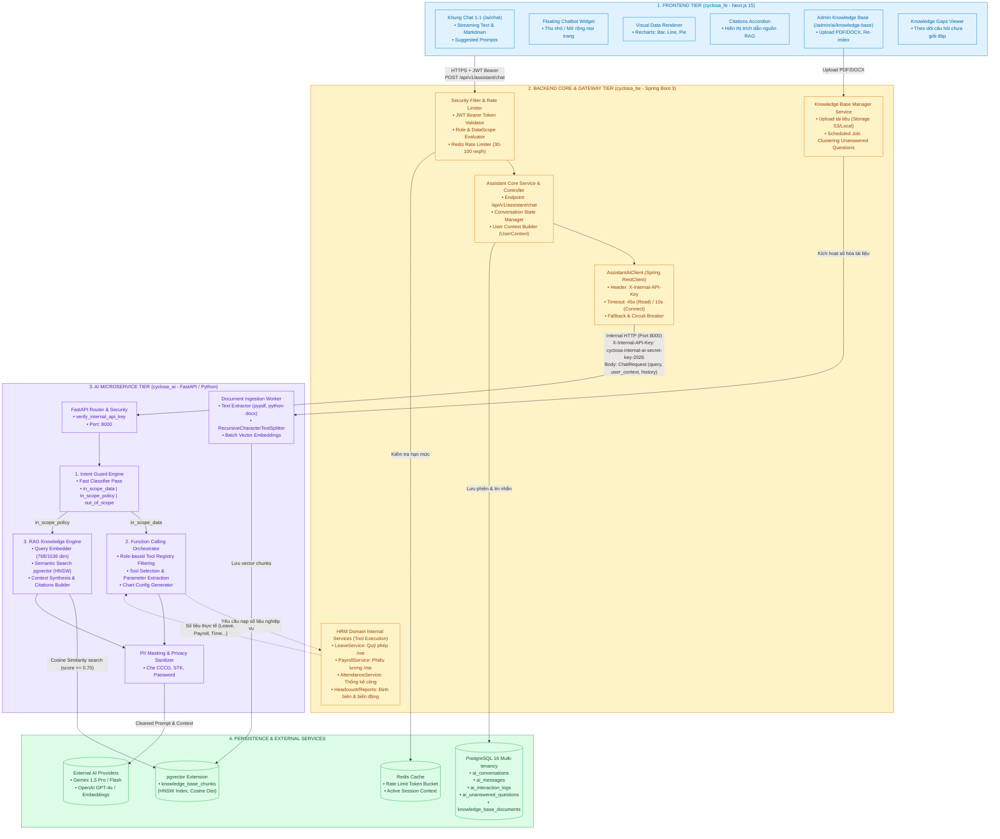
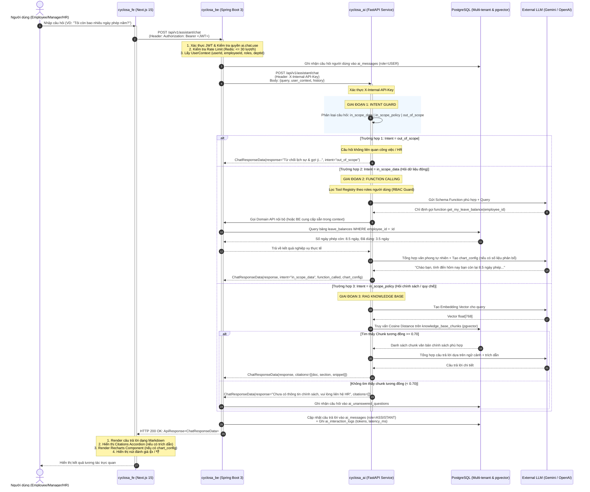
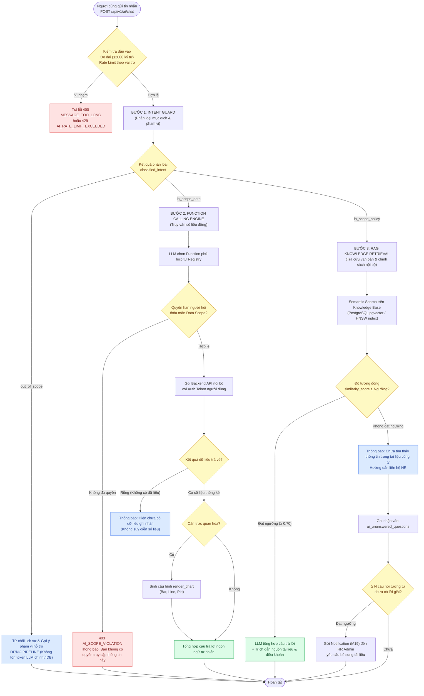

# ĐẶC TẢ CHI TIẾT VÀ KIẾN TRÚC TRIỂN KHAI MODULE 18: TRỢ LÝ AI (AI 1-1 ASSISTANT & CHATBOT)

> **Tài liệu căn cứ & tham chiếu:**
> - Nghiệp vụ chi tiết: [`docs/Nghiep-vu.docx`](file:///f:/Project/CYCLOSA/docs/Nghiep-vu.docx) (§18: AI 1-1 Assistant / Trợ lý)
> - Quy tắc nghiệp vụ tính năng AI: [`docs/HRM-AI-Features-Business-Rules.md`](file:///f:/Project/CYCLOSA/docs/HRM-AI-Features-Business-Rules.md) (Quy ước chung, Intent Guard, Function Calling, RAG)
> - Thiết kế CSDL & Data Dictionary: [`docs/database.md`](file:///f:/Project/CYCLOSA/docs/database.md) (§8.19 Module 18 — TRỢ LÝ AI)
> - Danh mục API chuẩn: [`docs/api-list.md`](file:///f:/Project/CYCLOSA/docs/api-list.md) (Nhóm 18 Trợ lý AI — Chat, Knowledge Base, Feedback)
> - Phân quyền RBAC & DataScope: [`docs/ba/module-phan-quyen.md`](file:///f:/Project/CYCLOSA/docs/ba/module-phan-quyen.md) (Permissions `ai.chat.use`, `ai.chat.query_team_data`, `ai.chat.query_company_data`, `ai.knowledge_base.manage`)

---

## 1. PHÂN TÍCH ĐẶC TẢ NGHIỆP VỤ & NGUYÊN TẮC CỐT LÕI

### 1.1. Mục tiêu và Sứ mệnh của AI Assistant trong CYCLOSA HRM
Trong môi trường doanh nghiệp hiện đại, người lao động và nhà quản lý thường mất nhiều thời gian để tra cứu quy chế, tìm kiếm biểu mẫu hoặc điều hướng qua nhiều phân hệ phức tạp để xem số liệu cá nhân.

**Module 18 (AI 1-1 Assistant / Chatbot)** được tích hợp vào hệ thống CYCLOSA HRM với vai trò là **"Trợ lý nhân sự ảo 24/7"**, cho phép:
1. **Hỏi đáp dữ liệu động (Dynamic Data Querying):** Tra cứu ngày phép còn lại, phiếu lương, tình hình chấm công, biến động nhân sự, chi phí lương bằng ngôn ngữ tự nhiên thông qua **Function Calling** kết nối trực tiếp với các module nghiệp vụ.
2. **Hỏi đáp chính sách & quy chế nội bộ (Policy Q&A):** Giải đáp nhanh chóng các thắc mắc về nội quy lao động, chính sách phúc lợi, quy trình phê duyệt, sổ tay nhân viên thông qua mô hình **RAG (Retrieval-Augmented Generation)** kèm trích dẫn văn bản chính thức.
3. **Trực quan hóa số liệu (Data Visualization):** Tự động đề xuất và dựng biểu đồ trực quan (`render_chart`: cột, đường, tròn) khi câu trả lời chứa dữ liệu thống kê.
4. **Học hỏi và hoàn thiện tri thức (Knowledge Gap Discovery):** Tự động phát hiện các câu hỏi mà chatbot chưa trả lời được, gom nhóm và thông báo cho ban Nhân sự (HR Admin) để cập nhật tài liệu vào Kho tri thức.

---

### 1.2. Tám nguyên tắc kiến trúc bất di bất dịch (Guiding Principles)
Theo tài liệu đặc tả nghiệp vụ `Nghiep-vu.docx` (§18.1) và `HRM-AI-Features-Business-Rules.md`:

1. **AI hỗ trợ, không thay thế quyết định con người:** AI không bao giờ tự ý đưa ra quyết định sa thải, kỷ luật, tăng/giảm lương hoặc thay đổi trạng thái hồ sơ của người lao động.
2. **Tuyệt đối tuân thủ RBAC & Data Scope (No Privilege Escalation):**
   * Chatbot không phải là "cửa sau" để vượt quyền. Mọi thao tác truy vấn dữ liệu động đều mang theo định danh người dùng (`user_id`), đơn vị công tác (`company_id`, `department_id`) và vai trò được phân quyền.
   * Nhân viên bình thường chỉ được hỏi về dữ liệu của chính mình (ngày phép của tôi, phiếu lương của tôi). Nếu nhân viên hỏi "Tổng chi phí lương toàn công ty tháng trước là bao nhiêu?", hệ thống lập tức từ chối và thông báo không đủ thẩm quyền.
3. **Chống ảo giác triệt để (Zero Hallucination Guarantee):**
   * Nếu Function Calling trả về dữ liệu rỗng: Trả lời *"Hiện chưa có dữ liệu cho khoảng thời gian này"*, tuyệt đối không tự bịa số liệu.
   * Nếu RAG không tìm thấy văn bản phù hợp: Trả lời *"Hiện tôi chưa tìm thấy thông tin trong chính sách công ty về vấn đề này, bạn vui lòng liên hệ trực tiếp bộ phận HR"*, tuyệt đối không tự suy diễn chính sách.
4. **Ghi vết kiểm toán toàn diện (Comprehensive Audit Logging):** Lưu trữ toàn bộ câu hỏi, câu trả lời, function đã gọi, tài liệu được trích dẫn, mã model, độ trễ xử lý (`latency_ms`) và lượng token tiêu thụ (`token_usage`) phục vụ giám sát và giải trình.
5. **Cơ chế dự phòng khi AI lỗi (Graceful Fallback):** Khi AI service gặp sự cố, timeout hoặc hết hạn mức token, hệ thống hiển thị thông báo lỗi thân thiện và hướng dẫn người dùng chuyển sang thao tác trực tiếp trên các màn hình chức năng truyền thống.
6. **Kiểm soát chi phí & Rate Limiting:** Thiết lập hạn mức số lượt hỏi trong một khoảng thời gian theo vai trò (ví dụ: Nhân viên tối đa 30 lượt/giờ, Quản lý/HR tối đa 100 lượt/giờ) nhằm ngăn ngừa lạm dụng chi phí API token.
7. **Bảo mật dữ liệu cá nhân & Tôn trọng quyền riêng tư (Privacy & Consent):** Dữ liệu trao đổi nhạy cảm (phiếu lương, đánh giá vi phạm) không được dùng để huấn luyện model công cộng ngoài biên giới tenant.
8. **Đánh giá phản hồi 2 chiều (User Feedback Loop):** Người dùng có quyền đánh giá câu trả lời là "Hữu ích" (Helpful) hoặc "Không hữu ích" (Not Helpful) để đội ngũ quản trị nâng cao độ chuẩn xác.

---

## 2. TỔNG QUAN KIẾN TRÚC HỆ THỐNG 3 TẦNG (CYCLOSA_FE - CYCLOSA_BE - CYCLOSA_AI)

Hệ thống Module 18 (AI Assistant & Chatbot) được thiết kế theo mô hình phân tầng hướng dịch vụ (Service-Oriented 3-Tier Architecture) nhằm đảm bảo tính độc lập, khả năng mở rộng (scalability), an toàn thông tin tối đa và tuân thủ chặt chẽ ranh giới bảo mật đa khách thuê (Multi-tenancy).

Ba thành phần cốt lõi của hệ thống gồm có:
1. **`cyclosa_fe` (Frontend Presentation Tier):** Ứng dụng Next.js 15 (React 19, TypeScript, Tailwind CSS, shadcn/ui, Recharts) chịu trách nhiệm hiển thị giao diện hội thoại thời gian thực, điều hướng lịch sử, trích dẫn tri thức và trực quan hóa số liệu.
2. **`cyclosa_be` (Core Backend & Gateway Tier):** Ứng dụng Spring Boot 3 (Java 21, Spring Security, JPA/Hibernate, Redis) đóng vai trò là "Cổng bảo vệ duy nhất" (Single Gateway of Truth), quản lý xác thực JWT, kiểm soát quyền hạn RBAC & DataScope, rate limiting, lưu vết CSDL và trung gian điều phối lệnh.
3. **`cyclosa_ai` (AI Microservice Tier):** Ứng dụng Python 3.10 (FastAPI, LangChain, pgvector, Pydantic) chuyên trách toàn bộ tác vụ AI chuyên sâu: Intent Guard phân loại ý định, Function Calling Tool Registry, Semantic Search RAG qua pgvector, làm sạch PII và giao tiếp với External LLMs.

---

### 2.1. Sơ đồ phân rã kiến trúc 3 tầng (3-Tier Component Architecture)



---

### 2.2. Sơ đồ tuần tự tương tác toàn trình (End-to-End Sequence Diagram)

Dưới đây là luồng xử lý chi tiết từ khi người dùng đặt câu hỏi trên giao diện đến khi nhận được câu trả lời kèm biểu đồ hoặc trích dẫn chính sách:



---

### 2.3. Bảng phân định trách nhiệm chi tiết (Responsibility Matrix - RACI)

Để ngăn ngừa việc chồng chéo logic nghiệp vụ, các trách nhiệm được phân định tuyệt đối giữa 3 cấu phần theo bảng dưới đây:

| Hạng mục nhiệm vụ | Frontend (`cyclosa_fe`) | Backend Core (`cyclosa_be`) | AI Service (`cyclosa_ai`) | Ghi chú kiến trúc & Ranh giới an toàn |
|---|---|---|---|---|
| **1. Xác thực & Danh tính (Auth & Identity)** | Thu thập JWT từ Cookie/LocalStorage; đính kèm header `Authorization: Bearer <JWT>` trên mọi request. | Giải mã JWT, trích xuất `userId`, `companyId`, nạp `SecurityContext`, phân rã roles và quyền hạn. | **Không** xử lý JWT người dùng. Chỉ xác thực khóa nội bộ bí mật `X-Internal-API-Key`. | Bảo vệ `cyclosa_ai` không bị lộ ra Internet công cộng. Mọi truy cập bắt buộc qua `cyclosa_be`. |
| **2. Kiểm soát Phân quyền (RBAC & DataScope)** | Ẩn/hiện các nút thao tác nâng cao (Re-index, Knowledge Base Management, Chat gợi ý số liệu quản lý). | Kiểm tra quyền hạn (`ai.chat.use`, `ai.chat.query_team_data`, `ai.chat.query_company_data`) và lọc dữ liệu đúng Tenant (`company_id`). | Lọc danh sách function tools theo mảng `roles` trong `user_context` trước khi gửi cho LLM. | Đảm bảo nguyên tắc Zero Privilege Escalation: LLM không biết các hàm vượt quyền của người hỏi. |
| **3. Kiểm soát tần suất (Rate Limiting)** | Hiển thị cảnh báo hoặc disable ô input khi nhận lỗi HTTP 429; đếm ngược thời gian hồi lượt hỏi. | Thực thi Rate Limiter qua Redis/Bucket4j (30 req/h cho Employee, 100 req/h cho Manager/HR). Chặn ngay khi vượt ngưỡng. | **Không** quản lý hạn mức người dùng (chỉ xử lý nghiệp vụ AI khi nhận request hợp lệ từ BE). | Giảm tải cho AI service và bảo vệ hạn mức chi phí token API nhà cung cấp LLM. |
| **4. Quản lý Phiên & Lưu vết CSDL (Persistence)** | Quản lý active `conversation_id`, state tin nhắn local, optimistic UI cập nhật tin nhắn. | Quản lý bảng `ai_conversations`, lưu vết từng tin nhắn vào `ai_messages`, ghi log kiểm toán vào `ai_interaction_logs`. | Stateless hoàn toàn. Nhận `conversation_history` qua request payload và trả kết quả tính toán. | `cyclosa_ai` không lưu trữ trạng thái người dùng (Stateless) giúp mở rộng ngang (horizontal scale) dễ dàng. |
| **5. Phân loại Ý định (Intent Guard)** | Hiển thị gợi ý mẫu câu hỏi (Prompt Suggestions) theo nhóm vai trò nghiệp vụ. | Bổ sung ngữ cảnh phòng ban & vai trò vào `UserContext` trước khi chuyển sang AI. | Chạy bộ lọc phân loại 3 hướng: `in_scope_data`, `in_scope_policy`, `out_of_scope`. Từ chối nhanh nếu ngoài phạm vi. | Tiết kiệm token: Câu hỏi ngoài phạm vi dừng ngay tại bước này, không gọi LLM nặng và không query RAG. |
| **6. Điều phối Hàm số liệu (Function Calling)** | Nhận `function_called`, `chart_config` từ response và vẽ biểu đồ Recharts tương ứng. | Cung cấp các domain API nghiệp vụ nội bộ (`/api/v1/internal/*`) có bảo mật xác thực nội bộ. | Quyết định gọi Function nào từ Registry, trích xuất tham số từ query tự nhiên, tạo cấu hình render biểu đồ. | Ngăn chặn ảo giác: Số liệu thực tế 100% do Backend DB sinh ra, AI chỉ đóng vai trò phân tích và định dạng. |
| **7. Tra cứu Tri thức Chính sách (RAG Engine)** | Hiển thị danh sách trích dẫn nguồn (`citations`: Tên văn bản, Điều khoản, Trích đoạn) dạng Accordion. | Quản lý metadata văn bản trong `knowledge_base_documents`, liên kết văn bản với quy chế công ty. | Tính toán Vector Embedding, thực hiện truy vấn tương đồng ngữ nghĩa trên bảng `knowledge_base_chunks` với pgvector. | Ngưỡng Cosine Similarity $\ge 0.70$. Dưới ngưỡng tự động báo không có dữ liệu thay vì tự bịa câu trả lời. |
| **8. Số hóa & Cắt nhỏ Văn bản (KB Ingestion)** | Màn hình Upload tài liệu kéo thả PDF/DOCX (`/admin/ai/knowledge-base`), thanh tiến trình xử lý. | Tiếp nhận file tải lên, lưu trữ an toàn (Storage S3/Local), tạo bản ghi văn bản ở trạng thái `PROCESSING`. | Đọc text từ file, chạy thuật toán chia nhỏ `RecursiveCharacterTextSplitter` (300-500 tokens), gọi Embedding API và ghi `knowledge_base_chunks`. | Bóc tách tự động các tiêu đề Điều/Khoản (`section_ref`) để phục vụ trích dẫn chính xác khi hỏi đáp. |
| **9. Phát hiện Lỗ hổng Tri thức (Knowledge Gaps)** | Màn hình Quản trị Câu hỏi chưa giải đáp (`/admin/ai/knowledge-gaps`), nút chuyển thành tài liệu mới. | Lưu câu hỏi không tìm thấy câu trả lời vào `ai_unanswered_questions`. Chạy cron-job gom cụm và thông báo cho HR Admin. | Cung cấp thuật toán embedding khoảng cách để nhóm các câu hỏi tương tự nhau thành từng cụm (`cluster_id`). | Tạo vòng lặp hoàn thiện tri thức tự động (Continuous Knowledge Improvement Loop) cho phòng Nhân sự. |
| **10. An toàn Dữ liệu & Bảo mật PII** | Tránh render trực tiếp HTML chưa làm sạch (Chống XSS), sử dụng React Markdown an toàn. | Loại bỏ các trường nhạy cảm tuyệt đối (mật khẩu, khóa bảo mật) khỏi `UserContext`. | Che dấu (Masking) số CCCD, số tài khoản ngân hàng, số điện thoại cá nhân trước khi gửi prompt ra External LLM. | Đảm bảo tuân thủ Nghị định 13/2023/NĐ-CP về Bảo vệ dữ liệu cá nhân (PDPD). |

---

### 2.4. Quy chuẩn Giao tiếp Liên Dịch vụ & Cơ chế Bảo mật (Inter-Service Protocols)

```
[ cyclosa_fe ] 
     │
     │  HTTPS / REST (JWT Bearer Token in Header)
     ▼
[ cyclosa_be (Port 8080) ]
     │
     │  Internal HTTP (X-Internal-API-Key: cyclosa-internal-ai-secret-key-2026)
     │  Payload: ChatRequest { query, user_context, conversation_history }
     ▼
[ cyclosa_ai (Port 8000) ]
     │
     ├─► PostgreSQL 16 (pgvector): Direct SQL via SQLAlchemy (knowledge_base_chunks)
     │
     └─► External LLM: HTTPS TLS 1.3 (OpenAI / Gemini API Key)
```

1. **Giao tiếp Frontend - Backend (`cyclosa_fe` ⟷ `cyclosa_be`):**
   * Giao thức: RESTful API qua giao thức HTTPS.
   * Xác thực: Header `Authorization: Bearer <accessToken>` (JWT mã hóa HMAC-SHA256 hoặc RSA).
   * Định dạng dữ liệu: Chuẩn `ApiResponse<T>` đồng nhất toàn hệ thống CYCLOSA (`success`, `code`, `message`, `data`).
   * Phản hồi tương tác: Hỗ trợ JSON đồng bộ tiêu chuẩn hoặc Server-Sent Events (SSE) để truyền luồng chữ (Streaming) mượt mà cho tin nhắn dài.

2. **Giao tiếp Backend - AI Microservice (`cyclosa_be` ⟷ `cyclosa_ai`):**
   * Mạng nội bộ (Private Network): Dịch vụ `cyclosa_ai` chạy trên cổng nội bộ `8000`, chỉ lắng nghe các kết nối xuất phát từ mạng nội bộ Docker/Kubernetes cluster, tuyệt đối không mở Public Port ra Internet.
   * Cơ chế xác thực: Header nội bộ bắt buộc `X-Internal-API-Key`. Cả `AssistantAiClient` (Spring Boot) và `security.py` (FastAPI) cùng chia sẻ và kiểm tra khóa bí mật:
     `cyclosa-internal-ai-secret-key-2026`. Mọi request thiếu hoặc sai header này đều bị chặn ngay với mã `401 Unauthorized` hoặc `403 Forbidden`.
   * Cấu hình Timeout & Khả năng chịu lỗi:
     * `Connect Timeout`: 10 giây.
     * `Read Timeout`: 45 giây (cho phép đủ thời gian cho các câu truy vấn phức tạp kết hợp RAG và LLM synthesis).
     * `Graceful Degradation (Dự phòng mềm)`: Nếu `cyclosa_ai` gặp sự cố mạng hoặc quá tải, `AssistantAiClient` bắt lỗi và trả về tin nhắn thân thiện thông báo hệ thống đang bảo trì, tuyệt đối không gây sập (crash) luồng nghiệp vụ của Spring Boot Backend.

3. **Giao tiếp AI Microservice - PostgreSQL / pgvector (`cyclosa_ai` ⟷ DB):**
   * Sử dụng kết nối cơ sở dữ liệu SQLAlchemy/AsyncPG kết nối trực tiếp vào schema nội bộ của tenant.
   * Truy vấn vector sử dụng toán tử khoảng cách Cosine Distance (`<=>`) kết hợp chỉ mục `HNSW (m=16, ef_construction=64)` đảm bảo tốc độ tra cứu dưới 50ms cho kho hàng trăm nghìn đoạn văn bản.

---

## 3. KIẾN TRÚC PIPELINE XỬ LÝ CÂU HỎI (3-STAGE ORCHESTRATION PIPELINE)

Để tối ưu hóa chi phí token và đảm bảo độ chính xác, mỗi câu hỏi gửi tới Chatbot (`POST /api/v1/ai/chat`) bắt buộc phải đi qua **Pipeline phân loại và điều phối 3 bước**:



---

### 3.1. Chi tiết Bước 1 — Intent Guard (Phân loại phạm vi)
Nhằm bảo vệ hệ thống và tiết kiệm chi phí, câu hỏi trước tiên được đưa qua một mô hình phân loại nhẹ (Classifier Model hoặc Fast LLM Pass) để gán nhãn 1 trong 3 nhóm:
1. `in_scope_data`: Câu hỏi yêu cầu dữ liệu động từ hệ thống HRM (Ví dụ: *"Tôi còn bao nhiêu ngày phép?"*, *"Danh sách nhân viên thử việc tháng này"*). Chuyển tiếp sang **Bước 2**.
2. `in_scope_policy`: Câu hỏi về quy định, chính sách, sổ tay nhân viên, phúc lợi, hướng dẫn sử dụng (Ví dụ: *"Quy định đi làm muộn quá 15 phút bị phạt thế nào?"*, *"Công ty hỗ trợ tiền gửi xe bao nhiêu?"*). Chuyển tiếp sang **Bước 3**.
3. `out_of_scope`: Câu hỏi hoàn toàn nằm ngoài phạm vi doanh nghiệp/HRM (Ví dụ: *"Hôm nay thời tiết thế nào?"*, *"Viết code Python giải thuật Dijkstra"*). Hệ thống trả lời từ chối lịch sự theo mẫu chuẩn và **dừng ngay pipeline** (không tốn thêm token cho bước sau).

---

### 3.2. Chi tiết Bước 2 — Function Calling Engine (Truy vấn số liệu động)
Khi câu hỏi được xác định là `in_scope_data`, Orchestrator nạp danh sách các Function hợp lệ theo vai trò của người gọi:

| Tên Function | API nội bộ tương ứng | Data Scope | Quyền hạn tối thiểu | Mô tả nghiệp vụ |
|---|---|---|---|---|
| `get_my_leave_balance` | `GET /api/v1/leave/balances/me` | `OWN` | `ai.chat.use` | Tra cứu quỹ ngày phép năm, phép tồn và ngày phép đã dùng của chính nhân viên hỏi. |
| `get_my_payslip` | `GET /api/v1/payroll/payslips/me` | `OWN` | `ai.chat.use` | Xem tóm tắt phiếu lương tháng gần nhất (Lương cơ bản, phụ cấp, OT, bảo hiểm, thuế, thực lĩnh). |
| `get_attendance_summary` | `GET /api/v1/attendance/summary` | `TEAM` / `DEPARTMENT` | `ai.chat.query_team_data` | Thống kê số công, số giờ đi muộn/về sớm của phòng ban trong tháng. |
| `get_headcount_report` | `GET /api/v1/organization/headcount` | `COMPANY` / `DEPT` | `ai.chat.query_team_data` / `ai.chat.query_company_data` | Báo cáo cơ cấu định biên nhân sự theo phòng ban, chi nhánh. |
| `get_turnover_rate` | `GET /api/v1/reports/turnover-rate` | `COMPANY` | `ai.chat.query_company_data` | Tỷ lệ thôi việc, biến động tăng giảm nhân sự theo quý/năm. |
| `get_payroll_cost` | `GET /api/v1/payroll/cost-summary` | `COMPANY` | `ai.chat.query_company_data` | Tổng chi phí tiền lương toàn công ty (**Chặn tuyệt đối vai trò Nhân viên**). |
| `get_recruitment_funnel`| `GET /api/v1/recruitment/funnel` | `COMPANY` | `ai.chat.query_company_data` | Phễu tuyển dụng (Số hồ sơ, số qua phỏng vấn, số nhận Offer). |
| `render_chart` | *Function nội bộ Frontend* | N/A | `ai.chat.use` | Chỉ thị giao diện hiển thị dữ liệu trả về dưới dạng biểu đồ trực quan. |

> **Nguyên tắc an toàn (Security Filter):** Orchestrator lọc danh sách Function dựa trên Role & Permissions của người dùng **trước khi** gửi schema cho LLM. Nhờ đó, LLM không hề biết đến sự tồn tại của function `get_payroll_cost` nếu người hỏi chỉ là Nhân viên thông thường.

---

### 3.3. Chi tiết Bước 3 — RAG Engine (Tra cứu tri thức & chính sách nội bộ)
Khi câu hỏi là `in_scope_policy` (hoặc Function Calling không xử lý được):
1. **Tìm kiếm ngữ nghĩa (Semantic Search):** Hệ thống chuyển câu hỏi thành Vector Embedding (chuẩn Text Embedding), sau đó thực hiện so khớp Cosine Distance trên bảng `knowledge_base_chunks` bằng PostgreSQL extension `pgvector` với chỉ mục `HNSW`.
2. **Lọc theo độ tin cậy:** Chỉ giữ lại các đoạn văn bản có $\text{similarity\_score} \ge 0.70$ (ngưỡng cấu hình).
3. **Tổng hợp có nguồn gốc:** LLM tổng hợp câu trả lời dựa trên ngữ cảnh được cung cấp và **bắt buộc đính kèm trích dẫn nguồn** (Tên tài liệu, Số phiên bản, Điều/Khoản tham chiếu).
4. **Xử lý khoảng trống tri thức (Knowledge Gap Discovery):**
   * Nếu không tìm thấy văn bản phù hợp: Ghi nhận câu hỏi vào bảng `ai_unanswered_questions`.
   * Định kỳ hàng tuần, tác vụ nền nhóm các câu hỏi tương tự nhau (Similarity Clustering). Khi có $\ge 3$ câu hỏi cùng chủ đề chưa được giải đáp, hệ thống kích hoạt thông báo gửi đến HR Admin để cập nhật tài liệu mới vào Kho tri thức.

---

## 4. THIẾT KẾ CƠ SỞ DỮ LIỆU (DATABASE SCHEMA)

Kiến trúc CSDL Module 18 gồm 7 bảng nghiệp vụ được thiết kế chặt chẽ theo chuẩn Multi-tenancy và pgvector:

```mermaid
erDiagram
    users ||--o{ ai_conversations : "owns"
    ai_conversations ||--|{ ai_messages : "contains"
    ai_messages ||--o| ai_intent_logs : "classified_by"
    ai_messages ||--o| ai_unanswered_questions : "escalates_to"
    
    knowledge_base_documents ||--|{ knowledge_base_chunks : "chunked_into"
    knowledge_base_documents ||--o{ knowledge_base_versions : "has_history"
    
    ai_interaction_logs {
        uuid id PK
        uuid user_id FK
        varchar feature
        text input_summary
        text output_summary
        varchar model_name
        int latency_ms
        int token_usage
        varchar status
    }
```



### 4.1. Chi tiết các bảng CSDL

#### 1. Bảng `ai_conversations` (Cuộc hội thoại)
Quản lý các phiên trò chuyện giữa người dùng và trợ lý ảo.

| Tên cột | Kiểu dữ liệu | Ràng buộc | Mô tả |
|---|---|:---:|---|
| `id` | `UUID` | PK | Mã định danh phiên hội thoại |
| `company_id` | `UUID` | FK, NN | Đơn vị pháp nhân (Multi-tenancy) |
| `user_id` | `UUID` | FK, NN | Người dùng sở hữu cuộc hội thoại |
| `title` | `VARCHAR(255)` | NN | Tiêu đề cuộc hội thoại (tự sinh từ câu hỏi đầu tiên) |
| `status` | `VARCHAR(30)` | NN | Trạng thái: `ACTIVE`, `ARCHIVED` |
| `created_at` | `TIMESTAMP` | NN | Thời gian tạo cuộc trò chuyện |
| `updated_at` | `TIMESTAMP` | NN | Thời điểm tương tác gần nhất |

#### 2. Bảng `ai_messages` (Tin nhắn trong cuộc hội thoại)
Lưu trữ toàn bộ nội dung tương tác 2 chiều giữa người dùng và chatbot.

| Tên cột | Kiểu dữ liệu | Ràng buộc | Mô tả |
|---|---|:---:|---|
| `id` | `UUID` | PK | Mã định danh tin nhắn |
| `conversation_id` | `UUID` | FK, NN | Trỏ tới cuộc hội thoại |
| `role` | `VARCHAR(20)` | NN | Vai trò: `USER`, `ASSISTANT`, `SYSTEM` |
| `content` | `TEXT` | NN | Nội dung tin nhắn dạng Markdown |
| `response_type` | `VARCHAR(50)` | NULL | Phân loại: `OUT_OF_SCOPE`, `FUNCTION_CALLING`, `RAG_POLICY`, `FALLBACK_NO_DATA` |
| `function_calls` | `JSONB` | NULL | Mảng chi tiết các hàm đã gọi kèm tham số (Audit vết) |
| `source_documents` | `JSONB` | NULL | Danh sách tài liệu/điều khoản trích dẫn nguồn |
| `chart_config` | `JSONB` | NULL | Cấu hình render biểu đồ trực quan (nếu có) |
| `token_usage` | `INTEGER` | NULL | Tổng token tiêu thụ cho tin nhắn này |
| `feedback` | `VARCHAR(20)` | NULL | Đánh giá của người dùng: `HELPFUL`, `NOT_HELPFUL`, `NULL` |
| `feedback_note` | `TEXT` | NULL | Ý kiến góp ý chi tiết của người dùng |
| `created_at` | `TIMESTAMP` | NN | Thời gian gửi tin nhắn |

#### 3. Bảng `ai_intent_logs` (Nhật ký phân loại câu hỏi)
Dùng để giám sát và tinh chỉnh độ chính xác của bộ lọc Intent Guard (Bước 1).

| Tên cột | Kiểu dữ liệu | Ràng buộc | Mô tả |
|---|---|:---:|---|
| `id` | `UUID` | PK | Mã bản ghi log |
| `message_id` | `UUID` | FK, UQ, NN | Tin nhắn tương ứng của người dùng |
| `classified_intent` | `VARCHAR(50)` | NN | Nhãn phân loại: `IN_SCOPE_DATA`, `IN_SCOPE_POLICY`, `OUT_OF_SCOPE` |
| `confidence_score` | `DECIMAL(5,4)` | NN | Độ tin cậy của bộ phân loại (0.0000 - 1.0000) |
| `latency_ms` | `INTEGER` | NN | Thời gian phân loại (mili-giây) |

#### 4. Bảng `knowledge_base_documents` (Kho văn bản tri thức nội bộ)
Quản lý các tài liệu gốc do HR Admin tải lên phục vụ cơ chế RAG.

| Tên cột | Kiểu dữ liệu | Ràng buộc | Mô tả |
|---|---|:---:|---|
| `id` | `UUID` | PK | Mã tài liệu tri thức |
| `company_id` | `UUID` | FK, NN | Công ty sở hữu tài liệu |
| `title` | `VARCHAR(500)` | NN | Tên văn bản (Ví dụ: "Nội quy lao động 2026") |
| `category` | `VARCHAR(50)` | NN | Danh mục: `HR_POLICY`, `EMPLOYEE_HANDBOOK`, `SYSTEM_GUIDE`, `LEGAL_COMPLIANCE` |
| `version` | `VARCHAR(30)` | NN | Phiên bản tài liệu (VD: "v2.1") |
| `file_url` | `VARCHAR(1000)`| NN | Đường dẫn file gốc (PDF, DOCX) trên Storage |
| `file_size` | `BIGINT` | NN | Kích thước file (bytes) |
| `status` | `VARCHAR(30)` | NN | Trạng thái: `PROCESSING`, `ACTIVE`, `ARCHIVED` |
| `created_by` | `UUID` | FK, NN | Người tải lên (HR Admin) |
| `created_at` | `TIMESTAMP` | NN | Ngày tạo |
| `archived_at` | `TIMESTAMP` | NULL | Ngày lưu trữ / ngừng áp dụng |

#### 5. Bảng `knowledge_base_chunks` (Các đoạn trích & Vector Embeddings)
Lưu trữ các đoạn văn bản đã bóc tách từ tài liệu kèm vector đặc trưng 768 hoặc 1536 chiều.

| Tên cột | Kiểu dữ liệu | Ràng buộc | Mô tả |
|---|---|:---:|---|
| `id` | `UUID` | PK | Mã đoạn văn bản |
| `document_id` | `UUID` | FK, NN | Trỏ tới tài liệu gốc |
| `chunk_index` | `INTEGER` | NN | Thứ tự đoạn trong tài liệu |
| `section_ref` | `VARCHAR(150)` | NULL | Ký hiệu điều/mục (Ví dụ: "Điều 12.3: Đi làm muộn") |
| `content` | `TEXT` | NN | Nội dung văn bản của đoạn (khoảng 300 - 500 từ) |
| `embedding` | `VECTOR(768)` | NN | Vector toán học phục vụ tìm kiếm tương đồng (pgvector) |
| `token_count` | `INTEGER` | NN | Số lượng token của đoạn |

#### 6. Bảng `ai_unanswered_questions` (Kho câu hỏi chưa được giải đáp)
Theo dõi các điểm trống tri thức để thông báo cho HR Admin bổ sung tài liệu.

| Tên cột | Kiểu dữ liệu | Ràng buộc | Mô tả |
|---|---|:---:|---|
| `id` | `UUID` | PK | Mã câu hỏi chưa giải đáp |
| `company_id` | `UUID` | FK, NN | Công ty |
| `message_id` | `UUID` | FK, NN | Tin nhắn gốc |
| `question_text` | `TEXT` | NN | Nội dung câu hỏi |
| `cluster_id` | `UUID` | NULL | Nhóm câu hỏi tương tự nhau (tự sinh bởi job định kỳ) |
| `status` | `VARCHAR(30)` | NN | Trạng thái: `PENDING_REVIEW`, `DOCUMENT_ADDED`, `DISMISSED` |
| `reviewed_by` | `UUID` | FK, NULL | HR Admin xử lý |
| `resolved_at` | `TIMESTAMP` | NULL | Thời điểm xử lý xong |

#### 7. Bảng `ai_interaction_logs` (Nhật ký tương tác AI & Token Usage)
Phục vụ quản lý chi phí API và đo lường SLA vận hành.

| Tên cột | Kiểu dữ liệu | Ràng buộc | Mô tả |
|---|---|:---:|---|
| `id` | `UUID` | PK | Mã bản ghi log |
| `user_id` | `UUID` | FK, NULL | Người dùng thực hiện |
| `feature` | `VARCHAR(50)` | NN | Tính năng: `CHATBOT`, `CV_SCREENING`, `ONBOARDING_OCR` |
| `model_name` | `VARCHAR(100)`| NN | Tên model AI thực thi (VD: `gpt-4o`, `gemini-1.5-pro`) |
| `latency_ms` | `INTEGER` | NN | Thời gian xử lý toàn trình (ms) |
| `prompt_tokens`| `INTEGER` | NN | Số token đầu vào |
| `completion_tokens` | `INTEGER` | NN | Số token đầu ra |
| `total_tokens` | `INTEGER` | NN | Tổng token |
| `status` | `VARCHAR(30)` | NN | Trạng thái: `SUCCESS`, `LOW_CONFIDENCE`, `FAILED`, `TIMEOUT` |
| `error_code` | `VARCHAR(50)` | NULL | Mã lỗi kỹ thuật (nếu có) |
| `created_at` | `TIMESTAMP` | NN | Thời điểm thực thi |

---

## 5. DANH MỤC API BACKEND & GIAO THỨC LIÊN DỊCH VỤ

### 5.1. Nhóm API Hội thoại & Tương tác Chatbot (Client Facing)
| Phương thức | Endpoint URL | Phân quyền tối thiểu | Mô tả chức năng |
|---|---|:---:|---|
| `POST` | `/api/v1/assistant/chat` | `ai.chat.use` | Gửi câu hỏi đến Chatbot, trung gian qua `cyclosa_ai` và trả về kết quả. |
| `GET` | `/api/v1/assistant/conversations` | `ai.chat.use` | Lấy danh sách các cuộc hội thoại gần đây của người dùng hiện tại. |
| `GET` | `/api/v1/assistant/conversations/{id}` | `ai.chat.use` | Lấy chi tiết lịch sử tin nhắn của một cuộc hội thoại. |
| `DELETE` | `/api/v1/assistant/conversations/{id}` | `ai.chat.use` | Lưu trữ / Xóa một cuộc hội thoại cá nhân. |
| `POST` | `/api/v1/assistant/messages/{id}/feedback` | `ai.chat.use` | Đánh giá chất lượng câu trả lời (`HELPFUL` / `NOT_HELPFUL`). |

### 5.2. Nhóm API Quản trị Kho Tri thức (Knowledge Base)
| Phương thức | Endpoint URL | Phân quyền tối thiểu | Mô tả chức năng |
|---|---|:---:|---|
| `GET` | `/api/v1/ai/knowledge-base/documents` | `ai.knowledge_base.manage` | Danh sách tài liệu trong kho tri thức (kèm trạng thái index). |
| `POST` | `/api/v1/ai/knowledge-base/documents` | `ai.knowledge_base.manage` | Tải lên tài liệu mới (Tự động kích hoạt job cắt chunk & tạo vector). |
| `GET` | `/api/v1/ai/knowledge-base/documents/{id}`| `ai.knowledge_base.manage` | Xem chi tiết tài liệu và danh sách các chunks văn bản. |
| `PUT` | `/api/v1/ai/knowledge-base/documents/{id}/archive` | `ai.knowledge_base.manage` | Lưu trữ / Ngừng kích hoạt tài liệu cũ hết hạn áp dụng. |
| `DELETE`| `/api/v1/ai/knowledge-base/documents/{id}` | `ai.knowledge_base.manage` | Xóa tài liệu khỏi kho tri thức. |
| `POST` | `/api/v1/ai/knowledge-base/reindex` | `ai.knowledge_base.manage` | Đồng bộ và tính toán lại vector cho toàn bộ kho tri thức. |

### 5.3. Nhóm API Theo dõi Câu hỏi Chưa có lời giải (Knowledge Gaps)
| Phương thức | Endpoint URL | Phân quyền tối thiểu | Mô tả chức năng |
|---|---|:---:|---|
| `GET` | `/api/v1/ai/unanswered-questions` | `ai.knowledge_base.manage` | Danh sách câu hỏi chưa được giải đáp (gom nhóm theo cụm). |
| `PUT` | `/api/v1/ai/unanswered-questions/{id}/dismiss` | `ai.knowledge_base.manage` | Bỏ qua câu hỏi không phù hợp / câu hỏi rác. |
| `PUT` | `/api/v1/ai/unanswered-questions/{id}/resolve` | `ai.knowledge_base.manage` | Đánh dấu đã bổ sung tài liệu giải đáp câu hỏi. |

### 5.4. Nhóm API Thống kê & Quản trị Token Usage
| Phương thức | Endpoint URL | Phân quyền tối thiểu | Mô tả chức năng |
|---|---|:---:|---|
| `GET` | `/api/v1/ai/analytics/dashboard` | `ai.knowledge_base.manage` | Dashboard thống kê: Tổng câu hỏi, chi phí token, tỷ lệ hài lòng, phân bố Intent. |
| `GET` | `/api/v1/ai/analytics/token-usage` | `ai.knowledge_base.manage` | Báo cáo chi tiết lượng token tiêu thụ theo ngày, theo phòng ban và theo tính năng. |

### 5.5. Nhóm API Nội bộ giữa Backend và AI Service (Internal Microservice Protocol)
Các endpoint này chỉ mở trong mạng nội bộ giữa `cyclosa_be` và `cyclosa_ai`, bắt buộc đính kèm header `X-Internal-API-Key: cyclosa-internal-ai-secret-key-2026`:

| Hướng gọi | Phương thức | Endpoint URL | Payload / Params | Mô tả |
|---|---|---|---|---|
| `cyclosa_be` ➡️ `cyclosa_ai` | `POST` | `http://cyclosa-ai:8000/api/v1/assistant/chat` | `ChatRequest { query, user_context, history }` | Gửi yêu cầu hội thoại để AI phân tích Intent, gọi Tool hoặc RAG. |
| `cyclosa_be` ➡️ `cyclosa_ai` | `POST` | `http://cyclosa-ai:8000/api/v1/assistant/classify-intent` | `?query=...` | Phân loại intent độc lập kiểm tra câu hỏi đầu vào. |
| `cyclosa_be` ➡️ `cyclosa_ai` | `POST` | `http://cyclosa-ai:8000/api/v1/knowledge-base/index` | `file_path, doc_id, company_id` | Lệnh cho AI service trích xuất text, bóc tách chunks và tính vector embedding. |
| `cyclosa_ai` ➡️ `cyclosa_be` | `GET` | `http://cyclosa-be:8080/api/v1/internal/leave/balances` | `?employee_id=...` | Tra cứu số dư ngày phép phục vụ Tool `get_my_leave_balance`. |
| `cyclosa_ai` ➡️ `cyclosa_be` | `GET` | `http://cyclosa-be:8080/api/v1/internal/payroll/payslip-summary` | `?employee_id=...&month=...` | Tra cứu tóm tắt phiếu lương phục vụ Tool `get_my_payslip`. |
| `cyclosa_ai` ➡️ `cyclosa_be` | `GET` | `http://cyclosa-be:8080/api/v1/internal/attendance/department-summary` | `?department_id=...` | Thống kê chấm công phòng ban phục vụ Tool `get_attendance_summary`. |

---

## 6. THIẾT KẾ TRẢI NGHIỆM NGƯỜI DÙNG & GIAO DIỆN FRONTEND (UI/UX)

Module 18 cung cấp **2 không gian giao diện riêng biệt** phù hợp với từng đối tượng sử dụng:

### 6.1. Giao diện 1: Không gian Chatbot Cá nhân (Trợ lý ảo 1-1)
* **Vị trí truy cập:**
  * **Trang riêng biệt:** Menu Sidebar chính ➡️ **`Trợ lý AI`** (`/ai/chat`).
  * **Widget nổi (Floating Widget):** Biểu tượng trợ lý ảo đính ở góc dưới bên phải màn hình làm việc mọi trang (có thể thu nhỏ hoặc mở rộng).
* **Bố cục giao diện Split-view:**
  * **Sidebar trái (Lịch sử hội thoại):**
    * Nút *"+ Cuộc trò chuyện mới"* nổi bật.
    * Danh sách các phiên trò chuyện phân nhóm theo *Hôm nay, 7 ngày trước, 30 ngày trước*.
    * Tìm kiếm lịch sử hội thoại nhanh.
  * **Khu vực trung tâm (Khung trò chuyện):**
    * Tin nhắn hiển thị rõ ràng giữa người dùng và trợ lý.
    * Hỗ trợ định dạng phong phú: Markdown, bảng biểu, khối mã, danh sách gạch đầu dòng.
    * **Khối trích dẫn nguồn (Source Citation Accordion):** Khi câu trả lời dùng RAG, hiển thị badge màu xanh lá *"Trích dẫn: [Nội quy lao động 2026 - Mục 12.3]"* có thể click để xem trích đoạn gốc.
    * **Khối biểu đồ tương tác (Interactive Chart Component):** Khi trả lời có số liệu báo cáo, giao diện render trực tiếp biểu đồ dạng Bar/Line/Pie tương tác được (sử dụng thư viện Recharts).
    * **Thanh tác vụ tin nhắn:** Nút Copy nội dung, Nút Đánh giá Hữu ích (👍) / Không hữu ích (👎), Nút Thử lại (Regenerate).
  * **Gợi ý câu hỏi nhanh (Prompt Suggestions):**
    * Khi mở cuộc trò chuyện mới, hiển thị các thẻ gợi ý phù hợp theo vai trò:
      * Nhân viên: *"Tôi còn bao nhiêu ngày phép năm?"*, *"Cách tính lương làm thêm giờ ban đêm"*, *"Chính sách làm việc từ xa (WFH)"*.
      * Quản lý / HR: *"Thống kê tỷ lệ đi làm muộn tuần này"*, *"Biến động nhân sự theo phòng ban tháng trước"*.

---

### 6.2. Giao diện 2: Trung tâm Quản trị Tri thức AI (Dành cho HR Admin)
* **Vị trí truy cập:** Menu Cài đặt hệ thống ➡️ **`Quản trị Tri thức AI`** (`/admin/ai/knowledge-base`).
* **Bao gồm 3 tab chức năng chính:**
  1. **Tab 1 — Kho văn bản tri thức (Knowledge Base):**
     * Danh sách tài liệu đã index thành công, số lượng chunk, dung lượng.
     * Nút *"Tải lên tài liệu mới"* (hỗ trợ kéo thả PDF, DOCX).
     * Modal xem trước các đoạn văn bản (chunks) và vector tương ứng.
     * Thao tác: Ngừng kích hoạt (Archive), Re-index vector.
  2. **Tab 2 — Câu hỏi chưa có lời giải (Knowledge Gaps):**
     * Danh sách các câu hỏi mà chatbot chưa thể trả lời được từ tài liệu hiện có.
     * Tự động hiển thị huy hiệu tần suất xuất hiện (Ví dụ: *"12 nhân viên cùng hỏi"*).
     * Nút *"Bổ sung tài liệu"* liên kết trực tiếp sang màn hình thêm tri thức.
  3. **Tab 3 — Báo cáo & Thống kê Token (Analytics):**
     * KPI Cards: Tổng số cuộc hội thoại, Tỷ lệ trả lời chính xác, Tỷ lệ người dùng đánh giá hữu ích (%), Tổng chi phí token trong tháng.
     * Biểu đồ phân bổ câu hỏi theo Intent: `Data Query (Function Calling)` vs `Policy (RAG)` vs `Out of Scope`.

---

## 7. QUY TẮC BẢO MẬT, AN TOÀN DỮ LIỆU & KIỂM THỬ

### 7.1. Bảo vệ Thông tin Định danh Cá nhân (PII Sanitization)
Trước khi gửi dữ liệu ngữ cảnh ra API nhà cung cấp LLM:
* Tự động che dấu (Masking) các trường cực kỳ nhạy cảm: Số tài khoản ngân hàng, Mật khẩu, Số CCCD/Hộ chiếu (chỉ giữ 4 số cuối).
* Không bao giờ gửi toàn bộ cơ sở dữ liệu nhân sự lên LLM. Chỉ gửi đúng kết quả rút gọn do Function Calling trả về.

### 7.2. Chiến lược Tối ưu hóa Context Window & Token Cache
* Giới hạn lịch sử hội thoại gửi kèm tối đa 6 lượt tin gần nhất (`window_size = 6`).
* Khi hội thoại vượt quá ngưỡng token an toàn, hệ thống tự động chạy tác vụ tóm tắt nội dung hội thoại cũ (`summarize_history`) để tiết kiệm token và duy trì ngữ cảnh dài hạn.

### 7.3. Tiêu chí Nghiệm thu & Kiểm thử (Acceptance Test Cases)
| Mã TC | Tình huống kiểm thử | Kết quả kỳ vọng |
|---|---|---|
| **TC-AI-01** | Nhân viên hỏi *"Số dư phép năm của tôi"* | Chatbot gọi đúng function `get_my_leave_balance`, trả lời chính xác số ngày phép và số ngày đã nghỉ của người đó. |
| **TC-AI-02** | Nhân viên hỏi *"Tổng chi phí lương công ty tháng trước"* | Chatbot nhận diện function `get_payroll_cost` vượt Data Scope `OWN`, từ chối trả lời lịch sự: *"Bạn không có quyền xem thông tin này"*. |
| **TC-AI-03** | Người dùng hỏi *"Công ty thưởng Tết thế nào?"* | Chatbot thực hiện RAG, tìm đúng điều khoản thưởng trong Sổ tay nhân viên, trích dẫn rõ tên văn bản và mục quy định. |
| **TC-AI-04** | Người dùng hỏi câu hỏi hoàn toàn không có trong tài liệu | Chatbot trả lời chưa tìm thấy thông tin và hướng dẫn liên hệ HR; hệ thống ghi bản ghi vào `ai_unanswered_questions`. |
| **TC-AI-05** | Người dùng hỏi *"Thời tiết hôm nay thế nào?"* | Bước 1 Intent Guard phân loại `out_of_scope`, trả lời từ chối ngay lập tức mà không gọi hàm hay truy vấn RAG. |
| **TC-AI-06** | HR hỏi *"Biến động nhân sự các tháng trong năm"* | Chatbot lấy dữ liệu báo cáo và trả về khối cấu hình biểu đồ `render_chart`, giao diện render biểu đồ cột mượt mà. |
| **TC-AI-07** | Người dùng gửi câu hỏi liên tục quá 30 lần trong 1 giờ | Trả về mã lỗi HTTP 429 `AI_RATE_LIMIT_EXCEEDED` kèm thông báo hạn mức. |

---

## 8. KẾT LUẬN & ĐỀ XUẤT LỘ TRÌNH TRIỂN KHAI

Module 18 không chỉ là một công cụ giải đáp thắc mắc đơn thuần, mà là **giao diện người - máy đột phá** đưa CYCLOSA HRM trở thành giải pháp quản trị nhân lực thông minh hàng đầu.

### Kế hoạch các bước triển khai kỹ thuật:
1. **Bước 1 (Backend CSDL & Vector):** Kích hoạt extension `pgvector` trên PostgreSQL, tạo 7 bảng CSDL và chỉ mục tìm kiếm HNSW.
2. **Bước 2 (RAG & Knowledge Ingestion Engine):** Xây dựng luồng bóc tách file PDF/DOCX, chia nhỏ chunks, gọi Embedding API và lưu trữ vector.
3. **Bước 3 (Orchestrator & Function Calling):** Xây dựng Orchestrator 3 bước (Intent Guard ➡️ Function Calling với bộ lọc RBAC ➡️ RAG Engine).
4. **Bước 4 (Frontend UI/UX):** Xây dựng màn hình Chatbot cá nhân (`/ai/chat`) tích hợp Streaming text, Render Chart và Trung tâm Quản trị Tri thức (`/admin/ai/knowledge-base`).
5. **Bước 5 (Kiểm thử thực địa & Tinh chỉnh):** Nạp bộ tài liệu mẫu (Nội quy công ty, Quy chế lương thưởng) và chạy bộ 50 câu hỏi thử nghiệm để hiệu chỉnh ngưỡng similarity.
