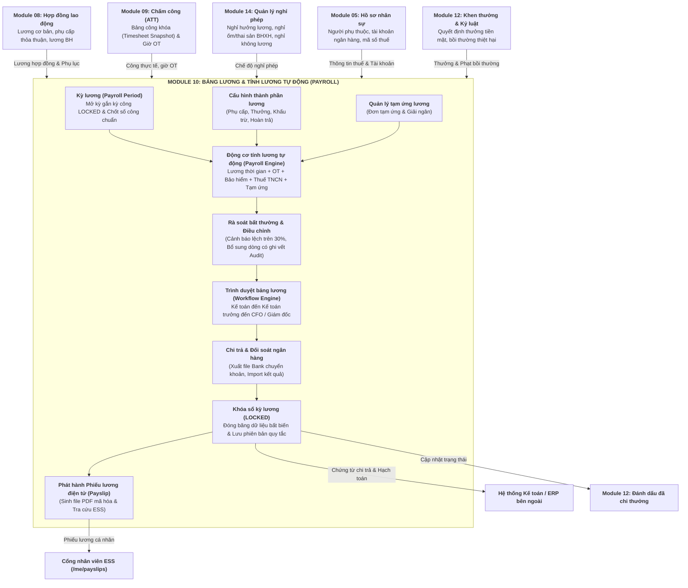
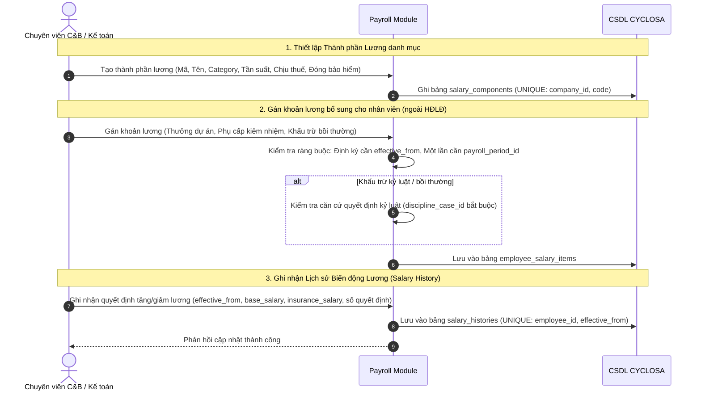
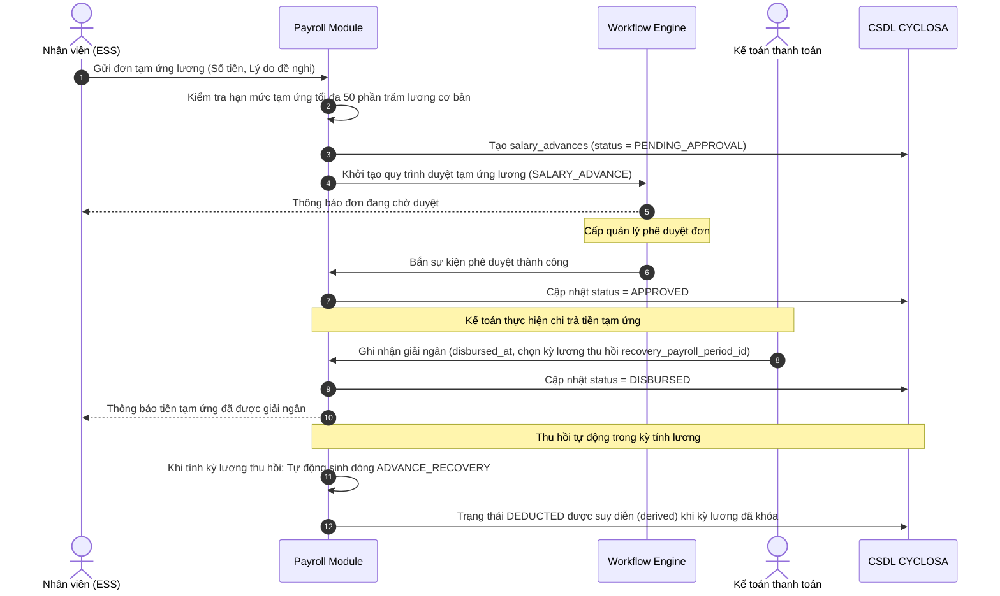
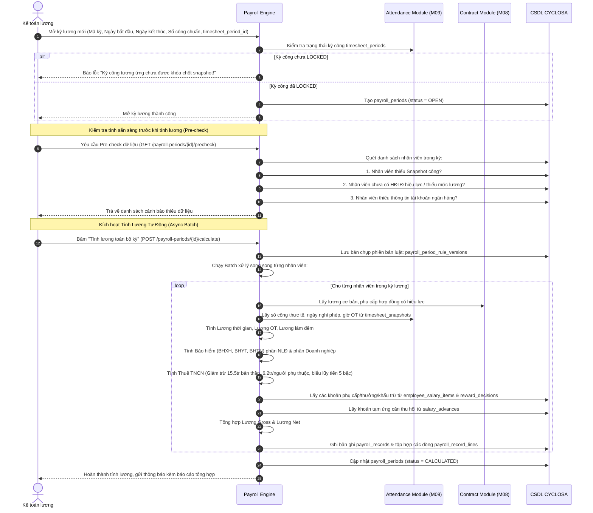
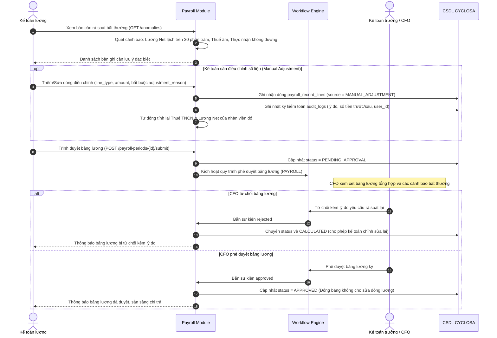
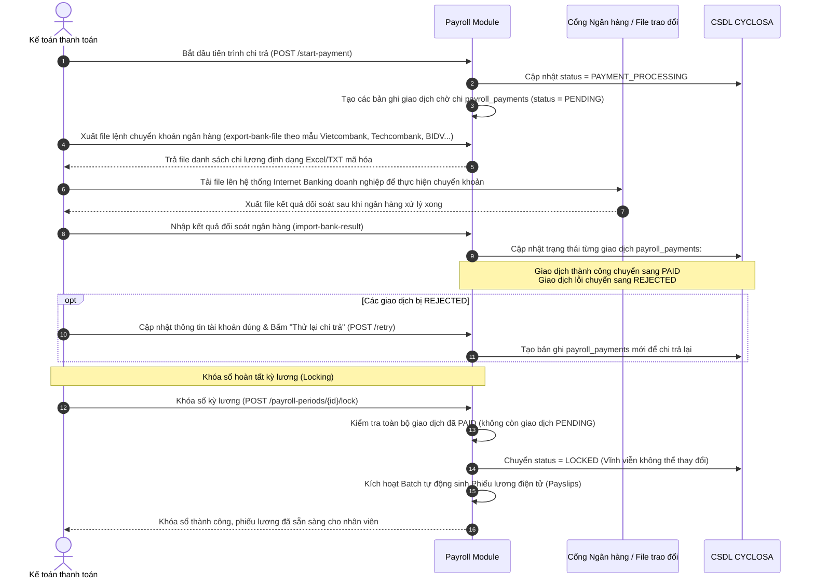
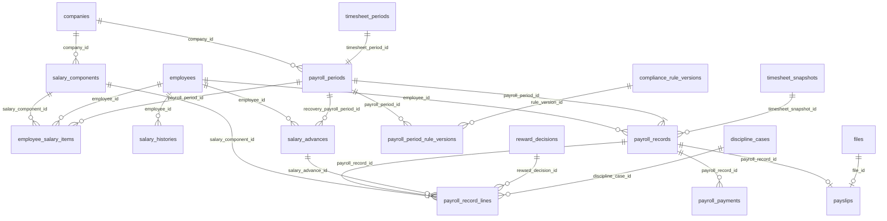
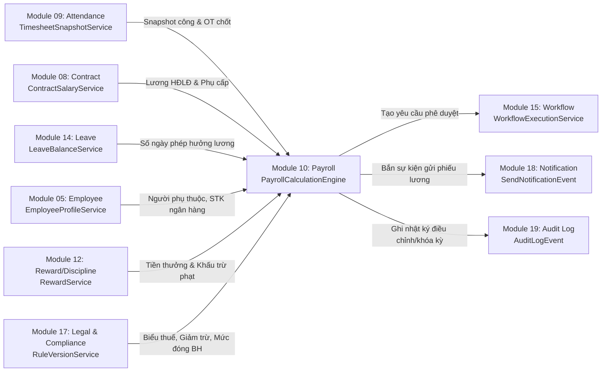

# TÀI LIỆU ĐẶC TẢ NGHIỆP VỤ & THIẾT KẾ KỸ THUẬT
## MODULE 10: BẢNG LƯƠNG & TÍNH LƯƠNG TỰ ĐỘNG (PAYROLL - PAY)

> **Tài liệu tham chiếu:**
> - Nghiệp vụ tổng thể: [`Nghiep-vu.docx`](file:///f:/Project/CYCLOSA/docs/Nghiep-vu.docx) (§10 Bảng lương và Tính lương tự động, dòng 1392–1584)
> - Thiết kế CSDL chi tiết: [`database.md`](file:///f:/Project/CYCLOSA/docs/database.md) (§8.11 Module 10 — Bảng lương & Tính lương tự động, dòng 2901–3200)
> - Danh mục API hệ thống: [`api-list.md`](file:///f:/Project/CYCLOSA/docs/api-list.md) (§10 Bảng lương & Tính lương tự động, 45 endpoints)
> - Danh mục màn hình UI: [`page-list.md`](file:///f:/Project/CYCLOSA/docs/page-list.md) (§5.11 PAY-01 đến PAY-12)
> - Căn cứ pháp lý & Tham số: [`module-phap-ly-va-anh-huong-tham-so.md`](file:///f:/Project/CYCLOSA/docs/ba/module-phap-ly-va-anh-huong-tham-so.md) (Luật Thuế TNCN 109/2025/QH15, Luật BHXH 2024, Nghị định 293/2025/NĐ-CP, Bộ luật Lao động 2019)

---

## 1. TỔNG QUAN & MỤC TIÊU NGHIỆP VỤ

### 1.1. Vị trí của Module 10 trong Hệ sinh thái CYCLOSA HRM

Module **Bảng lương & Tính lương tự động (Payroll - PAY)** là phân hệ tài chính - nhân sự cốt lõi và nhạy cảm nhất của CYCLOSA HRM. Module này chịu trách nhiệm thu thập, tổng hợp tự động toàn bộ dữ liệu lao động từ các phân hệ thượng nguồn (Hợp đồng lao động, Bảng chốt công, Nghỉ phép, Hồ sơ nhân sự, Khen thưởng, Kỷ luật) để tính toán thu nhập Gross, các khoản trích đóng bảo hiểm bắt buộc, thuế thu nhập cá nhân (TNCN), các khoản khấu trừ/tạm ứng và xác định lương thực nhận (Net) của nhân viên.



---

### 1.2. Mục tiêu Nghiệp vụ Cốt lõi

1. **Tuân thủ Tuyệt đối Quy định Pháp luật Việt Nam Hiện hành:**
   - **Bộ luật Lao động 2019 (Chương VI):** Nguyên tắc trả lương trực tiếp, đúng hạn; tiền làm thêm giờ (150% ngày thường, 200% ngày nghỉ tuần, 300% ngày lễ/Tết); làm việc ban đêm (phụ trội tối thiểu 30%); giới hạn khấu trừ tiền lương không quá 30% tiền lương thực nhận hàng tháng (Điều 102).
   - **Luật Thuế Thu nhập Cá nhân 109/2025/QH15 (Áp dụng từ kỳ tính thuế 2026):**
     - Mức giảm trừ gia cảnh: **15.500.000 VNĐ/tháng** đối với bản thân người nộp thuế; **6.200.000 VNĐ/tháng** cho mỗi người phụ thuộc hợp pháp.
     - Biểu thuế lũy tiến từng phần thu gọn thành **5 bậc** (thay vì 7 bậc cũ).
   - **Luật Bảo hiểm Xã hội 2024:**
     - Tỷ lệ trích nộp: Người lao động đóng 10.5% (BHXH 8%, BHYT 1.5%, BHTN 1%); Người sử dụng lao động đóng 21.5% (BHXH 17%, BHYT 3%, BHTN 1%, BHTNLĐ-BNN 0.5%).
     - Tiền đóng bảo hiểm của người sử dụng lao động được tính vào **Chi phí nhân sự doanh nghiệp**, tuyệt đối không trừ vào lương Net của người lao động.
     - Khống chế trần đóng BHXH/BHYT (tối đa 20 lần mức lương cơ sở / tham chiếu) và BHTN (tối đa 20 lần lương tối thiểu vùng).
   - **Nghị định 293/2025/NĐ-CP:** Kiểm tra mức lương cơ bản không được thấp hơn mức lương tối thiểu vùng từ 01/01/2026.

2. **Nguyên tắc "Tự động Tổng hợp - Không Nhập tay Lại" (Zero Manual Data Re-entry):**
   - Không cho phép người dùng nhập tay ngày công, giờ làm thêm, mức lương hợp đồng vào bảng lương.
   - Hệ thống tự động thu thập từ `timesheet_snapshots`, `contracts`, `contract_appendices`, `employee_dependents`, `salary_advances` đã duyệt.

3. **Nguyên tắc "Bất biến Tuyệt đối của Kỳ Lương Đã Chốt" (Immutable Historical Record):**
   - Kỳ lương khi đã chuyển sang trạng thái `LOCKED` là **vĩnh viễn không thể tính lại hay chỉnh sửa**.
   - Mọi biến động hợp đồng, nâng lương, thay đổi nhân sự hay điều chỉnh luật pháp về sau tuyệt đối không làm sai lệch số liệu của kỳ lương cũ.
   - Lưu trữ bản chụp phiên bản quy tắc pháp lý (`payroll_period_rule_versions`) tại thời điểm tính toán để phục vụ thanh tra, kiểm toán thuế bất kỳ lúc nào.

4. **Phát hiện Bất thường & Điều chỉnh Có Kiểm toán (Anomaly Detection & Audited Adjustment):**
   - Tự động nhận diện và gắn cờ cảnh báo các trường hợp bất thường: Lương thực nhận tăng/giảm trên **30%** so với kỳ liền kề; nhân viên chưa có tài khoản ngân hàng; nhân viên thiếu mã số thuế; kỳ công chưa khóa hoặc thiếu snapshot.
   - Mọi thao tác điều chỉnh thủ công (`MANUAL_ADJUSTMENT`) của kế toán bắt buộc phải nhập lý do giải trình (`adjustment_reason`) và được ghi vết chi tiết vào `audit_logs`.

5. **Bảo mật Tối đa Dữ liệu Nhạy cảm (PII & Financial Privacy):**
   - Toàn bộ thông tin tiền lương phải được kiểm soát qua quyền hạn riêng biệt (`payroll.view_salary`). Người không có quyền chỉ thấy dữ liệu đã che (`SensitiveMask`).
   - Phiếu lương điện tử (PDF) lưu trữ mã hóa và cấp quyền tải riêng cho từng cá nhân qua Cổng tự phục vụ (ESS).

---

### 1.3. Các Chủ thể & Quyền hạn Nghiệp vụ

| Vai trò | Trách nhiệm chính trong Module | Quyền hạn tương ứng |
| :--- | :--- | :--- |
| **Kế toán lương (Payroll Specialist)** | Quản lý thành phần lương, mở kỳ lương, kích hoạt tính lương tự động, rà soát bất thường, điều chỉnh dòng lương, giải ngân tạm ứng, lập lệnh chi trả ngân hàng, khóa kỳ và phát hành phiếu lương. | `payroll.view`, `payroll.view_salary`, `payroll.manage`, `payroll.calculate`, `payroll.adjust`, `payroll.pay` |
| **Kế toán trưởng / Giám đốc Tài chính (CFO)** | Phê duyệt bảng lương kỳ qua Workflow, kiểm soát tổng quỹ lương Gross/Net, kiểm tra cảnh báo biến động chi phí nhân sự. | `payroll.view`, `payroll.view_salary`, `workflow.approve` |
| **HR Admin / Quản lý Chế độ đãi ngộ (C&B)** | Cấu hình thành phần lương, theo dõi lịch sử biến động lương của nhân viên, hỗ trợ đối soát phụ cấp, hợp đồng. | `payroll.view`, `payroll.config`, `payroll.manage` |
| **Nhân viên (Employee - ESS)** | Gửi yêu cầu tạm ứng lương (`/me/salary-advances`), theo dõi trạng thái giải ngân, tra cứu và tải phiếu lương điện tử bảo mật (`/me/payslips`). | `Auth` (chỉ truy cập dữ liệu của chính mình) |
| **Hệ thống (Payroll Batch Engine)** | Tự động tổng hợp dữ liệu, tính toán ma trận lương hàng nghìn nhân viên bất đồng bộ, sinh file PDF phiếu lương mã hóa. | Internal System Service |

---

## 2. QUY TRÌNH NGHIỆP VỤ CHI TIẾT (BUSINESS WORKFLOWS)

### 2.1. Luồng 1: Quản lý Thành phần Lương & Biến động Mức lương

HR/Kế toán thiết lập danh mục thành phần cấu thành thu nhập và theo dõi lịch sử tăng/giảm lương của nhân viên.



* **Quy tắc phân loại thành phần lương (`SalaryComponentCategory`):**
  - `ALLOWANCE` (Phụ cấp): Phụ cấp ăn trưa, điện thoại, xăng xe, trách nhiệm. Cần chỉ định rõ tính chịu thuế TNCN và tính đóng BHXH theo luật.
  - `BONUS` (Thưởng): Thưởng hiệu suất, thưởng tháng 13, thưởng lễ/Tết. Chịu thuế TNCN, không đóng BHXH.
  - `DEDUCTION` (Khấu trừ): Khấu trừ tiền phạt kỷ luật lao động, bồi thường thiệt hại vật chất (bắt buộc liên kết `discipline_case_id` theo Điều 102 BLLĐ 2019).
  - `REIMBURSEMENT` (Hoàn trả chi phí): Công tác phí, chi phí tiếp khách hợp lý có hóa đơn. Không chịu thuế, không đóng BHXH.

---

### 2.2. Luồng 2: Tạm ứng Tiền lương & Giải ngân (Salary Advance)

Nhân viên gửi yêu cầu tạm ứng trước kỳ lương qua Cổng tự phục vụ (ESS).



---

### 2.3. Luồng 3: Mở Kỳ lương, Kiểm tra Dữ liệu & Tính Lương Tự động

Đây là chu trình trọng tâm xử lý khối lượng dữ liệu lớn của phân hệ lương.



---

### 2.4. Luồng 4: Rà soát Bất thường, Điều chỉnh & Phê duyệt Bảng lương

Sau khi tính toán tự động, kế toán rà soát ma trận lương và xử lý các ngoại lệ.



---

### 2.5. Luồng 5: Chi trả qua Ngân hàng, Đối soát Giao dịch & Khóa Sổ Bất Biến



---

## 3. ĐỘNG CƠ TÍNH TOÁN & CÔNG THỨC CHI TIẾT (PAYROLL CALCULATION ENGINE)

Toàn bộ các công thức tính toán dưới đây tuân thủ nghiêm ngặt theo **Bộ luật Lao động 2019**, **Luật Thuế TNCN 109/2025/QH15** và **Luật Bảo hiểm Xã hội 2024**.

### 3.1. Phân rã Thu nhập Gross của Nhân viên

Thu nhập tổng (`Gross Income`) của nhân viên trong kỳ được tổng hợp từ các thành phần:

$$\text{Gross} = \text{Lương thời gian} + \text{Lương OT} + \sum \text{Phụ cấp} + \sum \text{Thưởng} + \sum \text{Hoàn trả chi phí}$$

---

### 3.2. Công thức Lương Thời gian (Base Salary Calculation)

Lương thời gian phản ánh số ngày công lao động thực tế và các ngày nghỉ được hưởng nguyên lương theo luật định:

$$\text{Đơn giá ngày công} = \frac{\text{Lương cơ bản hợp đồng}}{\text{Số ngày công chuẩn của kỳ lương}}$$

$$\text{Lương thời gian} = \text{Đơn giá ngày công} \times \left( \text{Ngày công thực tế} + \text{Ngày nghỉ lễ/Tết} + \text{Ngày nghỉ phép năm} + \text{Nghỉ hưởng lương khác} \right)$$

*Trong đó:*
- `Số ngày công chuẩn của kỳ lương` (`standard_work_days`): Do kế toán xác lập khi mở kỳ lương (thông thường từ 22 đến 26 ngày tùy theo chế độ làm việc 5 ngày hay 5.5 ngày/tuần của công ty).
- `Ngày công thực tế`: Lấy từ bản chụp `timesheet_snapshots.actual_work_days`.
- `Ngày nghỉ phép năm / lễ Tết`: Lấy từ `timesheet_snapshots.paid_leave_days`.
- Trường hợp nghỉ không hưởng lương hoặc vắng mặt không phép: Tuyệt đối không được tính vào công hưởng lương.

---

### 3.3. Công thức Tiền Làm Thêm Giờ (Overtime - OT) & Làm việc Ban đêm

Căn cứ theo **Điều 98 Bộ luật Lao động 2019**:

$$\text{Đơn giá giờ làm việc bình thường} = \frac{\text{Lương cơ bản hợp đồng}}{\text{Số ngày công chuẩn} \times 8}$$

$$\text{Tiền làm thêm giờ (OT)} = \sum \left( \text{Số giờ OT}_k \times \text{Đơn giá giờ} \times \text{Hệ số OT}_k \right)$$

*Bảng tra cứu Hệ số OT theo quy định pháp luật:*

| Loại thời gian làm thêm | Ban ngày (06:00 - 22:00) | Ban đêm (22:00 - 06:00 hôm sau) | Ghi chú căn cứ pháp lý |
| :--- | :---: | :---: | :--- |
| **Ngày làm việc bình thường** | **150%** ($1.5$) | **210%** ($1.5 \times 1.3 + 0.15 = 2.10$) | Khoản 1 & Khoản 2 Điều 98 BLLĐ |
| **Ngày nghỉ hàng tuần** | **200%** ($2.0$) | **270%** ($2.0 \times 1.3 + 0.20 = 2.70$) | Nghỉ thứ Bảy, Chủ nhật theo quy định |
| **Ngày nghỉ Lễ, Tết, Ngày nghỉ có hưởng lương** | **300%** ($3.0$) | **390%** ($3.0 \times 1.3 + 0.30 = 3.90$) | Chưa kể tiền lương ngày lễ hưởng nguyên lương |

*Làm việc ban đêm trong ca bình thường:* Nhân viên làm việc vào ban đêm (không phải làm thêm giờ) được trả thêm ít nhất **30%** tiền lương tính theo đơn giá tiền lương của ngày làm việc bình thường.

---

### 3.4. Công thức Trích Nộp Bảo Hiểm Bắt Buộc

Căn cứ **Luật Bảo hiểm Xã hội 2024**:

$$\text{Lương làm căn cứ đóng bảo hiểm} = \min \left( \text{Mức lương đóng BH trên HĐLĐ}, \text{Mức trần bảo hiểm quy định} \right)$$

*Tỷ lệ trích nộp bảo hiểm bắt buộc:*

| Loại bảo hiểm | Phần Người lao động trừ vào lương | Phần Doanh nghiệp chịu (Chi phí nhân sự) | Tổng tỷ lệ trích nộp | Mức trần khống chế |
| :--- | :---: | :---: | :---: | :--- |
| **Bảo hiểm Xã hội (BHXH)** | **8.0%** | **17.0%** (14% Hưu trí + 3% Ốm đau/Thai sản) | 25.0% | Tối đa 20 lần mức lương cơ sở |
| **Bảo hiểm Y tế (BHYT)** | **1.5%** | **3.0%** | 4.5% | Tối đa 20 lần mức lương cơ sở |
| **Bảo hiểm Thất nghiệp (BHTN)** | **1.0%** | **1.0%** | 2.0% | Tối đa 20 lần mức lương tối thiểu vùng |
| **Bảo hiểm TNLĐ - BNN** | **0.0%** | **0.5%** | 0.5% | Doanh nghiệp đóng toàn bộ |
| **TỔNG CỘNG** | **10.5%** | **21.5%** | **32.0%** | |

$$\text{Tổng bảo hiểm trừ lương NLĐ} = \text{BHXH}_{8\%} + \text{BHYT}_{1.5\%} + \text{BHTN}_{1\%} = \text{Lương đóng BH} \times 10.5\%$$

$$\text{Chi phí bảo hiểm doanh nghiệp} = \text{Lương đóng BH} \times 21.5\%$$

> [!IMPORTANT]
> Toàn bộ phần bảo hiểm $21.5\%$ của doanh nghiệp được lưu ở dòng `INSURANCE_EMPLOYER` phục vụ báo cáo chi phí vận hành, **tuyệt đối không được trừ vào lương thực nhận Net của người lao động**.

---

### 3.5. Công thức Tính Thuế Thu Nhập Cá Nhân (TNCN) Mới

Tuân thủ **Luật Thuế Thu nhập Cá nhân 109/2025/QH15** (áp dụng từ kỳ tính thuế 2026):

#### Bước 1: Xác định Thu nhập Chịu thuế (Taxable Income)
$$\text{Thu nhập chịu thuế} = \text{Tổng thu nhập Gross} - \sum \text{Các khoản thu nhập được miễn thuế}$$

*Các khoản miễn thuế theo luật:*
- Tiền ăn trưa/giữa ca (trong định mức quy định).
- Tiền trang phục, công tác phí hợp lệ.
- Phần tiền làm thêm giờ, làm việc ban đêm được trả cao hơn so với đơn giá ngày làm việc bình thường (phần chênh lệch $50\%$, $100\%$, $200\%$).
- Các khoản trợ cấp khó khăn, thai sản, tai nạn lao động do BHXH chi trả.

#### Bước 2: Xác định Các khoản Giảm trừ (Deductions)
$$\text{Tổng giảm trừ} = \text{Giảm trừ bản thân} + (\text{Số người phụ thuộc} \times \text{Mức giảm trừ người phụ thuộc}) + \text{Bảo hiểm bắt buộc của NLĐ} (10.5\%)$$

- **Mức giảm trừ bản thân:** **15.500.000 VNĐ/tháng** (theo Luật 109/2025/QH15).
- **Mức giảm trừ người phụ thuộc:** **6.200.000 VNĐ/tháng/người** (chỉ tính những người phụ thuộc có mã số thuế và hồ sơ giảm trừ hợp lệ có hiệu lực trong kỳ).

#### Bước 3: Xác định Thu nhập Tính thuế (Assessable Income)
$$\text{Thu nhập tính thuế} = \max \left( 0, \text{Thu nhập chịu thuế} - \text{Tổng giảm trừ} \right)$$

Nếu $\text{Thu nhập tính thuế} \le 0 \implies \text{Thuế TNCN} = 0$.

#### Bước 4: Áp dụng Biểu thuế Lũy tiến Từng phần Mới (5 Bậc):

| Bậc thuế | Phần thu nhập tính thuế / tháng (Triệu VNĐ) | Thuế suất (%) | Cách tính thuế rút gọn (VNĐ) |
| :---: | :--- | :---: | :--- |
| **1** | Đến 10 triệu đồng | **5%** | $0.05 \times \text{TNTT}$ |
| **2** | Trên 10 triệu đến 30 triệu đồng | **10%** | $0.10 \times \text{TNTT} - 500.000$ |
| **3** | Trên 30 triệu đến 60 triệu đồng | **20%** | $0.20 \times \text{TNTT} - 3.500.000$ |
| **4** | Trên 60 triệu đến 100 triệu đồng | **30%** | $0.30 \times \text{TNTT} - 9.500.000$ |
| **5** | Trên 100 triệu đồng | **35%** | $0.35 \times \text{TNTT} - 14.500.000$ |

---

### 3.6. Công thức Tính Lương Thực Nhận (Net Salary)

Lương thực nhận của người lao động được xác định bằng:

$$\text{Net Salary} = \text{Tổng thu nhập Gross} - \text{Bảo hiểm NLĐ (10.5\%)} - \text{Thuế TNCN} - \text{Thu hồi tạm ứng} - \sum \text{Các khoản khấu trừ khác}$$

*Quy tắc giới hạn an toàn bảo vệ người lao động:*
- Căn cứ **Điều 102 Bộ luật Lao động 2019**, tổng mức khấu trừ tiền lương (không bao gồm bảo hiểm bắt buộc và thuế TNCN) không được vượt quá **30%** tiền lương thực nhận hàng tháng của người lao động.
- Nếu lương Net sau khi trừ các khoản tạm ứng/khấu trừ bị âm ($\le 0$), hệ thống sẽ chặn không cho chốt kỳ và đưa vào danh sách cảnh báo bất thường nghiêm trọng để kế toán phân bổ thu hồi sang nhiều kỳ.

---

### 3.7. Công thức Tổng Quỹ Lương Doanh nghiệp (Total Employer Cost)

$$\text{Tổng chi phí nhân sự của kỳ} = \sum \text{Lương Gross} + \sum \text{Bảo hiểm phần Doanh nghiệp đóng (21.5\%)}$$

---

## 4. THIẾT KẾ CƠ SỞ DỮ LIỆU CHI TIẾT (DATA MODEL)

### 4.1. Sơ đồ Quan hệ Thực thể (ERD Mermaid)



---

### 4.2. Đặc tả Chi tiết Các Bảng CSDL Module 10

#### 1. Bảng `salary_components` — Danh mục thành phần lương
*Mục đích:* Quản lý các loại phụ cấp, thưởng, khấu trừ, hoàn trả định kỳ hoặc phát sinh một lần.

| Tên cột | Kiểu dữ liệu | Ràng buộc | Mô tả |
| :--- | :--- | :---: | :--- |
| `id` | `BIGINT` | `PK`, `AUTO_INCREMENT` | Định danh thành phần |
| `company_id` | `BIGINT` | `FK` $\to$ `companies.id`, `NN` | Công ty áp dụng |
| `code` | `VARCHAR(30)` | `NN` | Mã định danh thành phần (VD: `AN_TRUA`, `XANG_XE`) |
| `name` | `VARCHAR(150)` | `NN` | Tên hiển thị (VD: Phụ cấp ăn trưa) |
| `category` | `VARCHAR(30)` | `NN` | Enum `SalaryComponentCategory` |
| `frequency` | `VARCHAR(20)` | `NN` | Enum `ComponentFrequency` (`RECURRING`, `ONE_TIME`) |
| `default_amount` | `DECIMAL(18,2)` | `NULL` | Số tiền mặc định |
| `is_taxable` | `BOOLEAN` | `NN`, `DEFAULT TRUE` | Có tính thuế TNCN không |
| `is_insurance_base` | `BOOLEAN` | `NN`, `DEFAULT FALSE`| Có tính vào lương đóng BHXH không |
| `is_active` | `BOOLEAN` | `NN`, `DEFAULT TRUE` | Trạng thái kích hoạt |
| *Ràng buộc:* | `UNIQUE (company_id, code)` | | Không trùng mã trong một công ty |

---

#### 2. Bảng `employee_salary_items` — Khoản thu nhập / Khấu trừ gán riêng cho nhân viên
*Mục đích:* Gán các khoản phụ cấp đặc thù, thưởng dự án hoặc khấu trừ bồi thường cho từng cá nhân (ngoài thỏa thuận trong hợp đồng lao động).

| Tên cột | Kiểu dữ liệu | Ràng buộc | Mô tả |
| :--- | :--- | :---: | :--- |
| `id` | `BIGINT` | `PK`, `AUTO_INCREMENT` | Định danh khoản gán |
| `employee_id` | `BIGINT` | `FK` $\to$ `employees.id`, `NN` | Nhân viên thụ hưởng / bị trừ |
| `salary_component_id` | `BIGINT`| `FK` $\to$ `salary_components.id`, `NN` | Loại khoản mục |
| `amount` | `DECIMAL(18,2)` | `NN` | Số tiền áp dụng |
| `effective_from` | `DATE` | `NULL` | Khoản định kỳ: Ngày bắt đầu có hiệu lực |
| `effective_to` | `DATE` | `NULL` | Khoản định kỳ: Ngày hết hiệu lực (NULL = vô thời hạn) |
| `payroll_period_id` | `BIGINT` | `FK` $\to$ `payroll_periods.id`, `NULL`| Khoản một lần: Kỳ lương áp dụng |
| `discipline_case_id`| `BIGINT` | `FK` $\to$ `discipline_cases.id`, `NULL`| Bắt buộc có căn cứ nếu là khoản khấu trừ kỷ luật |
| *Ràng buộc:* | `CHECK` đúng một trong `effective_from` (định kỳ) hoặc `payroll_period_id` (một lần) có giá trị. | |

---

#### 3. Bảng `salary_histories` — Lịch sử mức lương của nhân viên
*Mục đích:* Lưu vết toàn bộ các lần tăng lương, hạ lương, điều chỉnh lương đóng bảo hiểm.

| Tên cột | Kiểu dữ liệu | Ràng buộc | Mô tả |
| :--- | :--- | :---: | :--- |
| `id` | `BIGINT` | `PK`, `AUTO_INCREMENT` | Định danh bản ghi lịch sử |
| `employee_id` | `BIGINT` | `FK` $\to$ `employees.id`, `NN` | Nhân viên |
| `effective_from` | `DATE` | `NN` | Ngày bắt đầu áp dụng mức lương mới |
| `base_salary` | `DECIMAL(18,2)` | `NN` | Mức lương cơ bản thỏa thuận |
| `insurance_salary` | `DECIMAL(18,2)`| `NULL` | Mức lương làm căn cứ đóng bảo hiểm |
| `reason` | `VARCHAR(30)` | `NN` | Enum `SalaryChangeReason` |
| `decision_no` | `VARCHAR(50)` | `NULL` | Số quyết định điều chỉnh lương |
| `contract_id` | `BIGINT` | `FK` $\to$ `contracts.id`, `NULL` | Hợp đồng làm căn cứ |
| `contract_appendix_id`| `BIGINT`| `FK` $\to$ `contract_appendices.id`, `NULL`| Phụ lục hợp đồng làm căn cứ |
| `note` | `VARCHAR(500)` | `NULL` | Ghi chú giải trình |
| *Ràng buộc:* | `UNIQUE (employee_id, effective_from)` | | Mỗi ngày chỉ có 1 mức lương hiệu lực |

---

#### 4. Bảng `salary_advances` — Tạm ứng tiền lương
*Mục đích:* Quản lý đơn xin tạm ứng, phê duyệt và giải ngân.

| Tên cột | Kiểu dữ liệu | Ràng buộc | Mô tả |
| :--- | :--- | :---: | :--- |
| `id` | `BIGINT` | `PK`, `AUTO_INCREMENT` | Định danh đơn tạm ứng |
| `employee_id` | `BIGINT` | `FK` $\to$ `employees.id`, `NN` | Nhân viên yêu cầu |
| `amount` | `DECIMAL(18,2)` | `NN` | Số tiền đề nghị tạm ứng |
| `reason` | `TEXT` | `NN` | Lý do tạm ứng lương |
| `requested_at` | `TIMESTAMP` | `NN`, `DEFAULT CURRENT_TIMESTAMP` | Thời điểm gửi yêu cầu |
| `status` | `VARCHAR(30)` | `NN` | Enum `SalaryAdvanceStatus` |
| `disbursed_at` | `TIMESTAMP` | `NULL` | Thời điểm kế toán ghi nhận giải ngân |
| `recovery_payroll_period_id` | `BIGINT` | `FK` $\to$ `payroll_periods.id`, `NULL` | Kỳ lương dự kiến thu hồi |

---

#### 5. Bảng `payroll_periods` — Kỳ tính lương
*Mục đích:* Định nghĩa từng chu kỳ trả lương của doanh nghiệp.

| Tên cột | Kiểu dữ liệu | Ràng buộc | Mô tả |
| :--- | :--- | :---: | :--- |
| `id` | `BIGINT` | `PK`, `AUTO_INCREMENT` | Định danh kỳ lương |
| `company_id` | `BIGINT` | `FK` $\to$ `companies.id`, `NN` | Doanh nghiệp |
| `code` | `VARCHAR(30)` | `NN` | Mã kỳ lương (VD: `PR_2026_11`) |
| `name` | `VARCHAR(100)` | `NN` | Tên kỳ lương (VD: Kỳ lương Tháng 11/2026) |
| `start_date` | `DATE` | `NN` | Ngày bắt đầu chu kỳ tính công/lương |
| `end_date` | `DATE` | `NN` | Ngày kết thúc chu kỳ |
| `planned_payment_date` | `DATE` | `NN` | Ngày dự kiến chi trả lương |
| `standard_work_days` | `DECIMAL(5,2)` | `NN` | Số ngày công chuẩn của tháng do kế toán xác lập |
| `timesheet_period_id` | `BIGINT` | `FK` $\to$ `timesheet_periods.id`, `UQ`, `NN` | Kỳ công cung cấp dữ liệu (bắt buộc `LOCKED`) |
| `status` | `VARCHAR(30)` | `NN` | Enum `PayrollPeriodStatus` |
| *Ràng buộc:* | `UNIQUE (company_id, code)`; `CHECK (start_date <= end_date)` | | |

---

#### 6. Bảng `payroll_period_rule_versions` — Bản chụp quy tắc pháp lý áp dụng cho kỳ lương
*Mục đích:* Lưu trữ phiên bản quy tắc luật pháp (thuế, bảo hiểm, lương tối thiểu) tại thời điểm tính toán, phục vụ kiểm toán độc lập và truy vết bất biến.

| Tên cột | Kiểu dữ liệu | Ràng buộc | Mô tả |
| :--- | :--- | :---: | :--- |
| `payroll_period_id` | `BIGINT` | `PK`, `FK` $\to$ `payroll_periods.id` | Kỳ lương áp dụng |
| `rule_version_id` | `BIGINT` | `PK`, `FK` $\to$ `compliance_rule_versions.id` | Phiên bản quy tắc pháp lý |

---

#### 7. Bảng `payroll_records` — Bảng lương của từng nhân viên trong kỳ
*Mục đích:* Bản ghi header lương tổng hợp của từng nhân viên.

| Tên cột | Kiểu dữ liệu | Ràng buộc | Mô tả |
| :--- | :--- | :---: | :--- |
| `id` | `BIGINT` | `PK`, `AUTO_INCREMENT` | Định danh bảng lương cá nhân |
| `payroll_period_id` | `BIGINT` | `FK` $\to$ `payroll_periods.id`, `NN` | Kỳ lương |
| `employee_id` | `BIGINT` | `FK` $\to$ `employees.id`, `NN` | Nhân viên |
| `timesheet_snapshot_id`| `BIGINT`| `FK` $\to$ `timesheet_snapshots.id`, `NULL`| Nguồn công đã chốt từ Module 09 |
| `calculated_at` | `TIMESTAMP` | `NN` | Thời điểm tính toán gần nhất |
| *Ràng buộc:* | `UNIQUE (payroll_period_id, employee_id)` | | Mỗi nhân viên có 1 bản ghi trong 1 kỳ |

> [!NOTE]
> Các chỉ số tổng hợp: `Gross Income`, `Net Income`, `Total Deduction`, `Total Employer Cost` **không lưu cứng vào bảng `payroll_records`** nhằm loại bỏ dư thừa dữ liệu (Normal Form), mà được tính động (`derived`) bằng `SUM(amount)` theo `line_type` từ bảng chi tiết `payroll_record_lines`.

---

#### 8. Bảng `payroll_record_lines` — Dòng chi tiết bảng lương (Bất biến sau khi chốt)
*Mục đích:* Lưu chi tiết từng khoản cộng/trừ trong phiếu lương. Bất biến vĩnh viễn khi kỳ lương `LOCKED`.

| Tên cột | Kiểu dữ liệu | Ràng buộc | Mô tả |
| :--- | :--- | :---: | :--- |
| `id` | `BIGINT` | `PK`, `AUTO_INCREMENT` | Định danh dòng chi tiết |
| `payroll_record_id` | `BIGINT` | `FK` $\to$ `payroll_records.id`, `NN` | Thuộc bảng lương của nhân viên nào |
| `line_type` | `VARCHAR(30)` | `NN` | Enum `PayrollLineType` |
| `overtime_day_type` | `VARCHAR(30)` | `NULL` | Enum `OvertimeDayType` (chỉ dùng với `OVERTIME`) |
| `is_night_work` | `BOOLEAN` | `NULL` | Cờ làm đêm (chỉ dùng với `OVERTIME`) |
| `insurance_kind` | `VARCHAR(20)` | `NULL` | Enum `InsuranceKind` (`SOCIAL`, `HEALTH`, `UNEMPLOYMENT`) |
| `salary_component_id`| `BIGINT` | `FK` $\to$ `salary_components.id`, `NULL` | Thành phần phụ cấp/thưởng liên kết |
| `reward_decision_id` | `BIGINT` | `FK` $\to$ `reward_decisions.id`, `NULL` | Quyết định khen thưởng làm căn cứ |
| `salary_advance_id` | `BIGINT` | `FK` $\to$ `salary_advances.id`, `NULL` | Khoản tạm ứng được thu hồi |
| `discipline_case_id`| `BIGINT` | `FK` $\to$ `discipline_cases.id`, `NULL` | Vụ việc kỷ luật làm căn cứ khấu trừ |
| `quantity` | `DECIMAL(10,2)` | `NULL` | Số lượng đo được (số ngày công, số giờ OT) |
| `amount` | `DECIMAL(18,2)` | `NN` | Số tiền của dòng (Luôn $\ge 0$) |
| `source` | `VARCHAR(30)` | `NN` | Enum `PayrollLineSource` |
| `adjustment_reason` | `VARCHAR(500)` | `NULL` | Bắt buộc nhập nếu `source = MANUAL_ADJUSTMENT` |

---

#### 9. Bảng `payroll_payments` — Lịch sử giao dịch chi trả qua ngân hàng
*Mục đích:* Ghi nhận lệnh chuyển khoản và kết quả đối soát từ ngân hàng. Một bảng lương có thể phát sinh nhiều lần chi nếu các lần trước bị ngân hàng từ chối (thử lại).

| Tên cột | Kiểu dữ liệu | Ràng buộc | Mô tả |
| :--- | :--- | :---: | :--- |
| `id` | `BIGINT` | `PK`, `AUTO_INCREMENT` | Định danh giao dịch chi trả |
| `payroll_record_id` | `BIGINT` | `FK` $\to$ `payroll_records.id`, `NN` | Bảng lương được thanh toán |
| `bank_name` | `VARCHAR(150)` | `NN` | Tên ngân hàng tại thời điểm chuyển tiền |
| `account_number` | `VARCHAR(30)` | `NN` | Số tài khoản ngân hàng thụ hưởng |
| `amount` | `DECIMAL(18,2)` | `NN` | Số tiền thực chuyển |
| `status` | `VARCHAR(30)` | `NN` | Enum `PaymentStatus` (`PENDING`, `PAID`, `REJECTED`) |
| `bank_reference` | `VARCHAR(100)` | `NULL` | Mã giao dịch tham chiếu từ hệ thống ngân hàng |
| `paid_at` | `TIMESTAMP` | `NULL` | Thời điểm ngân hàng báo chuyển tiền thành công |
| `failure_reason` | `VARCHAR(500)` | `NULL` | Nguyên nhân nếu giao dịch bị ngân hàng từ chối |

---

#### 10. Bảng `payslips` — Phiếu lương điện tử (Electronic Payslip)
*Mục đích:* Lưu trữ bản phiếu lương PDF mã hóa cho nhân viên tra cứu qua ESS.

| Tên cột | Kiểu dữ liệu | Ràng buộc | Mô tả |
| :--- | :--- | :---: | :--- |
| `id` | `BIGINT` | `PK`, `AUTO_INCREMENT` | Định danh phiếu lương |
| `payroll_record_id` | `BIGINT` | `FK` $\to$ `payroll_records.id`, `UQ`, `NN` | Mỗi bảng lương cá nhân chỉ có 1 phiếu lương |
| `file_id` | `BIGINT` | `FK` $\to$ `files.id`, `NN` | Tệp PDF đã sinh và lưu mã hóa an toàn |
| `issued_at` | `TIMESTAMP` | `NN`, `DEFAULT CURRENT_TIMESTAMP` | Thời điểm phát hành |

---

### 4.3. Danh mục Các Enums Nghiệp vụ Chuẩn

```java
// 1. Nhóm thành phần lương
public enum SalaryComponentCategory {
    ALLOWANCE,       // Phụ cấp (ăn trưa, điện thoại, xăng xe...)
    BONUS,           // Thưởng (thưởng dự án, KPI, tháng 13...)
    DEDUCTION,       // Khấu trừ (bồi thường thiệt hại, phạt vi phạm...)
    REIMBURSEMENT    // Hoàn trả chi phí (công tác phí, tiếp khách...)
}

// 2. Tần suất thành phần
public enum ComponentFrequency {
    RECURRING,       // Định kỳ hàng tháng
    ONE_TIME         // Phát sinh một lần theo kỳ lương
}

// 3. Lý do điều chỉnh mức lương
public enum SalaryChangeReason {
    INITIAL,         // Mức lương khởi điểm khi tiếp nhận nhân viên
    PROMOTION,       // Thăng chức, bổ nhiệm chức vụ mới
    PERIODIC_REVIEW, // Xét tăng lương định kỳ hàng năm
    ADJUSTMENT,      // Điều chỉnh theo thỏa thuận phụ lục hợp đồng
    REDUCTION        // Giảm lương (kỷ luật chuyển công việc khác)
}

// 4. Trạng thái đơn tạm ứng
public enum SalaryAdvanceStatus {
    DRAFT,             // Bản nháp của nhân viên
    PENDING_APPROVAL,  // Đang chờ cấp trên phê duyệt qua Workflow
    APPROVED,          // Đã được phê duyệt
    REJECTED,          // Đã bị từ chối
    DISBURSED          // Kế toán đã giải ngân tiền mặt / chuyển khoản
}

// 5. Trạng thái kỳ tính lương
public enum PayrollPeriodStatus {
    OPEN,               // Mở kỳ, chuẩn bị dữ liệu / pre-check
    CALCULATED,         // Đã tính toán xong, đang rà soát bất thường
    PENDING_APPROVAL,   // Đã trình phê duyệt (Workflow khóa không cho sửa)
    APPROVED,           // Đã được phê duyệt, sẵn sàng giải ngân
    PAYMENT_PROCESSING, // Đang trong quá trình chi trả qua ngân hàng
    LOCKED              // Đã khóa sổ vĩnh viễn, phát hành phiếu lương
}

// 6. Phân loại dòng chi tiết bảng lương
public enum PayrollLineType {
    BASE_SALARY,          // Lương theo ngày công và nghỉ hưởng lương (Thu nhập)
    OVERTIME,             // Tiền làm thêm giờ (Thu nhập)
    ALLOWANCE,            // Phụ cấp (Thu nhập)
    BONUS,                // Tiền thưởng (Thu nhập)
    REIMBURSEMENT,        // Hoàn trả chi phí (Thu nhập)
    INSURANCE_EMPLOYEE,   // Bảo hiểm bắt buộc phần người lao động đóng (Khấu trừ)
    PERSONAL_INCOME_TAX,  // Thuế thu nhập cá nhân (Khấu trừ)
    ADVANCE_RECOVERY,     // Thu hồi tiền tạm ứng (Khấu trừ)
    DEDUCTION,            // Khấu trừ khác: kỷ luật / bồi thường (Khấu trừ)
    INSURANCE_EMPLOYER    // Bảo hiểm phần Doanh nghiệp đóng (Chi phí DN, KHÔNG trừ Net)
}

// 7. Loại bảo hiểm bắt buộc
public enum InsuranceKind {
    SOCIAL,        // Bảo hiểm Xã hội (BHXH)
    HEALTH,        // Bảo hiểm Y tế (BHYT)
    UNEMPLOYMENT   // Bảo hiểm Thất nghiệp (BHTN)
}

// 8. Nguồn gốc dòng chi tiết
public enum PayrollLineSource {
    SYSTEM_CALCULATED,  // Do động cơ Payroll tự động tính toán
    MANUAL_ADJUSTMENT   // Do kế toán điều chỉnh thủ công (ghi vết Audit bắt buộc)
}

// 9. Trạng thái giao dịch chi trả
public enum PaymentStatus {
    PENDING,   // Đang chờ lệnh chuyển ngân hàng
    PAID,      // Đã chuyển tiền thành công
    REJECTED   // Ngân hàng từ chối giao dịch (sai STK, tài khoản khóa...)
}
```

---

## 5. DANH MỤC API BACKEND & MA TRẬN PHÂN QUYỀN

Module cung cấp **45 endpoints** chuẩn RESTful, được bảo vệ qua hệ thống phân quyền RBAC và bọc chuẩn `ApiResponse<T>`:

### 5.1. Bảng Chi tiết 45 Endpoints RESTful

| STT | Method | Đường dẫn API | Chức năng nghiệp vụ | Quyền hạn yêu cầu |
| :-: | :---: | :--- | :--- | :--- |
| **I** | **CẤU HÌNH THÀNH PHẦN LƯƠNG & LƯƠNG NHÂN VIÊN** | | | |
| 1 | `GET` | `/api/v1/salary-components` | Danh sách thành phần lương. Query: category, is_active | `payroll.view` |
| 2 | `POST` | `/api/v1/salary-components` | Tạo thành phần lương mới | `payroll.config` |
| 3 | `PUT` | `/api/v1/salary-components/{id}` | Cập nhật cấu hình thành phần | `payroll.config` |
| 4 | `DELETE` | `/api/v1/salary-components/{id}` | Xóa thành phần (chỉ khi chưa được sử dụng) | `payroll.config` |
| 5 | `GET` | `/api/v1/employees/{empId}/salary-items` | Danh sách khoản lương bổ sung của nhân viên | `payroll.view_salary` |
| 6 | `POST` | `/api/v1/employees/{empId}/salary-items` | Thêm khoản lương mới (định kỳ hoặc một lần) | `payroll.manage` |
| 7 | `PUT` | `/api/v1/salary-items/{itemId}` | Cập nhật số tiền/hiệu lực khoản lương | `payroll.manage` |
| 8 | `DELETE` | `/api/v1/salary-items/{itemId}` | Xóa khoản lương chưa vào kỳ lương đã chốt | `payroll.manage` |
| 9 | `GET` | `/api/v1/employees/{empId}/salary-histories`| Lịch sử biến động mức lương của nhân viên | `payroll.view_salary` |
| 10 | `POST` | `/api/v1/employees/{empId}/salary-histories`| Ghi nhận quyết định điều chỉnh mức lương mới | `payroll.manage` |
| 11 | `GET` | `/api/v1/employees/{empId}/salary-histories/at`| Lấy mức lương có hiệu lực tại ngày chỉ định | `payroll.view_salary` |
| **II** | **QUẢN LÝ TẠM ỨNG TIỀN LƯƠNG** | | | |
| 12 | `GET` | `/api/v1/salary-advances` | Danh sách yêu cầu tạm ứng toàn công ty | `payroll.view` |
| 13 | `GET` | `/api/v1/salary-advances/{id}` | Chi tiết đơn tạm ứng & trạng thái đã thu hồi | `payroll.view` |
| 14 | `POST` | `/api/v1/salary-advances/{id}/disburse` | Kế toán xác nhận giải ngân & gán kỳ thu hồi | `payroll.pay` |
| 15 | `GET` | `/api/v1/me/salary-advances` | Danh sách đơn tạm ứng của chính tôi (ESS) | `Auth` |
| 16 | `POST` | `/api/v1/me/salary-advances` | Nhân viên gửi đơn đề nghị tạm ứng lương mới | `Auth` |
| 17 | `POST` | `/api/v1/me/salary-advances/{id}/cancel` | Hủy đơn tạm ứng đang ở trạng thái DRAFT/PENDING| `Auth` |
| **III**| **QUẢN LÝ KỲ LƯƠNG & ĐỘNG CƠ TÍNH TOÁN** | | | |
| 18 | `POST` | `/api/v1/payroll-periods` | Mở kỳ lương mới (gắn timesheet_period_id LOCKED)| `payroll.manage` |
| 19 | `GET` | `/api/v1/payroll-periods` | Danh sách kỳ lương (lọc theo năm, trạng thái) | `payroll.view` |
| 20 | `GET` | `/api/v1/payroll-periods/{id}` | Chi tiết kỳ kèm số liệu Gross, Net, Quỹ lương | `payroll.view` |
| 21 | `PUT` | `/api/v1/payroll-periods/{id}` | Cập nhật tham số kỳ (ngày công chuẩn, ngày trả) | `payroll.manage` |
| 22 | `GET` | `/api/v1/payroll-periods/{id}/precheck` | Kiểm tra tính đầy đủ dữ liệu (công, HĐ, STK) | `payroll.view` |
| 23 | `POST` | `/api/v1/payroll-periods/{id}/calculate`| Chạy Batch tính lương tự động toàn kỳ (Async) | `payroll.calculate` |
| 24 | `POST` | `/api/v1/payroll-periods/{id}/employees/{empId}/recalculate` | Tính lại lương cho 1 nhân viên cụ thể | `payroll.calculate` |
| 25 | `GET` | `/api/v1/payroll-periods/{id}/anomalies` | Danh sách cảnh báo biến động lương > 30% | `payroll.view_salary` |
| 26 | `GET` | `/api/v1/payroll-periods/{id}/rule-versions`| Xem phiên bản quy tắc pháp lý đã sử dụng | `payroll.view` |
| 27 | `POST` | `/api/v1/payroll-periods/{id}/submit` | Trình phê duyệt bảng lương (Workflow PAYROLL) | `payroll.manage` |
| 28 | `POST` | `/api/v1/payroll-periods/{id}/start-payment` | Bắt đầu chi trả (chuyển sang PAYMENT_PROCESSING)| `payroll.pay` |
| 29 | `POST` | `/api/v1/payroll-periods/{id}/lock` | Khóa sổ kỳ lương vĩnh viễn (LOCKED) | `payroll.pay` |
| **IV** | **BẢNG LƯƠNG NHÂN VIÊN & ĐIỀU CHỈNH** | | | |
| 30 | `GET` | `/api/v1/payroll-periods/{id}/records` | Danh sách bảng lương nhân viên trong kỳ | `payroll.view_salary` |
| 31 | `GET` | `/api/v1/payroll-records/{recordId}` | Chi tiết bảng lương cá nhân & các dòng cộng trừ | `payroll.view_salary` |
| 32 | `GET` | `/api/v1/payroll-records/{recordId}/trace` | Truy vết công thức & nguồn gốc dữ liệu đầu vào | `payroll.view_salary` |
| 33 | `POST` | `/api/v1/payroll-records/{recordId}/adjustments` | Bổ sung dòng điều chỉnh thủ công (có lý do) | `payroll.adjust` |
| 34 | `PUT` | `/api/v1/payroll-record-lines/{lineId}` | Sửa dòng điều chỉnh thủ công | `payroll.adjust` |
| 35 | `DELETE`| `/api/v1/payroll-record-lines/{lineId}` | Xóa dòng điều chỉnh thủ công | `payroll.adjust` |
| **V** | **CHI TRẢ NGÂN HÀNG & ĐỐI SOÁT** | | | |
| 36 | `GET` | `/api/v1/payroll-periods/{id}/payments` | Danh sách giao dịch chi trả (PENDING, PAID, REJECT)| `payroll.pay` |
| 37 | `POST` | `/api/v1/payroll-periods/{id}/payments/export-bank-file` | Xuất file lệnh chuyển khoản ngân hàng | `payroll.pay` |
| 38 | `POST` | `/api/v1/payroll-periods/{id}/payments/import-bank-result`| Nhập file kết quả đối soát ngân hàng | `payroll.pay` |
| 39 | `PUT` | `/api/v1/payroll-payments/{paymentId}` | Cập nhật thủ công kết quả giao dịch (PAID/REJECT)| `payroll.pay` |
| 40 | `POST` | `/api/v1/payroll-payments/{paymentId}/retry` | Tạo lại giao dịch chi sau khi ngân hàng từ chối | `payroll.pay` |
| **VI** | **PHIẾU LƯƠNG ĐIỆN TỬ & ESS** | | | |
| 41 | `POST` | `/api/v1/payroll-periods/{id}/payslips/generate` | Kích hoạt Batch sinh phiếu lương PDF mã hóa | `payroll.pay` |
| 42 | `POST` | `/api/v1/payslips/{payslipId}/resend` | Gửi lại thông báo phát hành phiếu lương | `payroll.pay` |
| 43 | `GET` | `/api/v1/me/payslips` | Danh sách phiếu lương cá nhân của tôi (ESS) | `Auth` |
| 44 | `GET` | `/api/v1/me/payslips/{id}/download` | Tải file PDF phiếu lương cá nhân mã hóa | `Auth` |
| 45 | `GET` | `/api/v1/me/payroll-records/{periodId}`| Xem chi tiết các dòng lương cá nhân kỳ chốt | `Auth` |

---

### 5.2. Ma trận Phân quyền Quyền hạn (Permissions & Data Scopes)

Phân hệ sử dụng các quyền hạt nhân theo chuẩn CYCLOSA:

- `payroll.config`: Quản lý danh mục thành phần lương của công ty.
- `payroll.view`: Xem danh sách kỳ lương, tiến độ, số lượng nhân viên (không hiển thị chi tiết số tiền lương nhạy cảm).
- `payroll.view_salary`: Được phép xem số tiền lương cơ bản, lương Gross, lương Net của nhân viên.
- `payroll.manage`: Mở kỳ lương, chỉnh sửa tham số kỳ, thiết lập khoản lương cá nhân.
- `payroll.calculate`: Kích hoạt động cơ tính lương tự động cho kỳ hoặc từng nhân viên.
- `payroll.adjust`: Thêm/sửa/xóa dòng điều chỉnh bảng lương (ghi nhật ký bắt buộc).
- `payroll.pay`: Giải ngân tạm ứng, xuất file ngân hàng, xác nhận đối soát và khóa sổ kỳ lương.

---

## 6. DANH MỤC MÀN HÌNH FRONTEND (UI SCREENS)

Hệ thống bao gồm **12 màn hình giao diện** theo danh mục [`page-list.md`](file:///f:/Project/CYCLOSA/docs/page-list.md) (§5.11):

| Mã MH | Đường dẫn URL | Layout | Đối tượng phục vụ | Mục đích & Chức năng chính |
| :---: | :--- | :---: | :--- | :--- |
| **PAY-01** | `/payroll/components` | `LIST` | HR / C&B Admin | Quản lý danh mục thành phần lương (Phụ cấp, Thưởng, Khấu trừ, Hoàn trả). Modal thêm/sửa, chuyển đổi kích hoạt, xem quy định tính thuế/bảo hiểm. |
| **PAY-02** | `/payroll/periods` | `LIST` | Kế toán lương | Danh sách kỳ tính lương theo năm. Thẻ thống kê tổng Gross, Net, Quỹ lương. Nút **"Mở kỳ lương mới"** (chọn kỳ công đã `LOCKED`). |
| **PAY-03** | `/payroll/periods/:id` | `DETAIL` | Kế toán trưởng / CFO | Bảng điều khiển trung tâm của kỳ lương: Tiến độ xử lý, nút **Tính lương tự động**, nút **Kiểm tra dữ liệu (Pre-check)**, nút **Trình phê duyệt**, nút **Khóa sổ**. |
| **PAY-04** | `/payroll/periods/:id/records` | `LIST` | Kế toán lương | Bảng danh sách lương chi tiết của toàn thể nhân viên trong kỳ. Lọc theo phòng ban, trạng thái cảnh báo; tìm kiếm theo tên, mã NV. Phím tắt tính lại lương cá nhân. |
| **PAY-05** | `/payroll/periods/:id/review` | `DASH` | Kế toán / Kiểm toán | Bảng điều hành phát hiện bất thường: Danh sách nhân viên lương lệch $> 30\%$, thiếu thông tin thuế, thiếu tài khoản ngân hàng. Tab hiển thị phiên bản quy tắc luật áp dụng. |
| **PAY-06** | `/payroll/records/:id` | `DETAIL` | Kế toán lương | Chi tiết bảng lương cá nhân: Thẻ tóm tắt Gross/Net; Các tab phân loại (Thu nhập, Bảo hiểm, Thuế, Tạm ứng, Khấu trừ). Nút **Bổ sung điều chỉnh thủ công** (kèm lý do). Drawer **Truy vết công thức (Trace Engine)**. |
| **PAY-07** | `/payroll/periods/:id/payments`| `LIST` | Kế toán thanh toán | Quản lý chi trả ngân hàng: Danh sách giao dịch (`PENDING`, `PAID`, `REJECTED`). Nút **Xuất file lệnh chuyển khoản ngân hàng**, nút **Nhập kết quả đối soát**, nút **Thử lại chi trả**. |
| **PAY-08** | `/payroll/periods/:id/payslips`| `DETAIL` | Kế toán lương | Quản lý phát hành phiếu lương: Nút **Kích hoạt sinh phiếu PDF hàng loạt**, thống kê số lượng đã gửi thông báo, tải xem trước mẫu phiếu lương. |
| **PAY-09** | `/employees/:id/payroll` | `DETAIL` | HR / Kế toán | Tab thông tin lương trong Hồ sơ nhân sự: Xem lịch sử mức lương (`salary_histories`), danh sách khoản phụ cấp/thưởng ngoài hợp đồng (`employee_salary_items`). |
| **PAY-10** | `/payroll/advances` | `LIST` | Kế toán thanh toán | Quản lý đơn tạm ứng lương toàn công ty: Lọc theo trạng thái; nút **Xác nhận giải ngân** và chọn kỳ thu hồi. |
| **PAY-11** | `/me/salary-advances` | `LIST` | Toàn bộ nhân viên (ESS)| Quản lý đơn tạm ứng của cá nhân: Thống kê hạn mức tạm ứng khả dụng, nút **"Tạo đơn tạm ứng mới"**, theo dõi trạng thái duyệt và ngày nhận tiền. |
| **PAY-12** | `/me/payslips` | `LIST` | Toàn bộ nhân viên (ESS)| Cổng tra cứu phiếu lương cá nhân: Danh sách phiếu lương theo từng tháng; xem chi tiết trực tiếp trên Web; tải tệp PDF mã hóa về máy. |

---

## 7. MA TRẬN TÍCH HỢP LIÊN PHÂN HỆ & BẢO MẬT PII

### 7.1. Tích hợp Liên Phân hệ (Inter-module Orchestration)

Module Payroll tuân thủ nguyên tắc Modular Monolith, chỉ giao tiếp với các phân hệ khác thông qua **Public Service / Domain Interface**:



1. **Với Module 09 (Chấm công):**
   - Chỉ nhận dữ liệu từ các kỳ công đã có trạng thái `LOCKED`.
   - Đọc dữ liệu từ `timesheet_snapshots` (số ngày công thực tế, số ngày nghỉ lễ/Tết, số ngày nghỉ phép năm) và `timesheet_snapshot_overtime` (số giờ OT ngày thường, nghỉ tuần, ngày lễ, ca đêm).
   - Tuyệt đối không đọc trực tiếp từ bảng `attendance_logs` thô.
2. **Với Module 08 (Hợp đồng lao động):**
   - Lấy mức lương cơ bản và lương đóng bảo hiểm từ hợp đồng lao động đang có hiệu lực tại ngày tính toán.
   - Nếu nhân viên có phụ lục hợp đồng thay đổi lương giữa kỳ, hệ thống phân bổ theo số ngày hiệu lực của từng mức lương.
3. **Với Module 15 (Quy trình phê duyệt - Workflow):**
   - Khi kế toán bấm "Trình phê duyệt", module gửi payload sang Workflow Engine với mã quy trình `PAYROLL`.
   - Khi Workflow hoàn tất: Trạng thái kỳ lương tự động cập nhật sang `APPROVED`. Nếu bị từ chối: Quay về `CALCULATED` kèm lý do giải trình.
4. **Với Module 19 (Nhật ký kiểm toán - Audit Log):**
   - Tự động ghi vết `@Auditable` cho mọi hành vi: Điều chỉnh dòng lương thủ công (`source = MANUAL_ADJUSTMENT`), Mở khóa kỳ lương, Giải ngân tạm ứng, Khóa sổ kỳ lương.
5. **Với Module 18 (Thông báo - Notification):**
   - Bắn thông báo đẩy (`SendNotificationEvent`) khi: Đơn tạm ứng được duyệt/giải ngân, Phiếu lương tháng mới được phát hành, Bảng lương có cảnh báo biến động $> 30\%$.

---

### 7.2. Bảo vệ Dữ liệu Cá nhân & An toàn Tài chính (PII Security)

Dữ liệu tiền lương và tài khoản ngân hàng là thông tin riêng tư nhạy cảm cấp độ cao nhất của doanh nghiệp:

1. **Che thông tin nhạy cảm (`SensitiveMask`):**
   - Tiền lương, số tài khoản ngân hàng và mã số thuế cá nhân mặc định được che (`••••••••`) trên toàn bộ giao diện danh sách.
   - Chỉ người dùng có quyền `payroll.view_salary` mới được bấm nút "Hiển thị" (có thể kèm xác thực lại mật khẩu hoặc mã OTP).
2. **Mã hóa Phiếu lương PDF:**
   - Phiếu lương điện tử định dạng PDF khi sinh ra được mã hóa chuẩn AES-256.
   - Không sử dụng mật khẩu mặc định dễ đoán (như 4 số cuối CCCD). Hệ thống áp dụng mã PIN bảo mật do nhân viên tự thiết lập trong Cổng ESS hoặc gửi OTP xác thực qua email/ứng dụng khi mở phiếu.
3. **Kiểm soát Tải xuống:**
   - Mọi lượt tải phiếu lương hoặc xuất file Excel bảng lương đều được ghi nhận vào `audit_logs` (thời điểm, địa chỉ IP, User thực hiện) để ngăn chặn rò rỉ dữ liệu tài chính nội bộ.

---

## 8. LỘ TRÌNH TRIỂN KHAI THEO TỪNG BƯỚC (ROADMAP)

| Giai đoạn | Nội dung công việc trọng tâm | Kết quả đầu ra (Deliverables) |
| :---: | :--- | :--- |
| **Bước 1** | **Database Migration & Entities** | - Script SQL Flyway tạo 10 bảng CSDL (§4.2).<br/>- 10 Entities JPA kế thừa `BaseEntity` (hỗ trợ Soft Delete). |
| **Bước 2** | **Cấu hình & Quản lý Tạm ứng** | - DTOs, Mappers, Repositories, Service và Controllers cho `salary_components`, `salary_histories`, `salary_advances`.<br/>- Tích hợp Workflow duyệt tạm ứng. |
| **Bước 3** | **Động cơ Tính lương (Engine)** | - `PayrollCalculationEngine` tính toán: Lương thời gian, Lương OT, Bảo hiểm (Luật BHXH 2024), Thuế TNCN (Luật 109/2025/QH15).<br/>- Pre-check kiểm tra dữ liệu đầu vào. |
| **Bước 4** | **Bảng lương & Điều chỉnh có Kiểm toán**| - Quản lý `payroll_periods` và `payroll_records`.<br/>- Cơ chế phát hiện bất thường ($> 30\%$).<br/>- Dòng điều chỉnh thủ công kèm `audit_logs`. |
| **Bước 5** | **Chi trả Ngân hàng & Khóa Sổ** | - Xuất/Nhập file đối soát ngân hàng (`payroll_payments`).<br/>- Khóa sổ bất biến (`LOCKED`) và lưu `payroll_period_rule_versions`. |
| **Bước 6** | **Phiếu lương PDF & Cổng ESS** | - Động cơ sinh PDF phiếu lương mã hóa.<br/>- Giao diện ESS tra cứu phiếu lương và gửi tạm ứng (`/me/payslips`, `/me/salary-advances`). |
| **Bước 7** | **Giao diện Quản trị & Kiểm thử** | - 10 màn hình quản trị (PAY-01 đến PAY-10).<br/>- Kiểm thử đơn vị (Unit Test) và kiểm thử tích hợp (Integration Test) đạt chuẩn 100% không lỗi. |

