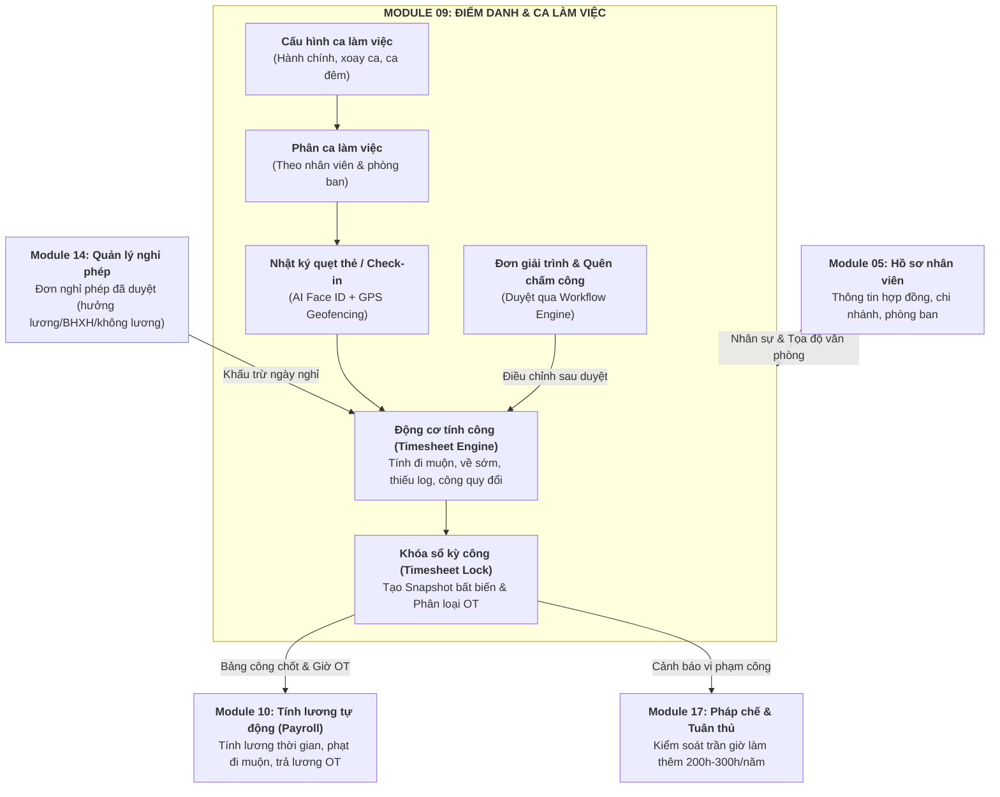
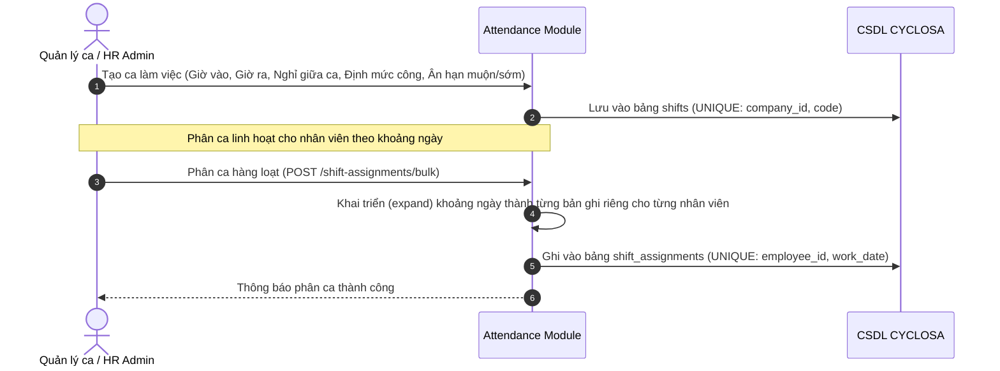
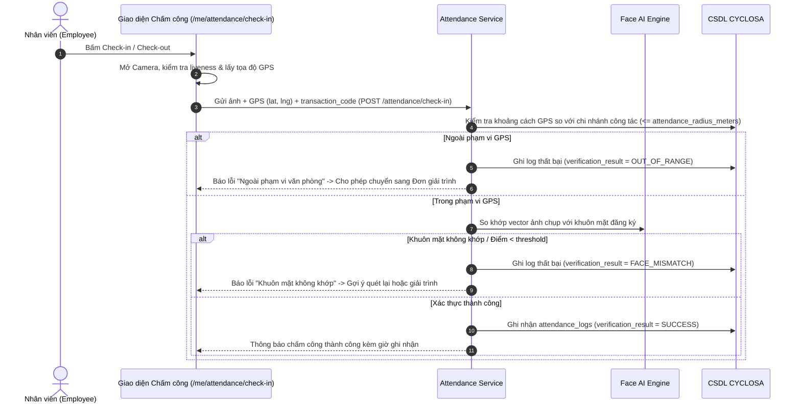
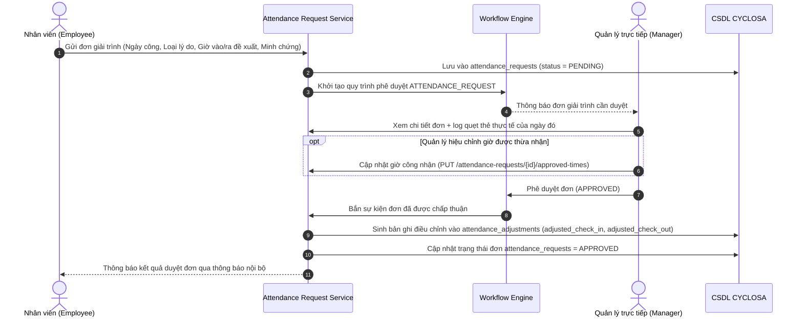
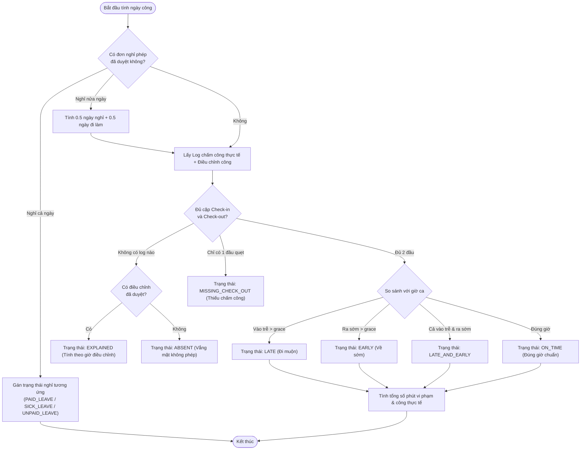
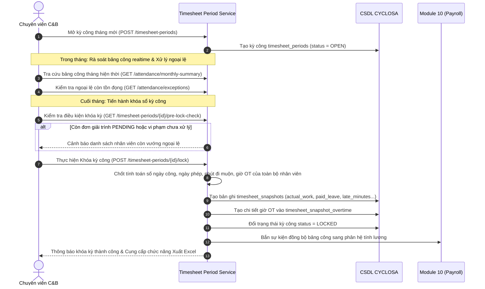
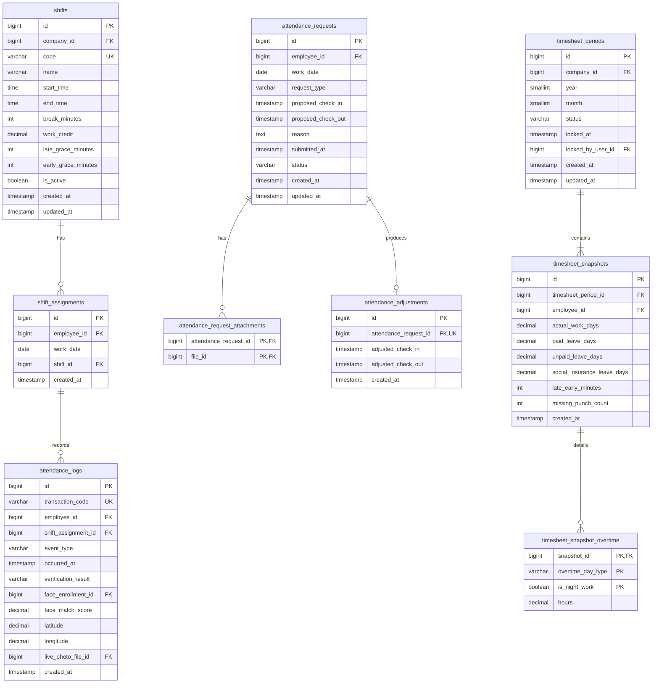
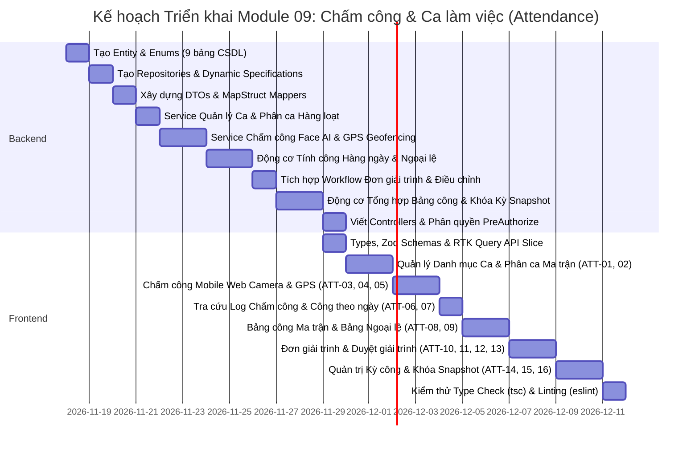

# TÀI LIỆU ĐẶC TẢ NGHIỆP VỤ & THIẾT KẾ KỸ THUẬT
## MODULE 09: ĐIỂM DANH & CA LÀM VIỆC (ATTENDANCE & TIME TRACKING - ATT)

> **Tài liệu tham chiếu:**
> - Nghiệp vụ tổng thể: [`Nghiep-vu.docx`](file:///f:/Project/CYCLOSA/ba/Nghiep-vu.docx) (§9 Điểm danh & Ca làm việc)
> - Thiết kế CSDL chi tiết: [`database.md`](file:///f:/Project/CYCLOSA/ba/database.md) (§8.10 Module 9 — Chấm công & Ca làm việc, dòng 2653–2890)
> - Danh mục API hệ thống: [`api-list.md`](file:///f:/Project/CYCLOSA/ba/api-list.md) (§9 Chấm công & Ca làm việc, dòng 856–926, 39 endpoints)
> - Danh mục màn hình UI: [`page-list.md`](file:///f:/Project/CYCLOSA/ba/page-list.md) (§5.10 ATT-01 đến ATT-16)
> - Lộ trình triển khai: [`thu-tu-code-module.md`](file:///f:/Project/CYCLOSA/ba/thu-tu-code-module.md) (Giai đoạn 4: Vận hành thường nhật)

---

## 1. TỔNG QUAN & MỤC TIÊU NGHIỆP VỤ

### 1.1. Vị trí của Module 09 trong Hệ sinh thái CYCLOSA HRM
Module **Điểm danh & Ca làm việc (Attendance - ATT)** là "trái tim vận hành hàng ngày" của hệ thống CYCLOSA HRM. Module này thu thập dữ liệu sống từ các lượt vào/ra của nhân viên, đối soát với ca làm việc và đơn nghỉ phép (M14) để tạo nên **Bảng công tháng (`Monthly Timesheet`)** — căn cứ pháp lý và số liệu bắt buộc đầu vào cho **Module 10: Bảng lương tự động (Payroll)**.

### 1.2. Mục tiêu Nghiệp vụ Cốt lõi
1. **Tuân thủ 100% Bộ luật Lao động Việt Nam 2019:**
   - Kiểm soát thời giờ làm việc bình thường: Không quá 8 giờ/ngày và không quá 48 giờ/tuần.
   - Phân loại và tính lũy tiến giờ làm thêm (OT): Ngày thường tối thiểu 150%, ngày nghỉ hàng tuần tối thiểu 200%, ngày nghỉ lễ/Tết tối thiểu 300%.
   - Phụ trội làm việc vào ban đêm: Tính từ 22:00 hôm trước đến 06:00 sáng hôm sau, phụ trội thêm ít nhất 30% lương.
2. **Nguyên tắc "Append-Only Log" (Nhật ký bất biến tuyệt đối):**
   - Mọi lượt chấm công (Check-in/Check-out) kể cả thành công hay thất bại đều được ghi nhận vĩnh viễn vào bảng `attendance_logs` kèm mã giao dịch độc nhất `transaction_code`.
   - Tuyệt đối không xóa hay ghi đè log gốc. Các trường hợp quên chấm công, máy chấm công hỏng, đi công tác được giải quyết bằng đơn giải trình (`attendance_requests`) và lưu vết điều chỉnh riêng biệt tại `attendance_adjustments`.
3. **Nguyên tắc "Derived State" (Dữ liệu Suy diễn Động):**
   - Trạng thái công hàng ngày (`ON_TIME`, `LATE`, `EARLY`, `LATE_AND_EARLY`, `MISSING_CHECK_OUT`, `ABSENT`, `EXPLAINED`), số phút đi muộn, số phút về sớm và công quy đổi **hoàn toàn là dữ liệu suy diễn**, được tính động từ:
     $$\text{Kết quả ngày} = f(\text{Ca làm việc}, \text{Lịch phân ca}, \text{Log chấm công}, \text{Điều chỉnh công}, \text{Đơn nghỉ phép})$$
4. **Xác thực Đa nhân tố Thông minh (AI Face Verification + GPS Geofencing):**
   - So khớp khuôn mặt 1:1 với mẫu sinh trắc học đã đăng ký trong hồ sơ nhân viên (`face_enrollments`), hỗ trợ kiểm tra người thật (`liveness detection`).
   - Kiểm tra định vị GPS trong bán kính cho phép (`attendance_radius_meters`) của chi nhánh/văn phòng làm việc.
5. **Cơ chế Khóa kỳ công 2 lớp (Pre-lock Verification & Immutable Snapshot):**
   - Trước khi khóa kỳ, hệ thống kiểm tra và cảnh báo danh sách đơn giải trình chưa duyệt, các ngày chưa đủ lượt chấm công.
   - Khi khóa kỳ công (`LOCKED`), hệ thống đóng băng toàn bộ số liệu và tạo bản chụp `timesheet_snapshots` cùng bảng chi tiết làm thêm giờ `timesheet_snapshot_overtime` phục vụ trực tiếp cho kỳ lương.

---

## 2. QUY TRÌNH NGHIỆP VỤ CHI TIẾT (BUSINESS WORKFLOWS)

### 2.1. Luồng 1: Thiết lập Ca làm việc & Phân ca (Shift & Shift Assignment)
HR Admin hoặc Quản lý ca thiết lập danh mục ca làm việc của doanh nghiệp.

* **Quy tắc ca làm việc:**
  - Ca qua đêm (Night Shift): Khi `end_time < start_time` (ví dụ: ca từ 22:00 đến 06:00 sáng hôm sau).
  - Định mức công (`work_credit`): Ca chuẩn 8 tiếng được tính 1.0 công; ca nửa ngày (sáng/chiều) tính 0.5 công.
  - Dung sai ân hạn (`grace_minutes`): Cho phép nhân viên đi muộn trong khoảng ân hạn (ví dụ: 15 phút) mà không bị phạt đi muộn.
  - Ca mặc định: Nếu một ngày nhân viên không được phân ca riêng $\to$ Hệ thống tự động áp dụng ca mặc định từ cấu hình hệ thống `attendance.default_shift_id`.

---

### 2.2. Luồng 2: Chấm công Trực tuyến bằng Khuôn mặt & Định vị GPS (Check-in / Check-out)
Nhân viên sử dụng ứng dụng di động hoặc giao diện Web mở camera để thực hiện chấm công hàng ngày.

* **Bảng mã kết quả xác thực (`VerificationResult`):**
  - `SUCCESS`: Khuôn mặt khớp $\ge$ ngưỡng và tọa độ GPS nằm trong bán kính hợp lệ.
  - `OUT_OF_RANGE`: Tọa độ GPS nằm ngoài bán kính văn phòng/chi nhánh của công ty.
  - `FACE_MISMATCH`: Điểm so khớp khuôn mặt thấp hơn ngưỡng cho phép (`attendance.face_match_threshold`).
  - `LIVENESS_FAILED`: Không vượt qua bài kiểm tra người thật (phát hiện chụp lại ảnh tĩnh/video).
  - `NO_ENROLLMENT`: Nhân viên chưa đăng ký mẫu khuôn mặt hoặc mẫu đã bị vô hiệu hóa.
  - `LOW_IMAGE_QUALITY`: Ảnh quá mờ, ngược sáng hoặc không phát hiện thấy khuôn mặt.
  - `DUPLICATE_OR_SEQUENCE_ERROR`: Quẹt thẻ quá nhanh trong khoảng thời gian chống spam (`punch_window`).

---

### 2.3. Luồng 3: Đơn giải trình & Chấm công ngoại lệ (Attendance Request)
Khi có sự cố (quên quẹt thẻ, công tác đột xuất, lỗi thiết bị, xác thực thất bại), nhân viên gửi đơn giải trình để được công nhận giờ công.

* **Quy tắc điều chỉnh:**
  - Bản ghi `attendance_adjustments` được tạo ra gắn chặt với `attendance_request_id` (`UNIQUE`).
  - Giờ vào/ra trong `attendance_adjustments` sẽ được Động cơ tính công ưu tiên ghi đè lên log thô để tính lại trạng thái công của ngày đó thành `EXPLAINED`.

---

### 2.4. Luồng 4: Động cơ Tính công Hàng ngày & Phát hiện Bất thường (Daily Calculation Engine)
Mỗi ngày làm việc của nhân viên được tính toán độc lập để xác định trạng thái và định mức công:

---

### 2.5. Luồng 5: Đăng ký & Tính toán Làm thêm giờ (Overtime - OT)
Làm thêm giờ được phân loại theo tính chất ngày làm việc theo quy định tại Điều 98 Bộ luật Lao động:

| Loại ngày OT (`OvertimeDayType`) | Hệ số lương tối thiểu | Ca làm việc ban đêm (22:00 - 06:00) |
|---|---|---|
| **NORMAL_DAY** (Ngày làm việc trong tuần) | **150%** | Cộng thêm ít nhất 30% lương = **200% - 210%** |
| **WEEKEND** (Ngày nghỉ hàng tuần: Thứ 7/CN) | **200%** | Cộng thêm ít nhất 30% lương = **270%** |
| **PUBLIC_HOLIDAY** (Ngày nghỉ Lễ, Tết, Nghỉ phép) | **300%** *(chưa kể tiền lương ngày lễ)* | Cộng thêm ít nhất 30% lương = **390%** |

* Giờ làm thêm hợp lệ được ghi nhận khi có đơn đề xuất OT được duyệt kết hợp với thời gian quẹt thẻ thực tế sau giờ ca.

---

### 2.6. Luồng 6: Tổng hợp Bảng công Tháng & Khóa sổ Kỳ công (Timesheet Period Lock)
Hàng tháng, chuyên viên C&B thực hiện đối soát và khóa sổ bảng công để chuyển sang tính lương.

* **Mở khóa kỳ công có kiểm soát (`Unlock Period`):**
  - Chỉ có cấp lãnh đạo có thẩm quyền (`attendance.period_unlock`) mới được mở khóa kỳ đã đóng.
  - Bắt buộc phải cung cấp lý do giải trình rõ ràng (`reason`).
  - Hệ thống tự động ghi nhật ký kiểm toán hành động `UNLOCK` vào `audit_logs`. Khi khóa lại, hệ thống sẽ tính toán và cập nhật đè Snapshot mới nhất.

---

## 3. THIẾT KẾ CƠ SỞ DỮ LIỆU CHI TIẾT (DATABASE DESIGN)

### 3.1. Sơ đồ Quan hệ Thực thể (Entity Relationship Diagram)

---

### 3.2. Đặc tả Bảng Dữ liệu & Ràng buộc

#### 1. Bảng `shifts` — Danh mục Ca làm việc
* Lưu trữ các cấu hình ca làm việc trong doanh nghiệp.
* **Ràng buộc:** `UNIQUE (company_id, code)`. Không được xóa ca nếu đã phát sinh dữ liệu trong `shift_assignments`.

| Tên trường | Kiểu dữ liệu | Nullable | Mô tả & Ràng buộc |
|---|---|---|---|
| `id` | `BIGINT` | NO | Khóa chính tự tăng (hoặc UUID) |
| `company_id` | `BIGINT` | NO | FK $\to$ `companies.id` |
| `code` | `VARCHAR(30)` | NO | Mã ca (VD: `HC_01`, `CA_SANG`, `CA_DEM`) |
| `name` | `VARCHAR(100)` | NO | Tên hiển thị (Ca hành chính 8h-17h, Ca sáng) |
| `start_time` | `TIME` | NO | Giờ bắt đầu ca (VD: `08:00:00`) |
| `end_time` | `TIME` | NO | Giờ kết thúc ca (nếu < `start_time` là ca qua đêm) |
| `break_minutes` | `INT` | NO | Thời gian nghỉ giữa ca (phút, VD: 60) |
| `work_credit` | `DECIMAL(3,2)` | NO | Định mức công của ca (VD: `1.00`, `0.50`) |
| `late_grace_minutes` | `INT` | NO | Số phút cho phép vào trễ không tính vi phạm (VD: 15) |
| `early_grace_minutes` | `INT` | NO | Số phút cho phép về sớm không tính vi phạm (VD: 0) |
| `is_active` | `BOOLEAN` | NO | Cờ trạng thái kích hoạt (mặc định: `true`) |
| `is_deleted` | `BOOLEAN` | NO | Cờ xóa mềm (Soft delete) |
| `created_at` / `updated_at` | `TIMESTAMP` | NO | Thời gian tạo và cập nhật |

#### 2. Bảng `shift_assignments` — Phân ca làm việc theo ngày
* Lưu trữ ca làm việc được chỉ định cho từng nhân viên theo từng ngày cụ thể.
* **Ràng buộc:** `UNIQUE (employee_id, work_date)`. Nếu một ngày không có dòng phân ca, hệ thống tự động gán ca mặc định theo cấu hình hệ thống.

| Tên trường | Kiểu dữ liệu | Nullable | Mô tả & Ràng buộc |
|---|---|---|---|
| `id` | `BIGINT` | NO | Khóa chính |
| `employee_id` | `BIGINT` | NO | FK $\to$ `employees.id` |
| `work_date` | `DATE` | NO | Ngày làm việc được phân ca |
| `shift_id` | `BIGINT` | NO | FK $\to$ `shifts.id` |
| `created_at` | `TIMESTAMP` | NO | Thời gian tạo bản ghi |

#### 3. Bảng `attendance_logs` — Nhật ký Chấm công gốc (Append-Only)
* Ghi lại chi tiết từng lượt bấm chấm công của nhân viên. Ghi cả các lượt thất bại để phục vụ điều tra và đối soát.
* **Ràng buộc:** `UNIQUE (transaction_code)`. Index trên `(employee_id, occurred_at)`.

| Tên trường | Kiểu dữ liệu | Nullable | Mô tả & Ràng buộc |
|---|---|---|---|
| `id` | `BIGINT` | NO | Khóa chính |
| `transaction_code` | `VARCHAR(64)` | NO | Mã giao dịch chấm công duy nhất chống trùng lặp |
| `employee_id` | `BIGINT` | NO | FK $\to$ `employees.id` |
| `shift_assignment_id` | `BIGINT` | YES | FK $\to$ `shift_assignments.id` (NULL nếu dùng ca mặc định) |
| `event_type` | `VARCHAR(20)` | NO | `CHECK_IN` hoặc `CHECK_OUT` |
| `occurred_at` | `TIMESTAMP` | NO | Thời điểm nhân viên quẹt thẻ thực tế |
| `verification_result` | `VARCHAR(30)` | NO | Kết quả xác thực (`SUCCESS`, `OUT_OF_RANGE`, `FACE_MISMATCH`,...) |
| `face_enrollment_id` | `BIGINT` | YES | FK $\to$ `face_enrollments.id` (mẫu khuôn mặt được so khớp) |
| `face_match_score` | `DECIMAL(5,2)` | YES | Điểm số so khớp khuôn mặt (VD: `94.50`) |
| `latitude` | `DECIMAL(9,6)` | YES | Tọa độ vĩ độ GPS từ thiết bị |
| `longitude` | `DECIMAL(9,6)` | YES | Tọa độ kinh độ GPS từ thiết bị |
| `live_photo_file_id` | `BIGINT` | YES | FK $\to$ `files.id` (ảnh chụp trực tiếp khi chấm công) |
| `created_at` | `TIMESTAMP` | NO | Thời điểm ghi log vào hệ thống |

#### 4. Bảng `attendance_requests` — Đơn Giải trình / Chấm công ngoại lệ
* Quản lý các đề xuất xin bổ sung giờ công hoặc giải trình sự cố. Định tuyến qua Workflow Engine `ATTENDANCE_REQUEST`.

| Tên trường | Kiểu dữ liệu | Nullable | Mô tả & Ràng buộc |
|---|---|---|---|
| `id` | `BIGINT` | NO | Khóa chính |
| `employee_id` | `BIGINT` | NO | FK $\to$ `employees.id` |
| `work_date` | `DATE` | NO | Ngày làm việc cần giải trình |
| `request_type` | `VARCHAR(30)` | NO | Loại lý do (`FORGOT_PUNCH`, `TIME_DEVIATION`, `DEVICE_FAILURE`,...) |
| `proposed_check_in` | `TIMESTAMP` | YES | Giờ vào đề xuất công nhận |
| `proposed_check_out`| `TIMESTAMP` | YES | Giờ ra đề xuất công nhận |
| `reason` | `TEXT` | NO | Lý do giải trình chi tiết |
| `submitted_at` | `TIMESTAMP` | NO | Thời gian gửi đơn |
| `status` | `VARCHAR(20)` | NO | `PENDING`, `APPROVED`, `REJECTED`, `CANCELLED` |

#### 5. Bảng `attendance_adjustments` — Bản ghi Điều chỉnh công sau duyệt
* Được sinh tự động khi đơn giải trình được phê duyệt. Tuyệt đối không ghi đè lên `attendance_logs`.
* **Ràng buộc:** `UNIQUE (attendance_request_id)`.

| Tên trường | Kiểu dữ liệu | Nullable | Mô tả & Ràng buộc |
|---|---|---|---|
| `id` | `BIGINT` | NO | Khóa chính |
| `attendance_request_id` | `BIGINT` | NO | FK $\to$ `attendance_requests.id`, UQ |
| `adjusted_check_in` | `TIMESTAMP` | YES | Giờ vào chính thức được thừa nhận |
| `adjusted_check_out`| `TIMESTAMP` | YES | Giờ ra chính thức được thừa nhận |
| `created_at` | `TIMESTAMP` | NO | Thời điểm áp dụng điều chỉnh |

#### 6. Bảng `timesheet_periods` — Kỳ công tháng
* Quản lý trạng thái mở/khóa sổ của từng tháng làm việc trong công ty.
* **Ràng buộc:** `UNIQUE (company_id, year, month)`.

| Tên trường | Kiểu dữ liệu | Nullable | Mô tả & Ràng buộc |
|---|---|---|---|
| `id` | `BIGINT` | NO | Khóa chính |
| `company_id` | `BIGINT` | NO | FK $\to$ `companies.id` |
| `year` | `SMALLINT` | NO | Năm công (VD: 2026) |
| `month` | `SMALLINT` | NO | Tháng công (1 - 12) |
| `status` | `VARCHAR(20)` | NO | `OPEN` (Đang mở/tính toán) hoặc `LOCKED` (Đã khóa) |
| `locked_at` | `TIMESTAMP` | YES | Thời điểm khóa sổ kỳ công |
| `locked_by_user_id`| `BIGINT` | YES | FK $\to$ `users.id` (người thực hiện khóa kỳ) |

#### 7. Bảng `timesheet_snapshots` — Bản chụp Bảng công tháng chốt
* Lưu trữ bức tranh toàn cảnh về công của từng nhân viên tại thời điểm khóa kỳ.

| Tên trường | Kiểu dữ liệu | Nullable | Mô tả & Ràng buộc |
|---|---|---|---|
| `id` | `BIGINT` | NO | Khóa chính |
| `timesheet_period_id` | `BIGINT` | NO | FK $\to$ `timesheet_periods.id` |
| `employee_id` | `BIGINT` | NO | FK $\to$ `employees.id` |
| `actual_work_days` | `DECIMAL(5,2)` | NO | Tổng số ngày công làm việc thực tế |
| `paid_leave_days` | `DECIMAL(5,2)` | NO | Số ngày nghỉ hưởng nguyên lương (phép năm, lễ tết, việc riêng) |
| `unpaid_leave_days` | `DECIMAL(5,2)` | NO | Số ngày nghỉ không hưởng lương |
| `social_insurance_leave_days` | `DECIMAL(5,2)` | NO | Số ngày nghỉ chế độ BHXH (ốm đau, thai sản) |
| `late_early_minutes`| `INT` | NO | Tổng số phút đi muộn + về sớm trong tháng |
| `missing_punch_count`| `INT` | NO | Số lượt quên quẹt thẻ chưa giải trình |

#### 8. Bảng `timesheet_snapshot_overtime` — Chi tiết Giờ làm thêm
* Lưu chi tiết số giờ làm thêm theo từng loại ngày và ca đêm cho từng snapshot.
* **Khóa chính kết hợp:** `(snapshot_id, overtime_day_type, is_night_work)`.

| Tên trường | Kiểu dữ liệu | Nullable | Mô tả & Ràng buộc |
|---|---|---|---|
| `snapshot_id` | `BIGINT` | NO | FK $\to$ `timesheet_snapshots.id` |
| `overtime_day_type` | `VARCHAR(20)` | NO | `NORMAL_DAY`, `WEEKEND`, `PUBLIC_HOLIDAY` |
| `is_night_work` | `BOOLEAN` | NO | Làm việc ban đêm (từ 22:00 đến 06:00) |
| `hours` | `DECIMAL(5,2)` | NO | Số giờ làm thêm lũy kế |

---

## 4. THIẾT KẾ HỆ THỐNG API (API ENDPOINTS SPECIFICATION)

Dựa trên danh mục chuẩn **39 API** tại `api-list.md` (§9 Chấm công & Ca làm việc):

### 4.1. Nhóm 1: Quản lý Ca làm việc (`ShiftController` - `/api/v1/shifts`)

| STT | Method | Đường dẫn API | Mô tả chức năng | Quyền hạn | Ghi chú tích hợp |
| :-: | :--- | :--- | :--- | :-: | :--- |
| 1 | `GET` | `/api/v1/shifts` | Danh sách ca làm việc (Lọc active, phân trang) | `attendance.view` | Màn hình `ATT-01` |
| 2 | `POST` | `/api/v1/shifts` | Tạo mới ca làm việc | `attendance.shift_manage` | Modal thêm ca |
| 3 | `GET` | `/api/v1/shifts/{id}` | Chi tiết ca làm việc | `attendance.view` | Xem cấu hình ca |
| 4 | `PUT` | `/api/v1/shifts/{id}` | Cập nhật cấu hình ca làm việc | `attendance.shift_manage` | Modal sửa ca |
| 5 | `POST` | `/api/v1/shifts/{id}/activate` | Kích hoạt ca làm việc | `attendance.shift_manage` | Đổi trạng thái ca |
| 6 | `POST` | `/api/v1/shifts/{id}/deactivate` | Ngừng sử dụng ca làm việc | `attendance.shift_manage` | Tắt kích hoạt |
| 7 | `DELETE` | `/api/v1/shifts/{id}` | Xóa ca làm việc (chỉ xóa khi chưa có phân ca) | `attendance.shift_manage` | Bảo vệ toàn vẹn |

### 4.2. Nhóm 2: Phân ca làm việc (`ShiftAssignmentController` - `/api/v1/shift-assignments`)

| STT | Method | Đường dẫn API | Mô tả chức năng | Quyền hạn | Ghi chú tích hợp |
| :-: | :--- | :--- | :--- | :-: | :--- |
| 8 | `GET` | `/api/v1/shift-assignments` | Danh sách phân ca (theo nhân viên, phòng ban, ngày) | `attendance.view` | Màn hình `ATT-02` |
| 9 | `POST` | `/api/v1/shift-assignments/bulk` | Phân ca hàng loạt theo khoảng ngày cho nhiều nhân viên | `attendance.shift_manage` | Khai triển theo từng ngày |
| 10 | `PUT` | `/api/v1/shift-assignments/{id}` | Đổi ca làm việc của một ngày cụ thể | `attendance.shift_manage` | Thao tác đổi ca nhanh |
| 11 | `DELETE` | `/api/v1/shift-assignments/{id}` | Xóa phân ca của một ngày | `attendance.shift_manage` | Xóa ca trả về mặc định |
| 12 | `GET` | `/api/v1/me/shifts` | Tra cứu lịch ca cá nhân của tôi (theo khoảng ngày) | `Auth` | Màn hình `ATT-05` (ESS) |

### 4.3. Nhóm 3: Chấm công Khuôn mặt + GPS & Tra cứu Log (`AttendanceController` - `/api/v1/attendance`)

| STT | Method | Đường dẫn API | Mô tả chức năng | Quyền hạn | Ghi chú tích hợp |
| :-: | :--- | :--- | :--- | :-: | :--- |
| 13 | `POST` | `/api/v1/attendance/check-in` | Check-in: Gửi ảnh camera, liveness, GPS, transactionCode | `Auth` | Màn hình `ATT-03` (Mobile/Web) |
| 14 | `POST` | `/api/v1/attendance/check-out` | Check-out: Gửi ảnh camera, liveness, GPS, transactionCode | `Auth` | Màn hình `ATT-03` (Mobile/Web) |
| 15 | `GET` | `/api/v1/me/attendance/today` | Trạng thái chấm công ngày hôm nay của tôi | `Auth` | Widget đầu trang Dashboard |
| 16 | `GET` | `/api/v1/me/attendance/logs` | Nhật ký các lượt quẹt thẻ của tôi | `Auth` | Màn hình `ATT-04` (ESS) |
| 17 | `GET` | `/api/v1/attendance/logs` | Tra cứu log chấm công toàn công ty (Lọc kết quả xác thực) | `attendance.view` | Màn hình `ATT-06` |
| 18 | `GET` | `/api/v1/attendance/logs/{id}` | Chi tiết log chấm công (Tọa độ GPS bản đồ, ảnh live) | `attendance.view` | Drawer xem chi tiết log |
| 19 | `GET` | `/api/v1/me/attendance/daily-records` | Kết quả ngày công của tôi (đi muộn, về sớm, thiếu log) | `Auth` | Màn hình `ATT-04` (ESS) |
| 20 | `GET` | `/api/v1/attendance/daily-records` | Kết quả công theo ngày của nhân viên/phòng ban | `attendance.view` | Màn hình `ATT-07` |
| 21 | `GET` | `/api/v1/attendance/monthly-summary` | Bảng công tháng hiện thời (tính trực tiếp, chưa khóa) | `attendance.view` | Màn hình `ATT-08` |
| 22 | `GET` | `/api/v1/attendance/exceptions` | Danh sách ngoại lệ cần xử lý (vắng mặt, lỗi xác thực) | `attendance.view` | Màn hình `ATT-09` |

### 4.4. Nhóm 4: Đơn giải trình & Điều chỉnh công (`AttendanceRequestController` - `/api/v1/attendance-requests`)

| STT | Method | Đường dẫn API | Mô tả chức năng | Quyền hạn | Ghi chú tích hợp |
| :-: | :--- | :--- | :--- | :-: | :--- |
| 23 | `POST` | `/api/v1/attendance-requests` | Gửi đơn giải trình (Workflow `ATTENDANCE_REQUEST`) | `Auth` | Màn hình `ATT-10` (ESS) |
| 24 | `GET` | `/api/v1/me/attendance-requests` | Lịch sử đơn giải trình của tôi | `Auth` | Màn hình `ATT-10` (ESS) |
| 25 | `GET` | `/api/v1/attendance-requests` | Danh sách đơn giải trình toàn công ty | `attendance.view` | Màn hình `ATT-11` |
| 26 | `GET` | `/api/v1/attendance-requests/{id}` | Chi tiết đơn giải trình và bản ghi điều chỉnh phát sinh | `Auth` | Màn hình `ATT-12` |
| 27 | `POST` | `/api/v1/attendance-requests/{id}/attachments` | Đính kèm minh chứng cho đơn giải trình | `Auth` | Upload file minh chứng |
| 28 | `POST` | `/api/v1/attendance-requests/{id}/cancel` | Hủy đơn giải trình khi còn trạng thái PENDING | `Auth` | Hủy đơn của tôi |
| 29 | `PUT` | `/api/v1/attendance-requests/{id}/approved-times` | Người duyệt hiệu chỉnh giờ được thừa nhận trước khi duyệt | `attendance.approve` | Thao tác duyệt cấp cao |
| 30 | `GET` | `/api/v1/attendance-adjustments` | Danh sách bản ghi điều chỉnh công sau phê duyệt | `attendance.view` | Màn hình `ATT-13` |

### 4.5. Nhóm 5: Quản lý Kỳ công & Khóa sổ Snapshot (`TimesheetPeriodController` - `/api/v1/timesheet-periods`)

| STT | Method | Đường dẫn API | Mô tả chức năng | Quyền hạn | Ghi chú tích hợp |
| :-: | :--- | :--- | :--- | :-: | :--- |
| 31 | `GET` | `/api/v1/timesheet-periods` | Danh sách kỳ công tháng theo năm | `attendance.view` | Màn hình `ATT-14` |
| 32 | `POST` | `/api/v1/timesheet-periods` | Mở kỳ công tháng mới (year, month) | `attendance.period_manage` | Nút Mở kỳ công |
| 33 | `GET` | `/api/v1/timesheet-periods/{id}` | Chi tiết kỳ công tháng | `attendance.view` | Màn hình `ATT-15` |
| 34 | `GET` | `/api/v1/timesheet-periods/{id}/pre-lock-check` | Kiểm tra trước khi khóa kỳ (ngoại lệ chưa giải quyết) | `attendance.period_manage` | Hộp thoại cảnh báo |
| 35 | `POST` | `/api/v1/timesheet-periods/{id}/lock` | Khóa sổ kỳ công, sinh Snapshot và đồng bộ Payroll | `attendance.period_manage` | Khóa bất biến kỳ công |
| 36 | `POST` | `/api/v1/timesheet-periods/{id}/unlock` | Mở khóa có kiểm soát (yêu cầu nhập lý do, ghi Audit) | `attendance.period_unlock` | Mở khóa ngoại lệ |
| 37 | `GET` | `/api/v1/timesheet-periods/{id}/snapshots` | Bảng công đã chốt kèm chi tiết giờ làm thêm (OT) | `attendance.view` | Bảng công chốt |
| 38 | `GET` | `/api/v1/me/timesheet-snapshots` | Bảng công đã chốt của cá nhân tôi theo năm | `Auth` | Màn hình `ATT-16` (ESS) |
| 39 | `GET` | `/api/v1/timesheet-periods/{id}/export` | Xuất file Excel bảng công tháng (xử lý bất đồng bộ) | `attendance.export` | Nút Xuất Excel |

---

## 5. THIẾT KẾ GIAO DIỆN NGƯỜI DÙNG (FRONTEND SCREENS SPECIFICATION)

Dựa trên danh mục **16 màn hình UI** tại `page-list.md` (§5.10 ATT-01 đến ATT-16):

| Mã MH | Route URL | Loại trang | Vai trò truy cập | Thành phần & Nghiệp vụ giao diện chính | Ghi chú |
|:---:|---|---|---|---|---|
| **ATT-01** | `/attendance/shifts` | `LIST & MODAL` | HR Admin / Ca trưởng | Bảng danh mục ca làm việc (Giờ vào/ra, nghỉ giữa ca, định mức công, dung sai muộn/sớm, cờ ca đêm). Modal thêm/sửa ca, nút bật/tắt kích hoạt, nút xóa ca chưa dùng. | Quản lý ca |
| **ATT-02** | `/attendance/shift-assignments` | `CALENDAR & MATRIX` | HR / Quản lý ca | Lưới lịch phân ca trực quan theo Ma trận Nhân viên $\times$ Ngày trong tháng. Modal **Phân ca hàng loạt** theo khoảng ngày/phòng ban. Thao tác click đổi ca nhanh của từng ngày. | Phân ca |
| **ATT-03** | `/me/attendance/check-in` | `MOBILE / WEB CAMERA` | Toàn bộ nhân viên | Giao diện quẹt thẻ thông minh: Hiển thị ca làm việc hôm nay, nút **Check-in / Check-out** mở camera kiểm tra liveness và lấy tọa độ GPS. Hiển thị thông báo kết quả; khi lỗi cho phép thử lại hoặc bấm phím tắt tạo đơn giải trình. | Sẽ bổ sung vào ESS sau |
| **ATT-04** | `/me/attendance` | `DASHBOARD & TABS` | Toàn bộ nhân viên | Tab 1: **Nhật ký quẹt thẻ** (lịch sử chi tiết theo ngày). Tab 2: **Kết quả tính công theo ngày** (hiển thị rõ số phút đi muộn, về sớm, thiếu quẹt, công được tính). | Sẽ bổ sung vào ESS sau |
| **ATT-05** | `/me/shifts` | `CALENDAR` | Toàn bộ nhân viên | Lịch làm việc cá nhân dạng tháng: hiển thị mã màu ca làm việc được phân, các ngày nghỉ tuần và ngày Lễ/Tết quốc gia. | Sẽ bổ sung vào ESS sau |
| **ATT-06** | `/attendance/logs` | `LIST & DRAWER` | HR / Trưởng phòng | Tra cứu nhật ký log chấm công gốc toàn công ty. Lọc theo nhân viên, ngày, kết quả xác thực. Drawer hiển thị chi tiết log: điểm so khớp khuôn mặt, vị trí GPS trên bản đồ OpenStreetMap và ảnh chụp trực tiếp. | Tra cứu log |
| **ATT-07** | `/attendance/daily-records` | `LIST & FILTER` | HR / Quản lý | Bảng kết quả công hàng ngày của toàn thể nhân viên. Lọc theo phòng ban, trạng thái (`ON_TIME`, `LATE`, `EARLY`, `MISSING_CHECK_OUT`, `ABSENT`, `EXPLAINED`). | Đối soát ngày |
| **ATT-08** | `/attendance/monthly-summary` | `MATRIX VIEW` | HR / Ban giám đốc | Ma trận bảng công tháng thời gian thực (chưa khóa): Dòng là nhân viên, cột là các ngày trong tháng hiển thị ký hiệu công (`1.0`, `0.5`, `P`, `KL`, `V`). Thống kê tổng công, tổng phút đi muộn. | Bảng công sống |
| **ATT-09** | `/attendance/exceptions` | `ACTION BOARD` | HR / Chuyên viên C&B | Bảng điều hành các ngoại lệ cần xử lý gấp: Danh sách nhân viên thiếu chấm công, các ca xác thực thất bại, các ngày vắng chưa có đơn xin nghỉ; phím tắt nhắc nhở nhân viên hoặc tạo giải trình hộ. | Xử lý ngoại lệ |
| **ATT-10** | `/me/attendance-requests` | `LIST & MODAL` | Toàn bộ nhân viên | Quản lý đơn giải trình của tôi: Thống kê trạng thái đơn. Modal tạo đơn giải trình mới (chọn ngày lỗi, loại lý do, nhập giờ đề xuất, tải file bằng chứng). Nút hủy đơn chờ duyệt. | Sẽ bổ sung vào ESS sau |
| **ATT-11** | `/attendance/requests` | `LIST & FILTER` | HR / Quản lý duyệt | Danh sách các đơn giải trình của nhân viên thuộc thẩm quyền quản lý. Bộ lọc trạng thái (`PENDING`, `APPROVED`, `REJECTED`), lọc phòng ban, khoảng ngày. Nút xem chi tiết. | Quản lý đơn |
| **ATT-12** | `/attendance/requests/:id` | `DETAIL & ACTIONS` | Người gửi / Người duyệt | Xem chi tiết đơn giải trình, ảnh bằng chứng đính kèm, lịch sử quẹt thẻ thực tế của ngày đó, tiến trình phê duyệt Workflow. Người duyệt có quyền **hiệu chỉnh lại giờ được công nhận** trước khi bấm duyệt. | Chi tiết giải trình |
| **ATT-13** | `/attendance/adjustments` | `AUDIT LIST` | HR / Thanh tra nội bộ | Bảng truy vết toàn bộ các bản ghi điều chỉnh công phát sinh từ đơn giải trình đã duyệt, đảm bảo tính minh bạch và không bao giờ ghi đè log gốc. | Nhật ký điều chỉnh |
| **ATT-14** | `/attendance/periods` | `LIST & MODAL` | Chuyên viên C&B | Danh sách các kỳ công theo năm kèm trạng thái (`OPEN` / `LOCKED`), người khóa và thời điểm khóa. Modal tạo mới kỳ công tháng. | Quản lý kỳ công |
| **ATT-15** | `/attendance/periods/:id` | `DETAIL & MANAGEMENT` | Chuyên viên C&B | Chi tiết kỳ công tháng: Hộp thoại **Kiểm tra trước khi khóa (`Pre-lock check`)**; Nút **Khóa sổ kỳ công**; Nút **Mở khóa ngoại lệ** (bắt buộc nhập lý do); Bảng công đã chốt kèm các cột OT; Nút **Xuất Excel bảng công**. | Quản trị kỳ công |
| **ATT-16** | `/me/timesheets` | `LIST & DETAIL` | Toàn bộ nhân viên | Tra cứu bảng công đã chốt chính thức của tôi theo từng tháng trong năm (số ngày công thực tế, ngày phép hưởng lương, số giờ OT được ghi nhận). | Sẽ bổ sung vào ESS sau |

---

## 6. DANH MỤC MÃ LỖI & QUY TẮC KIỂM TRA HỢP LỆ (ERROR CODES & VALIDATION)

| Mã HTTP | Business Error Code | Thông báo lỗi tiếng Việt | Điều kiện kích hoạt |
|:---:|---|---|---|
| 404 | `SHIFT_NOT_FOUND` | Không tìm thấy ca làm việc yêu cầu | ID ca làm việc không tồn tại trong CSDL |
| 409 | `SHIFT_CODE_DUPLICATED` | Mã ca làm việc đã tồn tại trong doanh nghiệp | Trùng mã ca `code` trong cùng công ty |
| 400 | `CANNOT_DELETE_ASSIGNED_SHIFT` | Không thể xóa ca làm việc đã được phân cho nhân viên | Đã có bản ghi tham chiếu trong `shift_assignments` |
| 400 | `INVALID_SHIFT_HOURS` | Thời gian ca làm việc và giờ nghỉ không hợp lệ | `break_minutes` lớn hơn tổng thời lượng ca |
| 409 | `OVERLAPPING_SHIFT_ASSIGNMENT` | Nhân viên đã được phân ca làm việc khác trong ngày này | Vi phạm unique `(employee_id, work_date)` |
| 400 | `DUPLICATE_PUNCH_TRANSACTION` | Mã giao dịch chấm công bị trùng lặp | Gửi lại cùng `transaction_code` |
| 403 | `GPS_OUT_OF_RANGE` | Vị trí hiện tại nằm ngoài bán kính cho phép của văn phòng | Khoảng cách GPS > `attendance_radius_meters` |
| 422 | `FACE_BIOMETRIC_NOT_ENROLLED` | Nhân viên chưa đăng ký sinh trắc học khuôn mặt | Chưa có bản ghi active trong `face_enrollments` |
| 422 | `FACE_VERIFICATION_FAILED` | Khuôn mặt không khớp với hồ sơ nhân viên đã đăng ký | Điểm so khớp < `face_match_threshold` |
| 422 | `LIVENESS_CHECK_FAILED` | Xác thực người thật không thành công (nghi vấn gian lận) | Phát hiện ảnh chụp qua màn hình hoặc ảnh tĩnh |
| 404 | `ATTENDANCE_REQUEST_NOT_FOUND` | Không tìm thấy đơn giải trình yêu cầu | ID đơn giải trình không tồn tại |
| 400 | `CANNOT_CANCEL_APPROVED_REQUEST` | Không thể hủy đơn giải trình đã được phê duyệt | Bấm hủy khi trạng thái khác `PENDING` |
| 400 | `ATTENDANCE_REQUEST_ALREADY_EXISTS` | Đã tồn tại đơn giải trình đang chờ xử lý cho ngày này | Trùng cặp `(employee_id, work_date)` ở trạng thái `PENDING` |
| 409 | `TIMESHEET_PERIOD_DUPLICATED` | Kỳ công tháng này đã được khởi tạo trong doanh nghiệp | Trùng `(company_id, year, month)` |
| 404 | `TIMESHEET_PERIOD_NOT_FOUND` | Không tìm thấy kỳ công tháng yêu cầu | ID kỳ công không tồn tại |
| 400 | `TIMESHEET_PERIOD_ALREADY_LOCKED` | Kỳ công này đã được khóa sổ và chuyển sang tính lương | Thao tác sửa đổi trên kỳ đã `LOCKED` |
| 400 | `UNRESOLVED_EXCEPTIONS_REMAINING` | Không thể khóa kỳ vì còn đơn giải trình chưa được duyệt | `pre-lock-check` phát hiện đơn `PENDING` |
| 400 | `UNLOCK_REASON_REQUIRED` | Bắt buộc phải nhập lý do khi mở khóa kỳ công | Gọi API unlock mà trường `reason` bị trống |

---

## 7. KẾ HOẠCH TRIỂN KHAI THEO GIAI ĐOẠN (IMPLEMENTATION PHASES)

---

> **Kết luận:** Tài liệu đặc tả này quy định toàn diện cả về mặt thiết kế CSDL, quy trình nghiệp vụ tuân thủ pháp luật lao động, danh mục 39 RESTful API và 16 màn hình giao diện người dùng. Đây là cơ sở kỹ thuật duy nhất để tiến hành triển khai Backend (`cyclosa_be`) và Frontend (`cyclosa_fe`) cho **Module 09: Điểm danh & Ca làm việc**, đảm bảo khớp nối thông suốt với Module 14 (Nghỉ phép) và chuẩn bị dữ liệu đầu vào cho Module 10 (Tính lương tự động).

