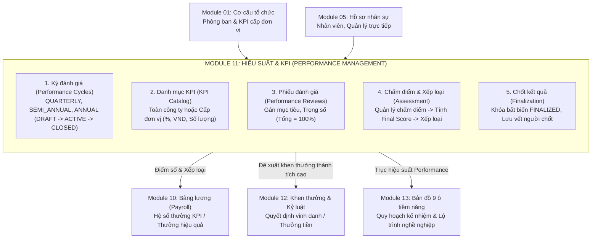
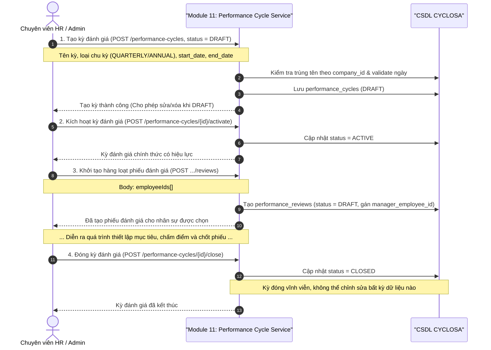
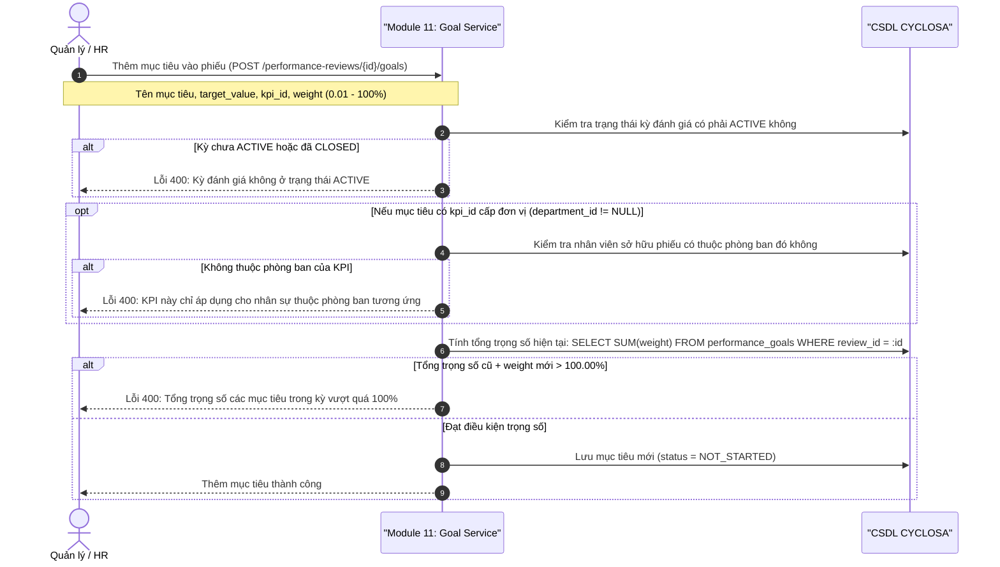
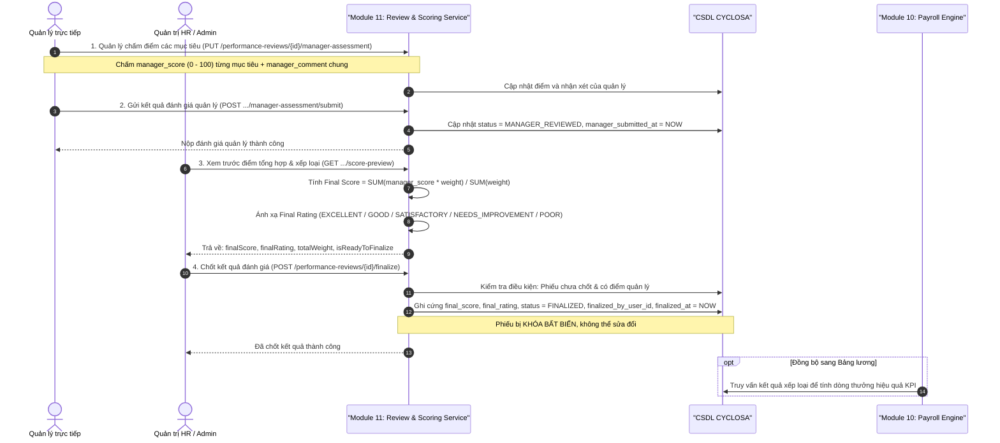
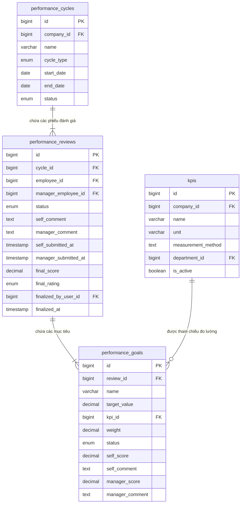

# TÀI LIỆU ĐẶC TẢ NGHIỆP VỤ & THIẾT KẾ KỸ THUẬT
## MODULE 11: HIỆU SUẤT & KPI (PERFORMANCE MANAGEMENT - PERF)

> **Tài liệu căn cứ & tham chiếu:**
> - Nghiệp vụ tổng thể: [`Nghiep-vu.docx`](file:///f:/Project/CYCLOSA/docs/Nghiep-vu.docx) (§11. Hiệu suất làm việc, dòng 1582–1818)
> - Thiết kế CSDL chi tiết: [`database.md`](file:///f:/Project/CYCLOSA/docs/database.md) (§8.12 Module 11 — Hiệu suất & KPI, dòng 3200–3330)
> - Danh mục API chuẩn: [`api-list.md`](file:///f:/Project/CYCLOSA/docs/api-list.md) (§11. Hiệu suất & KPI, 26 APIs, dòng 1013–1055)
> - Danh mục màn hình UI: [`page-list.md`](file:///f:/Project/CYCLOSA/docs/page-list.md) (§5.12 PERF-01 đến PERF-07, dòng 411–423)
> - Lộ trình kiến trúc: [`thu-tu-code-module.md`](file:///f:/Project/CYCLOSA/docs/thu-tu-code-module.md) (Giai đoạn 6: Hiệu suất & Phát triển nhân tài)
> - Quy chuẩn kiến trúc & coding: [`cyclosa_be/rules/`](file:///f:/Project/CYCLOSA/cyclosa_be/rules) & [`cyclosa_fe/rules/`](file:///f:/Project/CYCLOSA/cyclosa_fe/rules)
> - **Phạm vi triển khai hiện tại:** Hoàn thiện 100% Admin Portal (Quản lý kỳ, Danh mục KPI, Phiếu đánh giá, Chấm điểm quản lý & Chốt kết quả); Tạm hoãn cổng tự phục vụ ESS nhân viên theo chỉ đạo.

---

## 1. TỔNG QUAN & MỤC TIÊU NGHIỆP VỤ

### 1.1. Vị trí của Module 11 trong Hệ sinh thái CYCLOSA HRM
Module **Đánh giá Hiệu suất & KPI (Performance Management - PERF)** là trung tâm đo lường kết quả công việc và hiệu quả đóng góp của nhân sự trong toàn bộ tổ chức. Module 11 là mắt xích trực tiếp liên thông với:
- **Module 01 (Cơ cấu tổ chức) & Module 05 (Hồ sơ nhân sự):** Cung cấp danh sách nhân sự, quan hệ báo cáo quản lý trực tiếp (`manager_employee_id`) và phạm vi đơn vị/phòng ban.
- **Module 10 (Bảng lương & Tính lương - Payroll):** Cung cấp kết quả xếp loại hiệu suất và điểm số để làm căn cứ tính **Thưởng hiệu quả / Thưởng KPI** trên bảng lương định kỳ.
- **Module 12 (Khen thưởng, Kỷ luật & Khiếu nại - RWD):** Nhân sự đạt xếp loại Xuất sắc (`EXCELLENT`) là căn cứ lập Quyết định khen thưởng vinh danh; nhân sự xếp loại Kém (`POOR`) kéo dài là căn cứ chuyển sang quy trình xử lý không hoàn thành nhiệm vụ.
- **Module 13 (Phát triển & Kế nhiệm - Career & Succession):** Điểm hiệu suất là một trong hai trục tọa độ cốt lõi cấu thành **Bản đồ 9 ô tiềm năng (9-Box Grid)**.

---

### 1.2. Mục tiêu Nghiệp vụ Cốt lõi

1. **Chuẩn hóa Chu kỳ Đánh giá Doanh nghiệp:**
   * Hỗ trợ 3 loại chu kỳ đánh giá: **Quý (`QUARTERLY`)**, **Nửa năm (`SEMI_ANNUAL`)** và **Năm (`ANNUAL`)**.
   * Vòng đời kỳ đánh giá 3 bước nghiêm ngặt:
     $$\text{DRAFT (Chuẩn bị)} \longrightarrow \text{ACTIVE (Đang đánh giá)} \longrightarrow \text{CLOSED (Đóng kỳ, không sửa)}$$
   * Ràng buộc: Ngày bắt đầu không được sau ngày kết thúc (`start_date <= end_date`), tên kỳ duy nhất trong cùng công ty. Chỉ kỳ `DRAFT` mới được sửa/xóa; kỳ `CLOSED` bị khóa vĩnh viễn.

2. **Quản lý Danh mục Chỉ số Đo lường (KPI Catalog):**
   * Cho phép thiết lập KPI cấp **Toàn công ty (`department_id = NULL`)** hoặc cấp **Đơn vị tổ chức cụ thể**.
   * Quy tắc nghiệp vụ bắt buộc: KPI cấp đơn vị nào thì **chỉ được phép giao cho nhân viên thuộc đúng đơn vị đó**.
   * Đơn vị tính linh hoạt: Phần trăm (`%`), Tiền tệ (`VND`), Số lượng (`Số lượt`, `Lỗi`, `Dự án`). Không cho phép xóa KPI khi đã có mục tiêu tham chiếu.

3. **Thiết lập Mục tiêu & Kiểm soát Trọng số (Goal Weight Control):**
   * Mỗi nhân viên có phiếu đánh giá riêng trong kỳ (`performance_reviews`).
   * Nhân viên được giao danh sách các mục tiêu cụ thể (`performance_goals`), liên kết với KPI tương ứng.
   * **Ràng buộc trọng số nghiêm ngặt:** Mỗi mục tiêu có trọng số từ **$0.01\%$ đến $100\%$**, và **tổng trọng số của tất cả mục tiêu trong 1 phiếu không được vượt quá $100\%$** ($\sum \text{weight}_i \le 100\%$).
   * Chỉ được phép tạo mục tiêu khi kỳ đánh giá đang ở trạng thái `ACTIVE`.

4. **Cơ chế Chấm điểm & Quy đổi Xếp loại Chuẩn hóa:**
   * Quản lý trực tiếp chấm điểm từng mục tiêu trên thang điểm $100$ kèm nhận xét cụ thể.
   * **Công thức tính Điểm Tổng hợp (Final Score):**
     $$\text{Final Score} = \frac{\sum (\text{Manager Score}_i \times \text{Weight}_i)}{\sum \text{Weight}_i}$$
   * Điểm tổng hợp được làm tròn chuẩn 2 chữ số thập phân và tự động ánh xạ sang 5 bậc xếp loại:
     - $\ge 90$: **Xuất sắc (`EXCELLENT`)**
     - $\ge 80 \text{ và } < 90$: **Tốt (`GOOD`)**
     - $\ge 65 \text{ và } < 80$: **Đạt (`SATISFACTORY`)**
     - $\ge 50 \text{ và } < 65$: **Cần cải thiện (`NEEDS_IMPROVEMENT`)**
     - $< 50$: **Kém (`POOR`)**

5. **Tính Bất biến khi Chốt Kết quả (`FINALIZED`):**
   * Khi người có thẩm quyền (HR/Quản lý) bấm **"Chốt kết quả" (`POST .../finalize`)**, phiếu chuyển sang trạng thái `FINALIZED`.
   * Tại thời điểm này, `final_score` và `final_rating` được **chốt cứng vào CSDL**. Toàn bộ mục tiêu, điểm số và nhận xét bị khóa vĩnh viễn không cho phép sửa đổi hay nộp lại.
   * Điểm chốt này là bất biến kể cả khi sau này doanh nghiệp thay đổi cấu hình thang điểm.

---

## 2. QUY TRÌNH NGHIỆP VỤ CHI TIẾT (BUSINESS WORKFLOWS)

### 2.1. Luồng 1: Vòng đời Kỳ Đánh giá Hiệu suất (Performance Cycle Lifecycle)

---

### 2.2. Luồng 2: Thiết lập Mục tiêu & Kiểm soát Trọng số

---

### 2.3. Luồng 3: Đánh giá Quản lý, Tính Điểm & Chốt Kết quả Bất biến (Finalization)

---

## 3. THIẾT KẾ CƠ SỞ DỮ LIỆU & QUAN HỆ THỰC THỂ (DATABASE SCHEMA)

### 3.1. Sơ đồ Quan hệ Thực thể (ERD)

---

### 3.2. Data Dictionary Chi tiết

#### 1. Bảng `performance_cycles` (Kỳ đánh giá hiệu suất)
| Cột | Kiểu dữ liệu | Khóa | Ràng buộc | Mô tả |
| :--- | :--- | :--- | :--- | :--- |
| `id` | BIGINT | PK | AUTO_INCREMENT | Mã định danh kỳ đánh giá |
| `company_id` | BIGINT | FK | companies(id), NOT NULL | Thuộc công ty/pháp nhân |
| `name` | VARCHAR(150) | | NOT NULL | Tên kỳ đánh giá (vd: "Đánh giá KPI Quý 4/2026") |
| `cycle_type` | VARCHAR(30) | | NOT NULL, Enum `PerformanceCycleType` | Loại chu kỳ: `QUARTERLY`, `SEMI_ANNUAL`, `ANNUAL` |
| `start_date` | DATE | | NOT NULL | Ngày bắt đầu kỳ đánh giá |
| `end_date` | DATE | | NOT NULL | Ngày kết thúc kỳ đánh giá |
| `status` | VARCHAR(30) | | NOT NULL, Enum `PerformanceCycleStatus` | Trạng thái kỳ: `DRAFT`, `ACTIVE`, `CLOSED` |

* **Ràng buộc bảng:**
  * `UNIQUE (company_id, name)`: Không được trùng tên kỳ trong cùng công ty.
  * `CHECK (start_date <= end_date)`: Ngày bắt đầu không được sau ngày kết thúc.

---

#### 2. Bảng `kpis` (Danh mục KPI đo lường)
| Cột | Kiểu dữ liệu | Khóa | Ràng buộc | Mô tả |
| :--- | :--- | :--- | :--- | :--- |
| `id` | BIGINT | PK | AUTO_INCREMENT | Mã định danh KPI |
| `company_id` | BIGINT | FK | companies(id), NOT NULL | Thuộc công ty |
| `name` | VARCHAR(150) | | NOT NULL | Tên chỉ số KPI (vd: "Tỷ lệ đúng hạn dự án", "Doanh thu") |
| `unit` | VARCHAR(30) | | NOT NULL | Đơn vị đo lường (vd: "%", "VND", "Lỗi", "Khách hàng") |
| `measurement_method` | TEXT | | NULL | Công thức hoặc phương pháp thu thập số liệu |
| `department_id` | BIGINT | FK | departments(id), NULL | NULL = Áp dụng toàn công ty; Có ID = Chỉ áp dụng cho đơn vị đó |
| `is_active` | BOOLEAN | | NOT NULL, DEFAULT TRUE | Trạng thái kích hoạt sử dụng |

* **Ràng buộc bảng:** `UNIQUE (company_id, name)`

---

#### 3. Bảng `performance_reviews` (Phiếu đánh giá nhân viên theo kỳ)
| Cột | Kiểu dữ liệu | Khóa | Ràng buộc | Mô tả |
| :--- | :--- | :--- | :--- | :--- |
| `id` | BIGINT | PK | AUTO_INCREMENT | Mã định danh phiếu đánh giá |
| `cycle_id` | BIGINT | FK | performance_cycles(id), NOT NULL | Thuộc kỳ đánh giá |
| `employee_id` | BIGINT | FK | employees(id), NOT NULL | Nhân viên là chủ phiếu đánh giá |
| `manager_employee_id` | BIGINT | FK | employees(id), NULL | Quản lý trực tiếp phụ trách đánh giá |
| `status` | VARCHAR(30) | | NOT NULL, Enum `ReviewStatus` | Trạng thái phiếu: `DRAFT`, `SELF_REVIEWED`, `MANAGER_REVIEWED`, `FINALIZED` |
| `self_comment` | TEXT | | NULL | Nhận xét tổng quan của bản thân nhân viên |
| `manager_comment` | TEXT | | NULL | Nhận xét tổng quan của cấp quản lý |
| `self_submitted_at` | TIMESTAMP | | NULL | Thời điểm nộp bản tự đánh giá |
| `manager_submitted_at`| TIMESTAMP | | NULL | Thời điểm quản lý nộp kết quả đánh giá |
| `final_score` | DECIMAL(5,2) | | NULL | Điểm tổng hợp chốt (0.00 - 100.00); chỉ có khi `FINALIZED` |
| `final_rating` | VARCHAR(30) | | NULL, Enum `PerformanceRating` | Xếp loại chốt cuối cùng; chỉ có khi `FINALIZED` |
| `finalized_by_user_id`| BIGINT | FK | users(id), NULL | Người thực hiện chốt kết quả bất biến |
| `finalized_at` | TIMESTAMP | | NULL | Thời điểm chốt kết quả |

* **Ràng buộc bảng:**
  * `UNIQUE (cycle_id, employee_id)`: Mỗi nhân viên chỉ có duy nhất 01 phiếu đánh giá trong 1 kỳ.
  * `CHECK ((final_score IS NULL AND final_rating IS NULL AND finalized_at IS NULL) OR (final_score IS NOT NULL AND final_rating IS NOT NULL AND finalized_at IS NOT NULL))`.

---

#### 4. Bảng `performance_goals` (Mục tiêu chi tiết trong phiếu đánh giá)
| Cột | Kiểu dữ liệu | Khóa | Ràng buộc | Mô tả |
| :--- | :--- | :--- | :--- | :--- |
| `id` | BIGINT | PK | AUTO_INCREMENT | Mã định danh mục tiêu |
| `review_id` | BIGINT | FK | performance_reviews(id), NOT NULL | Thuộc phiếu đánh giá |
| `name` | VARCHAR(200) | | NOT NULL | Tên mục tiêu công việc |
| `target_value` | DECIMAL(18,2) | | NULL | Giá trị chỉ tiêu cần đạt |
| `kpi_id` | BIGINT | FK | kpis(id), NULL | Chỉ số KPI tham chiếu nếu có |
| `weight` | DECIMAL(5,2) | | NOT NULL | Trọng số mục tiêu (%): $0.01 \le \text{weight} \le 100.00$ |
| `status` | VARCHAR(30) | | NOT NULL, Enum `GoalStatus` | Tiến độ: `NOT_STARTED`, `IN_PROGRESS`, `COMPLETED` |
| `self_score` | DECIMAL(5,2) | | NULL | Điểm tự chấm của nhân viên ($0 \le \text{score} \le 100$) |
| `self_comment` | TEXT | | NULL | Giải trình mức độ hoàn thành của nhân viên |
| `manager_score` | DECIMAL(5,2) | | NULL | Điểm do quản lý đánh giá ($0 \le \text{score} \le 100$) |
| `manager_comment` | TEXT | | NULL | Nhận xét chi tiết của quản lý cho mục tiêu này |

* **Ràng buộc nghiệp vụ:** Tổng `weight` của tất cả các mục tiêu có cùng `review_id` phải $\le 100.00\%$.

---

## 4. DANH MỤC API RESTFUL & PHÂN QUYỀN RBAC (26 APIS)

Toàn bộ 26 API của Module 11 tuân thủ chuẩn RESTful, trả về định dạng `ApiResponse<T>`:

### 4.1. Nhóm 1: Quản lý Kỳ Đánh giá (Performance Cycles - 7 APIs)
| STT | Method | Endpoint | Quyền hạn (Scope) | Mô tả tóm tắt | Mã lỗi |
| :---: | :--- | :--- | :--- | :--- | :--- |
| 1 | `GET` | `/performance-cycles` | `performance.view` | Lấy danh sách kỳ đánh giá (Query: status, year) | `401`, `403` |
| 2 | `POST` | `/performance-cycles` | `performance.config` | Tạo kỳ đánh giá mới (`DRAFT`) | `400`, `409` |
| 3 | `GET` | `/performance-cycles/{cycleId}` | `performance.view` | Lấy thông tin chi tiết kỳ đánh giá | `404` |
| 4 | `PUT` | `/performance-cycles/{cycleId}` | `performance.config` | Sửa thông tin kỳ đánh giá (chỉ khi `DRAFT`) | `400`, `404` |
| 5 | `DELETE`| `/performance-cycles/{cycleId}` | `performance.config` | Xóa kỳ đánh giá (chỉ khi `DRAFT` và chưa có phiếu) | `400`, `404` |
| 6 | `POST` | `/performance-cycles/{cycleId}/activate`| `performance.config` | Kích hoạt kỳ đánh giá chuyển sang `ACTIVE` | `400`, `404` |
| 7 | `POST` | `/performance-cycles/{cycleId}/close` | `performance.config` | Đóng kỳ đánh giá chuyển sang `CLOSED` (khóa chỉnh sửa) | `400`, `404` |

---

### 4.2. Nhóm 2: Thống kê & Phân bổ Xếp loại (1 API)
| STT | Method | Endpoint | Quyền hạn (Scope) | Mô tả tóm tắt | Mã lỗi |
| :---: | :--- | :--- | :--- | :--- | :--- |
| 8 | `GET` | `/performance-cycles/{cycleId}/summary` | `performance.view` | Thống kê số lượng phiếu, tiến độ đánh giá & phân bổ xếp loại | `404` |

---

### 4.3. Nhóm 3: Danh mục Chỉ số KPI (4 APIs)
| STT | Method | Endpoint | Quyền hạn (Scope) | Mô tả tóm tắt | Mã lỗi |
| :---: | :--- | :--- | :--- | :--- | :--- |
| 9 | `GET` | `/kpis` | `performance.view` | Lấy danh mục KPI (Query: departmentId, isActive, search) | `401`, `403` |
| 10 | `POST` | `/kpis` | `performance.config` | Tạo chỉ số KPI mới (Cấp công ty hoặc Cấp đơn vị) | `400`, `409` |
| 11 | `PUT` | `/kpis/{kpiId}` | `performance.config` | Chỉnh sửa thông tin KPI | `400`, `404` |
| 12 | `DELETE`| `/kpis/{kpiId}` | `performance.config` | Xóa KPI (chỉ khi chưa được gắn vào mục tiêu nào) | `400`, `404`, `409` |

---

### 4.4. Nhóm 4: Quản lý Phiên Đánh giá (Performance Reviews - 4 APIs)
| STT | Method | Endpoint | Quyền hạn (Scope) | Mô tả tóm tắt | Mã lỗi |
| :---: | :--- | :--- | :--- | :--- | :--- |
| 13 | `POST` | `/performance-cycles/{cycleId}/reviews` | `performance.manage` | Khởi tạo hàng loạt phiếu đánh giá (Body: employeeIds[]) | `400`, `404` |
| 14 | `GET` | `/performance-reviews` | `performance.view` | Lấy danh sách phiếu đánh giá (Query: cycleId, employeeId, status) | `400`, `401` |
| 15 | `GET` | `/performance-reviews/{reviewId}` | `performance.view` | Lấy chi tiết phiếu đánh giá kèm toàn bộ danh sách mục tiêu | `404` |
| 16 | `GET` | `/me/performance-reviews` | `Auth` | Nhân viên tra cứu các phiếu đánh giá của chính mình (ESS) | `401` |

---

### 4.5. Nhóm 5: Thiết lập Mục tiêu Công việc (Goals - 4 APIs)
| STT | Method | Endpoint | Quyền hạn (Scope) | Mô tả tóm tắt | Mã lỗi |
| :---: | :--- | :--- | :--- | :--- | :--- |
| 17 | `POST` | `/performance-reviews/{reviewId}/goals` | `performance.manage` | Thêm mục tiêu vào phiếu (Kiểm tra tổng trọng số $\le 100\%$) | `400`, `404` |
| 18 | `PUT` | `/performance-goals/{goalId}` | `performance.manage` | Chỉnh sửa mục tiêu (Kiểm tra tổng trọng số) | `400`, `404` |
| 19 | `DELETE`| `/performance-goals/{goalId}` | `performance.manage` | Xóa mục tiêu khỏi phiếu (khi phiếu chưa FINALIZED) | `400`, `404` |
| 20 | `PATCH` | `/performance-goals/{goalId}/status` | `Auth` | Cập nhật tiến độ mục tiêu (`NOT_STARTED`, `IN_PROGRESS`, `COMPLETED`) | `400`, `404` |

---

### 4.6. Nhóm 6: Chấm điểm, Tính Điểm & Chốt Kết quả (6 APIs)
| STT | Method | Endpoint | Quyền hạn (Scope) | Mô tả tóm tắt | Mã lỗi |
| :---: | :--- | :--- | :--- | :--- | :--- |
| 21 | `PUT` | `/performance-reviews/{reviewId}/self-assessment` | `Auth` | Nhân viên lưu nháp phần tự chấm điểm và tự nhận xét (ESS) | `400`, `404` |
| 22 | `POST` | `/performance-reviews/{reviewId}/self-assessment/submit` | `Auth` | Nhân viên nộp bản tự đánh giá (`SELF_REVIEWED`) (ESS) | `400`, `404` |
| 23 | `PUT` | `/performance-reviews/{reviewId}/manager-assessment` | `performance.review` | Quản lý lưu điểm đánh giá từng mục tiêu và nhận xét | `400`, `404` |
| 24 | `POST` | `/performance-reviews/{reviewId}/manager-assessment/submit` | `performance.review` | Quản lý nộp kết quả đánh giá (`MANAGER_REVIEWED`) | `400`, `404` |
| 25 | `GET` | `/performance-reviews/{reviewId}/score-preview` | `performance.review` | Xem trước điểm tổng hợp & xếp loại tạm tính trước khi chốt | `404` |
| 26 | `POST` | `/performance-reviews/{reviewId}/finalize` | `performance.finalize` | Chốt kết quả đánh giá bất biến (`FINALIZED`), khóa mọi thao tác sửa | `400`, `404` |

---

## 5. ĐẶC TẢ GIAO DIỆN NGƯỜI DÙNG FRONTEND (UI/UX ADMIN PORTAL)

Tuân thủ nghiêm ngặt các quy tắc thiết kế `cyclosa_fe/rules`:
- **Rule 01:** Header chỉ gồm Tiêu đề, Breadcrumb và Action button góc phải. Không bọc icon trong hộp, không có subtitle.
- **Rule 02:** Stat Cards 4 cột `grid-cols-1 sm:grid-cols-2 lg:grid-cols-4`, khối icon `h-12 w-12 rounded-xl`, số liệu `font-mono text-2xl font-bold`, sparkline SVG mini bên phải, hỗ trợ click lọc 2 chiều.
- **Rule 03:** Filter bar 2 hàng: Hàng 1 tìm kiếm từ khóa, Hàng 2 Dropdown trạng thái + Nút Đặt lại.
- **Rule 04:** Table-embedded Empty State: `<TableRow><TableCell colSpan={...}>` hiển thị trạng thái rỗng bên trong bảng.
- **Rule 05:** Modal form sử dụng React Hook Form + Zod Schema với thông báo lỗi tiếng Việt thân thiện.
- **Phạm vi triển khai:** Tập trung 100% vào các trang **Admin / Manager Portal** (PERF-01 đến PERF-06), **chưa làm cổng ESS**.

### 5.1. Màn hình PERF-01: Quản lý Kỳ Đánh giá (`/performance/cycles`)
* **Header:** Title "Kỳ đánh giá hiệu suất", Breadcrumb: `Trang chủ / Hiệu suất & KPI / Kỳ đánh giá`. Action: Nút `+ Mở kỳ đánh giá mới`.
* **Stat Cards (4 cột):**
  1. *Tổng số kỳ đánh giá:* Tổng số chu kỳ được thiết lập.
  2. *Kỳ đang áp dụng (ACTIVE):* Số kỳ đang mở để giao mục tiêu và chấm điểm.
  3. *Kỳ đang chuẩn bị (DRAFT):* Kỳ đang thiết lập thông số.
  4. *Kỳ đã đóng sổ (CLOSED):* Kỳ đã chốt hoàn tất.
* **Filter Bar:** Tìm kiếm theo tên kỳ, Select lọc trạng thái (`ALL`, `DRAFT`, `ACTIVE`, `CLOSED`), Select lọc năm.
* **Table:** Tên kỳ, Loại chu kỳ (Badge), Thời gian bắt đầu - kết thúc, Trạng thái (Badge màu), Thao tác (Xem chi tiết $\to$ PERF-03, Sửa dialog, Xóa khi DRAFT, Kích hoạt / Đóng kỳ).

---

### 5.2. Màn hình PERF-03: Chi tiết Kỳ Đánh giá (`/performance/cycles/:id`)
* **Header:** Tên kỳ đánh giá kèm Badge trạng thái. Action: Nút "Kích hoạt kỳ" (nếu DRAFT), "Đóng kỳ đánh giá" (nếu ACTIVE), Nút "Khởi tạo phiếu đánh giá" (`+ Khởi tạo phiếu`).
* **Khối thống kê phân bổ (Summary):**
  - Tỷ lệ hoàn thành đánh giá: Tổng số phiếu, Số phiếu đã chốt (`FINALIZED`), Số phiếu đang chờ quản lý đánh giá.
  - Biểu đồ thanh ngang phân bổ xếp loại: Xuất sắc, Tốt, Đạt, Cần cải thiện, Kém.
* **Danh sách Phiếu đánh giá trong kỳ:** Bảng danh sách nhân viên trong kỳ, Quản lý trực tiếp, Trạng thái phiếu, Điểm tổng hợp, Xếp loại, Thao tác xem chi tiết phiếu.

---

### 5.3. Màn hình PERF-04: Danh mục Chỉ số KPI (`/performance/kpis`)
* **Header:** Title "Danh mục chỉ số KPI", Breadcrumb: `Trang chủ / Hiệu suất & KPI / Danh mục KPI`. Action: Nút `+ Thêm KPI`.
* **Filter Bar:** Tìm kiếm tên chỉ số, Select lọc theo Phòng ban (Toàn công ty vs Phòng cụ thể), Select trạng thái kích hoạt.
* **Table:** Tên KPI, Đơn vị tính (`%`, `VND`, `Số lượng`), Phạm vi áp dụng (Badge: Toàn công ty hoặc Tên phòng ban), Cách đo lường, Trạng thái kích hoạt (Switch hoặc Badge), Thao tác (Sửa dialog, Xóa).

---

### 5.4. Màn hình PERF-05: Danh sách Phiếu Đánh giá (`/performance/reviews`)
* **Header:** Title "Phiếu đánh giá hiệu suất", Breadcrumb: `Trang chủ / Hiệu suất & KPI / Phiếu đánh giá`.
* **Stat Cards (4 cột):**
  1. *Tổng số phiếu:* Toàn bộ phiếu trong phạm vi quản lý.
  2. *Đang thực hiện (DRAFT / IN_PROGRESS):* Phiếu đang giao mục tiêu.
  3. *Chờ quản lý đánh giá:* Phiếu cần quản lý chấm điểm.
  4. *Đã chốt kết quả (FINALIZED):* Phiếu đã hoàn thành xếp loại.
* **Filter Bar:** Tìm kiếm nhân viên / mã NV, Select Kỳ đánh giá, Select Trạng thái phiếu.
* **Table:** Nhân viên (Avatar + Tên + Mã NV), Phòng ban, Quản lý đánh giá, Trạng thái phiếu (Badge), Điểm tổng hợp (`font-mono`), Xếp loại (Badge màu), Thao tác (Xem chi tiết & Chấm điểm $\to$ PERF-06).

---

### 5.5. Màn hình PERF-06: Chi tiết Phiếu Đánh giá (`/performance/reviews/:id`)
* **Header:** Thông tin nhân viên, Kỳ đánh giá, Trạng thái phiếu, Quản lý trực tiếp phụ trách. Action: Nút "Chốt kết quả" (Finalize) khi đã hoàn thành đánh giá.
* **Khối Điểm số & Xếp loại Tổng hợp (Score Card):**
  - Điểm tổng hợp tạm tính (Final Score) hiển thị lớn, công thức tính tự động.
  - Thẻ Xếp loại (Rating Badge: EXCELLENT, GOOD, SATISFACTORY, NEEDS_IMPROVEMENT, POOR).
  - Thanh đo tiến độ tổng trọng số: Tổng trọng số đã giao ($\sum \text{weight} / 100\%$).
* **Bảng Danh mục Mục tiêu Công việc (Goal Table):**
  - Cột: Tên mục tiêu, KPI liên kết, Chỉ tiêu cần đạt, Trọng số (`%`), Tiến độ thực hiện (Badge: Chưa làm / Đang làm / Đã xong), Điểm tự đánh giá, Điểm quản lý chấm, Thao tác.
  - Nút `+ Giao mục tiêu mới` (Mở dialog).
  - Nút `Chấm điểm của quản lý` (Mở modal cho phép quản lý nhập điểm 0-100 và ghi nhận xét cho từng mục tiêu + nhận xét tổng quan).

---

## 6. KẾ HOẠCH TRIỂN KHAI BACKEND VÀ FRONTEND

1. **Backend (`cyclosa_be`):**
   * Migration SQL: Tạo 4 bảng `performance_cycles`, `kpis`, `performance_reviews`, `performance_goals` kèm đầy đủ khóa ngoại, unique constraints và index.
   * Tạo package `com.cyclosa.performance`:
     * Enums: 5 Enums chuẩn CSDL.
     * Entities: 4 Entity JPA kế thừa `BaseEntity`.
     * Repositories: 4 Spring Data JPA Repository.
     * DTOs & Validation: Request/Response chuẩn tiếng Việt.
     * Mappers: MapStruct componentModel = "spring".
     * Services: `PerformanceCycleService`, `KpiService`, `PerformanceReviewService` (Concrete class, không dùng `impl/`).
     * Controllers: 3 REST Controller (`/api/v1/performance-cycles`, `/api/v1/kpis`, `/api/v1/performance-reviews`).
   * Phân quyền & RBAC Seeding: Khởi tạo quyền `performance.view`, `performance.config`, `performance.manage`, `performance.review`, `performance.finalize`.
2. **Frontend (`cyclosa_fe`):**
   * Khởi tạo `src/features/performance`: types, constants (từ điển tiếng Việt, status badge variants), schemas (Zod tiếng Việt), api (RTK Query).
   * Tạo components theo chuẩn Rule 02/03/04/05:
     * KPI Stats Cards có icon bo góc `h-12 w-12 rounded-xl`, sparkline SVG, click filter.
     * Filter bars 2 hàng.
     * Tables với Table-embedded empty state.
     * Dialogs thêm/sửa Zod tiếng Việt.
   * Khởi tạo 5 trang Admin:
     * `/performance/cycles`
     * `/performance/cycles/[id]`
     * `/performance/kpis`
     * `/performance/reviews`
     * `/performance/reviews/[id]`
   * Cập nhật Sidebar menu: Thêm nhóm `HIỆU SUẤT & KPI` cho Admin portal (không có ESS).
