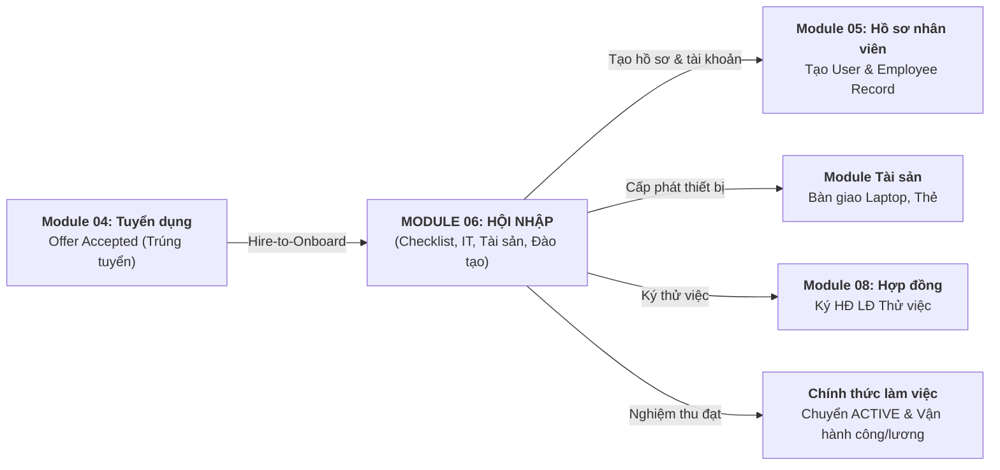
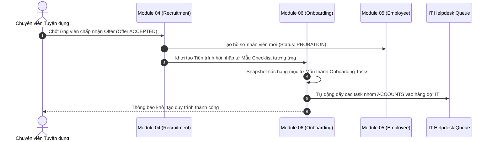
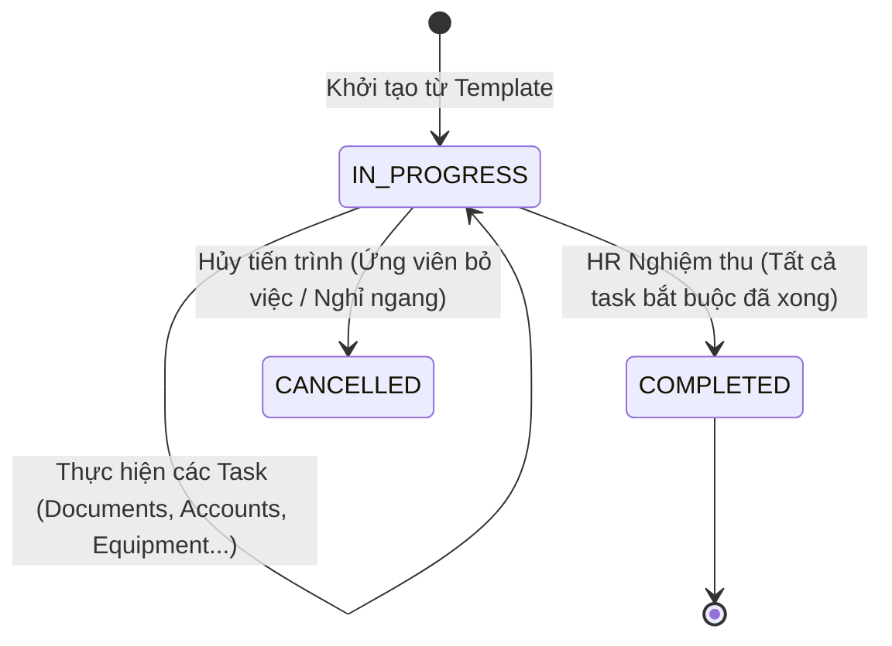
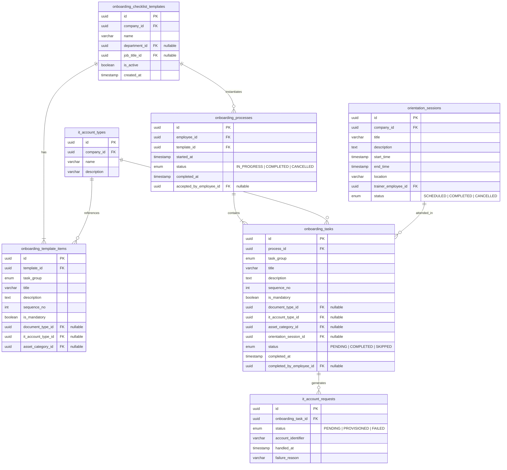
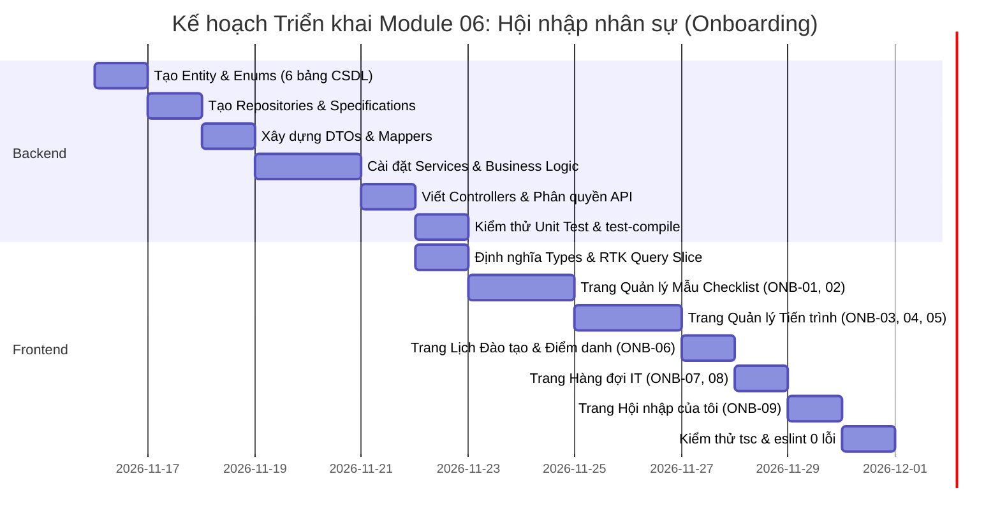

# TÀI LIỆU ĐẶC TẢ NGHIỆP VỤ & THIẾT KẾ KỸ THUẬT
## MODULE 06: HỘI NHẬP NHÂN SỰ (ONBOARDING & ORIENTATION)

> **Tài liệu tham chiếu:**
> - Nghiệp vụ tổng thể: [`Nghiep-vu.docx`](file:///f:/Project/CYCLOSA/ba/Nghiep-vu.docx)
> - Thiết kế CSDL chi tiết: [`database.md`](file:///f:/Project/CYCLOSA/ba/database.md) (§6 Onboarding, dòng 1844-2050)
> - Danh mục API hệ thống: [`api-list.md`](file:///f:/Project/CYCLOSA/ba/api-list.md) (Mục 6 Onboarding, 30 endpoints)
> - Danh mục màn hình UI: [`page-list.md`](file:///f:/Project/CYCLOSA/ba/page-list.md) (Mục 5.7 ONB-01 đến ONB-09)
> - Lộ trình triển khai: [`thu-tu-code-module.md`](file:///f:/Project/CYCLOSA/ba/thu-tu-code-module.md) (Phase 3)

---

## 1. TỔNG QUAN & MỤC TIÊU NGHIỆP VỤ

### 1.1. Vị trí của Module 06 trong Hệ sinh thái CYCLOSA HRM
Module **Hội nhập nhân sự (Onboarding)** đóng vai trò là "cầu nối sống còn" khép kín vòng đời nhân sự giữa **Giai đoạn Tuyển dụng (Recruitment - M04)** và **Vận hành hồ sơ nhân viên chính thức (Employee Profile - M05)**.

### 1.2. Mục tiêu cốt lõi
1. **Tự động hóa luồng tiếp nhận (Hire-to-Onboard):** Giảm thiểu tối đa thao tác nhập liệu thủ công; toàn bộ dữ liệu ứng viên từ Offer được tái sử dụng để khởi tạo hồ sơ nhân viên và hợp đồng thử việc.
2. **Chuẩn hóa lộ trình hội nhập 30-60-90 ngày:** Mỗi phòng ban, chức danh có bộ Checklist mẫu định sẵn (nộp hồ sơ pháp lý, tham gia khóa đào tạo văn hóa, hoàn thành bài kiểm tra an toàn thông tin, gặp gỡ Buddy/Quản lý).
3. **Phối hợp liên phòng ban nhịp nhàng (HR - IT - Hành chính/Tài sản):**
   - Tự động sinh yêu cầu cấp tài khoản cho bộ phận IT (Email, Git, VPN, CRM).
   - Tự động sinh phiếu yêu cầu thiết bị cho bộ phận Quản trị cơ sở vật chất (Laptop, màn hình, thẻ ra vào).
4. **Minh bạch hóa tiến độ & Trải nghiệm nhân viên số (Employee Self-Service):**
   - Nhân viên mới có trang riêng ([/me/onboarding](file:///f:/Project/CYCLOSA/cyclosa_fe/src/app/(employee)/me/onboarding/page.tsx)) để theo dõi việc cần làm, tài liệu cần nộp, thông tin Buddy và lịch đào tạo.
   - HR có Dashboard theo dõi tiến độ tổng thể, kịp thời hỗ trợ các trường hợp tắc nghẽn.

---

## 2. QUY TRÌNH NGHIỆP VỤ CHI TIẾT (BUSINESS WORKFLOWS)

### 2.1. Luồng 1: Tiếp nhận ứng viên trúng tuyển (Hire-to-Onboard Transfer)

* **Quy tắc chuyển đổi:**
  - Lấy mã phòng ban (`department_id`) và vị trí công việc (`job_title_id`) từ tin tuyển dụng để tìm Mẫu Checklist hội nhập (`onboarding_checklist_templates`) phù hợp nhất.
  - Nếu không có mẫu riêng theo chức danh $\to$ Dùng mẫu của phòng ban $\to$ Nếu không có $\to$ Dùng mẫu mặc định toàn công ty.

---

### 2.2. Luồng 2: Thiết kế & Quản lý Mẫu Checklist (Checklist Templates)
HR Admin thiết lập các bộ khung công việc mẫu cho từng đối tượng nhân viên.

* **5 nhóm công việc chuẩn (`OnboardingTaskGroup`):**
  1. `DOCUMENTS`: Nộp và xác thực hồ sơ giấy tờ pháp lý (CCCD/Hộ chiếu, bằng cấp chứng chỉ, giấy khám sức khỏe, cam kết bảo mật thông tin NDA).
  2. `ACCOUNTS`: Cấp phát tài khoản CNTT (Email Google Workspace/Microsoft 365, Git, Jira, ERP, VPN).
  3. `EQUIPMENT`: Bàn giao trang thiết bị làm việc (Laptop, chuột, màn hình phụ, thẻ nhân viên, đồng phục).
  4. `ORIENTATION`: Tham gia các buổi đào tạo định hướng tập trung (Văn hóa doanh nghiệp, Nội quy lao động, An toàn thông tin).
  5. `OTHER`: Các công việc gắn kết khác (Gặp gỡ Buddy, ăn trưa cùng đội ngũ, thiết lập mục tiêu thử việc cùng Trưởng phòng).

> [!IMPORTANT]
> **Quy tắc Snapshot bất biến:** Khi tiến trình hội nhập được tạo cho nhân viên, toàn bộ các hạng mục trong Mẫu được sao chép nguyên trạng sang bảng `onboarding_tasks`. Mọi chỉnh sửa, thêm/bớt hạng mục trong Mẫu về sau **tuyệt đối không làm thay đổi các tiến trình đang thực hiện dở dang**.

---

### 2.3. Luồng 3: Điều phối Công việc Hội nhập (Task Execution & Cross-Module Verification)
Mỗi công việc trong tiến trình hội nhập không chỉ là một checkbox thông thường, mà được tích hợp kiểm tra chéo với các module liên quan:

| Nhóm công việc (`task_group`) | Điều kiện để chuyển trạng thái sang `COMPLETED` |
|---|---|
| **DOCUMENTS** | Nhân viên đã tải lên tài liệu và được HR xác thực hợp lệ trong Module Số hóa hồ sơ (`Module 07: Digital Records`). |
| **ACCOUNTS** | Bộ phận IT đã cấp tài khoản và cập nhật định danh (`account_identifier`) với trạng thái `PROVISIONED` trong Hàng đợi IT. |
| **EQUIPMENT** | Thiết bị đã được xuất kho và bàn giao thành công trong Module Quản lý tài sản (`Asset Management`). |
| **ORIENTATION** | Nhân viên có mặt và được điểm danh trong Buổi đào tạo định hướng (`orientation_sessions`). |
| **OTHER** | Quản lý trực tiếp hoặc HR tích xác nhận hoàn thành bằng tay. |

* **Quy tắc Bỏ qua (`SKIPPED`):**
  - Chỉ cho phép bỏ qua đối với những công việc được cấu hình `is_mandatory = false`.
  - Các công việc bắt buộc (`is_mandatory = true`) bắt buộc phải hoàn thành, không được phép bỏ qua.

---

### 2.4. Luồng 4: Hàng đợi Cấp tài khoản CNTT (IT Provisioning Queue)
* Bộ phận IT có giao diện hàng đợi làm việc riêng biệt ([/onboarding/it-requests](file:///f:/Project/CYCLOSA/cyclosa_fe/src/app/(admin)/onboarding/it-requests/page.tsx)).
* Khi một tiến trình hội nhập có công việc thuộc nhóm `ACCOUNTS`:
  - Hệ thống tự sinh bản ghi trong `it_account_requests` với trạng thái `PENDING`.
  - IT Helpdesk tiếp nhận yêu cầu $\to$ Tạo tài khoản trên hệ thống tương ứng $\to$ Nhập username/email định danh $\to$ Bấm **Xác nhận đã cấp (`PROVISIONED`)**.
  - Nếu không thể cấp (do hết license, lỗi kỹ thuật) $\to$ Bấm **Thất bại (`FAILED`)** kèm lý do giải trình để HR phối hợp xử lý.

---

### 2.5. Luồng 5: Tổ chức & Điểm danh Buổi đào tạo định hướng (Orientation Sessions)
* HR tạo lịch đào tạo văn hóa/nội quy trên lịch ([/onboarding/orientation-sessions](file:///f:/Project/CYCLOSA/cyclosa_fe/src/app/(admin)/onboarding/orientation-sessions/page.tsx)) kèm địa điểm/link online và giảng viên phụ trách.
* Sau buổi học, HR thực hiện **Điểm danh hàng loạt (`Attendance`)** cho các nhân viên tham gia.
* Hệ thống tự động quét và đánh dấu `COMPLETED` cho các công việc nhóm `ORIENTATION` tương ứng của tất cả nhân viên có mặt trong danh sách điểm danh.

---

### 2.6. Luồng 6: Nghiệm thu Hội nhập & Đánh giá Thử việc (Acceptance & Probation Review)

* **Điều kiện Nghiệm thu (`Accept Onboarding`):**
  - Mọi công việc bắt buộc (`is_mandatory = true`) phải ở trạng thái `COMPLETED`.
  - Nếu còn bất kỳ công việc bắt buộc nào đang `PENDING`, hệ thống lập tức chặn nghiệm thu và chỉ rõ danh sách các công việc còn tồn đọng.
* **Hậu nghiệm thu:**
  - Trạng thái tiến trình chuyển sang `COMPLETED`, lưu người nghiệm thu và thời điểm hoàn tất.
  - Kích hoạt thông báo nhắc nhở Quản lý thực hiện **Đánh giá hết thời gian thử việc (Probation Evaluation)** trước khi ký Hợp đồng lao động chính thức.

---

## 3. THIẾT KẾ CƠ SỞ DỮ LIỆU (DATABASE SCHEMA)

### 3.1. Bảng `onboarding_checklist_templates` (Mẫu Checklist hội nhập)
| Cột | Kiểu | Ràng buộc | Mô tả |
|---|---|---|---|
| `id` | UUID | PK | Khóa chính |
| `company_id` | UUID | FK $\to$ companies.id, NOT NULL | Đơn vị pháp nhân |
| `name` | VARCHAR(200) | NOT NULL | Tên mẫu (VD: Onboarding Kỹ sư Phần mềm, Khối Vận hành) |
| `department_id` | UUID | FK $\to$ departments.id, NULL | Áp dụng cho phòng ban cụ thể (NULL = Toàn công ty) |
| `job_title_id` | UUID | FK $\to$ job_titles.id, NULL | Áp dụng cho chức danh cụ thể (NULL = Mọi chức danh) |
| `is_active` | BOOLEAN | NOT NULL, DEFAULT true | Mẫu đang có hiệu lực sử dụng |

### 3.2. Bảng `it_account_types` (Danh mục loại tài khoản CNTT)
| Cột | Kiểu | Ràng buộc | Mô tả |
|---|---|---|---|
| `id` | UUID | PK | Khóa chính |
| `company_id` | UUID | FK $\to$ companies.id, NOT NULL | Đơn vị pháp nhân |
| `name` | VARCHAR(100) | NOT NULL | Tên loại tài khoản (Email, GitLab, VPN, CRM...) |
| `description` | VARCHAR(255) | NULL | Hướng dẫn định dạng hoặc quy cách cấp |
*Ràng buộc duy nhất:* `UNIQUE (company_id, name)`.

### 3.3. Bảng `onboarding_template_items` (Hạng mục công việc của Mẫu)
| Cột | Kiểu | Ràng buộc | Mô tả |
|---|---|---|---|
| `id` | UUID | PK | Khóa chính |
| `template_id` | UUID | FK $\to$ templates.id, NOT NULL | Thuộc mẫu checklist |
| `task_group` | ENUM | NOT NULL | `DOCUMENTS`, `ACCOUNTS`, `EQUIPMENT`, `ORIENTATION`, `OTHER` |
| `title` | VARCHAR(200) | NOT NULL | Tên hạng mục công việc |
| `description` | TEXT | NULL | Hướng dẫn chi tiết cách thực hiện |
| `sequence_no` | INT | NOT NULL | Thứ tự sắp xếp thực hiện |
| `is_mandatory` | BOOLEAN | NOT NULL, DEFAULT true | Bắt buộc phải hoàn thành mới được nghiệm thu |
| `document_type_id` | UUID | FK $\to$ document_types.id, NULL | Dùng khi `task_group = DOCUMENTS` |
| `it_account_type_id` | UUID | FK $\to$ it_account_types.id, NULL | Dùng khi `task_group = ACCOUNTS` |
| `asset_category_id` | UUID | FK $\to$ asset_categories.id, NULL | Dùng khi `task_group = EQUIPMENT` |
*Ràng buộc duy nhất:* `UNIQUE (template_id, sequence_no)`.

### 3.4. Bảng `orientation_sessions` (Buổi đào tạo định hướng)
| Cột | Kiểu | Ràng buộc | Mô tả |
|---|---|---|---|
| `id` | UUID | PK | Khóa chính |
| `company_id` | UUID | FK $\to$ companies.id, NOT NULL | Đơn vị pháp nhân |
| `title` | VARCHAR(200) | NOT NULL | Tên buổi đào tạo |
| `description` | TEXT | NULL | Nội dung đào tạo & tài liệu đính kèm |
| `start_time` | TIMESTAMP | NOT NULL | Thời gian bắt đầu |
| `end_time` | TIMESTAMP | NOT NULL | Thời gian kết thúc |
| `location` | VARCHAR(255) | NOT NULL | Phòng họp / Đường dẫn phòng học trực tuyến (Google Meet/Zoom) |
| `trainer_employee_id` | UUID | FK $\to$ employees.id, NOT NULL | Giảng viên nội bộ phụ trách |
| `status` | ENUM | NOT NULL | `SCHEDULED`, `COMPLETED`, `CANCELLED` |

### 3.5. Bảng `onboarding_processes` (Tiến trình hội nhập của nhân viên)
| Cột | Kiểu | Ràng buộc | Mô tả |
|---|---|---|---|
| `id` | UUID | PK | Khóa chính |
| `employee_id` | UUID | FK $\to$ employees.id, NOT NULL | Nhân viên tiếp nhận |
| `template_id` | UUID | FK $\to$ templates.id, NOT NULL | Mẫu checklist được sao chép |
| `started_at` | TIMESTAMP | NOT NULL, DEFAULT NOW() | Thời điểm bắt đầu tiếp nhận |
| `status` | ENUM | NOT NULL | `IN_PROGRESS`, `COMPLETED`, `CANCELLED` |
| `completed_at` | TIMESTAMP | NULL | Thời điểm hoàn tất nghiệm thu |
| `accepted_by_employee_id` | UUID | FK $\to$ employees.id, NULL | Chuyên viên HR ký nghiệm thu |
*Ràng buộc nghiệp vụ:* Mỗi nhân viên chỉ có tối đa **1** tiến trình ở trạng thái `IN_PROGRESS`.

### 3.6. Bảng `onboarding_tasks` (Nhiệm vụ cụ thể của tiến trình - Snapshot)
| Cột | Kiểu | Ràng buộc | Mô tả |
|---|---|---|---|
| `id` | UUID | PK | Khóa chính |
| `process_id` | UUID | FK $\to$ processes.id, NOT NULL | Thuộc tiến trình |
| `task_group` | ENUM | NOT NULL | `DOCUMENTS`, `ACCOUNTS`, `EQUIPMENT`, `ORIENTATION`, `OTHER` |
| `title` | VARCHAR(200) | NOT NULL | Tên nhiệm vụ |
| `description` | TEXT | NULL | Mô tả chi tiết |
| `sequence_no` | INT | NOT NULL | Thứ tự thực hiện |
| `is_mandatory` | BOOLEAN | NOT NULL | Bắt buộc hoàn thành |
| `document_type_id` | UUID | FK $\to$ document_types.id, NULL | Khóa ngoại tham chiếu giấy tờ pháp lý |
| `it_account_type_id` | UUID | FK $\to$ it_account_types.id, NULL | Khóa ngoại tham chiếu loại tài khoản |
| `asset_category_id` | UUID | FK $\to$ asset_categories.id, NULL | Khóa ngoại tham chiếu loại thiết bị |
| `orientation_session_id` | UUID | FK $\to$ orientation_sessions.id, NULL | Buổi đào tạo nhân viên tham gia |
| `status` | ENUM | NOT NULL, DEFAULT PENDING | `PENDING`, `COMPLETED`, `SKIPPED` |
| `completed_at` | TIMESTAMP | NULL | Thời điểm hoàn thành |
| `completed_by_employee_id` | UUID | FK $\to$ employees.id, NULL | Người xác nhận hoàn tất |

### 3.7. Bảng `it_account_requests` (Yêu cầu cấp phát tài khoản CNTT)
| Cột | Kiểu | Ràng buộc | Mô tả |
|---|---|---|---|
| `id` | UUID | PK | Khóa chính |
| `onboarding_task_id` | UUID | FK $\to$ onboarding_tasks.id, UQ, NOT NULL | Gắn với công việc nhóm ACCOUNTS |
| `status` | ENUM | NOT NULL, DEFAULT PENDING | `PENDING`, `PROVISIONED`, `FAILED` |
| `account_identifier` | VARCHAR(255) | NULL | Định danh tài khoản đã cấp (email/username) |
| `handled_at` | TIMESTAMP | NULL | Thời điểm IT xử lý |
| `failure_reason` | VARCHAR(255) | NULL | Lý do nếu cấp thất bại |

---

## 4. DANH SÁCH API ENDPOINTS CHI TIẾT (30 ENDPOINTS)

### 4.1. Mẫu Checklist (`/api/v1/onboarding-templates`)
| Method | Endpoint | Mô tả nghiệp vụ | Quyền yêu cầu |
|---|---|---|---|
| `GET` | `/api/v1/onboarding-templates` | Danh sách mẫu checklist (lọc theo phòng ban, chức danh, active) | `onboarding.view` |
| `POST` | `/api/v1/onboarding-templates` | Tạo mới mẫu checklist kèm danh sách các hạng mục ban đầu | `onboarding.manage` |
| `GET` | `/api/v1/onboarding-templates/{id}` | Lấy chi tiết mẫu và toàn bộ các hạng mục công việc | `onboarding.view` |
| `PUT` | `/api/v1/onboarding-templates/{id}` | Cập nhật thông tin chung của mẫu (tên, phòng ban, chức danh) | `onboarding.manage` |
| `PUT` | `/api/v1/onboarding-templates/{id}/items` | Cập nhật/thay thế danh sách các hạng mục công việc trong mẫu | `onboarding.manage` |
| `POST` | `/api/v1/onboarding-templates/{id}/deactivate` | Ngừng kích hoạt mẫu checklist | `onboarding.manage` |

### 4.2. Danh mục Loại tài khoản CNTT (`/api/v1/it-account-types`)
| Method | Endpoint | Mô tả nghiệp vụ | Quyền yêu cầu |
|---|---|---|---|
| `GET` | `/api/v1/it-account-types` | Lấy danh sách các loại tài khoản CNTT (Google, Git, VPN...) | `onboarding.view` |
| `POST` | `/api/v1/it-account-types` | Thêm mới loại tài khoản CNTT | `onboarding.manage` |
| `PUT` | `/api/v1/it-account-types/{id}` | Cập nhật thông tin loại tài khoản CNTT | `onboarding.manage` |
| `DELETE` | `/api/v1/it-account-types/{id}` | Xóa loại tài khoản CNTT (chỉ khi chưa được mẫu nào tham chiếu) | `onboarding.manage` |

### 4.3. Buổi đào tạo định hướng (`/api/v1/orientation-sessions`)
| Method | Endpoint | Mô tả nghiệp vụ | Quyền yêu cầu |
|---|---|---|---|
| `GET` | `/api/v1/orientation-sessions` | Danh sách buổi đào tạo (lọc theo khoảng ngày, trạng thái) | `onboarding.view` |
| `POST` | `/api/v1/orientation-sessions` | Lên lịch buổi đào tạo định hướng mới | `onboarding.manage` |
| `GET` | `/api/v1/orientation-sessions/{id}` | Lấy chi tiết buổi đào tạo và danh sách nhân viên tham dự | `onboarding.view` |
| `PUT` | `/api/v1/orientation-sessions/{id}` | Sửa thông tin buổi đào tạo (thời gian, địa điểm, giảng viên) | `onboarding.manage` |
| `POST` | `/api/v1/orientation-sessions/{id}/complete` | Xác nhận hoàn thành buổi đào tạo | `onboarding.manage` |
| `POST` | `/api/v1/orientation-sessions/{id}/cancel` | Hủy buổi đào tạo định hướng | `onboarding.manage` |
| `POST` | `/api/v1/orientation-sessions/{id}/attendance` | Điểm danh nhân viên có mặt (tự động complete task ORIENTATION) | `onboarding.manage` |

### 4.4. Tiến trình hội nhập (`/api/v1/onboarding-processes`)
| Method | Endpoint | Mô tả nghiệp vụ | Quyền yêu cầu |
|---|---|---|---|
| `POST` | `/api/v1/onboarding-processes` | Khởi tạo tiến trình hội nhập cho nhân viên từ mẫu checklist | `onboarding.manage` |
| `GET` | `/api/v1/onboarding-processes` | Danh sách tiến trình hội nhập toàn công ty kèm % tiến độ | `onboarding.view` |
| `GET` | `/api/v1/onboarding-processes/{id}` | Xem chi tiết tiến trình, danh sách task và thống kê hoàn thành | `onboarding.view` |
| `GET` | `/api/v1/employees/{employeeId}/onboarding` | Lấy tiến trình hội nhập của một nhân viên cụ thể | `onboarding.view` |
| `GET` | `/api/v1/me/onboarding` | Tiến trình hội nhập của chính nhân viên đang đăng nhập | `Auth` (Tất cả nhân viên) |
| `POST` | `/api/v1/onboarding-processes/{id}/accept` | HR nghiệm thu tiến trình (yêu cầu hoàn tất mọi task bắt buộc) | `onboarding.manage` |
| `POST` | `/api/v1/onboarding-processes/{id}/cancel` | Hủy bỏ tiến trình hội nhập | `onboarding.manage` |

### 4.5. Nhiệm vụ hội nhập (`/api/v1/onboarding-tasks`)
| Method | Endpoint | Mô tả nghiệp vụ | Quyền yêu cầu |
|---|---|---|---|
| `GET` | `/api/v1/onboarding-processes/{processId}/tasks` | Lấy danh sách nhiệm vụ của tiến trình theo nhóm công việc | `onboarding.view` |
| `POST` | `/api/v1/onboarding-processes/{processId}/tasks` | Bổ sung thêm nhiệm vụ riêng ngoài mẫu cho nhân viên | `onboarding.manage` |
| `POST` | `/api/v1/onboarding-tasks/{id}/complete` | Xác nhận hoàn thành nhiệm vụ | `onboarding.manage` |
| `POST` | `/api/v1/onboarding-tasks/{id}/skip` | Bỏ qua nhiệm vụ (chỉ áp dụng cho nhiệm vụ không bắt buộc) | `onboarding.manage` |

### 4.6. Hàng đợi Cấp tài khoản CNTT (`/api/v1/it-account-requests`)
| Method | Endpoint | Mô tả nghiệp vụ | Quyền yêu cầu |
|---|---|---|---|
| `GET` | `/api/v1/it-account-requests` | Danh sách yêu cầu cấp tài khoản cho IT (lọc theo trạng thái) | `onboarding.it_handle` |
| `POST` | `/api/v1/it-account-requests/{id}/provision` | IT xác nhận đã cấp tài khoản (nhập username/email định danh) | `onboarding.it_handle` |
| `POST` | `/api/v1/it-account-requests/{id}/fail` | IT báo cáo cấp tài khoản thất bại kèm lý do | `onboarding.it_handle` |

---

## 5. BẢN ĐỒ GIAO DIỆN NGƯỜI DÙNG (UI/UX SPECIFICATIONS)

Hệ thống bao gồm **9 màn hình chuyên biệt** theo chuẩn `ONB-01` đến `ONB-09`:

| Mã MH | Route | Tên màn hình (Loại) | Đối tượng sử dụng | Mô tả tính năng chính |
|---|---|---|---|---|
| **ONB-01** | `/onboarding/templates` | Danh sách Mẫu Checklist (`LIST`) | HR Admin | Bảng danh sách mẫu, lọc theo phòng ban/chức danh, switch bật/tắt kích hoạt, nút tạo mới. |
| **ONB-02** | `/onboarding/templates/new` `/onboarding/templates/:id` | Thiết kế Mẫu Checklist (`EDITOR`) | HR Admin | Form thông tin mẫu + Bảng kéo thả sắp xếp thứ tự hạng mục (`sequence_no`), chọn nhóm việc, gắn loại tài liệu/tài khoản/thiết bị, đánh dấu bắt buộc. |
| **ONB-03** | `/onboarding/processes` | Quản lý Tiến trình Hội nhập (`LIST`) | HR Recruiter / HR Manager | Bảng theo dõi tiến trình toàn công ty, thẻ KPI tổng quan (Đang tiếp nhận, Hoàn tất, Trễ hạn), thanh tiến độ %, bộ lọc trạng thái. |
| **ONB-04** | `/onboarding/processes/new` | Khởi tạo Tiến trình mới (`FORM`) | HR Recruiter | Modal/Trang chọn nhân viên mới (tự động gợi ý từ danh sách vừa trúng tuyển) + Chọn mẫu checklist phù hợp. |
| **ONB-05** | `/onboarding/processes/:id` | Chi tiết Tiến trình Hội nhập (`DETAIL`) | HR / Quản lý trực tiếp | Giao diện Kanban hoặc Nhóm theo 5 nhóm việc, thanh tiến độ tổng thể, các nút thao tác: Hoàn thành, Bỏ qua, Thêm việc ngoài mẫu, Nghiệm thu, Hủy. |
| **ONB-06** | `/onboarding/orientation-sessions` | Lịch Đào tạo Định hướng (`CALENDAR`) | HR / Giảng viên nội bộ | Lịch hiển thị các buổi đào tạo theo tháng/tuần, modal thêm/sửa buổi, danh sách tham dự và công cụ điểm danh 1 chạm. |
| **ONB-07** | `/onboarding/it-account-types` | Danh mục Loại tài khoản CNTT (`LIST`) | HR Admin / IT Lead | Quản lý danh mục loại tài khoản (Email, VPN, Git, CRM...) kèm hướng dẫn quy cách đặt tên tài khoản. |
| **ONB-08** | `/onboarding/it-requests` | Hàng đợi Cấp tài khoản IT (`LIST`) | IT Helpdesk | Bảng công việc riêng của IT, lọc PENDING/PROVISIONED, modal nhập email/username đã cấp hoặc lý do thất bại. |
| **ONB-09** | `/me/onboarding` | Cổng thông tin Hội nhập của tôi (`PORTAL`) | Nhân viên mới (Mọi nhân viên) | Màn hình chào mừng nhân viên mới, tiến độ cá nhân, thông tin Người đồng hành (Buddy), danh sách việc cần làm, lịch học định hướng, tài khoản/thiết bị đã được cấp. |

---

## 6. DANH MỤC MÃ LỖI & QUY TẮC KIỂM TRA HỢP LỆ (ERROR CODES & VALIDATION)

| Mã lỗi HTTP | Business Error Code | Thông báo lỗi tiếng Việt | Điều kiện kích hoạt |
|---|---|---|---|
| 404 | `ONBOARDING_TEMPLATE_NOT_FOUND` | Không tìm thấy mẫu checklist hội nhập yêu cầu | ID mẫu không tồn tại trong CSDL |
| 409 | `ACTIVE_PROCESS_ALREADY_EXISTS` | Nhân viên này đã có một tiến trình hội nhập đang thực hiện | Nhân viên đã có bản ghi `IN_PROGRESS` |
| 400 | `PROCESS_ALREADY_COMPLETED` | Tiến trình hội nhập này đã hoàn tất, không thể chỉnh sửa | Thao tác trên tiến trình có status = `COMPLETED` |
| 400 | `PROCESS_ALREADY_CANCELLED` | Tiến trình hội nhập này đã bị hủy bỏ | Thao tác trên tiến trình có status = `CANCELLED` |
| 422 | `CANNOT_ACCEPT_UNFINISHED_MANDATORY_TASKS` | Không thể nghiệm thu do vẫn còn các công việc bắt buộc chưa hoàn thành | Bấm nghiệm thu khi còn task `is_mandatory = true` và status = `PENDING` |
| 422 | `CANNOT_SKIP_MANDATORY_TASK` | Không thể bỏ qua công việc bắt buộc trong quy trình hội nhập | Gọi endpoint `/skip` trên task có `is_mandatory = true` |
| 404 | `ONBOARDING_TASK_NOT_FOUND` | Không tìm thấy công việc hội nhập yêu cầu | ID task không tồn tại |
| 400 | `IT_REQUEST_ALREADY_PROCESSED` | Yêu cầu cấp tài khoản này đã được xử lý trước đó | Trạng thái yêu cầu IT khác `PENDING` |
| 400 | `ORIENTATION_SESSION_ALREADY_COMPLETED` | Buổi đào tạo định hướng này đã hoàn thành, không thể sửa đổi | Buổi đào tạo đã có status = `COMPLETED` |
| 409 | `IT_ACCOUNT_TYPE_NAME_DUPLICATED` | Tên loại tài khoản CNTT đã tồn tại trong doanh nghiệp | Trùng tên loại tài khoản trong cùng company |

---

## 7. KẾ HOẠCH TRIỂN KHAI THEO GIAI ĐOẠN

Tài liệu này là cơ sở duy nhất để đội ngũ kỹ thuật triển khai Module 06 (Hội nhập nhân sự Onboarding) đảm bảo chuẩn 100% kiến trúc nghiệp vụ và cơ sở dữ liệu của hệ thống CYCLOSA.

