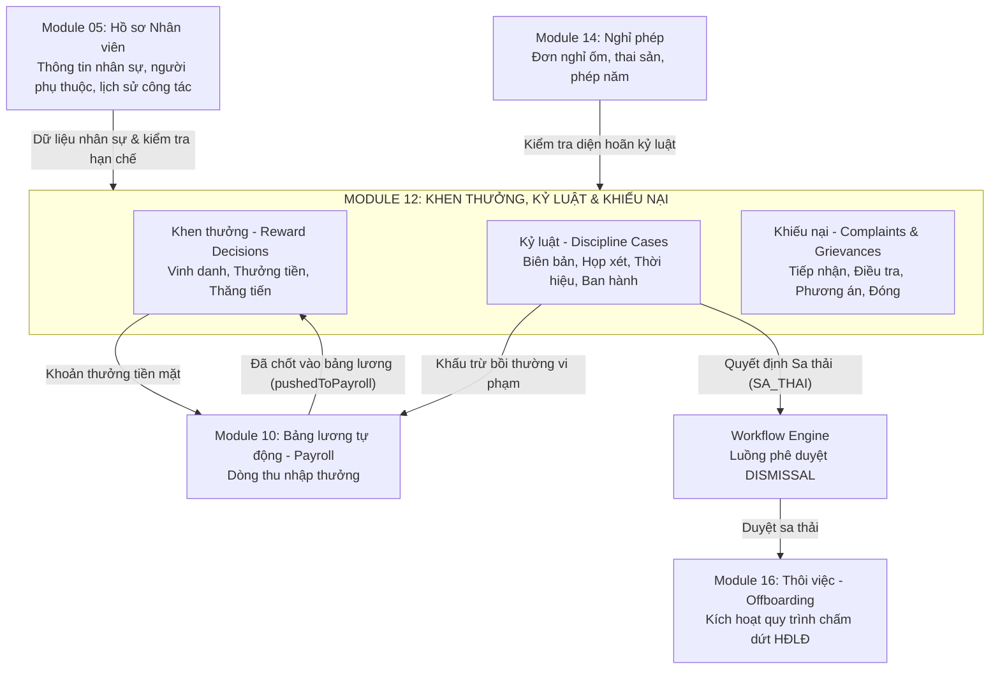
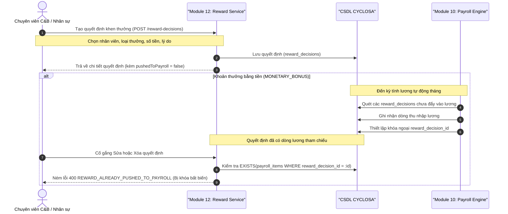
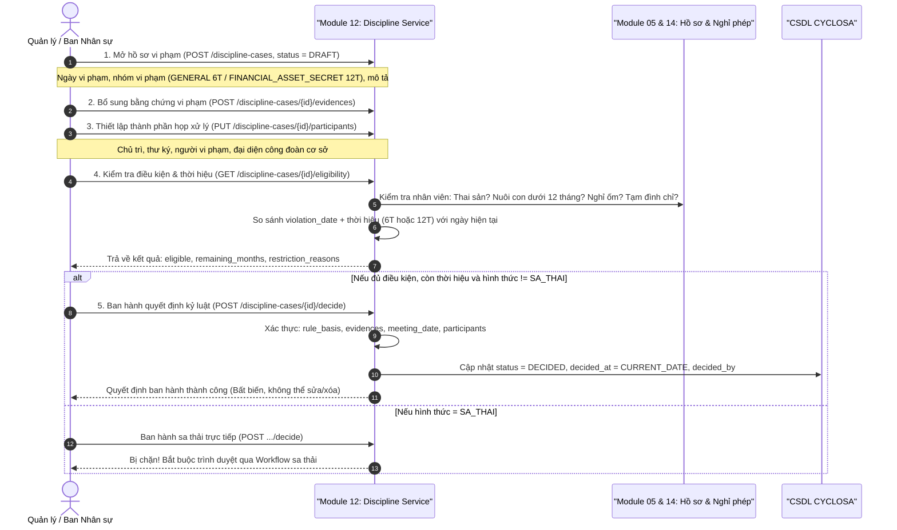
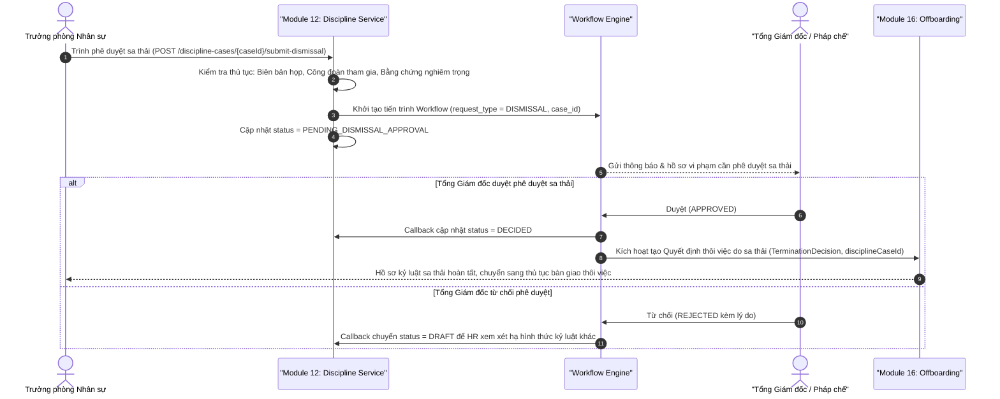
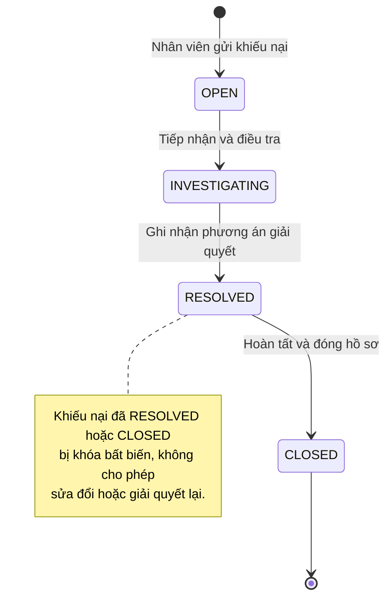
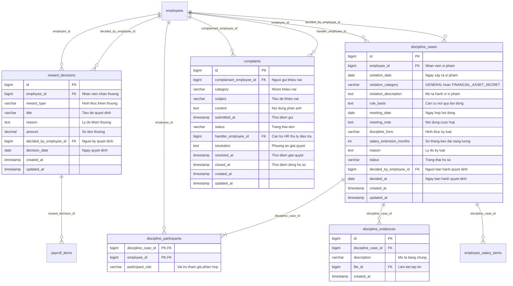
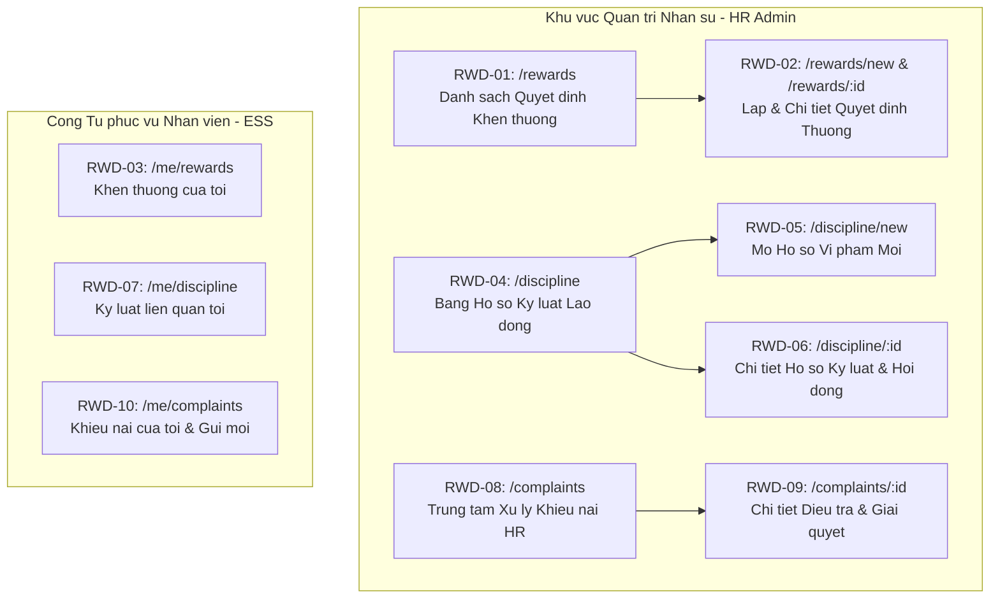
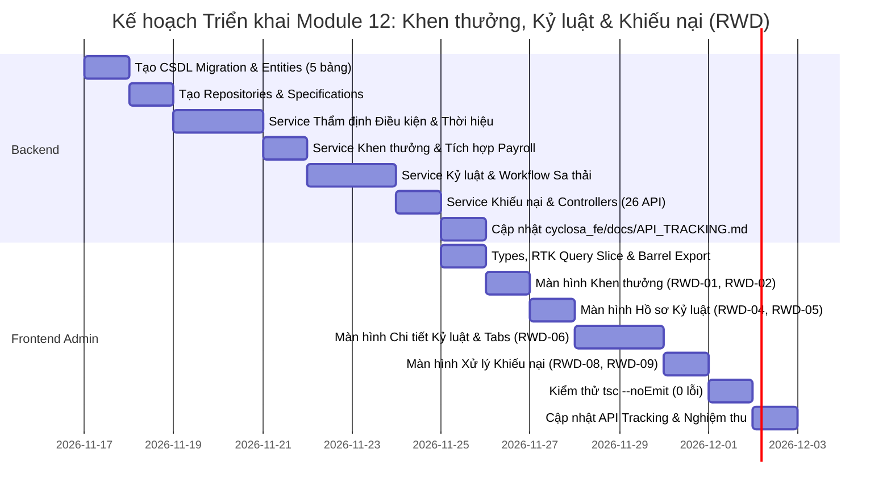

# TÀI LIỆU ĐẶC TẢ NGHIỆP VỤ & THIẾT KẾ KỸ THUẬT
## MODULE 12: KHEN THƯỞNG, KỶ LUẬT & GIẢI QUYẾT KHIẾU NẠI (REWARD, DISCIPLINE & GRIEVANCE - RWD)

> **Tài liệu tham chiếu:**
> - Nghiệp vụ tổng thể: [`Nghiep-vu.docx`](file:///f:/Project/CYCLOSA/docs/Nghiep-vu.docx) (§12. Khen thưởng & Vi phạm, dòng 12.1 – 12.3)
> - Thiết kế CSDL chi tiết: [`database.md`](file:///f:/Project/CYCLOSA/docs/database.md) (§8.13 Module 12 — Khen thưởng, Kỷ luật & Khiếu nại, dòng 3330–3468)
> - Danh mục API hệ thống: [`api-list.md`](file:///f:/Project/CYCLOSA/docs/api-list.md) (§12. Khen thưởng, Kỷ luật & Khiếu nại, 26 API, dòng 1058–1100)
> - Danh mục màn hình UI: [`page-list.md`](file:///f:/Project/CYCLOSA/docs/page-list.md) (§5.13 RWD-01 đến RWD-10, dòng 425–439)
> - Lộ trình triển khai: [`thu-tu-code-module.md`](file:///f:/Project/CYCLOSA/docs/thu-tu-code-module.md) (Giai đoạn 5: Đãi ngộ, Kỷ luật & Tiền lương)
> - Quy chuẩn kiến trúc & coding: [`cyclosa_be/rules/`](file:///f:/Project/CYCLOSA/cyclosa_be/rules) & [`cyclosa_fe/rules/`](file:///f:/Project/CYCLOSA/cyclosa_fe/rules)

---

## 1. TỔNG QUAN & MỤC TIÊU NGHIỆP VỤ

### 1.1. Vị trí của Module 12 trong Hệ sinh thái CYCLOSA HRM
Module **Khen thưởng, Kỷ luật & Giải quyết Khiếu nại (Reward, Discipline & Grievance - RWD)** là phân hệ quản trị nhân sự mang tính chế tài và đãi ngộ cốt lõi, thuộc **Giai đoạn 5: Đãi ngộ & Tiền lương**. Phân hệ này là cầu nối trực tiếp để khép kín chu trình tài chính với **Module 10 (Bảng lương & Tính lương - Payroll)**, đồng thời liên kết chặt chẽ với **Module 05 (Hồ sơ nhân sự)**, **Module 16 (Offboarding)** và **Hạ tầng Workflow Engine**.

### 1.2. Mục tiêu Nghiệp vụ Cốt lõi
1. **Quản lý Đãi ngộ Khen thưởng Minh bạch & Tích hợp Tiền lương:**
   * Ghi nhận và lưu vết các quyết định khen thưởng theo thành tích (Giấy khen/Vinh danh, Thưởng tiền mặt, Đề xuất thăng tiến).
   * **Cơ chế Khóa bất biến liên thông Tiền lương:** Khi khoản thưởng tiền mặt đã được chuyển vào kỳ lương (`pushedToPayroll = true`), hệ thống tự động khóa vĩnh viễn không cho phép sửa/xóa quyết định, loại bỏ rủi ro sai lệch số liệu kế toán.
2. **Tuân thủ 100% Bộ luật Lao động 2019 về Xử lý Kỷ luật:**
   * Hỗ trợ đầy đủ 4 hình thức kỷ luật lao động hợp pháp (Điều 124 BLLĐ): **Khiển trách**, **Kéo dài thời hạn nâng lương (tối đa 06 tháng)**, **Cách chức**, và **Sa thải**.
   * **Kiểm soát Thời hiệu Xử lý Kỷ luật tự động (Điều 123 BLLĐ):** Tối đa 06 tháng đối với vi phạm thông thường; tối đa 12 tháng đối với vi phạm trực tiếp đến tài chính, tài sản, bí mật công nghệ/kinh doanh.
   * **Kiểm tra Điều kiện Hạn chế Xử lý Kỷ luật (Điều 122 BLLĐ):** Chặn không cho ban hành quyết định kỷ luật đối với người lao động: đang nghỉ ốm đau, thai sản, điều dưỡng; đang nghỉ việc được sự đồng ý của NSDLĐ; đang bị tạm giữ/tạm giam; lao động nữ mang thai hoặc người lao động đang nuôi con dưới 12 tháng tuổi.
   * **Kiểm soát Thủ tục bắt buộc:** Yêu cầu đầy đủ căn cứ Nội quy lao động (`rule_basis`), hồ sơ Bằng chứng vi phạm (`discipline_evidences`), Biên bản cuộc họp (`meeting_note`) và Thành phần tham dự họp (`discipline_participants`) trước khi ban hành.
   * **Quy trình Sa thải nghiêm ngặt:** Hình thức `SA_THAI` không được ban hành trực tiếp mà bắt buộc định tuyến qua **Workflow Phê duyệt Sa thải (`DISMISSAL`)** có sự tham gia của Lãnh đạo cấp cao và Ban Pháp chế.
3. **Cơ chế "Derived State" (Dữ liệu Suy diễn Bất biến) cho Xóa Kỷ luật:**
   * Theo Điều 126 BLLĐ, người lao động bị khiển trách sau 03 tháng, bị kéo dài thời hạn nâng lương hoặc cách chức sau 06 tháng (kể từ ngày ban hành quyết định) mà không tái phạm thì **đương nhiên được xóa kỷ luật**.
   * Hệ thống CYCLOSA áp dụng triệt để nguyên lý **Derived State**: trạng thái `EXPIRED` và thời điểm hết hiệu lực `expiry_date` được **tính toán động qua truy vấn thời gian thực**, không dùng Cron Job/Scheduler 02:30 quét cập nhật CSDL nhằm đảm bảo tính toàn vẹn và hiệu năng tối ưu.
4. **Kênh Tiếp nhận & Giải quyết Khiếu nại Nội bộ (Grievance Management):**
   * Cung cấp cổng tiếp nhận phản ánh/khiếu nại bảo mật cho nhân viên (Mâu thuẫn nơi làm việc, Lương thưởng đãi ngộ, Chính sách, Quấy rối).
   * Chuẩn hóa quy trình xử lý 4 bước: `OPEN` (Mới tiếp nhận) $\to$ `INVESTIGATING` (Đang điều tra) $\to$ `RESOLVED` (Đã có phương án giải quyết) $\to$ `CLOSED` (Đóng hồ sơ). Hồ sơ đã giải quyết hoặc đóng là bất biến.

---

## 2. QUY TRÌNH NGHIỆP VỤ CHI TIẾT (BUSINESS WORKFLOWS)

### 2.1. Luồng 1: Lập & Quản lý Quyết định Khen thưởng (Reward Lifecycle)

---

### 2.2. Luồng 2: Quy trình Xử lý Vi phạm Kỷ luật Lao động chuẩn BLLĐ 2019

---

### 2.3. Luồng 3: Quy trình Phê duyệt Sa thải (Workflow DISMISSAL) & Tích hợp Offboarding

---

### 2.4. Luồng 4: Cơ chế Tự động Xóa Kỷ luật (Derived State - Expired)
* Theo Điều 126 Bộ luật Lao động:
  * **Khiển trách (`KHIEN_TRACH`):** Hết hiệu lực và đương nhiên xóa kỷ luật sau **03 tháng** kể từ ngày ban hành.
  * **Kéo dài thời hạn nâng lương (`KEO_DAI_NANG_LUONG`) & Cách chức (`CACH_CHUC`):** Hết hiệu lực và đương nhiên xóa kỷ luật sau **06 tháng** kể từ ngày ban hành.
  * **Sa thải (`SA_THAI`):** Chấm dứt quan hệ lao động, **không tự động xóa hiệu lực**.
* **Nguyên tắc kỹ thuật CYCLOSA:**
  $$\text{effective\_expiry\_date} = \begin{cases} 
  \text{decided\_at} + 3\text{ tháng} & \text{nếu } \text{discipline\_form} = \text{'KHIEN\_TRACH'} \\
  \text{decided\_at} + 6\text{ tháng} & \text{nếu } \text{discipline\_form} \in \{\text{'KEO\_DAI\_NANG\_LUONG'}, \text{'CACH\_CHUC'}\} \\
  \text{NULL} & \text{nếu } \text{discipline\_form} = \text{'SA\_THAI'}
  \end{cases}$$
  $$\text{computed\_status} = \begin{cases} 
  \text{'EXPIRED'} & \text{nếu } \text{status} = \text{'DECIDED'} \land \text{effective\_expiry\_date} \le \text{CURRENT\_DATE} \\
  \text{status} & \text{trường hợp còn lại}
  \end{cases}$$
  *Nhờ công thức này, API tra cứu luôn trả về trạng thái chính xác theo thời gian thực mà không phát sinh độ trễ hay lỗi đồng bộ dữ liệu.*

---

### 2.5. Luồng 5: Quy trình Tiếp nhận & Giải quyết Khiếu nại Nội bộ (Grievance Lifecycle)

---

## 3. THIẾT KẾ CƠ SỞ DỮ LIỆU & RÀNG BUỘC TOÀN VẸN

### 3.1. Sơ đồ Quan hệ Thực thể (Entity Relationship Diagram - ERD)

---

### 3.2. Đặc tả Chi tiết các Bảng CSDL

#### Bảng 1: `reward_decisions` — Quyết định Khen thưởng
| Tên cột | Kiểu dữ liệu | Ràng buộc | Diễn giải nghiệp vụ |
|---|---|---|---|
| `id` | BIGINT | PK, Auto Increment | Định danh duy nhất quyết định khen thưởng |
| `employee_id` | BIGINT | FK $\to$ `employees.id`, NOT NULL | Nhân viên được khen thưởng |
| `reward_type` | VARCHAR(30) | NOT NULL | Enum: `CERTIFICATE`, `MONETARY_BONUS`, `PROMOTION_PROPOSAL`, `OTHER` |
| `title` | VARCHAR(200) | NOT NULL | Tiêu đề quyết định (VD: *Khen thưởng cá nhân xuất sắc Quý 3/2026*) |
| `reason` | TEXT | NOT NULL | Lý do và thành tích khen thưởng |
| `amount` | DECIMAL(18,2) | NULL | Số tiền thưởng (VNĐ). **Bắt buộc $> 0$** khi `reward_type = 'MONETARY_BONUS'`; là `NULL` với các hình thức khác |
| `decided_by_employee_id` | BIGINT | FK $\to$ `employees.id`, NOT NULL | Người ký quyết định (Lãnh đạo / Giám đốc Nhân sự) |
| `decision_date` | DATE | NOT NULL | Ngày ký ban hành quyết định |
| `created_at` / `updated_at` | TIMESTAMP | NOT NULL | Audit trail hệ thống |

* **Ràng buộc kiểm tra (Check Constraints):**
  * `CHECK (reward_type != 'MONETARY_BONUS' OR (amount IS NOT NULL AND amount > 0))`
  * `CHECK (reward_type = 'MONETARY_BONUS' OR amount IS NULL)`
* **Thuộc tính suy diễn (Derived Attribute):**
  * `pushed_to_payroll = EXISTS (SELECT 1 FROM payroll_items WHERE reward_decision_id = reward_decisions.id)`: Khi `true`, hệ thống từ chối mọi yêu cầu `UPDATE` hoặc `DELETE`.

---

#### Bảng 2: `discipline_cases` — Hồ sơ Vi phạm & Xử lý Kỷ luật
| Tên cột | Kiểu dữ liệu | Ràng buộc | Diễn giải nghiệp vụ |
|---|---|---|---|
| `id` | BIGINT | PK, Auto Increment | Định danh duy nhất hồ sơ kỷ luật |
| `employee_id` | BIGINT | FK $\to$ `employees.id`, NOT NULL | Nhân viên có hành vi vi phạm |
| `violation_date` | DATE | NOT NULL | Ngày xảy ra hành vi vi phạm (mốc tính thời hiệu) |
| `violation_category` | VARCHAR(30) | NOT NULL | Enum: `GENERAL` (thời hiệu 6 tháng), `FINANCIAL_ASSET_SECRET` (thời hiệu 12 tháng) |
| `violation_description` | TEXT | NOT NULL | Mô tả chi tiết hành vi vi phạm |
| `rule_basis` | TEXT | NULL | Căn cứ Điều khoản Nội quy lao động đã đăng ký |
| `meeting_date` | DATE | NULL | Ngày tổ chức họp xét kỷ luật lao động |
| `meeting_note` | TEXT | NULL | Nội dung biên bản cuộc họp và ý kiến các bên |
| `discipline_form` | VARCHAR(30) | NULL | Enum: `KHIEN_TRACH`, `KEO_DAI_NANG_LUONG`, `CACH_CHUC`, `SA_THAI` |
| `salary_extension_months` | INT | NULL | Số tháng kéo dài nâng lương ($\le 6$). Bắt buộc khi hình thức là `KEO_DAI_NANG_LUONG` |
| `reason` | TEXT | NULL | Lý do và kết luận xử lý kỷ luật |
| `status` | VARCHAR(30) | NOT NULL, DEFAULT 'DRAFT' | Enum: `DRAFT`, `PENDING_DISMISSAL_APPROVAL`, `DECIDED` |
| `decided_by_employee_id` | BIGINT | FK $\to$ `employees.id`, NULL | Người ban hành quyết định kỷ luật |
| `decided_at` | DATE | NULL | Ngày ban hành quyết định (mốc tính hết hiệu lực) |
| `created_at` / `updated_at` | TIMESTAMP | NOT NULL | Audit trail hệ thống |

* **Quy tắc Kiểm tra Hợp lệ khi Ban hành (`status = 'DECIDED'`):**
  1. `rule_basis` không được rỗng.
  2. Bắt buộc có ít nhất 1 bản ghi bằng chứng trong `discipline_evidences`.
  3. `meeting_date` không được rỗng và $\ge$ `violation_date`.
  4. Bắt buộc có ít nhất 1 thành viên tham dự trong `discipline_participants`.
  5. Còn trong thời hiệu: $\text{CURRENT\_DATE} - \text{violation\_date} \le \text{limitation\_period}$ (6 hoặc 12 tháng).
  6. Nhân viên không thuộc diện hạn chế xử lý kỷ luật tại thời điểm ban hành.
  7. Nếu `discipline_form = 'SA_THAI'`, **không được chuyển trực tiếp sang DECIDED** mà phải qua Workflow duyệt sa thải.
* **Tính bất biến:** Khi hồ sơ đã ở trạng thái `DECIDED`, hệ thống khóa vĩnh viễn không cho chỉnh sửa bất kỳ trường nào.

---

#### Bảng 3: `discipline_participants` — Thành phần Tham dự Họp Kỷ luật
| Tên cột | Kiểu dữ liệu | Ràng buộc | Diễn giải nghiệp vụ |
|---|---|---|---|
| `discipline_case_id` | BIGINT | PK, FK $\to$ `discipline_cases.id` | Hồ sơ vi phạm liên kết |
| `employee_id` | BIGINT | PK, FK $\to$ `employees.id` | Nhân sự tham dự họp (Chủ trì, Ban nhân sự, Công đoàn, v.v.) |
| `participant_role` | VARCHAR(100) | NULL | Vai trò trong phiên họp (VD: *Chủ trì phiên họp, Đại diện BCH Công đoàn cơ sở, Thư ký ghi biên bản, Người làm chứng*) |

---

#### Bảng 4: `discipline_evidences` — Bằng chứng Vi phạm
| Tên cột | Kiểu dữ liệu | Ràng buộc | Diễn giải nghiệp vụ |
|---|---|---|---|
| `id` | BIGINT | PK, Auto Increment | Định danh duy nhất bằng chứng |
| `discipline_case_id` | BIGINT | FK $\to$ `discipline_cases.id`, NOT NULL | Hồ sơ vi phạm liên kết |
| `description` | VARCHAR(500) | NOT NULL | Diễn giải nội dung bằng chứng (VD: *Biên bản kiểm kê quỹ tiền mặt thiếu hụt, Trích xuất camera an ninh*) |
| `file_id` | BIGINT | FK $\to$ `files.id`, NULL | Mã tệp tin đính kèm (ảnh, PDF, video) từ Module 07 |
| `created_at` | TIMESTAMP | NOT NULL | Thời điểm tải lên |

---

#### Bảng 5: `complaints` — Khiếu nại & Phản ánh Nội bộ
| Tên cột | Kiểu dữ liệu | Ràng buộc | Diễn giải nghiệp vụ |
|---|---|---|---|
| `id` | BIGINT | PK, Auto Increment | Định danh duy nhất đơn khiếu nại |
| `complainant_employee_id` | BIGINT | FK $\to$ `employees.id`, NOT NULL | Nhân viên gửi phản ánh/khiếu nại |
| `category` | VARCHAR(30) | NOT NULL | Enum: `WORKPLACE_CONFLICT`, `COMPENSATION`, `POLICY`, `HARASSMENT`, `OTHER` |
| `subject` | VARCHAR(200) | NOT NULL | Tiêu đề ngắn gọn về nội dung khiếu nại |
| `content` | TEXT | NOT NULL | Nội dung phản ánh chi tiết và bằng chứng kèm theo |
| `submitted_at` | TIMESTAMP | NOT NULL | Thời điểm gửi đơn |
| `status` | VARCHAR(30) | NOT NULL, DEFAULT 'OPEN' | Enum: `OPEN`, `INVESTIGATING`, `RESOLVED`, `CLOSED` |
| `handler_employee_id` | BIGINT | FK $\to$ `employees.id`, NULL | Cán bộ Nhân sự được giao trách nhiệm điều tra |
| `resolution` | TEXT | NULL | Kết luận và phương án giải quyết khiếu nại của HR |
| `resolved_at` | TIMESTAMP | NULL | Thời điểm giải quyết |
| `closed_at` | TIMESTAMP | NULL | Thời điểm đóng đơn |
| `created_at` / `updated_at` | TIMESTAMP | NOT NULL | Audit trail hệ thống |

---

## 4. DANH MỤC API BACKEND & HỢP ĐỒNG DỮ LIỆU (26 API CHUẨN)

Toàn bộ API tuân thủ tiêu chuẩn RESTful của CYCLOSA: Response bọc trong `ApiResponse<T>`, danh sách phân trang dùng `PageData<T>`, đường dẫn thống nhất với [`api-list.md`](file:///f:/Project/CYCLOSA/docs/api-list.md).

### 4.1. Nhóm API Khen thưởng (Reward Decisions - 6 API)

| STT | Method | Endpoint URL | Phân quyền | Mô tả nghiệp vụ chi tiết |
|---|---|---|---|---|
| 1 | `POST` | `/api/v1/reward-decisions` | `reward.manage` | Lập quyết định khen thưởng mới (thưởng tiền yêu cầu `amount > 0`) |
| 2 | `GET` | `/api/v1/reward-decisions` | `reward.view` | Danh sách khen thưởng phân trang (Lọc: `employeeId`, `rewardType`, `from`, `to`) |
| 3 | `GET` | `/api/v1/reward-decisions/{decisionId}` | `reward.view` | Chi tiết quyết định khen thưởng (trả kèm cờ `pushedToPayroll` được tính toán) |
| 4 | `PUT` | `/api/v1/reward-decisions/{decisionId}` | `reward.manage` | Chỉnh sửa quyết định khen thưởng (Bị khóa khi `pushedToPayroll = true`) |
| 5 | `DELETE` | `/api/v1/reward-decisions/{decisionId}` | `reward.manage` | Xóa quyết định khen thưởng (Chỉ cho phép khi chưa chuyển vào bảng lương) |
| 6 | `GET` | `/api/v1/me/reward-decisions` | `Auth` | Danh sách các quyết định khen thưởng của chính nhân viên đang đăng nhập (ESS) |

---

### 4.2. Nhóm API Kỷ luật Lao động (Discipline Cases - 12 API)

| STT | Method | Endpoint URL | Phân quyền | Mô tả nghiệp vụ chi tiết |
|---|---|---|---|---|
| 7 | `POST` | `/api/v1/discipline-cases` | `discipline.manage` | Mở hồ sơ vi phạm mới (khởi tạo ở trạng thái `DRAFT`) |
| 8 | `GET` | `/api/v1/discipline-cases` | `discipline.view` | Danh sách hồ sơ kỷ luật phân trang (Lọc: `employeeId`, `status`, `disciplineForm`) |
| 9 | `GET` | `/api/v1/discipline-cases/{caseId}` | `discipline.view` | Chi tiết hồ sơ kỷ luật (kèm thời hiệu còn lại, tình trạng hết hiệu lực `EXPIRED`) |
| 10 | `PUT` | `/api/v1/discipline-cases/{caseId}` | `discipline.manage` | Cập nhật thông tin hồ sơ kỷ luật (Chỉ cho phép khi ở trạng thái `DRAFT`) |
| 11 | `GET` | `/api/v1/discipline-cases/{caseId}/eligibility` | `discipline.manage` | **Thẩm định điều kiện xử lý:** Kiểm tra thời hiệu và các trường hợp hạn chế (nghỉ ốm, thai sản, nuôi con < 12 tháng) |
| 12 | `PUT` | `/api/v1/discipline-cases/{caseId}/participants` | `discipline.manage` | Cập nhật / Thay thế danh sách thành phần tham gia phiên họp kỷ luật |
| 13 | `GET` | `/api/v1/discipline-cases/{caseId}/evidences` | `discipline.view` | Lấy danh sách bằng chứng vi phạm kèm tệp tin đính kèm |
| 14 | `POST` | `/api/v1/discipline-cases/{caseId}/evidences` | `discipline.manage` | Tải lên / Bổ sung bằng chứng vi phạm vào hồ sơ |
| 15 | `DELETE` | `/api/v1/discipline-evidences/{evidenceId}` | `discipline.manage` | Xóa một bằng chứng vi phạm khỏi hồ sơ (Chỉ khi `DRAFT`) |
| 16 | `POST` | `/api/v1/discipline-cases/{caseId}/decide` | `discipline.decide` | Ban hành quyết định kỷ luật chính thức (`DECIDED`). Không áp dụng cho `SA_THAI` |
| 17 | `POST` | `/api/v1/discipline-cases/{caseId}/submit-dismissal` | `discipline.manage` | Trình phê duyệt quyết định Sa thải (Khởi tạo Workflow `DISMISSAL`) |
| 18 | `GET` | `/api/v1/me/discipline-cases` | `Auth` | Tra cứu danh sách các quyết định kỷ luật liên quan đến bản thân (ESS) |

---

### 4.3. Nhóm API Khiếu nại & Phản ánh (Complaints - 8 API)

| STT | Method | Endpoint URL | Phân quyền | Mô tả nghiệp vụ chi tiết |
|---|---|---|---|---|
| 19 | `POST` | `/api/v1/complaints` | `Auth` | Nhân viên nộp đơn phản ánh / khiếu nại nội bộ mới (`OPEN`) |
| 20 | `GET` | `/api/v1/me/complaints` | `Auth` | Danh sách khiếu nại của chính người dùng đăng nhập phân trang (ESS) |
| 21 | `GET` | `/api/v1/complaints` | `complaint.manage` | Bảng quản lý khiếu nại cho HR (Lọc: `status`, `category`) |
| 22 | `GET` | `/api/v1/complaints/{complaintId}` | `complaint.manage` | Xem chi tiết nội dung khiếu nại và tiến trình xử lý |
| 23 | `POST` | `/api/v1/complaints/{complaintId}/assign` | `complaint.manage` | Phân công cán bộ HR thụ lý điều tra (`handlerEmployeeId`) |
| 24 | `POST` | `/api/v1/complaints/{complaintId}/start-investigation` | `complaint.manage` | Chuyển trạng thái khiếu nại sang Đang điều tra (`INVESTIGATING`) |
| 25 | `POST` | `/api/v1/complaints/{complaintId}/resolve` | `complaint.manage` | Ghi nhận phương án / kết luận giải quyết và chuyển sang `RESOLVED` |
| 26 | `POST` | `/api/v1/complaints/{complaintId}/close` | `complaint.manage` | Đóng hồ sơ khiếu nại chính thức (`CLOSED`) |

---

## 5. BẢN ĐẶC TẢ GIAO DIỆN FRONTEND (10 MÀN HÌNH CHUẨN RWD-01 ĐẾN RWD-10)

Hệ thống giao diện Module 12 bao gồm 10 màn hình theo chuẩn [`page-list.md`](file:///f:/Project/CYCLOSA/docs/page-list.md), được chia thành hai phân vùng rõ rệt: **Khu vực Quản trị Nhân sự / HR Admin** (`(admin)`) và **Cổng Tự phục vụ Nhân viên** (`(employee)` / `me`).

### Chi tiết Đặc tả từng Màn hình

| Mã MH | Route URL | Loại trang | Vai trò truy cập | Thành phần giao diện chính & Quy chuẩn UX | Trạng thái tích hợp |
|---|---|---|---|---|---|
| **RWD-01** | `/rewards` | `LIST` | HR Admin / C&B Lead | • **Header:** Icon `Award` trực tiếp trong `h1`, breadcrumb `Trang chủ / Khen thưởng & Kỷ luật / Quyết định khen thưởng`, nút Tạo quyết định bên phải. • **KPI Cards 4 cột:** Tổng số quyết định, Thưởng tiền mặt, Thưởng vinh danh, Đã đẩy Payroll. • **Filter Bar 2 hàng:** Hàng 1 tìm kiếm nhân viên debounce 350ms; Hàng 2 select Hình thức thưởng, Khoảng ngày, Switch Đã đẩy Payroll, nút Đặt lại. • **Bảng dữ liệu:** Cột Nhân viên, Loại thưởng, Số tiền, Ngày ký, Cờ trạng thái Payroll (Badge xanh lá Đã chuyển / Badge xám Chưa chuyển), Action Menu. | Đã lên kế hoạch (Admin) |
| **RWD-02** | `/rewards/new`, `/rewards/:id` | `FORM & DETAIL` | HR Admin | • Form chọn nhân viên, hình thức khen thưởng, ngày ban hành, người ký. • Ô nhập tiền thưởng có định dạng VNĐ tự động (bật khi chọn `MONETARY_BONUS`, ẩn khi chọn loại khác). • **Cơ chế Khóa giao diện:** Nếu `pushedToPayroll = true`, toàn bộ form chuyển sang chế độ `disabled`, hiển thị Banner thông báo cảnh báo: *"Khoản thưởng này đã được chốt vào kỳ lương, không được phép chỉnh sửa hoặc xóa"*. | Đã lên kế hoạch (Admin) |
| **RWD-03** | `/me/rewards` | `LIST` (ESS) | Toàn thể nhân viên | Danh sách các quyết định khen thưởng, vinh danh của cá nhân; xem chi tiết thư khen và số tiền thưởng đã nhận. | Tạm hoãn làm sau theo yêu cầu ESS |
| **RWD-04** | `/discipline` | `LIST` | HR Admin / Giám đốc NS | • **Header:** Icon `ShieldAlert` trực tiếp trong `h1`, breadcrumbs chuẩn, nút Mở hồ sơ vi phạm. • **KPI Cards 4 cột:** Tổng số vụ việc, Đang thụ lý (DRAFT), Đã ban hành (DECIDED), Đã hết hiệu lực (EXPIRED). • **Filter Bar 2 hàng:** Tìm kiếm tên/mã nhân viên debounce 350ms; Select Trạng thái, Select Hình thức kỷ luật, Nút Đặt lại. • **Bảng dữ liệu:** Nhân viên, Ngày vi phạm, Nhóm vi phạm (thời hiệu 6T/12T), Hình thức kỷ luật, Trạng thái (kèm badge EXPIRED tự tính), Cảnh báo hạn thời hiệu. | Đã lên kế hoạch (Admin) |
| **RWD-05** | `/discipline/new` | `FORM` | HR Admin | Form tạo hồ sơ vi phạm: Chọn nhân viên, Ngày xảy ra vi phạm, Phân loại nhóm vi phạm (`GENERAL` / `FINANCIAL_ASSET_SECRET`), Mô tả tóm tắt hành vi vi phạm. | Đã lên kế hoạch (Admin) |
| **RWD-06** | `/discipline/:id` | `DETAIL & TABS` | HR / Hội đồng kỷ luật | Chi tiết hồ sơ gồm 4 Tab nghiệp vụ: • **Tab 1: Thông tin chung & Biên bản:** Căn cứ nội quy, Ngày họp, Biên bản cuộc họp. • **Tab 2: Điều kiện & Thời hiệu (Live Inspector):** Hiển thị trực quan widget thời hiệu còn lại; Kiểm tra tự động nhân viên có đang trong diện hạn chế (ốm đau, thai sản, nuôi con < 12T) với thông báo cảnh báo đỏ. • **Tab 3: Hội đồng & Bằng chứng:** Danh sách người tham gia họp kèm vai trò; Danh sách tệp đính kèm bằng chứng (thêm/xóa). • **Tab 4: Quyết định kỷ luật:** Chọn hình thức kỷ luật; Nút **Ban hành quyết định** (chặn nếu vi phạm điều kiện); Nút **Trình duyệt sa thải** (mở popup xác nhận chuyển sang Workflow `DISMISSAL`). | Đã lên kế hoạch (Admin) |
| **RWD-07** | `/me/discipline` | `LIST` (ESS) | Toàn thể nhân viên | Xem các quyết định kỷ luật liên quan đến bản thân, theo dõi thời gian xóa kỷ luật còn lại. | Tạm hoãn làm sau theo yêu cầu ESS |
| **RWD-08** | `/complaints` | `LIST` | HR Admin | • **Header:** Icon `MessageSquareWarning` trực tiếp trong `h1`, breadcrumbs chuẩn. • **KPI Cards 4 cột:** Khiếu nại mới (OPEN), Đang điều tra (INVESTIGATING), Đã giải quyết (RESOLVED), Đã đóng (CLOSED). • **Filter Bar 2 hàng:** Hàng 1 tìm kiếm nội dung; Hàng 2 select Nhóm khiếu nại, Trạng thái, Nút Đặt lại. • **Bảng dữ liệu:** Người gửi, Nhóm nội dung, Tiêu đề, Ngày gửi, Cán bộ thụ lý, Trạng thái, Nút Phân công nhanh. | Đã lên kế hoạch (Admin) |
| **RWD-09** | `/complaints/:id` | `DETAIL` | HR thụ lý điều tra | Giao diện quy trình 4 giai đoạn trực quan (Stepped Timeline): • Thông tin người khiếu nại, nội dung chi tiết và tệp đính kèm. • Nút **Phân công cán bộ HR** $\to$ Nút **Bắt đầu điều tra** (`INVESTIGATING`). • Hộp nhập **Phương án / Kết luận giải quyết** $\to$ Bấm **Giải quyết** (`RESOLVED`). • Nút **Đóng hồ sơ** (`CLOSED`). Khi đã đóng: khóa toàn bộ form. | Đã lên kế hoạch (Admin) |
| **RWD-10** | `/me/complaints` | `FORM & LIST` (ESS)| Toàn thể nhân viên | Cổng gửi đơn khiếu nại/phản ánh bảo mật dành cho nhân viên và theo dõi tiến độ xử lý của phòng Nhân sự. | Tạm hoãn làm sau theo yêu cầu ESS |

---

## 6. DANH MỤC MÃ LỖI & QUY TẮC KIỂM TRA HỢP LỆ (ERROR CODES & VALIDATION)

| HTTP Code | Business Error Code | Thông báo lỗi tiếng Việt | Điều kiện kích hoạt & Nghiệp vụ kiểm tra |
|---|---|---|---|
| 404 | `REWARD_DECISION_NOT_FOUND` | Không tìm thấy quyết định khen thưởng yêu cầu | ID quyết định không tồn tại trong CSDL |
| 400 | `INVALID_REWARD_AMOUNT` | Thưởng bằng tiền bắt buộc phải nhập số tiền lớn hơn 0 | `reward_type = 'MONETARY_BONUS'` nhưng `amount <= 0` hoặc rỗng |
| 400 | `REWARD_AMOUNT_NOT_ALLOWED` | Hình thức khen thưởng này không được phép nhập số tiền | `reward_type != 'MONETARY_BONUS'` nhưng lại truyền `amount` |
| 400 | `REWARD_ALREADY_PUSHED_TO_PAYROLL` | Quyết định khen thưởng đã được chốt vào kỳ lương, không thể chỉnh sửa hoặc xóa | Tồn tại bản ghi trong `payroll_items` tham chiếu đến `reward_decision_id` |
| 404 | `DISCIPLINE_CASE_NOT_FOUND` | Không tìm thấy hồ sơ kỷ luật yêu cầu | ID hồ sơ không tồn tại trong CSDL |
| 400 | `DISCIPLINE_CASE_ALREADY_DECIDED` | Hồ sơ kỷ luật đã được ban hành quyết định chính thức, không thể sửa đổi | Thao tác sửa/xóa khi trạng thái là `DECIDED` |
| 400 | `DISCIPLINE_LIMITATION_EXPIRED` | Đã hết thời hiệu xử lý kỷ luật lao động theo quy định pháp luật | Quá 06 tháng (vi phạm thông thường) hoặc 12 tháng (tài chính/tài sản) kể từ ngày vi phạm |
| 422 | `EMPLOYEE_RESTRICTED_FROM_DISCIPLINE` | Không được phép xử lý kỷ luật nhân viên đang trong thời gian được pháp luật bảo vệ | Nhân viên đang nghỉ ốm, thai sản, điều dưỡng hoặc đang nuôi con dưới 12 tháng tuổi |
| 400 | `INSUFFICIENT_DISCIPLINE_PROCEDURES` | Chưa đủ thủ tục bắt buộc để ban hành quyết định kỷ luật | Thiếu căn cứ nội quy lao động, chưa có bằng chứng vi phạm, chưa có ngày họp hoặc thiếu thành phần tham dự họp |
| 400 | `DISMISSAL_REQUIRES_WORKFLOW_APPROVAL` | Hình thức kỷ luật sa thải bắt buộc phải trình phê duyệt qua quy trình Workflow | Người dùng gọi API `/decide` trực tiếp với hình thức `SA_THAI` |
| 400 | `INVALID_SALARY_EXTENSION_MONTHS` | Thời hạn kéo dài nâng lương không được vượt quá 06 tháng | `salary_extension_months > 6` hoặc $\le 0$ khi chọn `KEO_DAI_NANG_LUONG` |
| 404 | `COMPLAINT_NOT_FOUND` | Không tìm thấy đơn khiếu nại yêu cầu | ID khiếu nại không tồn tại trong CSDL |
| 400 | `COMPLAINT_ALREADY_CLOSED` | Khiếu nại này đã được giải quyết hoặc đã đóng hồ sơ, không thể thao tác lại | Thao tác điều tra/giải quyết lại khi đơn đã `RESOLVED` hoặc `CLOSED` |
| 400 | `INVALID_COMPLAINT_TRANSITION` | Trạng thái chuyển đổi khiếu nại không hợp lệ | Vi phạm thứ tự luồng: `OPEN` $\to$ `INVESTIGATING` $\to$ `RESOLVED` $\to$ `CLOSED` |

---

## 7. KẾ HOẠCH TRIỂN KHAI THEO GIAI ĐOẠN

---

> **Kết luận & Cam kết Quy chuẩn:**
> 1. Tài liệu đặc tả này là căn cứ kỹ thuật và nghiệp vụ duy nhất để triển khai **Module 12 (Khen thưởng, Kỷ luật & Giải quyết Khiếu nại)**.
> 2. Quá trình triển khai Backend cam kết tuân thủ 100% **`cyclosa_be/rules/`** (Entity, DTO, Mapper, Exception Handler, DataScope, Audit Log, API Tracking).
> 3. Quá trình triển khai Frontend cam kết tuân thủ 100% **`cyclosa_fe/rules/`** (Icon trực tiếp trong `h1`, không subtitle, breadcrumb chuẩn tiếng Việt, Filter Bar 2 hàng trong Card bo góc, debounce 350ms, nút Đặt lại, RTK Query mutation tag invalidation, tsc exit code 0).
> 4. Toàn bộ tiến độ API sẽ được đồng bộ cập nhật vào **`cyclosa_fe/docs/API_TRACKING.md`**.

