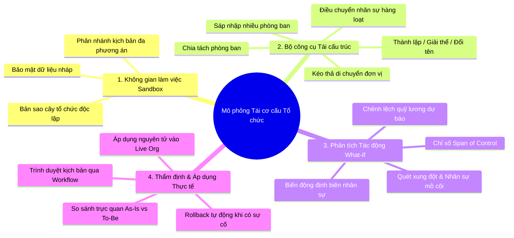
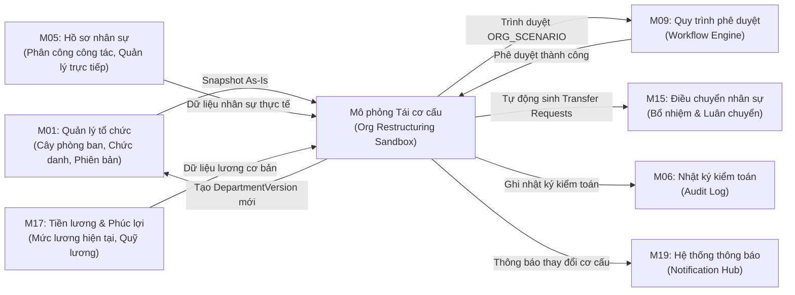
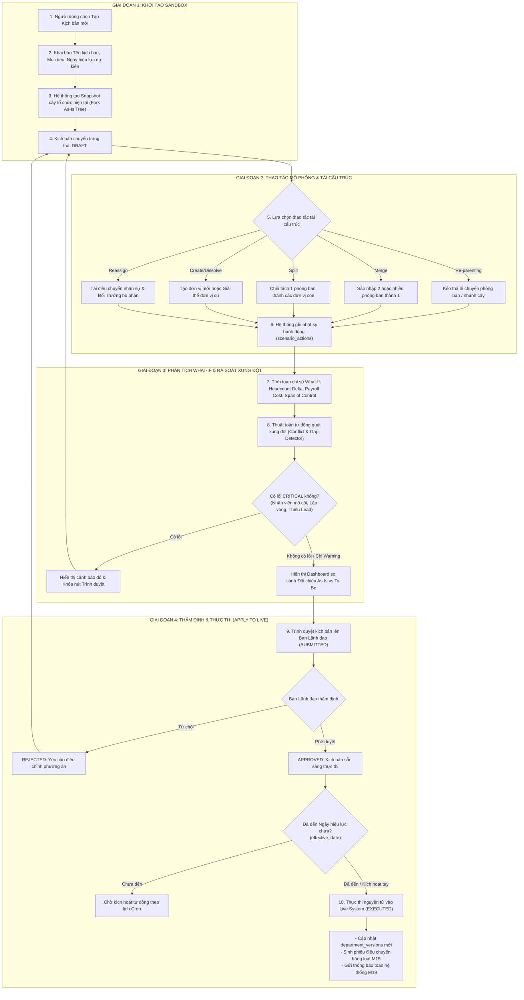
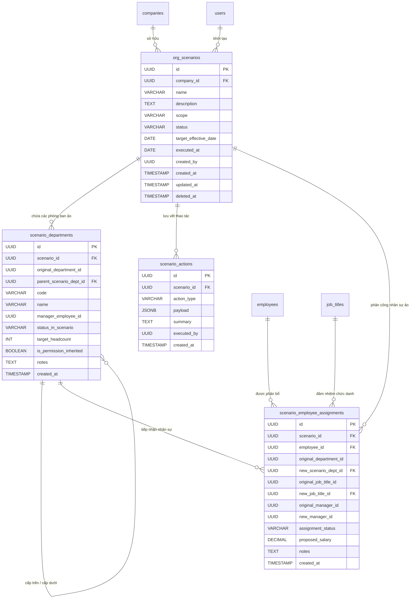

# TÀI LIỆU ĐẶC TẢ NGHIỆP VỤ & KỸ THUẬT: MODULE MÔ PHỎNG TÁI CƠ CẤU TỔ CHỨC (ORGANIZATION RESTRUCTURING SIMULATION)

---

## 1. TỔNG QUAN & MỐI QUAN HỆ LIÊN MODULE

Module **Mô phỏng Tái cơ cấu Tổ chức (Organization Restructuring Simulation / Org Sandbox)** là phân hệ quản trị chiến lược cấp cao trong hệ sinh thái CYCLOSA HRM. Module này cung cấp môi trường làm việc giả lập an toàn (**Sandbox Environment**), cho phép Hội đồng Quản trị, Ban Giám đốc và Lãnh đạo Khối Nhân sự (CHRO/HRD) chủ động lập kế hoạch, mô phỏng các phương án tái cấu trúc bộ máy tổ chức, phân tích tác động đa chiều (What-If Impact Analysis) và đánh giá rủi ro trước khi ban hành quyết định thay đổi chính thức vào hệ thống vận hành thực tế (Live System).

### 1.1. Mục tiêu & Ý nghĩa chiến lược
1. **Loại bỏ rủi ro xáo trộn vận hành thực tế:**
   - Trong môi trường doanh nghiệp quy mô lớn, việc điều chỉnh sơ đồ tổ chức (sáp nhập, giải thể, chia tách phòng ban, luân chuyển nhân sự hàng loạt) nếu thực hiện trực tiếp trên cây tổ chức đang chạy sẽ gây gián đoạn quy trình chấm công, tính lương, phân quyền phê duyệt và quan hệ báo cáo.
   - Module cung cấp cơ chế phân nhánh ảo (**Snapshot Forking**) giúp nhà quản lý thoải mái thử nghiệm nhiều kịch bản độc lập mà không ảnh hưởng tới dữ liệu thực tế.
2. **Định lượng tác động toàn diện trước khi thực thi (What-If Analytics):**
   - Dự báo chính xác biến động định biên nhân sự (**Headcount Delta**) và chi phí quỹ lương dự kiến (**Payroll Cost Delta**).
   - Đánh giá tỉ lệ kiểm soát của nhà quản lý (**Span of Control**) và độ sâu phân tầng bộ máy (**Management Depth / Layers**) để tránh tình trạng phình to bộ máy hành chính trung gian.
3. **Phát hiện xung đột & Lỗ hổng tổ chức tự động (Conflict & Gap Detection):**
   - Tự động quét và cảnh báo các vị trí "mồ côi" (Orphaned Employees - nhân viên không thuộc phòng ban nào hoặc mất người quản lý trực tiếp).
   - Cảnh báo phòng ban thiếu người đứng đầu (Missing Department Head), cấu trúc lặp vòng đệ quy (Cyclic Hierarchy), hoặc vượt trần ngân sách/định biên cho phép.
4. **Quy trình thẩm định chặt chẽ & Thực thi nguyên tử (Atomic Execution):**
   - Kịch bản sau khi hoàn thiện sẽ được trình phê duyệt qua Hội đồng thông qua quy trình Workflow tích hợp.
   - Khi được phê duyệt và đến ngày hiệu lực, hệ thống kích hoạt cơ chế thực thi tự động (**Atomic Batch Execution**), tự động cập nhật phiên bản phòng ban (`department_versions`), tạo quyết định điều chuyển bổ nhiệm (`transfer_requests`) và ghi nhận nhật ký kiểm toán bất biến.

---

### 1.2. Bốn trụ cột nghiệp vụ cốt lõi



1. **Không gian làm việc giả lập an toàn (Org Restructuring Sandbox):**
   - Cho phép tạo nhiều kịch bản độc lập (ví dụ: *Phương án A - Sáp nhập Khối Vận hành*, *Phương án B - Tách Khối Kinh doanh theo khu vực*).
   - Mỗi kịch bản là một bản sao ảo tại thời điểm tạo (`Snapshot Time`), hoàn toàn cách ly với cơ sở dữ liệu vận hành.
2. **Bộ công cụ Thao tác Tái cơ cấu Trực quan (Structural Actions Engine):**
   - **Kéo thả phân cấp (Re-parenting / Drag & Drop):** Thay đổi đơn vị quản lý trực tiếp của một phòng ban hoặc cả nhánh con.
   - **Sáp nhập phòng ban (Merge Departments):** Gộp hai hoặc nhiều phòng ban thành một đơn vị duy nhất, tự động tập hợp nhân sự và điều chỉnh quan hệ báo cáo.
   - **Chia tách phòng ban (Split Department):** Phân rã một phòng ban lớn thành các phòng ban chuyên môn mới, phân bổ danh sách nhân viên và tái bổ nhiệm trưởng bộ phận.
   - **Thành lập mới (Create Department):** Khởi tạo đơn vị tổ chức mới trong kịch bản.
   - **Giải thể (Dissolve Department):** Đóng cửa đơn vị và bắt buộc tái bố trí toàn bộ nhân sự trực thuộc.
   - **Điều chuyển nhân sự trong kịch bản (Scenario Employee Reassignment):** Gán lại phòng ban, chức danh hoặc quản lý trực tiếp cho từng cá nhân hoặc nhóm nhân sự.
3. **Bộ đo lường & Dự báo tác động (What-If Impact Metrics):**
   - Tự động tính toán các chỉ số so sánh đối chiếu giữa trạng thái hiện tại (**As-Is**) và trạng thái sau tái cơ cấu (**To-Be**).
   - Phân loại trực quan mức độ xung đột: `CRITICAL` (chặn đệ trình/áp dụng), `WARNING` (cần xem xét), `INFO` (thông tin tham khảo).
4. **Cơ chế Phê duyệt & Áp dụng vào thực tế (Live Execution Engine):**
   - Tích hợp Module Quy trình phê duyệt (Workflow - M09) để trình Hội đồng Thẩm định.
   - Khi áp dụng vào thực tế, hệ thống chạy trong một Transaction cơ sở dữ liệu nguyên tử, đồng bộ các bảng `department_versions`, `employee_work_assignments` và kích hoạt luồng thông báo.

---

### 1.3. Mối quan hệ liên module (Inter-module Architecture)



- **Module Cơ cấu Tổ chức (Organization - M01):**
  - Cung cấp dữ liệu nguồn để tạo Snapshot: danh sách phòng ban, cấu trúc cây phân cấp hiện hành (`department_versions`), danh mục chức danh (`JobTitle`) và cấp bậc (`JobLevel`).
  - Là đích tiếp nhận dữ liệu khi kịch bản được kích hoạt: hệ thống tự động sinh các bản ghi `department_versions` mới với `effective_from` bằng ngày hiệu lực của kịch bản.
- **Module Hồ sơ Nhân sự (Employee Profile - M05):**
  - Cung cấp thông tin nhân sự công tác thực tế (`employee_work_assignments`) và người quản lý trực tiếp (`direct_manager_id`).
  - Được cập nhật khi kịch bản được thực thi áp dụng.
- **Module Bảng lương & Chi phí Nhân sự (Payroll - M17):**
  - Cung cấp mức lương gross/net cơ bản hiện tại của nhân sự để thuật toán ước tính chi phí quỹ lương bình quân hàng tháng theo từng phòng ban và toàn công ty.
- **Module Quy trình Phê duyệt (Approval Workflow - M09):**
  - Quản lý vòng đời phê duyệt của kịch bản với loại yêu cầu `ORG_RESTRUCTURE_SCENARIO` qua các cấp phê duyệt: *Giám đốc Nhân sự (CHRO) $\to$ Tổng Giám đốc (CEO) $\to$ Chủ tịch HĐQT*.
- **Module Điều chuyển Nhân sự (Transfer - M15):**
  - Khi kịch bản được áp dụng, hệ thống tự động kích hoạt tạo hàng loạt phiếu điều chuyển/bổ nhiệm (`TRANSFER_REQUEST`) với lý do `RESTRUCTURING` (Tái cơ cấu tổ chức), giúp lưu trữ lịch sử pháp lý rõ ràng.
- **Module Nhật ký Kiểm toán (Audit Log - M06):**
  - Ghi nhận chi tiết từng thao tác can thiệp trong kịch bản (Ai tạo kịch bản, ai sáp nhập phòng ban, ai thay đổi quản lý, nhật ký diff trước/sau khi thực thi).

---

## 2. QUY TRÌNH NGHIỆP VỤ CỐT LÕI (CORE WORKFLOWS)



---

### 2.1. Khởi tạo Kịch bản & Cơ chế Phân nhánh Ảo (Forking & Sandbox Isolation)
1. **Thiết lập Kịch bản:**
   - Người dùng có quyền `org_restructure.manage` khởi tạo kịch bản với các thông tin:
     - `name`: Tên kịch bản (Ví dụ: *"Tái cấu trúc Khối Công nghệ Q1/2027"*).
     - `description`: Mục tiêu chiến lược và bối cảnh tái cơ cấu.
     - `scope`: Phạm vi áp dụng (`COMPANY_WIDE`: Toàn công ty, `DIVISION_LEVEL`: Cấp Khối/Ban, `DEPARTMENT_LEVEL`: Cấp Phòng ban cụ thể).
     - `targetEffectiveDate`: Ngày dự kiến áp dụng chính thức vào vận hành.
2. **Cơ chế Phân nhánh Ảo (Forking Logic):**
   - Hệ thống quét toàn bộ phòng ban đang hoạt động của công ty tại thời điểm hiện tại và sao chép vào bảng `scenario_departments` với trường `original_department_id` tham chiếu đến phòng ban gốc.
   - Sao chép toàn bộ phân công nhân sự tương ứng vào `scenario_employee_assignments` để sẵn sàng cho các thao tác điều chuyển ảo.
   - Bản sao này hoàn toàn độc lập, đảm bảo mọi chỉnh sửa trong Sandbox **không bao giờ ảnh hưởng** đến bảng `departments` và `department_versions` đang vận hành.

---

### 2.2. Các Thao tác Tái cấu trúc & Ràng buộc Nghiệp vụ Bất biến

#### A. Sáp nhập Phòng ban (Merge Departments)
- **Nghiệp vụ:** Gộp danh sách các phòng ban nguồn ($D_1, D_2, \dots, D_k$) vào một phòng ban đích $D_{target}$ (có thể là một trong các phòng ban nguồn được giữ lại hoặc tạo mới hoàn toàn).
- **Quy tắc xử lý:**
  1. Các phòng ban nguồn bị sáp nhập được đánh dấu trạng thái `MERGED` trong kịch bản.
  2. Toàn bộ các phòng ban con cháu trực thuộc các phòng ban nguồn sẽ tự động được chuyển quan hệ quản lý sang làm phòng ban con của $D_{target}$.
  3. Toàn bộ nhân sự thuộc các phòng ban nguồn được tự động chuyển sang $D_{target}$ (ghi nhận lý do `MERGE_TRANSFER`).
  4. Người đứng đầu (Manager): Người dùng bắt buộc phải chọn ai sẽ là Trưởng bộ phận của phòng ban mới $D_{target}$, các trưởng bộ phận cũ chuyển về vai trò chuyên môn hoặc phân công vị trí mới.

#### B. Chia tách Phòng ban (Split Department)
- **Nghiệp vụ:** Phân tách một phòng ban nguồn $D_{source}$ thành hai hoặc nhiều phòng ban mới ($D_{new1}, D_{new2}, \dots$).
- **Quy tắc xử lý:**
  1. Phòng ban nguồn $D_{source}$ được đánh dấu trạng thái `SPLIT` (hoặc giải thể nếu không giữ lại pháp nhân cũ).
  2. Người dùng phải phân bổ cụ thể danh sách nhân sự từ $D_{source}$ vào từng phòng ban mới. Không được bỏ sót bất kỳ nhân sự nào (chống nhân sự mồ côi).
  3. Mỗi phòng ban mới bắt buộc phải được chỉ định cấp trên trực tiếp (`parent_department_id`) và người đứng đầu (`manager_employee_id`).

#### C. Kéo thả Di chuyển Phân cấp (Hierarchy Re-parenting)
- **Nghiệp vụ:** Thay đổi vị trí báo cáo của một phòng ban từ Phòng ban cha A sang Phòng ban cha B.
- **Ràng buộc bất biến:**
  - **Chống lặp vòng đệ quy (Cyclic Dependency Check):** Không bao giờ được phép kéo một phòng ban cha làm con của chính phòng ban con/cháu của nó:
    $$\forall D_x \in \text{Descendants}(D_{source}), \quad D_{new\_parent} \ne D_x$$
  - Nếu vi phạm, hệ thống từ chối ngay lập tức và đưa ra thông báo lỗi vi phạm logic cây phân cấp.

#### D. Giải thể Phòng ban (Dissolve Department)
- **Nghiệp vụ:** Đóng cửa phòng ban không còn nhu cầu vận hành.
- **Ràng buộc bất biến:**
  - Phòng ban giải thể **không được còn phòng ban con đang hoạt động** bên dưới (phải giải thể hoặc di chuyển các phòng ban con trước).
  - Phòng ban giải thể **không được còn nhân sự** (toàn bộ nhân sự phải được điều chuyển sang phòng ban khác hoặc đánh dấu vào diện tinh giản biên chế / thanh lý hợp đồng lao động).

---

### 2.3. Bộ công cụ Phân tích Tác động (What-If Impact Analytics Engine)

Hệ thống tự động tính toán 4 nhóm chỉ số trọng yếu:

#### 1. Biến động Định biên & Cơ cấu Nhân sự (Headcount Impact)
- **Công thức tính chênh lệch nhân sự:**
  $$\Delta \text{Headcount} = \text{Headcount}_{\text{To-Be}} - \text{Headcount}_{\text{As-Is}}$$
- Thống kê chi tiết theo từng đơn vị: Số lượng nhân sự tiếp nhận mới, số lượng nhân sự chuyển đi, số lượng tinh giản, số lượng tuyển mới dự kiến.
- Tỉ lệ nhân sự trực tiếp (Direct/Operational) so với nhân sự gián tiếp (Indirect/Back-office).

#### 2. Biến động Quỹ lương & Chi phí Vận hành (Payroll Cost Impact)
- **Công thức ước tính biến động quỹ lương hàng tháng:**
  $$\Delta \text{MonthlyPayroll} = \sum_{e \in \text{Staff}_{\text{To-Be}}} \text{BaseSalary}(e) - \sum_{e \in \text{Staff}_{\text{As-Is}}} \text{BaseSalary}(e)$$
- Khi có các đề xuất thăng chức, nâng ngạch hoặc điều chỉnh mức lương theo chức danh mới trong kịch bản, hệ thống cộng dồn khoản chênh lệch lương dự kiến để báo cáo mức tăng/giảm ngân sách nhân sự hàng tháng và hàng năm ($\Delta \text{AnnualBudget} = \Delta \text{MonthlyPayroll} \times 12$).

#### 3. Tỉ lệ Kiểm soát (Span of Control) & Độ sâu Phân tầng (Management Layers)
- **Span of Control (Tỉ lệ nhân viên dưới quyền trực tiếp của một nhà quản lý):**
  $$\text{SpanOfControl}(M) = \text{Count}(\text{DirectSubordinates}(M))$$
  - *Cảnh báo quá tải:* Nếu $\text{SpanOfControl}(M) > 15$ (quá nhiều nhân viên báo cáo trực tiếp tới 1 người).
  - *Cảnh báo lãng phí:* Nếu $\text{SpanOfControl}(M) < 3$ (phân cấp quá vụn vặt, 1 trưởng bộ phận chỉ quản lý 1-2 nhân viên).
- **Độ sâu phân tầng tối đa (Max Hierarchy Depth):**
  - Đếm số cấp quản lý từ Ban Giám đốc xuống nhân viên cấp thấp nhất. Khuyến nghị duy trì $\le 5$ cấp trong doanh nghiệp tinh gọn.

#### 4. Thuật toán Quét Xung đột & Lỗ hổng Bộ máy (Conflict & Gap Detector)
Hệ thống tự động thực thi ma trận kiểm tra tính hợp lệ trước khi cho phép trình duyệt:

| Mã Kiểm tra | Tên Lỗ hổng | Mức độ | Điều kiện vi phạm | Hành động hệ thống |
| :--- | :--- | :---: | :--- | :--- |
| **GAP-01** | **Nhân sự mồ côi (Orphaned Employee)** | `CRITICAL` | Nhân sự trong kịch bản không thuộc bất kỳ phòng ban hợp lệ nào, hoặc phòng ban trực thuộc bị giải thể mà chưa tái bố trí. | Chặn đệ trình kịch bản |
| **GAP-02** | **Cấu trúc lặp vòng (Cyclic Hierarchy)** | `CRITICAL` | Phòng ban A là cha của B, B lại là cha của A hoặc qua chuỗi trung gian. | Chặn lưu & Chặn đệ trình |
| **GAP-03** | **Khuyết Trưởng bộ phận (Missing Manager)** | `WARNING` | Phòng ban đang hoạt động nhưng không được chỉ định người đứng đầu phụ trách. | Cảnh báo vàng |
| **GAP-04** | **Trùng lặp Vị trí Báo cáo** | `WARNING` | Một nhân sự vừa được phân công làm Trưởng phòng vừa báo cáo cho nhân viên cấp dưới của mình. | Cảnh báo vàng |
| **GAP-05** | **Vượt trần Định biên (Over Headcount Cap)** | `WARNING` | Số lượng nhân sự phân bổ vào phòng ban vượt quá chỉ tiêu định biên tối đa (`max_headcount`). | Cảnh báo vàng |

---

### 2.4. So sánh Trực quan Đối chiếu (Side-by-Side Visual Diff)
Hệ thống cung cấp màn hình đối chiếu đa chiều giữa sơ đồ **As-Is** và **To-Be**:
- **Chỉ báo màu sắc chuẩn hóa (Visual Color Coding):**
  - 🟩 **Xanh lá cây (`ADDED`):** Phòng ban mới thành lập hoặc nhân sự mới được bổ sung vào bộ phận.
  - 🟨 **Vàng cam (`MODIFIED`):** Phòng ban bị đổi tên, đổi người quản lý, hoặc thay đổi cấp trên trực tiếp.
  - 🟥 **Đỏ (`DISSOLVED / REMOVED`):** Phòng ban bị giải thể, sáp nhập bỏ hoặc nhân sự bị chuyển đi khỏi bộ phận.
  - 🟦 **Xanh dương (`TRANSFERRED`):** Nhân sự được điều chuyển chéo giữa các phòng ban.
- Cho phép xuất báo cáo so sánh chi tiết ra định dạng Excel / PDF trình Hội đồng Quản trị.

---

### 2.5. Cơ chế Áp dụng Thực tế (Atomic Live Execution)
Khi kịch bản chuyển sang trạng thái `APPROVED` và đến thời điểm `target_effective_date`:
1. Mở một **Transaction cơ sở dữ liệu cô lập**:
   - Khóa các bảng liên quan để tránh hiện tượng tương tranh (Concurrency lock).
2. Tạo các bản ghi mới trong `department_versions` tương ứng với sơ đồ To-Be, ghi nhận `effective_from = target_effective_date`.
3. Cập nhật ngày giải thể `dissolved_date` cho các phòng ban bị giải thể hoặc sáp nhập.
4. Tự động sinh hàng loạt phiếu điều chuyển bổ nhiệm `TRANSFER_REQUEST` trong M15 với trạng thái `APPROVED_AUTOMATIC` để ghi nhận vào lịch sử hồ sơ nhân sự của từng nhân viên.
5. Cập nhật `employee_work_assignments` cho toàn bộ nhân sự có thay đổi đơn vị hoặc quản lý trực tiếp.
6. Đánh dấu kịch bản sang trạng thái `EXECUTED`.
7. Gửi thông báo phát hành cơ cấu mới đến toàn bộ cán bộ nhân viên qua Notification Hub (M19).
8. Nếu xảy ra bất kỳ lỗi hệ thống nào trong quá trình thực thi: **Rollback toàn bộ**, đưa kịch bản về trạng thái lỗi và thông báo ngay lập tức cho Quản trị viên hệ thống.

---

## 3. MÔ HÌNH DỮ LIỆU & THIẾT KẾ THỰC THỂ (DATA MODEL & ENTITY DESIGN)

### 3.1. Sơ đồ Quan hệ Thực thể (ERD)



---

### 3.2. Đặc tả Chi tiết các Bảng Cơ sở Dữ liệu

#### 1. Bảng `org_scenarios` (Kịch bản Tái cơ cấu)
Quản lý vòng đời và thông tin chung của các kịch bản mô phỏng.

| Tên Cột | Kiểu Dữ Liệu | Ràng buộc | Ý nghĩa Nghiệp vụ |
| :--- | :--- | :--- | :--- |
| `id` | `UUID` | `PRIMARY KEY` | Khóa chính kịch bản |
| `company_id` | `UUID` | `NOT NULL, FK companies(id)` | Pháp nhân sở hữu kịch bản |
| `name` | `VARCHAR(150)` | `NOT NULL` | Tên kịch bản mô phỏng |
| `code` | `VARCHAR(50)` | `NOT NULL` | Mã định danh kịch bản (VD: `SCENARIO-2027-01`) |
| `description` | `TEXT` | `NULLABLE` | Mục tiêu chiến lược và mô tả chi tiết |
| `scope` | `VARCHAR(30)` | `NOT NULL DEFAULT 'COMPANY_WIDE'` | Phạm vi kịch bản (`COMPANY_WIDE`, `DIVISION_LEVEL`, `DEPARTMENT_LEVEL`) |
| `status` | `VARCHAR(30)` | `NOT NULL DEFAULT 'DRAFT'` | Trạng thái kịch bản (`DRAFT`, `ANALYZING`, `SUBMITTED`, `APPROVED`, `REJECTED`, `EXECUTED`, `CANCELLED`) |
| `target_effective_date` | `DATE` | `NOT NULL` | Ngày dự kiến áp dụng vào vận hành thực tế |
| `executed_at` | `TIMESTAMP` | `NULLABLE` | Thời điểm áp dụng thực tế thành công |
| `executed_by` | `UUID` | `NULLABLE, FK users(id)` | Người bấm nút thực thi áp dụng |
| `created_by` | `UUID` | `NOT NULL, FK users(id)` | Người lập kịch bản |
| `created_at` | `TIMESTAMP` | `NOT NULL DEFAULT NOW()` | Thời điểm tạo kịch bản |
| `updated_at` | `TIMESTAMP` | `NULLABLE` | Thời điểm cập nhật cuối cùng |
| `deleted_at` | `TIMESTAMP` | `NULLABLE` | Thời điểm xóa mềm |

**Ràng buộc & Chỉ mục:**
- `UNIQUE (company_id, code)`
- `CREATE INDEX idx_org_scenarios_comp_status ON org_scenarios(company_id, status);`

---

#### 2. Bảng `scenario_departments` (Phòng ban Ảo trong Kịch bản)
Lưu cấu trúc cây tổ chức mô phỏng, độc lập với bảng `departments` thực tế.

| Tên Cột | Kiểu Dữ Liệu | Ràng buộc | Ý nghĩa Nghiệp vụ |
| :--- | :--- | :--- | :--- |
| `id` | `UUID` | `PRIMARY KEY` | Khóa chính phòng ban ảo trong kịch bản |
| `scenario_id` | `UUID` | `NOT NULL, FK org_scenarios(id) ON DELETE CASCADE` | Kịch bản trực thuộc |
| `original_department_id` | `UUID` | `NULLABLE, FK departments(id)` | Tham chiếu phòng ban thực tế ban đầu (NULL nếu là phòng ban tạo mới hoàn toàn) |
| `parent_scenario_dept_id`| `UUID` | `NULLABLE, FK scenario_departments(id)` | Phòng ban cấp trên trong kịch bản (NULL nếu là nút gốc) |
| `code` | `VARCHAR(50)` | `NOT NULL` | Mã phòng ban |
| `name` | `VARCHAR(150)` | `NOT NULL` | Tên phòng ban trong kịch bản |
| `manager_employee_id` | `UUID` | `NULLABLE, FK employees(id)` | Trưởng bộ phận phụ trách trong kịch bản |
| `status_in_scenario` | `VARCHAR(30)` | `NOT NULL DEFAULT 'UNCHANGED'` | Trạng thái biến động (`UNCHANGED`, `ADDED`, `MODIFIED`, `MERGED`, `SPLIT`, `DISSOLVED`) |
| `target_headcount` | `INT` | `NOT NULL DEFAULT 0` | Chỉ tiêu định biên nhân sự dự kiến |
| `is_permission_inherited`| `BOOLEAN` | `NOT NULL DEFAULT TRUE` | Cờ kế thừa quyền xuống đơn vị con |
| `notes` | `TEXT` | `NULLABLE` | Ghi chú lý do thay đổi cơ cấu |
| `created_at` | `TIMESTAMP` | `NOT NULL DEFAULT NOW()` | Thời điểm tạo |

**Ràng buộc & Chỉ mục:**
- `CREATE INDEX idx_scen_dept_scenario ON scenario_departments(scenario_id);`
- `CREATE INDEX idx_scen_dept_parent ON scenario_departments(parent_scenario_dept_id);`
- `CREATE INDEX idx_scen_dept_status ON scenario_departments(scenario_id, status_in_scenario);`

---

#### 3. Bảng `scenario_actions` (Nhật ký Thao tác Tái cơ cấu)
Lưu toàn bộ lịch sử các thao tác điều chỉnh đã thực hiện trong kịch bản, phục vụ hoàn tác (Undo), so sánh Diff và kiểm toán.

| Tên Cột | Kiểu Dữ Liệu | Ràng buộc | Ý nghĩa Nghiệp vụ |
| :--- | :--- | :--- | :--- |
| `id` | `UUID` | `PRIMARY KEY` | Khóa chính nhật ký thao tác |
| `scenario_id` | `UUID` | `NOT NULL, FK org_scenarios(id) ON DELETE CASCADE` | Kịch bản trực thuộc |
| `action_type` | `VARCHAR(50)` | `NOT NULL` | Loại thao tác (`CREATE_DEPT`, `RENAME_DEPT`, `MOVE_DEPT`, `MERGE_DEPTS`, `SPLIT_DEPT`, `DISSOLVE_DEPT`, `REASSIGN_EMP`, `REASSIGN_MANAGER`) |
| `payload` | `JSONB` | `NOT NULL` | Dữ liệu chi tiết của thao tác (danh sách ID nguồn, ID đích, danh sách nhân viên liên quan...) |
| `summary` | `TEXT` | `NOT NULL` | Mô tả ngắn gọn dễ đọc (VD: *"Sáp nhập Phòng Marketing và Phòng Truyền thông vào Khối MarCom"*) |
| `executed_by` | `UUID` | `NOT NULL, FK users(id)` | Người thực hiện thao tác |
| `created_at` | `TIMESTAMP` | `NOT NULL DEFAULT NOW()` | Thời điểm thực hiện |

**Chỉ mục:**
- `CREATE INDEX idx_scen_actions_scen ON scenario_actions(scenario_id, created_at);`

---

#### 4. Bảng `scenario_employee_assignments` (Phân công Nhân sự Ảo trong Kịch bản)
Ghi nhận việc bố trí nhân sự vào các phòng ban và chức danh mới trong kịch bản.

| Tên Cột | Kiểu Dữ Liệu | Ràng buộc | Ý nghĩa Nghiệp vụ |
| :--- | :--- | :--- | :--- |
| `id` | `UUID` | `PRIMARY KEY` | Khóa chính phân công ảo |
| `scenario_id` | `UUID` | `NOT NULL, FK org_scenarios(id) ON DELETE CASCADE` | Kịch bản trực thuộc |
| `employee_id` | `UUID` | `NOT NULL, FK employees(id)` | Nhân sự được phân bổ |
| `original_department_id` | `UUID` | `NULLABLE, FK departments(id)` | Phòng ban thực tế ban đầu trước khi tái cơ cấu |
| `new_scenario_dept_id` | `UUID` | `NOT NULL, FK scenario_departments(id)` | Phòng ban mới được phân bổ trong kịch bản |
| `original_job_title_id` | `UUID` | `NULLABLE, FK job_titles(id)` | Chức danh thực tế ban đầu |
| `new_job_title_id` | `UUID` | `NOT NULL, FK job_titles(id)` | Chức danh mới đảm nhiệm trong kịch bản |
| `original_manager_id` | `UUID` | `NULLABLE, FK employees(id)` | Quản lý trực tiếp ban đầu |
| `new_manager_id` | `UUID` | `NULLABLE, FK employees(id)` | Quản lý trực tiếp mới trong kịch bản |
| `assignment_status` | `VARCHAR(30)` | `NOT NULL DEFAULT 'UNCHANGED'` | Trạng thái (`UNCHANGED`, `TRANSFERRED`, `PROMOTED`, `REDUNDANT`) |
| `proposed_salary` | `DECIMAL(15, 2)` | `NULLABLE` | Mức lương cơ bản đề xuất mới (nếu có điều chỉnh) |
| `notes` | `TEXT` | `NULLABLE` | Ghi chú lý do bố trí công tác |
| `created_at` | `TIMESTAMP` | `NOT NULL DEFAULT NOW()` | Thời điểm ghi nhận |

**Ràng buộc & Chỉ mục:**
- `UNIQUE (scenario_id, employee_id)`
- `CREATE INDEX idx_scen_emp_scenario_dept ON scenario_employee_assignments(scenario_id, new_scenario_dept_id);`
- `CREATE INDEX idx_scen_emp_status ON scenario_employee_assignments(scenario_id, assignment_status);`

---

### 3.3. Định nghĩa các Kiểu Liệt kê (Enums)

#### 1. `ScenarioStatus` (Trạng thái Kịch bản)
- `DRAFT`: Bản nháp, người tạo đang tự do chỉnh sửa và thử nghiệm.
- `ANALYZING`: Đang chạy các thuật toán phân tích What-If và rà soát lỗi xung đột.
- `SUBMITTED`: Đã khóa chỉnh sửa, gửi trình Hội đồng phê duyệt qua Workflow.
- `APPROVED`: Đã được Ban Lãnh đạo phê duyệt chính thức, chờ kích hoạt áp dụng.
- `REJECTED`: Bị từ chối phê duyệt, mở lại trạng thái để người tạo hiệu chỉnh.
- `EXECUTED`: Đã thực thi áp dụng thành công vào cây tổ chức thực tế.
- `CANCELLED`: Kịch bản bị hủy bỏ / không sử dụng.

#### 2. `RestructureActionType` (Loại Thao tác Tái cơ cấu)
- `CREATE_DEPT`: Thành lập phòng ban mới trong kịch bản.
- `RENAME_DEPT`: Đổi tên / đổi mã phòng ban.
- `MOVE_DEPT`: Di chuyển vị trí phân cấp (thay đổi phòng ban cha).
- `MERGE_DEPTS`: Sáp nhập nhiều phòng ban thành 1.
- `SPLIT_DEPT`: Chia tách 1 phòng ban thành các đơn vị con.
- `DISSOLVE_DEPT`: Giải thể phòng ban.
- `REASSIGN_EMP`: Điều chuyển nhân sự sang đơn vị hoặc chức danh mới.
- `REASSIGN_MANAGER`: Bổ nhiệm / thay đổi người đứng đầu bộ phận.

#### 3. `DepartmentScenarioStatus` (Trạng thái Phòng ban trong Kịch bản)
- `UNCHANGED`: Giữ nguyên như cơ cấu hiện tại.
- `ADDED`: Phòng ban mới được thành lập.
- `MODIFIED`: Phòng ban có sự điều chỉnh (đổi tên, đổi cha, đổi trưởng phòng).
- `MERGED`: Phòng ban đã bị sáp nhập vào đơn vị khác.
- `SPLIT`: Phòng ban đã bị chia tách thành các đơn vị mới.
- `DISSOLVED`: Phòng ban bị giải thể.

---

## 4. DANH MỤC API RESTFUL (API SPECIFICATIONS)

Toàn bộ API tuân thủ tiêu chuẩn:
- Base URL: `/api/v1/org-restructuring`
- Kiến trúc Controller: Trực tiếp gọi `@Service` cụ thể, không qua tầng Interface/Impl.
- Phản hồi chuẩn hóa: `ResponseEntity<ApiResponse<T>>`.
- Bảo mật & Phân quyền: `@PreAuthorize("hasAuthority('org_restructure....')")`.

### 4.1. Quản lý Kịch bản (Scenario Management)

| Phương thức | Đường dẫn API | Phân quyền RBAC | Mô tả Nghiệp vụ |
| :--- | :--- | :--- | :--- |
| `POST` | `/api/v1/org-restructuring/scenarios` | `org_restructure.manage` | Khởi tạo kịch bản mới & tự động nhân bản snapshot cây tổ chức As-Is |
| `GET` | `/api/v1/org-restructuring/scenarios` | `org_restructure.view` | Lấy danh sách kịch bản phân trang, lọc theo trạng thái và thời gian |
| `GET` | `/api/v1/org-restructuring/scenarios/{id}` | `org_restructure.view` | Lấy chi tiết thông tin kịch bản và tiến độ phê duyệt |
| `PUT` | `/api/v1/org-restructuring/scenarios/{id}` | `org_restructure.manage` | Cập nhật thông tin chung (Tên, mô tả, ngày hiệu lực dự kiến) |
| `DELETE` | `/api/v1/org-restructuring/scenarios/{id}` | `org_restructure.manage` | Xóa mềm kịch bản (chỉ khả dụng khi trạng thái là `DRAFT` hoặc `REJECTED`) |

---

### 4.2. Thao tác Mô phỏng & Tái cấu trúc Cây Phòng ban

| Phương thức | Đường dẫn API | Phân quyền RBAC | Mô tả Nghiệp vụ |
| :--- | :--- | :--- | :--- |
| `GET` | `/api/v1/org-restructuring/scenarios/{id}/tree` | `org_restructure.view` | Lấy cây tổ chức giả lập To-Be dạng cấu trúc phân cấp lồng nhau |
| `POST` | `/api/v1/org-restructuring/scenarios/{id}/departments` | `org_restructure.manage` | Thành lập phòng ban mới trong kịch bản |
| `PUT` | `/api/v1/org-restructuring/scenarios/{id}/departments/{deptId}` | `org_restructure.manage` | Cập nhật tên, mã, định biên hoặc trưởng bộ phận phòng ban ảo |
| `PUT` | `/api/v1/org-restructuring/scenarios/{id}/departments/{deptId}/move` | `org_restructure.manage` | Kéo thả di chuyển phòng ban sang phòng ban cha mới (Re-parenting) |
| `POST` | `/api/v1/org-restructuring/scenarios/{id}/actions/merge` | `org_restructure.manage` | Thực hiện sáp nhập nhiều phòng ban vào một phòng ban đích |
| `POST` | `/api/v1/org-restructuring/scenarios/{id}/actions/split` | `org_restructure.manage` | Thực hiện chia tách phòng ban thành nhiều đơn vị mới |
| `POST` | `/api/v1/org-restructuring/scenarios/{id}/actions/dissolve` | `org_restructure.manage` | Đánh dấu giải thể phòng ban và kiểm tra điều kiện sạch nhân sự |
| `POST` | `/api/v1/org-restructuring/scenarios/{id}/actions/reassign-employees` | `org_restructure.manage` | Điều chuyển hàng loạt nhân sự sang phòng ban / chức danh mới |
| `GET` | `/api/v1/org-restructuring/scenarios/{id}/actions` | `org_restructure.view` | Lấy danh sách lịch sử các thao tác đã thực hiện trong kịch bản |

---

### 4.3. Phân tích What-If, Quét Xung đột & So sánh Đối chiếu

| Phương thức | Đường dẫn API | Phân quyền RBAC | Mô tả Nghiệp vụ |
| :--- | :--- | :--- | :--- |
| `GET` | `/api/v1/org-restructuring/scenarios/{id}/impact-analysis` | `org_restructure.view` | Tính toán chỉ số What-If: Headcount Delta, Payroll Delta, Span of Control |
| `GET` | `/api/v1/org-restructuring/scenarios/{id}/conflicts` | `org_restructure.view` | Quét kiểm tra toàn bộ lỗi xung đột (GAP-01 đến GAP-05) |
| `GET` | `/api/v1/org-restructuring/scenarios/{id}/diff` | `org_restructure.view` | Lấy dữ liệu so sánh sai khác chi tiết Side-by-Side (As-Is vs To-Be) |

---

### 4.4. Trình duyệt & Kích hoạt Áp dụng Thực tế (Live Execution)

| Phương thức | Đường dẫn API | Phân quyền RBAC | Mô tả Nghiệp vụ |
| :--- | :--- | :--- | :--- |
| `POST` | `/api/v1/org-restructuring/scenarios/{id}/submit` | `org_restructure.manage` | Trình kịch bản lên Hội đồng phê duyệt (tự động khóa chỉnh sửa) |
| `POST` | `/api/v1/org-restructuring/scenarios/{id}/approve` | `org_restructure.approve` | Ban Giám đốc phê duyệt kịch bản tái cơ cấu |
| `POST` | `/api/v1/org-restructuring/scenarios/{id}/reject` | `org_restructure.approve` | Ban Giám đốc từ chối kịch bản kèm lý do cần hiệu chỉnh |
| `POST` | `/api/v1/org-restructuring/scenarios/{id}/execute` | `org_restructure.execute` | Áp dụng chính thức kịch bản vào Live System (Atomic Execution) |

---

## 5. THIẾT KẾ GIAO DIỆN & TRẢI NGHIỆM NGƯỜI DÙNG (FRONTEND ARCHITECTURE)

Hệ thống giao diện tuân thủ nghiêm ngặt các bộ quy chuẩn thiết kế của CYCLOSA:
- **Rule 02 (Header & Breadcrumbs):** Icon đại diện nằm bên trong thẻ `<h1>`, breadcrumbs nằm ngay dưới tiêu đề phân cách bằng dấu `<span>/</span>`, không sử dụng subtitle, không có icon Home.
- **Rule 06 (Data Table):** Bảng dữ liệu có cột STT (`w-12 text-center`), header màu xám nhạt `bg-slate-50/80`, có pagination và badge trạng thái rõ ràng.
- **Rule 07 (KPI Stats Cards):** Khối thẻ chỉ số thống kê dạng grid (2-4 cards), icon bọc trong khối vuông bo tròn `rounded-lg`, số liệu lớn đậm nét, nhãn phụ giải thích chi tiết bên dưới.

### 5.1. Danh sách Trang Giao diện Quản trị

```
src/app/(admin)/org-restructuring/
├── page.tsx                           # Điều hướng về danh sách kịch bản
├── scenarios/
│   ├── page.tsx                       # Màn hình Quản lý danh sách Kịch bản Tái cơ cấu
│   └── [id]/
│       ├── workbench/
│       │   └── page.tsx               # Bàn làm việc Mô phỏng Tái cấu trúc Trực quan (Org Sandbox Workbench)
│       └── comparison/
│           └── page.tsx               # Màn hình So sánh Đối chiếu Trực quan As-Is vs To-Be (Visual Diff)
```

---

### 5.2. Chi tiết Màn hình 1: Danh sách Kịch bản Tái cơ cấu (`/org-restructuring/scenarios`)

1. **Khối Header & Breadcrumbs chuẩn:**
   - Tiêu đề: `<h1><SlidersHorizontal className="h-6 w-6 text-primary" /> Quản lý Kịch bản Tái cơ cấu Tổ chức</h1>`
   - Breadcrumbs: `Trang chủ / Tổ chức & Bộ máy / Kịch bản Tái cơ cấu`
   - Nút hành động chính: `+ Tạo Kịch bản mới` (Mở Dialog nhập thông tin kịch bản).
2. **Khối KPI Stats Cards:**
   - Card 1: **Tổng số Kịch bản** (Icon `FolderGit2`, hiển thị tổng số kịch bản đang lưu).
   - Card 2: **Bản nháp đang hiệu chỉnh** (Icon `Edit3`, số lượng kịch bản `DRAFT`).
   - Card 3: **Chờ thẩm định phê duyệt** (Icon `Clock`, số lượng kịch bản `SUBMITTED`).
   - Card 4: **Đã áp dụng thực tế** (Icon `CheckCircle2`, số lượng kịch bản `EXECUTED`).
3. **Bảng Danh sách Kịch bản (Data Table):**
   - Các cột: `STT`, `Mã kịch bản`, `Tên kịch bản`, `Phạm vi (Scope)`, `Ngày hiệu lực dự kiến`, `Trạng thái`, `Người tạo`, `Ngày tạo`, `Thao tác`.
   - Cột Thao tác: Nút vào **Bàn làm việc (Workbench)**, Nút xem **Đối chiếu (Comparison)**, Nút xóa (khi còn là bản nháp).

---

### 5.3. Chi tiết Màn hình 2: Bàn làm việc Mô phỏng Trực quan (`/org-restructuring/scenarios/[id]/workbench`)

Màn hình làm việc chính chia thành 3 phân vùng thông minh:

1. **Thanh Công cụ Chiến lược (Top Action Toolbar):**
   - Hiển thị Tên kịch bản, Huy hiệu trạng thái (`DRAFT`, `ANALYZING`...).
   - Nhóm nút thao tác tái cấu trúc nhanh: `+ Thêm phòng ban`, `Sáp nhập (Merge)`, `Chia tách (Split)`, `Giải thể (Dissolve)`, `Điều chuyển nhân sự`.
   - Nút **Quét xung đột (Audit Conflicts)**: Hiển thị badge số lỗi phát hiện (nếu có).
   - Nút **Trình phê duyệt (Submit for Approval)**: Chỉ sáng lên khi không còn lỗi `CRITICAL`.
2. **Vùng làm việc Cây Tổ chức Trực quan (Visual Org Canvas - 70% bề ngang):**
   - Hỗ trợ 2 chế độ hiển thị linh hoạt:
     - **Chế độ Cây Phân cấp (Collapsible Org Tree):** Cho phép mở rộng / thu gọn các nhánh phòng ban, kéo thả phòng ban để thay đổi cấp trên trực tiếp (Re-parenting).
     - **Chế độ Thẻ Sơ đồ Khối (Org Chart Cards):** Mỗi thẻ phòng ban hiển thị Tên đơn vị, Mã đơn vị, Ảnh và Tên Trưởng bộ phận, Định biên thực tế / kế hoạch, Huy hiệu biến động màu sắc (Xanh: Mới, Vàng: Thay đổi, Đỏ: Giải thể).
3. **Bảng Phân tích Tác động What-If Trực tiếp (Live What-If Impact Sidebar - 30% bề ngang):**
   - Cập nhật tức thời (Real-time) sau mỗi thao tác kéo thả hoặc sáp nhập:
     - **Biến động Định biên:** Tăng/giảm bao nhiêu nhân sự so với thực tế.
     - **Ước tính Quỹ lương:** Dự báo mức tăng/giảm chi phí lương hàng tháng.
     - **Chỉ số Span of Control trung bình:** Đánh giá mức độ tinh gọn của bộ máy.
     - **Cảnh báo Xung đột:** Danh sách các nhân sự mồ côi hoặc phòng ban thiếu trưởng bộ phận cần xử lý ngay.

---

### 5.4. Chi tiết Màn hình 3: So sánh Đối chiếu Trực quan (`/org-restructuring/scenarios/[id]/comparison`)

- **Bố cục 2 cột song song (Side-by-Side Dual View):**
  - **Cột Trái (Hiện trạng As-Is):** Sơ đồ cây tổ chức thực tế đang vận hành tại thời điểm Snapshot.
  - **Cột Phải (Dự kiến To-Be):** Sơ đồ cây tổ chức sau khi áp dụng toàn bộ các thay đổi trong kịch bản.
- **Bảng Nhật ký Biến động Chi tiết (Change Log Summary):**
  - Danh sách cụ thể các phòng ban bị xóa bỏ, thành lập mới, chuyển đổi cấp trên.
  - Danh sách nhân sự được điều chuyển công tác kèm vị trí cũ và vị trí mới.
- Hỗ trợ xuất file báo cáo **Tờ trình Tái cơ cấu Tổ chức (PDF/Excel)** chuẩn mực phục vụ họp Hội đồng Quản trị.

---

## 6. QUY TẮC NGHIỆP VỤ & XỬ LÝ NGOẠI LỆ (BUSINESS RULES & ERROR CODES)

### 6.1. Danh mục Quy tắc Nghiệp vụ Bất biến (Business Rules)

- **BR-OR-01 (Tính Cô lập của Sandbox):** Mọi hành động thêm, sửa, xóa, sáp nhập, điều chuyển trong kịch bản chỉ được phép ghi vào các bảng `scenario_*`. Tuyệt đối không được ghi đè hay biến đổi dữ liệu của bảng `departments`, `department_versions`, `employees` khi kịch bản chưa được thực thi (`status != 'EXECUTED'`).
- **BR-OR-02 (Chống Lặp Vòng Cây Phân cấp):** Không cho phép di chuyển phòng ban làm con của chính nó hoặc con của bất kỳ phòng ban con cháu trực thuộc nào của nó.
- **BR-OR-03 (Điều kiện Tiên quyết khi Giải thể):** Phòng ban chỉ được giải thể khi không còn phòng ban con trực thuộc và không còn bất kỳ nhân sự nào thuộc biên chế.
- **BR-OR-04 (Bảo toàn Nhân sự khi Sáp nhập):** Khi sáp nhập phòng ban, toàn bộ nhân sự của các phòng ban nguồn phải được tự động chuyển về phòng ban đích. Không được làm thất lạc hồ sơ nhân sự.
- **BR-OR-05 (Chặn Đệ trình khi còn Lỗ hổng Critical):** Kịch bản chỉ được phép chuyển trạng thái sang `SUBMITTED` khi hàm quét xung đột trả về 0 lỗi mức độ `CRITICAL` (không có nhân viên mồ côi, không lặp vòng cây).
- **BR-OR-06 (Khóa Chỉnh sửa khi Đang Thẩm định):** Khi kịch bản ở trạng thái `SUBMITTED`, `APPROVED` hoặc `EXECUTED`, hệ thống khóa toàn bộ các API chỉnh sửa cấu trúc kịch bản. Muốn sửa đổi, người có thẩm quyền phải bấm Trả về (`REJECTED`) kèm ý kiến thẩm định.
- **BR-OR-07 (Tính Nguyên tử khi Thực thi Áp dụng):** Quá trình chuyển đổi To-Be thành Live Org phải chạy trong 1 Transaction cơ sở dữ liệu duy nhất. Bất kỳ lỗi phát sinh nào đều phải dẫn đến Rollback toàn diện, đảm bảo tính toàn vẹn dữ liệu tổ chức 100%.

---

### 6.2. Bảng Mã Lỗi Hệ thống (RestructureErrorCode)

Dải mã lỗi chuẩn hóa dành riêng cho Module Mô phỏng Tái cơ cấu Tổ chức: **`4801 - 4830`**.

| Mã Lỗi | Http Status | Thông báo Lỗi Tiếng Việt | Nguyên nhân & Hướng xử lý |
| :---: | :---: | :--- | :--- |
| **`4801`** | `404 NOT_FOUND` | Kịch bản tái cơ cấu không tồn tại trên hệ thống | `id` kịch bản không tồn tại hoặc đã bị xóa mềm |
| **`4802`** | `400 BAD_REQUEST` | Kịch bản đã bị khóa chỉnh sửa | Cố tình chỉnh sửa kịch bản đang ở trạng thái `SUBMITTED`, `APPROVED` hoặc `EXECUTED` |
| **`4803`** | `400 BAD_REQUEST` | Phát hiện lỗi cấu trúc lặp vòng đệ quy trong sơ đồ tổ chức | Kéo thả phòng ban cha làm con của phòng ban con cháu |
| **`4804`** | `400 BAD_REQUEST` | Không thể giải thể phòng ban do vẫn còn đơn vị con trực thuộc | Phải di chuyển hoặc giải thể các đơn vị con trước |
| **`4805`** | `400 BAD_REQUEST` | Không thể giải thể phòng ban do vẫn còn nhân sự chưa được tái bố trí | Phải điều chuyển toàn bộ nhân sự sang phòng ban khác trước khi giải thể |
| **`4806`** | `400 BAD_REQUEST` | Thao tác sáp nhập yêu cầu tối thiểu hai phòng ban nguồn | Cần chọn ít nhất 2 phòng ban để thực hiện lệnh Merge |
| **`4807`** | `400 BAD_REQUEST` | Không tìm thấy phòng ban đích trong kịch bản | Phòng ban đích để sáp nhập không tồn tại hoặc đã bị xóa |
| **`4808`** | `422 UNPROCESSABLE_ENTITY` | Tồn tại nhân sự mồ côi chưa được phân bổ đơn vị | Còn nhân viên chưa được gán vào bất kỳ phòng ban hợp lệ nào |
| **`4809`** | `400 BAD_REQUEST` | Ngày hiệu lực dự kiến không được ở trong quá khứ | `target_effective_date` phải $\ge$ ngày hiện tại |
| **`4810`** | `400 BAD_REQUEST` | Kịch bản chưa được phê duyệt, không thể thực thi áp dụng | Chỉ kịch bản có trạng thái `APPROVED` mới được bấm thực thi |
| **`4811`** | `409 CONFLICT` | Mã kịch bản tái cơ cấu đã tồn tại trong công ty | Trùng lặp `code` kịch bản trong cùng `company_id` |
| **`4812`** | `500 INTERNAL_SERVER_ERROR` | Lỗi trong quá trình thực thi nguyên tử áp dụng vào sơ đồ thực tế | Lỗi cơ sở dữ liệu khi migrate To-Be sang Live, hệ thống đã rollback an toàn |

---

### 6.3. Ma trận Phân quyền Quản trị (RBAC Matrix)

| Mã Quyền (Permission Code) | Tên Quyền | Mô tả Nghiệp vụ | Gán Mặc định cho Vai trò (Role) |
| :--- | :--- | :--- | :--- |
| **`org_restructure.view`** | Xem Kịch bản Tái cơ cấu | Xem danh sách kịch bản, cây tổ chức giả lập To-Be và báo cáo phân tích What-If | `ADMIN`, `HR_MANAGER`, `CHRO`, `CEO` |
| **`org_restructure.manage`** | Thiết lập & Điều chỉnh Kịch bản | Tạo kịch bản, kéo thả cây phân cấp, sáp nhập, chia tách, điều chuyển nhân sự ảo | `ADMIN`, `HR_MANAGER`, `CHRO` |
| **`org_restructure.approve`** | Phê duyệt Kịch bản Tái cơ cấu | Thẩm định, phê duyệt hoặc từ chối kịch bản tái cấu trúc tổ chức | `CHRO`, `CEO`, `BOD` (Hội đồng Quản trị) |
| **`org_restructure.execute`** | Áp dụng vào Cây Tổ chức Thực tế | Bấm nút kích hoạt chuyển đổi toàn bộ sơ đồ To-Be vào Live System | `ADMIN`, `CHRO` |

---

## 7. KẾT LUẬN & KẾ HOẠCH BÀN GIAO TRIỂN KHAI

Tài liệu này là căn cứ đặc tả duy nhất và toàn diện cho việc phát triển **Module Mô phỏng Tái cơ cấu Tổ chức (Organization Restructuring Simulation)**. Đội ngũ kỹ sư cần tuân thủ triệt để:
1. **Quy chuẩn Backend:** Viết service cụ thể trực tiếp (`OrgRestructureService`), không dùng interface/impl thừa thãi, thiết lập bảo vệ Transaction cô lập cho luồng Execute, tuân thủ dải mã lỗi `4801 - 4830`.
2. **Quy chuẩn Frontend:** Thiết kế chuẩn Rule 02 cho thanh Header & Breadcrumbs, Rule 06 cho Data Table và Rule 07 cho Stats Cards, tích hợp bàn làm việc mô phỏng Canvas mượt mà, phân tích What-If trực quan.
3. **Tính Toàn vẹn Dữ liệu:** Đảm bảo 100% không bao giờ làm gián đoạn hay ảnh hưởng đến sơ đồ tổ chức thực tế khi các kịch bản đang trong giai đoạn thử nghiệm Sandbox.
