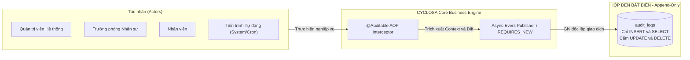
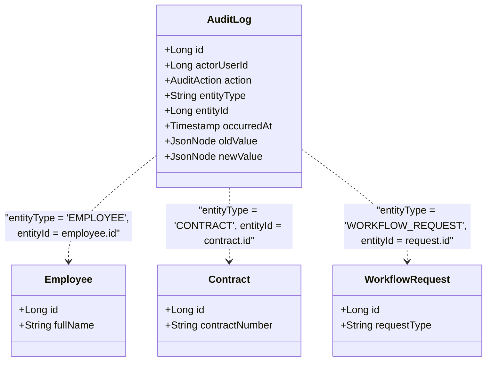
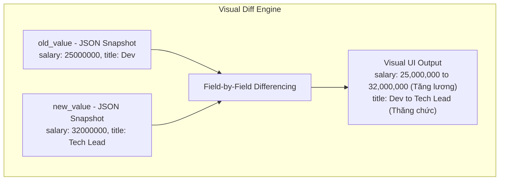
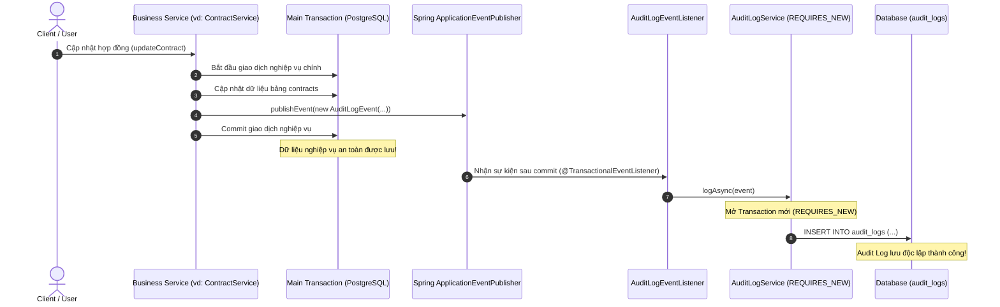
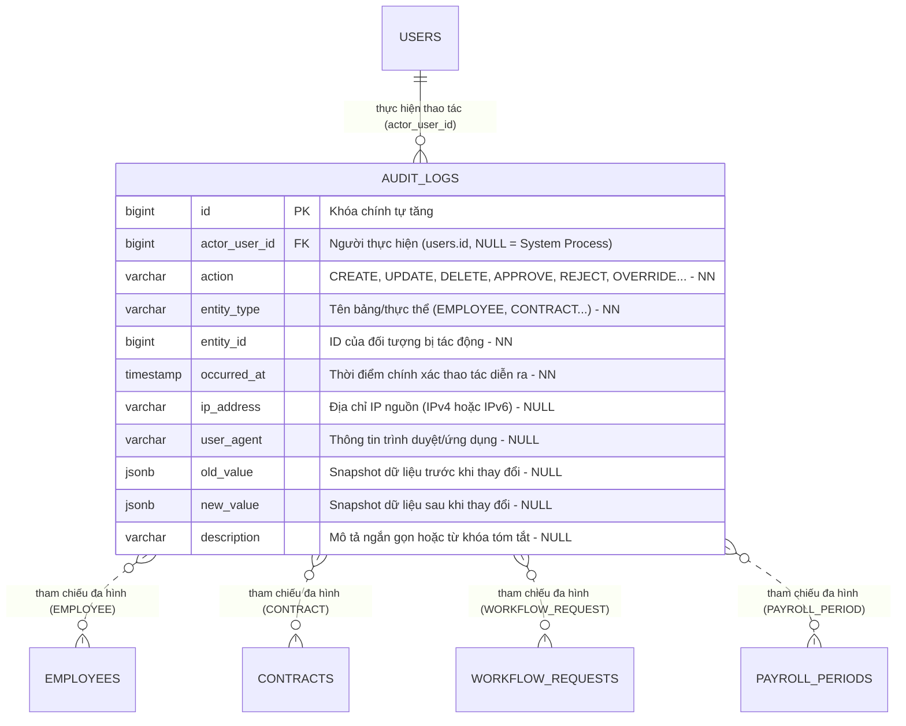
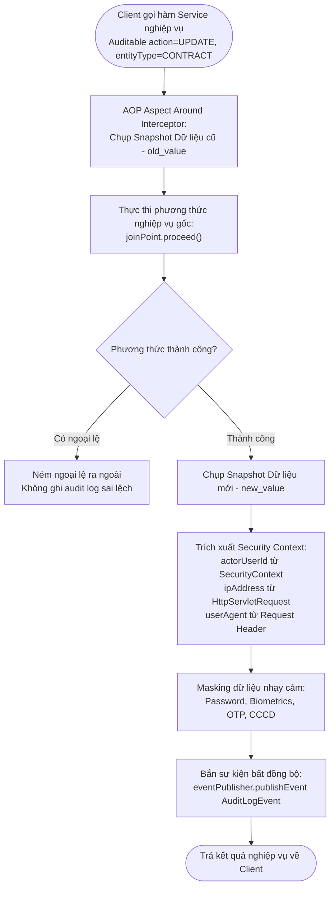

# ĐẶC TẢ CHI TIẾT VÀ KIẾN TRÚC TRIỂN KHAI MODULE 21: NHẬT KÝ KIỂM TOÁN & TRUY VẾT HỆ THỐNG (AUDIT LOG & AUDIT TRAIL)

> **Tài liệu căn cứ & tham chiếu:**
> - Nghiệp vụ chi tiết: [`Nghiep-vu.docx`](file:///f:/Project/CYCLOSA/ba/Nghiep-vu.docx) (§21 Nhật ký kiểm toán: Cơ chế ghi nhận thay đổi, nguyên tắc bất biến, truy vết lịch sử thực thể)
> - Thiết kế CSDL & Data Dictionary: [`database.md`](file:///f:/Project/CYCLOSA/ba/database.md) (§8.22 Module 21 — NHẬT KÝ KIỂM TOÁN (Audit Log & Audit Trail), §3.5 Tham chiếu đa hình polymorphic)
> - Danh mục API chuẩn: [`api-list.md`](file:///f:/Project/CYCLOSA/ba/api-list.md) (§21 NHẬT KÝ KIỂM TOÁN (Audit Log) — 5 endpoints)
> - Phân quyền RBAC & DataScope: [`module-phan-quyen.md`](file:///f:/Project/CYCLOSA/cyclosa_be/docs/ba/module-phan-quyen.md) (Quyền kiểm toán hệ thống `audit.view` và `audit.export`)
> - Cơ sở pháp lý & Tiêu chuẩn an toàn thông tin:
>   - **Nghị định 13/2023/NĐ-CP** (Bảo vệ dữ liệu cá nhân - PDPD): Bắt buộc lưu trữ và truy vết lịch sử xử lý, truy cập, chỉnh sửa dữ liệu cá nhân của người lao động.
>   - **Tiêu chuẩn ISO/IEC 27001 (Kiểm soát A.12.4 Logging & Monitoring):** Bắt buộc duy trì nhật ký sự kiện người dùng, quản trị viên, các ngoại lệ và sự kiện an ninh mạng.
>   - **Chuẩn kiểm toán SOC 2 Type II (Trust Services Criteria):** Đảm bảo tính bảo mật (Security), tính toàn vẹn xử lý (Processing Integrity) và tính bảo mật thông tin (Confidentiality).
>   - **Bộ luật Lao động 2019:** Bắt buộc bảo lưu và chứng minh tính xác thực của các biến động hợp đồng, tiền lương, kỷ luật lao động.
> - Chuẩn kiến trúc codebase: [`com.cyclosa.product`](file:///f:/Project/CYCLOSA/cyclosa_be/src/main/java/com/cyclosa/product) (AOP Aspect, Asynchronous Event Logging, Append-only Ledger)

---

## 1. PHÂN TÍCH ĐẶC TẢ NGHIỆP VỤ & NGUYÊN LÝ CỐT LÕI

### 1.1. Bản chất "Hộp Đen Bất Biến" (Black Box Immutable Ledger) của CYCLOSA HRM

Trong một hệ thống hoạch định và quản trị nhân sự cấp Tập đoàn, dữ liệu không chỉ phục vụ vận hành hàng ngày mà còn là **bằng chứng pháp lý** trước cơ quan thanh tra lao động, bảo hiểm xã hội, cơ quan thuế và kiểm toán độc lập.

**Module 21: Nhật ký kiểm toán (Audit Log & Audit Trail)** đóng vai trò như chiếc "Hộp đen máy bay" của toàn bộ nền tảng CYCLOSA, ghi nhận chính xác:
- **Ai** đã thực hiện thao tác? (`actor_user_id`)
- **Hành động** nghiệp vụ gì đã diễn ra? (`action`)
- **Đối tượng** thực thể nào bị tác động? (`entity_type`, `entity_id`)
- **Thời điểm** chính xác xảy ra sự kiện? (`occurred_at`)
- **Từ đâu:** Địa chỉ IP thiết bị (`ip_address`) và thông tin trình duyệt (`user_agent`)?
- **Dữ liệu biến động:** Trạng thái trước khi sửa (`old_value`) và trạng thái sau khi sửa (`new_value`)?



---

### 1.2. Nguyên lý Append-Only & Sự Triệt Tiêu Cột `created_by` / `updated_by`

Theo thiết kế chuẩn hóa của CYCLOSA (xem [`database.md`](file:///f:/Project/CYCLOSA/ba/database.md) §8.22):

1. **Nguyên tắc Append-Only (Chỉ thêm mới):**
   - Bảng `audit_logs` là **bất biến (immutable)**. Hệ thống chỉ hỗ trợ 2 thao tác: `INSERT` (khi nghiệp vụ phát sinh) và `SELECT` (khi tra cứu/truy vết).
   - **Tuyệt đối không có API hoặc câu lệnh `UPDATE` hay `DELETE`** đối với bảng `audit_logs`. Ngay cả tài khoản Super Admin cũng không có quyền sửa hoặc xóa các dòng nhật ký đã lưu trong CSDL sản xuất.
2. **Loại bỏ các cột `created_by`, `updated_by` tại các bảng nghiệp vụ:**
   - Trong các hệ thống cũ, mọi bảng đều sinh thêm các cột `created_by`, `updated_by`, `created_at`, `updated_at`. Tuy nhiên, cách làm này bộc lộ nhược điểm chí mạng: Cột `updated_by` chỉ lưu được người sửa *cuối cùng*, làm mất hoàn toàn lịch sử của 10 lần sửa trước đó, và không biết được người đó đã sửa những trường dữ liệu nào.
   - CYCLOSA tập trung toàn bộ trách nhiệm kiểm toán vào `audit_logs`. Bảng `audit_logs` là **Nguồn Chân lý Duy nhất (Single Source of Truth)**. Khi cần biết lịch sử biến động của một bản ghi (ví dụ: Ai đã tăng lương cho nhân viên A? Ai đã điều chuyển phòng ban?), hệ thống chỉ cần truy vấn Audit Trail của thực thể đó.

---

### 1.3. Cơ chế Khóa Tham chiếu Đa hình (Polymorphic Reference - Audit Trail)

Hệ sinh thái CYCLOSA bao gồm hơn 100 bảng thực thể dữ liệu khác nhau. Để không phải tạo hàng trăm bảng nhật ký riêng lẻ (`contract_audit`, `employee_audit`, `payroll_audit`...), hệ thống áp dụng cơ chế **Tham chiếu Đa hình (Polymorphic Reference)** thông qua cặp khóa:

$$(\mathbf{entity\_type},\ \mathbf{entity\_id})$$



- `entity_type`: Tên định danh chuẩn của thực thể (ví dụ: `EMPLOYEE`, `CONTRACT`, `PAYROLL_PERIOD`, `WORKFLOW_REQUEST`, `USER`, `DEPARTMENT`).
- `entity_id`: Khóa chính `id` (kiểu `BIGINT`) của thực thể tương ứng.
- **Audit Trail Dọc theo Thời gian:** Khi một người dùng mở trang chi tiết Hợp đồng `#741`, hệ thống có thể lập tức tái hiện toàn bộ lịch sử biến động từ lúc tạo, qua các lần điều chỉnh lương, gia hạn, tới lúc thanh lý thông qua một câu truy vấn duy nhất:
  $$\text{SELECT} * \text{FROM audit\_logs WHERE entity\_type = 'CONTRACT' AND entity\_id = 741 ORDER BY occurred\_at ASC;}$$

---

### 1.4. Cơ chế Snapshot JSON Before/After & Visual Diff Engine

Bảng `audit_logs` lưu trữ 2 cột JSON cấu trúc:
- `old_value`: Snapshot trạng thái của thực thể **ngay trước khi** thay đổi.
- `new_value`: Snapshot trạng thái của thực thể **ngay sau khi** thay đổi.



#### Quy tắc Masking Dữ liệu Nhạy cảm (Data Masking & Redaction):
Để tuân thủ Nghị định 13/2023/NĐ-CP và tiêu chuẩn ISO 27001, các trường thông tin nhạy cảm bắt buộc phải được che giấu (Masked) hoặc loại bỏ trước khi ghi vào cột JSON:
- `password_hash`, `refresh_token`, `otp_code`: Luôn thay thế bằng `"***REDACTED***"`.
- `id_card_number` (CCCD/CMND), `bank_account_number`: Che giấu các chữ số ở giữa, chỉ giữ lại 3 chữ số đầu và 3 chữ số cuối (ví dụ: `"0790******123"`).
- `template_ref` (dữ liệu mẫu khuôn mặt sinh trắc): Tuyệt đối không serialize vào audit snapshot.

---

### 1.5. Nguyên tắc Cô lập Giao dịch (Transactional Isolation & Reliability)

Trong thiết kế phần mềm doanh nghiệp, một câu hỏi quan trọng là: **"Nếu việc ghi Audit Log bị lỗi, có làm rollback nghiệp vụ chính của người dùng hay không?"** và ngược lại **"Nếu nghiệp vụ chính bị lỗi rollback, Audit Log có được lưu không?"**

CYCLOSA giải quyết vấn đề này bằng chiến lược **Phân tách Ranh giới Giao dịch (Transaction Decoupling)**:



- **Nguyên tắc:** Việc ghi nhật ký kiểm toán không được phép làm suy giảm hiệu năng hoặc làm gián đoạn luồng nghiệp vụ chính của người dùng.
- Sự kiện ghi log được đẩy qua Spring Event và xử lý bất đồng bộ (`@Async`) hoặc sau khi commit (`TransactionPhase.AFTER_COMMIT`).
- Nếu giao dịch nghiệp vụ thất bại và rollback, sự kiện audit log về thay đổi dữ liệu sẽ không được ghi, tránh tình trạng "log rác" không phản ánh đúng CSDL. Đối với các sự kiện an ninh như đăng nhập thất bại (`LOGIN`), hệ thống ghi log ngay lập tức với `Propagation.REQUIRES_NEW`.

---

### 1.6. Danh mục 13 Hành động Kiểm toán Chuẩn hóa (`AuditAction`)

Tất cả các hành động trong hệ thống bắt buộc phải được ánh xạ về một trong 13 mã chuẩn hóa sau:

| Mã hành động (`AuditAction`) | Ý nghĩa nghiệp vụ chi tiết | Ví dụ phát sinh thực tế | Mức độ nhạy cảm |
| :--- | :--- | :--- | :---: |
| `CREATE` | Tạo mới một thực thể nghiệp vụ | Tạo nhân viên mới, tạo vị trí tuyển dụng, lập hợp đồng lao động | Trung bình |
| `UPDATE` | Chỉnh sửa, cập nhật thông tin thực thể | Điều chỉnh mức lương, đổi địa chỉ thường trú, cập nhật chức vụ | Trung bình |
| `DELETE` | Xóa bản ghi (kể cả xóa mềm `soft delete` hoặc xóa vật lý) | Xóa phụ lục hợp đồng nháp, xóa kỹ năng nhân viên | Cao |
| `APPROVE` | Phê duyệt một hồ sơ / đề xuất trong Workflow | Sếp duyệt thư mời nhận việc, Trưởng phòng duyệt đơn nghỉ phép | Cao |
| `REJECT` | Từ chối một hồ sơ / đề xuất trong Workflow | Giám đốc từ chối đề xuất ngân sách tuyển dụng | Cao |
| `OVERRIDE` | Can thiệp / Ghi đè đặc biệt có kiểm soát | Quản trị viên mở khóa bảng chấm công đã chốt để sửa thủ công | Rất cao |
| `EXPORT` | Xuất dữ liệu ra file ngoại vi (Excel, CSV, PDF) | Xuất báo cáo nhân sự toàn công ty, xuất lịch sử kiểm toán | Rất cao |
| `VIEW` | Truy cập xem dữ liệu nhạy cảm | Mở xem hồ sơ sức khỏe, xem chi tiết hợp đồng bảo mật | Cao |
| `DOWNLOAD` | Tải tệp tài liệu quan trọng về máy tính | Tải file đính kèm hợp đồng có chữ ký số, tải phiếu lương | Cao |
| `LOGIN` | Đăng nhập hệ thống (cả thành công và thất bại) | Đăng nhập qua Email/Mật khẩu hoặc Google SSO | Rất cao |
| `LOCK` | Khóa thực thể để chống chỉnh sửa | Khóa kỳ công tháng 10, khóa bảng lương, khóa tài khoản user | Rất cao |
| `UNLOCK` | Mở khóa thực thể cho phép chỉnh sửa trở lại | Mở khóa kỳ tính lương để kế toán bổ sung phụ cấp | Rất cao |
| `PUBLISH` | Công bố thông tin diện rộng | Phát thông báo toàn công ty, đăng tuyển dụng ra website | Trung bình |

---

### 1.7. Các Quy tắc Nghiệp vụ Phòng vệ (Defensive Business Rules)

1. **Kiểm soát Quyền Truy cập Tối cao (`audit.view` & `audit.export`):**
   - Chỉ các tài khoản có vai trò Kiểm toán viên (Internal Auditor), Giám đốc Pháp chế/Tuân thủ (Compliance Officer) hoặc Quản trị viên Cấp cao mới được gán quyền `audit.view`.
   - Quyền xuất file `audit.export` phải được cấp riêng biệt và bị giới hạn tần suất.
2. **Kiểm toán Ngược (Auditing the Auditor):**
   - Mọi hành vi tra cứu xem nhật ký kiểm toán hoặc gọi API xuất file (`GET /audit-logs/export`) **chính nó cũng được ghi nhận thành một bản ghi kiểm toán mới** với hành động `EXPORT` hoặc `VIEW`. Đảm bảo rằng không ai có thể âm thầm trích xuất dữ liệu mà không để lại dấu vết.
3. **Phòng chống Giả mạo IP & User-Agent:**
   - Khi chạy phía sau Reverse Proxy / Cloudflare / Load Balancer, backend phải trích xuất địa chỉ IP từ header `X-Forwarded-For` với kiểm tra dải proxy tin cậy (Trusted Proxies) để ngăn chặn kẻ xấu giả mạo IP nguồn trong audit log.
4. **Giới hạn Khoảng thời gian Truy vấn & Xuất file:**
   - Để ngăn ngừa nghẽn tài nguyên CSDL, các truy vấn tra cứu không được phép vượt quá khoảng thời gian 180 ngày/lần truy vấn. Nếu muốn trích xuất dữ liệu nhiều năm, hệ thống bắt buộc sử dụng cơ chế Xuất file Bất đồng bộ (`async export job`).

---

## 2. KIẾN TRÚC THỰC THỂ DỮ LIỆU & DATABASE SCHEMA

### 2.1. Sơ đồ Quan hệ Thực thể CSDL (Entity Relationship Diagram)



---

### 2.2. Từ điển Dữ liệu Chi tiết (Data Dictionary: Bảng `audit_logs`)

| Tên trường | Kiểu dữ liệu | Nullable | Ràng buộc | Mô tả nghiệp vụ chi tiết |
| :--- | :--- | :---: | :--- | :--- |
| `id` | `BIGINT` | **No** | `PRIMARY KEY AUTO_INCREMENT` | Định danh duy nhất của bản ghi nhật ký kiểm toán. |
| `actor_user_id` | `BIGINT` | **Yes** | `FOREIGN KEY → users(id) ON DELETE SET NULL` | ID người dùng thực hiện thao tác. Nếu mang giá trị `NULL` nghĩa là thao tác do tiến trình tự động của hệ thống (Cron job, Scheduler, Migration script). |
| `action` | `VARCHAR(30)` | **No** | `ENUM AuditAction` | Hành động kiểm toán đã chuẩn hóa (`CREATE`, `UPDATE`, `APPROVE`...). |
| `entity_type` | `VARCHAR(100)` | **No** | `NOT EMPTY` | Loại đối tượng nghiệp vụ (Tên thực thể: `EMPLOYEE`, `CONTRACT`, `PAYROLL_PERIOD`...). |
| `entity_id` | `BIGINT` | **No** | `NOT NULL` | Khóa chính của đối tượng bị tác động (Tham chiếu đa hình polymorphic). Cặp (`entity_type`, `entity_id`) tạo thành khóa truy vết Audit Trail. |
| `occurred_at` | `TIMESTAMP` | **No** | `DEFAULT CURRENT_TIMESTAMP` | Thời điểm chính xác thao tác diễn ra (UTC/ISO-8601). Không thể cập nhật lại. |
| `ip_address` | `VARCHAR(45)` | **Yes** | `NULL` | Địa chỉ IP thiết bị gửi request (hỗ trợ cả chuẩn IPv4 tối đa 15 ký tự và IPv6 tối đa 45 ký tự). |
| `user_agent` | `VARCHAR(500)` | **Yes** | `NULL` | Chuỗi User-Agent chứa thông tin trình duyệt, hệ điều hành và loại thiết bị của người dùng. |
| `old_value` | `JSON` | **Yes** | `NULL` | Snapshot dữ liệu trước khi thực hiện thay đổi (dưới định dạng JSON Key-Value). `NULL` khi thao tác là `CREATE`. |
| `new_value` | `JSON` | **Yes** | `NULL` | Snapshot dữ liệu sau khi thực hiện thay đổi (dưới định dạng JSON Key-Value). `NULL` khi thao tác là `DELETE`. |
| `description` | `VARCHAR(500)` | **Yes** | `NULL` | Mô tả ngắn gọn bằng ngôn ngữ tự nhiên để người quản trị dễ dàng đọc hiểu nhanh mà không cần parse JSON. |

---

### 2.3. Định nghĩa Enum `AuditAction`

```java
package com.cyclosa.product.audit.model;

public enum AuditAction {
    CREATE,    // Tạo mới thực thể
    UPDATE,    // Chỉnh sửa / cập nhật dữ liệu
    DELETE,    // Xóa thực thể (bao gồm cả soft delete)
    APPROVE,   // Phê duyệt hồ sơ / đề xuất
    REJECT,    // Từ chối phê duyệt
    OVERRIDE,  // Can thiệp / Ghi đè đặc biệt có kiểm soát (mở kỳ công, sửa tay bảng lương)
    EXPORT,    // Xuất dữ liệu ngoại vi (Excel, CSV, PDF, Audit Export)
    VIEW,      // Xem dữ liệu nhạy cảm (tài liệu mật, hồ sơ cá nhân)
    DOWNLOAD,  // Tải tệp chứng từ đính kèm
    LOGIN,     // Đăng nhập hệ thống (thành công hoặc thất bại)
    LOCK,      // Khóa thực thể (khóa kỳ công, khóa bảng lương, khóa tài khoản)
    UNLOCK,    // Mở khóa thực thể
    PUBLISH    // Công bố thông tin diện rộng (quy chế, bản vẽ mặt bằng, thông báo)
}
```

---

### 2.4. Thiết kế Chỉ mục Tối ưu Truy vấn & Phân vùng Dữ liệu (Indexes & Partitioning)

Bảng `audit_logs` có tốc độ tăng trưởng dung lượng rất nhanh trong quá trình vận hành (hàng trăm ngàn đến hàng triệu bản ghi mỗi tháng). Việc thiết kế chỉ mục và chiến lược phân vùng là tối quan trọng:

```sql
-- 1. Index truy vết lịch sử thực thể (Audit Trail Query) - Quan trọng nhất:
-- Cho phép truy vấn toàn bộ lịch sử của 1 thực thể cụ thể (vd: Hợp đồng 741) trong O(log N)
CREATE INDEX idx_audit_entity_trail 
ON audit_logs (entity_type, entity_id, occurred_at DESC);

-- 2. Index truy vấn theo tác nhân (Actor Activities):
-- Phục vụ điều tra an ninh: "Người dùng X đã làm những gì trong tuần qua?"
CREATE INDEX idx_audit_actor_time 
ON audit_logs (actor_user_id, occurred_at DESC);

-- 3. Index phục vụ bộ lọc tìm kiếm theo hành động và thời gian:
-- SELECT * FROM audit_logs WHERE action = 'OVERRIDE' AND occurred_at >= ? ORDER BY occurred_at DESC;
CREATE INDEX idx_audit_action_time 
ON audit_logs (action, occurred_at DESC);

-- 4. Chiến lược Phân vùng Bảng (Table Partitioning Strategy - PostgreSQL):
-- Đối với CSDL Production lớn, bảng audit_logs được khuyến nghị phân vùng THEO NĂM/THÁNG:
-- CREATE TABLE audit_logs ( ... ) PARTITION BY RANGE (occurred_at);
-- CREATE TABLE audit_logs_2026_q4 PARTITION OF audit_logs 
--   FOR VALUES FROM ('2026-10-01') TO ('2027-01-01');
```

---

## 3. DANH MỤC RESTFUL API CHUẨN

Tất cả các API kiểm toán chỉ cung cấp quyền đọc (`GET`). Không có API tạo, sửa hoặc xóa thông qua HTTP client. Việc tạo log được thực thi tự động qua tầng AOP Interceptor và Event Listeners nội bộ.

### 3.1. Bảng Tổng hợp Danh mục API

| STT | Phương thức | Đường dẫn Endpoint | Tóm tắt chức năng | Quyền hạn (Scope) | Tần suất sử dụng |
| :---: | :---: | :--- | :--- | :---: | :---: |
| 1 | `GET` | `/audit-logs` | Tra cứu danh sách nhật ký kiểm toán theo bộ lọc đa chiều (phân trang) | `audit.view` | Định kỳ (Kiểm toán viên / Quản trị viên) |
| 2 | `GET` | `/audit-logs/{logId}` | Xem chi tiết một bản ghi nhật ký (kèm snapshot JSON cũ/mới) | `audit.view` | Khi điều tra sự vụ |
| 3 | `GET` | `/audit-logs/entity/{entityType}/{entityId}` | Lấy toàn bộ dòng thời gian truy vết (Audit Trail) của một thực thể | `audit.view` | Thường xuyên (Nhúng trong trang chi tiết) |
| 4 | `GET` | `/audit-logs/actions` | Lấy danh mục hành động kiểm toán chuẩn hóa phục vụ bộ lọc UI | `audit.view` | Thấp (Cache tại client) |
| 5 | `GET` | `/audit-logs/export` | Xuất file Excel/CSV nhật ký kiểm toán theo tiêu chí lọc (Async Job) | `audit.export` | Định kỳ (Báo cáo tháng/quý) |

---

### 3.2. Đặc tả Chi tiết Payload Request / Response JSON

#### 1. Tra cứu danh sách nhật ký kiểm toán (`GET /audit-logs`)
- **Query Parameters:**
  - `actorUserId` (long, optional): Lọc theo ID người thực hiện.
  - `action` (string, optional): Lọc theo enum `AuditAction` (`UPDATE`, `APPROVE`...).
  - `entityType` (string, optional): Lọc theo loại thực thể (`EMPLOYEE`, `CONTRACT`...).
  - `entityId` (long, optional): Lọc theo ID thực thể.
  - `from` (timestamp ISO-8601, optional): Mốc thời gian bắt đầu (vd: `2026-11-01T00:00:00Z`).
  - `to` (timestamp ISO-8601, optional): Mốc thời gian kết thúc (vd: `2026-11-14T23:59:59Z`).
  - `keyword` (string, optional): Tìm kiếm từ khóa trong `description`.
  - `ipAddress` (string, optional): Lọc theo địa chỉ IP nguồn.
  - `page` (int, default: 0): Số trang.
  - `size` (int, default: 20): Số bản ghi/trang.
- **Response `200 OK`:**
```json
{
  "success": true,
  "code": 200,
  "message": "Tra cứu nhật ký kiểm toán thành công",
  "data": {
    "content": [
      {
        "id": 984521,
        "actor": {
          "id": 14,
          "fullName": "Lê Văn Cường",
          "email": "cuong.le@cyclosa.com",
          "avatarUrl": "/avatars/14.png"
        },
        "action": "UPDATE",
        "entityType": "CONTRACT",
        "entityId": 741,
        "entityReference": "HĐLĐ-2026-0089 (Trần Thị B)",
        "occurredAt": "2026-11-14T10:30:15Z",
        "ipAddress": "118.69.182.45",
        "userAgent": "Mozilla/5.0 (Windows NT 10.0; Win64; x64) Chrome/130.0.0.0",
        "description": "Điều chỉnh mức lương cơ bản từ 20,000,000 VND lên 25,000,000 VND"
      },
      {
        "id": 984518,
        "actor": {
          "id": 5,
          "fullName": "Nguyễn Hoàng Nam (CHRO)",
          "email": "nam.nguyen@cyclosa.com",
          "avatarUrl": "/avatars/5.png"
        },
        "action": "APPROVE",
        "entityType": "WORKFLOW_REQUEST",
        "entityId": 102,
        "entityReference": "Yêu cầu tuyển dụng: Senior Backend Developer",
        "occurredAt": "2026-11-14T09:45:00Z",
        "ipAddress": "14.161.25.88",
        "userAgent": "Mozilla/5.0 (Macintosh; Intel Mac OS X 10_15_7) Safari/605.1.15",
        "description": "Phê duyệt bước 2: Xét duyệt Giám đốc Khối Nhân sự"
      }
    ],
    "page": 0,
    "size": 20,
    "totalElements": 1420,
    "totalPages": 71,
    "last": false
  }
}
```

---

#### 2. Chi tiết một bản ghi nhật ký kiểm toán (`GET /audit-logs/{logId}`)
- **Path Parameter:** `logId` (BIGINT)
- **Response `200 OK`:**
```json
{
  "success": true,
  "code": 200,
  "message": "Lấy chi tiết nhật ký kiểm toán thành công",
  "data": {
    "id": 984521,
    "actor": {
      "id": 14,
      "fullName": "Lê Văn Cường",
      "email": "cuong.le@cyclosa.com",
      "jobTitle": "Chuyên viên C&B",
      "department": "Phòng Nhân sự"
    },
    "action": "UPDATE",
    "entityType": "CONTRACT",
    "entityId": 741,
    "occurredAt": "2026-11-14T10:30:15Z",
    "ipAddress": "118.69.182.45",
    "userAgent": "Mozilla/5.0 (Windows NT 10.0; Win64; x64) AppleWebKit/537.36 (KHTML, like Gecko) Chrome/130.0.0.0 Safari/537.36",
    "description": "Điều chỉnh mức lương cơ bản và phụ cấp chức vụ",
    "oldValue": {
      "contractNumber": "HĐLĐ-2026-0089",
      "baseSalary": 20000000,
      "positionAllowance": 2000000,
      "status": "ACTIVE",
      "contractType": "DEFINITE_TERM",
      "updatedAt": "2026-10-15T08:00:00Z"
    },
    "newValue": {
      "contractNumber": "HĐLĐ-2026-0089",
      "baseSalary": 25000000,
      "positionAllowance": 3000000,
      "status": "ACTIVE",
      "contractType": "DEFINITE_TERM",
      "updatedAt": "2026-11-14T10:30:15Z"
    },
    "changedFields": [
      {
        "field": "baseSalary",
        "displayName": "Lương cơ bản",
        "oldValue": 20000000,
        "newValue": 25000000
      },
      {
        "field": "positionAllowance",
        "displayName": "Phụ cấp chức vụ",
        "oldValue": 2000000,
        "newValue": 3000000
      }
    ]
  }
}
```

---

#### 3. Truy vết Audit Trail của một thực thể (`GET /audit-logs/entity/{entityType}/{entityId}`)
- **Path Parameters:**
  - `entityType`: Tên thực thể (`CONTRACT`, `EMPLOYEE`, `PAYROLL_PERIOD`...)
  - `entityId`: Khóa chính ID thực thể
- **Response `200 OK`:** Trả về danh sách toàn bộ các sự kiện từ quá khứ đến hiện tại theo thứ tự thời gian tăng dần (`occurredAt ASC`).
```json
{
  "success": true,
  "code": 200,
  "message": "Lấy lịch sử truy vết thực thể thành công",
  "data": {
    "entityType": "CONTRACT",
    "entityId": 741,
    "totalEvents": 4,
    "timeline": [
      {
        "logId": 910240,
        "occurredAt": "2026-10-01T08:00:00Z",
        "action": "CREATE",
        "actorName": "Nguyễn Văn A (Tuyển dụng)",
        "description": "Khởi tạo hợp đồng lao động mới ở trạng thái DRAFT"
      },
      {
        "logId": 910512,
        "occurredAt": "2026-10-02T14:20:00Z",
        "action": "APPROVE",
        "actorName": "Lê Văn Cường (Trưởng phòng C&B)",
        "description": "Phê duyệt thông qua quy trình phê duyệt hồ sơ"
      },
      {
        "logId": 921400,
        "occurredAt": "2026-10-03T09:10:00Z",
        "action": "UPDATE",
        "actorName": "Trần Thị B (Nhân viên)",
        "description": "Ký số hợp đồng lao động điện tử; trạng thái chuyển sang ACTIVE"
      },
      {
        "logId": 984521,
        "occurredAt": "2026-11-14T10:30:15Z",
        "action": "UPDATE",
        "actorName": "Lê Văn Cường (Chuyên viên C&B)",
        "description": "Điều chỉnh mức lương cơ bản và phụ cấp chức vụ"
      }
    ]
  }
}
```

---

#### 4. Danh mục Hành động Chuẩn hóa (`GET /audit-logs/actions`)
- **Response `200 OK`:**
```json
{
  "success": true,
  "code": 200,
  "message": "Lấy danh mục hành động kiểm toán thành công",
  "data": [
    { "code": "CREATE", "name": "Tạo mới", "badgeVariant": "success" },
    { "code": "UPDATE", "name": "Cập nhật", "badgeVariant": "info" },
    { "code": "DELETE", "name": "Xóa", "badgeVariant": "destructive" },
    { "code": "APPROVE", "name": "Phê duyệt", "badgeVariant": "success" },
    { "code": "REJECT", "name": "Từ chối", "badgeVariant": "destructive" },
    { "code": "OVERRIDE", "name": "Ghi đè/Can thiệp", "badgeVariant": "warning" },
    { "code": "EXPORT", "name": "Xuất dữ liệu", "badgeVariant": "secondary" },
    { "code": "VIEW", "name": "Xem thông tin mật", "badgeVariant": "outline" },
    { "code": "DOWNLOAD", "name": "Tải chứng từ", "badgeVariant": "outline" },
    { "code": "LOGIN", "name": "Đăng nhập", "badgeVariant": "default" },
    { "code": "LOCK", "name": "Khóa", "badgeVariant": "warning" },
    { "code": "UNLOCK", "name": "Mở khóa", "badgeVariant": "info" },
    { "code": "PUBLISH", "name": "Công bố", "badgeVariant": "success" }
  ]
}
```

---

#### 5. Xuất File Báo cáo Kiểm toán (`GET /audit-logs/export`)
- **Quyền yêu cầu:** `audit.export`
- **Query Parameters:** Tương tự `GET /audit-logs` kèm tham số `format` (`XLSX`, `CSV`).
- **Response `200 OK`:**
```json
{
  "success": true,
  "code": 200,
  "message": "Yêu cầu trích xuất nhật ký kiểm toán đã được tiếp nhận",
  "data": {
    "jobId": "JOB-AUDIT-EXP-20261114-001",
    "estimatedRecords": 1420,
    "downloadUrl": "/api/v1/files/downloads/export-audit-20261114.xlsx",
    "status": "PROCESSING"
  }
}
```
*(Lưu ý: Ngay sau khi API này được gọi, hệ thống tự động ghi 1 dòng `audit_logs` với action = `EXPORT` để truy vết).*

---

## 4. THUẬT TOÁN ĐIỀU PHỐI TIẾN TRÌNH & KIẾN TRÚC AOP (ENGINE MECHANICS)

### 4.1. Kiến trúc Đánh chặn Tự động bằng AOP Aspect (`@Auditable`)

Để lập trình viên không phải viết thủ công mã lệnh ghi log trong từng dòng code nghiệp vụ, CYCLOSA sử dụng Spring AOP với Custom Annotation `@Auditable`:

```java
@Target(ElementType.METHOD)
@Retention(RetentionPolicy.RUNTIME)
public @interface Auditable {
    AuditAction action();
    String entityType();
    String entityIdExpression() default "#id"; // SpEL Expression
    String description() default "";
}
```

#### Sơ đồ Hoạt động của Aspect Đánh chặn:



---

### 4.2. Thuật toán So sánh Biến động Dữ liệu (JSON Diff Engine)

Khi một bản ghi có cấu trúc phức tạp bị sửa đổi (ví dụ: một nhân viên có 40 trường thông tin nhưng chỉ sửa đúng `phone_number` và `tax_code`), việc chỉ lưu cả 2 JSON snapshot sẽ khiến người đọc khó nhận biết cái gì đã thay đổi.

**JSON Diff Engine** của CYCLOSA thực hiện thuật toán so khớp trường động:

$$\mathbf{ChangedFields} = \left\{ k \in \text{Keys}(old) \cup \text{Keys}(new) \mid old[k] \neq new[k] \ \land\ k \notin \text{IgnoredAuditFields} \right\}$$

- Các trường bỏ qua so sánh (`IgnoredAuditFields`): `updated_at`, `version`, `etag`.
- Nếu phát hiện giá trị thay đổi, engine tự động map mã trường sang Tên hiển thị tiếng Việt (Display Name) thông qua Resource Bundle nội bộ.

---

## 5. THIẾT KẾ TRẢI NGHIỆM NGƯỜI DÙNG & GIAO DIỆN FRONTEND (`cyclosa_fe`)

### 5.1. Vị trí Menu & Điều hướng Bảo mật

Trong thanh Sidebar quản trị hệ thống, chức năng Nhật ký kiểm toán được đặt trong nhóm Quản trị & Bảo mật:

```
├── ⚙️ Cài đặt hệ thống
│   ├── Cơ cấu tổ chức (/settings/organization)
│   ├── Vai trò & Phân quyền (/settings/roles)
│   └── 🛡️ Nhật ký kiểm toán (/admin/audit-logs) [Chỉ hiển thị khi có quyền audit.view]
```

---

### 5.2. Màn hình Trình duyệt Nhật ký Kiểm toán (`/admin/audit-logs/page.tsx`)

Màn hình làm việc chuyên nghiệp chuẩn doanh nghiệp dành cho Kiểm toán viên và Ban Giám đốc:
- **Header chuẩn:** Gồm Tiêu đề *Nhật ký Kiểm toán Hệ thống (Audit Log Explorer)* và Breadcrumb *Trang chủ / Quản trị bảo mật / Nhật ký kiểm toán* (Không có đoạn văn mô tả thừa).
- **Bộ lọc Đa tiêu chí Thông minh:**
  - *Khoảng thời gian:* Bộ chọn ngày nhanh (Hôm nay, 7 ngày qua, 30 ngày qua, Tháng này, Tùy chọn ngày-giờ chính xác).
  - *Tác nhân (Actor):* Ô tìm kiếm gợi ý nhanh nhân viên/người dùng.
  - *Hành động (Action):* Dropdown đa chọn 13 mã `AuditAction` kèm màu sắc nhận diện.
  - *Loại thực thể (Entity Type):* Chọn phân hệ (`Hợp đồng`, `Nhân viên`, `Bảng lương`, `Phê duyệt`, `Tài khoản`).
  - *Địa chỉ IP:* Tìm kiếm chính xác IP khả nghi.
- **Bảng Dữ liệu Nhật ký với Action Badges trực quan:**
  - `CREATE`: Badge màu xanh lá (Green).
  - `UPDATE`: Badge màu xanh dương (Blue).
  - `DELETE`: Badge màu đỏ (Destructive Red).
  - `APPROVE`: Badge màu ngọc bích (Emerald).
  - `REJECT`: Badge màu cam đậm (Orange).
  - `OVERRIDE`: Badge màu tím đậm cảnh báo (Purple Warning).
  - `EXPORT` / `LOGIN`: Badge màu xám viền đen (Slate).
- **Hành động hàng (Row Action):**
  - Nút **Xem chi tiết biến động (View Diff)** mở Slide-over Drawer bên phải màn hình.

---

### 5.3. Component Tái sử dụng: Visual Diff Viewer (`<JsonDiffViewer />`)

Component chuyên dụng dùng để trực quan hóa thay đổi giữa `old_value` và `new_value`:

```
┌────────────────────────────────────────────────────────────────────────────────────────┐
│ CHI TIẾT BIẾN ĐỘNG THỰC THỂ: HỢP ĐỒNG LAO ĐỘNG #741                                  │
├────────────────────────────────────────────────────────────────────────────────────────┤
│ Tác nhân: Lê Văn Cường (Chuyên viên C&B) | IP: 118.69.182.45 | Lúc: 14/11/2026 10:30  │
├────────────────────────────────────────────────────────────────────────────────────────┤
│ THÔNG TIN THAY ĐỔI (02 TRƯỜNG):                                                        │
│                                                                                        │
│ 1. Lương cơ bản (baseSalary):                                                         │
│    [- 20,000,000 VND -] (Đỏ gạch ngang)   --->   [+ 25,000,000 VND +] (Xanh lá đậm)   │
│                                                                                        │
│ 2. Phụ cấp chức vụ (positionAllowance):                                                │
│    [- 2,000,000 VND -] (Đỏ gạch ngang)    --->   [+ 3,000,000 VND +] (Xanh lá đậm)    │
│                                                                                        │
│ CÁC TRƯỜNG KHÔNG THAY ĐỔI: (contractType: DEFINITE_TERM, status: ACTIVE...)           │
└────────────────────────────────────────────────────────────────────────────────────────┘
```

- Cột bên trái: Giá trị cũ hiển thị nền đỏ nhạt, chữ đỏ có gạch ngang (`line-through text-red-600 bg-red-50`).
- Cột bên phải: Giá trị mới hiển thị nền xanh lá nhạt, chữ xanh lá đậm (`font-semibold text-emerald-700 bg-emerald-50`).

---

### 5.4. Component Tái sử dụng: Lịch sử Truy vết Thực thể (`<EntityAuditTrailDrawer />`)

Component nhúng sẵn tại tất cả các trang chi tiết nghiệp vụ (Chi tiết Hợp đồng, Chi tiết Nhân sự, Chi tiết Bảng lương):
- Cho phép người dùng có quyền `audit.view` bấm nút **"Lịch sử thay đổi"** ngay trên thanh công cụ của trang nghiệp vụ.
- Một Drawer trượt ra từ cạnh phải hiển thị toàn bộ trục dọc thời gian (Timeline) của đối tượng đó mà không cần phải chuyển sang màn hình quản trị chung.

---

## 6. DẢI MÃ LỖI NGHIỆP VỤ CHUẨN HÓA (BUSINESS ERROR CODES)

Module Nhật ký kiểm toán sử dụng dải mã lỗi chuẩn hóa tiền tố `AUDIT_`:

| Mã lỗi (Error Code) | HTTP Status | Thông điệp lỗi chi tiết (Message) | Nguyên nhân phát sinh & Hướng dẫn xử lý |
| :--- | :---: | :--- | :--- |
| `AUDIT_LOG_NOT_FOUND` | `404` | Bản ghi nhật ký kiểm toán không tồn tại. | Log ID tra cứu không tồn tại trong CSDL hoặc đã bị lưu trữ phân vùng ngoài. |
| `AUDIT_ACCESS_DENIED` | `403` | Bạn không có quyền truy cập nhật ký kiểm toán hệ thống. | Tài khoản người dùng thiếu mã quyền `audit.view` trong vai trò RBAC. |
| `AUDIT_EXPORT_PERMISSION_DENIED` | `403` | Bạn không có quyền trích xuất dữ liệu nhật ký kiểm toán. | Tài khoản người dùng thiếu mã quyền `audit.export`. |
| `AUDIT_DATE_RANGE_INVALID` | `400` | Khoảng thời gian tra cứu không hợp lệ hoặc vượt quá 180 ngày. | Mốc thời gian `from` lớn hơn `to`, hoặc khoảng cách thời gian vượt quá giới hạn tối đa cho phép. |
| `AUDIT_ENTITY_INVALID` | `400` | Loại thực thể hoặc ID đối tượng tra cứu không hợp lệ. | Tham số `entityType` không nằm trong danh mục thực thể hợp lệ của hệ thống. |
| `AUDIT_ACTION_UNSUPPORTED` | `400` | Mã hành động kiểm toán không được hỗ trợ. | Tham số `action` gửi lên không khớp với bất kỳ giá trị nào trong enum `AuditAction`. |
| `AUDIT_EXPORT_LIMIT_EXCEEDED` | `400` | Số lượng bản ghi yêu cầu xuất file vượt quá hạn mức 50,000 dòng. | Vui lòng thu hẹp bộ lọc thời gian hoặc bổ sung tiêu chí lọc theo tác nhân/thực thể trước khi xuất. |
| `AUDIT_LOGGING_FAILED` | `500` | Ghi nhận sự kiện kiểm toán hệ thống gặp lỗi bất khả kháng. | Lỗi kết nối CSDL hoặc lỗi parse JSON Snapshot trong tiến trình ghi log nền. Kiểm tra logs server. |

