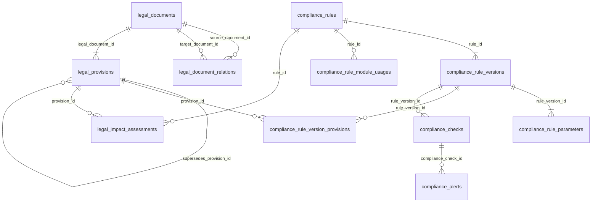
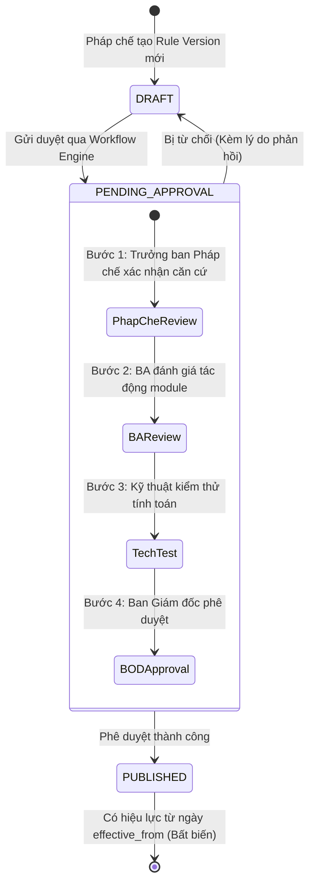

# ĐẶC TẢ CHI TIẾT MODULE PHÁP LUẬT & TUÂN THỦ (LEGAL & COMPLIANCE) VÀ ẢNH HƯỞNG THAM SỐ TỚI TOÀN BỘ HỆ THỐNG CYCLOSA HRM

> **Tài liệu tham chiếu:**
> - Nghiệp vụ chi tiết: [`Nghiep-vu.docx`](file:///f:/Project/CYCLOSA/ba/Nghiep-vu.docx) (Mục 17)
> - Thiết kế CSDL & Data Dictionary: [`database.md`](file:///f:/Project/CYCLOSA/ba/database.md) (§8.18 & §10.2)
> - Ràng buộc hợp lệ API: [`HRM-API-Validation-Rules.md`](file:///f:/Project/CYCLOSA/ba/HRM-API-Validation-Rules.md)
> - Lộ trình thứ tự code: [`thu-tu-code-module.md`](file:///f:/Project/CYCLOSA/ba/thu-tu-code-module.md)

---

## 1. DANH MỤC VĂN BẢN PHÁP LUẬT & NGHỊ ĐỊNH ĐƯỢC ÁP DỤNG TRONG HỆ THỐNG (TRÍCH XUẤT TỪ NGHIỆP VỤ)

Theo tài liệu đặc tả nghiệp vụ [`Nghiep-vu.docx`](file:///f:/Project/CYCLOSA/ba/Nghiep-vu.docx), hệ thống CYCLOSA HRM chịu sự điều chỉnh trực tiếp của các văn bản quy phạm pháp luật, luật chuyên ngành và nghị định hướng dẫn mới nhất dưới đây:

| STT | Tên văn bản pháp luật / Nghị định | Số hiệu / Năm ban hành | Lĩnh vực áp dụng | Phạm vi & Chức năng chịu ảnh hưởng trong hệ thống |
|:---:|---|---|:---:|---|
| **1** | **Bộ luật Lao động 2019** | Luật số `45/2019/QH14` | Quan hệ lao động & Tiêu chuẩn việc làm | **Xương sống pháp lý toàn hệ thống:**<br/>- **Điều 13, 14, 20, 21:** Giao kết, hợp đồng điện tử, nội dung bắt buộc và loại HĐLĐ.<br/>- **Điều 22, 33:** Phụ lục hợp đồng (cấm sửa thời hạn HĐ).<br/>- **Điều 24–27:** Thử việc (thời hạn 6, 30, 60, 180 ngày; lương min 85%).<br/>- **Điều 34–47:** Căn cứ chấm dứt HĐLĐ, thời hạn báo trước (3, 30, 45 ngày), trợ cấp thôi việc/mất việc làm.<br/>- **Điều 48:** Thời hạn thanh toán quyền lợi khi thôi việc (14 ngày làm việc).<br/>- **Chương VI & Điều 98, 101, 102:** Nguyên tắc trả lương, lương OT (150%, 200%, 300%), lương ca đêm (+30%, +20%), tạm ứng và khấu trừ lương.<br/>- **Điều 105–110:** Thời giờ làm việc (8h/ngày, 48h/tuần), trần OT (50%/ngày, 40h/tháng, 200h-300h/năm), nghỉ giữa ca $\ge 12$ giờ.<br/>- **Điều 112–115:** Nghỉ lễ tết (11 ngày), phép năm (12 ngày + 1 ngày/5 năm thâm niên), nghỉ việc riêng có lương.<br/>- **Điều 12, 122–128:** Báo cáo lao động; nguyên tắc kỷ luật, thời hiệu (6-12 tháng), cấm kỷ luật phụ nữ mang thai/nuôi con < 12 tháng, xóa kỷ luật tự động. |
| **2** | **Luật Giao dịch điện tử 2023** | Luật số `20/2023/QH15`<br/>*(Hiệu lực từ 01/07/2024)* | Giao dịch điện tử & Ký kết số | **`M08 Quản lý hợp đồng & E-Contract`**:<br/>- Xác lập giá trị pháp lý của hợp đồng lao động điện tử dưới dạng thông điệp dữ liệu.<br/>- Quy chuẩn chữ ký điện tử an toàn, chữ ký số và tính toàn vẹn của văn bản số.<br/>- Nghiêm cấm mặc định thao tác nhập OTP/click nút tương đương chữ ký số nếu chưa đủ điều kiện pháp lý. |
| **3** | **Nghị định 23/2025/NĐ-CP** | Nghị định Chính phủ số `23/2025/NĐ-CP` | Chữ ký điện tử & Dịch vụ tin cậy | **`M08 Quản lý hợp đồng & E-Contract`**:<br/>- Quy chuẩn kỹ thuật về dịch vụ ký số, dấu thời gian (Timestamping) và lưu trữ bằng chứng ký kết số hợp đồng lao động. |
| **4** | **Nghị định 145/2020/NĐ-CP** | Nghị định Chính phủ số `145/2020/NĐ-CP` | Hướng dẫn thi hành BLLĐ | **`M08 Hợp đồng`, `M09 Điểm danh`, `M16 Thôi việc`**:<br/>- Hướng dẫn quản lý lao động, trợ cấp thôi việc, trợ cấp mất việc làm.<br/>- Danh mục các ngành nghề, công việc được làm thêm từ trên 200 giờ đến 300 giờ/năm.<br/>- Quy định và mẫu báo cáo tình hình thay đổi lao động định kỳ 6 tháng/năm. |
| **5** | **Luật Bảo hiểm xã hội 2024 & Luật hiện hành** | Luật BHXH số `41/2024/QH15` | An sinh & Bảo hiểm bắt buộc | **`M08 Hợp đồng`, `M10 Bảng lương`**:<br/>- Quy định đối tượng tham gia bảo hiểm bắt buộc.<br/>- Tỷ lệ đóng BHXH (8% NLĐ / 17.5% NSDLĐ), BHYT (1.5% / 3%), BHTN (1% / 1%), TNLĐ-BNN (0.5%).<br/>- Mức trần tiền lương đóng BHXH/BHYT (20 lần mức lương cơ sở) và trần BHTN (20 lần lương tối thiểu vùng).<br/>- Đồng bộ dữ liệu nghỉ ốm đau, thai sản giữa `M14` sang cơ quan BHXH. |
| **6** | **Luật Thuế Thu nhập cá nhân** *(Cập nhật mới)* | Luật số `109/2025/QH15` & văn bản hướng dẫn | Thuế Thu nhập cá nhân | **`M10 Bảng lương và Tính lương tự động`**:<br/>- Áp dụng thông số mới cho kỳ tính thuế từ năm 2026:<br/>  + Mức giảm trừ gia cảnh bản thân: **15,5 triệu đồng/tháng** (thay cho 11 triệu cũ).<br/>  + Mức giảm trừ gia cảnh người phụ thuộc: **6,2 triệu đồng/tháng/người** (thay cho 4,4 triệu cũ).<br/>  + Biểu thuế lũy tiến từng phần chuyển thành **5 bậc** (thay cho 7 bậc cũ).<br/>- Nghiệp vụ cảnh báo không được hard-code thông số cũ vào code. |
| **7** | **Nghị định 293/2025/NĐ-CP** | Nghị định Chính phủ số `293/2025/NĐ-CP` | Lương tối thiểu vùng | **`M08 Hợp đồng`, `M10 Bảng lương`**:<br/>- Quy định mức lương tối thiểu vùng mới áp dụng từ ngày **01/01/2026** (Vùng I, II, III, IV).<br/>- Chặn không cho tạo hợp đồng lao động có lương cơ bản thấp hơn mức tối thiểu vùng của chi nhánh làm việc. |
| **8** | **Luật Bảo vệ dữ liệu cá nhân** *(Kèm Nghị định 356/2025/NĐ-CP & NĐ 13/2023/NĐ-CP)* | Luật số `91/2025/QH15`<br/>*(Hiệu lực từ 01/01/2026)* | An toàn thông tin & Dữ liệu nhạy cảm | **`M00 Auth`, `M07 Lưu kho`, `M09 Điểm danh Face ID/GPS`, `M21 Audit Log`**:<br/>- Xác định **Dữ liệu sinh trắc học (vector khuôn mặt)** và **Dữ liệu vị trí GPS** là **Dữ liệu cá nhân nhạy cảm** (Điều 31).<br/>- Bắt buộc thu thập văn bản/xác nhận đồng thuận của người lao động trước khi thu thập mẫu khuôn mặt.<br/>- Mã hóa đường truyền và lưu trữ; cấm chia sẻ mẫu sinh trắc học sang module khác không có thẩm quyền.<br/>- Quyền được xóa dữ liệu sinh trắc học khi thôi việc và cung cấp phương án chấm công thay thế cho người không thể nhận diện khuôn mặt. |
| **9** | **Luật Kế toán 2015 & Luật Lưu trữ** | Luật số `88/2015/QH13` & Luật Lưu trữ | Lưu trữ chứng từ & Hồ sơ | **`M07 Số hóa & Lưu kho hồ sơ`, `M10 Bảng lương`**:<br/>- Quy định thời hạn lưu trữ hồ sơ nhân sự của nhân viên đã thôi việc tối thiểu **05 năm**.<br/>- Thời hạn lưu trữ bảng lương, chứng từ chi trả lương tối thiểu **10 năm** trước khi được xét hủy. |

---

## 2. TỔNG QUAN & NGUYÊN TẮC THIẾT KẾ CỐT LÕI

### 2.1. Sứ mệnh của Module 17
Trong quản trị nhân sự doanh nghiệp, các quy định pháp luật (Bộ luật Lao động, Luật Bảo hiểm xã hội, Luật Thuế thu nhập cá nhân, Luật An toàn vệ sinh lao động, Nghị định bảo vệ dữ liệu cá nhân) liên tục thay đổi theo thời gian. 

Nếu mỗi module (Hợp đồng, Điểm danh, Tính lương, Kỷ luật, Thôi việc) tự hard-code các con số hoặc tự lưu trữ quy định riêng:
* Hệ thống sẽ bị phân mảnh, thiếu nhất quán giữa các bộ phận.
* Khi nhà nước ban hành Nghị định mới (ví dụ: thay đổi mức lương tối thiểu vùng, tăng trần giờ làm thêm, đổi biểu thuế TNCN), lập trình viên sẽ phải sửa code và biên dịch lại mã nguồn ở hàng chục nơi.
* Rủi ro bị cơ quan thanh tra xử phạt do vi phạm pháp lý lao động mà hệ thống không cảnh báo kịp thời.

**Module 17 (Pháp luật & Tuân thủ - Legal & Compliance)** được thiết kế như là **"Nguồn chân lý duy nhất" (Single Source of Truth - SSOT)** cho toàn bộ quy định và thông số pháp lý của CYCLOSA HRM.

---

### 2.2. Ba nguyên tắc kiến trúc bất di bất dịch
1. **Tính bất biến của Quy tắc đã công bố (Published Immutability):**
   * Các quy tắc hoặc phiên bản quy tắc đã ở trạng thái `PUBLISHED` **tuyệt đối không được phép chỉnh sửa hoặc xóa** (`UPDATE` / `DELETE`).
   * Mọi sự thay đổi của pháp luật đều phải được mô hình hóa bằng một **Phiên bản mới (`version_no + 1`)** gắn với **Ngày có hiệu lực (`effective_from`)**.
2. **Áp dụng theo mốc thời gian phát sinh giao kết (Effective-Dated Resolution):**
   * Khi một nghiệp vụ được thực hiện tại ngày $T$, hệ thống sẽ lấy phiên bản quy tắc `PUBLISHED` có $effective\_from \le T$ lớn nhất.
   * Ví dụ: Hợp đồng ký ngày 01/01/2024 áp dụng mức lương tối thiểu của năm 2024; Hợp đồng ký ngày 01/07/2026 tự động áp dụng mức lương tối thiểu mới mà không làm sai lệch tính hợp pháp của các hợp đồng lịch sử.
3. **Cơ chế 2 tầng (Two-Tier Architecture):**
   * **Tầng 1 - Shared Parameter Kernel:** Cung cấp dịch vụ `LegalParameterProvider` (In-memory Cache + Redis) để các module khác đọc tham số động theo thời gian thực.
   * **Tầng 2 - Surveillance & Audit Center:** Quản lý kho văn bản số hóa, theo dõi văn bản sửa đổi/thay thế, phân tích tác động, chạy job quét vi phạm định kỳ (Audit Scanner) và Dashboard đo lường rủi ro tuân thủ cho Ban Giám đốc và Chuyên viên Pháp chế.

---

## 3. SƠ ĐỒ THỰC THỂ CƠ SỞ DỮ LIỆU (DATABASE SCHEMA)



### Chi tiết các bảng nghiệp vụ chính:

| Tên bảng CSDL | Mục đích & Trách nhiệm lưu trữ |
|---|---|
| `legal_documents` | Thư viện văn bản pháp luật: Số hiệu văn bản, tên luật/nghị định, cơ quan ban hành, ngày ban hành, ngày hiệu lực, lĩnh vực (`LABOR`, `INSURANCE`, `PERSONAL_INCOME_TAX`,...). |
| `legal_document_relations` | Quan hệ giữa các văn bản: Xác định văn bản mới sửa đổi (`AMENDS`), bổ sung (`SUPPLEMENTS`), thay thế (`REPLACES`) hoặc bãi bỏ (`REPEALS`) văn bản cũ. |
| `legal_provisions` | Bóc tách từng điều khoản cụ thể (ví dụ: "Điều 20.2", "Điều 107.1") và trỏ đến điều khoản cũ mà nó thay thế (`supersedes_provision_id`). |
| `compliance_rules` | Mã quy tắc tuân thủ ổn định (VD: `RULE_MAX_OT_HOURS`, `RULE_CONTRACT_RENEWAL_LIMIT`, `RULE_PIT_TAX_BRACKETS`). |
| `compliance_rule_versions` | Phiên bản quy tắc, mô tả điều kiện áp dụng, thông báo khi vi phạm (`violation_message`), ngày hiệu lực (`effective_from`), trạng thái (`DRAFT`, `PENDING_APPROVAL`, `PUBLISHED`). |
| `compliance_rule_parameters` | **Trọng tâm tham số:** Khóa tham số (`param_key`), điều kiện phân nhánh (`qualifier_key`, `qualifier_value`), giá trị (`value`), kiểu dữ liệu (`NUMBER`, `PERCENT`, `TEXT`, `BOOLEAN`), đơn vị (`VND`, `giờ`, `%`, `ngày`). |
| `compliance_rule_module_usages` | Bản đồ ánh xạ: Quy định mã quy tắc này đang được module nào (`ATTENDANCE`, `PAYROLL`, `CONTRACT`,...) và chức năng nào sử dụng. |
| `legal_impact_assessments` | Đánh giá tác động khi một điều khoản luật thay đổi: Ghi nhận kết quả rà soát, người phụ trách và phương án (sửa tham số hay sửa code). |
| `compliance_checks` & `compliance_alerts` | Nhật ký ghi nhận mỗi lần module khác kiểm tra dữ liệu tuân thủ và cảnh báo vi phạm được gán cho nhân sự phụ trách xử lý. |

---

## 4. MA TRẬN ẢNH HƯỞNG THAM SỐ PHÁP LÝ TỚI CÁC MODULE NGHIỆP VỤ

Dưới đây là đặc tả chi tiết toàn bộ các nhóm tham số pháp lý được quản lý tập trung tại Module 17 và cách thức chúng tác động trực tiếp tới logic nghiệp vụ của các module khác:

```
                                  ┌────────────────────────────────────────┐
                                  │      MODULE 17: LEGAL & COMPLIANCE     │
                                  │   (Single Source of Legal Parameters)  │
                                  └───────────────────┬────────────────────┘
                                                      │
         ┌───────────────────┬────────────────────────┼────────────────────────┬───────────────────┐
         ▼                   ▼                        ▼                        ▼                   ▼
   [M04 Tuyển dụng &   [M08 Quản lý             [M09 Điểm danh &         [M10 Bảng lương &   [M12 Kỷ luật,
    M05 Hồ sơ nhân sự]  Hợp đồng lao động]       Ca làm việc]             Tính lương]         M14 Nghỉ phép,
                                                                                              M16 Thôi việc]
   - Thời gian thử việc - Giới hạn tái ký HĐ    - Trần giờ làm thêm ngày - Mức lương tối thiểu - Điều kiện cấm kỷ luật
   - Lương thử việc min - Chuyển loại HĐLĐ      - Trần OT tháng (40h)    - Trần đóng BHXH/BHYT - Thời hiệu kỷ luật
   - Độ tuổi lao động   - Thời hạn báo hết hạn  - Trần OT năm (200/300h) - Biểu thuế TNCN     - Quỹ phép năm cơ bản
                        - Quy chuẩn ký số E-sign- Hệ số lương làm thêm   - Giảm trừ gia cảnh   - Thời hạn báo trước
                                                - Nghỉ giữa ca / chuyển ca                     - Trợ cấp thôi việc
```

---

### 4.1. Nhóm Thử việc (`PROBATION`)
* **Căn cứ pháp lý:** Điều 25, Điều 27 - Bộ luật Lao động 2019.
* **Module bị ảnh hưởng:** `M04 Tuyển dụng`, `M05 Hồ sơ nhân sự`, `M08 Quản lý hợp đồng`.

| Tham số (`param_key`) | Qualifier (`key = value`) | Giá trị mặc định | Đơn vị | Ý nghĩa & Quy tắc kiểm tra (Business Rule) |
|---|---|:---:|:---:|---|
| `probation.max_days` | `job_level = EXECUTIVE` | 180 | ngày | Thời gian thử việc tối đa đối với người quản lý doanh nghiệp. |
| `probation.max_days` | `education_level = UNIVERSITY_OR_ABOVE` | 60 | ngày | Tối đa 60 ngày đối với công việc có chức danh nghề nghiệp cần trình độ từ cao đẳng trở lên. |
| `probation.max_days` | `education_level = VOCATIONAL_INTERMEDIATE` | 30 | ngày | Tối đa 30 ngày đối với công việc cần trình độ trung cấp, công nhân kỹ thuật. |
| `probation.max_days` | `education_level = OTHER` | 6 | ngày làm việc | Tối đa 6 ngày làm việc đối với các công việc khác. |
| `probation.min_wage_rate` | — | 85 | % | Tiền lương trong thời gian thử việc do hai bên thỏa thuận nhưng ít nhất phải bằng 85% mức lương của công việc đó. |
| `probation.allowed_on_short_term` | `contract_duration_months < 1` | `FALSE` | Boolean | Không áp dụng thử việc đối với hợp đồng lao động có thời hạn dưới 01 tháng. |

* **Tác động nghiệp vụ:**
  - Tại `M04 (Tuyển dụng)`: Khi HR soạn Thư mời nhận việc (Job Offer), hệ thống đọc chức danh và trình độ ứng viên để tự động validate số ngày thử việc không được vượt quá ngưỡng quy định. Nếu vượt quá, form hiển thị lỗi validation `PROBATION_DURATION_EXCEEDS_LEGAL_LIMIT`.
  - Tại `M08 (Hợp đồng)`: Mức lương thỏa thuận trên Hợp đồng thử việc tự động kiểm tra `probation_salary >= official_salary * 85%`.

---

### 4.2. Nhóm Hợp đồng lao động (`CONTRACT`)
* **Căn cứ pháp lý:** Điều 20, Điều 22 - Bộ luật Lao động 2019; Luật Giao dịch điện tử 2023; Nghị định 23/2025/NĐ-CP; Nghị định 145/2020/NĐ-CP.
* **Module bị ảnh hưởng:** `M08 Quản lý hợp đồng & Hợp đồng điện tử`.

| Tham số (`param_key`) | Qualifier (`key = value`) | Giá trị mặc định | Đơn vị | Ý nghĩa & Quy tắc kiểm tra (Business Rule) |
|---|---|:---:|:---:|---|
| `contract.max_fixed_term_renewals` | `contract_type = FIXED_TERM` | 1 | lần | Hợp đồng lao động xác định thời hạn (12-36 tháng) chỉ được ký tiếp **tối đa 01 lần**. |
| `contract.mandatory_transition_type` | `after_renewals = 2` | `INDEFINITE_TERM` | Enum | Sau khi hết hạn lần tái ký thứ nhất, nếu người lao động tiếp tục làm việc thì **bắt buộc phải ký Hợp đồng lao động không xác định thời hạn**. |
| `contract.auto_indefinite_days` | — | 30 | ngày | Trong thời hạn 30 ngày kể từ ngày HĐLĐ hết hạn, nếu hai bên không ký HĐLĐ mới thì HĐ đã giao kết trở thành HĐ không xác định thời hạn. |
| `contract.min_age_standard` | — | 15 | tuổi | Độ tuổi tối thiểu của người lao động theo hợp đồng lao động tiêu chuẩn (trừ các công việc đặc thù nhẹ nhàng theo thông tư). |

* **Tác động nghiệp vụ:**
  - Tại `M08 (Quản lý hợp đồng)`: Khi HR bấm "Gia hạn hợp đồng" hoặc "Tạo hợp đồng mới cho nhân viên hiện tại", backend đếm số hợp đồng xác định thời hạn đã ký trong lịch sử:
    + Nếu đã có 2 hợp đồng xác định thời hạn, hệ thống **vô hiệu hóa (disable)** lựa chọn "Hợp đồng xác định thời hạn" trên giao diện và bắt buộc chọn "Hợp đồng không xác định thời hạn".
    + Nếu người dùng cố tình gửi request API tạo HĐ xác định thời hạn lần 3, API trả về HTTP 422 với mã lỗi: `CONTRACT_MAX_RENEWALS_EXCEEDED` ("Theo Điều 20 BLLĐ 2019, hợp đồng xác định thời hạn chỉ được ký tối đa 2 lần. Hợp đồng tiếp theo bắt buộc là không xác định thời hạn").

---

### 4.3. Nhóm Thời giờ làm việc & Làm thêm giờ (`WORKING_HOURS`, `OVERTIME`)
* **Căn cứ pháp lý:** Điều 105, 106, 107, 108, 109, 110 - Bộ luật Lao động 2019; Nghị định 145/2020/NĐ-CP.
* **Module bị ảnh hưởng:** `M09 Điểm danh & Ca làm việc`, `M10 Bảng lương và Tính lương tự động`.

| Tham số (`param_key`) | Qualifier (`key = value`) | Giá trị mặc định | Đơn vị | Ý nghĩa & Quy tắc kiểm tra (Business Rule) |
|---|---|:---:|:---:|---|
| `work_hours.daily_standard_max` | `calculation_basis = DAILY` | 8 | giờ | Giờ làm việc bình thường không quá 8 giờ trong một ngày. |
| `work_hours.weekly_standard_max` | `calculation_basis = WEEKLY` | 48 | giờ | Giờ làm việc bình thường không quá 48 giờ trong một tuần. |
| `work_hours.rest_between_shifts_min` | `shift_type = CONSECUTIVE` | 12 | giờ | Khoảng cách nghỉ giữa hai ca làm việc liên tục tối thiểu 12 giờ. |
| `work_hours.night_start_time` | — | 22:00 | Giờ | Giờ bắt đầu tính làm việc ban đêm. |
| `work_hours.night_end_time` | — | 06:00 | Giờ | Giờ kết thúc tính làm việc ban đêm. |
| `ot.max_daily_percent` | — | 50 | % | Số giờ làm thêm không quá 50% số giờ làm việc bình thường trong ngày (tối đa 4 giờ/ngày). |
| `ot.max_monthly_hours` | — | 40 | giờ | Tổng số giờ làm thêm không được quá 40 giờ trong 01 tháng. |
| `ot.max_yearly_hours_standard` | `industry_type = STANDARD` | 200 | giờ | Tổng số giờ làm thêm không quá 200 giờ trong 01 năm đối với công việc bình thường. |
| `ot.max_yearly_hours_special` | `industry_type = SPECIAL_ALLOWED` | 300 | giờ | Tối đa 300 giờ trong 01 năm cho các ngành đặc thù (dệt may, da giày, chế biến, viễn thông, CNTT theo NĐ 145/2020). |
| `ot.multiplier` | `day_type = WEEKDAY` | 150 | % | Tiền làm thêm ngày làm việc bình thường: ít nhất 150%. |
| `ot.multiplier` | `day_type = WEEKLY_REST_DAY` | 200 | % | Tiền làm thêm ngày nghỉ hàng tuần: ít nhất 200%. |
| `ot.multiplier` | `day_type = HOLIDAY` | 300 | % | Tiền làm thêm ngày nghỉ lễ, tết, ngày nghỉ có hưởng lương: ít nhất 300% (chưa kể lương ngày lễ). |
| `ot.night_additional_rate` | — | 30 | % | Phụ cấp làm việc vào ban đêm: trả thêm ít nhất 30% tiền lương của ngày làm việc bình thường. |
| `ot.night_ot_additional_rate` | — | 20 | % | Làm thêm giờ vào ban đêm: trả thêm 20% tiền lương tính theo giờ làm việc ban ngày. |

* **Tác động nghiệp vụ:**
  - Tại `M09 (Điểm danh & Ca làm việc)`:
    + Khi HR cấu hình ca: Hệ thống validate thời lượng ca $\le 8$ giờ và khoảng cách giữa ca hôm nay và ca ngày mai của cùng nhân viên $\ge 12$ giờ (`REST_BETWEEN_SHIFTS_VIOLATION`).
    + Khi nhân viên tạo đơn Đăng ký làm thêm giờ (Overtime Request): Hệ thống tính tổng giờ OT đã duyệt trong tháng hiện tại + số giờ xin thêm. Nếu $> 40$ giờ, hệ thống chặn phê duyệt và báo lỗi `MONTHLY_OT_LIMIT_EXCEEDED` (hoặc bật cờ Warning cấp cao).
    + Tính lũy kế OT trong năm: Cảnh báo khi nhân viên vượt ngưỡng 200 giờ/năm.
  - Tại `M10 (Bảng lương)`: Động cơ tính lương tự động nhân chính xác hệ số $150\%$, $200\%$, $300\%$, $390\%$ theo từng loại giờ công OT bóc tách từ bảng công chi tiết.

---

### 4.4. Nhóm Nghỉ phép & Nghỉ chế độ (`LEAVE`)
* **Căn cứ pháp lý:** Điều 112, 113, 114, 115 - Bộ luật Lao động 2019; Luật Bảo hiểm xã hội.
* **Module bị ảnh hưởng:** `M14 Quản lý nghỉ phép`, `M10 Bảng lương`.

| Tham số (`param_key`) | Qualifier (`key = value`) | Giá trị mặc định | Đơn vị | Ý nghĩa & Quy tắc kiểm tra (Business Rule) |
|---|---|:---:|:---:|---|
| `leave.annual_base_days` | `working_condition = NORMAL` | 12 | ngày | Số ngày phép năm cơ bản trong điều kiện làm việc bình thường. |
| `leave.annual_base_days` | `working_condition = HEAVY_HAZARDOUS` | 14 | ngày | Số ngày phép năm cho lao động làm nghề nặng nhọc, độc hại, nguy hiểm. |
| `leave.annual_base_days` | `working_condition = EXTREMELY_HEAVY` | 16 | ngày | Số ngày phép năm cho lao động đặc biệt nặng nhọc, độc hại. |
| `leave.seniority_step_years` | — | 5 | năm | Cứ đủ 05 năm làm việc cho một người sử dụng lao động thì... |
| `leave.seniority_bonus_days` | — | 1 | ngày | ...được cộng thêm 01 ngày phép năm tương ứng. |
| `leave.personal_paid_days` | `reason = SELF_MARRIAGE` | 3 | ngày | Nghỉ việc riêng hưởng nguyên lương: Bản thân kết hôn (3 ngày). |
| `leave.personal_paid_days` | `reason = CHILD_MARRIAGE` | 1 | ngày | Nghỉ việc riêng hưởng nguyên lương: Con đẻ, con nuôi kết hôn (1 ngày). |
| `leave.personal_paid_days` | `reason = BEREAVEMENT_CLOSE` | 3 | ngày | Nghỉ việc riêng hưởng nguyên lương: Cha đẻ, mẹ đẻ, cha mẹ vợ/chồng, vợ/chồng, con chết (3 ngày). |
| `leave.paid_public_holidays_per_year` | — | 11 | ngày | Số ngày nghỉ lễ, tết hưởng nguyên lương trong năm (Tết Dương lịch 1, Tết Âm lịch 5, Giỗ Tổ Hùng Vương 1, 30/4 1, 1/5 1, Quốc khánh 2). |

* **Tác động nghiệp vụ:**
  - Tại `M14 (Quản lý nghỉ phép)`:
    + Batch job chạy vào ngày 01/01 hàng năm tự động tính toán Quỹ phép năm cho từng nhân viên:
      $$\text{Total Annual Leave} = \text{leave.annual\_base\_days} + \left\lfloor \frac{\text{Số năm thâm niên}}{\text{leave.seniority\_step\_years}} \right\rfloor \times \text{leave.seniority\_bonus\_days}$$
    + Khi nhân viên gửi đơn nghỉ việc riêng lý do "Kết hôn", hệ thống tự động gán loại phép là `PERSONAL_PAID_LEAVE` (hưởng 100% lương) thay vì trừ vào quỹ phép năm.
  - Tại `M10 (Bảng lương)`: Ngày nghỉ lễ, tết và ngày nghỉ phép năm hợp lệ được tính nguyên 100% lương ngày công chuẩn.

---

### 4.5. Nhóm Tiền lương, Bảo hiểm & Thuế thu nhập cá nhân (`PAYROLL_TAX`, `INSURANCE`)
* **Căn cứ pháp lý:** Luật BHXH 2024; Luật Thuế TNCN số 109/2025/QH15 & văn bản hướng dẫn; Nghị định 293/2025/NĐ-CP (lương tối thiểu vùng từ 01/01/2026).
* **Module bị ảnh hưởng:** `M10 Bảng lương và Tính lương tự động`, `M08 Quản lý hợp đồng`.

> **Lưu ý nghiệp vụ đặc biệt quan trọng (Trích mục 10.4 Nghiep-vu.docx):**  
> Đối với kỳ tính thuế áp dụng từ năm 2026 theo **Luật Thuế TNCN số 109/2025/QH15**, hệ thống chuyển sang **biểu thuế lũy tiến 5 bậc** và mức giảm trừ gia cảnh mới (**15,5 triệu / 6,2 triệu**). Không được hard-code các hằng số cũ (11 triệu / 4,4 triệu / 7 bậc) vào code; hệ thống quản lý theo `effective_from` qua bảng `compliance_rule_versions`.

#### Bảng tham số áp dụng từ 01/01/2026 (Phiên bản mới nhất theo Luật 109/2025/QH15 & NĐ 293/2025/NĐ-CP):

| Tham số (`param_key`) | Qualifier (`key = value`) | Giá trị (từ 2026) | Giá trị lịch sử (trước 2026) | Đơn vị | Ý nghĩa & Quy tắc kiểm tra (Business Rule) |
|---|---|:---:|:---:|:---:|---|
| `pit.personal_deduction` | — | **15.500.000** | 11.000.000 | VNĐ/tháng | Mức giảm trừ gia cảnh cho bản thân người nộp thuế. |
| `pit.dependent_deduction` | — | **6.200.000** | 4.400.000 | VNĐ/tháng/người | Mức giảm trừ gia cảnh cho mỗi người phụ thuộc hợp pháp. |
| `pit.tax_brackets_count` | — | **5** | 7 | Bậc | Số bậc của Biểu thuế lũy tiến từng phần. |
| `pit.bracket.upper` | `bracket_no = 1` | 10.000.000 | 5.000.000 | VNĐ/tháng | Bậc 1: Thu nhập tính thuế đến 10 triệu $\rightarrow$ Thuế suất 5%. |
| `pit.bracket.upper` | `bracket_no = 2` | 30.000.000 | 10.000.000 | VNĐ/tháng | Bậc 2: Trên 10 đến 30 triệu $\rightarrow$ Thuế suất 10%. |
| `pit.bracket.upper` | `bracket_no = 3` | 60.000.000 | 18.000.000 | VNĐ/tháng | Bậc 3: Trên 30 đến 60 triệu $\rightarrow$ Thuế suất 20%. |
| `pit.bracket.upper` | `bracket_no = 4` | 100.000.000 | 32.000.000 | VNĐ/tháng | Bậc 4: Trên 60 đến 100 triệu $\rightarrow$ Thuế suất 30%. |
| `pit.bracket.upper` | `bracket_no = 5` | `UNLIMITED` | 52.000.000 | VNĐ/tháng | Bậc 5: Trên 100 triệu $\rightarrow$ Thuế suất 35%. |
| `minimum_wage.monthly` | `region = REGION_1` | Cập nhật theo NĐ 293 | 4.960.000 | VNĐ/tháng | Lương tối thiểu vùng I (Hà Nội, TP.HCM...). HĐLĐ không được thấp hơn mức này. |
| `minimum_wage.monthly` | `region = REGION_2` | Cập nhật theo NĐ 293 | 4.410.000 | VNĐ/tháng | Lương tối thiểu vùng II. |
| `minimum_wage.monthly` | `region = REGION_3` | Cập nhật theo NĐ 293 | 3.860.000 | VNĐ/tháng | Lương tối thiểu vùng III. |
| `minimum_wage.monthly` | `region = REGION_4` | Cập nhật theo NĐ 293 | 3.450.000 | VNĐ/tháng | Lương tối thiểu vùng IV. |
| `insurance.employee.rate` | `insurance_kind = SOCIAL` | 8.0 | 8.0 | % | Tỷ lệ đóng BHXH của Người lao động. |
| `insurance.employee.rate` | `insurance_kind = HEALTH` | 1.5 | 1.5 | % | Tỷ lệ đóng BHYT của Người lao động. |
| `insurance.employee.rate` | `insurance_kind = UNEMPLOYMENT` | 1.0 | 1.0 | % | Tỷ lệ đóng BHTN của Người lao động. |
| `insurance.employer.rate` | `insurance_kind = SOCIAL` | 17.5 | 17.5 | % | Tỷ lệ đóng BHXH của NSDLĐ (14% hưu trí, 3% ốm đau thai sản, 0.5% TNLĐ). |
| `insurance.employer.rate` | `insurance_kind = HEALTH` | 3.0 | 3.0 | % | Tỷ lệ đóng BHYT của Người sử dụng lao động. |
| `insurance.employer.rate` | `insurance_kind = UNEMPLOYMENT` | 1.0 | 1.0 | % | Tỷ lệ đóng BHTN của Người sử dụng lao động. |
| `insurance.base.cap_statutory_base_multiple` | `insurance_kind = SOCIAL_HEALTH` | 20 | 20 | lần | Mức tiền lương tháng đóng BHXH, BHYT tối đa bằng 20 lần mức lương cơ sở. |
| `insurance.base.cap_minimum_wage_multiple` | `insurance_kind = UNEMPLOYMENT` | 20 | 20 | lần | Mức đóng BHTN tối đa bằng 20 lần mức lương tối thiểu vùng. |

* **Tác động nghiệp vụ:**
  - Tại `M08 (Quản lý hợp đồng)`: Khi nhập mức lương cơ bản trong hợp đồng, hệ thống đối chiếu với chi nhánh/địa phương của nhân viên để kiểm tra: `base_salary >= minimum_wage[region]`. Nếu thấp hơn, API báo lỗi vi phạm luật `SALARY_BELOW_REGIONAL_MINIMUM`.
  - Tại `M10 (Bảng lương tự động)`:
    + Động cơ tính lương lấy trần đóng bảo hiểm: $Lương\_tính\_BHXH = \min(Lương\_đóng\_BH, 20 \times Lương\_cơ\_sở)$.
    + Trừ $10.5\%$ bảo hiểm người lao động đóng ($8\% + 1.5\% + 1\%$).
    + Tính giảm trừ: $Giảm\_trừ = \text{pit.personal\_deduction} + (\text{Số người phụ thuộc hợp lệ} \times \text{pit.dependent\_deduction})$.
    + Áp dụng thuật toán tính Thuế TNCN lũy tiến động dựa trên mảng `pit.bracket` tương ứng với ngày tính lương. Kỳ lương trước 2026 tự động áp dụng biểu thuế 7 bậc; kỳ lương từ 2026 tự động áp dụng biểu thuế 5 bậc và giảm trừ gia cảnh mới.

---

### 4.6. Nhóm Kỷ luật lao động & Khiếu nại (`DISCIPLINE`)
* **Căn cứ pháp lý:** Điều 122, 123, 124, 126 - Bộ luật Lao động 2019.
* **Module bị ảnh hưởng:** `M12 Khen thưởng & Vi phạm`, `M10 Bảng lương`.

| Tham số (`param_key`) | Qualifier (`key = value`) | Giá trị mặc định | Đơn vị | Ý nghĩa & Quy tắc kiểm tra (Business Rule) |
|---|---|:---:|:---:|---|
| `discipline.statute_of_limitations_standard` | — | 6 | tháng | Thời hiệu xử lý kỷ luật lao động tối đa là 06 tháng kể từ ngày xảy ra hành vi vi phạm. |
| `discipline.statute_of_limitations_financial` | `violation = FINANCIAL_OR_TECH_SECRET` | 12 | tháng | Thời hiệu xử lý tối đa 12 tháng đối với hành vi liên quan trực tiếp đến tài chính, tài sản, bí mật công nghệ. |
| `discipline.prohibited_female_pregnancy` | — | `TRUE` | Boolean | **Nghiêm cấm** xử lý kỷ luật lao động đối với lao động nữ mang thai; nghỉ thai sản; nuôi con dưới 12 tháng tuổi. |
| `discipline.prohibited_sick_leave` | — | `TRUE` | Boolean | Không được xử lý kỷ luật người lao động đang nghỉ ốm đau, điều dưỡng có xác nhận y tế. |
| `discipline.max_salary_extension_months` | `discipline_form = EXTEND_SALARY_INCREASE` | 6 | tháng | Kéo dài thời hạn nâng lương không được quá 06 tháng. |
| `discipline.record_expiry_reprimand` | `discipline_form = REPRIMAND` | 3 | tháng | Người lao động bị khiển trách sau 03 tháng nếu không tái phạm thì đương nhiên được xóa kỷ luật. |
| `discipline.record_expiry_extended` | `discipline_form = EXTEND_SALARY_OR_DEMOTION` | 6 | tháng | Bị kéo dài thời hạn nâng lương hoặc cách chức thì sau 06 tháng đương nhiên được xóa kỷ luật. |

* **Tác động nghiệp vụ:**
  - Tại `M12 (Khen thưởng & Vi phạm)`:
    + Khi HR tạo Hồ sơ vi phạm kỷ luật: Hệ thống kiểm tra khoảng cách từ `violation_date` đến ngày hiện tại. Nếu vượt quá 6 tháng (hoặc 12 tháng tùy loại), hệ thống **chặn không cho ban hành quyết định** và thông báo lỗi: `DISCIPLINE_STATUTE_OF_LIMITATIONS_EXPIRED` ("Đã hết thời hiệu xử lý kỷ luật lao động theo Điều 123 BLLĐ 2019").
    + Kiểm tra trạng thái nhân sự tại `M05`: Nếu nhân viên đang có trạng thái `MATERNITY_LEAVE` hoặc đang nuôi con dưới 12 tháng tuổi (kiểm tra ngày sinh của con trong bảng `dependents`), hệ thống chặn ngay: `CANNOT_DISCIPLINE_EMPLOYEE_PROTECTED_BY_LAW`.
    + Batch job tự động: Khi hết thời hạn 3 tháng hoặc 6 tháng, hệ thống tự động đổi trạng thái bản ghi kỷ luật sang `EXPIRED` (Xóa kỷ luật) và không còn tính vào điểm trừ hiệu suất.

---

### 4.7. Nhóm Chấm dứt hợp đồng & Thôi việc (`CONTRACT_TERMINATION`)
* **Căn cứ pháp lý:** Điều 35, 36, 46, 47, 48 - Bộ luật Lao động 2019; Nghị định 145/2020/NĐ-CP.
* **Module bị ảnh hưởng:** `M16 Offboarding (Thôi việc)`, `M10 Bảng lương (Quyết toán lương cuối)`.

| Tham số (`param_key`) | Qualifier (`key = value`) | Giá trị mặc định | Đơn vị | Ý nghĩa & Quy tắc kiểm tra (Business Rule) |
|---|---|:---:|:---:|---|
| `resignation.notice_days` | `contract_type = INDEFINITE_TERM` | 45 | ngày | Người lao động đơn phương chấm dứt HĐ không xác định thời hạn phải báo trước **ít nhất 45 ngày**. |
| `resignation.notice_days` | `contract_type = FIXED_TERM_12_36` | 30 | ngày | Hợp đồng xác định thời hạn từ 12 đến 36 tháng phải báo trước **ít nhất 30 ngày**. |
| `resignation.notice_days` | `contract_type = UNDER_12_MONTHS` | 3 | ngày làm việc | Hợp đồng dưới 12 tháng phải báo trước **ít nhất 03 ngày làm việc**. |
| `severance_allowance.monthly_rate_per_year` | — | 0.5 | tháng lương | Trợ cấp thôi việc: Mỗi năm làm việc được trợ cấp 1/2 tháng tiền lương (áp dụng cho thời gian không tham gia BHTN). |
| `severance_allowance.min_working_months` | — | 12 | tháng | Người lao động đã làm việc thường xuyên từ đủ 12 tháng trở lên mới thuộc diện xét trợ cấp thôi việc. |
| `final_settlement.deadline_days_standard` | — | 14 | ngày làm việc | Trong thời hạn 14 ngày làm việc kể từ ngày chấm dứt HĐLĐ, hai bên có trách nhiệm thanh toán đầy đủ các khoản tiền liên quan. |
| `final_settlement.deadline_days_extended` | `reason = SPECIAL_FORCE_MAJEURE` | 30 | ngày | Tối đa không quá 30 ngày trong các trường hợp thiên tai, hỏa hoạn, dịch bệnh hoặc tái cơ cấu. |

* **Tác động nghiệp vụ:**
  - Tại `M16 (Offboarding)`:
    + Khi nhân viên tạo đơn xin thôi việc (`ResignationRequest`), hệ thống tự động tính: $\text{Ngày dự kiến nghỉ} - \text{Ngày nộp đơn}$. Nếu số ngày nhỏ hơn quy định theo loại hợp đồng đang ký, hệ thống cảnh báo: "Thời gian báo trước của bạn là X ngày, vi phạm quy định tối thiểu Y ngày theo Điều 35 BLLĐ. Đơn này sẽ được chuyển sang diện Thỏa thuận chấm dứt HĐLĐ hoặc cần phê duyệt ngoại lệ của Ban Giám đốc".
    + Tự động tính hạn chót thanh toán quyết toán quyền lợi và hiển thị đồng hồ đếm ngược (SLA: 14 ngày làm việc).
  - Tại `M10 (Bảng lương - Final Payroll)`:
    + Tự động tính tiền thanh toán cho số ngày phép năm chưa nghỉ: $\text{Số ngày phép còn dư} \times \frac{\text{Lương tháng liền kề}}{\text{Ngày công chuẩn}}$.
    + Tính trợ cấp thôi việc theo công thức luật định nếu có thời gian làm việc trước năm 2009 (chưa đóng BHTN).

---

### 4.8. Nhóm Lưu trữ hồ sơ & Dữ liệu cá nhân (`RECORD_RETENTION`, `DATA_PROTECTION`)
* **Căn cứ pháp lý:** Luật Kế toán 2015, Luật Lưu trữ; Luật Bảo vệ dữ liệu cá nhân số 91/2025/QH15, Nghị định 356/2025/NĐ-CP & Nghị định 13/2023/NĐ-CP.
* **Module bị ảnh hưởng:** `M07 Số hóa & Lưu kho hồ sơ`, `M00 Xác thực`, `M09 Điểm danh Face ID`, `M21 Audit Log`.

| Tham số (`param_key`) | Qualifier (`key = value`) | Giá trị mặc định | Đơn vị | Ý nghĩa & Quy tắc kiểm tra (Business Rule) |
|---|---|:---:|:---:|---|
| `record_retention.employee_dossier_years` | `document_type = PERSONNEL_FILE` | 5 | năm | Hồ sơ nhân sự của nhân viên đã thôi việc phải lưu trữ tối thiểu 05 năm trước khi được xét hủy. |
| `record_retention.payroll_accounting_years` | `document_type = PAYROLL_VOUCHER` | 10 | năm | Bảng lương, chứng từ chi trả lương phải lưu trữ tối thiểu 10 năm theo Luật Kế toán. |
| `data_protection.consent_mandatory_face_id` | — | `TRUE` | Boolean | Bắt buộc thu thập văn bản đồng thuận có chữ ký/xác nhận điện tử của nhân viên trước khi kích hoạt tính năng Chấm công nhận diện khuôn mặt (Face ID). |
| `data_protection.right_to_be_forgotten_grace_days` | — | 30 | ngày | Sau khi nhân viên nghỉ việc và hết thời hạn lưu trữ pháp lý, dữ liệu sinh trắc học (vector khuôn mặt) phải được xóa vĩnh viễn trong vòng 30 ngày. |

---

## 5. CƠ CHẾ KỸ THUẬT TÍCH HỢP HỆ THỐNG (TECHNICAL INTEGRATION PATTERNS)

Để các module khác có thể truy xuất và tuân thủ tham số pháp lý một cách mượt mà với hiệu năng cao, hệ thống triển khai 3 mẫu kiến trúc kỹ thuật chuẩn Enterprise:

### 5.1. Pattern 1: `LegalParameterProvider` (In-Memory Cache & Redis)
Thay vì mỗi lần tính lương hay kiểm tra OT lại truy vấn vào database, hệ thống sử dụng một Service trung tâm:

```java
@Service
@RequiredArgsConstructor
public class LegalParameterProvider {

    private final ComplianceRuleParameterRepository parameterRepository;
    private final RedisTemplate<String, Object> redisTemplate;

    /**
     * Tra cứu giá trị tham số pháp lý có hiệu lực tại thời điểm targetDate
     */
    @Cacheable(value = "compliance_parameters", key = "#paramKey + '_' + #qualifierValue + '_' + #targetDate")
    public BigDecimal getNumberParameter(String paramKey, String qualifierValue, LocalDate targetDate) {
        return parameterRepository.findEffectiveParameter(paramKey, qualifierValue, targetDate)
                .map(ComplianceRuleParameter::getAsBigDecimal)
                .orElseThrow(() -> new LegalParameterNotFoundException(paramKey));
    }
}
```

* **Cơ chế Cache Invalidation:** Khi một phiên bản quy tắc mới được phê duyệt và chuyển sang `PUBLISHED`, Event `ComplianceRulePublishedEvent` sẽ tự động xóa sạch cache Redis liên quan để mọi module nhận giá trị mới tức thì.

---

### 5.2. Pattern 2: `ComplianceValidatorInterceptor` (AOP Pre-check)
Áp dụng cơ chế tiền kiểm (Pre-validation) qua Spring AOP Aspect:
* Trước khi `OvertimeService.approveOvertimeRequest()` chạy: Aspect tự động đối chiếu tổng giờ OT của nhân viên trong tháng với `ot.max_monthly_hours`. Nếu vi phạm, ném exception `ComplianceViolationException` ngăn chặn hành vi trái luật ngay tại cửa ngõ.

---

### 5.3. Pattern 3: `Scheduled Compliance Audit Scanner` (Background Worker)
Vào 02:00 sáng mỗi Chủ Nhật hàng tuần, một Cron Job chạy ngầm trên toàn bộ CSDL:
1. Quét toàn bộ hợp đồng hiện hành: Tìm các hợp đồng xác định thời hạn đã gia hạn quá 1 lần mà chưa chuyển thành không xác định thời hạn.
2. Quét toàn bộ bảng công tháng: Phát hiện nhân viên nào có số giờ làm thêm trong tuần $> 12$ giờ hoặc trong tháng $> 40$ giờ.
3. Quét toàn bộ quyết định kỷ luật: Phát hiện có quyết định kỷ luật nào ban hành sau 6 tháng kể từ ngày vi phạm không.
4. Ghi nhận vi phạm vào bảng `compliance_checks` và sinh bản ghi `compliance_alerts` gửi thông báo đỏ (High Severity) tới Giám đốc Nhân sự và Trưởng phòng Pháp chế.

---

## 6. QUY TRÌNH QUẢN LÝ VÒNG ĐỜI QUY TẮC PHÁP LUẬT (RULE GOVERNANCE WORKFLOW)

Một quy định pháp luật khi thay đổi không bao giờ được phép sửa đổi tùy tiện. Quá trình ban hành tuân theo State Machine nghiêm ngặt:



1. **Bước 1 (Pháp chế):** Bóc tách điều khoản từ văn bản luật mới, gán vào bảng `legal_documents` & `legal_provisions`, tạo phiên bản quy tắc mới ở trạng thái `DRAFT`.
2. **Bước 2 (Đánh giá tác động - BA):** Bảng `compliance_rule_module_usages` tự động liệt kê các module bị ảnh hưởng. BA xác nhận tham số nào có thể thay đổi cấu hình, nghiệp vụ nào cần cập nhật giao diện.
3. **Bước 3 (Kiểm thử - Kỹ thuật):** Chạy kiểm thử tự động (Unit Test / Regression Test) trên môi trường Staging với tham số mới.
4. **Bước 4 (Công bố - Ban Giám đốc):** Ban Giám đốc ký phê duyệt điện tử. Trạng thái chuyển thành `PUBLISHED`. Kể từ ngày `effective_from`, toàn bộ hệ thống CYCLOSA chính thức vận hành theo quy tắc pháp lý mới.

---

## 7. KẾT LUẬN & GIÁ TRỊ DOANH NGHIỆP

Module Pháp luật & Tuân thủ (Module 17) không đơn thuần là một phân hệ lưu trữ văn bản tĩnh, mà là **"Bộ não điều phối ranh giới pháp lý"** của toàn bộ hệ thống CYCLOSA HRM. 

Nhờ thiết kế tách rời giữa **Tham số luật định** và **Logic phần mềm**:
* Doanh nghiệp hoàn toàn chủ động thích ứng với mọi đợt cải cách luật lao động, thuế và bảo hiểm trong tương lai mà không tốn chi phí đập đi xây lại phần mềm.
* Đảm bảo tính minh bạch, chuẩn xác tuyệt đối trong quan hệ lao động, loại trừ $100\%$ rủi ro bị xử phạt hành chính hoặc tranh chấp kiện tụng lao động.

