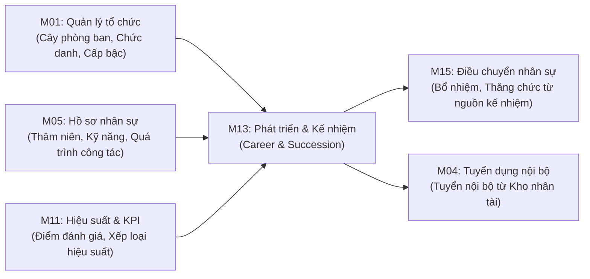
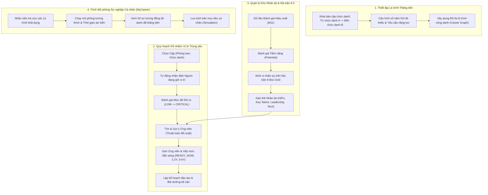
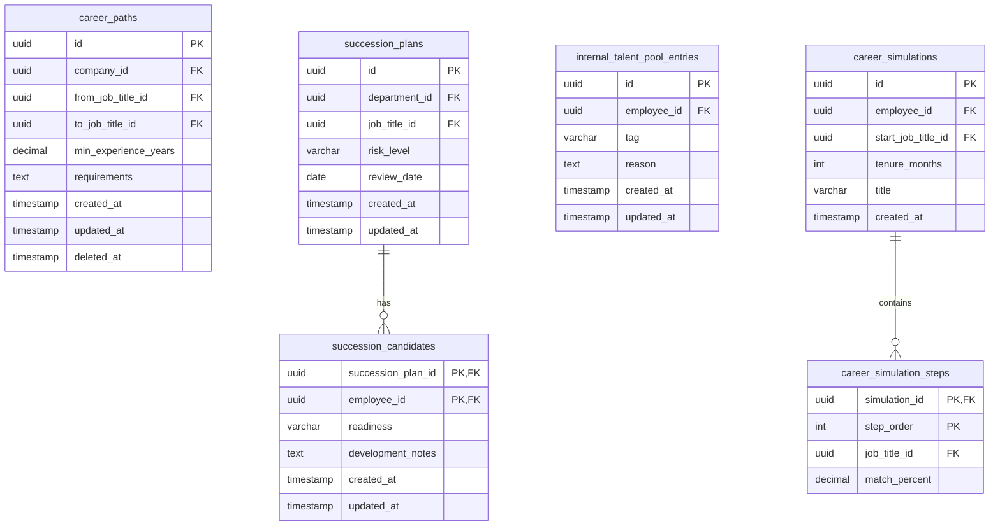

# TÀI LIỆU ĐẶC TẢ NGHIỆP VỤ & KỸ THUẬT: MODULE PHÁT TRIỂN NHÂN SỰ & QUY HOẠCH KẾ NHIỆM (CAREER & SUCCESSION) - M13

---

## 1. TỔNG QUAN & MỐI QUAN HỆ LIÊN MODULE

Module **Phát triển nhân sự & Quy hoạch kế nhiệm (Career & Succession Planning - M13)** là phân hệ quản trị chiến lược cấp cao trong hệ thống CYCLOSA HRM. Module chịu trách nhiệm xây dựng lộ trình phát triển năng lực cá nhân, giữ chân nhân tài then chốt (Key Talents), nhận diện sớm nguồn nhân lực kế cận sẵn sàng thay thế cho các vị trí lãnh đạo và chuyên môn trọng yếu, đồng thời trao quyền cho người lao động chủ động mô phỏng và kiến tạo con đường thăng tiến của bản thân (**MyCareer**).

### 1.1. Bốn trụ cột nghiệp vụ cốt lõi
1. **Lộ trình công danh & Bản đồ thăng tiến (Career Paths & Career Graph):**
   - Định nghĩa các tuyến thăng tiến chuẩn từ một vị trí công tác sang các vị trí mục tiêu (ngang hàng, vượt bậc, chuyển đổi chuyên môn chéo phòng ban).
   - Thiết lập số năm kinh nghiệm tối thiểu, yêu cầu năng lực, kỹ năng và chứng chỉ bắt buộc.
   - Trực quan hóa toàn bộ mạng lưới thăng tiến của tổ chức dưới dạng Đồ thị có hướng (Directed Acyclic Graph - DAG).
2. **Kế hoạch kế nhiệm vị trí trọng yếu (Succession Planning):**
   - Nhận diện các vị trí then chốt, sống còn của tổ chức theo cặp *(Phòng ban, Chức danh)*.
   - Tự động xác định người đang đương nhiệm (Current Holder) và đánh giá mức độ rủi ro thiếu hụt nhân sự (`RiskLevel`: `LOW`, `MEDIUM`, `HIGH`, `CRITICAL`).
   - Xây dựng danh sách ứng viên kế nhiệm (Succession Pipeline) phân cấp theo độ sẵn sàng (`Readiness`: `READY_NOW`, `READY_1_2_YEARS`, `READY_3_5_YEARS`) kèm lộ trình bồi dưỡng cụ thể.
   - Thuật toán tự động gợi ý ứng viên sáng giá từ dữ liệu hiệu suất và năng lực nội bộ.
3. **Kho nhân tài nội bộ & Ma trận 9 ô (Internal Talent Pool & 9-Box Grid):**
   - Phân loại và gắn thẻ nhân sự tiềm năng (`TalentTag`: `HIPO` - High Potential, `KEY_TALENT` - Nhân tài chủ chốt, `LEADERSHIP_POTENTIAL` - Tiềm năng lãnh đạo, `TECH_EXPERT` - Chuyên gia công nghệ).
   - Trực quan hóa Ma trận 9 ô đối sánh giữa **Hiệu suất làm việc (Performance)** từ Module Đánh giá (M11) và **Tiềm năng phát triển (Potential)**.
4. **Trình mô phỏng sự nghiệp cá nhân (MyCareer Simulator):**
   - Cổng tự phục vụ giúp nhân viên tra cứu các ngã rẽ sự nghiệp khả dụng từ vị trí hiện tại.
   - Thuật toán đối sánh độ tương thích năng lực (`matchPercent`), dự báo thời gian đạt được, tham khảo các hồ sơ tương đồng ẩn danh đã thăng tiến thành công trong lịch sử.
   - Cho phép nhân viên lưu lại các kịch bản mục tiêu cá nhân (`career_simulations`).

### 1.2. Mối quan hệ liên module (Inter-module Architecture)


- **Module Cơ cấu Tổ chức (Organization - M01):**
  - Cung cấp danh mục Chức danh (`JobTitle`), Cấp bậc (`JobLevel`) và Phòng ban (`Department`) để định nghĩa điểm đầu/cuối của lộ trình và xác định vị trí trọng yếu.
- **Module Hồ sơ Nhân sự (Employee Profile - M05):**
  - Cung cấp dữ liệu thâm niên, chuyên môn, lịch sử phân công công tác (`EmployeeWorkAssignment`) để tự động xác định người đang giữ vị trí trọng yếu và tính toán độ tương thích năng lực.
  - Tab "Thẻ nhân tài" trong Hồ sơ nhân viên hiển thị các danh hiệu/nhãn Talent được trao tặng.
- **Module Hiệu suất làm việc (Performance Management - M11):**
  - Cung cấp kết quả xếp loại định kỳ (Xuất sắc, Tốt, Hoàn thành...) và điểm đánh giá 360 làm trục hoành (Hiệu suất) cho Ma trận 9 ô và là điều kiện tiên quyết để gợi ý ứng viên kế nhiệm.
- **Module Điều chuyển & Bổ nhiệm (Transfer - M15):**
  - Khi một ứng viên trong danh sách kế nhiệm được phê duyệt đảm nhiệm chức vụ, hệ thống khởi tạo tự động phiếu Điều chuyển/Bổ nhiệm (`TRANSFER_REQUEST`) với lý do thăng chức (`ROLE_PROMOTION_DEMOTION`).
- **Module Tuyển dụng (Recruitment - M04):**
  - Khi phòng ban phát sinh Đề xuất tuyển dụng mới (`ManpowerRequest`), hệ thống ưu tiên đối soát kho nhân tài nội bộ (Internal Talent Pool) trước khi đăng tin tuyển dụng bên ngoài.

---

## 2. QUY TRÌNH NGHIỆP VỤ CỐT LÕI (CORE WORKFLOWS)



### 2.1. Quản lý Lộ trình Thăng tiến (Career Paths)
1. **Khởi tạo tuyến thăng tiến:**
   - Quản trị viên/HR cấu hình cặp chức danh: Vị trí xuất phát (`fromJobTitle`) $\to$ Vị trí mục tiêu (`toJobTitle`).
   - Khai báo số năm kinh nghiệm chuyên môn tối thiểu (`minExperienceYears`).
   - Khai báo yêu cầu năng lực, kỹ năng cứng, chứng chỉ hoặc khung năng lực bắt buộc (`requirements`).
2. **Ràng buộc nghiệp vụ bất biến:**
   - Cấm thiết lập lộ trình có vị trí xuất phát trùng với vị trí đích: `CHECK (from_job_title_id <> to_job_title_id)`.
   - Tính duy nhất: Trong cùng một pháp nhân (`company_id`), mỗi cặp `(from_job_title_id, to_job_title_id)` chỉ được tồn tại một bản ghi đang hoạt động (chưa xóa mềm).
   - Xóa mềm: Khi không còn áp dụng tuyến thăng tiến, chuyển trạng thái qua `deleted_at = NOW()`.
3. **Đồ thị Lộ trình Thăng tiến (Career Graph):**
   - Hệ thống liên kết các cặp chức danh để kết xuất đồ thị mạng thăng tiến đa chiều.
   - Cho phép nhân viên và nhà quản lý tra cứu: Từ một chức danh, có thể đi tới những chức danh nào (trực tiếp hoặc gián tiếp qua nhiều bước trung gian).

### 2.2. Lập Kế hoạch Kế nhiệm Vị trí Trọng yếu (Succession Planning)
1. **Xác định Vị trí Trọng yếu:**
   - Vị trí trọng yếu được định danh theo cặp duy nhất: `(department_id, job_title_id)` (Ví dụ: Trưởng phòng Kỹ thuật - Ban Công nghệ; Giám đốc Tài chính - Khối Tài chính).
   - Hệ thống **tự động xác định người đang đương nhiệm** (Derived Current Holder) bằng cách truy vấn nhân sự có phân công công tác hợp lệ (`employee_work_assignments`) tại phòng ban và chức danh đó.
2. **Đánh giá mức độ rủi ro kế nhiệm (`RiskLevel`):**
   - `LOW`: Vị trí dễ tuyển dụng thay thế, mức độ tác động vận hành thấp.
   - `MEDIUM`: Vị trí chuyên môn tiêu chuẩn, cần thời gian bàn giao 1 - 3 tháng.
   - `HIGH`: Vị trí cấp quản lý then chốt, khó tuyển mới trên thị trường, rủi ro gián đoạn kinh doanh cao.
   - `CRITICAL`: Vị trí lãnh đạo tối cao hoặc chuyên gia kỹ thuật độc quyền, nếu khuyết vị trí sẽ gây tổn thất nghiêm trọng cho doanh nghiệp.
   - Thiết lập Ngày rà soát kế hoạch định kỳ (`reviewDate`).
3. **Quản lý Danh sách Ứng viên Kế nhiệm (Succession Pipeline):**
   - Quản lý thêm các ứng viên tiềm năng vào kế hoạch.
   - Phân cấp mức độ sẵn sàng đảm nhiệm (`Readiness`):
     - `READY_NOW`: Sẵn sàng đảm nhiệm ngay lập tức (trong vòng 0 - 3 tháng).
     - `READY_1_2_YEARS`: Cần bồi dưỡng và kèm cặp thêm từ 1 đến 2 năm.
     - `READY_3_5_YEARS`: Nguồn nhân lực kế cận dài hạn (3 đến 5 năm).
   - Ghi nhận nhận xét phát triển (`developmentNotes`): Các khóa đào tạo cần hoàn thành, kỹ năng lãnh đạo cần bổ sung, dự án thử thách cần giao.
   - **Ràng buộc nghiệp vụ tối thượng:**
     - Ứng viên kế nhiệm **tuyệt đối không được trùng với người đang giữ chức vụ** hiện tại (`CANDIDATE_IS_CURRENT_HOLDER`).
4. **Thuật toán Tự động Gợi ý Ứng viên Sáng giá (Auto-Suggestions Engine):**
   Hệ thống tự động chấm điểm xếp hạng ứng viên nội bộ dựa trên 4 trọng số:
   - *Độ phù hợp lộ trình (30%):* Nhân sự đang giữ chức danh nằm trong tuyến thăng tiến chuẩn tới chức danh mục tiêu.
   - *Kết quả đánh giá hiệu suất (30%):* Đạt điểm cao trong các kỳ đánh giá hiệu suất gần nhất (từ M11).
   - *Thẻ nhân tài (20%):* Đã được gắn thẻ trong Kho nhân tài nội bộ (`HiPo`, `Key Talent`...).
   - *Thâm niên & Kinh nghiệm (20%):* Đạt hoặc vượt số năm kinh nghiệm tối thiểu yêu cầu.

### 2.3. Kho Nhân tài Nội bộ & Ma trận 9 ô (Internal Talent Pool & 9-Box Grid)
1. **Gắn thẻ nhân sự đặc biệt (`TalentTag`):**
   - HR / Lãnh đạo gắn thẻ vinh danh nhân sự kèm lý do cụ thể (`reason`):
     - `HIPO` (High Potential): Nhân sự có tiềm năng phát triển vượt trội, khả năng học hỏi và thích ứng thần tốc.
     - `KEY_TALENT`: Nhân sự nắm giữ bí quyết công nghệ, đóng góp doanh số chủ chốt, khó thay thế.
     - `LEADERSHIP_POTENTIAL`: Nhân sự có tố chất thủ lĩnh, khả năng truyền cảm hứng và quản lý đội ngũ.
     - `TECH_EXPERT`: Chuyên gia kỹ thuật đầu ngành, giải quyết các bài toán công nghệ chuyên sâu.
   - Ràng buộc: Mỗi cặp `(employee_id, tag)` là duy nhất.
2. **Ma trận 9 ô (9-Box Grid Alignment):**
   - Đối chiếu chéo 2 chiều đánh giá:
     - **Trục hoành (Hiệu suất làm việc - Performance):** Dưới kỳ vọng (Low) $\leftrightarrow$ Đạt yêu cầu (Medium) $\leftrightarrow$ Xuất sắc (High) - kết xuất từ M11.
     - **Trục tung (Tiềm năng phát triển - Potential):** Thấp (Low) $\leftrightarrow$ Trung bình (Medium) $\leftrightarrow$ Cao (High) - do Hội đồng đánh giá nhân sự xác định.
   - Nhóm rơi vào ô Góc trên cùng bên phải *(Hiệu suất Xuất sắc + Tiềm năng Cao)* được tự động gắn cờ Top Talent và ưu tiên số 1 đưa vào danh sách `READY_NOW` của các Kế hoạch kế nhiệm.

### 2.4. Trình Mô phỏng Sự nghiệp Cá nhân (MyCareer Simulator)
1. **Mô phỏng ngã rẽ sự nghiệp:**
   - Nhân viên truy cập cổng `/me/career` để khám phá tương lai nghề nghiệp của mình.
   - Hệ thống tự động lấy vị trí hiện tại (`start_job_title_id`) và thâm niên thực tế (`tenure_months`).
   - Nhân viên chọn một chức danh mục tiêu kỳ vọng. Hệ thống chạy thuật toán mô phỏng (không lưu CSDL) để hiển thị:
     - Tỷ lệ tương thích năng lực (`matchPercent`).
     - Các năng lực còn thiếu (Skill Gaps).
     - Thời gian dự kiến cần tích lũy thêm.
2. **Tham khảo Hồ sơ tương đồng ẩn danh (Anonymous Peer Benchmark):**
   - Hiển thị thống kê các đồng nghiệp trong công ty từng có vị trí xuất phát giống nhân viên và đã thăng tiến thành công lên vị trí mục tiêu:
     - Thâm niên trung bình họ mất bao lâu để lên chức.
     - Các dự án, kỹ năng tiêu biểu họ đã tích lũy (hoàn toàn ẩn danh thông tin cá nhân).
3. **Lưu Kịch bản Mục tiêu (Saved Simulations):**
   - Nhân viên có thể đặt tên và lưu lại kịch bản (`career_simulations` & `career_simulation_steps`) để làm kim chỉ nam phát triển.
   - **Quy tắc bảo mật riêng tư:** Kịch bản mô phỏng sự nghiệp là tài sản cá nhân của người lao động. Chỉ duy nhất chính nhân viên đó mới có quyền xem và xóa kịch bản của mình (`FORBIDDEN_SIMULATION_ACCESS`).

---

## 3. THIẾT KẾ CƠ SỞ DỮ LIỆU (DATABASE SCHEMA)

Dựa trên thiết kế kiến trúc chuẩn CYCLOSA HRM ([`database.md`](file:///f:/Project/CYCLOSA/docs/database.md)), Module 13 bao gồm 6 bảng dữ liệu:



### 3.1. Bảng `career_paths` (Lộ trình thăng tiến chuẩn)
```sql
CREATE TABLE career_paths (
    id UUID PRIMARY KEY,
    company_id UUID NOT NULL REFERENCES companies(id),
    from_job_title_id UUID NOT NULL REFERENCES job_titles(id),
    to_job_title_id UUID NOT NULL REFERENCES job_titles(id),
    min_experience_years DECIMAL(4, 1) NOT NULL DEFAULT 1.0,
    requirements TEXT,
    created_at TIMESTAMP NOT NULL DEFAULT NOW(),
    updated_at TIMESTAMP,
    created_by UUID,
    updated_by UUID,
    deleted_at TIMESTAMP,
    CONSTRAINT chk_career_path_different_titles CHECK (from_job_title_id <> to_job_title_id)
);

-- Partial index đảm bảo tính duy nhất của lộ trình đang hoạt động
CREATE UNIQUE INDEX uq_career_path_active 
ON career_paths (company_id, from_job_title_id, to_job_title_id) 
WHERE deleted_at IS NULL;

CREATE INDEX idx_career_path_from ON career_paths(from_job_title_id);
CREATE INDEX idx_career_path_to ON career_paths(to_job_title_id);
```

### 3.2. Bảng `succession_plans` (Kế hoạch kế nhiệm vị trí trọng yếu)
```sql
CREATE TABLE succession_plans (
    id UUID PRIMARY KEY,
    department_id UUID NOT NULL REFERENCES departments(id),
    job_title_id UUID NOT NULL REFERENCES job_titles(id),
    risk_level VARCHAR(30) NOT NULL, -- LOW, MEDIUM, HIGH, CRITICAL
    review_date DATE NOT NULL,
    created_at TIMESTAMP NOT NULL DEFAULT NOW(),
    updated_at TIMESTAMP,
    created_by UUID,
    updated_by UUID,
    CONSTRAINT uq_succession_plan_dept_title UNIQUE (department_id, job_title_id)
);

CREATE INDEX idx_succession_dept ON succession_plans(department_id);
CREATE INDEX idx_succession_title ON succession_plans(job_title_id);
CREATE INDEX idx_succession_risk ON succession_plans(risk_level);
```

### 3.3. Bảng `succession_candidates` (Ứng viên kế nhiệm)
```sql
CREATE TABLE succession_candidates (
    succession_plan_id UUID NOT NULL REFERENCES succession_plans(id) ON DELETE CASCADE,
    employee_id UUID NOT NULL REFERENCES employees(id),
    readiness VARCHAR(30) NOT NULL, -- READY_NOW, READY_1_2_YEARS, READY_3_5_YEARS
    development_notes TEXT,
    created_at TIMESTAMP NOT NULL DEFAULT NOW(),
    updated_at TIMESTAMP,
    created_by UUID,
    updated_by UUID,
    PRIMARY KEY (succession_plan_id, employee_id)
);

CREATE INDEX idx_succ_candidate_emp ON succession_candidates(employee_id);
CREATE INDEX idx_succ_candidate_ready ON succession_candidates(readiness);
```

### 3.4. Bảng `internal_talent_pool_entries` (Kho nhân tài nội bộ)
```sql
CREATE TABLE internal_talent_pool_entries (
    id UUID PRIMARY KEY,
    employee_id UUID NOT NULL REFERENCES employees(id),
    tag VARCHAR(50) NOT NULL, -- HIPO, KEY_TALENT, LEADERSHIP_POTENTIAL, TECH_EXPERT
    reason TEXT,
    created_at TIMESTAMP NOT NULL DEFAULT NOW(),
    updated_at TIMESTAMP,
    created_by UUID,
    updated_by UUID,
    CONSTRAINT uq_talent_employee_tag UNIQUE (employee_id, tag)
);

CREATE INDEX idx_talent_pool_emp ON internal_talent_pool_entries(employee_id);
CREATE INDEX idx_talent_pool_tag ON internal_talent_pool_entries(tag);
```

### 3.5. Bảng `career_simulations` (Kịch bản mô phỏng sự nghiệp đã lưu)
```sql
CREATE TABLE career_simulations (
    id UUID PRIMARY KEY,
    employee_id UUID NOT NULL REFERENCES employees(id),
    start_job_title_id UUID NOT NULL REFERENCES job_titles(id),
    tenure_months INT NOT NULL,
    title VARCHAR(150),
    created_at TIMESTAMP NOT NULL DEFAULT NOW()
);

CREATE INDEX idx_career_sim_emp ON career_simulations(employee_id);
```

### 3.6. Bảng `career_simulation_steps` (Các bước trong kịch bản mô phỏng)
```sql
CREATE TABLE career_simulation_steps (
    simulation_id UUID NOT NULL REFERENCES career_simulations(id) ON DELETE CASCADE,
    step_order INT NOT NULL,
    job_title_id UUID NOT NULL REFERENCES job_titles(id),
    match_percent DECIMAL(5, 2) NOT NULL,
    PRIMARY KEY (simulation_id, step_order)
);

CREATE INDEX idx_sim_step_title ON career_simulation_steps(job_title_id);
```

---

## 4. DANH SÁCH RESTFUL APIS (API SPECIFICATION)

Tiêu chuẩn: Tất cả API trả về `ResponseEntity<ApiResponse<T>>`, path bắt đầu bằng `/api/v1`.

### 4.1. Tuyến thăng tiến chuẩn (CareerPathController - `/api/v1/career-paths`)
| Method | Endpoint | Mô tả chức năng | Quyền yêu cầu |
|---|---|---|---|
| `GET` | `/api/v1/career-paths` | Lấy danh sách lộ trình thăng tiến (Filter: `fromJobTitleId`, `toJobTitleId`, phân trang) | `career.view` |
| `POST` | `/api/v1/career-paths` | Tạo mới tuyến thăng tiến chuẩn | `career.manage` |
| `GET` | `/api/v1/career-paths/{id}` | Lấy chi tiết lộ trình thăng tiến | `career.view` |
| `PUT` | `/api/v1/career-paths/{id}` | Cập nhật số năm kinh nghiệm và yêu cầu năng lực | `career.manage` |
| `DELETE` | `/api/v1/career-paths/{id}` | Xóa mềm tuyến thăng tiến | `career.manage` |
| `GET` | `/api/v1/career-paths/graph` | Kết xuất đồ thị thăng tiến từ một chức danh (`fromJobTitleId`) | `career.view` |

### 4.2. Kế hoạch kế nhiệm (SuccessionPlanController - `/api/v1/succession-plans`)
| Method | Endpoint | Mô tả chức năng | Quyền yêu cầu |
|---|---|---|---|
| `GET` | `/api/v1/succession-plans` | Danh sách kế hoạch vị trí trọng yếu (Filter: `departmentId`, `riskLevel`) | `succession.view` |
| `POST` | `/api/v1/succession-plans` | Tạo kế hoạch kế nhiệm cho cặp (Phòng ban, Chức danh) | `succession.manage` |
| `GET` | `/api/v1/succession-plans/{id}` | Chi tiết kế hoạch, người đương nhiệm và danh sách ứng viên kế cận | `succession.view` |
| `PUT` | `/api/v1/succession-plans/{id}` | Cập nhật mức độ rủi ro và ngày rà soát kế hoạch | `succession.manage` |
| `DELETE` | `/api/v1/succession-plans/{id}` | Xóa kế hoạch kế nhiệm | `succession.manage` |
| `POST` | `/api/v1/succession-plans/{id}/candidates` | Thêm ứng viên kế nhiệm (chặn nếu trùng người đương nhiệm) | `succession.manage` |
| `PUT` | `/api/v1/succession-plans/{id}/candidates/{employeeId}` | Cập nhật mức độ sẵn sàng và ghi chú phát triển | `succession.manage` |
| `DELETE` | `/api/v1/succession-plans/{id}/candidates/{employeeId}` | Gỡ ứng viên khỏi kế hoạch | `succession.manage` |
| `GET` | `/api/v1/succession-plans/{id}/suggestions` | Thuật toán gợi ý ứng viên sáng giá dựa trên hiệu suất và năng lực | `succession.view` |

### 4.3. Kho nhân tài nội bộ (InternalTalentPoolController - `/api/v1/internal-talent-pool`)
| Method | Endpoint | Mô tả chức năng | Quyền yêu cầu |
|---|---|---|---|
| `GET` | `/api/v1/internal-talent-pool` | Danh sách nhân tài nội bộ (Filter: `tag`, `departmentId`) | `succession.view` |
| `POST` | `/api/v1/internal-talent-pool` | Gắn thẻ nhân tài cho nhân viên (Body: `employeeId`, `tag`, `reason`) | `succession.manage` |
| `DELETE` | `/api/v1/internal-talent-pool/{id}` | Thu hồi thẻ nhân tài | `succession.manage` |
| `GET` | `/api/v1/employees/{employeeId}/talent-tags` | Lấy danh sách thẻ nhân tài của 1 nhân viên | `succession.view` |

### 4.4. Mô phỏng sự nghiệp cá nhân (CareerSimulatorController - `/api/v1/career-simulator`)
| Method | Endpoint | Mô tả chức năng | Quyền yêu cầu |
|---|---|---|---|
| `GET` | `/api/v1/career-simulator/paths` | Các lộ trình khả dụng từ vị trí công tác hiện tại | `Auth` |
| `POST` | `/api/v1/career-simulator/simulate` | Mô phỏng lộ trình (tính tỷ lệ tương thích, thời gian dự kiến) - Không lưu | `Auth` |
| `GET` | `/api/v1/career-simulator/similar-profiles` | Hồ sơ nhân viên tương đồng đã thăng tiến thành công (dữ liệu ẩn danh) | `Auth` |
| `POST` | `/api/v1/career-simulations` | Lưu lại kịch bản mô phỏng cá nhân | `Auth` |
| `GET` | `/api/v1/career-simulations` | Danh sách kịch bản đã lưu của tôi | `Auth` |
| `GET` | `/api/v1/career-simulations/{id}` | Xem chi tiết kịch bản (chỉ chủ sở hữu được xem) | `Auth` |
| `DELETE` | `/api/v1/career-simulations/{id}` | Xóa kịch bản đã lưu (chỉ chủ sở hữu được xóa) | `Auth` |

---

## 5. MÃ LỖI NGHIỆP VỤ (CAREER ERROR CODES - RANGE 4700s)

| Enum | Mã số | HTTP Status | Thông điệp lỗi |
|---|:---:|:---:|---|
| `CAREER_PATH_NOT_FOUND` | 4701 | 404 NOT_FOUND | Không tìm thấy thông tin lộ trình thăng tiến yêu cầu |
| `CAREER_PATH_ALREADY_EXISTS` | 4702 | 409 CONFLICT | Tuyến thăng tiến giữa hai chức danh này đã tồn tại trong doanh nghiệp |
| `SAME_JOB_TITLE_NOT_ALLOWED` | 4703 | 400 BAD_REQUEST | Vị trí xuất phát và vị trí mục tiêu không được trùng nhau |
| `SUCCESSION_PLAN_NOT_FOUND` | 4704 | 404 NOT_FOUND | Không tìm thấy kế hoạch kế nhiệm cho vị trí này |
| `SUCCESSION_PLAN_ALREADY_EXISTS` | 4705 | 409 CONFLICT | Kế hoạch kế nhiệm cho vị trí tại phòng ban này đã được thiết lập |
| `CANDIDATE_ALREADY_IN_PLAN` | 4706 | 409 CONFLICT | Nhân viên đã có tên trong danh sách ứng viên kế nhiệm của kế hoạch này |
| `CANDIDATE_IS_CURRENT_HOLDER` | 4707 | 400 BAD_REQUEST | Không thể đưa người đang đảm nhiệm vị trí vào danh sách kế nhiệm chính họ |
| `CANDIDATE_NOT_FOUND_IN_PLAN` | 4708 | 404 NOT_FOUND | Nhân viên không nằm trong danh sách ứng viên kế nhiệm của vị trí này |
| `TALENT_TAG_ALREADY_ASSIGNED` | 4709 | 409 CONFLICT | Nhân viên đã được trao danh hiệu / thẻ nhân tài này trước đó |
| `TALENT_ENTRY_NOT_FOUND` | 4710 | 404 NOT_FOUND | Không tìm thấy bản ghi thẻ nhân tài yêu cầu |
| `SIMULATION_NOT_FOUND` | 4711 | 404 NOT_FOUND | Không tìm thấy kịch bản mô phỏng sự nghiệp yêu cầu |
| `FORBIDDEN_SIMULATION_ACCESS` | 4712 | 403 FORBIDDEN | Bạn không có quyền xem hoặc chỉnh sửa kịch bản sự nghiệp của người khác |
| `EMPLOYEE_NOT_FOUND` | 4713 | 404 NOT_FOUND | Không tìm thấy thông tin nhân viên trong hệ thống |
| `JOB_TITLE_NOT_FOUND` | 4714 | 404 NOT_FOUND | Không tìm thấy chức danh yêu cầu |
| `DEPARTMENT_NOT_FOUND` | 4715 | 404 NOT_FOUND | Không tìm thấy phòng ban yêu cầu |

---

## 6. DANH SÁCH TRANG & QUY CHUẨN GIAO DIỆN (FRONTEND UI/UX)

Theo danh sách trang [`page-list.md`](file:///f:/Project/CYCLOSA/docs/page-list.md), Module 13 bao gồm 8 màn hình:

| ID Trang | Route Frontend | Tên Trang & Loại Giao diện | Chức năng chính |
|:---:|---|---|---|
| **CAR-01** | `/career/paths` | Lộ trình thăng tiến (`LIST`) | Bảng danh sách tuyến thăng tiến + Chuyển đổi sang **Dạng Đồ thị (Graph Canvas)** xem mạng lưới thăng tiến |
| **CAR-02** | `/career/paths/:id` | Chi tiết lộ trình thăng tiến (`FORM`) | Thiết lập số năm kinh nghiệm, yêu cầu năng lực, chỉnh sửa / xóa mềm |
| **CAR-03** | `/career/succession` | Kế hoạch vị trí trọng yếu (`LIST`) | Quản lý danh sách vị trí trọng yếu, lọc theo phòng ban, mức độ rủi ro, KPI cards |
| **CAR-04** | `/career/succession/:id` | Chi tiết kế hoạch kế nhiệm (`DETAIL`) | Người đương nhiệm, danh sách ứng viên (sửa mức sẵn sàng, ghi chú đào tạo) + **Tab Gợi ý ứng viên sáng giá** |
| **CAR-05** | `/career/talent-pool` | Kho nhân tài nội bộ (`LIST`) | Lọc theo thẻ (`HiPo`, `Key Talent`, `Leadership`, `Tech Expert`), phòng ban; gắn/gỡ thẻ + **Xem Ma trận 9-Box Grid** |
| **CAR-06** | `/me/career` | MyCareer - Mô phỏng sự nghiệp (`DASH`) | Giao diện tự phục vụ: khám phá ngã rẽ sự nghiệp, chạy thuật toán mô phỏng, xem hồ sơ tương đồng ẩn danh |
| **CAR-07** | `/me/career/simulations` | Kịch bản sự nghiệp đã lưu (`LIST`) | Danh sách các kịch bản phát triển mục tiêu của cá nhân |
| **CAR-08** | `/me/career/simulations/:id` | Chi tiết kịch bản sự nghiệp (`DETAIL`) | Xem chi tiết các chặng thăng tiến và xóa kịch bản của chính mình |

### Quy chuẩn thiết kế giao diện CYCLOSA bắt buộc:
1. **Header & Breadcrumbs (Rule 02):**
   - Tiêu đề H1 đặt icon trực tiếp, không bọc hộp màu nền, không có subtitle gây loãng bố cục:
     `<Award className="w-6 h-6 text-primary shrink-0" /> <span>Lộ trình thăng tiến</span>`.
   - Đường dẫn Breadcrumbs đặt ngay dưới H1, phân cách bằng `<span>/</span>`, bắt đầu từ `Trang chủ`.
2. **KPI Stats Cards (Rule 03):**
   - 4 thẻ KPI: **Tổng vị trí trọng yếu**, **Vị trí rủi ro cao/nguy cấp (High/Critical)**, **Ứng viên sẵn sàng ngay (Ready Now)**, **Nhân tài then chốt (Top Talent)**.
   - Chuẩn Icon Box `h-12 w-12 rounded-xl` + Sparkline SVG + tương tác click filter.
3. **Filter Bar 2 hàng (Rule 03):**
   - Hàng 1: Search Input (Chức danh, phòng ban, tên nhân sự).
   - Hàng 2: Dropdown Phòng ban, Mức độ rủi ro (`RiskLevel`), Trạng thái sẵn sàng (`Readiness`), Thẻ nhân tài (`TalentTag`) + Nút đặt lại `X`.
4. **Table & DataPagination (Rule 04):**
   - Cột STT: `(page - 1) * size + index + 1`.
   - Cuộn ngang `overflow-x-auto`, Table-embedded Empty State `colSpan={...}`.
5. **Form Dialogs (Rule 05):**
   - Single Form Dialog cho Tuyến thăng tiến (`CareerPathDialog`).
   - Modal thêm ứng viên kế nhiệm (`AddCandidateDialog`) với tính năng tìm kiếm nhân sự trực quan và chặn tự chọn người đương nhiệm.
