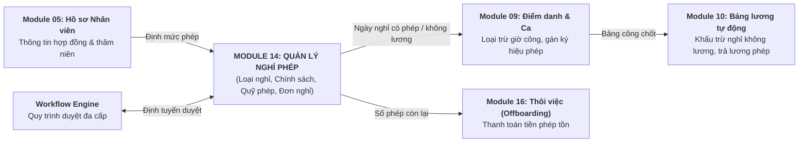
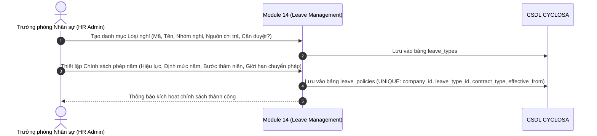
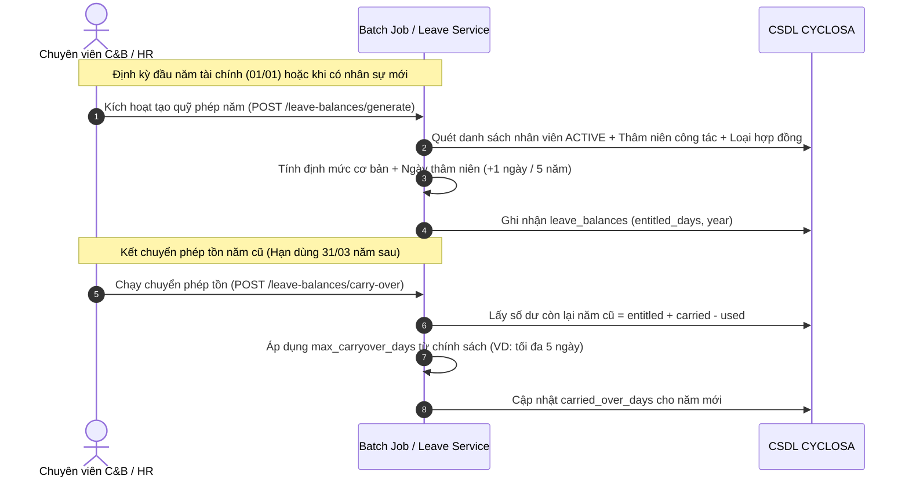
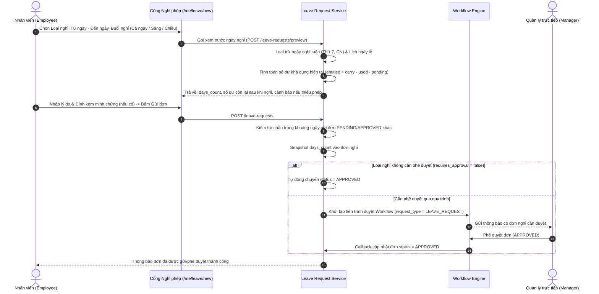
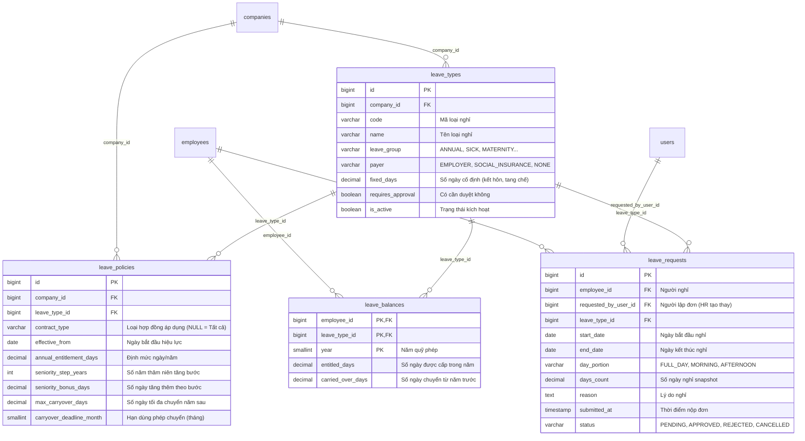
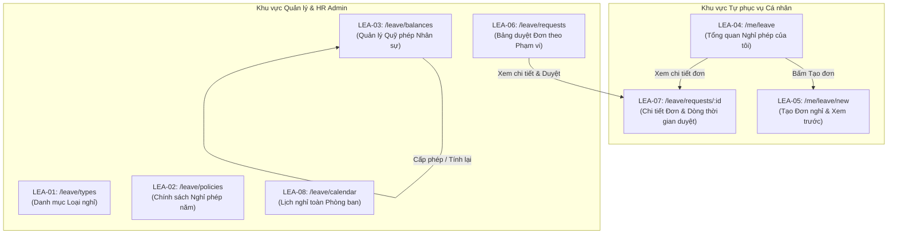
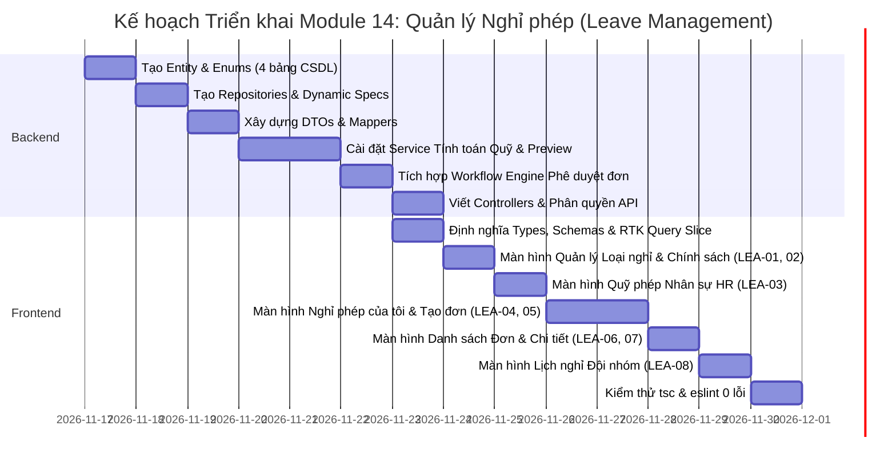

# TÀI LIỆU ĐẶC TẢ NGHIỆP VỤ & THIẾT KẾ KỸ THUẬT
## MODULE 14: QUẢN LÝ NGHỈ PHÉP (LEAVE MANAGEMENT - LEA)

> **Tài liệu tham chiếu:**
> - Nghiệp vụ tổng thể: [`Nghiep-vu.docx`](file:///f:/Project/CYCLOSA/ba/Nghiep-vu.docx)
> - Thiết kế CSDL chi tiết: [`database.md`](file:///f:/Project/CYCLOSA/ba/database.md) (§8.15 Quản lý nghỉ phép, dòng 3640–3726)
> - Danh mục API hệ thống: [`api-list.md`](file:///f:/Project/CYCLOSA/ba/api-list.md) (§4.14 Quản lý nghỉ phép, dòng 1155–1190)
> - Danh mục màn hình UI: [`page-list.md`](file:///f:/Project/CYCLOSA/ba/page-list.md) (§5.15 LEA-01 đến LEA-08)
> - Lộ trình triển khai: [`thu-tu-code-module.md`](file:///f:/Project/CYCLOSA/ba/thu-tu-code-module.md) (Giai đoạn 4: Vận hành thường nhật)

---

## 1. TỔNG QUAN & MỤC TIÊU NGHIỆP VỤ

### 1.1. Vị trí của Module 14 trong Hệ sinh thái CYCLOSA HRM
Module **Quản lý Nghỉ phép (Leave Management - LEA)** là phân hệ cốt lõi mở đầu cho **Giai đoạn 4: Vận hành Thường nhật (Daily Operations)**. Phân hệ này là mắt xích quyết định để tính toán chính xác dữ liệu của **Module 09 (Điểm danh & Chấm công - Timesheet)** và **Module 10 (Tính lương tự động - Payroll)**.

### 1.2. Mục tiêu Nghiệp vụ Cốt lõi
1. **Tuân thủ 100% Bộ luật Lao động Việt Nam:** Hỗ trợ đầy đủ các chế độ nghỉ phép năm (12–16 ngày), tăng ngày nghỉ theo thâm niên (cứ 5 năm làm việc tăng 1 ngày), nghỉ việc riêng có lương (kết hôn, tang chế), nghỉ ốm đau/thai sản hưởng trợ cấp BHXH, và nghỉ không hưởng lương.
2. **Cơ chế Quỹ phép Linh hoạt (Leave Balance Engine):**
   * Tự động sinh quỹ phép đầu năm theo chính sách hợp đồng và thâm niên nhân viên.
   * Hỗ trợ tính theo tỷ lệ thời gian (pro-rata) cho nhân sự mới tiếp nhận trong năm.
   * Tự động kết chuyển phép tồn (carry-over) sang quý 1 năm sau với hạn sử dụng quy định (ví dụ: đến hết 31/03).
3. **Nguyên tắc "Derived State" (Dữ liệu Suy diễn Bất biến):**
   * Bảng quỹ phép `leave_balances` **chỉ lưu số ngày được cấp (`entitled_days`) và số ngày chuyển (`carried_over_days`)**.
   * Số ngày đã dùng (`used_days`), đang chờ duyệt (`pending_days`), và số dư còn lại (`remaining_days`) được **tính toán động từ các đơn nghỉ phép** (`leave_requests`), loại bỏ hoàn toàn rủi ro sai lệch số dư do cập nhật bất đồng bộ.
4. **Trải nghiệm Nhân viên Tự phục vụ (Employee Self-Service):**
   * Cho phép nhân viên tra cứu trực quan số dư phép theo từng loại, lịch sử nghỉ và tiến trình phê duyệt trên Web/Mobile.
   * Tính năng **Xem trước số ngày nghỉ (Preview)**: Tự động loại trừ ngày nghỉ cuối tuần (Thứ 7, CN) và ngày Lễ/Tết quốc gia trước khi nộp đơn.

---

## 2. QUY TRÌNH NGHIỆP VỤ CHI TIẾT (BUSINESS WORKFLOWS)

### 2.1. Luồng 1: Cấu hình Loại nghỉ & Chính sách Nghỉ phép

* **Quy tắc phân loại nhóm nghỉ (`LeaveGroup`):**
  * `ANNUAL`: Nghỉ phép năm — trừ vào quỹ phép cá nhân tích lũy.
  * `PUBLIC_HOLIDAY`: Nghỉ Lễ, Tết theo quy định nhà nước.
  * `PERSONAL_PAID`: Nghỉ việc riêng hưởng nguyên lương (bản thân kết hôn: 3 ngày; con kết hôn: 1 ngày; bố/mẹ/vợ/chồng/con mất: 3 ngày).
  * `PERSONAL_UNPAID`: Nghỉ việc riêng không hưởng lương (thỏa thuận với người sử dụng lao động).
  * `SICK`: Nghỉ ốm đau ngắn ngày hoặc dài ngày (do Quỹ BHXH chi trả theo chế độ).
  * `MATERNITY`: Nghỉ thai sản (do Quỹ BHXH chi trả).
* **Nguồn chi trả (`LeavePayer`):** `EMPLOYER` (Doanh nghiệp trả lương), `SOCIAL_INSURANCE` (Cơ quan BHXH chi trả), `NONE` (Không hưởng lương).

---

### 2.2. Luồng 2: Cấp phát Quỹ phép Năm & Chuyển phép Tồn

---

### 2.3. Luồng 3: Nộp Đơn xin nghỉ phép & Kiểm tra Hợp lệ

---

### 2.4. Luồng 4: Hủy đơn Xin nghỉ phép (Cancel & Rollback)
* Nhân viên có thể hủy đơn nghỉ phép khi:
  * Đơn đang ở trạng thái `PENDING` (chờ duyệt).
  * Đơn đã `APPROVED` nhưng **ngày bắt đầu nghỉ (`start_date`) chưa diễn ra**.
* **Cơ chế hoàn trả:** Vì số dư phép là dữ liệu tính toán động (Derived State), khi đơn chuyển sang `CANCELLED`, hệ thống tự động loại bỏ số ngày `days_count` của đơn khỏi tổng đã dùng/đang chờ, số dư khả dụng của nhân viên tự động được khôi phục ngay lập tức mà không cần can thiệp cập nhật thủ công vào bảng số dư.

---

## 3. THIẾT KẾ CƠ SỞ DỮ LIỆU & RÀNG BUỘC TOÀN VẸN

### 3.1. Sơ đồ Quan hệ Thực thể (Entity Relationship Diagram - ERD)

---

### 3.2. Đặc tả Chi tiết các Bảng CSDL

#### Bảng 1: `leave_types` — Danh mục Loại nghỉ
| Tên cột | Kiểu dữ liệu | Ràng buộc | Diễn giải nghiệp vụ |
|---|---|---|---|
| `id` | BIGINT | PK, Auto Increment | Định danh duy nhất |
| `company_id` | BIGINT | FK $\to$ `companies.id`, NOT NULL | Thuộc doanh nghiệp nào |
| `code` | VARCHAR(30) | NOT NULL | Mã loại nghỉ (VD: `ANNUAL`, `WEDDING`, `SICK`, `MATERNITY`) |
| `name` | VARCHAR(150) | NOT NULL | Tên tiếng Việt (VD: *Nghỉ phép năm, Nghỉ kết hôn, Nghỉ ốm đau*) |
| `leave_group` | VARCHAR(30) | NOT NULL | Nhóm: `ANNUAL`, `PUBLIC_HOLIDAY`, `PERSONAL_PAID`, `PERSONAL_UNPAID`, `SICK`, `MATERNITY` |
| `payer` | VARCHAR(30) | NOT NULL | Nguồn trả lương: `EMPLOYER`, `SOCIAL_INSURANCE`, `NONE` |
| `fixed_days` | DECIMAL(4,1) | NULL | Số ngày cố định nếu có (VD: Kết hôn = 3.0 ngày) |
| `requires_approval` | BOOLEAN | NOT NULL, DEFAULT true | `false` = tự động duyệt ngay khi nộp |
| `is_active` | BOOLEAN | NOT NULL, DEFAULT true | Trạng thái sử dụng |
| `created_at` / `updated_at` | TIMESTAMP | NOT NULL | Audit trail |
| `deleted_at` | TIMESTAMP | NULL | Soft delete |

* **Ràng buộc:** `UNIQUE (company_id, code)`. Không xóa loại nghỉ nếu đã có chính sách hoặc đơn xin nghỉ liên kết.

---

#### Bảng 2: `leave_policies` — Chính sách Nghỉ phép năm
| Tên cột | Kiểu dữ liệu | Ràng buộc | Diễn giải nghiệp vụ |
|---|---|---|---|
| `id` | BIGINT | PK, Auto Increment | Định danh chính sách |
| `company_id` | BIGINT | FK $\to$ `companies.id`, NOT NULL | Doanh nghiệp áp dụng |
| `leave_type_id` | BIGINT | FK $\to$ `leave_types.id`, NOT NULL | Loại nghỉ áp dụng hạn mức |
| `contract_type` | VARCHAR(30) | NULL | Áp dụng cho loại HĐ nào (`FULL_TIME`, `PROBATION`... NULL = Mọi HĐ) |
| `effective_from` | DATE | NOT NULL | Ngày bắt đầu có hiệu lực |
| `annual_entitlement_days` | DECIMAL(4,1) | NOT NULL | Định mức ngày nghỉ/năm (VD: 12.0 ngày) |
| `seniority_step_years` | INT | NULL | Cứ mỗi N năm thâm niên (VD: 5 năm) |
| `seniority_bonus_days` | DECIMAL(3,1) | NULL | Được cộng thêm số ngày (VD: 1.0 ngày) |
| `max_carryover_days` | DECIMAL(4,1) | NOT NULL, DEFAULT 0 | Số ngày tối đa được chuyển sang năm sau (0 = không cho chuyển) |
| `carryover_deadline_month` | SMALLINT | NULL, DEFAULT 3 | Tháng hết hạn phép chuyển trong năm sau (VD: Tháng 3 = 31/03) |

* **Ràng buộc:** `UNIQUE (company_id, leave_type_id, contract_type, effective_from)`. Đảm bảo tại một thời điểm mỗi nhân viên chỉ khớp 1 chính sách duy nhất.

---

#### Bảng 3: `leave_balances` — Quỹ phép Cá nhân theo Năm
| Tên cột | Kiểu dữ liệu | Ràng buộc | Diễn giải nghiệp vụ |
|---|---|---|---|
| `employee_id` | BIGINT | PK, FK $\to$ `employees.id` | Nhân viên sở hữu quỹ phép |
| `leave_type_id` | BIGINT | PK, FK $\to$ `leave_types.id` | Loại nghỉ có hạn mức |
| `year` | SMALLINT | PK | Năm áp dụng (VD: 2026) |
| `entitled_days` | DECIMAL(4,1) | NOT NULL, DEFAULT 0 | Số ngày phép được cấp trong năm (theo chính sách, thâm niên, pro-rata) |
| `carried_over_days` | DECIMAL(4,1) | NOT NULL, DEFAULT 0 | Số ngày phép năm trước chuyển sang (chốt cố định khi cấp) |

* **Công thức Suy diễn (Derived Attributes — Tính toán qua Query API, không lưu cột cứng):**
  $$\text{used\_days} = \sum \text{days\_count} \quad (\text{đơn có status} = \text{APPROVED trong năm})$$
  $$\text{pending\_days} = \sum \text{days\_count} \quad (\text{đơn có status} = \text{PENDING trong năm})$$
  $$\text{remaining\_days} = \text{entitled\_days} + \text{carried\_over\_days} - \text{used\_days} - \text{pending\_days}$$

---

#### Bảng 4: `leave_requests` — Đơn xin Nghỉ phép
| Tên cột | Kiểu dữ liệu | Ràng buộc | Diễn giải nghiệp vụ |
|---|---|---|---|
| `id` | BIGINT | PK, Auto Increment | Mã định danh đơn |
| `employee_id` | BIGINT | FK $\to$ `employees.id`, NOT NULL | Nhân viên xin nghỉ |
| `requested_by_user_id` | BIGINT | FK $\to$ `users.id`, NOT NULL | Người tạo đơn (Nhân viên tự tạo hoặc HR tạo thay) |
| `leave_type_id` | BIGINT | FK $\to$ `leave_types.id`, NOT NULL | Loại nghỉ xin áp dụng |
| `start_date` | DATE | NOT NULL | Ngày bắt đầu nghỉ |
| `end_date` | DATE | NOT NULL | Ngày kết thúc nghỉ |
| `day_portion` | VARCHAR(20) | NOT NULL, DEFAULT 'FULL_DAY' | Buổi nghỉ: `FULL_DAY`, `MORNING`, `AFTERNOON` |
| `days_count` | DECIMAL(4,1) | NOT NULL | Số ngày nghỉ thực tế snapshot tại lúc gửi đơn |
| `reason` | TEXT | NULL | Lý do xin nghỉ |
| `submitted_at` | TIMESTAMP | NOT NULL | Thời điểm nộp đơn |
| `status` | VARCHAR(30) | NOT NULL | Trạng thái: `PENDING`, `APPROVED`, `REJECTED`, `CANCELLED` |

* **Ràng buộc Toàn vẹn:**
  * `CHECK (start_date <= end_date)`
  * `CHECK (day_portion = 'FULL_DAY' OR start_date = end_date)`: Nghỉ nửa ngày chỉ được áp dụng khi `start_date = end_date`.
  * **Chặn trùng lịch:** Không được trùng khoảng ngày với bất kỳ đơn nào khác có trạng thái `PENDING` hoặc `APPROVED` của cùng nhân viên.
  * Đơn nghỉ thuộc về năm quỹ phép của `start_date`.

---

## 4. DANH MỤC API BACKEND & HỢP ĐỒNG DỮ LIỆU

Toàn bộ API được thiết kế theo chuẩn **RESTful JSON**, bọc dữ liệu trong `ApiResponse<T>`, hỗ trợ phân trang chuẩn `PageData<T>`.

### 4.1. Nhóm API Quản lý Loại nghỉ & Chính sách

| STT | Phương thức | Endpoint URL | Phân quyền | Mô tả chức năng |
|---|---|---|---|---|
| 1 | `GET` | `/api/v1/leave-types` | `Auth` | Lấy danh sách loại nghỉ (Lọc: `group`, `isActive`) |
| 2 | `GET` | `/api/v1/leave-types/{id}` | `Auth` | Lấy chi tiết loại nghỉ |
| 3 | `POST` | `/api/v1/leave-types` | `leave.config` | Thêm mới loại nghỉ |
| 4 | `PUT` | `/api/v1/leave-types/{id}` | `leave.config` | Cập nhật thông tin loại nghỉ |
| 5 | `DELETE` | `/api/v1/leave-types/{id}` | `leave.config` | Xóa loại nghỉ (chỉ xóa khi chưa có đơn/chính sách tham chiếu) |
| 6 | `GET` | `/api/v1/leave-policies` | `leave.view` | Lấy danh sách chính sách nghỉ phép năm phân trang |
| 7 | `POST` | `/api/v1/leave-policies` | `leave.config` | Tạo mới chính sách phép năm |
| 8 | `PUT` | `/api/v1/leave-policies/{id}` | `leave.config` | Chỉnh sửa chính sách phép năm |
| 9 | `DELETE` | `/api/v1/leave-policies/{id}` | `leave.config` | Xóa chính sách phép năm |

---

### 4.2. Nhóm API Quỹ phép Nhân viên

| STT | Phương thức | Endpoint URL | Phân quyền | Mô tả chức năng |
|---|---|---|---|---|
| 10 | `GET` | `/api/v1/me/leave-balances` | `Auth` | Lấy quỹ phép năm của chính người dùng đăng nhập (`year`) |
| 11 | `GET` | `/api/v1/employees/{employeeId}/leave-balances` | `leave.view` | Xem quỹ phép chi tiết của một nhân viên |
| 12 | `POST` | `/api/v1/leave-balances/generate` | `leave.manage` | Cấp phát quỹ phép hàng loạt đầu năm cho nhân viên theo chính sách |
| 13 | `POST` | `/api/v1/employees/{employeeId}/leave-balances/recalculate` | `leave.manage` | Tính toán lại định mức được cấp cho 1 nhân sự khi đổi HĐLĐ/thâm niên |
| 14 | `POST` | `/api/v1/leave-balances/carry-over` | `leave.manage` | Kích hoạt kết chuyển phép tồn sang năm sau theo hạn mức quy định |

---

### 4.3. Nhóm API Đơn xin Nghỉ phép & Lịch công tác

| STT | Phương thức | Endpoint URL | Phân quyền | Mô tả chức năng |
|---|---|---|---|---|
| 15 | `POST` | `/api/v1/leave-requests/preview` | `Auth` | **Xem trước đơn nghỉ:** Trừ ngày cuối tuần/ngày lễ, kiểm tra số dư dự kiến |
| 16 | `POST` | `/api/v1/leave-requests` | `Auth` | Nộp đơn xin nghỉ phép (Nhân viên tự gửi hoặc HR gửi thay) |
| 17 | `GET` | `/api/v1/me/leave-requests` | `Auth` | Lấy danh sách đơn nghỉ của tôi phân trang (`year`, `status`) |
| 18 | `GET` | `/api/v1/leave-requests` | `leave.view` | Lấy danh sách đơn nghỉ toàn công ty/phòng ban theo DataScope |
| 19 | `GET` | `/api/v1/leave-requests/{id}` | `Auth` | Xem chi tiết đơn nghỉ kèm dòng thời gian phê duyệt (Approval Timeline) |
| 20 | `POST` | `/api/v1/leave-requests/{id}/cancel` | `Auth` | Hủy đơn xin nghỉ phép (hoàn trả ngày nghỉ tự động) |
| 21 | `GET` | `/api/v1/leave-calendar` | `leave.view` | Lấy dữ liệu lịch nghỉ toàn phòng ban/đội nhóm phục vụ cân đối nhân sự |

---

## 5. BẢN ĐẶC TẢ GIAO DIỆN FRONTEND (8 MÀN HÌNH CHUẨN)

Hệ thống giao diện Module 14 bao gồm 8 màn hình (ký hiệu `LEA-01` đến `LEA-08`), chia thành 2 nhóm: **Khu vực Quản trị Nhân sự (HR/Manager)** và **Khu vực Tự phục vụ Cá nhân (Employee Self-Service)**.

### Chi tiết Đặc tả từng Màn hình

| Mã MH | Route URL | Loại trang | Vai trò truy cập | Thành phần & Nghiệp vụ giao diện chính | Ghi chú |
|---|---|---|---|---|---|
| **LEA-01** | `/leave/types` | `LIST & MODAL` | HR Admin | Bảng danh mục loại nghỉ (Mã, Tên, Nhóm nghỉ, Nguồn chi trả, Số ngày cố định, Switch cần duyệt). Modal thêm/sửa loại nghỉ. | Đã hoàn thành |
| **LEA-02** | `/leave/policies` | `LIST & MODAL` | HR Admin / C&B Lead | Bảng chính sách thâm niên và chuyển phép theo loại hợp đồng; modal thiết lập hạn mức năm, bước thâm niên và tháng hết hạn phép chuyển. | Đã hoàn thành |
| **LEA-03** | `/leave/balances` | `LIST & ACTIONS` | HR / C&B Specialist | Bảng quỹ phép toàn công ty: Cột Cấp mới, Chuyển năm trước, Đã dùng, Đang chờ, Còn lại. Các nút thao tác cấp cao: **Cấp quỹ đầu năm**, **Tính lại quỹ nhân viên**, **Kết chuyển phép tồn**. | Đã hoàn thành |
| **LEA-04** | `/me/leave` | `DASHBOARD` | Toàn bộ nhân viên | Thẻ Widget tổng quan số dư phép năm, số ngày đã dùng; Danh sách các đơn nghỉ của tôi kèm badge trạng thái; Nút tạo đơn nhanh. | Sẽ bổ sung vào cổng tự phục vụ nhân viên sau |
| **LEA-05** | `/me/leave/new` hoặc `/leave/requests/new` | `FORM & PREVIEW` | Nhân viên / HR tạo thay | Form chọn loại nghỉ, khoảng ngày, buổi nghỉ (Cả ngày, Sáng, Chiều), lý do. **Hộp Xem trước (Live Preview)**: Hiển thị ngay số ngày nghỉ thực tế (đã trừ T7, CN, Lễ) và số dư phép còn lại trước khi bấm nộp. | Sẽ bổ sung vào cổng tự phục vụ nhân viên sau |
| **LEA-06** | `/leave/requests` | `LIST & FILTER` | Quản lý / HR | Bảng quản lý đơn nghỉ theo phòng ban: Lọc theo trạng thái (`PENDING`, `APPROVED`, `REJECTED`, `CANCELLED`), lọc theo nhân viên, khoảng ngày; Nút duyệt/từ chối nhanh. | Đã hoàn thành |
| **LEA-07** | `/leave/requests/:id` | `DETAIL` | Người gửi / Quản lý duyệt | Chi tiết đơn nghỉ, lý do, số ngày nghỉ, file đính kèm, sơ đồ dòng thời gian phê duyệt (Approval Timeline) qua các cấp quản lý, nút Hủy đơn. | Đã hoàn thành |
| **LEA-08** | `/leave/calendar` | `CALENDAR VIEW` | Quản lý / Toàn đội | Lịch biểu trực quan hiển thị các thành viên nghỉ phép trong tháng/tuần theo mã màu loại nghỉ, giúp Trưởng bộ phận chủ động bố trí nhân sự thay thế. | Đã hoàn thành |

---

## 6. DANH MỤC MÃ LỖI & QUY TẮC KIỂM TRA HỢP LỆ (ERROR CODES & VALIDATION)

| Mã HTTP | Business Error Code | Thông báo lỗi tiếng Việt | Điều kiện kích hoạt |
|---|---|---|---|
| 404 | `LEAVE_TYPE_NOT_FOUND` | Không tìm thấy loại nghỉ yêu cầu | ID loại nghỉ không tồn tại trong CSDL |
| 409 | `LEAVE_TYPE_CODE_DUPLICATED` | Mã loại nghỉ đã tồn tại trong doanh nghiệp | Trùng mã `code` trong cùng công ty |
| 400 | `CANNOT_DELETE_REFERENCED_LEAVE_TYPE` | Không thể xóa loại nghỉ đang được áp dụng trong chính sách hoặc đơn nghỉ | Đã có bản ghi tham chiếu khóa ngoại |
| 404 | `LEAVE_POLICY_NOT_FOUND` | Không tìm thấy chính sách nghỉ phép yêu cầu | ID chính sách không tồn tại |
| 409 | `LEAVE_POLICY_CONFLICT` | Đã tồn tại chính sách hiệu lực trùng thời điểm cho loại hợp đồng này | Trùng bộ khóa unique chính sách |
| 400 | `INVALID_LEAVE_DATE_RANGE` | Ngày kết thúc nghỉ không được trước ngày bắt đầu | `start_date > end_date` |
| 400 | `INVALID_HALF_DAY_PORTION` | Nghỉ nửa ngày chỉ được áp dụng trong cùng một ngày | `day_portion != 'FULL_DAY'` nhưng `start_date != end_date` |
| 409 | `OVERLAPPING_LEAVE_REQUEST` | Khoảng thời gian xin nghỉ bị trùng với một đơn nghỉ khác của bạn | Đã có đơn `PENDING` hoặc `APPROVED` trùng ngày |
| 422 | `INSUFFICIENT_LEAVE_BALANCE` | Số dư phép năm không đủ để thực hiện yêu cầu nghỉ này | Số ngày nghỉ vượt quá số dư khả dụng (`remaining_days`) |
| 404 | `LEAVE_REQUEST_NOT_FOUND` | Không tìm thấy đơn xin nghỉ phép yêu cầu | ID đơn nghỉ không tồn tại |
| 400 | `CANNOT_CANCEL_PAST_LEAVE_REQUEST` | Không thể hủy đơn nghỉ phép đã diễn ra trong quá khứ | Bấm hủy khi `start_date` đã qua |
| 400 | `LEAVE_REQUEST_ALREADY_PROCESSED` | Đơn nghỉ phép này đã được xử lý hoặc đã bị hủy trước đó | Đơn không ở trạng thái được phép thao tác |

---

## 7. KẾ HOẠCH TRIỂN KHAI THEO GIAI ĐOẠN

---

> **Kết luận:** Tài liệu đặc tả này là cơ sở quy chuẩn duy nhất để đội ngũ kỹ thuật triển khai toàn diện Backend và Frontend cho **Module 14: Quản lý Nghỉ phép (Leave Management)**, đảm bảo tính nhất quán dữ liệu với phân hệ Chấm công (M09) và Bảng lương (M10) trong hệ sinh thái CYCLOSA HRM.

