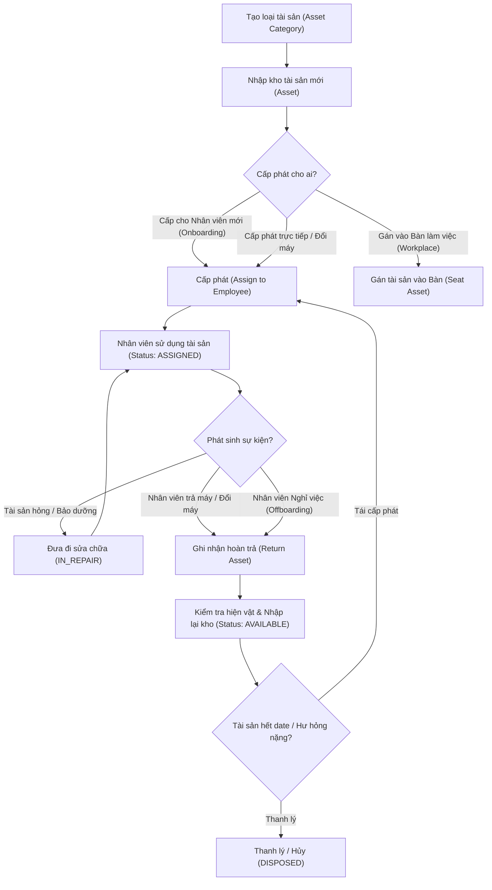

# TÀI LIỆU ĐẶC TẢ NGHIỆP VỤ & KỸ THUẬT: MODULE QUẢN LÝ TÀI SẢN (ASSET MANAGEMENT)

---

## 1. TỔNG QUAN & MỐI QUAN HỆ LIÊN MODULE

Module **Quản lý tài sản (Asset Management - AST)** quản lý toàn diện vòng đời của các trang thiết bị, công cụ dụng cụ và tài sản hữu hình do doanh nghiệp sở hữu và cấp phát cho người lao động phục vụ công việc (Laptop, máy tính để bàn, màn hình, bàn phím, điện thoại nghiệp vụ, thẻ nhân viên, xe công vụ, chìa khóa...).

Phân hệ đảm bảo sự minh bạch trong kiểm soát hiện vật, hạn chế thất thoát, kết nối chặt chẽ với quy trình tiếp nhận nhân sự mới (**Onboarding**), luồng di biến động chỗ ngồi (**Workplace**) và thủ tục bàn giao thanh lý trước khi thôi việc (**Offboarding**).

### 1.1. Phạm vi nghiệp vụ
- **Quản lý danh mục Loại tài sản (Asset Categories):**
  - Phân nhóm tài sản: *Thiết bị CNTT (IT Equipment)*, *Thiết bị văn phòng (Office Supplies)*, *Phương tiện di chuyển (Vehicles)*, *Thẻ & Chìa khóa (Access Cards & Keys)*...
  - Cho phép cấu hình theo từng Pháp nhân/Doanh nghiệp (`companyId`).
- **Quản lý Danh mục Hiện vật Tài sản (Assets):**
  - Mã định danh tài sản (`assetCode`), Tên tài sản, Loại tài sản, Số Serial (`serialNumber`), Model/Hãng sản xuất, Thông số kỹ thuật, Giá mua, Ngày đưa vào sử dụng.
  - Tình trạng vật lý: *Mới (NEW)*, *Đang sử dụng tốt (GOOD)*, *Cần bảo dưỡng (MAINTENANCE_REQUIRED)*, *Hỏng hóc (DAMAGED)*, *Thanh lý/Hủy (DISPOSED)*.
  - Trạng thái vận hành: *Chưa cấp phát / Sẵn sàng trong kho (AVAILABLE)*, *Đang cấp phát (ASSIGNED)*, *Đang bảo dưỡng (IN_REPAIR)*, *Đã thanh lý (LIQUIDATED)*.
- **Cấp phát & Bàn giao Tài sản (Asset Allocation / Assignment):**
  - Cấp phát tài sản đích danh cho Nhân viên (`employeeId`).
  - Ghi nhận ngày bàn giao (`assignedAt`), tình trạng hiện vật lúc bàn giao, biên bản đính kèm, ghi chú.
- **Hoàn trả & Thu hồi Tài sản (Asset Return):**
  - Tiếp nhận tài sản hoàn trả từ nhân viên.
  - Ghi nhận thời điểm hoàn trả (`returnedAt`), đánh giá tình trạng hiện vật lúc thu hồi (có hư hao/mất mát không), ghi chú.
- **Tra cứu & Báo cáo Lịch sử Tài sản:**
  - Lịch sử cấp phát của từng tài sản qua các đời nhân sự sử dụng.
  - Danh sách tài sản nhân viên đang nắm giữ (phục vụ tab Tài sản trong Hồ sơ nhân sự và cổng tự phục vụ ESS).
  - Thống kê KPI: Tổng số tài sản, Tài sản đang cấp phát, Tài sản sẵn sàng trong kho, Tài sản đang bảo dưỡng/hỏng.

### 1.2. Mối quan hệ liên module (Inter-module Architecture)
- **Module Hội nhập nhân sự (Onboarding - M06):**
  - Khi nhân viên mới vào làm, quy trình Checklist Hội nhập có các đầu việc cấp phát Laptop, màn hình, thẻ từ. Quản trị viên/IT cấp phát tài sản qua module Asset và đánh dấu hoàn thành nhiệm vụ Onboarding tương ứng.
- **Module Thôi việc (Offboarding - M16):**
  - Thủ tục thanh lý công nợ bàn giao bao gồm hạng mục bắt buộc: `ASSET` (Hoàn trả tài sản).
  - Hệ thống kiểm tra điều kiện tiên quyết: `unreturned_asset_count == 0` (số tài sản chưa trả bằng 0) thì nhân sự mới được phê duyệt hoàn tất thủ tục bàn giao tài sản để tiến hành quyết toán thôi việc.
- **Module Hồ sơ nhân sự (Employee Profile - M05):**
  - Màn hình chi tiết nhân viên tích hợp tab **"Tài sản"** (`/employees/:id/assets`) hiển thị danh sách các thiết bị nhân viên đang giữ và lịch sử đã từng sử dụng.
- **Module Không gian làm việc & Sơ đồ ghế ngồi (Smart Workplace - M19):**
  - Hỗ trợ gán tài sản cố định vào vị trí bàn làm việc (`seat_assets`: màn hình phụ, điện thoại để bàn, dock sạc) bên cạnh việc cấp phát cho cá nhân.

---

## 2. QUY TRÌNH NGHIỆP VỤ CỐT LÕI (CORE WORKFLOWS)



### 2.1. Quản lý Danh mục Loại tài sản (Asset Categories)
1. Quản trị viên HR/IT tạo danh mục phân loại: ví dụ "Laptop", "Màn hình", "Điện thoại nghiệp vụ", "Xe công ty".
2. Ràng buộc: `name` không được trùng lặp trong cùng một `company_id`.
3. Khi xóa Loại tài sản: Hệ thống kiểm tra nếu đã có tài sản thuộc loại này thì chặn xóa và trả về lỗi `CANNOT_DELETE_CATEGORY_WITH_ASSETS (4603)`.

### 2.2. Nhập kho & Quản lý Tài sản (Asset Inventory)
1. Khởi tạo tài sản với các thông tin: Mã tài sản (duy nhất trong công ty), Tên, Loại tài sản, Số Serial, Model, Thông số kỹ thuật, Giá mua, Ngày mua.
2. Trạng thái ban đầu mặc định là `AVAILABLE` (Sẵn sàng trong kho).
3. Ràng buộc nghiệp vụ:
   - `assetCode` là duy nhất trên phạm vi toàn công ty (`company_id`).
   - `serialNumber` nếu nhập thì không được trùng lặp với tài sản đang hoạt động.
4. Xóa tài sản: Chỉ cho phép xóa tài sản khi chưa từng được cấp phát hoặc đang ở trạng thái `AVAILABLE`. Nếu tài sản đang được cấp phát (`ASSIGNED`), hệ thống chặn xóa và trả về lỗi `CANNOT_DELETE_ASSIGNED_ASSET (4605)`.

### 2.3. Cấp phát tài sản cho nhân sự (Asset Assignment)
1. Người dùng chọn tài sản ở trạng thái `AVAILABLE`.
2. Chọn nhân viên được cấp phát (`employeeId`), nhập Ngày cấp phát (`assignedAt`), Tình trạng lúc giao máy, Ghi chú.
3. Hệ thống kiểm tra:
   - Tài sản phải có trạng thái `AVAILABLE` (nếu đang `ASSIGNED` hoặc `IN_REPAIR` thì chặn cấp phát).
   - Nhân viên phải ở trạng thái hoạt động hợp lệ (`ACTIVE`, `PROBATION`).
4. Xử lý giao dịch:
   - Tạo bản ghi mới trong bảng `asset_assignments` với `returnedAt = null`.
   - Cập nhật trạng thái của tài sản sang `ASSIGNED`.
   - Ghi nhật ký kiểm toán (Audit Log).

### 2.4. Thu hồi & Hoàn trả tài sản (Asset Return)
1. Từ màn hình Chi tiết tài sản hoặc Danh sách cấp phát, bấm nút **"Thu hồi / Ghi nhận hoàn trả"**.
2. Nhập Ngày hoàn trả (`returnedAt`), Tình trạng hiện vật khi nhận lại máy (`GOOD`, `DAMAGED`), Ghi chú lý do trả máy.
3. Hệ thống kiểm tra:
   - Bản ghi cấp phát phải đang mở (`returnedAt IS NULL`).
4. Xử lý giao dịch:
   - Cập nhật `returnedAt` và ghi chú tình trạng vào `asset_assignments`.
   - Cập nhật trạng thái của tài sản về `AVAILABLE` (nếu máy tốt) hoặc `IN_REPAIR` / `DAMAGED` (nếu máy hỏng cần sửa).
   - Giảm số lượng `unreturned_asset_count` của nhân viên tương ứng.

---

## 3. THIẾT KẾ CƠ SỞ DỮ LIỆU (DATABASE SCHEMA)

Dựa trên chuẩn CSDL CYCLOSA HRM ([`database.md`](file:///f:/Project/CYCLOSA/docs/database.md)), các bảng dữ liệu của phân hệ Asset được thiết kế chi tiết:

### 3.1. Bảng `asset_categories` (Loại tài sản)
```sql
CREATE TABLE asset_categories (
    id UUID PRIMARY KEY,
    company_id UUID NOT NULL REFERENCES companies(id),
    name VARCHAR(100) NOT NULL,
    code VARCHAR(50) NOT NULL,
    description VARCHAR(500),
    created_at TIMESTAMP NOT NULL,
    updated_at TIMESTAMP,
    created_by VARCHAR(100),
    last_modified_by VARCHAR(100),
    deleted_at TIMESTAMP,
    CONSTRAINT uq_asset_category_company_name UNIQUE (company_id, name),
    CONSTRAINT uq_asset_category_company_code UNIQUE (company_id, code)
);
```

### 3.2. Bảng `assets` (Hiện vật tài sản)
```sql
CREATE TABLE assets (
    id UUID PRIMARY KEY,
    company_id UUID NOT NULL REFERENCES companies(id),
    asset_code VARCHAR(50) NOT NULL,
    asset_category_id UUID NOT NULL REFERENCES asset_categories(id),
    name VARCHAR(200) NOT NULL,
    serial_number VARCHAR(100),
    model VARCHAR(100),
    manufacturer VARCHAR(100),
    specifications TEXT,
    purchase_date DATE,
    purchase_price DECIMAL(15,2),
    status VARCHAR(30) NOT NULL DEFAULT 'AVAILABLE',
    condition_status VARCHAR(30) NOT NULL DEFAULT 'GOOD',
    location VARCHAR(200),
    notes VARCHAR(500),
    created_at TIMESTAMP NOT NULL,
    updated_at TIMESTAMP,
    created_by VARCHAR(100),
    last_modified_by VARCHAR(100),
    deleted_at TIMESTAMP,
    CONSTRAINT uq_asset_company_code UNIQUE (company_id, asset_code)
);
```

### 3.3. Bảng `asset_assignments` (Lịch sử cấp phát và hoàn trả)
```sql
CREATE TABLE asset_assignments (
    id UUID PRIMARY KEY,
    asset_id UUID NOT NULL REFERENCES assets(id),
    employee_id UUID NOT NULL REFERENCES employees(id),
    assigned_at TIMESTAMP NOT NULL,
    returned_at TIMESTAMP,
    condition_on_assign VARCHAR(50),
    condition_on_return VARCHAR(50),
    notes VARCHAR(500),
    created_at TIMESTAMP NOT NULL,
    updated_at TIMESTAMP,
    created_by VARCHAR(100),
    last_modified_by VARCHAR(100)
);

-- Partial index đảm bảo tại một thời điểm mỗi tài sản chỉ cấp cho tối đa 1 người
CREATE UNIQUE INDEX uq_asset_active_assignment 
ON asset_assignments (asset_id) 
WHERE returned_at IS NULL;
```

---

## 4. DANH SÁCH RESTFUL APIS (API SPECIFICATION)

Tiêu chuẩn: Tất cả API trả về `ResponseEntity<ApiResponse<T>>`, path bắt đầu bằng `/api/v1`.

### 4.1. Asset Categories (`/api/v1/asset-categories`)
| Phương thức | Đường dẫn | Chức năng | Quyền yêu cầu |
|---|---|---|---|
| `GET` | `/api/v1/asset-categories` | Lấy danh sách loại tài sản (có phân trang / tìm kiếm) | `asset.view` |
| `GET` | `/api/v1/asset-categories/all` | Lấy toàn bộ danh mục để nạp Dropdown Select | `asset.view` |
| `POST` | `/api/v1/asset-categories` | Tạo mới loại tài sản | `asset.manage` |
| `GET` | `/api/v1/asset-categories/{id}` | Lấy chi tiết loại tài sản | `asset.view` |
| `PUT` | `/api/v1/asset-categories/{id}` | Cập nhật loại tài sản | `asset.manage` |
| `DELETE` | `/api/v1/asset-categories/{id}` | Xóa loại tài sản (khi chưa có tài sản liên kết) | `asset.manage` |

### 4.2. Assets (`/api/v1/assets`)
| Phương thức | Đường dẫn | Chức năng | Quyền yêu cầu |
|---|---|---|---|
| `GET` | `/api/v1/assets` | Tìm kiếm & phân trang danh sách tài sản (filter theo keyword, categoryId, status, condition) | `asset.view` |
| `GET` | `/api/v1/assets/statistics` | Thống kê số liệu KPI (Tổng số, Đang cấp, Sẵn sàng, Bảo dưỡng) | `asset.view` |
| `POST` | `/api/v1/assets` | Tạo mới tài sản nhập kho | `asset.manage` |
| `GET` | `/api/v1/assets/{id}` | Chi tiết tài sản kèm thông tin người đang giữ & lịch sử cấp phát | `asset.view` |
| `PUT` | `/api/v1/assets/{id}` | Cập nhật thông tin tài sản | `asset.manage` |
| `DELETE` | `/api/v1/assets/{id}` | Xóa tài sản (Soft delete) | `asset.manage` |
| `POST` | `/api/v1/assets/{id}/assign` | Cấp phát tài sản cho nhân viên | `asset.assign` |

### 4.3. Asset Assignments (`/api/v1/asset-assignments`)
| Phương thức | Đường dẫn | Chức năng | Quyền yêu cầu |
|---|---|---|---|
| `POST` | `/api/v1/asset-assignments/{id}/return` | Ghi nhận hoàn trả / thu hồi tài sản | `asset.assign` |
| `GET` | `/api/v1/asset-assignments/history/{assetId}` | Lấy lịch sử cấp phát của 1 tài sản | `asset.view` |
| `GET` | `/api/v1/employees/{employeeId}/assets` | Lấy danh sách tài sản nhân viên đang giữ và lịch sử | `asset.view` |
| `GET` | `/api/v1/me/assets` | Cổng nhân viên xem tài sản cá nhân đang được cấp | `Auth` |

---

## 5. MÃ LỖI NGHIỆP VỤ (ASSET ERROR CODES - RANGE 4600s)

| Enum | Mã số | HTTP Status | Thông điệp lỗi |
|---|:---:|:---:|---|
| `ASSET_NOT_FOUND` | 4601 | 404 NOT_FOUND | Không tìm thấy thông tin tài sản yêu cầu |
| `ASSET_CODE_ALREADY_EXISTS` | 4602 | 409 CONFLICT | Mã tài sản đã tồn tại trong doanh nghiệp |
| `CANNOT_DELETE_CATEGORY_WITH_ASSETS` | 4603 | 400 BAD_REQUEST | Không thể xóa loại tài sản đang chứa hiện vật tài sản |
| `ASSET_CATEGORY_NOT_FOUND` | 4604 | 404 NOT_FOUND | Không tìm thấy loại tài sản tương ứng |
| `CANNOT_DELETE_ASSIGNED_ASSET` | 4605 | 400 BAD_REQUEST | Không thể xóa tài sản đang trong trạng thái cấp phát cho nhân viên |
| `ASSET_NOT_AVAILABLE_FOR_ASSIGN` | 4606 | 400 BAD_REQUEST | Tài sản không ở trạng thái sẵn sàng để cấp phát |
| `ASSET_ALREADY_ASSIGNED` | 4607 | 409 CONFLICT | Tài sản này hiện đang được cấp phát cho một nhân viên khác |
| `ASSIGNMENT_NOT_FOUND` | 4608 | 404 NOT_FOUND | Không tìm thấy lượt cấp phát tài sản yêu cầu |
| `ASSIGNMENT_ALREADY_RETURNED` | 4609 | 400 BAD_REQUEST | Lượt cấp phát này đã được ghi nhận hoàn trả trước đó |
| `EMPLOYEE_NOT_FOUND` | 4610 | 404 NOT_FOUND | Không tìm thấy thông tin nhân viên nhận tài sản |
| `INVALID_RETURN_DATE` | 4611 | 400 BAD_REQUEST | Ngày hoàn trả không được trước ngày cấp phát |
| `CATEGORY_NAME_DUPLICATED` | 4612 | 409 CONFLICT | Tên loại tài sản đã tồn tại trong doanh nghiệp |

---

## 6. QUY CHUẨN GIAO DIỆN FRONTEND (UI/UX RULES)

1. **Header & Breadcrumbs (Rule 02):**
   - Breadcrumbs 3 cấp: `Trang chủ > Quản trị nhân sự > Quản lý tài sản`.
   - H1 hiển thị icon trực tiếp: `<Package className="h-6 w-6 text-primary" />`.
2. **KPI Stats Cards (Rule 03):**
   - 4 Cards: **Tổng tài sản**, **Đang cấp phát**, **Sẵn sàng cấp**, **Bảo dưỡng / Hỏng**.
   - Chuẩn Icon Box `h-12 w-12 rounded-xl` + Sparkline SVG + click filter tương tác.
3. **Filter Bar 2 hàng (Rule 03):**
   - Hàng 1: Search Input (Mã tài sản, tên, số serial).
   - Hàng 2: Dropdown Loại tài sản, Trạng thái vận hành (`AVAILABLE`, `ASSIGNED`, `IN_REPAIR`, `LIQUIDATED`), Tình trạng hiện vật (`GOOD`, `MAINTENANCE_REQUIRED`, `DAMAGED`) + Nút xóa bộ lọc `X`.
4. **Table & DataPagination (Rule 04):**
   - Cột STT: `(page - 1) * size + index + 1`.
   - Bảng cuộn ngang `overflow-x-auto`.
   - Embedded Empty State khi không có dữ liệu `colSpan={8}`.
5. **Form & Dialog (Rule 05):**
   - Single Form Dialog `AssetFormDialog`: Hợp nhất Tạo mới và Chỉnh sửa tài sản qua prop `asset?: AssetDetail | null`.
   - Dialog Cấp phát tài sản `AssignAssetDialog`: Chọn nhân viên, ngày bàn giao, ghi chú.
   - Dialog Hoàn trả tài sản `ReturnAssetDialog`: Ngày hoàn trả, đánh giá tình trạng nhận lại.
   - Dialog Quản lý loại tài sản `AssetCategoryDialog`.
6. **Hook Đồng bộ URL (Rule 06):**
   - `useAssetFilters`: Đồng bộ query params `page`, `size`, `search`, `categoryId`, `status`, `condition` lên URL.
