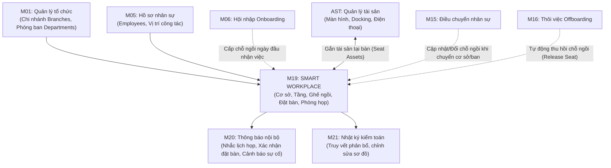
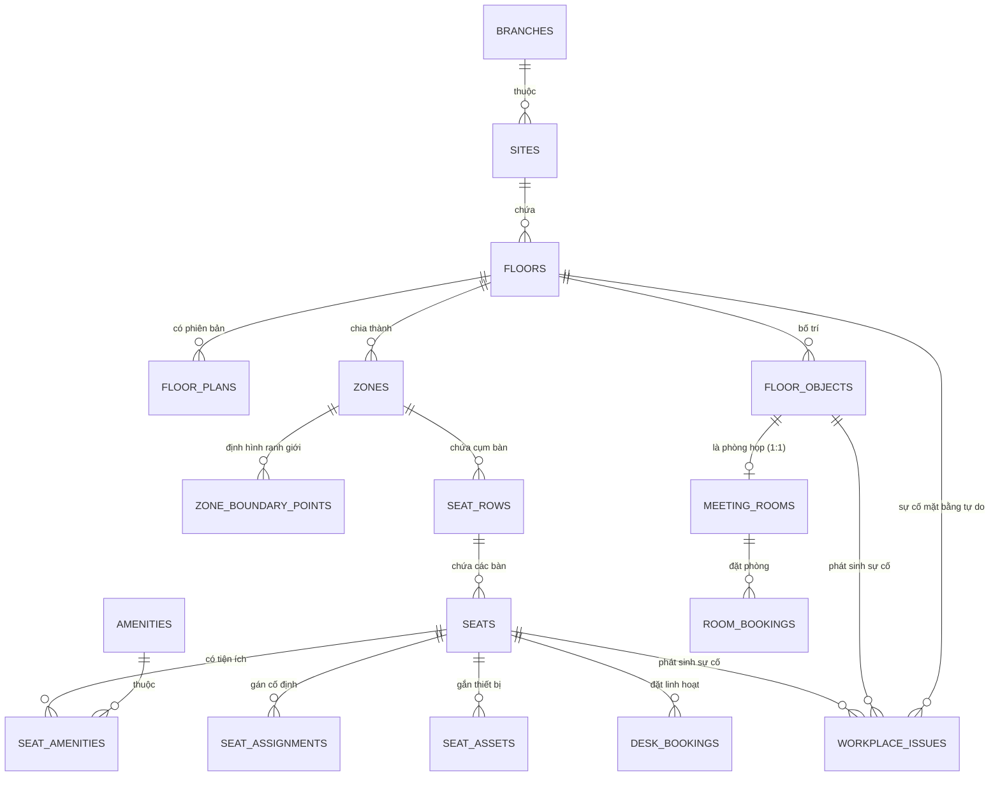
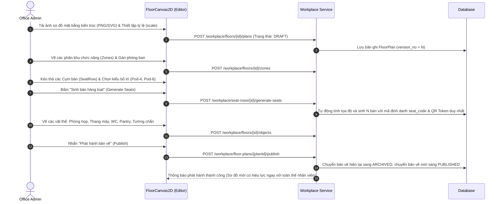
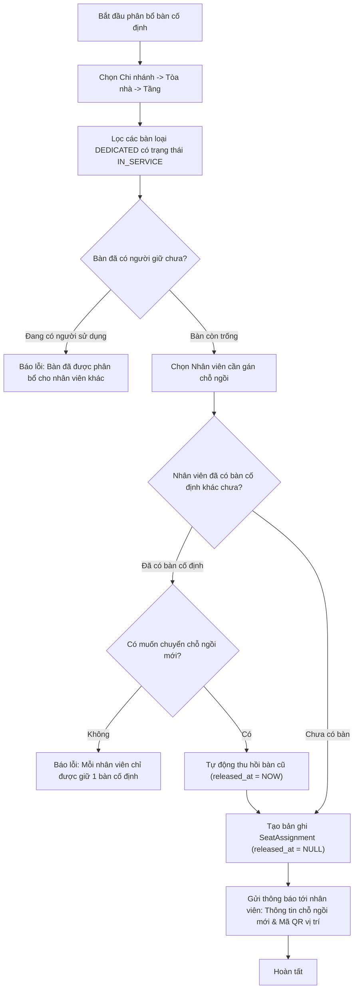
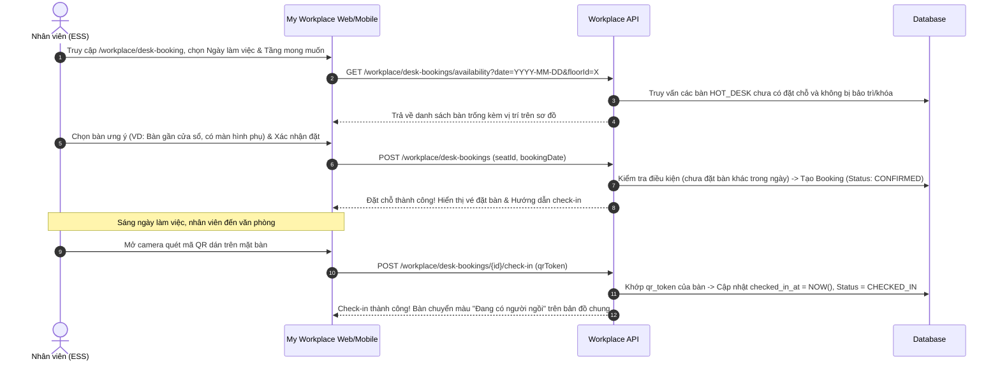
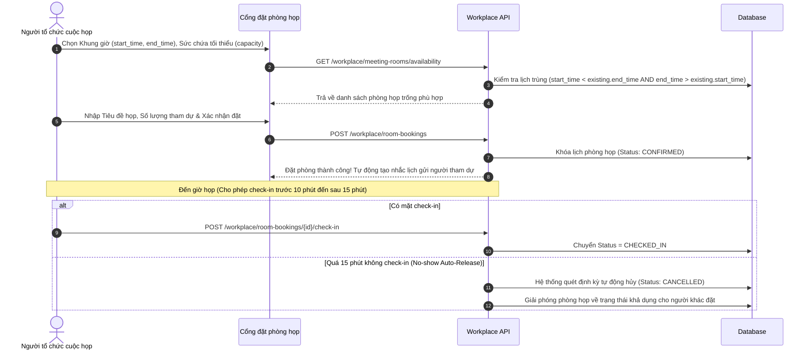
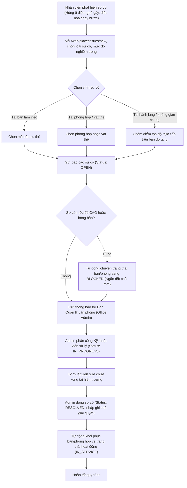

# TÀI LIỆU ĐẶC TẢ NGHIỆP VỤ & KỸ THUẬT: MODULE SƠ ĐỒ GHẾ NGỒI & KHÔNG GIAN LÀM VIỆC THÔNG MINH (SMART WORKPLACE)

---

## 1. TỔNG QUAN & MỐI QUAN HỆ LIÊN MODULE

Module **Sơ đồ Ghế ngồi & Không gian Làm việc Thông minh (Smart Workplace / Workplace Management - WP / M19)** là phân hệ quản trị cơ sở vật chất, bố trí sơ đồ mặt bằng và điều phối không gian làm việc số trong hệ sinh thái CYCLOSA HRM. Module kết nối người lao động với không gian vật lý của doanh nghiệp, tối ưu hóa công suất sử dụng văn phòng, hỗ trợ mô hình làm việc kết hợp linh hoạt (**Hybrid Work & Hot-desking**) và chuẩn hóa công tác vận hành quản trị văn phòng (**Office Administration & Facilities Management**).

### 1.1. Mục tiêu & Ý nghĩa chiến lược
1. **Số hóa toàn diện cơ sở vật chất & Sơ đồ mặt bằng (Digital Facility Mapping):**
   - Quản lý phân tầng địa vật lý: Tòa nhà/Cơ sở (`Site`) $\to$ Tầng (`Floor`) $\to$ Bản vẽ Canvas (`FloorPlan`) $\to$ Phân khu chức năng (`Zone`) $\to$ Dãy/Cụm bàn (`SeatRow`) $\to$ Vị trí bàn làm việc (`Seat`) & Vật thể tiện ích (`FloorObject`).
   - Cung cấp công cụ trực quan hóa dạng Canvas 2D/Visual Grid hỗ trợ tạo lập, kéo thả, xoay góc và phát hành sơ đồ tầng theo từng phiên bản (`DRAFT`, `PUBLISHED`, `ARCHIVED`).
2. **Linh hoạt hóa phương thức làm việc (Dedicated & Hot-desking):**
   - Hỗ trợ mô hình bàn cố định (**Dedicated Desk**): Gán vị trí làm việc ổn định lâu dài cho nhân sự theo phòng ban/dự án.
   - Hỗ trợ mô hình bàn linh hoạt (**Hot-desking / Dynamic Desk**): Cho phép nhân sự chủ động tra cứu, giữ chỗ theo ngày/ca làm việc, check-in bằng mã QR tại bàn, tối ưu hóa diện tích mặt sàn đối với các doanh nghiệp áp dụng Hybrid Work.
3. **Quản lý phòng họp & Tiện ích chia sẻ (Meeting Rooms & Amenities):**
   - Quản trị phòng họp, sức chứa, máy chiếu, bảng trắng, thiết bị hội nghị truyền hình.
   - Cơ chế đặt phòng thông minh với thuật toán chặn chồng lấn thời gian (Exclusion Constraint), check-in tự động và cơ chế giải phóng phòng khi người đặt không có mặt.
4. **Tương tác nội bộ & Hướng dẫn di chuyển (Wayfinding & Colleague Locator):**
   - Cho phép nhân viên tra cứu nhanh vị trí chỗ ngồi thực tế của đồng nghiệp hoặc trưởng bộ phận trên bản đồ tương tác.
   - Thuật toán tìm đường ngắn nhất (A* Pathfinding) giữa hai điểm bất kỳ trên cùng mặt sàn (bàn làm việc, phòng họp, máy in, pantry, lối thoát hiểm).
5. **Tiếp nhận & Xử lý sự cố cơ sở vật chất (Workplace Facility Ticketing):**
   - Kênh tiếp nhận báo hỏng điện, nước, điều hòa, hỏng bàn ghế, thiết bị phần cứng gắn trực tiếp với tọa độ bàn hoặc khu vực trên sơ đồ.
   - Cơ chế tự động khóa bàn (`BLOCKED`) khi phát sinh sự cố nghiêm trọng và tự động mở lại (`IN_SERVICE`) khi bộ phận kỹ thuật hoàn tất xử lý.
6. **Đo lường & Báo cáo hiệu suất không gian (Space Utilization Analytics):**
   - Báo cáo tỷ lệ lấp đầy mặt sàn (Occupancy Rate), tần suất sử dụng bàn linh hoạt, tỷ lệ phòng họp bị hủy hoặc bỏ trống (Ghost Meetings) phục vụ việc ra quyết định mở rộng hoặc thu hẹp diện tích thuê văn phòng.

---

### 1.2. Mối quan hệ liên module (Inter-module Architecture)

- **Module Tổ chức (M01):**
  - Cơ sở tòa nhà (`sites`) trực thuộc Chi nhánh (`branches`).
  - Phân khu chức năng (`zones`) trên mặt sàn được gán cho Phòng ban chuyên môn (`departments`) để hiển thị màu nhận diện riêng biệt.
- **Module Hồ sơ nhân sự (M05):**
  - Cung cấp danh tính nhân viên cho việc phân bổ bàn cố định (`seat_assignments`), đặt bàn linh hoạt (`desk_bookings`) và đặt phòng họp (`room_bookings`).
  - Màn hình thông tin cá nhân của nhân viên hiển thị vị trí chỗ ngồi thực tế (Tòa nhà - Tầng - Phân khu - Mã bàn).
- **Module Hội nhập nhân sự (M06):**
  - Khi nhân viên mới Onboarding, HR/Office Admin tiến hành gán chỗ ngồi cố định cho nhân viên mới, thông tin này lập tức gửi vào Welcome Kit và hướng dẫn nhận việc.
- **Module Quản lý tài sản (AST):**
  - Hỗ trợ gán tài sản cố định (`seat_assets`) trực tiếp vào mã bàn (VD: Màn hình Dell Ultrasharp 27", Docking Station HP, điện thoại IP Phone để bàn). Hệ thống xác minh tính hợp lệ và trạng thái khả dụng của tài sản qua Asset Service.
- **Module Điều chuyển (M15) & Thôi việc (M16):**
  - Khi nhân viên được duyệt điều chuyển địa điểm làm việc hoặc quyết định thôi việc có hiệu lực, hệ thống tự động kích hoạt nghiệp vụ giải phóng bàn (`released_at = NOW()`), đưa bàn trở lại trạng thái khả dụng cho nhân sự khác.

---

## 2. KIẾN TRÚC THỰC THỂ DỮ LIỆU CỐT LÕI (DATA DOMAIN MODEL)

Hệ thống quản lý không gian làm việc bao gồm 13 thực thể chính:

### 2.1. Chi tiết các bảng CSDL

#### 1. `workplace_sites` (Cơ sở / Tòa nhà văn phòng)
- Quản lý các tòa nhà văn phòng của công ty theo chi nhánh.
- **Trường chính:**
  - `id`: BIGINT (PK)
  - `branch_id`: BIGINT (FK $\to$ `branches.id`, NOT NULL)
  - `code`: VARCHAR(30) (Mã tòa nhà - duy nhất trong công ty, chuẩn hóa chữ hoa, VD: `SITE-HN-01`, `SITE-HCM-TOWER`)
  - `name`: VARCHAR(150) (Tên tòa nhà, VD: *Tòa nhà Keangnam Landmark 72*, *Tòa nhà Bitexco Financial*)
  - `address`: VARCHAR(500) (Địa chỉ cụ thể)
  - `description`: TEXT (Ghi chú mô tả)
  - `deleted_at`: TIMESTAMP (Hỗ trợ xóa mềm)

#### 2. `workplace_floors` (Tầng làm việc)
- Quản lý các tầng trong tòa nhà.
- **Trường chính:**
  - `id`: BIGINT (PK)
  - `site_id`: BIGINT (FK $\to$ `workplace_sites.id`, NOT NULL)
  - `floor_number`: INT (Số tầng: -2, -1, 1, 2, 10, 25...)
  - `name`: VARCHAR(100) (Tên tầng hiển thị: *Tầng 12 - Khối Công nghệ*, *Tầng 8 - Khối Kinh doanh*)
  - `description`: TEXT
- **Ràng buộc:** `UNIQUE (site_id, floor_number)`. Chặn xóa tầng nếu tầng đang chứa phân khu hoặc bản vẽ.

#### 3. `workplace_floor_plans` (Phiên bản bản vẽ sơ đồ tầng)
- Quản lý bản vẽ nền và kích thước Canvas 2D phục vụ trình biên soạn sơ đồ.
- **Trường chính:**
  - `id`: BIGINT (PK)
  - `floor_id`: BIGINT (FK $\to$ `workplace_floors.id`, NOT NULL)
  - `version_no`: INT (Số thứ tự phiên bản bản vẽ: 1, 2, 3...)
  - `background_file_id`: BIGINT (FK $\to$ `files.id`, ảnh nền mặt bằng định dạng PNG/SVG/JPEG)
  - `canvas_width`: INT (Chiều rộng Canvas thiết kế tính bằng pixel, VD: 1920, 2400)
  - `canvas_height`: INT (Chiều cao Canvas thiết kế tính bằng pixel, VD: 1080, 1600)
  - `scale_meters_per_px`: DECIMAL(10,6) (Tỷ lệ thực tế: 1 pixel tương ứng bao nhiêu mét ngoài đời thực)
  - `status`: ENUM (`DRAFT`, `PUBLISHED`, `ARCHIVED`)
- **Ràng buộc:** `UNIQUE (floor_id, version_no)`. Mỗi tầng tại một thời điểm chỉ có tối đa **1** bản vẽ ở trạng thái `PUBLISHED`. Khi phát hành bản vẽ mới, bản vẽ đang phát hành cũ tự động chuyển thành `ARCHIVED`.

#### 4. `workplace_zones` (Phân khu chức năng)
- Phân chia khu vực mặt bằng tầng theo phòng ban hoặc mục đích sử dụng.
- **Trường chính:**
  - `id`: BIGINT (PK)
  - `floor_id`: BIGINT (FK $\to$ `workplace_floors.id`, NOT NULL)
  - `name`: VARCHAR(100) (Tên khu vực: *Khu R&D Phần mềm*, *Khu Kinh doanh & Marketing*, *Khu Vận hành Nhân sự*)
  - `department_id`: BIGINT (FK $\to$ `departments.id`, NULL - liên kết phòng ban phụ trách khu vực)
  - `color_hex`: CHAR(7) (Mã màu nhận diện trên sơ đồ, VD: `#3B82F6`, `#10B981`)

#### 5. `workplace_zone_boundary_points` (Đỉnh ranh giới phân khu)
- Tọa độ các đỉnh đa giác xác định ranh giới phân khu trên Canvas.
- **Trường chính:**
  - `zone_id`: BIGINT (PK, FK $\to$ `workplace_zones.id`)
  - `point_order`: INT (PK - Thứ tự nối đỉnh: 1, 2, 3, 4...)
  - `x`: DECIMAL(10,2) (Tọa độ X trên Canvas)
  - `y`: DECIMAL(10,2) (Tọa độ Y trên Canvas)

#### 6. `workplace_seat_rows` (Cụm / Dãy bàn làm việc)
- Quản lý dãy bàn làm việc có quy cách bố trí đồng nhất.
- **Trường chính:**
  - `id`: BIGINT (PK)
  - `zone_id`: BIGINT (FK $\to$ `workplace_zones.id`, NOT NULL)
  - `code`: VARCHAR(30) (Mã cụm/dãy: `ROW-A`, `ROW-B`, `POD-01`)
  - `layout_type`: ENUM (`SINGLE_ROW` - một dãy đơn, `POD_4_FACING` - cụm 4 bàn đối diện, `POD_6_FACING` - cụm 6 bàn đối diện)
  - `x`: DECIMAL(10,2) (Tọa độ gốc X trên Canvas)
  - `y`: DECIMAL(10,2) (Tọa độ gốc Y trên Canvas)
  - `rotation_degrees`: DECIMAL(5,2) (Góc xoay cụm bàn: 0°, 45°, 90°, 180°...)
- **Ràng buộc:** `UNIQUE (zone_id, code)`.

#### 7. `workplace_amenities` (Danh mục Tiện ích bàn làm việc)
- Danh mục trang thiết bị, tiện ích gắn kèm bàn.
- **Trường chính:**
  - `id`: BIGINT (PK)
  - `company_id`: BIGINT (FK $\to$ `companies.id`, NOT NULL)
  - `name`: VARCHAR(100) (Tên tiện ích: *Màn hình đôi (Dual Monitor)*, *Bàn nâng hạ tự động (Standing Desk)*, *Cổng mạng LAN tốc độ cao*, *Ổ cắm điện đa năng*, *Ghế công thái học*)
- **Ràng buộc:** `UNIQUE (company_id, name)`. Không cho phép xóa tiện ích đang được liên kết với ít nhất một bàn.

#### 8. `workplace_seats` (Vị trí bàn làm việc)
- Thực thể trung tâm lưu trữ thông tin của từng bàn cụ thể.
- **Trường chính:**
  - `id`: BIGINT (PK)
  - `seat_row_id`: BIGINT (FK $\to$ `workplace_seat_rows.id`, NOT NULL)
  - `seat_code`: VARCHAR(100) (Mã định danh bàn duy nhất toàn hệ thống, cấp một lần không đổi, gắn với mã QR; VD: `HN01-F12-DEV-A01`)
  - `seat_type`: ENUM (`DEDICATED` - bàn cố định cho 1 nhân viên, `HOT_DESK` - bàn linh hoạt đặt theo ngày/giờ, `VISITOR` - bàn khách vãng lai/thực tập sinh)
  - `status`: ENUM (`IN_SERVICE` - đang vận hành, `MAINTENANCE` - đang bảo trì sửa chữa, `BLOCKED` - bị khóa)
  - `x`: DECIMAL(10,2) (Tọa độ X trên Canvas)
  - `y`: DECIMAL(10,2) (Tọa độ Y trên Canvas)
  - `shape`: ENUM (`RECTANGLE` - hình chữ nhật, `ROUND` - hình tròn)
  - `width`: DECIMAL(8,2) (Chiều rộng hình vẽ)
  - `height`: DECIMAL(8,2) (Chiều cao hình vẽ)
  - `rotation_degrees`: DECIMAL(5,2) (Góc xoay)
  - `qr_token`: VARCHAR(100) (Token mã hóa duy nhất để quét mã QR check-in)
- **Ràng buộc:** `UNIQUE (seat_code)`, `UNIQUE (qr_token)`.

#### 9. `workplace_seat_amenities` (Bảng liên kết Tiện ích - Bàn làm việc)
- Quan hệ nhiều - nhiều giữa `workplace_seats` và `workplace_amenities`.
- **Trường chính:** `seat_id` (PK, FK), `amenity_id` (PK, FK).

#### 10. `workplace_seat_assignments` (Phân bổ bàn cố định)
- Gán bàn loại `DEDICATED` cho nhân sự sử dụng lâu dài.
- **Trường chính:**
  - `id`: BIGINT (PK)
  - `seat_id`: BIGINT (FK $\to$ `workplace_seats.id`, NOT NULL - chỉ gán bàn `DEDICATED` & `IN_SERVICE`)
  - `employee_id`: BIGINT (FK $\to$ `employees.id`, NOT NULL)
  - `assigned_at`: TIMESTAMP (Thời điểm bắt đầu phân bổ)
  - `released_at`: TIMESTAMP (Thời điểm thu hồi bàn; nếu `NULL` nghĩa là nhân sự đang nắm giữ bàn này)
- **Ràng buộc toàn vẹn:** Partial Unique: Tối đa một dòng có `released_at IS NULL` cho mỗi `seat_id` (một bàn tại một thời điểm chỉ có 1 chủ) và tối đa một dòng có `released_at IS NULL` cho mỗi `employee_id` (mỗi nhân viên chỉ có tối đa 1 bàn cố định).

#### 11. `workplace_seat_assets` (Tài sản doanh nghiệp gắn tại bàn)
- Liên kết trang thiết bị vật chất thuộc Module Quản lý tài sản (`AST`) vào bàn làm việc.
- **Trường chính:**
  - `id`: BIGINT (PK)
  - `seat_id`: BIGINT (FK $\to$ `workplace_seats.id`, NOT NULL)
  - `asset_id`: BIGINT (FK $\to$ `assets.id`, NOT NULL)
  - `linked_at`: TIMESTAMP (Thời điểm gắn)
  - `unlinked_at`: TIMESTAMP (Thời điểm tháo thiết bị; `NULL` = đang gắn)
- **Ràng buộc:** Một tài sản tại một thời điểm chỉ gắn tại tối đa một bàn làm việc (`unlinked_at IS NULL` là Partial Unique trên `asset_id`).

#### 12. `workplace_floor_objects` & `workplace_meeting_rooms` (Vật thể mặt bằng & Phòng họp)
- Định nghĩa các vật thể kiến trúc phi bàn làm việc trên sơ đồ.
- **`workplace_floor_objects`:**
  - `id`: BIGINT (PK)
  - `floor_id`: BIGINT (FK $\to$ `workplace_floors.id`, NOT NULL)
  - `object_type`: ENUM (`MEETING_ROOM`, `ELEVATOR`, `STAIRS`, `EXIT`, `RESTROOM`, `PANTRY`, `PRINTER`, `LOCKER`, `WALL_OBSTACLE`, `OTHER`)
  - `name`: VARCHAR(150) (Tên hiển thị: *Phòng họp Apollo*, *Khu Pantry Tầng 12*, *Cụm Thang máy B*)
  - `x`, `y`, `width`, `height`, `rotation_degrees`: Vị trí và kích thước trên Canvas
  - `qr_token`: VARCHAR(100) (Token QR giải mã vị trí hoặc check-in phòng họp)
- **`workplace_meeting_rooms` (Mở rộng 1:1 cho đối tượng loại `MEETING_ROOM`):**
  - `floor_object_id`: BIGINT (PK, FK $\to$ `workplace_floor_objects.id`)
  - `capacity`: INT (Sức chứa tối đa: 4, 8, 12, 30 người)

#### 13. `workplace_desk_bookings` (Giao dịch Đặt bàn linh hoạt Hot-desking)
- Quản lý việc đặt chỗ trước bàn làm việc linh hoạt theo ngày.
- **Trường chính:**
  - `id`: BIGINT (PK)
  - `seat_id`: BIGINT (FK $\to$ `workplace_seats.id`, NOT NULL - chỉ áp dụng cho bàn `HOT_DESK` & `IN_SERVICE`)
  - `employee_id`: BIGINT (FK $\to$ `employees.id`, NOT NULL)
  - `booking_date`: DATE (Ngày đặt bàn)
  - `status`: ENUM (`CONFIRMED`, `CHECKED_IN`, `CANCELLED`)
  - `checked_in_at`: TIMESTAMP (Thời điểm quét mã QR check-in tại bàn thực tế)
- **Ràng buộc:**
  - Không cho phép trùng đặt chỗ: Partial Unique `UNIQUE (seat_id, booking_date)` cho các bản ghi có trạng thái khác `CANCELLED`.
  - Mỗi nhân viên chỉ được đặt tối đa một bàn linh hoạt trong một ngày: Partial Unique `UNIQUE (employee_id, booking_date)` cho các bản ghi khác `CANCELLED`.

#### 14. `workplace_room_bookings` (Giao dịch Đặt phòng họp)
- Quản lý lịch họp và đặt phòng họp dùng chung.
- **Trường chính:**
  - `id`: BIGINT (PK)
  - `meeting_room_id`: BIGINT (FK $\to$ `workplace_meeting_rooms.floor_object_id`, NOT NULL)
  - `organizer_employee_id`: BIGINT (FK $\to$ `employees.id`, NOT NULL - Người chủ trì cuộc họp)
  - `created_by_user_id`: BIGINT (FK $\to$ `users.id`, NOT NULL - Người thực hiện đặt, Office Admin có quyền đặt thay)
  - `title`: VARCHAR(200) (Tiêu đề cuộc họp: *Họp Sprint Review*, *Phỏng vấn ứng viên*)
  - `attendee_count`: INT (Số lượng người tham dự, bắt buộc $\le$ `capacity` của phòng)
  - `start_time`: TIMESTAMP (Giờ bắt đầu)
  - `end_time`: TIMESTAMP (Giờ kết thúc, bắt buộc `start_time < end_time`)
  - `status`: ENUM (`CONFIRMED`, `CHECKED_IN`, `CANCELLED`)
  - `checked_in_at`: TIMESTAMP (Thời điểm check-in tại cửa phòng)
- **Ràng buộc:** Chặn xung đột thời gian (Exclusion Constraint): Không cho phép hai cuộc họp trùng khoảng thời gian trên cùng một phòng họp (ngoại trừ các đơn bị `CANCELLED`).

#### 15. `workplace_issues` (Sự cố cơ sở vật chất văn phòng)
- Tiếp nhận và xử lý sự cố thiết bị/không gian.
- **Trường chính:**
  - `id`: BIGINT (PK)
  - `reporter_employee_id`: BIGINT (FK $\to$ `employees.id`, NOT NULL - Nhân viên báo cáo)
  - `issue_type`: ENUM (`ELECTRICAL`, `FURNITURE`, `AIR_CONDITIONING`, `HARDWARE`, `CLEANING`, `OTHER`)
  - `severity`: ENUM (`LOW`, `MEDIUM`, `HIGH`)
  - `title`: VARCHAR(200), `description`: TEXT
  - **Vị trí phát sinh sự cố (đúng 1 trong 3):**
    - `seat_id`: FK $\to$ `workplace_seats.id` (Sự cố tại bàn làm việc)
    - `floor_object_id`: FK $\to$ `workplace_floor_objects.id` (Sự cố tại vật thể/phòng họp)
    - `floor_id` + `location_x` + `location_y`: Sự cố tại điểm tự do trên mặt bằng tầng
  - `status`: ENUM (`OPEN` - mới báo, `IN_PROGRESS` - đang sửa chữa, `RESOLVED` - đã khắc phục)
  - `assigned_to_employee_id`: BIGINT (Kỹ thuật viên phụ trách sửa chữa)
  - `resolution_note`: TEXT (Ghi chú kết quả xử lý)
  - `reported_at`: TIMESTAMP, `resolved_at`: TIMESTAMP
- **Hiệu ứng phụ:** Khi sự cố loại nghiêm trọng (`HIGH`) hoặc liên quan trực tiếp đến bàn làm việc, hệ thống tự động cập nhật `workplace_seats.status = 'BLOCKED'`. Khi chuyển sang `RESOLVED`, bàn tự động khôi phục về `IN_SERVICE`.

---

## 3. QUY TRÌNH NGHIỆP VỤ CỐT LÕI (CORE BUSINESS FLOWS)

### 3.1. Quy trình Soạn thảo & Phát hành Sơ đồ Tầng (Floor Plan Lifecycle)

---

### 3.2. Quy trình Phân bổ Bàn Cố định (Dedicated Desk Allocation)

---

### 3.3. Quy trình Đặt bàn Linh hoạt Hot-desking & Check-in QR

---

### 3.4. Quy trình Đặt phòng Họp & Giải phóng Phòng tự động

---

### 3.5. Quy trình Báo cáo & Khắc phục Sự cố Cơ sở vật chất

---

### 3.6. Cơ chế Tìm kiếm Đồng nghiệp & Tìm đường (Wayfinding A* Algorithm)

1. **Tìm kiếm vị trí đồng nghiệp:**
   - Nhân viên tìm kiếm theo tên hoặc mã nhân viên $\to$ Hệ thống kiểm tra quyền hạn dữ liệu.
   - Trả về tọa độ chính xác: Tòa nhà, Tầng, Phân khu, Mã bàn đang được phân bổ cố định hoặc bàn Hot-desk đang check-in trong ngày.
   - Sơ đồ tầng tự động căn giữa (Pan & Zoom) và nhấp nháy làm nổi bật vị trí bàn của đồng nghiệp.
2. **Tìm đường ngắn nhất trên Canvas (Wayfinding):**
   - Không gian bản vẽ được chia thành lưới ô vuông (Grid Mesh) kích thước $20 \times 20\text{ px}$.
   - Các vật thể loại `WALL_OBSTACLE`, bàn ghế và tường phòng họp được đánh dấu là chướng ngại vật bất khả xâm phạm (Impassable Nodes).
   - Áp dụng thuật toán **A\* Pathfinding** tìm chuỗi tọa độ tối ưu từ điểm xuất phát (VD: Vị trí quét mã QR tại cửa thang máy) tới điểm đích (Bàn làm việc hoặc phòng họp).
   - Canvas 2D vẽ đường dẫn chuyển động uốn lượn kèm mũi tên chỉ hướng giúp nhân viên/khách di chuyển dễ dàng.

---

## 4. MA TRẬN PHÂN QUYỀN (RBAC & ACCESS CONTROL)

Module áp dụng cơ chế phân quyền chặt chẽ trên Resource `WORKPLACE`:

| Quyền hạn (Permission) | Tên quyền nghiệp vụ | Đối tượng gán vai trò | Phạm vi thao tác cho phép |
| :--- | :--- | :--- | :--- |
| `workplace.view` | Xem cấu hình không gian | Office Admin, HR, Manager, IT | Xem danh sách cơ sở, tầng, danh sách bàn, tiện ích, lịch phòng họp, danh sách sự cố văn phòng. |
| `workplace.manage` | Quản trị không gian làm việc | Office Admin, Quản trị cơ sở vật chất | Toàn quyền thêm/sửa/xóa cơ sở, tầng, vẽ sơ đồ, phân bổ bàn cố định, đặt phòng thay người khác, phân công và xử lý sự cố. |
| `workplace.report` | Báo cáo sử dụng mặt bằng | Office Admin, Giám đốc Vận hành (COO), HRD | Xem báo cáo phân tích tỷ lệ lấp đầy mặt bằng, tần suất sử dụng bàn linh hoạt, chỉ số phòng họp. |
| `Auth` *(Đăng nhập cơ bản)* | Tự phục vụ không gian (ESS) | Tất cả nhân viên công ty | Xem sơ đồ văn phòng, xem bàn của tôi, đặt bàn linh hoạt Hot-desking, đặt phòng họp, báo sự cố cá nhân, tìm vị trí đồng nghiệp. |

---

## 5. BỘ QUY TẮC NGHIỆP VỤ & KIỂM TRA TÍNH HỢP LỆ (VALIDATION RULES)

| Mã quy tắc | Tên quy tắc nghiệp vụ | Điều kiện kiểm tra & Hành vi hệ thống | Thông báo lỗi chuẩn |
| :---: | :--- | :--- | :--- |
| **VR-WP-01** | **Chuẩn hóa Mã Cơ sở** | Mã cơ sở (`code`) bắt buộc tự động viết hoa (Uppercase), không dấu, không khoảng trắng, duy nhất trong công ty. | `Mã cơ sở đã tồn tại trong hệ thống. Vui lòng chọn mã khác.` |
| **VR-WP-02** | **Bảo vệ toàn vẹn Tầng** | Không cho phép xóa một tầng (`floor`) nếu tầng đó đang có ít nhất 1 phân khu (`zone`), 1 bàn làm việc (`seat`) hoặc 1 bản vẽ đang phát hành. | `Không thể xóa tầng đang chứa phân khu hoặc dữ liệu mặt bằng hoạt động.` |
| **VR-WP-03** | **Độc quyền Bản vẽ Phát hành** | Mỗi tầng chỉ có duy nhất 1 bản vẽ ở trạng thái `PUBLISHED`. Khi phát hành bản vẽ mới, bản vẽ cũ bắt buộc chuyển sang `ARCHIVED`. | Tự động hóa ở tầng Service. |
| **VR-WP-04** | **Tính đơn nhất Bàn Cố định** | Một bàn `DEDICATED` tại một thời điểm chỉ được gán cho tối đa 1 nhân viên (`released_at IS NULL`). Mỗi nhân viên chỉ được giữ tối đa 1 bàn cố định. | `Bàn làm việc này đã được phân bổ cho nhân sự khác.` / `Nhân viên đã có chỗ ngồi cố định.` |
| **VR-WP-05** | **Điều kiện bàn gán cố định** | Chỉ cho phép phân bổ chỗ ngồi cố định đối với bàn có `seat_type = 'DEDICATED'` và `status = 'IN_SERVICE'`. | `Không thể gán bàn đang bảo trì, bị khóa hoặc là bàn linh hoạt.` |
| **VR-WP-06** | **Chống trùng đặt Bàn Hot-desk** | Một nhân viên chỉ được đặt tối đa 1 bàn `HOT_DESK` trong cùng một ngày (`booking_date`). Một bàn chỉ được nhận 1 lượt đặt thành công trong ngày. | `Bạn đã đặt chỗ ngồi làm việc trong ngày này.` / `Bàn làm việc đã được người khác đặt trước.` |
| **VR-WP-07** | **Chặn xung đột Giờ Phòng họp** | Khoảng thời gian họp mới `[start_time, end_time]` không được chồng lấn với bất kỳ lượt đặt phòng nào khác `CANCELLED` của cùng phòng họp đó. Bắt buộc `start_time < end_time` và `start_time >= NOW()`. | `Khung giờ họp đã bị trùng với một cuộc họp khác trong phòng.` |
| **VR-WP-08** | **Kiểm soát Sức chứa Phòng họp** | Số lượng người tham gia (`attendee_count`) không được vượt quá sức chứa tối đa (`capacity`) của phòng họp. | `Số lượng người tham dự vượt quá sức chứa tối đa của phòng họp.` |
| **VR-WP-09** | **Tự động khóa bàn khi có sự cố** | Khi tạo sự cố gắn với bàn (`seat_id`) có mức độ `HIGH` hoặc loại `ELECTRICAL`/`FURNITURE`, hệ thống tự động cập nhật `workplace_seats.status = 'BLOCKED'`. | Bàn tự động chuyển màu đỏ trên sơ đồ và không cho phép đặt chỗ. |
| **VR-WP-10** | **Xác thực Tài sản gắn tại Bàn** | Khi gắn tài sản (`asset_id`) vào bàn, tài sản đó phải tồn tại trong module `AST`, ở trạng thái `AVAILABLE` và chưa được gắn tại bất kỳ bàn nào khác. | `Tài sản không hợp lệ hoặc đang được gắn tại một vị trí bàn khác.` |

---

## 6. DANH SÁCH ENDPOINTS API CHI TIẾT (BACKEND ARCHITECTURE)

Toàn bộ 27 API nghiệp vụ phân nhóm chuẩn RESTful:

### 6.1. Nhóm Quản lý Cơ sở, Tầng & Bản vẽ
- `GET /workplace/sites`: Danh sách cơ sở tòa nhà (Lọc theo `branchId`, phân trang).
- `POST /workplace/sites`: Tạo cơ sở mới (Mã tự chuẩn hóa chữ hoa).
- `GET /workplace/sites/{siteId}`: Chi tiết cơ sở.
- `PUT /workplace/sites/{siteId}`: Cập nhật thông tin cơ sở.
- `DELETE /workplace/sites/{siteId}`: Xóa mềm cơ sở.
- `GET /workplace/sites/{siteId}/floors`: Danh sách tầng thuộc cơ sở.
- `POST /workplace/sites/{siteId}/floors`: Thêm tầng mới.
- `PUT /workplace/floors/{floorId}`: Cập nhật thông tin tầng.
- `DELETE /workplace/floors/{floorId}`: Xóa tầng (Chặn nếu có dữ liệu con).
- `GET /workplace/floors/{floorId}/plans`: Danh sách các phiên bản bản vẽ của tầng.
- `POST /workplace/floors/{floorId}/plans`: Tạo bản vẽ nháp mới (Upload ảnh nền, Canvas width/height, scale).
- `PUT /workplace/floor-plans/{planId}`: Chỉnh sửa kích thước bản vẽ nháp (`DRAFT`).
- `POST /workplace/floor-plans/{planId}/publish`: Phát hành chính thức bản vẽ mặt bằng.
- `POST /workplace/floor-plans/{planId}/archive`: Lưu trữ bản vẽ cũ.

### 6.2. Nhóm Phân khu, Cụm bàn, Bàn làm việc & Tiện ích
- `GET /workplace/floors/{floorId}/map`: Lấy toàn bộ dữ liệu đối tượng mặt bằng đang phát hành của tầng (Dùng cho Canvas 2D: Zones, Rows, Seats, Objects, Rooms).
- `GET /workplace/floors/{floorId}/zones`: Danh sách phân khu theo tầng.
- `POST /workplace/floors/{floorId}/zones`: Tạo phân khu (Kèm danh sách đỉnh tọa độ boundary points).
- `PUT /workplace/zones/{zoneId}`: Sửa phân khu và tọa độ ranh giới.
- `DELETE /workplace/zones/{zoneId}`: Xóa phân khu (Chặn nếu còn cụm bàn).
- `POST /workplace/zones/{zoneId}/seat-rows`: Tạo cụm/dãy bàn mới.
- `PUT /workplace/seat-rows/{rowId}`: Cập nhật vị trí, góc xoay, kiểu bố trí cụm bàn.
- `DELETE /workplace/seat-rows/{rowId}`: Xóa cụm bàn.
- `POST /workplace/seat-rows/{rowId}/generate-seats`: Sinh hàng loạt bàn làm việc theo quy cách cụm bàn.
- `GET /workplace/seats`: Tìm kiếm danh sách bàn (Lọc theo `floorId`, `zoneId`, `seatType`, `status`, `amenityId`).
- `GET /workplace/seats/{seatId}`: Chi tiết bàn: Nhân sự đang gán, tiện ích, tài sản gắn kèm.
- `POST /workplace/seats`: Thêm bàn làm việc đơn lẻ.
- `PUT /workplace/seats/{seatId}`: Cập nhật tọa độ, hình dạng, góc xoay của bàn.
- `PATCH /workplace/seats/{seatId}/status`: Cập nhật trạng thái thủ công (`IN_SERVICE`, `MAINTENANCE`, `BLOCKED`).
- `DELETE /workplace/seats/{seatId}`: Xóa bàn làm việc (Chặn nếu có lịch sử phân bổ).
- `GET /workplace/amenities`: Danh mục tiện ích bàn làm việc.
- `POST /workplace/amenities`: Thêm mới tiện ích.
- `PUT /workplace/amenities/{amenityId}`: Sửa tên tiện ích.
- `DELETE /workplace/amenities/{amenityId}`: Xóa tiện ích.
- `PUT /workplace/seats/{seatId}/amenities`: Cập nhật danh sách tiện ích gắn vào bàn.
- `POST /workplace/seats/{seatId}/assets`: Gắn tài sản từ kho AST vào bàn làm việc.
- `DELETE /workplace/seat-assets/{seatAssetId}`: Tháo liên kết tài sản khỏi bàn.

### 6.3. Nhóm Phân bổ Bàn Cố định & Đặt bàn Hot-desking
- `GET /workplace/seat-assignments`: Danh sách phân bổ bàn cố định (Lọc theo tầng, nhân viên, trạng thái hiệu lực).
- `POST /workplace/seat-assignments`: Phân bổ bàn `DEDICATED` cho nhân viên (Ràng buộc 1 người - 1 bàn).
- `POST /workplace/seat-assignments/{assignmentId}/release`: Thu hồi bàn làm việc cố định.
- `GET /workplace/desk-bookings/availability`: Tra cứu danh sách bàn Hot-desk còn trống theo ngày, tầng, tiện ích.
- `POST /workplace/desk-bookings`: Đặt bàn làm việc linh hoạt theo ngày.
- `POST /workplace/desk-bookings/{bookingId}/check-in`: Check-in xác nhận chỗ ngồi bằng mã QR.
- `POST /workplace/desk-bookings/{bookingId}/cancel`: Hủy lượt đặt bàn linh hoạt.
- `GET /workplace/desk-bookings`: Danh sách quản lý đặt bàn (Dành cho Quản trị viên).

### 6.4. Nhóm Phòng họp & Đặt phòng
- `GET /workplace/floors/{floorId}/objects`: Lấy danh sách các vật thể mặt bằng (Phòng họp, thang máy, WC, Pantry...).
- `POST /workplace/floors/{floorId}/objects`: Thêm vật thể mới trên sơ đồ.
- `PUT /workplace/objects/{objectId}`: Cập nhật vị trí, kích thước vật thể.
- `DELETE /workplace/objects/{objectId}`: Xóa vật thể.
- `PUT /workplace/meeting-rooms/{objectId}`: Cập nhật thông tin chuyên biệt phòng họp (Sức chứa `capacity`).
- `GET /workplace/meeting-rooms/availability`: Tra cứu danh sách phòng họp còn trống theo khung giờ & sức chứa.
- `POST /workplace/room-bookings`: Đặt phòng họp (Chặn chồng giờ).
- `GET /workplace/room-bookings`: Lịch đặt phòng họp (Lọc theo phòng, ngày, trạng thái).
- `POST /workplace/room-bookings/{bookingId}/check-in`: Check-in nhận phòng họp.
- `POST /workplace/room-bookings/{bookingId}/cancel`: Hủy đặt phòng họp.

### 6.5. Nhóm Sự cố & Điều hướng Wayfinding
- `POST /workplace/issues`: Báo cáo sự cố văn phòng (Gắn bàn, gắn phòng hoặc điểm tự do).
- `GET /workplace/issues`: Danh sách sự cố (Lọc theo trạng thái, mức độ, tầng).
- `GET /workplace/issues/{issueId}`: Chi tiết sự cố kèm vị trí trên sơ đồ.
- `PUT /workplace/issues/{issueId}/assign`: Phân công kỹ thuật viên xử lý sự cố.
- `POST /workplace/issues/{issueId}/start`: Bắt đầu xử lý sự cố (`IN_PROGRESS`).
- `POST /workplace/issues/{issueId}/resolve`: Hoàn tất xử lý (Nhập ghi chú giải quyết & Tự động mở lại bàn).
- `GET /workplace/employees/{employeeId}/location`: Tra cứu vị trí chỗ ngồi thực tế của đồng nghiệp.
- `GET /workplace/navigation/route`: Tính toán đường đi ngắn nhất giữa 2 điểm trên mặt sàn (Thuật toán A* Pathfinding).
- `GET /workplace/qr/resolve`: Giải mã mã QR quét được để điều hướng đến hành động tương ứng.

### 6.6. Nhóm Tự phục vụ Nhân viên (My Workplace / ESS)
- `GET /me/workplace/seat`: Thông tin bàn làm việc cố định của tôi.
- `GET /me/workplace/desk-bookings`: Lịch sử và danh sách đặt bàn Hot-desking của tôi.
- `GET /me/workplace/room-bookings`: Danh sách các cuộc họp tôi tổ chức hoặc tham dự.
- `GET /me/workplace/issues`: Danh sách các sự cố cơ sở vật chất do tôi báo cáo.

### 6.7. Nhóm Thống kê & Báo cáo Sử dụng
- `GET /workplace/reports/utilization`: Báo cáo tỷ lệ lấp đầy mặt bằng, tần suất sử dụng bàn Hot-desking, tỷ lệ sử dụng phòng họp theo ngày/tuần/tháng.

---

## 7. CẤU TRÚC GIAO DIỆN NGƯỜI DÙNG (FRONTEND SPECIFICATIONS)

Frontend của Module M19 được thiết kế chia làm 2 phân vùng chức năng chính:

### 7.1. Phân vùng Quản trị Văn phòng (Workplace Administration - `/workplace/admin`)
Dành cho **Office Admin / IT / Facilities Manager**:

1. **Quản lý Cơ sở & Tầng (`/workplace/admin/sites` & `/workplace/admin/sites/:id`):**
   - Danh sách cơ sở phân cấp theo Chi nhánh.
   - Quản lý danh sách tầng của từng tòa nhà, nút truy cập nhanh vào Trình biên soạn sơ đồ tầng.
2. **Trình biên soạn Sơ đồ Tầng Trực quan (`/workplace/admin/floors/:id/editor`):**
   - **Canvas 2D tương tác cao:** Hỗ trợ Zoom, Pan, Grid Snapping, kéo thả các đối tượng.
   - **Thanh công cụ bên trái (Toolbox):**
     - Vẽ Phân khu đa giác (`Zone`), chọn màu sắc và gán phòng ban.
     - Kéo thả Cụm bàn (`SeatRow`), hỗ trợ xoay góc 45°/90° và công cụ **"Sinh bàn tự động"**.
     - Thêm vật thể kiến trúc: Phòng họp, Thang máy, Cầu thang bộ, WC, Pantry, Máy in, Tường ngăn.
   - **Bảng thuộc tính bên phải (Properties Panel):**
     - Khi click chọn một bàn: Hiển thị Mã bàn, Loại bàn (`DEDICATED` / `HOT_DESK`), Gán tiện ích, Gán tài sản, Trạng thái hoạt động, Xuất mã QR.
     - Khi click chọn phòng họp: Thiết lập tên phòng, sức chứa, danh sách tiện ích hội nghị.
   - **Nút hành động Header:** Lưu bản nháp (`Save Draft`), Kiểm tra lỗi chồng lấn, Phát hành bản vẽ chính thức (`Publish`).
3. **Quản lý Phân bổ Bàn Cố định (`/workplace/admin/seat-assignments`):**
   - Bảng danh sách phân bổ chỗ ngồi: Lọc theo Cơ sở, Tầng, Phòng ban, Tên nhân viên.
   - Dialog phân bổ nhanh với tính năng gợi ý bàn trống gần nhóm làm việc của nhân viên.
   - Nút thu hồi chỗ ngồi (kèm xác nhận bảo vệ an toàn).
4. **Quản lý Đặt bàn & Lịch Phòng họp (`/workplace/admin/desk-bookings` & `/workplace/admin/room-bookings`):**
   - Chế độ xem Lịch (Day / Week / Month Calendar) và Bảng danh sách.
   - Tính năng Quản trị viên đặt phòng họp thay mặt Ban Giám đốc hoặc Trưởng phòng.
5. **Tiếp nhận & Xử lý Sự cố Cơ sở vật chất (`/workplace/admin/issues` & `/workplace/admin/issues/:id`):**
   - Bảng Kanban hoặc Bảng danh sách phân luồng theo trạng thái: *Mới tiếp nhận*, *Đang xử lý*, *Đã khắc phục*.
   - Màn hình chi tiết sự cố hiển thị trực tiếp chấm đỏ nhấp nháy trên sơ đồ mặt bằng giúp kỹ thuật viên dễ dàng định vị vị trí hỏng hóc.
6. **Bảng điều khiển Sử dụng Không gian (`/workplace/admin/reports`):**
   - Biểu đồ nhiệt (Heatmap) thể hiện mức độ tập trung người trên từng khu vực mặt bằng.
   - Biểu đồ cột thể hiện tỷ lệ lấp đầy (Occupancy Rate) theo ngày trong tuần (giúp phát hiện ngày nào nhân viên lên văn phòng đông nhất trong tuần để bố trí tài nguyên hợp lý).

---

### 7.2. Phân vùng Tự phục vụ Nhân viên (My Workplace / ESS - `/workplace`)
Dành cho **Toàn thể Nhân viên**:

1. **Bảng tổng hợp Không gian của tôi (`/workplace`):**
   - Card hiển thị vị trí chỗ ngồi cố định của tôi (Tòa nhà, Tầng, Mã bàn, Bản đồ thu nhỏ).
   - Danh sách lượt đặt bàn Hot-desking sắp tới & Lịch các cuộc họp trong ngày có nút **Check-in nhanh**.
   - Phím tắt tiện ích: *Tìm vị trí đồng nghiệp*, *Đặt bàn mới*, *Đặt phòng họp*, *Báo sự cố*.
2. **Bản đồ Văn phòng & Tìm vị trí Đồng nghiệp (`/workplace/map`):**
   - Xem sơ đồ tầng trực quan với mã màu trạng thái: Bàn của tôi (Xanh lá), Bàn có người (Xám), Bàn trống (Trắng), Bàn Hot-desk sẵn sàng (Xanh dương).
   - Thanh tìm kiếm thông minh: Gõ tên đồng nghiệp $\to$ Sơ đồ tự động lia tới vị trí bàn đồng nghiệp kèm ảnh đại diện thu nhỏ.
   - Nút **"Chỉ đường đến đây"**: Tự động tính toán và vẽ đường đi A* từ vị trí hiện tại của nhân viên đến bàn đích.
3. **Wizard Đặt bàn Linh hoạt (`/workplace/desk-booking`):**
   - Bước 1: Chọn ngày làm việc & Tiêu chí mong muốn (Tầng, Khu vực yên tĩnh, Có màn hình phụ).
   - Bước 2: Chọn trực tiếp trên sơ đồ mặt bằng các bàn Hot-desk đang sáng màu xanh khả dụng.
   - Bước 3: Xác nhận đặt chỗ & Nhận mã QR check-in.
4. **Wizard Đặt phòng Họp (`/workplace/room-booking`):**
   - Chọn khung giờ bắt đầu - kết thúc, số lượng người tham dự.
   - Hệ thống lọc ra các phòng họp đủ sức chứa và đang trống trong khung giờ đó.
   - Xác nhận đặt phòng và tự động gửi thông báo lịch tới những người tham gia.
5. **Báo cáo Sự cố Nhanh (`/workplace/issues/new`):**
   - Biểu mẫu chụp ảnh hiện trường, chọn loại sự cố và bấm chọn vị trí trực tiếp trên sơ đồ mặt bằng.

---

## 8. KẾ HOẠCH DỮ LIỆU MẪU MẶT BẰNG & DEMO (SEED DATA SPECIFICATION)

Để đảm bảo hệ thống có thể trải nghiệm trực quan ngay lập tức sau khi hoàn thành, dữ liệu mẫu cần được khởi tạo đầy đủ:
- **01 Cơ sở mẫu:** *Trụ sở Chính CYCLOSA Tower* (`SITE-HN-01`) - Tòa nhà Keangnam Landmark 72, Hà Nội.
- **02 Tầng mẫu:**
  - *Tầng 12:* Khối Công nghệ Thông tin & R&D (`Floor 12`).
  - *Tầng 15:* Khối Kinh doanh, Marketing & Ban Giám đốc (`Floor 15`).
- **Phân khu & Cụm bàn Tầng 12:**
  - Phân khu *R&D Software Engineering* (Màu `#3B82F6`): 4 Cụm bàn Pod-6 (Tổng 24 bàn làm việc).
  - Phân khu *Product & Design* (Màu `#10B981`): 2 Cụm bàn Pod-4 (Tổng 8 bàn làm việc).
  - Khu vực *Hot-desking Zone* (Màu `#F59E0B`): 12 bàn làm việc linh hoạt dành cho nhân sự Hybrid/Remote khi lên văn phòng.
- **Phòng họp & Tiện ích:**
  - *Phòng họp lớn Innovation* (Sức chứa 16 người, trang bị màn hình LED 85", Cisco Webex Kit).
  - *Phòng họp Agile 1 & Agile 2* (Sức chứa 6 người/phòng).
  - Khu *Pantry Cafe*, *Phone Booth* (Phòng gọi điện cách âm), *Cụm Máy in*.
- **Phân bổ thực tế:** Gán sẵn chỗ ngồi cố định cho các nhân viên quản lý chủ chốt, tạo sẵn 5 lượt đặt bàn Hot-desking trong tuần và 3 sự cố mẫu để kiểm thử quy trình phân luồng.

---

## 9. TỔNG KẾT & KẾ HOẠCH BƯỚC ĐI TIẾP THEO

Tài liệu này xác lập đầy đủ toàn bộ kiến trúc CSDL 15 bảng, 27 endpoints API, các quy trình nghiệp vụ và đặc tả giao diện người dùng cho **Module 19: Sơ đồ Ghế ngồi & Không gian Làm việc Thông minh (Smart Workplace)**.

### Các bước tiếp theo:
1. **Thiết kế Migration & CSDL Backend:** Viết Flyway migration script khởi tạo toàn bộ 15 bảng CSDL và các enums liên quan trong `cyclosa_be`.
2. **Triển khai Tầng Dịch vụ Backend:** Xây dựng Entities, Repositories, DTOs, Services (xử lý logic thuật toán chồng lấn phòng họp, A* pathfinding, sinh bàn hàng loạt) và Controllers tuân thủ nghiêm ngặt bộ Backend Rules.
3. **Triển khai Tầng Giao diện Frontend:** Phát triển core component `FloorCanvas2D` (sử dụng HTML5 Canvas / SVG tương tác cao), xây dựng phân vùng quản trị `/workplace/admin` và cổng nhân viên `/workplace` tuân thủ các quy chuẩn Frontend Rules 01 - 05.
