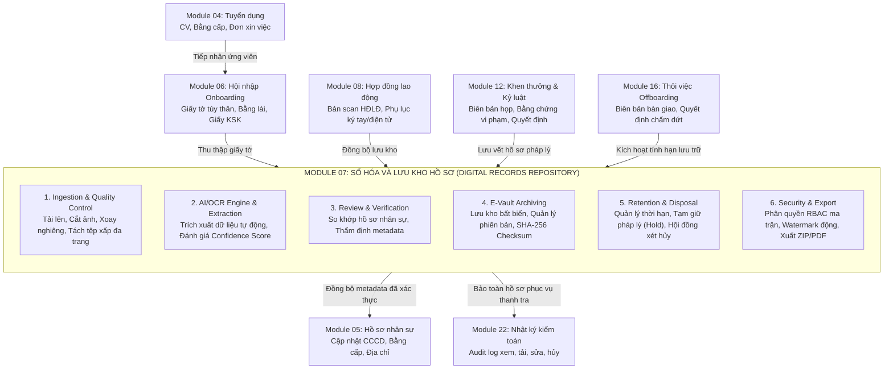
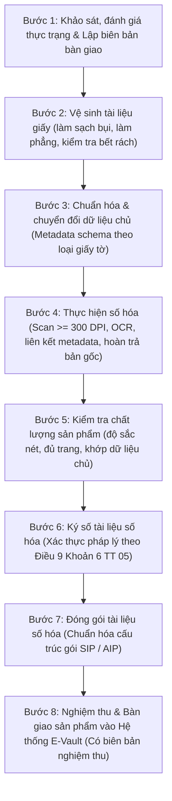
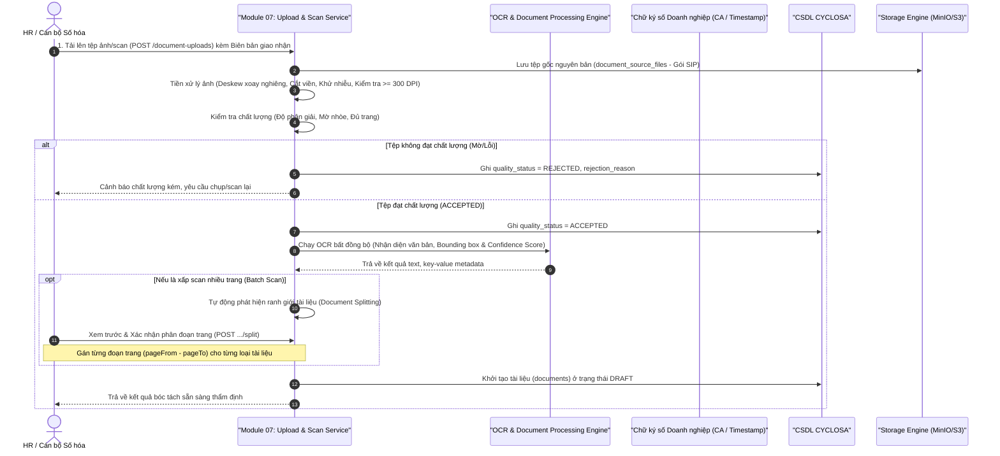
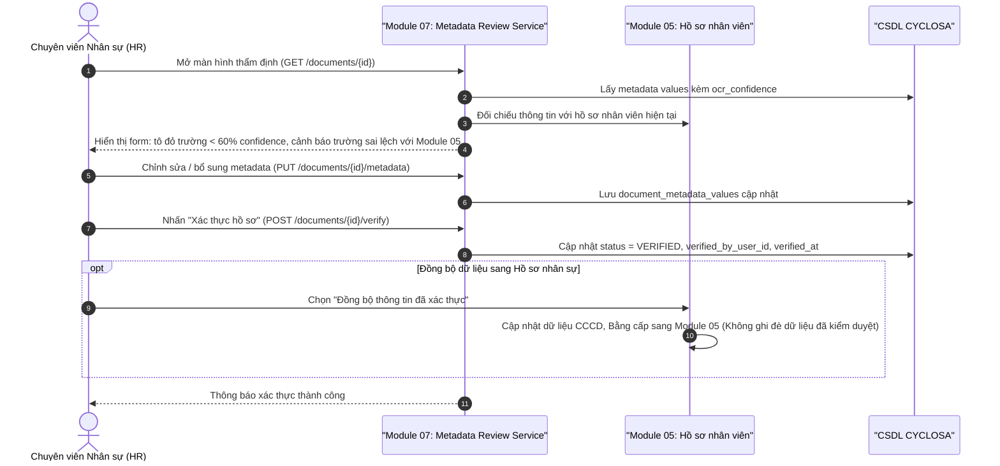
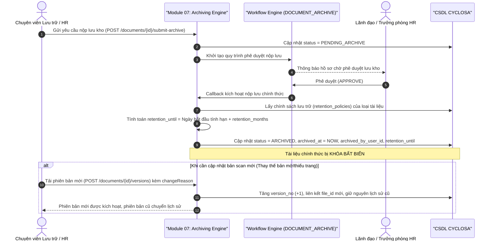
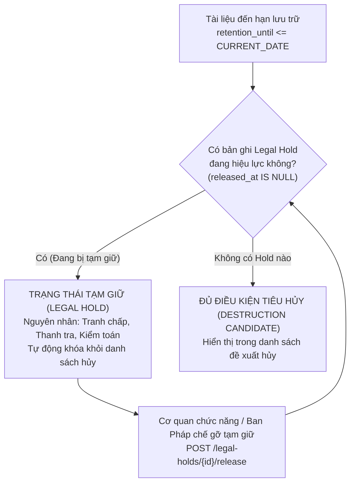
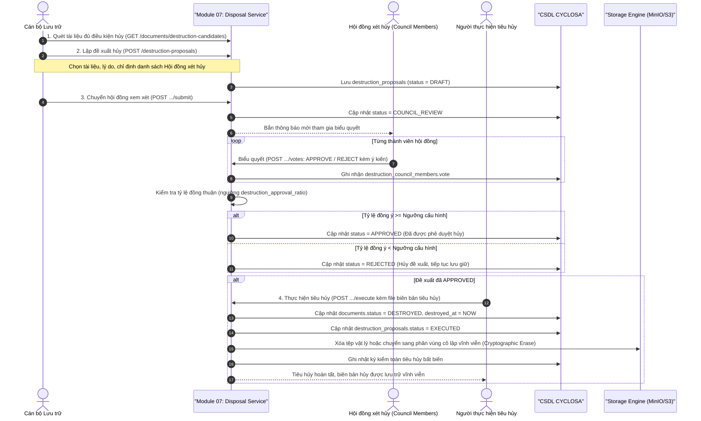
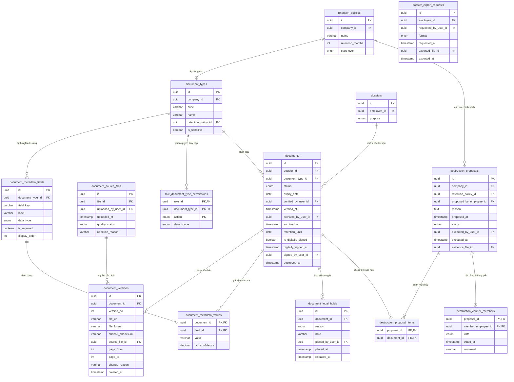

# TÀI LIỆU ĐẶC TẢ NGHIỆP VỤ & THIẾT KẾ KỸ THUẬT
## MODULE 07: SỐ HÓA VÀ LƯU KHO HỒ SƠ NHÂN SỰ (DIGITAL RECORDS REPOSITORY - DOC)

> **Tài liệu căn cứ & tham chiếu:**
> - Nghiệp vụ tổng thể: [`Nghiep-vu.docx`](file:///f:/Project/CYCLOSA/docs/Nghiep-vu.docx) (§7. Số hóa và lưu kho hồ sơ nhân sự, dòng 781–952)
> - Thiết kế CSDL chi tiết: [`database.md`](file:///f:/Project/CYCLOSA/docs/database.md) (§8.8 Module 7 — Số hóa và lưu kho hồ sơ, dòng 2041–2370)
> - Danh mục API chuẩn: [`api-list.md`](file:///f:/Project/CYCLOSA/docs/api-list.md) (§7. Số hóa & lưu kho hồ sơ, 43 APIs, dòng 703–782)
> - Danh mục màn hình UI: [`page-list.md`](file:///f:/Project/CYCLOSA/docs/page-list.md) (§5.8 DOC-01 đến DOC-13, dòng 329–346)
> - Lộ trình kiến trúc: [`thu-tu-code-module.md`](file:///f:/Project/CYCLOSA/docs/thu-tu-code-module.md) (Giai đoạn 3: Hồ sơ, Hội nhập, Hợp đồng & Lưu kho)
> - Khung pháp lý & Tiêu chuẩn: **Thông tư số 05/2025/TT-BNV** (ngày 14/05/2025 của Bộ Nội vụ - Quy định chi tiết nghiệp vụ lưu trữ tài liệu lưu trữ số, hiệu lực 01/07/2025), **Luật Lưu trữ số 33/2024/QH15** (hiệu lực 01/07/2025), **Nghị định 13/2023/NĐ-CP** (Bảo vệ dữ liệu cá nhân - PDPD), **Bộ luật Lao động 2019**, **Luật Giao dịch điện tử số 20/2023/QH15**, Tiêu chuẩn an toàn thông tin ISO/IEC 27001 & Định dạng lưu trữ dài hạn ISO 19005 (PDF/A).
> - Quy chuẩn mã nguồn: [`cyclosa_be/rules/`](file:///f:/Project/CYCLOSA/cyclosa_be/rules) & [`cyclosa_fe/rules/`](file:///f:/Project/CYCLOSA/cyclosa_fe/rules)

---

## 1. TỔNG QUAN PHÂN HỆ & NGUYÊN TẮC NGHIỆP VỤ CỐT LÕI

### 1.1. Vị trí của Module 07 trong Hệ sinh thái CYCLOSA HRM
Phân hệ **Số hóa và Lưu kho Hồ sơ nhân sự (Digital Records Repository - DOC)** đóng vai trò là **Kho lưu trữ điện tử trung tâm (Electronic Records Management / Enterprise Content Management - ECM/DMS)** của toàn bộ hệ thống CYCLOSA HRM. Module này chịu trách nhiệm chuyển hóa các tài liệu giấy, tệp scan, ảnh chụp thành các tài sản dữ liệu số có cấu trúc, kiểm soát toàn diện vòng đời của tài liệu từ khâu thu thập, bóc tách OCR, thẩm định metadata, nộp lưu chính thức cho đến khi tiêu hủy an toàn theo pháp luật.

### 1.2. Khung Pháp lý Tuân thủ
Hệ thống CYCLOSA HRM thiết kế Module 07 bám sát các tiêu chuẩn pháp lý khắt khe nhất tại Việt Nam và quốc tế:
1. **Thông tư số 05/2025/TT-BNV (ngày 14/05/2025 của Bộ Nội vụ, hiệu lực từ 01/07/2025):**
   * **Điều 9:** Chuẩn hóa quy trình số hóa tài liệu lưu trữ giấy thành **8 bước bắt buộc** (từ khảo sát, vệ sinh, quét scan, kiểm tra, ký số xác thực, đóng gói đến nghiệm thu bàn giao).
   * **Tiêu chuẩn kỹ thuật định dạng số hóa:** Bắt buộc chuẩn **PDF/A-1a/b** hoặc **PDF/A-2b** (ISO 19005), độ phân giải tối thiểu **$\ge 300\text{ DPI}$** (tỷ lệ 1:1), màu **24-bit True Color** đối với văn bản có chữ ký mực/dấu đỏ.
   * **Ký số xác thực số hóa (Điều 9 Khoản 6):** Sử dụng chữ ký số của cơ quan/doanh nghiệp hoặc người có thẩm quyền xác thực bản số hóa có giá trị pháp lý tương đương bản giấy gốc.
   * **Mô hình đóng gói thông tin lưu trữ:** Chuẩn hóa theo 3 gói thông tin **SIP** (Gói nộp lưu), **AIP** (Gói lưu trữ vĩnh viễn), **DIP** (Gói khai thác đóng dấu Watermark).
2. **Luật Lưu trữ số 33/2024/QH15 (hiệu lực 01/07/2025) & Luật Lưu trữ 2011:**
   * Quy định tài liệu lưu trữ điện tử phải đảm bảo tính xác thực, tính toàn vẹn, tính khả dụng và khả năng truy cập lâu dài.
   * Quy định rõ quy trình nộp lưu, thời hạn bảo quản hồ sơ nhân sự gốc (tối thiểu 5 năm đến vĩnh viễn tùy loại hồ sơ).
   * Nghiêm cấm tự ý tiêu hủy tài liệu lưu trữ khi chưa có quyết định của Hội đồng xét hủy và biên bản tiêu hủy hợp lệ.
3. **Nghị định 13/2023/NĐ-CP về Bảo vệ dữ liệu cá nhân (PDPD):**
   * Giấy tờ tùy thân (CCCD, Hộ chiếu), lý lịch tư pháp, hồ sơ y tế, thông tin tài chính/lương là **Dữ liệu cá nhân nhạy cảm**.
   * Hệ thống bắt buộc mã hóa tệp lưu trữ, đóng dấu watermark nhận diện danh tính người xem/tải xuống để chống rò rỉ dữ liệu.
   * Bắt buộc có cơ chế phân quyền ma trận tách biệt: chỉ những vai trò được cấp phép mới được quyền xem hoặc tải tài liệu nhạy cảm.
4. **Bộ luật Lao động 2019 & Luật BHXH 2024 & Luật Giao dịch điện tử 2023:**
   * Hồ sơ hợp đồng lao động, phụ lục, sổ BHXH, tài liệu giải quyết tranh chấp/kỷ luật phải được lưu giữ tối thiểu tương ứng với thời hiệu khởi kiện hoặc kết thúc nghĩa vụ pháp lý.
   * Xác lập giá trị pháp lý của văn bản điện tử và chứng thư chữ ký điện tử an toàn.

---

### 1.3. Tiêu chuẩn Kỹ thuật Số hóa & Mô hình Đóng gói Dữ liệu theo Thông tư 05/2025/TT-BNV

#### 1.3.1. Tiêu chuẩn Kỹ thuật Tệp tin Số hóa
1. **Định dạng tài liệu lưu trữ dài hạn:**
   * Bắt buộc chuyển đổi sang định dạng chuẩn **PDF/A** (theo tiêu chuẩn quốc tế ISO 19005-1 hoặc ISO 19005-2).
   * Yêu cầu kỹ thuật: Tự động nhúng toàn bộ phông chữ (Embedded Fonts), thông tin bảng màu và siêu dữ liệu; nghiêm cấm các mã thực thi độc hại hoặc JavaScript động.
2. **Độ phân giải và chất lượng hình ảnh quét (Scan):**
   * Độ phân giải tối thiểu: **$\ge 300\text{ DPI}$** (Dots Per Inch) theo tỷ lệ quét $1:1$ so với bản gốc.
   * Định dạng màu: **24-bit RGB / True Color** đối với tài liệu có chữ ký mực xanh, con dấu mộc đỏ, ảnh chân dung nhận diện; hoặc thang xám (8-bit Grayscale) đối với văn bản thuần chữ in đen trắng.
   * Thuật toán tiền xử lý: Tự động cắt viền (Cropping), khử góc nghiêng (Deskewing) với sai số góc nghiêng $\le 1^\circ$, lọc nhiễu nền nhưng tuyệt đối không làm mờ nét chữ hoặc đứt gãy nét mực chữ ký.
3. **Chữ ký số xác nhận bản số hóa hợp pháp (Điều 9 Khoản 6):**
   * Sau khi kiểm tra chất lượng đạt, văn bản số hóa được thực hiện **Ký số cơ quan/tổ chức hoặc người có thẩm quyền** kèm dấu thời gian tin cậy (Timestamping) để đảm bảo tính toàn vẹn và có giá trị tương đương bản giấy gốc.
4. **Mã băm toàn vẹn mật mã học (Cryptographic Checksum):**
   * Tính toán và lưu trữ mã băm **SHA-256** ngay tại thời điểm số hóa. Bất kỳ sự thay đổi bit dữ liệu vật lý nào bên ngoài ổ đĩa đều bị phát hiện ngay lập tức khi đối soát.

#### 1.3.2. Cấu trúc Mô hình Đóng gói Thông tin Lưu trữ (OAIS / TT 05)
* **Gói nộp lưu SIP (Submission Information Package):** Tệp quét scan thô do HR hoặc nhân viên tải lên (`document_source_files`) kèm kết quả bóc tách OCR ban đầu và biên bản giao nhận tài liệu để số hóa.
* **Gói lưu trữ vĩnh viễn AIP (Archival Information Package):** Tệp PDF/A chuẩn hóa + Chữ ký số xác thực + Metadata đã duyệt + Checksum SHA-256 (`status = ARCHIVED`, khóa bất biến, phân vùng an toàn).
* **Gói khai thác DIP (Dissemination Information Package):** Tệp tài liệu trích xuất phục vụ nhân viên hoặc HR xem trước (`preview`) hoặc tải về (`download`), tự động phủ lớp **Watermark động** chéo trang chứa thông tin người truy cập.

---

### 1.4. Các Nguyên tắc Nghiệp vụ Cốt lõi

#### 1.3.1. Phân định rõ ràng trách nhiệm liên module (Separation of Concerns)
* **Module 06 (Hội nhập - Onboarding):** Chỉ đóng vai trò theo dõi **checklist yêu cầu nộp giấy tờ** và kết quả xác thực. Không sở hữu tệp tin gốc và không quản lý vòng đời lưu trữ.
* **Module 05 (Hồ sơ nhân sự):** Quản lý thông tin lý lịch cá nhân và quan hệ công tác hiện hành.
* **Module 07 (Số hóa & Lưu kho):** Nắm giữ quyền sở hữu tuyệt đối đối với **tệp tin gốc (`document_source_files`), tài liệu số (`documents`), các phiên bản (`document_versions`), siêu dữ liệu (`document_metadata_values`) và toàn bộ vòng đời lưu trữ**.

#### 1.3.2. Phân biệt hai loại thời hạn cốt lõi
Hệ thống phân định rạch ròi 2 mốc thời gian độc lập để tránh sai lệch nghiệp vụ:

| Loại thời hạn | Thuộc tính CSDL | Ý nghĩa nghiệp vụ | Hành động hệ thống |
| :--- | :--- | :--- | :--- |
| **Ngày hết hiệu lực giấy tờ** | `expiry_date` | Ngày văn bản hết giá trị pháp lý (ví dụ: CCCD hết hạn sau 10 năm, Giấy khám sức khỏe hết hạn sau 12 tháng, Chứng chỉ chứng nhận có thời hạn). | Cảnh báo nhân viên và HR yêu cầu nộp bổ sung/gia hạn giấy tờ mới qua cổng ESS/Admin. |
| **Ngày kết thúc lưu trữ** | `retention_until` | Ngày tài liệu kết thúc nghĩa vụ lưu giữ trong kho hồ sơ theo Chính sách lưu trữ (`retention_policies`). | Đủ điều kiện đưa vào danh sách đề xuất tiêu hủy nếu không bị tạm giữ pháp lý (`Legal Hold`). |

#### 1.3.3. Nguyên tắc Bất biến Tài liệu Lưu kho (Archival Immutability & Versioning)
* Khi tài liệu đã nộp lưu chính thức (`status = ARCHIVED`), hệ thống **khóa vĩnh viễn** việc chỉnh sửa nội dung tệp tin hoặc ghi đè dữ liệu.
* Khi cần thay thế tài liệu (ví dụ: phát hiện bản scan cũ thiếu trang, tệp scan bị mờ), hệ thống áp dụng cơ chế **Tạo phiên bản mới (`document_versions`)** với số thứ tự phiên bản tăng dần (`version_no`), bắt buộc ghi rõ lý do thay đổi (`change_reason`). Phiên bản cũ vẫn được lưu vết để phục vụ kiểm toán.
* Giấy tờ bổ sung mới độc lập (ví dụ: văn bằng đại học thứ hai, chứng chỉ nghiệp vụ mới) được tạo thành bản ghi tài liệu mới trong cùng bộ hồ sơ (`dossier`).

#### 1.3.4. Nguyên tắc "Derived State" (Trạng thái suy diễn thời gian thực)
Nhằm đảm bảo tính toàn vẹn dữ liệu, CYCLOSA không dùng các cờ trạng thái tĩnh lưu trữ việc "Hết hiệu lực" hay "Đến hạn tiêu hủy". Thay vào đó:
* Trạng thái **Giấy tờ hết hiệu lực (`IS_EXPIRED`)** được suy diễn động: `expiry_date < CURRENT_DATE`.
* Trạng thái **Đủ điều kiện tiêu hủy (`DESTRUCTION_CANDIDATE`)** được suy diễn động: `status = 'ARCHIVED' AND retention_until <= CURRENT_DATE AND NOT EXISTS (document_legal_holds WHERE released_at IS NULL)`.

---

## 2. QUY TRÌNH NGHIỆP VỤ CHI TIẾT & SƠ ĐỒ LUỒNG (BUSINESS WORKFLOWS)

### 2.1. Luồng 1: Quy trình Số hóa 8 Bước Chuẩn (Điều 9 Thông tư 05/2025/TT-BNV)

Toàn bộ quy trình số hóa tài liệu từ giấy sang bản số trong CYCLOSA tuân thủ đầy đủ 8 bước chuẩn của Bộ Nội vụ:

#### Sơ đồ Tuần tự Chi tiết (Sequence Diagram) các bước kỹ thuật:

---

### 2.2. Luồng 2: Thẩm định & Xác thực Metadata (Review & Verification)
Màn hình xác thực metadata hoạt động theo cơ chế chia đôi trực quan (Split-screen): Một bên hiển thị ảnh tệp scan, một bên hiển thị form metadata bóc tách được.

---

### 2.3. Luồng 3: Nộp lưu kho chính thức & Quản lý Phiên bản (Archival & Versioning)

---

### 2.4. Luồng 4: Tạm giữ Pháp lý (Legal Hold Mechanism)
Tạm giữ pháp lý là cơ chế bảo vệ tối cao ngăn chặn mọi hành vi tiêu hủy tài liệu (dù tài liệu đã hết thời hạn lưu trữ theo chính sách), áp dụng khi doanh nghiệp đang phát sinh tranh chấp lao động, phục vụ thanh tra, kiểm toán nhà nước hoặc yêu cầu từ cơ quan tư pháp.

---

### 2.5. Luồng 5: Quy trình Hội đồng xét duyệt Tiêu hủy tài liệu (Destruction Governance)

---

## 3. THIẾT KẾ CƠ SỞ DỮ LIỆU & TỪ ĐIỂN DỮ LIỆU (DATABASE SCHEMA)

### 3.1. Sơ đồ Quan hệ Thực thể (ERD - Chuẩn UUID BaseEntity)

Toàn bộ 12 bảng thực thể đều kế thừa `BaseEntity` với khóa chính `UUID id`, các trường kiểm toán `created_at`, `updated_at`, `created_by`, `updated_by` và xóa mềm `deleted_at`.

---

### 3.2. Data Dictionary Chi tiết

#### 1. Bảng `retention_policies` (Chính sách lưu trữ tài liệu)
Quản lý thời hạn lưu giữ bắt buộc và sự kiện kích hoạt tính hạn theo quy định pháp luật và chính sách doanh nghiệp.

| Cột | Kiểu dữ liệu | Ràng buộc | Mô tả |
| :--- | :--- | :--- | :--- |
| `id` | BIGINT | PK, AUTO_INCREMENT | Định danh chính sách |
| `company_id` | BIGINT | FK → companies(id), NOT NULL | Thuộc công ty |
| `name` | VARCHAR(150) | NOT NULL | Tên chính sách lưu trữ (vd: "Hồ sơ tuyển dụng - 5 năm", "Hợp đồng lao động - 10 năm") |
| `retention_months` | INT | NOT NULL | Thời hạn lưu trữ tính bằng tháng |
| `start_event` | VARCHAR(30) | NOT NULL | Enum `RetentionStartEvent`: Sự kiện bắt đầu tính hạn |

* **Enum `RetentionStartEvent`:**
  * `ARCHIVED_DATE`: Tính từ ngày nộp lưu kho chính thức.
  * `EMPLOYMENT_END_DATE`: Tính từ ngày nhân viên chấm dứt quan hệ lao động (Offboarding).
  * `CONTRACT_END_DATE`: Tính từ ngày hợp đồng lao động hết hiệu lực.
  * `DOCUMENT_EXPIRY_DATE`: Tính từ ngày giấy tờ hết giá trị pháp lý.

---

#### 2. Bảng `document_types` (Danh mục loại tài liệu)
Phân loại các văn bản, giấy tờ nhân sự được lưu trữ trong hệ thống.

| Cột | Kiểu dữ liệu | Ràng buộc | Mô tả |
| :--- | :--- | :--- | :--- |
| `id` | BIGINT | PK, AUTO_INCREMENT | Định danh loại tài liệu |
| `company_id` | BIGINT | FK → companies(id), NOT NULL | Thuộc công ty |
| `code` | VARCHAR(30) | NOT NULL | Mã định danh kỹ thuật (vd: `CCCD`, `DEGREE`, `LABOR_CONTRACT`, `HEALTH_CHECK`, `CERTIFICATE`) |
| `name` | VARCHAR(150) | NOT NULL | Tên hiển thị (vd: "Căn cước công dân / Hộ chiếu", "Văn bằng tốt nghiệp") |
| `retention_policy_id` | BIGINT | FK → retention_policies(id), NOT NULL | Chính sách lưu trữ áp dụng |
| `is_sensitive` | BOOLEAN | NOT NULL, DEFAULT FALSE | Đánh dấu tài liệu nhạy cảm (bắt buộc đóng dấu watermark động, kiểm soát xuất gắt gao) |

* **Ràng buộc:** `UNIQUE (company_id, code)`

---

#### 3. Bảng `document_metadata_fields` (Cấu hình trường metadata động)
Thiết lập danh mục trường dữ liệu cần bóc tách OCR và thẩm định cho từng loại tài liệu cụ thể.

| Cột | Kiểu dữ liệu | Ràng buộc | Mô tả |
| :--- | :--- | :--- | :--- |
| `id` | BIGINT | PK, AUTO_INCREMENT | Định danh cấu hình trường |
| `document_type_id` | BIGINT | FK → document_types(id), NOT NULL | Thuộc loại tài liệu |
| `field_key` | VARCHAR(50) | NOT NULL | Khóa kỹ thuật (vd: `id_number`, `full_name`, `issue_date`, `expiry_date`, `major`) |
| `label` | VARCHAR(100) | NOT NULL | Nhãn trường hiển thị trên UI |
| `data_type` | VARCHAR(20) | NOT NULL | Enum `MetadataDataType`: `TEXT`, `DATE`, `NUMBER` |
| `is_required` | BOOLEAN | NOT NULL, DEFAULT FALSE | Bắt buộc phải có giá trị khi xác thực |
| `display_order` | INT | NOT NULL, DEFAULT 0 | Thứ tự hiển thị trên form thẩm định |

* **Ràng buộc:** `UNIQUE (document_type_id, field_key)`

---

#### 4. Bảng `dossiers` (Bộ hồ sơ nhân sự theo mục đích)
Gom nhóm các tài liệu của một nhân viên theo từng mục đích quản lý chuyên biệt.

| Cột | Kiểu dữ liệu | Ràng buộc | Mô tả |
| :--- | :--- | :--- | :--- |
| `id` | BIGINT | PK, AUTO_INCREMENT | Định danh bộ hồ sơ |
| `employee_id` | BIGINT | FK → employees(id), NOT NULL | Thuộc nhân viên |
| `purpose` | VARCHAR(30) | NOT NULL | Enum `DossierPurpose`: Mục đích quản lý hồ sơ |

* **Enum `DossierPurpose`:**
  * `RECRUITMENT`: Bộ hồ sơ tuyển dụng & ứng tuyển (CV, Cover Letter, Đơn xin việc).
  * `CONTRACT`: Bộ hồ sơ hợp đồng lao động & phụ lục ký kết.
  * `INSURANCE`: Bộ hồ sơ bảo hiểm xã hội, y tế, thất nghiệp & người phụ thuộc.
  * `MEDICAL`: Bộ hồ sơ y tế, khám sức khỏe định kỳ & bệnh án nghề nghiệp.
  * `OTHER`: Bộ hồ sơ đào tạo, khen thưởng, kỷ luật hoặc hồ sơ khác.
* **Ràng buộc:** `UNIQUE (employee_id, purpose)` — Mỗi nhân viên chỉ có tối đa 01 bộ hồ sơ cho mỗi mục đích.

---

#### 5. Bảng `document_source_files` (Tệp nguồn tải lên nguyên bản)
Lưu trữ tệp tin nguyên bản do người dùng tải lên trước khi thực hiện cắt tách hoặc xử lý.

| Cột | Kiểu dữ liệu | Ràng buộc | Mô tả |
| :--- | :--- | :--- | :--- |
| `id` | BIGINT | PK, AUTO_INCREMENT | Định danh tệp nguồn |
| `file_id` | BIGINT | FK → files(id), NOT NULL, UNIQUE | Bản ghi tệp vật lý lưu trong MinIO/S3 |
| `uploaded_by_user_id` | BIGINT | FK → users(id), NOT NULL | Người tải lên (HR hoặc Nhân viên qua ESS) |
| `uploaded_at` | TIMESTAMP | NOT NULL, DEFAULT CURRENT_TIMESTAMP | Thời điểm tải lên |
| `quality_status` | VARCHAR(30) | NOT NULL | Enum `SourceQualityStatus`: Trạng thái kiểm định chất lượng |
| `rejection_reason` | VARCHAR(500) | NULL | Lý do từ chối nếu không đạt chất lượng (mờ, nhòe, mất góc) |

* **Enum `SourceQualityStatus`:** `PENDING_CHECK` (Chờ kiểm tra), `ACCEPTED` (Đạt chất lượng), `REJECTED` (Không đạt, yêu cầu tải lại).

---

#### 6. Bảng `documents` (Tài liệu logic chính thức)
Bản ghi logic đại diện cho một tài liệu nhân sự trong kho lưu trữ.

| Cột | Kiểu dữ liệu | Ràng buộc | Mô tả |
| :--- | :--- | :--- | :--- |
| `id` | BIGINT | PK, AUTO_INCREMENT | Định danh tài liệu |
| `dossier_id` | BIGINT | FK → dossiers(id), NOT NULL | Thuộc bộ hồ sơ nào (suy ra nhân viên sở hữu) |
| `document_type_id` | BIGINT | FK → document_types(id), NOT NULL | Loại tài liệu |
| `status` | VARCHAR(30) | NOT NULL | Enum `DocumentStatus`: Vòng đời trạng thái tài liệu |
| `expiry_date` | DATE | NULL | Ngày giấy tờ hết hiệu lực (nhắc gia hạn/bổ sung) |
| `verified_by_user_id` | BIGINT | FK → users(id), NULL | Chuyên viên HR thẩm định metadata |
| `verified_at` | TIMESTAMP | NULL | Thời điểm xác thực metadata |
| `archived_by_user_id` | BIGINT | FK → users(id), NULL | Người thực hiện nộp lưu kho |
| `archived_at` | TIMESTAMP | NULL | Thời điểm nộp lưu kho chính thức |
| `retention_until` | DATE | NULL | Ngày kết thúc lưu trữ (tính tại thời điểm nộp lưu) |
| `destroyed_at` | TIMESTAMP | NULL | Thời điểm tài liệu bị tiêu hủy vật lý |

* **Enum `DocumentStatus`:**
  * `DRAFT`: Mới tạo, bóc tách OCR xong, chưa xác thực metadata.
  * `VERIFIED`: Đã được HR kiểm tra và xác thực metadata hợp lệ.
  * `PENDING_ARCHIVE`: Đã gửi đề xuất nộp lưu, đang chờ lãnh đạo phê duyệt.
  * `ARCHIVED`: Đã nộp lưu kho chính thức (Khóa bất biến, áp dụng chính sách lưu trữ).
  * `DESTROYED`: Đã tiêu hủy an toàn theo quyết định của Hội đồng xét hủy.

---

#### 7. Bảng `document_versions` (Phiên bản tài liệu)
Lưu vết toàn bộ các lần thay thế hoặc chuẩn hóa của tệp tài liệu. Bản ghi có `version_no` lớn nhất là phiên bản hiện hành.

| Cột | Kiểu dữ liệu | Ràng buộc | Mô tả |
| :--- | :--- | :--- | :--- |
| `id` | BIGINT | PK, AUTO_INCREMENT | Định danh phiên bản |
| `document_id` | BIGINT | FK → documents(id), NOT NULL | Thuộc tài liệu |
| `version_no` | INT | NOT NULL | Số thứ tự phiên bản (1, 2, 3...) |
| `file_id` | BIGINT | FK → files(id), NOT NULL | Tệp tin chuẩn hóa sau tiền xử lý/cắt tách |
| `source_file_id` | BIGINT | FK → document_source_files(id), NOT NULL | Tệp nguồn ban đầu |
| `page_from` | INT | NULL | Trang bắt đầu trong tệp nguồn (khi tách tệp) |
| `page_to` | INT | NULL | Trang kết thúc trong tệp nguồn (khi tách tệp) |
| `change_reason` | VARCHAR(500) | NULL | Lý do thay thế phiên bản (bắt buộc khi cập nhật bản mới) |
| `created_at` | TIMESTAMP | NOT NULL, DEFAULT CURRENT_TIMESTAMP | Thời điểm phát hành phiên bản |

* **Ràng buộc:** `UNIQUE (document_id, version_no)`

---

#### 8. Bảng `document_metadata_values` (Giá trị metadata chi tiết)
Lưu trữ các giá trị siêu dữ liệu bóc tách được theo từng trường cấu hình, kèm theo độ tin cậy OCR.

| Cột | Kiểu dữ liệu | Ràng buộc | Mô tả |
| :--- | :--- | :--- | :--- |
| `document_id` | BIGINT | PK, FK → documents(id) | Thuộc tài liệu |
| `field_id` | BIGINT | PK, FK → document_metadata_fields(id) | Thuộc trường cấu hình |
| `value` | VARCHAR(1000) | NULL | Giá trị thực tế đã xác nhận/nhập tay |
| `ocr_confidence` | DECIMAL(5,2) | NULL | Điểm tin cậy trích xuất OCR (0.00% - 100.00%) |

---

#### 9. Bảng `document_legal_holds` (Tạm giữ pháp lý tài liệu)
Theo dõi các lệnh phong tỏa, ngăn chặn tiêu hủy đối với tài liệu đang phục vụ thanh tra, tranh chấp hoặc kiểm toán.

| Cột | Kiểu dữ liệu | Ràng buộc | Mô tả |
| :--- | :--- | :--- | :--- |
| `id` | BIGINT | PK, AUTO_INCREMENT | Định danh lệnh tạm giữ |
| `document_id` | BIGINT | FK → documents(id), NOT NULL | Thuộc tài liệu |
| `reason` | VARCHAR(30) | NOT NULL | Enum `LegalHoldReason`: Lý do tạm giữ |
| `note` | VARCHAR(500) | NULL | Ghi chú vụ việc (vd: "Tranh chấp HĐLĐ vụ án số 12/2026/LĐ-ST") |
| `placed_by_user_id` | BIGINT | FK → users(id), NOT NULL | Người ban hành lệnh tạm giữ |
| `placed_at` | TIMESTAMP | NOT NULL, DEFAULT CURRENT_TIMESTAMP | Thời điểm bắt đầu tạm giữ |
| `released_at` | TIMESTAMP | NULL | Thời điểm gỡ bỏ tạm giữ (NULL = đang bị phong tỏa) |

* **Enum `LegalHoldReason`:**
  * `DISPUTE`: Đang có tranh chấp khiếu nại hoặc tố tụng lao động.
  * `AUDIT`: Đang phục vụ kỳ kiểm toán nội bộ hoặc kiểm toán độc lập.
  * `INSPECTION`: Đang phục vụ thanh tra chuyên ngành (Lao động, BHXH, Thuế).
  * `LEGAL_REQUEST`: Yêu cầu cung cấp tài liệu từ cơ quan công an / tòa án.

---

#### 10. Bảng `destruction_proposals` (Đề xuất tiêu hủy tài liệu)
Quản lý các đợt xem xét và tiêu hủy tài liệu đã hết hạn lưu trữ.

| Cột | Kiểu dữ liệu | Ràng buộc | Mô tả |
| :--- | :--- | :--- | :--- |
| `id` | BIGINT | PK, AUTO_INCREMENT | Định danh đề xuất hủy |
| `company_id` | BIGINT | FK → companies(id), NOT NULL | Thuộc công ty |
| `retention_policy_id` | BIGINT | FK → retention_policies(id), NOT NULL | Áp dụng theo chính sách lưu trữ nào |
| `proposed_by_employee_id` | BIGINT | FK → employees(id), NOT NULL | Cán bộ lưu trữ lập đề xuất |
| `reason` | TEXT | NOT NULL | Lý do đề xuất tiêu hủy |
| `proposed_at` | TIMESTAMP | NOT NULL, DEFAULT CURRENT_TIMESTAMP | Thời điểm lập đề xuất |
| `status` | VARCHAR(30) | NOT NULL | Enum `DestructionStatus`: Tiến trình xét duyệt |
| `executed_by_user_id` | BIGINT | FK → users(id), NULL | Người phụ trách thực hiện tiêu hủy |
| `executed_at` | TIMESTAMP | NULL | Thời điểm thực hiện tiêu hủy |
| `evidence_file_id` | BIGINT | FK → files(id), NULL | File đính kèm biên bản tiêu hủy có ký số/đóng dấu |

* **Enum `DestructionStatus`:** `DRAFT` (Mới lập), `COUNCIL_REVIEW` (Đang biểu quyết), `APPROVED` (Được phê duyệt), `REJECTED` (Bị bác bỏ), `EXECUTED` (Đã tiêu hủy xong).

---

#### 11. Bảng `destruction_proposal_items` (Danh sách tài liệu đề xuất hủy - Bảng N:M)
Liên kết các tài liệu cụ thể nằm trong đợt đề xuất tiêu hủy.

| Cột | Kiểu dữ liệu | Ràng buộc | Mô tả |
| :--- | :--- | :--- | :--- |
| `proposal_id` | BIGINT | PK, FK → destruction_proposals(id) | Định danh đề xuất hủy |
| `document_id` | BIGINT | PK, FK → documents(id) | Tài liệu được đề xuất hủy |

---

#### 12. Bảng `destruction_council_members` (Hội đồng xét hủy & Biểu quyết)
Danh sách các thành viên hội đồng độc lập được chỉ định tham gia biểu quyết phê duyệt tiêu hủy.

| Cột | Kiểu dữ liệu | Ràng buộc | Mô tả |
| :--- | :--- | :--- | :--- |
| `proposal_id` | BIGINT | PK, FK → destruction_proposals(id) | Định danh đề xuất hủy |
| `member_employee_id` | BIGINT | PK, FK → employees(id) | Nhân sự là thành viên hội đồng |
| `vote` | VARCHAR(20) | NULL | Enum `CouncilVote`: `APPROVE` (Đồng ý), `REJECT` (Không đồng ý), NULL (Chưa biểu quyết) |
| `voted_at` | TIMESTAMP | NULL | Thời điểm gửi biểu quyết |
| `comment` | VARCHAR(500) | NULL | Ý kiến nhận xét hoặc lý do bác bỏ |

---

#### 13. Bảng `role_document_type_permissions` (Ma trận phân quyền tài liệu theo vai trò)
Kiểm soát quyền truy cập chi tiết đến từng loại tài liệu và phạm vi dữ liệu nhân sự.

| Cột | Kiểu dữ liệu | Ràng buộc | Mô tả |
| :--- | :--- | :--- | :--- |
| `role_id` | BIGINT | PK, FK → roles(id) | Vai trò áp dụng (vd: HR_SPECIALIST, PAYROLL_OFFICER) |
| `document_type_id` | BIGINT | PK, FK → document_types(id) | Loại tài liệu |
| `action` | VARCHAR(30) | PK, Enum `DocumentAction` | Hành động được cấp phép |
| `data_scope` | VARCHAR(30) | NOT NULL, Enum `DataScope` | Phạm vi nhân sự: `OWN`, `TEAM`, `DEPARTMENT`, `COMPANY`, `ALL` |

* **Enum `DocumentAction`:** `VIEW`, `DOWNLOAD`, `UPLOAD`, `EDIT_METADATA`, `VERIFY`, `ARCHIVE`, `DESTROY`, `HOLD`, `EXPORT`.

---

#### 14. Bảng `dossier_export_requests` (Yêu cầu xuất trọn bộ hồ sơ)
Lưu vết và kiểm soát quy trình tải xuất toàn bộ hồ sơ của nhân viên dưới dạng tệp PDF gộp hoặc ZIP nén.

| Cột | Kiểu dữ liệu | Ràng buộc | Mô tả |
| :--- | :--- | :--- | :--- |
| `id` | BIGINT | PK, AUTO_INCREMENT | Định danh yêu cầu xuất |
| `employee_id` | BIGINT | FK → employees(id), NOT NULL | Nhân viên có hồ sơ được xuất |
| `requested_by_user_id` | BIGINT | FK → users(id), NOT NULL | Người yêu cầu xuất hồ sơ |
| `format` | VARCHAR(20) | NOT NULL | Enum `ExportFormat`: `MERGED_PDF`, `ZIP` |
| `requested_at` | TIMESTAMP | NOT NULL, DEFAULT CURRENT_TIMESTAMP | Thời điểm tạo yêu cầu |
| `exported_file_id` | BIGINT | FK → files(id), NULL | File kết quả xuất (sau khi qua luồng phê duyệt và sinh file) |
| `exported_at` | TIMESTAMP | NULL | Thời điểm hoàn tất đóng gói file |

---

## 4. DANH MỤC API RESTFUL & PHÂN QUYỀN RBAC (43 APIS)

Dưới đây là 43 API chuẩn RESTful của Module 07 theo tài liệu [`api-list.md`](file:///f:/Project/CYCLOSA/docs/api-list.md), được tổ chức thành 7 nhóm nghiệp vụ chính:

### 4.1. Nhóm 1: Cấu hình Danh mục Lưu trữ & Ma trận Phân quyền (12 APIs)

| STT | Method | Endpoint | Quyền hạn (Scope) | Mô tả tóm tắt | Mã lỗi chính |
| :---: | :--- | :--- | :--- | :--- | :--- |
| 1 | `GET` | `/retention-policies` | `document.config` | Danh sách chính sách lưu trữ | `401`, `403` |
| 2 | `POST` | `/retention-policies` | `document.config` | Tạo chính sách lưu trữ mới | `400`, `409` |
| 3 | `PUT` | `/retention-policies/{policyId}` | `document.config` | Chỉnh sửa chính sách (không đổi hạn tài liệu đã lưu) | `400`, `404` |
| 4 | `DELETE`| `/retention-policies/{policyId}` | `document.config` | Xóa chính sách (chỉ khi chưa được tài liệu nào tham chiếu) | `400`, `404`, `409` |
| 5 | `GET` | `/document-types` | `document.view` | Danh mục các loại tài liệu | `401`, `403` |
| 6 | `POST` | `/document-types` | `document.config` | Tạo mới loại tài liệu | `400`, `409` |
| 7 | `PUT` | `/document-types/{typeId}` | `document.config` | Cập nhật thông tin loại tài liệu | `400`, `404` |
| 8 | `DELETE`| `/document-types/{typeId}` | `document.config` | Xóa loại tài liệu (chỉ khi chưa có tài liệu phát sinh) | `400`, `404`, `409` |
| 9 | `GET` | `/document-types/{typeId}/metadata-fields` | `document.view` | Lấy danh sách cấu hình trường metadata | `404` |
| 10 | `PUT` | `/document-types/{typeId}/metadata-fields` | `document.config` | Thay thế toàn bộ danh sách trường metadata | `400`, `404` |
| 11 | `GET` | `/roles/{roleId}/document-type-permissions` | `role.view` | Lấy ma trận quyền truy cập tài liệu theo vai trò | `404` |
| 12 | `PUT` | `/roles/{roleId}/document-type-permissions` | `role.manage` | Cập nhật ma trận quyền tài liệu cho vai trò | `400`, `404` |

---

### 4.2. Nhóm 2: Quản lý Bộ hồ sơ nhân viên (Dossiers - 3 APIs)

| STT | Method | Endpoint | Quyền hạn (Scope) | Mô tả tóm tắt | Mã lỗi chính |
| :---: | :--- | :--- | :--- | :--- | :--- |
| 13 | `GET` | `/employees/{employeeId}/dossiers` | `document.view` | Danh sách các bộ hồ sơ theo mục đích của nhân viên | `404` |
| 14 | `POST` | `/employees/{employeeId}/dossiers` | `document.upload` | Tạo mới bộ hồ sơ cho nhân viên theo mục đích | `400`, `409` |
| 15 | `GET` | `/me/dossiers` | `Auth` | Nhân viên xem danh sách các bộ hồ sơ cá nhân qua ESS | `401` |

---

### 4.3. Nhóm 3: Thu thập, Tải lên & OCR Tách tài liệu (3 APIs)

| STT | Method | Endpoint | Quyền hạn (Scope) | Mô tả tóm tắt | Mã lỗi chính |
| :---: | :--- | :--- | :--- | :--- | :--- |
| 16 | `POST` | `/document-uploads` | `document.upload` | Tải lên tệp scan/ảnh (multipart), kiểm tra chất lượng, tiền xử lý và chạy OCR | `400`, `413`, `415` |
| 17 | `GET` | `/document-uploads/{uploadId}` | `document.upload` | Tra cứu tiến độ và kết quả bóc tách OCR | `404` |
| 18 | `POST` | `/document-uploads/{uploadId}/split` | `document.upload` | Tách tệp scan nhiều trang thành các tài liệu con theo khoảng trang và loại tài liệu | `400`, `404` |

---

### 4.4. Nhóm 4: Quản lý Tài liệu, Thẩm định & Phiên bản (12 APIs)

| STT | Method | Endpoint | Quyền hạn (Scope) | Mô tả tóm tắt | Mã lỗi chính |
| :---: | :--- | :--- | :--- | :--- | :--- |
| 19 | `GET` | `/documents` | `document.view` | Tìm kiếm và lọc danh sách tài liệu trong kho | `400`, `401` |
| 20 | `GET` | `/documents/{documentId}` | `document.view` | Xem chi tiết thông tin, metadata và phiên bản tài liệu (ghi Audit) | `404` |
| 21 | `PUT` | `/documents/{documentId}/metadata` | `document.edit_metadata` | Cập nhật giá trị metadata thẩm định | `400`, `404` |
| 22 | `POST` | `/documents/{documentId}/verify` | `document.verify` | HR thẩm định đạt và xác thực metadata (`VERIFIED`) | `400`, `404` |
| 23 | `POST` | `/documents/{documentId}/digitization-sign` | `document.verify` | Ký số xác thực số hóa của cơ quan/doanh nghiệp (theo Điều 9 Khoản 6 Thông tư 05/2025/TT-BNV) | `400`, `404` |
| 24 | `GET` | `/documents/{documentId}/versions` | `document.view` | Lịch sử các phiên bản của tài liệu | `404` |
| 25 | `POST` | `/documents/{documentId}/versions` | `document.upload` | Tải phiên bản mới thay thế kèm lý do (không ghi đè bản cũ) | `400`, `404` |
| 26 | `GET` | `/documents/{documentId}/preview` | `document.view` | Xem trước nội dung tài liệu kèm **Watermark động** chống chụp lén | `404` |
| 27 | `GET` | `/documents/{documentId}/download` | `document.download` | Tải tệp tài liệu về máy (đóng Watermark, ghi Audit Log) | `403`, `404` |
| 28 | `POST` | `/documents/{documentId}/submit-archive` | `document.archive` | Gửi trình duyệt nộp lưu kho chính thức (`DOCUMENT_ARCHIVE`) | `400`, `404` |
| 29 | `GET` | `/documents/expiring` | `document.view` | Danh sách giấy tờ sắp hoặc đã hết hiệu lực (`withinDays`) | `400` |
| 30 | `GET` | `/me/documents` | `Auth` | Danh sách giấy tờ cá nhân của nhân viên qua cổng ESS | `401` |
| 31 | `POST` | `/me/documents` | `Auth` | Nhân viên tự nộp/bổ sung giấy tờ cá nhân qua ESS | `400`, `413` |

---

### 4.5. Nhóm 5: Tạm giữ Pháp lý Chống tiêu hủy (Legal Hold - 3 APIs)

| STT | Method | Endpoint | Quyền hạn (Scope) | Mô tả tóm tắt | Mã lỗi chính |
| :---: | :--- | :--- | :--- | :--- | :--- |
| 31 | `GET` | `/documents/{documentId}/legal-holds` | `document.hold` | Lịch sử các lệnh phong tỏa tạm giữ pháp lý của tài liệu | `404` |
| 32 | `POST` | `/documents/{documentId}/legal-holds` | `document.hold` | Ban hành lệnh tạm giữ pháp lý chống tiêu hủy | `400`, `404` |
| 33 | `POST` | `/legal-holds/{holdId}/release` | `document.hold` | Gỡ bỏ lệnh tạm giữ pháp lý | `400`, `404` |

---

### 4.6. Nhóm 6: Tiêu hủy Tài liệu & Hội đồng Biểu quyết (7 APIs)

| STT | Method | Endpoint | Quyền hạn (Scope) | Mô tả tóm tắt | Mã lỗi chính |
| :---: | :--- | :--- | :--- | :--- | :--- |
| 34 | `GET` | `/documents/destruction-candidates` | `document.destroy` | Danh sách tài liệu đủ điều kiện hủy (hết hạn lưu, không có Hold) | `400` |
| 35 | `POST` | `/destruction-proposals` | `document.destroy` | Khởi tạo đề xuất tiêu hủy tài liệu hết hạn | `400`, `409` |
| 36 | `GET` | `/destruction-proposals` | `document.destroy` | Danh sách các hồ sơ đề xuất tiêu hủy | `400` |
| 37 | `GET` | `/destruction-proposals/{proposalId}` | `document.destroy` | Chi tiết đề xuất hủy, danh sách tài liệu và kết quả biểu quyết | `404` |
| 38 | `POST` | `/destruction-proposals/{proposalId}/submit` | `document.destroy` | Chuyển đề xuất sang Hội đồng xét duyệt (`COUNCIL_REVIEW`) | `400`, `404` |
| 39 | `POST` | `/destruction-proposals/{proposalId}/votes` | `Auth` | Thành viên hội đồng gửi phiếu biểu quyết (Đồng ý/Từ chối) | `400`, `403`, `404` |
| 40 | `POST` | `/destruction-proposals/{proposalId}/execute` | `document.destroy` | Thực hiện tiêu hủy tài liệu (khi APPROVED), đính kèm biên bản | `400`, `404` |

---

### 4.7. Nhóm 7: Đóng gói & Xuất trọn bộ Hồ sơ (3 APIs)

| STT | Method | Endpoint | Quyền hạn (Scope) | Mô tả tóm tắt | Mã lỗi chính |
| :---: | :--- | :--- | :--- | :--- | :--- |
| 41 | `POST` | `/employees/{employeeId}/dossier-exports` | `document.export` | Tạo yêu cầu xuất trọn bộ hồ sơ (PDF gộp hoặc ZIP nén) | `400`, `404` |
| 42 | `GET` | `/dossier-exports` | `document.export` | Danh sách theo dõi tiến độ các yêu cầu xuất hồ sơ | `400` |
| 43 | `GET` | `/dossier-exports/{exportId}/download` | `document.export` | Tải tệp hồ sơ đã đóng gói sau khi được phê duyệt | `403`, `404` |

---

## 5. ĐẶC TẢ GIAO DIỆN NGƯỜI DÙNG FRONTEND (UI/UX SPECIFICATIONS)

Các màn hình thuộc Module 07 tuân thủ nghiêm ngặt 5 bộ quy tắc thiết kế giao diện của CYCLOSA (`cyclosa_fe/rules/`):
* **Rule 01 (Page Header):** Tiêu đề trang ngắn gọn, breadcrumb trực quan, nút thao tác chính đặt phía trên bên phải. Tuyệt đối không bọc icon trong hộp tròn/vuông, không thêm dòng mô tả dài dòng (subtitle).
* **Rule 02 (Stat Card Grid):** Lưới thống kê hiển thị 4 cột (`grid-cols-1 sm:grid-cols-2 lg:grid-cols-4`), icon đặt trong khối bo góc có màu nền pastel tương phản nhẹ, số liệu định dạng phân tách hàng nghìn chuẩn tiếng Việt.
* **Rule 03 (Filter Bar):** Chia 2 hàng tách biệt rõ ràng. Hàng 1 chứa ô tìm kiếm từ khóa và các Select lọc trạng thái/danh mục; Hàng 2 chứa bộ lọc ngày tháng và nút "Đặt lại bộ lọc".
* **Rule 04 (Data Table):** Trình bày dữ liệu chuẩn Table-Embedded Empty State (khi không có dữ liệu, thông báo hiển thị bên trong hàng `<tr><td colspan="...">`, không render khối rỗng bên ngoài bảng làm gãy layout). Cột cuối cùng chứa nút Thao tác.
* **Rule 05 (Form Dialog):** Tất cả modal thêm/sửa sử dụng React Hook Form + Zod Schema với thông báo lỗi tiếng Việt thân thiện, nút "Hủy" và "Lưu" đặt cố định ở góc dưới bên phải.

Dưới đây là đặc tả chi tiết 13 màn hình chuẩn hóa từ **DOC-01** đến **DOC-13** (theo [`page-list.md`](file:///f:/Project/CYCLOSA/docs/page-list.md)):

---

### 5.1. Màn hình DOC-01: Chính sách Lưu trữ (`/records/config/retention-policies`)
* **Loại trang:** `LIST` (Cấu hình)
* **Quyền:** `document.config`
* **Page Header:**
  * Breadcrumb: `Trang chủ / Lưu trữ & Hồ sơ / Cấu hình / Chính sách lưu trữ`
  * Title: `Chính sách lưu trữ`
  * Actions: Nút `+ Thêm chính sách` (mở Dialog)
* **Stat Cards (4 cột):**
  1. *Tổng số chính sách:* Tổng số policy hiện có.
  2. *Lưu trữ vĩnh viễn:* Số policy có thời hạn đặc biệt (> 50 năm hoặc vĩnh viễn).
  3. *Lưu trữ từ khi nghỉ việc:* Số policy gắn với sự kiện `EMPLOYMENT_END_DATE`.
  4. *Loại tài liệu áp dụng:* Số lượng loại tài liệu đã được gán chính sách.
* **Bảng dữ liệu:** Cột gồm Tên chính sách, Thời hạn (tháng / năm), Sự kiện bắt đầu tính hạn (`start_event`), Số loại tài liệu áp dụng, Trạng thái, Thao tác (Sửa, Xóa).
* **Ghi chú nghiệp vụ:** Sửa chính sách chỉ áp dụng cho tài liệu nộp lưu về sau, tuyệt đối không tự động thay đổi `retention_until` đã chốt của tài liệu cũ.

---

### 5.2. Màn hình DOC-02: Loại Tài liệu (`/records/config/document-types`)
* **Loại trang:** `LIST` (Cấu hình)
* **Quyền:** `document.view` / `document.config`
* **Page Header:**
  * Breadcrumb: `Trang chủ / Lưu trữ & Hồ sơ / Cấu hình / Loại tài liệu`
  * Title: `Loại tài liệu`
  * Actions: Nút `+ Thêm loại tài liệu`
* **Bảng dữ liệu:** Cột gồm Mã loại (`code`), Tên hiển thị, Chính sách lưu trữ áp dụng, Nhãn nhạy cảm (`is_sensitive` - Badge đỏ nếu nhạy cảm), Số trường metadata, Thao tác (Cấu hình Metadata $\to$ chuyển DOC-03, Sửa, Xóa).

---

### 5.3. Màn hình DOC-03: Cấu hình Trường Metadata (`/records/config/document-types/:id/metadata`)
* **Loại trang:** `EDITOR`
* **Quyền:** `document.config`
* **Bố cục:** Cho phép kéo thả sắp xếp thứ tự hiển thị (`display_order`), khai báo `field_key`, `label`, kiểu dữ liệu (`TEXT`, `DATE`, `NUMBER`), cờ `is_required`.
* **Thao tác:** Nút "Lưu cấu hình" gọi API `PUT /document-types/{typeId}/metadata-fields` thay thế toàn bộ danh sách trường.

---

### 5.4. Màn hình DOC-04: Kho Tài liệu Số Tập trung (`/records/documents`)
* **Loại trang:** `LIST` (Kho lưu trữ trung tâm)
* **Quyền:** `document.view`
* **Stat Cards (4 cột):**
  1. *Tổng tài liệu:* Tổng số hồ sơ trong kho.
  2. *Chờ thẩm định:* Số tài liệu đang ở trạng thái `DRAFT`.
  3. *Đã nộp lưu (ARCHIVED):* Số tài liệu đã lưu kho chính thức.
  4. *Đang tạm giữ (Legal Hold):* Số tài liệu đang bị phong tỏa pháp lý.
* **Filter Bar 2 hàng:**
  * Hàng 1: Search theo tên nhân viên / mã tài liệu; Select Loại tài liệu; Select Trạng thái (`DRAFT`, `VERIFIED`, `ARCHIVED`, `DESTROYED`); Select Tình trạng tạm giữ.
  * Hàng 2: Bộ lọc ngày nộp lưu; Bộ lọc hạn lưu trữ; Nút "Đặt lại bộ lọc".
* **Bảng dữ liệu:** Nhân viên (Avatar + Tên + Mã), Loại tài liệu, Tên tài liệu, Phiên bản (`v1.0`), Trạng thái (Badge), Hạn hiệu lực (`expiry_date`), Hạn lưu trữ (`retention_until`), Thao tác (Xem chi tiết DOC-06, Thẩm định DOC-07, Tải xuống).

---

### 5.5. Màn hình DOC-05: Thu thập & Wizard Tách tệp Scan OCR (`/records/upload`)
* **Loại trang:** `WIZARD` (4 bước)
* **Quyền:** `document.upload`
* **Quy trình Wizard:**
  * **Bước 1: Chọn Bộ hồ sơ & Tải tệp:** Chọn nhân viên và mục đích hồ sơ (`dossier`), kéo thả tệp ảnh chụp từ điện thoại, file scan PDF nhiều trang.
  * **Bước 2: Kiểm tra chất lượng & Tiền xử lý OCR:** Hệ thống hiển thị kết quả kiểm tra (Độ nghiêng, độ phân giải). Nếu ảnh nghiêng, cung cấp công cụ tự động xoay/cắt viền.
  * **Bước 3: Tách tệp scan nhiều trang (Document Splitting):** Hiển thị danh sách thumbnail các trang. Cho phép người dùng kéo chọn trang bắt đầu - trang kết thúc và gán loại tài liệu tương ứng cho từng đoạn.
  * **Bước 4: Chuyển sang thẩm định metadata (Hoàn tất):** Khởi tạo các bản ghi `documents` và điều hướng sang màn hình DOC-07.

---

### 5.6. Màn hình DOC-06: Chi tiết Tài liệu & Trình xem Watermark (`/records/documents/:id`)
* **Loại trang:** `DETAIL`
* **Quyền:** `document.view` / `document.download` / `document.archive` / `document.hold`
* **Bố cục:**
  * **Cột trái (Trình xem tài liệu bảo mật):** Viewer hiển thị tệp PDF/ảnh tích hợp **Watermark động** gồm Tên tài khoản, Email, IP và Thời gian truy cập hiện tại. Chặn chuột phải sao chép hoặc in ấn trái phép.
  * **Cột phải (Thông tin & Tab chức năng):**
    * *Tab 1: Thông tin chung & Metadata:* Giá trị các trường dữ liệu, người thẩm định, ngày xác thực.
    * *Tab 2: Lịch sử phiên bản:* Danh sách các phiên bản (v1, v2...), lý do thay đổi, nút tải bản scan thay thế mới (không ghi đè bản cũ).
    * *Tab 3: Tạm giữ pháp lý (Legal Hold):* Lịch sử đặt/gỡ tạm giữ. Nút "Đặt lệnh tạm giữ" và "Gỡ tạm giữ".
  * **Thao tác Header:** Nút "Nộp lưu kho chính thức" (kích hoạt Workflow `DOCUMENT_ARCHIVE`), Nút "Tải xuống có Watermark" (ghi Audit Log).

---

### 5.7. Màn hình DOC-07: Thẩm định & So khớp Metadata OCR (`/records/documents/:id/review`)
* **Loại trang:** `EDITOR` (Split-screen Review)
* **Quyền:** `document.edit_metadata` / `document.verify`
* **Bố cục chia đôi màn hình trực quan:**
  * **Nửa bên trái:** Ảnh tài liệu gốc phóng to thu nhỏ được, hỗ trợ xoay lật và trỏ chuột vào vùng chữ nhật OCR (Bounding box).
  * **Nửa bên phải:** Biểu mẫu nhập liệu metadata:
    * Các trường có điểm tin cậy OCR cao ($\ge 60\%$) được tự động điền sẵn.
    * Các trường có điểm tin cậy thấp ($< 60\%$) hoặc không nhận diện được sẽ được tô viền vàng/đỏ cảnh báo "Cần kiểm tra".
    * Đối chiếu tự động với Module 05: Nếu số CCCD hoặc ngày sinh trích xuất khác với thông tin trong hồ sơ nhân viên, hiển thị icon cảnh báo màu cam kèm giá trị hiện hành trên hệ thống để HR đối chiếu.
* **Hành động:** Nút "Lưu nháp", Nút "Đồng bộ sang hồ sơ nhân viên", Nút "Xác nhận & Thẩm định đạt" (`VERIFIED`).

---

### 5.8. Màn hình DOC-08: Giám sát Giấy tờ Sắp/Đã Hết hạn (`/records/expiring`)
* **Loại trang:** `LIST` (Cảnh báo & Giám sát)
* **Quyền:** `document.view`
* **Mục đích:** Theo dõi các giấy tờ có thời hạn hiệu lực sử dụng (`expiry_date`) như CCCD, Giấy phép lao động (Work Permit cho chuyên gia nước ngoài), Chứng chỉ hành nghề, Giấy khám sức khỏe.
* **Bộ lọc nhanh:** Giấy tờ đã hết hạn hôm nay, Sắp hết hạn trong 15 ngày, 30 ngày, 60 ngày.
* **Thao tác hàng loạt:** Nút "Gửi thông báo nhắc bổ sung hồ sơ" (gửi thông báo chuông và email tới nhân viên tương ứng).

---

### 5.9. Màn hình DOC-09: Bộ Hồ sơ Nhân viên Tập trung (`/employees/:id/documents`)
* **Loại trang:** `DETAIL` (Tích hợp trong Hồ sơ nhân sự)
* **Quyền:** `document.view` / `document.upload` / `document.export`
* **Bố cục:** Trình bày theo dạng cây thư mục (Dossier Tabs):
  * Tab Tuyển dụng (`RECRUITMENT`): CV, Thư giới thiệu.
  * Tab Hợp đồng (`CONTRACT`): Các bản HĐLĐ, Phụ lục hợp đồng đã lưu kho.
  * Tab Bảo hiểm (`INSURANCE`): Tờ khai tham gia BHXH, Giấy khai sinh người phụ thuộc.
  * Tab Y tế (`MEDICAL`): Kết quả khám sức khỏe định kỳ.
  * Tab Bằng cấp & Khác (`OTHER`): Bằng đại học, chứng chỉ ngoại ngữ.
* **Thao tác chính:**
  * Nút `+ Nộp giấy tờ mới`: Tải tài liệu trực tiếp vào bộ hồ sơ.
  * Nút `Xuất trọn bộ hồ sơ`: Yêu cầu đóng gói PDF gộp hoặc ZIP nén (chuyển sang quy trình phê duyệt `DOCUMENT_EXPORT`).

---

### 5.10. Màn hình DOC-10: Nhật ký Yêu cầu Xuất Hồ sơ (`/records/exports`)
* **Loại trang:** `LIST`
* **Quyền:** `document.export`
* **Bảng dữ liệu:** Mã yêu cầu, Nhân viên có hồ sơ được xuất, Người yêu cầu, Định dạng xuất (`MERGED_PDF` / `ZIP`), Trạng thái (`PENDING_APPROVAL`, `COMPLETED`, `REJECTED`), Thời điểm tạo, Thao tác (Tải tệp xuất nếu đã hoàn tất).

---

### 5.11. Màn hình DOC-11: Quản lý Tiêu hủy Hồ sơ (`/records/destruction`)
* **Loại trang:** `LIST`
* **Quyền:** `document.destroy`
* **2 Tab chính:**
  * **Tab 1: Danh sách Đủ điều kiện hủy (Candidates):** Lọc các tài liệu đã hết hạn lưu trữ (`retention_until <= CURRENT_DATE`) và không bị tạm giữ pháp lý. Cho phép chọn nhiều tài liệu để bấm nút `+ Lập đề xuất tiêu hủy`.
  * **Tab 2: Danh sách Đề xuất tiêu hủy (Proposals):** Theo dõi các đợt tiêu hủy đang ở trạng thái `DRAFT`, `COUNCIL_REVIEW`, `APPROVED`, `EXECUTED`.

---

### 5.12. Màn hình DOC-12: Chi tiết Đề xuất Hủy & Hội đồng Biểu quyết (`/records/destruction/:id`)
* **Loại trang:** `DETAIL`
* **Quyền:** `document.destroy` (Biểu quyết: `Auth` theo thành viên hội đồng)
* **Bố cục:**
  * **Khối thông tin đề xuất:** Căn cứ chính sách lưu trữ, người đề xuất, lý do tiêu hủy.
  * **Khối Hội đồng xét hủy (Council Matrix):** Danh sách thành viên hội đồng, trạng thái biểu quyết (Đồng ý / Bác bỏ / Chưa biểu quyết), tỷ lệ tán thành hiện tại so với ngưỡng quy định (`destruction_approval_ratio`).
  * **Khu vực Biểu quyết (Dành riêng cho thành viên hội đồng):** Nút "Tán thành tiêu hủy", "Từ chối tiêu hủy", ô nhập ý kiến nhận xét.
  * **Khu vực Thực hiện Tiêu hủy (Khi đã APPROVED):** Nút "Xác nhận thực hiện tiêu hủy", khu vực upload tệp Biên bản tiêu hủy có đầy đủ chữ ký các bên (`evidence_file_id`).

---

### 5.13. Màn hình DOC-13: Cổng Tự phục vụ ESS - Hồ sơ Giấy tờ Cá nhân (`/me/documents`)
* **Loại trang:** `LIST` (Dành cho Người lao động - ESS Portal)
* **Quyền:** `Auth`
* **Bố cục:**
  * Khối cảnh báo: Danh sách giấy tờ còn thiếu hoặc sắp hết hạn cần nộp bổ sung.
  * Nút "Tự nộp giấy tờ": Chụp ảnh trực tiếp bằng camera điện thoại hoặc chọn file từ máy tính.
  * Danh sách giấy tờ đã nộp: Xem trạng thái xác thực từ HR (Đã xác thực / Cần cập nhật lại).

---

## 6. TÍCH HỢP LIÊN PHÂN HỆ & NGUYÊN TẮC BẢO MẬT DỮ LIỆU

### 6.1. Tích hợp với Phân hệ Tuyển dụng (Module 04) & Hội nhập (Module 06)
* Khi ứng viên trúng tuyển và chấp nhận Offer, quá trình chuyển đổi sang nhân viên chính thức sẽ tự động mang theo các tệp CV, Bằng cấp từ Module 04 chuyển vào bộ hồ sơ tuyển dụng (`RECRUITMENT Dossier`) của Module 07.
* Trong quy trình Onboarding (Module 06), nhiệm vụ nộp giấy tờ của nhân viên mới được liên kết trực tiếp với các `document_type_id`. Tiến độ hoàn thành checklist giấy tờ chỉ đạt 100% khi tài liệu tương ứng trong Module 07 đã được HR xác thực (`status = VERIFIED`).

---

### 6.2. Tích hợp với Phân hệ Hợp đồng Lao động (Module 08)
* Khi Hợp đồng lao động hoặc Phụ lục hoàn tất ký kết song phương (ký điện tử hoặc ký giấy có xác nhận wet-ink), chức năng "Lưu kho" trong Module 08 sẽ tạo bản ghi tài liệu lưu trữ chính thức trong `CONTRACT Dossier` của Module 07.
* Trường `archived_document_id` trên bảng `contracts` tham chiếu ngược về `documents.id`. Sự kiện kết thúc hợp đồng (`CONTRACT_END_DATE`) sẽ tự động kích hoạt mốc tính hạn lưu trữ cho hợp đồng đó.

---

### 6.3. Tích hợp với Khen thưởng, Kỷ luật (Module 12) & Thôi việc (Module 16)
* Hồ sơ xử lý kỷ luật lao động (Biên bản họp, Bằng chứng vi phạm, Quyết định kỷ luật) được bảo quản an toàn trong Module 07. Nếu nhân viên phát sinh khiếu nại hoặc tranh chấp lao động, Module 12 sẽ phát lệnh **Tạm giữ pháp lý (`Legal Hold`)** sang Module 07 để ngăn chặn tuyệt đối việc xóa hồ sơ vi phạm.
* Khi nhân viên thôi việc hoàn tất (Module 16), sự kiện `EMPLOYMENT_END_DATE` sẽ được phát đi qua Event Bus. Module 07 tự động cập nhật thời hạn `retention_until` cho toàn bộ các bộ hồ sơ của nhân viên theo chính sách lưu trữ tương ứng.

---

### 6.4. Hạ tầng Lưu trữ Tệp tin & Kiểm tra Toàn vẹn (Storage & SHA-256 Checksum)
* Tệp tin vật lý được lưu trữ trên hệ thống lưu trữ đối tượng **MinIO / Amazon S3** theo kiến trúc phân tán.
* Mỗi tệp tin khi tải lên được tính toán mã băm mật mã học **SHA-256**. Định kỳ và trước khi cung cấp tệp tải về, hệ thống kiểm tra lại mã băm để đảm bảo tệp không bị can thiệp, chỉnh sửa trái phép từ bên ngoài hệ điều hành (chống giả mạo hồ sơ điện tử).

---

### 6.5. Đóng dấu Watermark Động & Nhật ký Kiểm toán Tập trung (Audit Logs)
* **Watermark động:** Áp dụng thuật toán phủ lớp chữ mờ chéo góc trên tệp PDF và hình ảnh khi người dùng xem trước (`preview`) hoặc tải về (`download`). Nội dung watermark bao gồm:
  $$\text{Watermark} = \text{Mã NV} + \text{" - "} + \text{Họ tên} + \text{" - "} + \text{Email} + \text{" - "} + \text{Địa chỉ IP} + \text{" - "} + \text{Timestamp}$$
* **Audit Logs:** Nhằm tuân thủ nguyên tắc tối ưu thiết kế CSDL (không tạo bảng log rác riêng lẻ), toàn bộ hành vi: **Xem tài liệu nhạy cảm**, **Tải tệp**, **Sửa metadata**, **Nộp lưu kho**, **Đặt/Gỡ tạm giữ** và **Tiêu hủy** đều được định tuyến trực tiếp vào bảng `audit_logs` của **Module 22 (Nhật ký kiểm toán)** với đầy đủ snapshot dữ liệu `old_value` và `new_value`.

---

## 7. KẾ HOẠCH TRIỂN KHAI & DANH MỤC KIỂM THỬ (TEST CASES)

### 7.1. Thứ tự Triển khai Kỹ thuật (Technical Implementation Steps)
1. **Giai đoạn 1 (Backend Core & CSDL):**
   * Khởi tạo Flyway migration cho 13 bảng thuộc Module 07.
   * Xây dựng các Entity JPA, Repository, DTOs và Mapper.
   * Xây dựng Concrete Service classes theo chuẩn rule backend (không tạo interface `*Impl`).
   * Tích hợp MinIO Client & Thư viện tiền xử lý ảnh OpenCV / Tesseract OCR / Claude Vision API.
2. **Giai đoạn 2 (Logic Nghiệp vụ & Workflow):**
   * Triển khai nghiệp vụ bóc tách OCR và thẩm định metadata.
   * Triển khai Workflow nộp lưu kho `DOCUMENT_ARCHIVE` và Workflow xuất hồ sơ `DOCUMENT_EXPORT`.
   * Triển khai cơ chế khóa an toàn Legal Hold và Hội đồng xét duyệt tiêu hủy.
3. **Giai đoạn 3 (Frontend Admin & ESS):**
   * Xây dựng các trang cấu hình danh mục (DOC-01, DOC-02, DOC-03).
   * Phát triển Wizard tải lên và tách tệp đa trang (DOC-05) cùng Trình thẩm định Split-screen (DOC-07).
   * Phát triển Kho tài liệu số tập trung (DOC-04) và Chi tiết Viewer Watermark (DOC-06).
   * Phát triển các màn hình Tiêu hủy hồ sơ (DOC-11, DOC-12) và Cổng ESS (DOC-13).

---

### 7.2. Các Kịch bản Kiểm thử Nghiệp vụ Trọng yếu (Test Matrix)

| Mã test case | Tên kịch bản | Dữ liệu đầu vào | Kết quả kỳ vọng |
| :--- | :--- | :--- | :--- |
| **TC-DOC-01** | Kiểm tra chất lượng ảnh tải lên | Tệp ảnh CCCD bị nhòe mờ, độ phân giải $< 150 \text{ DPI}$ | Hệ thống đánh dấu `REJECTED`, hiển thị thông báo yêu cầu chụp lại rõ nét. |
| **TC-DOC-02** | Bóc tách OCR và tô viền tin cậy | Tệp CCCD có số định danh rõ ràng, ngày cấp bị mờ | Trường số CCCD tự điền (xanh); trường ngày cấp tô viền đỏ kèm cảnh báo "Cần kiểm tra". |
| **TC-DOC-03** | Khóa bất biến khi tài liệu đã ARCHIVED | Tài liệu có `status = ARCHIVED` | API `PUT /documents/{id}/metadata` bị chặn với lỗi `400 BAD_REQUEST`. Bắt buộc phải tạo bản version mới nếu muốn thay đổi. |
| **TC-DOC-04** | Ngăn chặn tiêu hủy khi có Legal Hold | Tài liệu đã quá hạn lưu trữ 2 năm nhưng đang có lệnh tạm giữ do tranh chấp | Tài liệu không xuất hiện trong danh sách `destruction-candidates`; nếu cố tình đưa vào đề xuất hủy, API báo lỗi `409 CONFLICT`. |
| **TC-DOC-05** | Biểu quyết tiêu hủy đạt ngưỡng phê duyệt | Hội đồng 5 người, tỷ lệ cấu hình là $60\%$. Có 3 phiếu `APPROVE` và 2 phiếu `REJECT` | Đề xuất tự động chuyển sang trạng thái `APPROVED`, cho phép người phụ trách bấm thực hiện tiêu hủy. |
| **TC-DOC-06** | Đóng dấu Watermark thời gian thực | User `hr_admin` thực hiện tải tệp hợp đồng nhạy cảm | Tệp PDF tải về có dòng chữ chéo mờ hiển thị thông tin email, IP và giờ tải của `hr_admin`; bảng `audit_logs` ghi nhận 1 bản ghi `DOWNLOAD`. |
| **TC-DOC-07** | Derived State hết hạn giấy tờ | Giấy khám sức khỏe có `expiry_date = 2026-05-01` | Truy vấn tại ngày `2026-05-02` tự động trả về `isExpired = true` mà không cần chạy scheduler cập nhật CSDL. |

