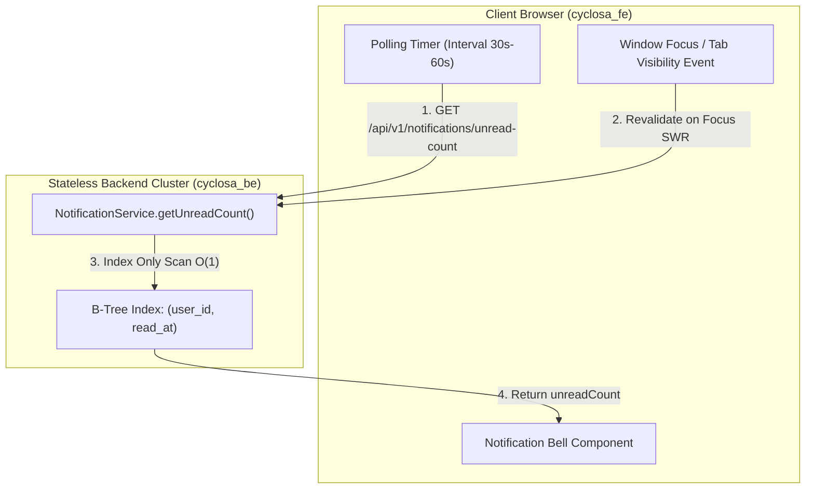
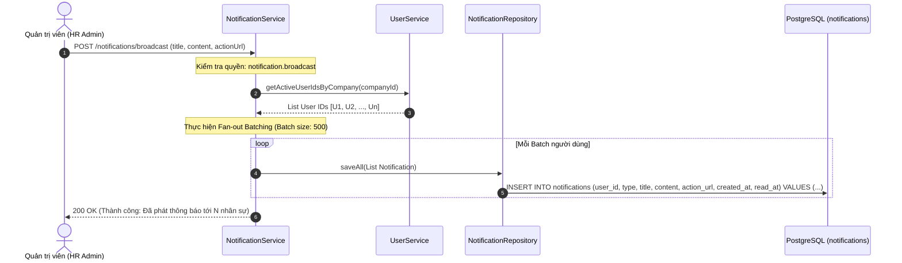
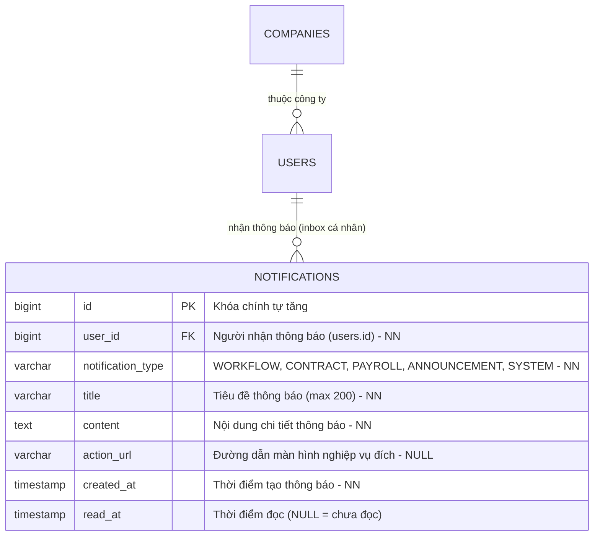
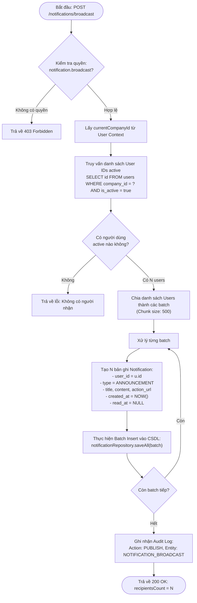
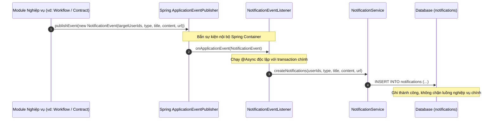
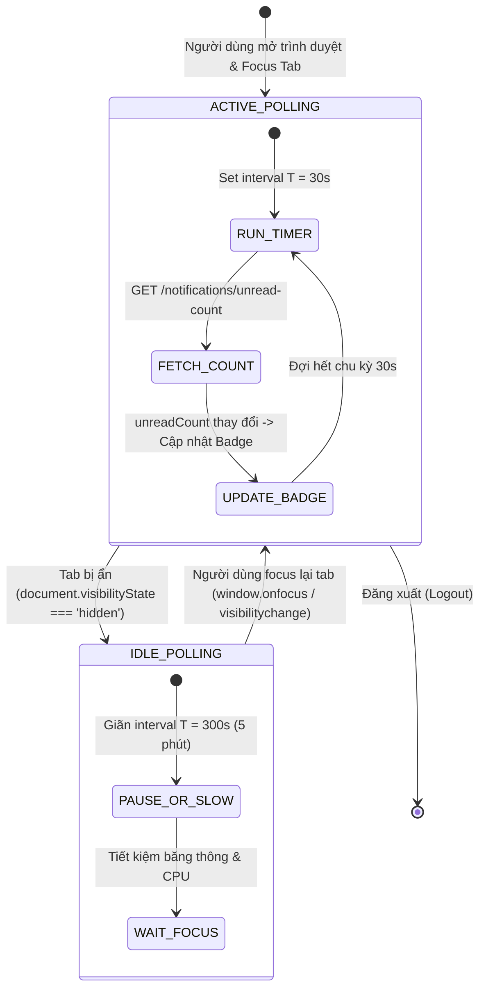

# ĐẶC TẢ CHI TIẾT VÀ KIẾN TRÚC TRIỂN KHAI MODULE 20: THÔNG BÁO NỘI BỘ (NOTIFICATION SYSTEM & NOTIFICATION CENTER)

> **Tài liệu căn cứ & tham chiếu:**
> - Nghiệp vụ chi tiết: [`Nghiep-vu.docx`](file:///f:/Project/CYCLOSA/ba/Nghiep-vu.docx) (§20 Thông báo nội bộ: Mô hình thông báo cá nhân hóa, thông báo toàn công ty)
> - Thiết kế CSDL & Data Dictionary: [`database.md`](file:///f:/Project/CYCLOSA/ba/database.md) (§8.21 Module 20 — THÔNG BÁO NỘI BỘ (Notification), [ASSUMPTION A21: Cơ chế Fan-out phát thông báo])
> - Danh mục API chuẩn: [`api-list.md`](file:///f:/Project/CYCLOSA/ba/api-list.md) (§20 THÔNG BÁO NỘI BỘ (Notification) — 7 endpoints)
> - Phân quyền RBAC & DataScope: [`module-phan-quyen.md`](file:///f:/Project/CYCLOSA/cyclosa_be/docs/ba/module-phan-quyen.md) (Quyền `notification.broadcast` và phạm vi dữ liệu cá nhân `Auth`)
> - Các module nghiệp vụ phát sinh thông báo:
>   - Quy trình phê duyệt dùng chung: [`module-quy-trinh-phe-duyet.md`](file:///f:/Project/CYCLOSA/cyclosa_be/docs/ba/module-quy-trinh-phe-duyet.md) (Sự kiện giao bước duyệt, kết quả duyệt/từ chối hồ sơ)
>   - Hợp đồng lao động: [`module-hop-dong-lao-dong.md`](file:///f:/Project/CYCLOSA/cyclosa_be/docs/ba/module-hop-dong-lao-dong.md) (Cảnh báo hợp đồng sắp hết hạn 30/15 ngày, yêu cầu ký số)
>   - Hồ sơ nhân sự: [`module-ho-so-nhan-su.md`](file:///f:/Project/CYCLOSA/cyclosa_be/docs/ba/module-ho-so-nhan-su.md) (Đánh giá hết hạn thử việc, quyết định điều chuyển, bổ nhiệm)
>   - Tuyển dụng & Thư mời nhận việc: [`module-tuyen-dung.md`](file:///f:/Project/CYCLOSA/cyclosa_be/docs/ba/module-tuyen-dung.md) (Thông báo ứng viên phản hồi Offer, phê duyệt kế hoạch tuyển dụng)
> - Chuẩn kiến trúc codebase: [`com.cyclosa.product`](file:///f:/Project/CYCLOSA/cyclosa_be/src/main/java/com/cyclosa/product) (Domain Service, Transactional Event Listeners, Polling Engine)

---

## 1. PHÂN TÍCH ĐẶC TẢ NGHIỆP VỤ & NGUYÊN LÝ CỐT LÕI

### 1.1. Bản chất & Vai trò của Notification Center trong Hệ sinh thái CYCLOSA HRM

Trong môi trường doanh nghiệp quy mô vừa và lớn (Enterprise HRM), **Thông báo nội bộ (Notification)** đóng vai trò là chiếc cầu nối luân chuyển thông tin thời gian thực giữa các phân hệ nghiệp vụ tự động và nhân sự:
- **Cắt giảm độ trễ ra quyết định:** Nhắc việc tức thì cho cấp quản lý khi có yêu cầu phê duyệt mới (`WORKFLOW`), thông báo hợp đồng sắp hết hạn (`CONTRACT`) để chuyên viên C&B kịp thời tái ký hoặc gia hạn.
- **Minh bạch hóa thông tin nhân sự:** Gửi thông báo khi bảng lương được duyệt và phiếu lương cá nhân đã sẵn sàng (`PAYROLL`), thông báo các chính sách, quy chế hoặc lịch nghỉ lễ của công ty (`ANNOUNCEMENT`).
- **Cảnh báo an toàn hệ thống:** Cảnh báo đăng nhập bất thường, thông báo bảo trì hoặc thay đổi chính sách bảo mật (`SYSTEM`).

---

### 1.2. Nguyên lý Kiến trúc: Pull-based (Polling) vs. Push-based (WebSocket)

Hệ thống CYCLOSA lựa chọn mô hình kiến trúc **Pull-based (REST Polling có kiểm soát)** thay vì duy trì kết nối liên tục Stateful WebSocket/Socket.IO:



#### Lý do kiến trúc & Lợi ích vận hành:
1. **Tiết kiệm tài nguyên hạ tầng (Resource Efficiency):**
   - Một hệ thống quản trị HRM nội bộ có hàng ngàn nhân viên đăng nhập trong giờ hành chính. Việc duy trì hàng ngàn kết nối TCP/WebSocket liên tục chiếm dụng file descriptors, bộ nhớ RAM tại Application Gateway/Load Balancer và gây phức tạp khi scale ngang (cần Redis Pub/Sub backplane để sync socket sessions).
   - Tần suất phát sinh thông báo của một nhân viên văn phòng thông thường là vài thông báo/giờ, không đòi hỏi độ trễ micro-giây như ứng dụng chat thời gian thực hoặc sàn chứng khoán. Chu kỳ Polling 30s - 60s hoàn toàn đáp ứng trọn vẹn trải nghiệm người dùng.
2. **Tương thích hoàn hảo kiến trúc Stateless JWT:**
   - Mỗi request Polling mang theo JWT Bearer token tiêu chuẩn, tự động hưởng lợi từ cơ chế xác thực phân quyền, rate-limiting và caching của Gateway mà không cần handshake hay quản lý heartbeat phức tạp.
3. **Cơ chế Polling thông minh (Smart Polling & Tab Revalidation):**
   - Khi người dùng thu nhỏ trình duyệt hoặc chuyển sang tab khác (`document.visibilityState === 'hidden'`), Frontend tự động giãn chu kỳ polling (tăng lên 300s) hoặc tạm dừng.
   - Khi người dùng quay lại tab làm việc (`visibilitychange` hoặc `window.onfocus`), Frontend tự động bắn một request kiểm tra ngay lập tức (kỹ thuật SWR / Stale-While-Revalidate).

---

### 1.3. Nguyên tắc Lưu trữ Cá nhân hóa & Cơ chế Phát tán Tin (Broadcast Fan-out Pattern)

Hệ thống tuân thủ nghiêm ngặt nguyên tắc thiết kế dữ liệu chuẩn hóa [ASSUMPTION A21]:

> **Thông báo luôn được lưu theo từng người dùng riêng lẻ (`user_id`). Thao tác phát thông báo toàn công ty (`/notifications/broadcast`) thực hiện cơ chế Fan-out (phân rã thành mỗi người dùng một bản ghi riêng).**



#### Vì sao phải dùng Fan-out thay vì lưu 1 bản ghi dùng chung?
- **Độc lập tuyệt đối về trạng thái đọc (`read_at`):** Người dùng $A$ đã đọc không làm ảnh hưởng đến trạng thái chưa đọc của người dùng $B$.
- **Hộp thư cá nhân độc lập:** Nếu dùng một bảng chung kèm bảng phụ `notification_reads (notification_id, user_id)`, mỗi câu lệnh đếm số chưa đọc sẽ phải thực hiện phép `LEFT JOIN` / `NOT EXISTS` cực kỳ nặng nề trên hàng triệu bản ghi khi hệ thống hoạt động lâu năm. Với Fan-out, câu lệnh đếm chưa đọc chỉ là một phép quét chỉ mục đơn giản trên bảng `notifications` với điều kiện `user_id = :uid AND read_at IS NULL`.
- **Hỗ trợ xóa riêng biệt:** Người dùng có quyền xóa dọn dẹp hộp thư cá nhân của mình mà không ảnh hưởng tới người khác.

---

### 1.4. Công thức Trạng thái Suy diễn (Derived State) & Cơ chế Xóa vật lý

#### A. Công thức Trạng thái Đọc & Đếm chưa đọc:
CYCLOSA không lưu cột cờ hiệu boolean `is_read` trong CSDL nhằm tránh dư thừa dữ liệu và mâu thuẫn đồng bộ với mốc thời gian:

$$\mathbf{is\_read} = \begin{cases} 
\mathbf{true} & \text{nếu } read\_at \neq \text{NULL} \\
\mathbf{false} & \text{nếu } read\_at = \text{NULL} 
\end{cases}$$

Số lượng thông báo chưa đọc hiển thị trên quả chuông (`unread_count`) được tính bằng:

$$\mathbf{UnreadCount}(u) = \sum_{n \in \text{Notifications}} \mathbb{I}(n.user\_id = u \ \land\ n.read\_at\ \text{IS NULL})$$

#### B. Cơ chế Xóa vật lý Hộp thư Cá nhân (Physical Deletion):
- Thao tác `DELETE /notifications/{notificationId}` là **Xóa vật lý (Hard Delete)** trực tiếp bản ghi khỏi bảng `notifications`.
- **Lý do nghiệp vụ:** Bảng `notifications` thuần túy là một "Hộp thư đến" (Personal Inbox) phục vụ trải nghiệm hiển thị cá nhân. Sự kiện nghiệp vụ gốc (ví dụ: Hợp đồng được duyệt, Quyết định bổ nhiệm, Lệnh chi lương) đã được lưu vĩnh viễn trong các bảng master nghiệp vụ và vết kiểm toán tại `audit_logs`. Do đó, người dùng có toàn quyền dọn dẹp inbox cá nhân mà không vi phạm tính toàn vẹn dữ liệu hệ thống.

---

### 1.5. Phân loại Thông báo (`NotificationType`)

| Loại thông báo (`NotificationType`) | Ý nghĩa & Nguồn phát sinh | Đối tượng nhận | Mức độ ưu tiên | Hành vi click (`action_url`) |
| :--- | :--- | :--- | :---: | :--- |
| `WORKFLOW` | Sự kiện quy trình phê duyệt: Được giao phiếu duyệt mới; Hồ sơ gửi duyệt đã được chấp thuận hoặc bị từ chối. | Người duyệt (Approver) hoặc Người đề xuất (Requester) | Cao | Điều hướng tới Hộp thư phê duyệt: `/approvals` hoặc chi tiết hồ sơ liên quan. |
| `CONTRACT` | Cảnh báo hợp đồng lao động: Hợp đồng sắp hết hạn (trước 30 ngày / 15 ngày), yêu cầu nhân viên ký số hợp đồng mới. | Nhân viên ký hợp đồng hoặc Chuyên viên nhân sự quản lý | Cao | Điều hướng tới màn hình Ký hợp đồng cá nhân: `/contracts/{id}` hoặc danh sách hợp đồng. |
| `PAYROLL` | Phát hành bảng lương, công bố phiếu lương tháng cá nhân đã được khóa sổ. | Toàn thể nhân viên có bảng lương trong kỳ | Trung bình | Điều hướng tới màn hình Xem phiếu lương cá nhân: `/my-payroll/{periodId}`. |
| `ANNOUNCEMENT` | Thông báo chung toàn công ty do Ban Giám đốc hoặc Phòng Nhân sự phát hành (Nghỉ lễ, chính sách mới, sự kiện nội bộ). | Toàn bộ nhân viên công ty | Trung bình | Mở cửa sổ đọc nội dung chi tiết hoặc mở đường dẫn tài liệu đính kèm. |
| `SYSTEM` | Cảnh báo bảo mật hệ thống: Đăng nhập từ thiết bị lạ, cảnh báo sắp hết hạn mật khẩu, bảo trì máy chủ định kỳ. | Người dùng bị ảnh hưởng hoặc Toàn hệ thống | Khẩn cấp | Điều hướng tới Cài đặt bảo mật `/settings/security` hoặc trang thông báo bảo trì. |

---

### 1.6. Các Quy tắc Nghiệp vụ Phòng vệ (Defensive Business Rules)

1. **Kiểm soát Phạm vi Dữ liệu & Quyền riêng tư (Strict Privacy Boundary):**
   - Mọi thao tác xem (`GET /notifications`), đếm (`GET /notifications/unread-count`), đánh dấu đọc (`POST /notifications/{id}/read`), đọc tất cả (`POST /notifications/read-all`) và xóa (`DELETE /notifications/{id}`) **bắt buộc phải kèm điều kiện ràng buộc `user_id = CurrentUser.id`**.
   - Người dùng tuyệt đối không thể đọc lén, sửa trạng thái hoặc xóa thông báo của người khác dù cố tình nhập ID của thông báo khác. Nếu cố tình truy cập ID không thuộc quyền sở hữu, hệ thống trả về mã lỗi `NOTIFICATION_NOT_FOUND` hoặc `NOTIFICATION_ACCESS_DENIED`.
2. **Kiểm soát Quyền Phát sóng Thông báo (Broadcast Authorization):**
   - Chỉ người dùng sở hữu quyền `notification.broadcast` (thường là Quản trị viên hệ thống hoặc Trưởng phòng Nhân sự) mới được phép gọi API `/notifications/broadcast`.
   - Hệ thống tự động giới hạn phạm vi phát sóng: Quản trị viên của Công ty A chỉ được phép broadcast tới các User thuộc Công ty A (xác định qua `companyId` của phiên làm việc).
3. **Phòng chống Lạm dụng & Tấn công Dữ liệu (Payload Sanitization & Throttling):**
   - Tiêu đề thông báo (`title`) giới hạn tối đa 200 ký tự, không được để trống.
   - Nội dung thông báo (`content`) được làm sạch qua bộ lọc HTML Sanitizer (chống tấn công Stored XSS) trước khi lưu vào CSDL.
   - Giới hạn tần suất gọi broadcast: Một tài khoản không được phép phát sóng quá 5 thông báo diện rộng trong vòng 10 phút nhằm tránh tình trạng spam hòm thư nhân viên.
4. **Bảo vệ Giao dịch Nội bộ (Asynchronous Event Dispatching):**
   - Khi các module nghiệp vụ khác tạo thông báo qua sự kiện Spring Event (`NotificationEvent`), tiến trình xử lý thông báo chạy bất đồng bộ (`@Async`) hoặc chạy sau khi giao dịch chính đã commit (`@TransactionalEventListener(phase = TransactionPhase.AFTER_COMMIT)`). Đảm bảo rằng việc gửi thông báo thất bại không bao giờ làm rollback giao dịch nghiệp vụ cốt lõi.

---

## 2. KIẾN TRÚC THỰC THỂ DỮ LIỆU & DATABASE SCHEMA

### 2.1. Sơ đồ Quan hệ Thực thể CSDL (Entity Relationship Diagram)



---

### 2.2. Từ điển Dữ liệu Chi tiết (Data Dictionary: Bảng `notifications`)

| Tên trường | Kiểu dữ liệu | Nullable | Ràng buộc | Mô tả nghiệp vụ chi tiết |
| :--- | :--- | :---: | :--- | :--- |
| `id` | `BIGINT` | **No** | `PRIMARY KEY AUTO_INCREMENT` | Định danh duy nhất của bản ghi thông báo. |
| `user_id` | `BIGINT` | **No** | `FOREIGN KEY → users(id) ON DELETE CASCADE` | Người nhận thông báo. Mọi truy vấn xem, đọc, xóa của người dùng đều bắt buộc lọc theo cột này. |
| `notification_type` | `VARCHAR(30)` | **No** | `ENUM NotificationType` | Phân loại thông báo (`WORKFLOW`, `CONTRACT`, `PAYROLL`, `ANNOUNCEMENT`, `SYSTEM`). |
| `title` | `VARCHAR(200)` | **No** | `LENGTH(title) BETWEEN 1 AND 200` | Tiêu đề ngắn gọn hiển thị trên thanh Notification Popover. |
| `content` | `TEXT` | **No** | `NOT EMPTY` | Nội dung đầy đủ của thông báo (hỗ trợ văn bản thuần hoặc HTML an toàn). |
| `action_url` | `VARCHAR(500)` | **Yes** | `NULL` | Đường dẫn tương đối (Deep Link) tới màn hình chức năng liên quan (ví dụ: `/approvals?id=123`). |
| `created_at` | `TIMESTAMP` | **No** | `DEFAULT CURRENT_TIMESTAMP` | Thời điểm hệ thống phát hành thông báo. |
| `read_at` | `TIMESTAMP` | **Yes** | `DEFAULT NULL` | Thời điểm người dùng mở xem thông báo. Nếu `NULL` tức là thông báo chưa đọc. |

---

### 2.3. Định nghĩa Enum `NotificationType`

```java
package com.cyclosa.product.notification.model;

public enum NotificationType {
    WORKFLOW,      // Phiếu phê duyệt được giao, kết quả phê duyệt hồ sơ
    CONTRACT,      // Hợp đồng sắp hết hạn, yêu cầu ký kết hợp đồng điện tử
    PAYROLL,       // Phát hành bảng lương, phiếu lương cá nhân
    ANNOUNCEMENT,  // Thông báo chính sách, lịch nghỉ lễ, thông điệp chung toàn công ty
    SYSTEM         // Cảnh báo bảo mật tài khoản, thông báo bảo trì hệ thống
}
```

---

### 2.4. Thiết kế Chỉ mục Tối ưu Truy vấn (Database Indexes)

Bảng `notifications` có đặc thù là tần suất đọc (`SELECT`) và đếm (`COUNT`) rất cao do cơ chế Polling định kỳ từ tất cả các client đang hoạt động. Các chỉ mục bắt buộc phải được thiết lập tối ưu:

```sql
-- 1. Index tối ưu hóa truy vấn đếm số lượng chưa đọc (Unread Count) & Polling nhanh:
-- Cho phép Database thực hiện Index-Only Scan với O(log N) cho câu lệnh:
-- SELECT COUNT(*) FROM notifications WHERE user_id = ? AND read_at IS NULL;
CREATE INDEX idx_notifications_user_unread 
ON notifications (user_id, read_at) 
WHERE read_at IS NULL;

-- 2. Index tối ưu hóa phân trang danh sách thông báo theo thời gian giảm dần:
-- SELECT * FROM notifications WHERE user_id = ? ORDER BY created_at DESC LIMIT 20 OFFSET 0;
CREATE INDEX idx_notifications_user_created 
ON notifications (user_id, created_at DESC);

-- 3. Index tối ưu hóa lọc theo loại thông báo:
-- SELECT * FROM notifications WHERE user_id = ? AND notification_type = ? ORDER BY created_at DESC;
CREATE INDEX idx_notifications_user_type 
ON notifications (user_id, notification_type, created_at DESC);
```

---

## 3. DANH MỤC RESTFUL API CHUẨN

Tất cả các API tuân thủ tiêu chuẩn kiến trúc CYCLOSA: Base path `/api/v1`, xác thực Stateless JWT `Authorization: Bearer <token>`, định dạng `application/json; charset=UTF-8`.

### 3.1. Bảng Tổng hợp Danh mục API

| STT | Phương thức | Đường dẫn Endpoint | Tóm tắt chức năng | Quyền hạn (Scope) | Tần suất sử dụng |
| :---: | :---: | :--- | :--- | :---: | :---: |
| 1 | `GET` | `/notifications` | Lấy danh sách thông báo của tôi (phân trang, lọc theo trạng thái đọc và loại) | `Auth` | Thường xuyên (Mở dropdown / Trang quản lý) |
| 2 | `GET` | `/notifications/unread-count` | Lấy số lượng thông báo chưa đọc cho biểu tượng chuông trên Header | `Auth` | Rất cao (Polling chu kỳ 30s-60s) |
| 3 | `POST` | `/notifications/{notificationId}/read` | Đánh dấu một thông báo cụ thể là đã đọc | `Auth` | Thường xuyên (Khi click vào 1 thông báo) |
| 4 | `POST` | `/notifications/read-all` | Đánh dấu tất cả thông báo của tôi là đã đọc | `Auth` | Định kỳ (Bấm nút 'Đọc tất cả') |
| 5 | `DELETE`| `/notifications/{notificationId}` | Xóa một thông báo khỏi hộp thư cá nhân | `Auth` | Tùy chọn (Dọn dẹp hòm thư) |
| 6 | `POST` | `/notifications/broadcast` | Phát thông báo toàn công ty (Fan-out tới tất cả nhân viên) | `notification.broadcast` | Thấp (Chỉ khi có thông cáo chung) |
| 7 | `POST` | `/internal/notifications` | API nội bộ giữa các module: Tạo thông báo cho một hoặc nhiều người dùng | `Service` | Rất cao (Hệ thống gọi ngầm) |

---

### 3.2. Đặc tả Chi tiết Payload Request / Response JSON

#### 1. Lấy danh sách thông báo của tôi (`GET /notifications`)
- **Query Parameters:**
  - `read` (boolean, optional): `true` = đã đọc, `false` = chưa đọc, omit = lấy tất cả.
  - `type` (string, optional): Lọc theo enum `NotificationType` (`WORKFLOW`, `CONTRACT`...).
  - `page` (int, default: 0): Số trang.
  - `size` (int, default: 20): Số lượng bản ghi mỗi trang.
- **Response `200 OK`:**
```json
{
  "success": true,
  "code": 200,
  "message": "Lấy danh sách thông báo thành công",
  "data": {
    "content": [
      {
        "id": 10524,
        "notificationType": "WORKFLOW",
        "title": "Hồ sơ đề xuất tuyển dụng cần phê duyệt",
        "content": "Chuyên viên Nguyễn Văn A đã gửi đề xuất tuyển dụng vị trí Senior Backend Developer. Vui lòng kiểm tra và phê duyệt.",
        "actionUrl": "/approvals?requestId=89",
        "createdAt": "2026-11-14T09:15:30Z",
        "readAt": null,
        "isRead": false
      },
      {
        "id": 10488,
        "notificationType": "CONTRACT",
        "title": "Hợp đồng lao động sắp hết hạn",
        "content": "Hợp đồng lao động có thời hạn của nhân viên Trần Thị B (Mã: EMP0089) sẽ hết hạn vào ngày 30/11/2026 (còn 16 ngày).",
        "actionUrl": "/contracts/741",
        "createdAt": "2026-11-13T08:00:00Z",
        "readAt": "2026-11-13T10:20:15Z",
        "isRead": true
      }
    ],
    "page": 0,
    "size": 20,
    "totalElements": 48,
    "totalPages": 3,
    "last": false
  }
}
```

---

#### 2. Lấy số lượng thông báo chưa đọc (`GET /notifications/unread-count`)
- **Headers:** `Authorization: Bearer <token>`
- **Response `200 OK`:**
```json
{
  "success": true,
  "code": 200,
  "message": "Lấy số lượng thông báo chưa đọc thành công",
  "data": {
    "unreadCount": 5
  }
}
```

---

#### 3. Đánh dấu một thông báo là đã đọc (`POST /notifications/{notificationId}/read`)
- **Path Parameter:** `notificationId` (BIGINT)
- **Response `200 OK`:**
```json
{
  "success": true,
  "code": 200,
  "message": "Đã đánh dấu thông báo là đã đọc",
  "data": {
    "id": 10524,
    "readAt": "2026-11-14T16:10:00Z",
    "isRead": true
  }
}
```

---

#### 4. Đánh dấu tất cả thông báo là đã đọc (`POST /notifications/read-all`)
- **Headers:** `Authorization: Bearer <token>`
- **Response `200 OK`:**
```json
{
  "success": true,
  "code": 200,
  "message": "Đã đánh dấu tất cả thông báo là đã đọc",
  "data": {
    "updatedCount": 5
  }
}
```

---

#### 5. Xóa một thông báo cá nhân (`DELETE /notifications/{notificationId}`)
- **Path Parameter:** `notificationId` (BIGINT)
- **Response `200 OK`:**
```json
{
  "success": true,
  "code": 200,
  "message": "Đã xóa thông báo thành công",
  "data": null
}
```

---

#### 6. Phát thông báo toàn công ty (`POST /notifications/broadcast`)
- **Quyền yêu cầu:** `notification.broadcast`
- **Request Body:**
```json
{
  "title": "Thông báo: Nghỉ Tết Dương Lịch 2027 và Lịch trả lương tháng 12",
  "content": "Toàn thể CBNV công ty sẽ được nghỉ Tết Dương Lịch vào ngày 01/01/2027. Bảng lương và phiếu lương tháng 12 sẽ được hoàn tất quyết toán trước ngày 30/12/2026.",
  "actionUrl": "/announcements/tet-2027"
}
```
- **Response `200 OK`:**
```json
{
  "success": true,
  "code": 200,
  "message": "Phát thông báo toàn công ty thành công",
  "data": {
    "recipientsCount": 350,
    "broadcastAt": "2026-11-14T16:15:00Z"
  }
}
```

---

#### 7. API Nội bộ giữa các Service (`POST /internal/notifications`)
- **Quyền yêu cầu:** Token dịch vụ nội bộ `Service` hoặc lời gọi Direct Spring `@Service`
- **Request Body:**
```json
{
  "userIds": [12, 18, 45],
  "notificationType": "WORKFLOW",
  "title": "Phiếu duyệt hợp đồng mới",
  "content": "Hợp đồng lao động HD-2026-089 đang chờ bạn xét duyệt.",
  "actionUrl": "/approvals?requestId=102"
}
```
- **Response `200 OK`:**
```json
{
  "success": true,
  "code": 200,
  "message": "Tạo thông báo nội bộ thành công",
  "data": {
    "createdCount": 3
  }
}
```

---

## 4. THUẬT TOÁN ĐIỀU PHỐI TIẾN TRÌNH (ENGINE MECHANICS)

### 4.1. Quy trình Phát thông báo Toàn công ty (Broadcast Fan-out Process)



---

### 4.2. Cơ chế Tiếp nhận Sự kiện Nghiệp vụ Đa phân hệ (Event-Driven Integration)

Để tuân thủ triệt để nguyên tắc **Kiến trúc phân rã không phụ thuộc vòng (Decoupled Architecture)**, các module nghiệp vụ như Workflow, Contract, Payroll không trực tiếp thao tác vào bảng `notifications`. Thay vào đó, chúng kích hoạt cơ chế Spring Application Event:



---

### 4.3. Chiến lược Polling Thông minh tại Frontend (`cyclosa_fe`)



---

## 5. THIẾT KẾ TRẢI NGHIỆM NGƯỜI DÙNG & GIAO DIỆN FRONTEND (`cyclosa_fe`)

### 5.1. Kiến trúc Thành phần Giao diện Chuông Thông báo (Notification Bell on Navbar)

Thành phần quả chuông thông báo nằm cố định tại góc phải trên thanh Top Navigation Bar:

```
┌────────────────────────────────────────────────────────────────────────────────────────┐
│ CYCLOSA HRM   [🔍 Tìm kiếm nhân viên, chức năng...]       (🔔 5)  (🌐 VN)  [Avatar Sếp] │
└────────────────────────────────────────────────────────────────────────────────────────┘
                                                              │
                                                              ▼ (Click mở Popover)
┌────────────────────────────────────────────────────────────────────────────────────────┐
│ THÔNG BÁO                                                 [✓ Đánh dấu tất cả đã đọc]   │
├────────────────────────────────────────────────────────────────────────────────────────┤
│ 🔵 Hồ sơ đề xuất tuyển dụng cần phê duyệt                                     5 phút trước │
│    Chuyên viên Nguyễn Văn A đã gửi đề xuất tuyển dụng Senior Backend...                │
├────────────────────────────────────────────────────────────────────────────────────────┤
│ 🔵 Hợp đồng lao động sắp hết hạn                                               2 giờ trước │
│    Hợp đồng của nhân viên Trần Thị B sẽ hết hạn sau 16 ngày...                         │
├────────────────────────────────────────────────────────────────────────────────────────┤
│ ⚪ Bảng lương tháng 10/2026 đã được phát hành                                  Hôm qua      │
│    Phiếu lương cá nhân đã sẵn sàng, vui lòng kiểm tra chi tiết...                      │
├────────────────────────────────────────────────────────────────────────────────────────┤
│ [            Xem tất cả thông báo trong Trung tâm thông báo (/notifications)         ] │
└────────────────────────────────────────────────────────────────────────────────────────┘
```

- **Unread Badge:**
  - Nếu `unreadCount === 0`: Ẩn badge đỏ.
  - Nếu `1 <= unreadCount <= 99`: Hiển thị số lượng màu đỏ tươi (`bg-red-500 text-white text-xs font-bold rounded-full`).
  - Nếu `unreadCount > 99`: Hiển thị `99+`.
- **Hành vi Tương tác:**
  - Click vào quả chuông: Mở dropdown hiển thị tối đa 5 thông báo mới nhất.
  - Click vào một thông báo chưa đọc: Tự động gọi API `POST /notifications/{id}/read`, chuyển icon sang trạng thái đã đọc (`isRead = true`), giảm `unreadCount` đi 1 đơn vị, và chuyển hướng trình duyệt tới `actionUrl`.
  - Nút "Đánh dấu tất cả đã đọc": Gọi API `POST /notifications/read-all`, chuyển toàn bộ trạng thái trong popover thành đã đọc và xóa badge đỏ.

---

### 5.2. Màn hình Trung tâm Quản lý Thông báo (`/notifications/page.tsx`)

Màn hình chuyên biệt dành cho người dùng quản lý, tìm kiếm và phân loại toàn bộ lịch sử thông báo cá nhân:
- **Header chuẩn:** Gồm Tiêu đề *Trung tâm Thông báo* và Breadcrumb *Trang chủ / Thông báo* (Không có đoạn văn mô tả thừa).
- **Tabs Phân loại Trạng thái:**
  - `Tất cả` (All)
  - `Chưa đọc` (Unread - có hiển thị số lượng badge nhỏ)
  - `Phê duyệt` (`WORKFLOW`)
  - `Hợp đồng` (`CONTRACT`)
  - `Tiền lương` (`PAYROLL`)
  - `Chung & Hệ thống` (`ANNOUNCEMENT` & `SYSTEM`)
- **Danh sách Thông báo Chi tiết:**
  - Hiển thị đầy đủ nội dung chi tiết, biểu tượng trực quan theo từng loại (Icon Clipboard cho Workflow, Icon FileText cho Hợp đồng, Icon DollarSign cho Tiền lương, Icon Megaphone cho Announcement).
  - Nút **Xóa thông báo (Delete Icon)** cho phép xóa vĩnh viễn khỏi hộp thư.
  - Nút **Chuyển tới nghiệp vụ (Action Button)** điều hướng trực tiếp đến chức năng xử lý.

---

### 5.3. Màn hình Phát Thông báo Toàn công ty (`/announcements/broadcast`)

Dành riêng cho Quản trị viên Nhân sự có quyền `notification.broadcast`:
- **Biểu mẫu soạn thảo thông cáo:**
  - *Tiêu đề thông báo:* Ô nhập văn bản (Bắt buộc, tối đa 200 ký tự).
  - *Nội dung chi tiết:* Trình soạn thảo văn bản hỗ trợ xuống dòng, danh sách gạch đầu dòng.
  - *Đường dẫn liên kết (Action URL):* Tùy chọn đường dẫn nội bộ trong hệ thống.
  - *Xem trước (Live Preview):* Hiển thị mô phỏng giao diện thông báo mà nhân viên sẽ nhìn thấy trên máy tính và điện thoại.
- **Hộp thoại Xác nhận Phát sóng (Confirmation Dialog):**
  - Cảnh báo rõ số lượng nhân sự sẽ nhận thông báo: *"Bạn đang chuẩn bị phát thông báo tới toàn bộ 350 nhân sự đang hoạt động của công ty. Thao tác này không thể hoàn tác. Bạn có chắc chắn muốn phát sóng?"*

---

## 6. DẢI MÃ LỖI NGHIỆP VỤ CHUẨN HÓA (BUSINESS ERROR CODES)

Module Thông báo nội bộ sử dụng dải mã lỗi chuẩn hóa tiền tố `NOTIFICATION_`:

| Mã lỗi (Error Code) | HTTP Status | Thông điệp lỗi chi tiết (Message) | Nguyên nhân phát sinh & Hướng dẫn xử lý |
| :--- | :---: | :--- | :--- |
| `NOTIFICATION_NOT_FOUND` | `404` | Thông báo không tồn tại hoặc đã bị xóa. | ID thông báo không tồn tại trong CSDL hoặc đã bị người dùng xóa vật lý trước đó. |
| `NOTIFICATION_ACCESS_DENIED` | `403` | Bạn không có quyền thao tác trên thông báo của người khác. | Người dùng cố tình gọi API đọc/xóa thông báo có `user_id` không khớp với JWT Token. |
| `NOTIFICATION_TITLE_REQUIRED` | `400` | Tiêu đề thông báo không được để trống. | Dữ liệu đầu vào khi broadcast hoặc tạo thông báo nội bộ thiếu trường `title`. |
| `NOTIFICATION_CONTENT_TOO_LONG` | `400` | Nội dung thông báo vượt quá độ dài cho phép. | Nội dung thông báo dài hơn giới hạn quy định hoặc tiêu đề vượt quá 200 ký tự. |
| `NOTIFICATION_BROADCAST_EMPTY_TARGET` | `400` | Không có người nhận hợp lệ nào trong công ty để phát thông báo. | Công ty hiện tại không có nhân sự nào đang ở trạng thái kích hoạt tài khoản (`is_active = true`). |
| `NOTIFICATION_BROADCAST_PERMISSION_DENIED` | `403` | Bạn không có quyền phát thông báo toàn công ty. | Tài khoản thiếu mã quyền `notification.broadcast` trong cấu hình vai trò RBAC. |
| `NOTIFICATION_FANOUT_FAILED` | `500` | Quá trình phát tán thông báo diện rộng gặp sự cố. | Lỗi kết nối CSDL hoặc lỗi Batch Insert trong quá trình Fan-out hàng loạt. Kiểm tra logs hệ thống. |

