# THIẾT KẾ CƠ SỞ DỮ LIỆU QUAN HỆ — HỆ THỐNG QUẢN TRỊ NGUỒN NHÂN LỰC (HRM) FSI

> Vai trò: Senior Database Architect / Data Modeler  
> Nguồn: `QLDA.docx` (21 module: Auth → Audit Log)  
> Chuẩn hóa: tối thiểu 3NF — không lưu dữ liệu derived — phân biệt rõ master / transaction / history / snapshot.

---

## MỤC LỤC

1. [Phạm vi, nguồn dữ liệu và giới hạn](#1-phạm-vi-nguồn-dữ-liệu-và-giới-hạn)
2. [Quy ước thiết kế](#2-quy-ước-thiết-kế)
3. [Quyết định kiến trúc dữ liệu xuyên suốt](#3-quyết-định-kiến-trúc-dữ-liệu-xuyên-suốt)
4. [Phân tích nghiệp vụ: entity, quan hệ, functional dependency](#4-phân-tích-nghiệp-vụ)
5. [Danh sách dữ liệu derived bị loại bỏ](#5-dữ-liệu-derived-bị-loại-bỏ)
6. [Dữ liệu lịch sử / snapshot được phép lưu](#6-dữ-liệu-lịch-sử--snapshot-được-phép-lưu)
7. [Danh sách [ASSUMPTION]](#7-danh-sách-assumption) (A1–A33; bổ sung A34–A43 ở mục 11)
8. [Thiết kế chi tiết các bảng theo module](#8-thiết-kế-chi-tiết-các-bảng)
9. [Kiểm tra chuẩn hóa 1NF → 2NF → 3NF](#9-kiểm-tra-chuẩn-hóa)
10. [Phụ lục: danh mục khóa cấu hình hệ thống](#10-phụ-lục-khóa-cấu-hình)
11. [Giả định bổ sung](#11-giả-định-bổ-sung)

---

## 1. Phạm vi, nguồn dữ liệu và giới hạn

| Hạng mục | Nội dung |
| --- | --- |
| Module có đặc tả đầy đủ | 0 Auth, 1 Organization, 2 Org Simulation, 3 Role & Permission, 4 Recruitment, 5 Employee, 6 Onboarding, 7 Digital Records, 8 Contract, 9 Attendance, 10 Payroll, 11 Performance, 12 Reward & Discipline, 13 Career & Succession, 14 Leave, 15 Transfer, 16 Offboarding, 17 Legal & Compliance, 18 AI Assistant, 19 Workplace, 20 Notification, 21 Audit Log |
| Module được tham chiếu nhưng **không có mô tả riêng** | **Workflow** (phê duyệt), **Asset** (tài sản), **Reporting**, **Bảo hiểm** |
| Dữ liệu nằm ngoài RDBMS | Activation token, Refresh Token, Access Token Blacklist (Redis, module Auth); ảnh/tệp nhị phân (object storage — CSDL chỉ giữ tham chiếu); vector index nếu dùng vector DB ngoài |

**Quy mô thiết kế:** 172 bảng, 123 enum, phủ 21 module + nhóm dùng chung (Workflow, Asset, Files, Cấu hình).

**Giới hạn cần biết:**

- Tài liệu có 105 hình minh họa (sơ đồ luồng, mock UI). Thiết kế này dựa trên **toàn bộ phần văn bản**; các hình không được dùng làm nguồn dữ liệu. Nếu hình có chứa trường dữ liệu bổ sung, cần đối chiếu lại.
- **Workflow** và **Asset** bị 10+ module phụ thuộc (phê duyệt, thu hồi tài sản, gắn tài sản vào chỗ ngồi). Vì thiếu đặc tả, chỉ thiết kế **tập bảng tối thiểu** đủ cho các nghiệp vụ đã mô tả — xem [ASSUMPTION A2, A3].
- Các module **Reporting** và **Bảo hiểm** chỉ tổng hợp/hiển thị → không tạo bảng riêng (toàn bộ là dữ liệu derived).

---

## 2. Quy ước thiết kế

| Quy ước | Nội dung |
| --- | --- |
| Khóa chính | `id BIGINT` (auto-increment / identity). Bảng nối N:M dùng **khóa chính ghép** khi cặp khóa ngoại đã đủ định danh |
| Kiểu dữ liệu | `BIGINT`, `INT`, `SMALLINT`, `DECIMAL(p,s)`, `VARCHAR(n)`, `TEXT`, `BOOLEAN`, `DATE`, `TIME`, `TIMESTAMP` (UTC), `ENUM <Tên>` (tham chiếu tới enum mô tả ngay dưới bảng/module) |
| Tiền tệ | `DECIMAL(18,2)`, đơn vị VND [ASSUMPTION A6] |
| Ký hiệu cột "Khóa" | `PK` khóa chính · `FK` khóa ngoại · `UQ` duy nhất · `NN` NOT NULL · `NULL` cho phép rỗng. Cột NULL không ghi gì thêm nghĩa là tùy chọn |
| Cột kỹ thuật | **Không** thêm `created_at/updated_at/created_by` hàng loạt vì Audit Log (module 21) đã ghi nhận ai/khi nào/trước-sau. Chỉ lưu timestamp khi nó là **business fact** (vd `submitted_at`, `read_at`, `checked_in_at`) |
| Xóa mềm | Chỉ dùng `deleted_at` ở nơi tài liệu nêu rõ "xóa mềm" (Site, Career Path) hoặc `dissolved_date` cho phòng ban |
| Enum | Mô tả ngay sau bảng đầu tiên sử dụng, dạng `Enum <Tên>` + bảng giá trị |
| Ràng buộc nhiều cột | Ghi ở dòng **"Ràng buộc bảng"** dưới mỗi bảng (UNIQUE, CHECK, partial unique) |

---

## 3. Quyết định kiến trúc dữ liệu xuyên suốt

### 3.1. Mô hình hiệu lực theo thời gian (effective-dated) thay cho "bản ghi hiện tại + bản sao lịch sử"

Tài liệu yêu cầu lịch sử cho: cơ cấu phòng ban, công tác nhân viên, trạng thái làm việc, mức lương. Nếu vừa lưu "giá trị hiện tại" trong bảng chính vừa lưu bản sao trong bảng lịch sử sẽ **trùng thông tin**. Thiết kế chọn:

| Thực thể | Bảng danh tính (ổn định) | Bảng hiệu lực theo thời gian | Cách lấy "hiện tại" |
| --- | --- | --- | --- |
| Phòng ban | `departments` | `department_versions` | dòng có `effective_from` lớn nhất ≤ ngày cần tra |
| Công tác (phòng ban, chi nhánh, chức danh, cấp bậc, quản lý, loại hình) | `employees` | `employee_work_assignments` | như trên |
| Trạng thái làm việc | `employees` | `employee_status_history` | như trên |
| Mức lương | `employees` | `salary_histories` | như trên |

`effective_to` **không lưu** vì bằng `effective_from` của dòng kế tiếp (derived). Giá trị "trước/sau thay đổi" cũng lấy từ hai dòng liền kề.

### 3.2. Workflow phê duyệt dùng chung
Hầu hết nghiệp vụ (nghỉ phép, điều chuyển, đề xuất tuyển dụng, hợp đồng, bảng lương, sa thải, hủy tài liệu...) đi qua module Workflow. Tiến trình phê duyệt (ai duyệt, khi nào, từ chối vì sao) lưu **một nơi duy nhất** trong `workflow_*`. Bảng nghiệp vụ chỉ giữ **trạng thái vòng đời của chính thực thể** (vd `DRAFT`, `COMPLETED`, `CANCELLED`) và **không** sao chép người duyệt/ngày duyệt.

> **Đánh đổi có chủ ý:** các trạng thái trung gian như `PENDING_APPROVAL` vẫn xuất hiện trong enum của bảng nghiệp vụ vì tài liệu định nghĩa chúng là một phần vòng đời của thực thể và các module khác truy vấn theo trạng thái này. Đây là trạng thái do nghiệp vụ xác nhận, không phải giá trị tính toán thuần túy.

### 3.3. Tệp tin
Mọi tệp (CV, ảnh chân dung, hợp đồng PDF, tài liệu scan, phiếu lương...) tham chiếu qua bảng `files`. Giá trị băm SHA-256 (bắt buộc cho toàn vẹn hợp đồng điện tử) lưu **một lần** ở `files.sha256_hash`.

### 3.4. Cấu hình
Ngưỡng/tham số vận hành mà tài liệu ghi "theo cấu hình" (ngưỡng OCR 60%, ngưỡng so khớp khuôn mặt, ngày nhắc hợp đồng 45/30, ngưỡng bất thường lương 30%...) lưu trong `system_configurations` (danh mục khóa ở Phụ lục §10). **Thông số pháp lý** (giảm trừ gia cảnh, biểu thuế, hệ số OT, tỷ lệ BHXH, thời hiệu kỷ luật...) **không** nằm ở đây mà lấy từ `compliance_rule_versions` / `compliance_rule_parameters` theo đúng yêu cầu của module 10 và 17.

### 3.5. Tham chiếu đa hình (polymorphic) — chỉ dùng khi bắt buộc
Chỉ 3 chỗ dùng cặp `(type, id)` không có FK vật lý: `workflow_requests.reference_id`, `compliance_checks.subject_id`, `audit_logs.entity_id`. Lý do: đối tượng tham chiếu có thể là bảng bất kỳ của mọi module. Mọi nơi khác dùng FK thật hoặc nhiều FK nullable + `CHECK` đúng một giá trị khác NULL.

### 3.6. Đa công ty
`company_id` chỉ đặt ở **bảng gốc** của mỗi cây dữ liệu (departments, branches→regions, job_titles, roles...). Bảng con lấy công ty qua khóa cha, **không lặp `company_id`** để tránh phụ thuộc bắc cầu.

---

## 4. Phân tích nghiệp vụ

### 4.1. Business entity theo module

| Module | Entity (bảng master/transaction chính) |
| --- | --- |
| Dùng chung | File, SystemConfiguration, Skill, Holiday, Workflow (Definition/Step/Request/RequestStep), Asset (Category/Asset/Assignment) |
| 0 Auth | User, OAuthAccount |
| 1 Organization | Company, Region, Branch, CostCenter, Department(+Version), JobTitle, JobLevel |
| 2 Simulation | OrgScenario, ScenarioDepartment, ScenarioEmployeeMove |
| 3 Permission | Role, Permission, RolePermission(scope), UserRoleAssignment |
| 4 Recruitment | RecruitmentRequest, JobOpening, JobPosting, Channel, Candidate(+Experience/Education/Skill), Application(+StageTransition, AiReview), InterviewRound/Criterion/Question, Interview, Panelist, Scorecard(+Score), ContentFlag, Offer(+Allowance), TalentPool, InternalOpportunity(+Application) |
| 5 Employee | Employee, IdentityDocument, BankAccount, Dependent, EmergencyContact, WorkAssignment, StatusHistory, ProbationEvaluation, FaceEnrollment |
| 6 Onboarding | ChecklistTemplate(+Item), OnboardingProcess(+Task), ItAccountType, ItAccountRequest, OrientationSession |
| 7 Digital Records | DocumentType, MetadataField, RetentionPolicy, Dossier, SourceFile, Document(+Version, MetadataValue), LegalHold, DestructionProposal(+Item, CouncilMember), RoleDocumentTypePermission |
| 8 Contract | ContractTemplate(+Version), Contract, Allowance, Appendix, ContractVersion, Signer |
| 9 Attendance | Shift, ShiftAssignment, AttendanceLog, AttendanceRequest(+Attachment), AttendanceAdjustment, TimesheetPeriod, TimesheetSnapshot(+Overtime) |
| 10 Payroll | SalaryComponent, EmployeeSalaryComponent, SalaryHistory, SalaryAdvance, PayrollPeriod, PayrollRecord(+Line), PayrollPeriodRuleVersion, PayrollPayment, Payslip |
| 11 Performance | PerformanceCycle, Kpi, PerformanceReview, PerformanceGoal |
| 12 Reward & Discipline | RewardDecision, DisciplineCase(+Participant, Evidence), Complaint |
| 13 Career | CareerPath, SuccessionPlan(+Candidate), InternalTalentPool, CareerSimulation(+Step) |
| 14 Leave | LeaveType, LeavePolicy, LeaveBalance, LeaveRequest |
| 15 Transfer | TransferRequest(+Allowance) |
| 16 Offboarding | ResignationRequest, TerminationDecision, ClearanceItem, ExitInterview |
| 17 Legal | LegalDocument(+Relation, Provision), ComplianceRule(+Version, Parameter, ModuleUsage), ImpactAssessment, ComplianceCheck, ComplianceAlert |
| 18 AI | KnowledgeDocument(+Version, Chunk), ChatConversation, ChatMessage(+FunctionCall, Citation), KnowledgeGapCluster |
| 19 Workplace | Site, Floor, FloorPlan, Zone(+BoundaryPoint), SeatRow, Amenity, Seat, SeatAssignment, SeatAsset, FloorObject, MeetingRoom, DeskBooking, RoomBooking, WorkplaceIssue |
| 20 Notification | Notification |
| 21 Audit | AuditLog |

### 4.2. Cardinality và bảng trung gian (N:M)

| Quan hệ | Cardinality | Giải pháp |
| --- | --- | --- |
| Company — Region — Branch | 1:N — 1:N | FK `regions.company_id`, `branches.region_id` |
| Company — Department | 1:N | FK + `department_versions` giữ phụ thuộc cha-con theo thời gian |
| Department ↔ Department (cha/con) | 1:N tự tham chiếu | `department_versions.parent_department_id` |
| Employee — (Department, Branch, JobTitle, JobLevel, Manager) | N:M theo thời gian | `employee_work_assignments` (bảng nối có thuộc tính `effective_from`) |
| User ↔ Role (theo công ty) | N:M | `user_role_assignments` |
| Role ↔ Permission | N:M có thuộc tính `data_scope` | `role_permissions` |
| Role ↔ DocumentType | N:M có thuộc tính `action` | `role_document_type_permissions` |
| Candidate ↔ JobOpening | N:M có thuộc tính | `applications` |
| Interview ↔ Interviewer | N:M | `interview_panelists` |
| Scorecard ↔ Criterion | N:M có điểm | `scorecard_scores` |
| Candidate ↔ Skill | N:M | `candidate_skills` |
| Seat ↔ Amenity | N:M | `seat_amenities` |
| Seat ↔ Asset | N:M theo thời gian | `seat_assets` |
| Seat ↔ Employee (bàn cố định) | N:M theo thời gian | `seat_assignments` |
| ComplianceRuleVersion ↔ LegalProvision | N:M | `compliance_rule_version_provisions` |
| DestructionProposal ↔ Document | N:M | `destruction_proposal_items` |
| Employee ↔ Tag (talent) | N:M | `internal_talent_pool_entries` (cặp employee–tag là duy nhất) |
| 1 Contract — N Appendix — N Version — N Signer | 1:N chuỗi | FK trực tiếp |

### 4.3. Functional dependency quan trọng (đại diện)

| Bảng | Functional dependency | Hệ quả thiết kế |
| --- | --- | --- |
| `employee_work_assignments` | (employee_id, effective_from) → department, branch, job_title, job_level, manager, employment_type | Ba chiều tổ chức/địa lý/chức danh nằm cùng một bộ giá trị hiệu lực; không lưu tên phòng ban/chi nhánh |
| `department_versions` | (department_id, effective_from) → name, parent, cost_center, manager | Tên/vị trí cây/trung tâm chi phí **không** nằm ở `departments` |
| `branches` | id → region_id; region_id → company_id | Không đặt `company_id` ở `branches` (tránh transitive) |
| `seats` | id → seat_row_id; seat_row_id → zone_id → floor_id → site_id | Không lưu zone/floor/site ở `seats` |
| `leave_balances` | (employee_id, leave_type_id, year) → entitled_days, carried_over_days | Số đã dùng/đang chờ/còn lại **không lưu** (tính từ `leave_requests`) |
| `contracts` | id → employee_id, template_version_id; employee_id → họ tên | Họ tên/CCCD nhân viên không lặp trong hợp đồng |
| `payroll_record_lines` | id → payroll_record_id; payroll_record_id → (period_id, employee_id) | Tổng Gross/Net **không lưu** (SUM theo dòng) |
| `performance_goals` | id → review_id; review_id → (cycle_id, employee_id) | Điểm tổng hợp chỉ chốt khi `FINALIZED` |
| `chat_messages` | id → conversation_id; conversation_id → user_id | Không lặp `user_id` ở tin nhắn |
| `compliance_rule_versions` | (rule_id, version_no) → hiệu lực, trạng thái | Quy tắc đã công bố bất biến, sửa đổi = phiên bản mới |

---

## 5. Dữ liệu derived bị loại bỏ

Các trường dưới đây **có xuất hiện trong tài liệu nghiệp vụ** nhưng là dữ liệu suy ra được → **không tạo cột**.

| # | Trường / khái niệm trong tài liệu | Lý do là derived | Cách lấy |
| --- | --- | --- | --- |
| 1 | `onboarding` tổng số việc, số đã hoàn thành, tỷ lệ hoàn thành | Đếm từ `onboarding_tasks` | `COUNT`, `COUNT FILTER` |
| 2 | Số lượng đã tuyển của vị trí | Đếm ứng viên đã chuyển thành nhân viên | `COUNT(employees.source_application_id)` theo opening |
| 3 | `FILLED`/hết hạn tin tuyển dụng (`EXPIRED`) | So `expires_at` với thời gian hiện tại | `expires_at < now()` |
| 4 | Giờ làm tiêu chuẩn của ca | `end_time − start_time − break_minutes` | tính từ ca |
| 5 | Ca qua ngày (`is_overnight`) | `end_time < start_time` | so sánh giờ |
| 6 | Số phút đi muộn/về sớm, công quy đổi, trạng thái `ON_TIME/LATE/EARLY/ABSENT/EXPLAINED/MISSING_CHECK_OUT...` từng ngày | Tính từ ca + log chấm công + bản ghi điều chỉnh + đơn nghỉ | truy vấn/service tính công |
| 7 | Số lần thử xác thực | Đếm `attendance_logs` thất bại | `COUNT` |
| 8 | Bảng công tháng **trước khi khóa** | Tổng hợp từ nguồn | chỉ lưu **snapshot khi khóa** (xem §6) |
| 9 | `total_amount`, Gross, Net, tổng quỹ lương, số nhân viên của kỳ lương | SUM/COUNT dòng lương | `SUM(payroll_record_lines)` |
| 10 | Kỳ lương "số nhân viên", "tiến độ xử lý" | Đếm bản ghi | `COUNT` |
| 11 | Cờ lương biến động > 30%, thiếu dữ liệu, bất thường | So kỳ trước | truy vấn |
| 12 | `pushedToPayroll` của khen thưởng | Tồn tại dòng lương tham chiếu `reward_decision_id` | `EXISTS` |
| 13 | Thời hiệu xử lý kỷ luật (6/12 tháng) | `violation_date + n tháng` | tính theo tham số pháp lý |
| 14 | `expiryDate` của quyết định kỷ luật và trạng thái `EXPIRED` | `decided_at + 3/6 tháng` theo hình thức | so sánh ngày; **không cần scheduler 02:30 cập nhật trạng thái** |
| 15 | Đủ điều kiện/bị hạn chế kỷ luật (nghỉ ốm, thai sản, nuôi con < 12 tháng) | Tra từ đơn nghỉ và ngày sinh người phụ thuộc | truy vấn |
| 16 | `used_days`, `pending_days`, `remaining_days` của quỹ phép | `SUM(leave_requests.days_count)` theo trạng thái | truy vấn |
| 17 | Số phép năm còn lại khi thôi việc, số tài sản chưa trả (hiển thị tổng hợp) | Tính từ phép/tài sản | truy vấn |
| 18 | `is_read` của thông báo, số thông báo chưa đọc | `read_at IS NOT NULL`; `COUNT` | truy vấn |
| 19 | `full_name` (nhân viên, ứng viên, người phụ thuộc...) | Ghép tên | chỉ lưu `last_name`, `first_name` cho nhân viên; nơi tài liệu chỉ có "họ tên" thì lưu 1 cột `full_name` (nguồn gốc, không ghép) |
| 20 | Tuổi, thâm niên, thời gian công tác | Từ `date_of_birth`, `start_date`, assignment | tính |
| 21 | `OCCUPIED`/`AVAILABLE` của bàn | Có `seat_assignments` còn hiệu lực hoặc `desk_bookings` trong ngày | truy vấn (xem A23) |
| 22 | `COMPLETED` của đặt phòng họp | `end_time < now()` và không `CANCELLED` | truy vấn |
| 23 | Tỷ lệ lấp đầy, báo cáo sử dụng không gian | Tổng hợp | truy vấn |
| 24 | Cảnh báo bất đồng điểm phỏng vấn, xu hướng chấm điểm (bias) | Thống kê từ điểm | truy vấn |
| 25 | Trạng thái hợp đồng `ACTIVE`, `EXPIRING`, `EXPIRED`, `PARTIALLY_SIGNED`, `TERMINATED` | Từ `start_date/end_date`, `contract_signers`, `resignation/termination` | truy vấn |
| 26 | Hết hạn chứng thư/giấy tờ "cần bổ sung" | `expiry_date < now()` | truy vấn |
| 27 | Trạng thái đăng ký giảm trừ thuế người phụ thuộc | Từ `tax_deduction_from/to` | truy vấn (A26) |
| 28 | Mã QR (hình ảnh) | Sinh từ `qr_token` | sinh khi hiển thị |
| 29 | Số lượng câu hỏi chưa có lời giải trong cụm, ngưỡng thông báo | `COUNT` theo cụm | truy vấn |
| 30 | Tên trình duyệt, hệ điều hành, loại thiết bị trong audit | Parse từ `user_agent` | chỉ lưu `user_agent` |
| 31 | `employment_status` hiện tại, phòng ban/chi nhánh/chức danh/quản lý hiện tại, lương hiện tại | Dòng hiệu lực mới nhất ở bảng history | xem §3.1 |
| 32 | Người đang giữ vị trí trọng yếu (`CANDIDATE_IS_CURRENT_HOLDER`) | Nhân viên có assignment hiện tại khớp (phòng ban, chức danh) | truy vấn (A10) |
| 33 | `boundary_type` RECTANGLE/POLYGON của phân khu | Chữ nhật = đa giác 4 điểm | `zone_boundary_points` |

---

## 6. Dữ liệu lịch sử / snapshot được phép lưu

Các giá trị dưới đây **trông giống derived/trùng lặp nhưng là business fact tại một thời điểm**, được lưu có chủ đích:

| Bảng.cột | Vì sao không phải derived | Nếu không lưu thì sao |
| --- | --- | --- |
| `contracts` (lương, phụ cấp, chức danh, phòng ban, chi nhánh) | Điều khoản **hai bên đã thỏa thuận** trong văn bản ký; khác với công tác/lương hiện tại và không đổi khi nhân viên điều chuyển | Mất nội dung pháp lý của hợp đồng |
| `salary_histories` | Quyết định điều chỉnh lương có hiệu lực theo ngày, kèm số quyết định; là nguồn tính lương và mức đóng bảo hiểm | Không truy được lương tại thời điểm bất kỳ |
| `payroll_record_lines`, `payroll_period_rule_versions` | Kết quả tính lương **bất biến** của kỳ đã chốt; tài liệu yêu cầu bất biến dù luật/lương/hợp đồng thay đổi sau | Bảng lương cũ thay đổi theo luật mới |
| `payroll_payments` (số tiền, tài khoản tại thời điểm chi) | Kết quả giao dịch ngân hàng thực tế | Không đối soát được khi nhân viên đổi tài khoản |
| `timesheet_snapshots` | Bản tổng hợp tại thời điểm khóa gửi sang Payroll; đơn giải trình duyệt sau khi khóa **không** được tự đổi | Công đã chuyển Payroll bị đổi ngầm |
| `leave_requests.days_count` | Số ngày nghỉ tính bằng lịch ngày lễ + lịch ca **có thể sửa về sau**; quỹ phép và lương dựa vào con số đã được duyệt | Sửa lịch lễ làm đổi quỹ phép/lương đã chốt |
| `leave_balances.entitled_days`, `carried_over_days` | Số được cấp là **quyết định cấp phát** (theo chính sách, tỷ lệ thời gian, tính lại khi HR yêu cầu) chứ không suy ra từ đơn nghỉ | Mất hạn mức đã cấp |
| `transfer_requests.from_*` | Tài liệu yêu cầu lưu "dữ liệu gốc" của phiếu để đối chiếu và phát hiện hồ sơ nhân viên đổi giữa lúc chờ duyệt | Không biết phiếu lập dựa trên trạng thái nào |
| `offboarding_clearance_items.unreturned_asset_count` | Tài liệu yêu cầu lưu **số tài sản chưa trả tại thời điểm xác nhận** | Không chứng minh được tình trạng lúc xác nhận |
| `performance_reviews.final_score`, `final_rating` | Chốt kết quả bất biến (`FINALIZED`) dù ngưỡng xếp loại cấu hình thay đổi sau | Xếp loại lịch sử bị đổi |
| `career_simulation_steps.match_percent` | Snapshot kịch bản mô phỏng mà nhân viên chủ động lưu | Kịch bản đã lưu thay đổi theo dữ liệu mới |
| `onboarding_tasks` (title, group, is_mandatory) | Bản sao từ mẫu khi khởi tạo; sửa mẫu về sau **không** được đổi tiến trình đang chạy | Tiến trình hội nhập bị đổi giữa chừng |
| `documents.retention_until` | Hạn lưu trữ **được xác định tại thời điểm nộp lưu** theo chính sách khi đó; chính sách đổi sau không làm đổi hạn đã áp | Hủy nhầm / giữ nhầm tài liệu |
| `interview_scorecards.submitted_at` | Cơ chế chấm điểm độc lập: điểm chỉ lộ sau khi nộp | Không thực thi được Blind Grading |
| `desk_bookings`/`room_bookings` | Giao dịch đặt chỗ | — |
| `contract_signers` (chứng thư, mã giao dịch, thời điểm ký) | Bằng chứng giao kết điện tử theo Luật Giao dịch điện tử | Mất giá trị pháp lý |

---

## 7. Danh sách [ASSUMPTION]

| Mã | Giả định |
| --- | --- |
| **A1** | Chỉ dùng phần văn bản của tài liệu; 105 hình minh họa không được phân tích. |
| **A2** | Module Workflow không có mô tả → thiết kế tối thiểu: định nghĩa quy trình, bước, yêu cầu, bước thực hiện. Điều kiện bước chỉ hỗ trợ 3 loại (luôn áp dụng / vượt khung lương / vượt ngưỡng số tiền) vì tài liệu chỉ nêu Offer Approval Matrix và duyệt vượt ngân sách. |
| **A3** | Module Asset không có mô tả → chỉ có Danh mục, Tài sản, Cấp phát/Thu hồi (đủ cho Onboarding, Offboarding, Workplace). Trạng thái tài sản (đang cấp/chưa cấp) là derived từ cấp phát. |
| **A4** | Không tạo bảng cho Reporting, Bảo hiểm, Dashboard (toàn bộ derived). Các khoản BHXH/BHYT/BHTN lưu như dòng trong `payroll_record_lines`. |
| **A5** | Token kích hoạt, Refresh Token, Blacklist nằm ở Redis, không thuộc CSDL quan hệ. |
| **A6** | Một loại tiền tệ duy nhất (VND). |
| **A7** | Địa chỉ lưu một cột văn bản vì tài liệu không yêu cầu tách tỉnh/huyện/xã. |
| **A8** | `employee_code` duy nhất toàn hệ thống (tài liệu: "kiểm tra mã nhân viên đã tồn tại"). |
| **A9** | Phạm vi `TEAM` = nhân viên có `manager_employee_id` là người dùng hiện tại; `DEPARTMENT` = phòng ban hiện tại của người dùng và các phòng ban con; `COMPANY` = công ty của `user_role_assignments.company_id`; `OWN` = chính mình; `ALL` = toàn hệ thống. |
| **A10** | "Vị trí trọng yếu" của kế hoạch kế nhiệm = cặp (phòng ban, chức danh); người đang giữ là derived. |
| **A11** | Giai đoạn ATS Pipeline không được liệt kê trong tài liệu → đề xuất enum `ApplicationStage`. |
| **A12** | Kết quả CV Review của AI (chức năng "Mở rộng") được lưu để HR tham khảo; CV Parser ghi thẳng vào hồ sơ ứng viên sau khi HR kiểm tra nên không có bảng riêng. |
| **A13** | "Năm hạng mục bàn giao" của Offboarding **không được liệt kê** trong tài liệu (chỉ biết có `ASSET`) → đề xuất `WORK_HANDOVER, ASSET, IT_ACCESS, DOCUMENT, FINANCE`. |
| **A14** | Chấm dứt hợp đồng (8.2.8) và Offboarding (16) là cùng một luồng nghiệp vụ nhìn từ hai module → mô hình hóa một lần trong module Offboarding (`resignation_requests`, `termination_decisions` có FK tới `contracts`). Trợ cấp thôi việc/mất việc, phép chưa nghỉ là derived và chi trả thành dòng lương `payroll_record_lines`. |
| **A15** | Tài liệu không mô tả phiếu đăng ký làm thêm giờ → giờ OT được tính từ log chấm công hợp lệ vượt ca, phân loại theo loại ngày; không có bảng đơn OT. |
| **A16** | Kỳ công = tháng dương lịch của công ty. |
| **A17** | Hệ số OT, tỷ lệ bảo hiểm, biểu thuế, giảm trừ gia cảnh, thời hiệu kỷ luật lấy từ `compliance_rule_parameters`, không cột cứng. |
| **A18** | Chính sách lưu trữ gắn theo **loại tài liệu**; không mô hình hóa chính sách riêng cho cấp "bộ hồ sơ". Mỗi đề xuất hủy áp dụng một chính sách. |
| **A19** | Hồ sơ nhân viên chỉ có **một** ca/ngày (`UNIQUE(employee_id, work_date)`). |
| **A20** | Mẫu nhận diện khuôn mặt chỉ lưu **tham chiếu tới kho mã hóa** (`template_ref`), không lưu dữ liệu sinh trắc thô trong CSDL nghiệp vụ. Ảnh chụp mỗi lượt chấm công chỉ lưu khi chính sách yêu cầu (`live_photo_file_id` nullable). |
| **A21** | Thông báo phát toàn công ty được **fan-out** thành mỗi người một dòng `notifications` (tài liệu: "lưu theo từng người dùng"). |
| **A22** | Phòng ban của người dùng được suy ra qua `users → employees → assignment hiện tại`. |
| **A23** | Trạng thái bàn lưu chỉ gồm `IN_SERVICE, MAINTENANCE, BLOCKED`; `AVAILABLE/OCCUPIED` trong tài liệu là derived. Khi có sự cố gắn bàn, hệ thống ghi `BLOCKED` và khôi phục `IN_SERVICE` khi sự cố xử lý xong (là hành động ghi nhận, không phải phép tính). |
| **A24** | Thành phần dự họp xử lý kỷ luật đều là nhân viên. |
| **A25** | Văn bản pháp luật là dữ liệu dùng chung toàn hệ thống (không có `company_id`). |
| **A26** | Trạng thái đăng ký giảm trừ người phụ thuộc xác định bằng khoảng `tax_deduction_from → tax_deduction_to` (NULL = chưa đăng ký). |
| **A27** | Mẫu thư mời nhận việc dùng chung bảng `contract_templates` với `template_kind = OFFER_LETTER`. |
| **A28** | `workflow_requests.reference_id` là tham chiếu đa hình; loại đối tượng suy ra từ `workflow_definitions.request_type`. |
| **A29** | Tọa độ bản đồ 2D dùng đơn vị pixel theo Canvas của bản vẽ đang phát hành; `scale_meters_per_px` chuyển sang mét. |
| **A30** | Nghỉ thai sản/ốm đau chỉ ghi nhận như một `leave_types` có `payer = SOCIAL_INSURANCE`; hồ sơ nộp BHXH là phạm vi mở rộng (tài liệu nêu rõ "chưa được đặc tả đầy đủ") nên không mô hình hóa. |
| **A31** | Một nhân viên có tối đa **một** tài khoản ngân hàng nhận lương hiện hành (tài liệu liệt kê 1 bộ thông tin). |
| **A32** | Mỗi nhân viên có tối đa một bản ghi phỏng vấn nghỉ việc (theo tài liệu). |
| **A33** | `payroll_period.standard_work_days` được lưu vì là tham số kỳ lương do kế toán xác lập (tài liệu liệt kê là thuộc tính kỳ lương; ví dụ công thức Leave dùng 22). |

---
## 8. Thiết kế chi tiết các bảng

---

### 8.0. NHÓM DÙNG CHUNG (Shared Kernel)

**Lược đồ quan hệ:**

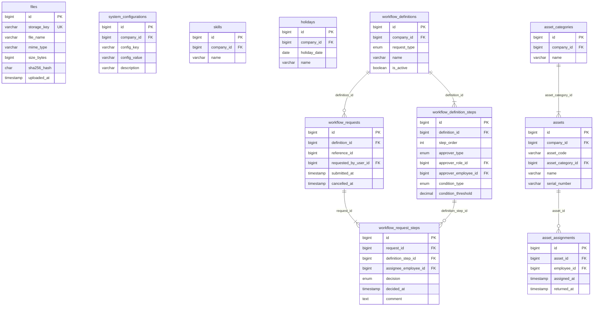

#### `files` — Tệp tin
Mục đích: một điểm tham chiếu duy nhất tới mọi tệp lưu ở object storage.

| Trường | Kiểu dữ liệu | Khóa | Mô tả |
| --- | --- | --- | --- |
| id | BIGINT | PK | Mã tệp |
| storage_key | VARCHAR(500) | UQ, NN | Đường dẫn/khóa trong object storage |
| file_name | VARCHAR(255) | NN | Tên tệp gốc |
| mime_type | VARCHAR(100) | NN | Loại nội dung |
| size_bytes | BIGINT | NN | Dung lượng |
| sha256_hash | CHAR(64) | NULL | Giá trị băm SHA-256 phục vụ kiểm tra toàn vẹn (bắt buộc với hợp đồng điện tử, tài liệu lưu kho) |
| uploaded_at | TIMESTAMP | NN | Thời điểm tải lên |

#### `system_configurations` — Cấu hình hệ thống
Mục đích: tham số vận hành "theo cấu hình" (danh mục khóa: §10). Không chứa tham số pháp lý.

| Trường | Kiểu dữ liệu | Khóa | Mô tả |
| --- | --- | --- | --- |
| id | BIGINT | PK | |
| company_id | BIGINT | FK → companies.id, NULL | NULL = cấu hình toàn hệ thống |
| config_key | VARCHAR(100) | NN | Khóa cấu hình |
| config_value | VARCHAR(500) | NN | Giá trị (parse theo khóa) |
| description | VARCHAR(500) | NULL | Giải thích |

Ràng buộc bảng: `UNIQUE (company_id, config_key)`.

#### `skills` — Danh mục kỹ năng
| Trường | Kiểu dữ liệu | Khóa | Mô tả |
| --- | --- | --- | --- |
| id | BIGINT | PK | |
| company_id | BIGINT | FK → companies.id, NN | Công ty sở hữu danh mục |
| name | VARCHAR(100) | NN | Tên kỹ năng |

Ràng buộc bảng: `UNIQUE (company_id, name)`.

#### `holidays` — Ngày nghỉ lễ
Mục đích: nguồn dữ liệu cho tính ngày nghỉ phép, phân loại giờ OT ngày lễ. (Tài liệu: "một số ngày lễ cố định".)

| Trường | Kiểu dữ liệu | Khóa | Mô tả |
| --- | --- | --- | --- |
| id | BIGINT | PK | |
| company_id | BIGINT | FK → companies.id, NN | |
| holiday_date | DATE | NN | Ngày nghỉ |
| name | VARCHAR(150) | NN | Tên ngày lễ (Tết, Quốc khánh...) |

Ràng buộc bảng: `UNIQUE (company_id, holiday_date)`.

#### Workflow (tối thiểu — [ASSUMPTION A2])

##### `workflow_definitions` — Định nghĩa quy trình phê duyệt
| Trường | Kiểu dữ liệu | Khóa | Mô tả |
| --- | --- | --- | --- |
| id | BIGINT | PK | |
| company_id | BIGINT | FK → companies.id, NN | |
| request_type | ENUM WorkflowRequestType | NN | Loại yêu cầu mà quy trình xử lý |
| name | VARCHAR(150) | NN | Tên quy trình |
| is_active | BOOLEAN | NN | Quy trình đang được áp dụng |

Ràng buộc bảng: tối đa một dòng `is_active = true` cho mỗi `(company_id, request_type)` (partial unique).

**Enum `WorkflowRequestType`**

| Giá trị | Mô tả |
| --- | --- |
| RECRUITMENT_REQUEST | Đề xuất tuyển dụng |
| OFFER | Thư mời nhận việc |
| ORG_SCENARIO | Kịch bản tái cơ cấu tổ chức |
| CONTRACT | Hợp đồng lao động |
| CONTRACT_APPENDIX | Phụ lục hợp đồng |
| DOCUMENT_ARCHIVE | Nộp lưu kho tài liệu |
| DESTRUCTION_PROPOSAL | Đề xuất hủy tài liệu |
| DOCUMENT_EXPORT | Xuất trọn bộ hồ sơ nhạy cảm |
| ATTENDANCE_REQUEST | Giải trình / chấm công ngoại lệ |
| SALARY_ADVANCE | Tạm ứng lương |
| PAYROLL | Phê duyệt bảng lương |
| LEAVE_REQUEST | Đơn xin nghỉ |
| TRANSFER_REQUEST | Phiếu điều chuyển |
| RESIGNATION | Đơn xin thôi việc |
| TERMINATION | Quyết định chấm dứt hợp đồng |
| DISMISSAL | Quyết định kỷ luật sa thải |
| COMPLIANCE_RULE | Phê duyệt/công bố quy tắc tuân thủ |

##### `workflow_definition_steps` — Bước của quy trình
| Trường | Kiểu dữ liệu | Khóa | Mô tả |
| --- | --- | --- | --- |
| id | BIGINT | PK | |
| definition_id | BIGINT | FK → workflow_definitions.id, NN | |
| step_order | INT | NN | Thứ tự bước |
| approver_type | ENUM ApproverType | NN | Cách xác định người duyệt |
| approver_role_id | BIGINT | FK → roles.id, NULL | Bắt buộc khi `approver_type = ROLE` |
| approver_employee_id | BIGINT | FK → employees.id, NULL | Bắt buộc khi `approver_type = SPECIFIC_EMPLOYEE` |
| condition_type | ENUM StepConditionType | NN | Điều kiện kích hoạt bước |
| condition_threshold | DECIMAL(18,2) | NULL | Ngưỡng số tiền khi `AMOUNT_ABOVE_THRESHOLD` |

Ràng buộc bảng: `UNIQUE (definition_id, step_order)`.

**Enum `ApproverType`**

| Giá trị | Mô tả |
| --- | --- |
| DIRECT_MANAGER | Quản lý trực tiếp của người gửi |
| DEPARTMENT_HEAD | Người đứng đầu phòng ban |
| ROLE | Người giữ một vai trò nhất định |
| SPECIFIC_EMPLOYEE | Một nhân viên chỉ định |

**Enum `StepConditionType`**

| Giá trị | Mô tả |
| --- | --- |
| ALWAYS | Luôn áp dụng bước này |
| SALARY_ABOVE_BAND | Chỉ áp dụng khi lương đề xuất vượt khung lương của vị trí (Offer Approval Matrix) |
| AMOUNT_ABOVE_THRESHOLD | Chỉ áp dụng khi số tiền vượt `condition_threshold` (vd vượt ngân sách) |

##### `workflow_requests` — Yêu cầu phê duyệt
Trạng thái tổng của yêu cầu (đang chờ/đã duyệt/từ chối) là **derived** từ các bước nên không lưu; chỉ lưu sự kiện hủy.

| Trường | Kiểu dữ liệu | Khóa | Mô tả |
| --- | --- | --- | --- |
| id | BIGINT | PK | |
| definition_id | BIGINT | FK → workflow_definitions.id, NN | Quy trình áp dụng (suy ra loại đối tượng — [A28]) |
| reference_id | BIGINT | NN | Id của đối tượng nghiệp vụ cần duyệt (tham chiếu đa hình) |
| requested_by_user_id | BIGINT | FK → users.id, NN | Người gửi duyệt |
| submitted_at | TIMESTAMP | NN | Thời điểm gửi |
| cancelled_at | TIMESTAMP | NULL | Thời điểm người gửi hủy yêu cầu; NULL = chưa hủy |

##### `workflow_request_steps` — Bước phê duyệt cụ thể của yêu cầu
| Trường | Kiểu dữ liệu | Khóa | Mô tả |
| --- | --- | --- | --- |
| id | BIGINT | PK | |
| request_id | BIGINT | FK → workflow_requests.id, NN | |
| definition_step_id | BIGINT | FK → workflow_definition_steps.id, NN | Bước định nghĩa (cho biết thứ tự) |
| assignee_employee_id | BIGINT | FK → employees.id, NN | Người được giao duyệt (đã xác định khi bước kích hoạt) |
| decision | ENUM StepDecision | NULL | NULL = chưa xử lý |
| decided_at | TIMESTAMP | NULL | Thời điểm quyết định |
| comment | TEXT | NULL | Nhận xét / lý do từ chối (bắt buộc khi `REJECTED`) |

Ràng buộc bảng: `UNIQUE (request_id, definition_step_id)`.

**Enum `StepDecision`**

| Giá trị | Mô tả |
| --- | --- |
| APPROVED | Chấp thuận |
| REJECTED | Từ chối |

#### Asset (tối thiểu — [ASSUMPTION A3])

##### `asset_categories`
| Trường | Kiểu dữ liệu | Khóa | Mô tả |
| --- | --- | --- | --- |
| id | BIGINT | PK | |
| company_id | BIGINT | FK → companies.id, NN | |
| name | VARCHAR(100) | NN | Loại tài sản (laptop, màn hình, thẻ nhân viên...) |

Ràng buộc bảng: `UNIQUE (company_id, name)`.

##### `assets`
| Trường | Kiểu dữ liệu | Khóa | Mô tả |
| --- | --- | --- | --- |
| id | BIGINT | PK | |
| company_id | BIGINT | FK → companies.id, NN | |
| asset_code | VARCHAR(50) | NN | Mã tài sản |
| asset_category_id | BIGINT | FK → asset_categories.id, NN | |
| name | VARCHAR(200) | NN | Tên tài sản |
| serial_number | VARCHAR(100) | NULL | Số serial |

Ràng buộc bảng: `UNIQUE (company_id, asset_code)`.

##### `asset_assignments` — Cấp phát/thu hồi tài sản
| Trường | Kiểu dữ liệu | Khóa | Mô tả |
| --- | --- | --- | --- |
| id | BIGINT | PK | |
| asset_id | BIGINT | FK → assets.id, NN | |
| employee_id | BIGINT | FK → employees.id, NN | Người được cấp |
| assigned_at | TIMESTAMP | NN | Thời điểm bàn giao |
| returned_at | TIMESTAMP | NULL | Thời điểm hoàn trả; NULL = chưa trả |

Ràng buộc bảng: một tài sản chỉ có tối đa một dòng `returned_at IS NULL` (partial unique trên `asset_id`).  
Ghi chú: "số tài sản chưa trả" = `COUNT(returned_at IS NULL)` theo nhân viên — derived.

---

### 8.1. MODULE 0 — XÁC THỰC (Authentication)

Dữ liệu Redis (activation token 48 giờ, refresh token, blacklist) **không** vào RDBMS [A5].

**Lược đồ quan hệ:**

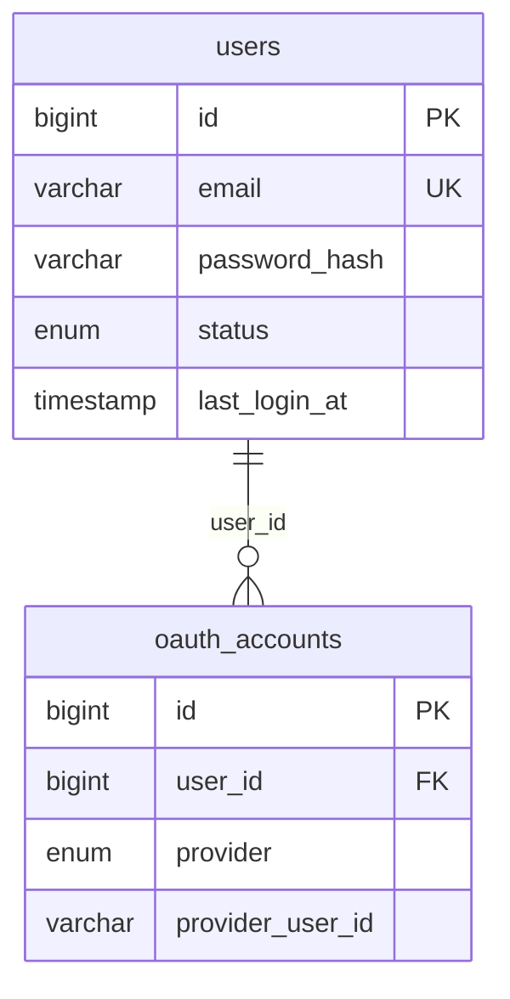

#### `users` — Tài khoản đăng nhập
| Trường | Kiểu dữ liệu | Khóa | Mô tả |
| --- | --- | --- | --- |
| id | BIGINT | PK | |
| email | VARCHAR(255) | UQ, NN | Email đăng nhập (công ty/Google) |
| password_hash | VARCHAR(100) | NULL | Băm BCrypt. NULL khi chưa kích hoạt hoặc chỉ đăng nhập OAuth |
| status | ENUM UserStatus | NN | Trạng thái tài khoản do quản trị viên/hệ thống đặt |
| last_login_at | TIMESTAMP | NULL | Thời điểm đăng nhập thành công gần nhất (tài liệu yêu cầu cập nhật khi login) |

**Enum `UserStatus`**

| Giá trị | Mô tả |
| --- | --- |
| PENDING_ACTIVATION | Quản trị viên đã tạo, nhân viên chưa kích hoạt qua liên kết email |
| ACTIVE | Đang hoạt động, được phép đăng nhập |
| LOCKED | Bị khóa (quản trị viên khóa hoặc tự động khi nhân viên nghỉ việc) |

#### `oauth_accounts` — Liên kết tài khoản OAuth2
| Trường | Kiểu dữ liệu | Khóa | Mô tả |
| --- | --- | --- | --- |
| id | BIGINT | PK | |
| user_id | BIGINT | FK → users.id, NN | Người dùng được liên kết |
| provider | ENUM OAuthProvider | NN | Nhà cung cấp |
| provider_user_id | VARCHAR(100) | NN | Mã định danh phía nhà cung cấp |

Ràng buộc bảng: `UNIQUE (provider, provider_user_id)`.

**Enum `OAuthProvider`**

| Giá trị | Mô tả |
| --- | --- |
| GOOGLE | Đăng nhập Google OAuth2 |

---

### 8.2. MODULE 1 — QUẢN LÝ TỔ CHỨC

Ba chiều độc lập: **Phòng ban** (`departments`) · **Địa lý** (`branches`) · **Vị trí việc làm** (`job_titles` + `job_levels`). Gắn với nhân viên ở `employee_work_assignments` (§8.5).

**Lược đồ quan hệ:**

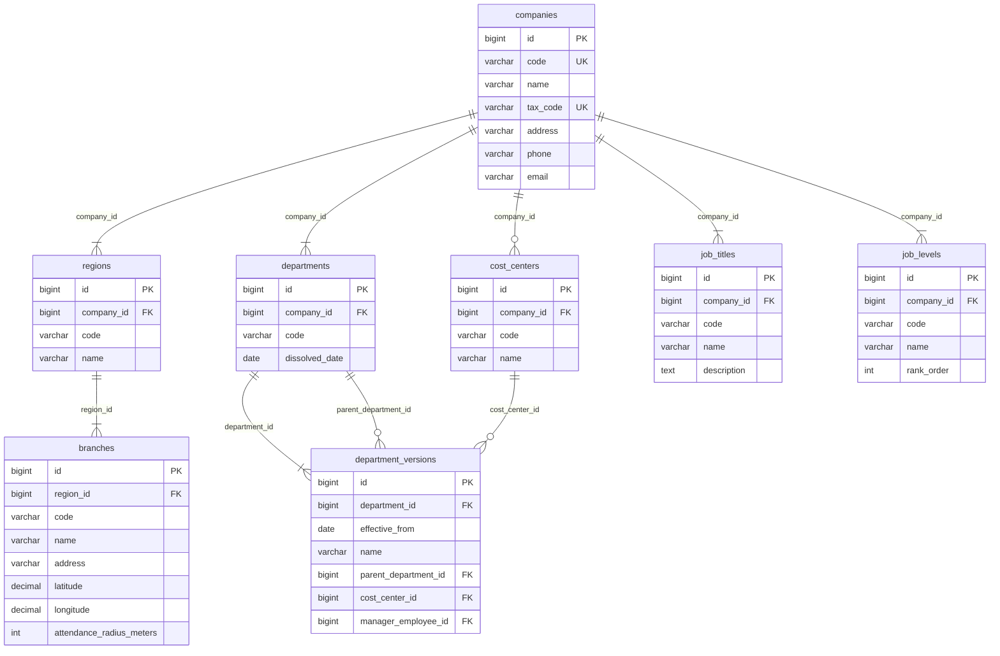

#### `companies` — Công ty / pháp nhân
| Trường | Kiểu dữ liệu | Khóa | Mô tả |
| --- | --- | --- | --- |
| id | BIGINT | PK | |
| code | VARCHAR(30) | UQ, NN | Mã công ty |
| name | VARCHAR(200) | NN | Tên công ty |
| tax_code | VARCHAR(20) | UQ, NULL | Mã số thuế |
| address | VARCHAR(500) | NN | Địa chỉ [A7] |
| phone | VARCHAR(30) | NULL | Điện thoại liên hệ |
| email | VARCHAR(255) | NULL | Email liên hệ |

#### `regions` — Vùng miền
| Trường | Kiểu dữ liệu | Khóa | Mô tả |
| --- | --- | --- | --- |
| id | BIGINT | PK | |
| company_id | BIGINT | FK → companies.id, NN | |
| code | VARCHAR(30) | NN | Mã vùng |
| name | VARCHAR(100) | NN | Miền Bắc / Trung / Nam / Quốc tế |

Ràng buộc bảng: `UNIQUE (company_id, code)`.

#### `branches` — Chi nhánh
`company_id` **không** lưu ở đây (lấy qua `region_id → regions.company_id`) để tránh phụ thuộc bắc cầu.

| Trường | Kiểu dữ liệu | Khóa | Mô tả |
| --- | --- | --- | --- |
| id | BIGINT | PK | |
| region_id | BIGINT | FK → regions.id, NN | Vùng trực thuộc |
| code | VARCHAR(30) | NN | Mã chi nhánh |
| name | VARCHAR(150) | NN | Tên chi nhánh |
| address | VARCHAR(500) | NN | Địa chỉ |
| latitude | DECIMAL(9,6) | NN | Vĩ độ (tâm phạm vi chấm công) |
| longitude | DECIMAL(9,6) | NN | Kinh độ |
| attendance_radius_meters | INT | NN | Bán kính chấm công hợp lệ (mét) |

Ràng buộc bảng: `UNIQUE (region_id, code)`.

#### `cost_centers` — Trung tâm chi phí
| Trường | Kiểu dữ liệu | Khóa | Mô tả |
| --- | --- | --- | --- |
| id | BIGINT | PK | |
| company_id | BIGINT | FK → companies.id, NN | |
| code | VARCHAR(30) | NN | Mã chi phí |
| name | VARCHAR(150) | NN | Tên trung tâm chi phí |

Ràng buộc bảng: `UNIQUE (company_id, code)`.

#### `departments` — Đơn vị tổ chức (danh tính ổn định)
Tên, vị trí trong cây, trung tâm chi phí, người quản lý đều **thay đổi theo thời gian** nên nằm ở `department_versions` ([§3.1](#31-mô-hình-hiệu-lực-theo-thời-gian-effective-dated-thay-cho-bản-ghi-hiện-tại--bản-sao-lịch-sử)).

| Trường | Kiểu dữ liệu | Khóa | Mô tả |
| --- | --- | --- | --- |
| id | BIGINT | PK | |
| company_id | BIGINT | FK → companies.id, NN | |
| code | VARCHAR(30) | NN | Mã đơn vị (không đổi) |
| dissolved_date | DATE | NULL | Ngày giải thể (xóa logic). Chỉ được đặt khi không còn nhân viên/đơn vị con trực thuộc |

Ràng buộc bảng: `UNIQUE (company_id, code)`.

#### `department_versions` — Phiên bản hiệu lực của đơn vị
| Trường | Kiểu dữ liệu | Khóa | Mô tả |
| --- | --- | --- | --- |
| id | BIGINT | PK | |
| department_id | BIGINT | FK → departments.id, NN | |
| effective_from | DATE | NN | Ngày bắt đầu hiệu lực của phiên bản |
| name | VARCHAR(200) | NN | Tên đơn vị |
| parent_department_id | BIGINT | FK → departments.id, NULL | Đơn vị cấp trên (NULL = gốc). Khối → ban → phòng → tổ/nhóm |
| cost_center_id | BIGINT | FK → cost_centers.id, NULL | Trung tâm chi phí liên kết |
| manager_employee_id | BIGINT | FK → employees.id, NULL | Người đứng đầu đơn vị |

Ràng buộc bảng: `UNIQUE (department_id, effective_from)`; `CHECK (parent_department_id <> department_id)`; ứng dụng chặn chuyển đơn vị vào chính nó hoặc đơn vị con của nó.  
Ghi chú: truy vấn "cơ cấu tại thời điểm T" = với mỗi đơn vị lấy phiên bản có `effective_from ≤ T` lớn nhất. Người thực hiện thay đổi lấy từ `audit_logs`.

#### `job_titles` — Chức danh
| Trường | Kiểu dữ liệu | Khóa | Mô tả |
| --- | --- | --- | --- |
| id | BIGINT | PK | |
| company_id | BIGINT | FK → companies.id, NN | |
| code | VARCHAR(30) | NN | Mã chức danh |
| name | VARCHAR(150) | NN | Tên (Backend Developer...) |
| description | TEXT | NULL | Mô tả công việc chung |

Ràng buộc bảng: `UNIQUE (company_id, code)`.

#### `job_levels` — Cấp bậc
| Trường | Kiểu dữ liệu | Khóa | Mô tả |
| --- | --- | --- | --- |
| id | BIGINT | PK | |
| company_id | BIGINT | FK → companies.id, NN | |
| code | VARCHAR(30) | NN | Mã cấp bậc |
| name | VARCHAR(100) | NN | Junior / Middle / Senior... |
| rank_order | INT | NN | Thứ tự thẩm quyền (số lớn = cấp cao hơn) |

Ràng buộc bảng: `UNIQUE (company_id, code)`, `UNIQUE (company_id, rank_order)`.

---

### 8.3. MODULE 2 — MÔ PHỎNG TÁI CƠ CẤU TỔ CHỨC (What-if)

Kịch bản là **sandbox độc lập**: sao chép cấu trúc đơn vị vào bảng riêng để chỉnh sửa mà không chạm dữ liệu thật. Phân tích tác động (số nhân viên, chi phí, quy trình, quyền) và so sánh kịch bản là **derived** → không lưu.

**Lược đồ quan hệ:**

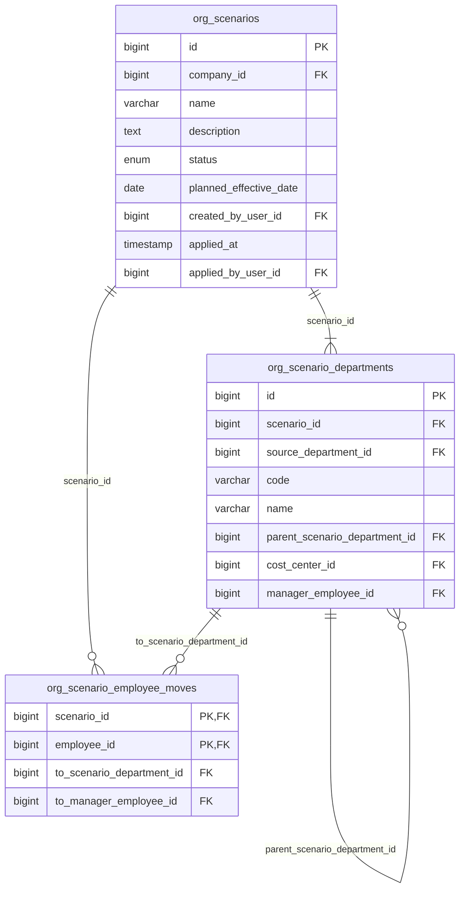

#### `org_scenarios` — Kịch bản tái cơ cấu
| Trường | Kiểu dữ liệu | Khóa | Mô tả |
| --- | --- | --- | --- |
| id | BIGINT | PK | |
| company_id | BIGINT | FK → companies.id, NN | |
| name | VARCHAR(200) | NN | Tên phương án |
| description | TEXT | NULL | Mục tiêu / mô tả |
| status | ENUM ScenarioStatus | NN | Vòng đời kịch bản |
| planned_effective_date | DATE | NN | Ngày hiệu lực dự kiến; dùng làm `effective_from` của `department_versions` khi áp dụng |
| created_by_user_id | BIGINT | FK → users.id, NN | Người tạo |
| applied_at | TIMESTAMP | NULL | Thời điểm áp dụng chính thức |
| applied_by_user_id | BIGINT | FK → users.id, NULL | Người bấm Áp dụng |

**Enum `ScenarioStatus`**

| Giá trị | Mô tả |
| --- | --- |
| DRAFT | Đang xây dựng/chỉnh sửa |
| PENDING_APPROVAL | Đã trình phê duyệt |
| APPROVED | Đã được phê duyệt, chờ áp dụng |
| APPLIED | Đã áp dụng vào cơ cấu thật |
| CANCELLED | Hủy bỏ |

#### `org_scenario_departments` — Cây đơn vị trong kịch bản
Mỗi dòng là một đơn vị **tồn tại** trong cơ cấu giả lập. Đơn vị thật bị loại bỏ (sáp nhập/giải thể) = **không có dòng** tương ứng (nên không cần cờ `is_removed`).

| Trường | Kiểu dữ liệu | Khóa | Mô tả |
| --- | --- | --- | --- |
| id | BIGINT | PK | |
| scenario_id | BIGINT | FK → org_scenarios.id, NN | |
| source_department_id | BIGINT | FK → departments.id, NULL | Đơn vị thật được sao chép; NULL = đơn vị mới tạo trong kịch bản |
| code | VARCHAR(30) | NULL | Mã đơn vị — bắt buộc khi `source_department_id` NULL |
| name | VARCHAR(200) | NN | Tên đơn vị trong kịch bản |
| parent_scenario_department_id | BIGINT | FK → org_scenario_departments.id, NULL | Cấp trên trong kịch bản (NULL = gốc) |
| cost_center_id | BIGINT | FK → cost_centers.id, NULL | Trung tâm chi phí giả lập |
| manager_employee_id | BIGINT | FK → employees.id, NULL | Người quản lý giả lập |

Ràng buộc bảng: `UNIQUE (scenario_id, source_department_id)`.

#### `org_scenario_employee_moves` — Điều chuyển nhân sự giả lập
Chỉ lưu nhân viên **bị thay đổi** (delta); nhân viên còn lại giữ nguyên.

| Trường | Kiểu dữ liệu | Khóa | Mô tả |
| --- | --- | --- | --- |
| scenario_id | BIGINT | PK, FK → org_scenarios.id | |
| employee_id | BIGINT | PK, FK → employees.id | |
| to_scenario_department_id | BIGINT | FK → org_scenario_departments.id, NN | Đơn vị đích trong kịch bản |
| to_manager_employee_id | BIGINT | FK → employees.id, NULL | Quản lý trực tiếp mới (nếu đổi) |

---

### 8.4. MODULE 3 — PHÂN QUYỀN (Role & Permission)

Hai trục: **quyền chức năng** (`permissions`) × **phạm vi dữ liệu** (`role_permissions.data_scope`, đặt riêng **cho từng quyền**).

**Lược đồ quan hệ:**

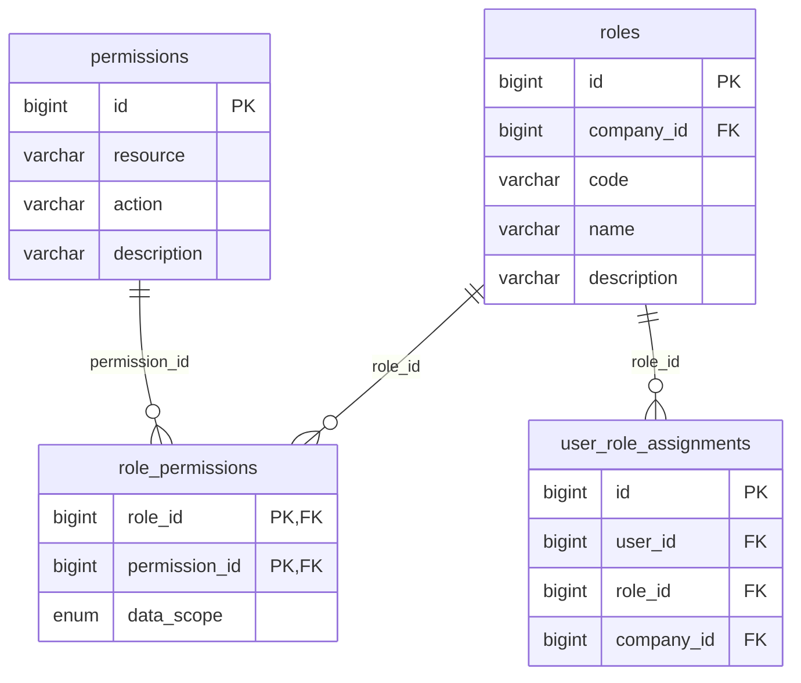

#### `permissions` — Quyền chức năng
| Trường | Kiểu dữ liệu | Khóa | Mô tả |
| --- | --- | --- | --- |
| id | BIGINT | PK | |
| resource | VARCHAR(50) | NN | Chức năng/tài nguyên (EMPLOYEE, LEAVE, ATTENDANCE, PAYROLL, CONTRACT, PERFORMANCE...) |
| action | VARCHAR(50) | NN | Thao tác (VIEW, CREATE, UPDATE, APPROVE, EXPORT, BROADCAST...) |
| description | VARCHAR(255) | NULL | Mô tả |

Ràng buộc bảng: `UNIQUE (resource, action)`. Mã quyền dạng `performance.view` = `lower(resource) + '.' + lower(action)` (derived).

#### `roles` — Vai trò
| Trường | Kiểu dữ liệu | Khóa | Mô tả |
| --- | --- | --- | --- |
| id | BIGINT | PK | |
| company_id | BIGINT | FK → companies.id, NULL | NULL = vai trò mặc định của hệ thống; có giá trị = vai trò tùy chỉnh của công ty (nên **không** cần cờ `is_system`) |
| code | VARCHAR(50) | NN | Mã vai trò (SUPER_ADMIN, HR_ADMIN, MANAGER, EMPLOYEE...) |
| name | VARCHAR(100) | NN | Tên hiển thị |
| description | VARCHAR(255) | NULL | |

Ràng buộc bảng: `UNIQUE (company_id, code)` (với `company_id` NULL dùng chỉ mục riêng để mã vai trò hệ thống duy nhất).

#### `role_permissions` — Quyền của vai trò kèm phạm vi
| Trường | Kiểu dữ liệu | Khóa | Mô tả |
| --- | --- | --- | --- |
| role_id | BIGINT | PK, FK → roles.id | |
| permission_id | BIGINT | PK, FK → permissions.id | |
| data_scope | ENUM DataScope | NN | Phạm vi dữ liệu áp dụng cho quyền này |

**Enum `DataScope`** (xem [A9])

| Giá trị | Mô tả |
| --- | --- |
| OWN | Chỉ dữ liệu của chính mình |
| TEAM | Dữ liệu của nhân viên do mình trực tiếp quản lý |
| DEPARTMENT | Dữ liệu của phòng ban mình thuộc và các đơn vị con |
| COMPANY | Toàn bộ dữ liệu của công ty được cấp |
| ALL | Toàn hệ thống (mọi công ty) |

Ghi chú: khi người dùng có nhiều vai trò cùng cấp một quyền, hệ thống chọn phạm vi rộng nhất (`ALL > COMPANY > DEPARTMENT > TEAM > OWN`) — logic ứng dụng, không lưu.

#### `user_role_assignments` — Gán vai trò theo công ty
| Trường | Kiểu dữ liệu | Khóa | Mô tả |
| --- | --- | --- | --- |
| id | BIGINT | PK | |
| user_id | BIGINT | FK → users.id, NN | |
| role_id | BIGINT | FK → roles.id, NN | |
| company_id | BIGINT | FK → companies.id, NN | Công ty nơi vai trò có hiệu lực (một người có thể là Nhân viên ở công ty A, Quản lý ở công ty B) |

Ràng buộc bảng: `UNIQUE (user_id, role_id, company_id)`.

---
### 8.5. MODULE 4 — TUYỂN DỤNG (Recruitment)

Luồng: Đề xuất tuyển dụng → Vị trí tuyển dụng → Tin đăng → Ứng viên/Hồ sơ ứng tuyển → Phỏng vấn → Offer → (chuyển thành nhân viên: `employees.source_application_id`).

**Lược đồ quan hệ:**

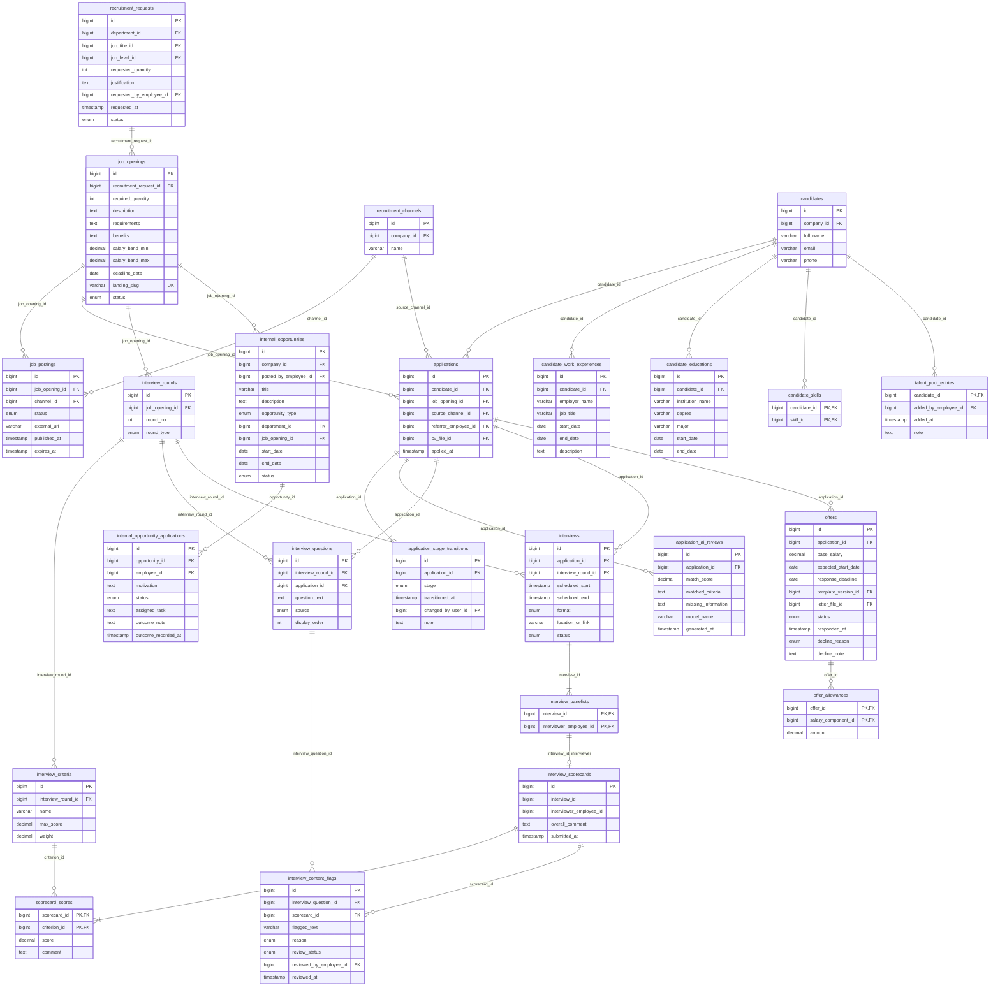

#### `recruitment_requests` — Đề xuất tuyển dụng
| Trường | Kiểu dữ liệu | Khóa | Mô tả |
| --- | --- | --- | --- |
| id | BIGINT | PK | |
| department_id | BIGINT | FK → departments.id, NN | Phòng ban có nhu cầu |
| job_title_id | BIGINT | FK → job_titles.id, NN | Vị trí đề xuất |
| job_level_id | BIGINT | FK → job_levels.id, NULL | Cấp bậc đề xuất |
| requested_quantity | INT | NN | Số lượng cần tuyển được đề xuất |
| justification | TEXT | NN | Nhu cầu bổ sung nhân sự / lý do |
| requested_by_employee_id | BIGINT | FK → employees.id, NN | Trưởng bộ phận lập đề xuất |
| requested_at | TIMESTAMP | NN | Thời điểm lập |
| status | ENUM RecruitmentRequestStatus | NN | Trạng thái đề xuất |

**Enum `RecruitmentRequestStatus`**

| Giá trị | Mô tả |
| --- | --- |
| PENDING_APPROVAL | Chờ phê duyệt (người tạo có thể hủy ở trạng thái này) |
| APPROVED | Đã được phê duyệt — HR được phép tuyển |
| REJECTED | Bị từ chối |
| CANCELLED | Người tạo đã hủy |

#### `job_openings` — Vị trí tuyển dụng (định biên)
"Số lượng đã tuyển" là **derived** (= số `employees` có `source_application_id` thuộc vị trí này) nên không có cột.

| Trường | Kiểu dữ liệu | Khóa | Mô tả |
| --- | --- | --- | --- |
| id | BIGINT | PK | |
| recruitment_request_id | BIGINT | FK → recruitment_requests.id, NN | Đề xuất đã duyệt làm căn cứ (cung cấp phòng ban, chức danh, cấp bậc) |
| required_quantity | INT | NN | Số lượng cần tuyển được HR chấp nhận mở (có thể < số đề xuất) |
| description | TEXT | NN | Mô tả công việc (JD) |
| requirements | TEXT | NULL | Yêu cầu ứng viên |
| benefits | TEXT | NULL | Quyền lợi |
| salary_band_min | DECIMAL(18,2) | NULL | Cận dưới khung lương của vị trí |
| salary_band_max | DECIMAL(18,2) | NULL | Cận trên khung lương — căn cứ Offer Approval Matrix |
| deadline_date | DATE | NN | Thời hạn tuyển dụng |
| landing_slug | VARCHAR(150) | UQ, NULL | Đường dẫn trang ứng tuyển riêng (chức năng "Mở rộng") |
| status | ENUM JobOpeningStatus | NN | Trạng thái vị trí |

**Enum `JobOpeningStatus`**

| Giá trị | Mô tả |
| --- | --- |
| OPEN | Đang nhận hồ sơ |
| ON_HOLD | Tạm dừng |
| CLOSED | HR đã đóng vị trí (đủ người hoặc dừng tuyển). *Không* có `FILLED` vì "đủ người" là derived |

#### `recruitment_channels` — Kênh tuyển dụng / nguồn ứng viên
Một danh mục dùng cho cả **kênh đăng tin** (LinkedIn, website...) và **nguồn ứng viên** (website, LinkedIn, giới thiệu nội bộ, nền tảng tuyển dụng).

| Trường | Kiểu dữ liệu | Khóa | Mô tả |
| --- | --- | --- | --- |
| id | BIGINT | PK | |
| company_id | BIGINT | FK → companies.id, NN | |
| name | VARCHAR(100) | NN | Tên kênh/nguồn |

Ràng buộc bảng: `UNIQUE (company_id, name)`.

#### `job_postings` — Tin tuyển dụng trên từng kênh
| Trường | Kiểu dữ liệu | Khóa | Mô tả |
| --- | --- | --- | --- |
| id | BIGINT | PK | |
| job_opening_id | BIGINT | FK → job_openings.id, NN | Nội dung tin = JD của vị trí (soạn một lần) |
| channel_id | BIGINT | FK → recruitment_channels.id, NN | Kênh đăng |
| status | ENUM PostingStatus | NN | Trạng thái xuất bản |
| external_url | VARCHAR(500) | NULL | Đường dẫn bài đăng |
| published_at | TIMESTAMP | NULL | Thời điểm xuất bản |
| expires_at | TIMESTAMP | NULL | Ngày hết hạn (trạng thái "hết hạn" là derived) |

Ràng buộc bảng: `UNIQUE (job_opening_id, channel_id)`.

**Enum `PostingStatus`**

| Giá trị | Mô tả |
| --- | --- |
| DRAFT | Đã soạn, chưa xuất bản |
| PUBLISHED | Đã xuất bản lên kênh |
| FAILED | Xuất bản tự động thất bại (do giới hạn tích hợp/quyền của nền tảng) |
| WITHDRAWN | HR gỡ tin |

#### `candidates` — Ứng viên
| Trường | Kiểu dữ liệu | Khóa | Mô tả |
| --- | --- | --- | --- |
| id | BIGINT | PK | |
| company_id | BIGINT | FK → companies.id, NN | |
| full_name | VARCHAR(150) | NN | Họ tên |
| email | VARCHAR(255) | NN | Email liên hệ |
| phone | VARCHAR(30) | NN | Số điện thoại |

Ràng buộc bảng: `UNIQUE (company_id, email)`, `UNIQUE (company_id, phone)` — chống trùng hồ sơ trong cùng công ty.

#### `candidate_work_experiences` — Kinh nghiệm làm việc (từ CV)
| Trường | Kiểu dữ liệu | Khóa | Mô tả |
| --- | --- | --- | --- |
| id | BIGINT | PK | |
| candidate_id | BIGINT | FK → candidates.id, NN | |
| employer_name | VARCHAR(200) | NN | Nơi làm việc |
| job_title | VARCHAR(150) | NN | Chức danh tự khai |
| start_date | DATE | NULL | |
| end_date | DATE | NULL | NULL = đang làm |
| description | TEXT | NULL | Mô tả công việc |

#### `candidate_educations` — Học vấn (từ CV)
| Trường | Kiểu dữ liệu | Khóa | Mô tả |
| --- | --- | --- | --- |
| id | BIGINT | PK | |
| candidate_id | BIGINT | FK → candidates.id, NN | |
| institution_name | VARCHAR(200) | NN | Cơ sở đào tạo |
| degree | VARCHAR(100) | NULL | Bằng cấp |
| major | VARCHAR(150) | NULL | Chuyên ngành |
| start_date | DATE | NULL | |
| end_date | DATE | NULL | |

#### `candidate_skills` — Kỹ năng của ứng viên (N:M)
| Trường | Kiểu dữ liệu | Khóa | Mô tả |
| --- | --- | --- | --- |
| candidate_id | BIGINT | PK, FK → candidates.id | |
| skill_id | BIGINT | PK, FK → skills.id | |

#### `talent_pool_entries` — Ngân hàng hồ sơ ứng viên (Talent Pool)
Phân loại theo kỹ năng/nguồn được **truy vấn** từ `candidate_skills` và `applications.source_channel_id` nên không có cột riêng.

| Trường | Kiểu dữ liệu | Khóa | Mô tả |
| --- | --- | --- | --- |
| candidate_id | BIGINT | PK, FK → candidates.id | Ứng viên tiềm năng (1 dòng/ứng viên) |
| added_by_employee_id | BIGINT | FK → employees.id, NN | HR đưa vào kho |
| added_at | TIMESTAMP | NN | |
| note | TEXT | NULL | Ghi chú đánh giá |

#### `applications` — Hồ sơ ứng tuyển (Ứng viên × Vị trí)
| Trường | Kiểu dữ liệu | Khóa | Mô tả |
| --- | --- | --- | --- |
| id | BIGINT | PK | |
| candidate_id | BIGINT | FK → candidates.id, NN | |
| job_opening_id | BIGINT | FK → job_openings.id, NN | |
| source_channel_id | BIGINT | FK → recruitment_channels.id, NULL | Nguồn ứng viên của lần ứng tuyển này |
| referrer_employee_id | BIGINT | FK → employees.id, NULL | Nhân viên giới thiệu (nếu nguồn là giới thiệu nội bộ) |
| cv_file_id | BIGINT | FK → files.id, NULL | CV nộp kèm |
| applied_at | TIMESTAMP | NN | Thời điểm nộp |

Ràng buộc bảng: `UNIQUE (candidate_id, job_opening_id)`.

#### `application_stage_transitions` — Lịch sử chuyển giai đoạn ATS Pipeline
Giai đoạn **hiện tại** = dòng có `transitioned_at` mới nhất (derived).

| Trường | Kiểu dữ liệu | Khóa | Mô tả |
| --- | --- | --- | --- |
| id | BIGINT | PK | |
| application_id | BIGINT | FK → applications.id, NN | |
| stage | ENUM ApplicationStage | NN | Giai đoạn được chuyển tới |
| transitioned_at | TIMESTAMP | NN | |
| changed_by_user_id | BIGINT | FK → users.id, NULL | NULL = hệ thống / ứng viên tự nộp |
| note | TEXT | NULL | Ghi chú, lý do loại |

**Enum `ApplicationStage`** [A11]

| Giá trị | Mô tả |
| --- | --- |
| APPLIED | Mới tiếp nhận hồ sơ |
| SCREENING | Sàng lọc hồ sơ |
| INTERVIEW | Đang phỏng vấn |
| OFFER | Đã/đang gửi Offer |
| REJECTED | Bị loại |
| WITHDRAWN | Ứng viên rút hồ sơ |

Ghi chú: trạng thái "đã tuyển" **không** là một giai đoạn lưu — suy ra từ `employees.source_application_id`.

#### `application_ai_reviews` — Kết quả AI CV Review [A12]
| Trường | Kiểu dữ liệu | Khóa | Mô tả |
| --- | --- | --- | --- |
| id | BIGINT | PK | |
| application_id | BIGINT | FK → applications.id, NN | |
| match_score | DECIMAL(5,2) | NULL | Điểm phù hợp tham khảo (không dùng làm căn cứ duy nhất loại ứng viên) |
| matched_criteria | TEXT | NULL | Tiêu chí CV đã đáp ứng |
| missing_information | TEXT | NULL | Thông tin thiếu / cần xác minh |
| model_name | VARCHAR(100) | NN | Mô hình AI đã dùng |
| generated_at | TIMESTAMP | NN | Thời điểm sinh kết quả |

#### `interview_rounds` — Vòng phỏng vấn của vị trí
| Trường | Kiểu dữ liệu | Khóa | Mô tả |
| --- | --- | --- | --- |
| id | BIGINT | PK | |
| job_opening_id | BIGINT | FK → job_openings.id, NN | |
| round_no | INT | NN | Thứ tự vòng |
| round_type | ENUM InterviewRoundType | NN | Loại vòng |

Ràng buộc bảng: `UNIQUE (job_opening_id, round_no)`.

**Enum `InterviewRoundType`**

| Giá trị | Mô tả |
| --- | --- |
| HR | Vòng nhân sự |
| TECHNICAL | Vòng chuyên môn |
| MANAGER | Vòng quản lý |
| CULTURE_FIT | Mức độ phù hợp môi trường làm việc |

#### `interview_criteria` — Tiêu chí đánh giá của vòng
| Trường | Kiểu dữ liệu | Khóa | Mô tả |
| --- | --- | --- | --- |
| id | BIGINT | PK | |
| interview_round_id | BIGINT | FK → interview_rounds.id, NN | |
| name | VARCHAR(150) | NN | Tên tiêu chí |
| max_score | DECIMAL(5,2) | NN | Thang điểm tối đa |
| weight | DECIMAL(5,2) | NN | Trọng số |

#### `interview_questions` — Bộ câu hỏi (Interview Kit)
| Trường | Kiểu dữ liệu | Khóa | Mô tả |
| --- | --- | --- | --- |
| id | BIGINT | PK | |
| interview_round_id | BIGINT | FK → interview_rounds.id, NN | |
| application_id | BIGINT | FK → applications.id, NULL | NULL = câu hỏi chuẩn của vòng; có giá trị = câu hỏi riêng cho ứng viên (AI sinh từ JD + CV) |
| question_text | TEXT | NN | Nội dung câu hỏi |
| source | ENUM QuestionSource | NN | Nguồn câu hỏi |
| display_order | INT | NN | Thứ tự hiển thị |

**Enum `QuestionSource`**

| Giá trị | Mô tả |
| --- | --- |
| MANUAL | HR/hội đồng tự soạn |
| AI_GENERATED | Do AI đề xuất từ JD và CV |

#### `interviews` — Buổi phỏng vấn
| Trường | Kiểu dữ liệu | Khóa | Mô tả |
| --- | --- | --- | --- |
| id | BIGINT | PK | |
| application_id | BIGINT | FK → applications.id, NN | |
| interview_round_id | BIGINT | FK → interview_rounds.id, NN | |
| scheduled_start | TIMESTAMP | NN | Giờ bắt đầu |
| scheduled_end | TIMESTAMP | NN | Giờ kết thúc |
| format | ENUM InterviewFormat | NN | Hình thức |
| location_or_link | VARCHAR(500) | NULL | Địa điểm hoặc đường dẫn họp |
| status | ENUM InterviewStatus | NN | |

Ràng buộc bảng: `CHECK (scheduled_start < scheduled_end)`; `interview_round_id` và `application_id` phải thuộc **cùng một** `job_opening_id` (kiểm tra bằng trigger/ứng dụng). Nhắc lịch 30 phút trước là tác vụ **derived** từ `scheduled_start`.

**Enum `InterviewFormat`**: `ONLINE` (họp trực tuyến) · `ONSITE` (trực tiếp tại địa điểm) · `PHONE` (điện thoại).  
**Enum `InterviewStatus`**: `SCHEDULED` (đã lên lịch) · `COMPLETED` (đã diễn ra) · `CANCELLED` (hủy).

#### `interview_panelists` — Hội đồng phỏng vấn (N:M)
| Trường | Kiểu dữ liệu | Khóa | Mô tả |
| --- | --- | --- | --- |
| interview_id | BIGINT | PK, FK → interviews.id | |
| interviewer_employee_id | BIGINT | PK, FK → employees.id | Người phỏng vấn |

#### `interview_scorecards` — Phiếu đánh giá của từng giám khảo
| Trường | Kiểu dữ liệu | Khóa | Mô tả |
| --- | --- | --- | --- |
| id | BIGINT | PK | |
| interview_id | BIGINT | NN | |
| interviewer_employee_id | BIGINT | NN | |
| overall_comment | TEXT | NULL | Nhận xét chung / ghi chú phỏng vấn |
| submitted_at | TIMESTAMP | NULL | Thời điểm nộp phiếu. **Blind Grading:** chỉ khi giám khảo đã nộp mới được xem phiếu người khác |

Ràng buộc bảng: `FOREIGN KEY (interview_id, interviewer_employee_id) → interview_panelists`; `UNIQUE (interview_id, interviewer_employee_id)`.

#### `scorecard_scores` — Điểm theo tiêu chí
| Trường | Kiểu dữ liệu | Khóa | Mô tả |
| --- | --- | --- | --- |
| scorecard_id | BIGINT | PK, FK → interview_scorecards.id | |
| criterion_id | BIGINT | PK, FK → interview_criteria.id | |
| score | DECIMAL(5,2) | NN | Điểm (≤ `max_score` của tiêu chí) |
| comment | TEXT | NULL | Nhận xét theo tiêu chí |

#### `interview_content_flags` — Cảnh báo nội dung phỏng vấn không phù hợp (chức năng "Mở rộng")
HR xem xét, **không** mặc định mọi nội dung AI đánh dấu là vi phạm.

| Trường | Kiểu dữ liệu | Khóa | Mô tả |
| --- | --- | --- | --- |
| id | BIGINT | PK | |
| interview_question_id | BIGINT | FK → interview_questions.id, NULL | Câu hỏi bị gắn cờ |
| scorecard_id | BIGINT | FK → interview_scorecards.id, NULL | Phiếu/ghi chú bị gắn cờ |
| flagged_text | VARCHAR(500) | NN | Đoạn nội dung bị gắn cờ |
| reason | ENUM ContentFlagReason | NN | Nhóm lý do |
| review_status | ENUM FlagReviewStatus | NN | Kết quả HR xem xét |
| reviewed_by_employee_id | BIGINT | FK → employees.id, NULL | |
| reviewed_at | TIMESTAMP | NULL | |

Ràng buộc bảng: `CHECK` đúng một trong `interview_question_id`, `scorecard_id` khác NULL.

**Enum `ContentFlagReason`**

| Giá trị | Mô tả |
| --- | --- |
| DISCRIMINATION_RISK | Nguy cơ phân biệt đối xử |
| IRRELEVANT_TO_JOB | Không liên quan yêu cầu công việc |
| PERSONAL_PRIVACY | Xâm phạm đời tư không cần thiết |
| OTHER | Khác |

**Enum `FlagReviewStatus`**: `PENDING` (chờ HR xem) · `CONFIRMED` (HR xác nhận không phù hợp) · `DISMISSED` (HR bác bỏ cảnh báo).

#### `offers` — Thư mời nhận việc
| Trường | Kiểu dữ liệu | Khóa | Mô tả |
| --- | --- | --- | --- |
| id | BIGINT | PK | |
| application_id | BIGINT | FK → applications.id, NN | |
| base_salary | DECIMAL(18,2) | NN | Mức lương đề xuất (so với `job_openings.salary_band_max` để quyết định bước duyệt bổ sung) |
| expected_start_date | DATE | NN | Ngày bắt đầu dự kiến |
| response_deadline | DATE | NN | Hạn phản hồi (quá hạn là derived) |
| template_version_id | BIGINT | FK → contract_template_versions.id, NULL | Mẫu thư mời đã dùng [A27] |
| letter_file_id | BIGINT | FK → files.id, NULL | Thư mời đã sinh / đã ký điện tử |
| status | ENUM OfferStatus | NN | |
| responded_at | TIMESTAMP | NULL | Thời điểm ứng viên phản hồi |
| decline_reason | ENUM OfferDeclineReason | NULL | Bắt buộc khi `DECLINED` |
| decline_note | TEXT | NULL | Diễn giải thêm |

**Enum `OfferStatus`**

| Giá trị | Mô tả |
| --- | --- |
| DRAFT | HR đang soạn |
| PENDING_APPROVAL | Chờ phê duyệt (bắt buộc trước khi gửi) |
| APPROVED | Đã duyệt, chưa gửi |
| SENT | Đã gửi ứng viên |
| ACCEPTED | Ứng viên đồng ý |
| DECLINED | Ứng viên từ chối |
| CANCELLED | HR hủy |

**Enum `OfferDeclineReason`**

| Giá trị | Mô tả |
| --- | --- |
| SALARY_NOT_SUITABLE | Mức lương chưa phù hợp |
| OTHER_OFFER | Nhận lời mời từ công ty khác |
| LONG_HIRING_PROCESS | Thời gian tuyển dụng kéo dài |
| OTHER | Lý do khác |

#### `offer_allowances` — Phụ cấp trong Offer
| Trường | Kiểu dữ liệu | Khóa | Mô tả |
| --- | --- | --- | --- |
| offer_id | BIGINT | PK, FK → offers.id | |
| salary_component_id | BIGINT | PK, FK → salary_components.id | Loại phụ cấp |
| amount | DECIMAL(18,2) | NN | Số tiền |

#### `internal_opportunities` — Cơ hội nội bộ (Internal Talent Marketplace)
| Trường | Kiểu dữ liệu | Khóa | Mô tả |
| --- | --- | --- | --- |
| id | BIGINT | PK | |
| company_id | BIGINT | FK → companies.id, NN | |
| posted_by_employee_id | BIGINT | FK → employees.id, NN | Quản lý đăng cơ hội |
| title | VARCHAR(200) | NN | |
| description | TEXT | NN | |
| opportunity_type | ENUM OpportunityType | NN | |
| department_id | BIGINT | FK → departments.id, NULL | Đơn vị có nhu cầu |
| job_opening_id | BIGINT | FK → job_openings.id, NULL | Liên kết vị trí tuyển dụng đang mở (nếu có) |
| start_date | DATE | NULL | Thời gian dự án |
| end_date | DATE | NULL | |
| status | ENUM OpportunityStatus | NN | |

**Enum `OpportunityType`**: `OPEN_POSITION` (vị trí đang mở) · `SHORT_TERM_PROJECT` (dự án ngắn hạn).  
**Enum `OpportunityStatus`**: `OPEN` (nhận quan tâm) · `CLOSED` (đã đóng).

#### `internal_opportunity_applications` — Nhân viên quan tâm / được chọn
| Trường | Kiểu dữ liệu | Khóa | Mô tả |
| --- | --- | --- | --- |
| id | BIGINT | PK | |
| opportunity_id | BIGINT | FK → internal_opportunities.id, NN | |
| employee_id | BIGINT | FK → employees.id, NN | |
| motivation | TEXT | NULL | Lời bày tỏ quan tâm |
| status | ENUM InterestStatus | NN | |
| assigned_task | TEXT | NULL | Nhiệm vụ được phân công khi `SELECTED` |
| outcome_note | TEXT | NULL | Kết quả/đóng góp khi dự án kết thúc |
| outcome_recorded_at | TIMESTAMP | NULL | Thời điểm ghi nhận kết quả |

Ràng buộc bảng: `UNIQUE (opportunity_id, employee_id)`.

**Enum `InterestStatus`**: `INTERESTED` (bày tỏ quan tâm) · `SELECTED` (được chọn) · `REJECTED` (không được chọn) · `WITHDRAWN` (nhân viên rút).

---
### 8.6. MODULE 5 — HỒ SƠ NHÂN SỰ (Employee Profile & Lifecycle)

`employees` chỉ chứa thông tin **bản thân người lao động, không đổi theo công tác**. Phòng ban/chi nhánh/chức danh/cấp bậc/quản lý/loại hình làm việc → `employee_work_assignments`; trạng thái làm việc → `employee_status_history` ([§3.1](#31-mô-hình-hiệu-lực-theo-thời-gian-effective-dated-thay-cho-bản-ghi-hiện-tại--bản-sao-lịch-sử)).

**Lược đồ quan hệ:**

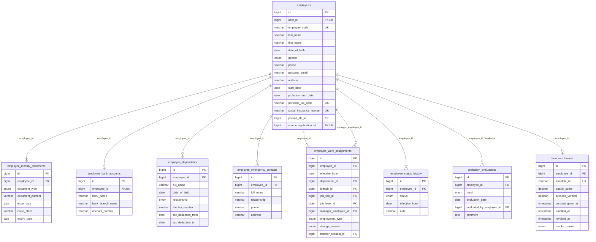

#### `employees` — Nhân viên
| Trường | Kiểu dữ liệu | Khóa | Mô tả |
| --- | --- | --- | --- |
| id | BIGINT | PK | |
| user_id | BIGINT | FK → users.id, UQ, NULL | Tài khoản đăng nhập liên kết (HR có thể tạo hồ sơ không kèm tài khoản) |
| employee_code | VARCHAR(30) | UQ, NN | Mã nhân viên [A8] |
| last_name | VARCHAR(100) | NN | Họ và tên đệm |
| first_name | VARCHAR(50) | NN | Tên (họ tên đầy đủ là derived) |
| date_of_birth | DATE | NN | Ngày sinh (tuổi là derived) |
| gender | ENUM Gender | NN | Giới tính |
| phone | VARCHAR(30) | NN | Số điện thoại liên hệ |
| personal_email | VARCHAR(255) | NULL | Email cá nhân (email đăng nhập nằm ở `users.email`) |
| address | VARCHAR(500) | NULL | Địa chỉ liên hệ [A7] |
| start_date | DATE | NN | Ngày bắt đầu làm việc (thâm niên, phép năm, trợ cấp suy ra từ đây) |
| probation_end_date | DATE | NULL | Ngày kết thúc thử việc do HR xác lập/gia hạn |
| personal_tax_code | VARCHAR(20) | UQ, NULL | Mã số thuế TNCN |
| social_insurance_number | VARCHAR(20) | UQ, NULL | Mã số BHXH |
| portrait_file_id | BIGINT | FK → files.id, NULL | Ảnh chân dung hồ sơ (**không** phải mẫu sinh trắc — xem `face_enrollments`) |
| source_application_id | BIGINT | FK → applications.id, UQ, NULL | Hồ sơ ứng tuyển trúng tuyển dùng để tiếp nhận; NULL nếu nhập trực tiếp. Căn cứ "số lượng đã tuyển" và "lịch sử tiếp nhận" |

**Enum `Gender`**: `MALE` (Nam) · `FEMALE` (Nữ) · `OTHER` (Khác).

#### `employee_identity_documents` — Giấy tờ định danh
Tách bảng vì một người có thể có cả CCCD và hộ chiếu (1:N) và dữ liệu này nhạy cảm, phân quyền riêng.

| Trường | Kiểu dữ liệu | Khóa | Mô tả |
| --- | --- | --- | --- |
| id | BIGINT | PK | |
| employee_id | BIGINT | FK → employees.id, NN | |
| document_type | ENUM IdentityDocumentType | NN | |
| document_number | VARCHAR(30) | NN | Số CCCD/hộ chiếu |
| issue_date | DATE | NN | Ngày cấp |
| issue_place | VARCHAR(200) | NN | Nơi cấp |
| expiry_date | DATE | NULL | Ngày hết hạn (hộ chiếu) |

Ràng buộc bảng: `UNIQUE (document_type, document_number)` — kiểm tra trùng khi tạo hồ sơ.

**Enum `IdentityDocumentType`**: `CITIZEN_ID` (CCCD) · `PASSPORT` (Hộ chiếu).

#### `employee_bank_accounts` — Tài khoản nhận lương
Bảng riêng 1:1 do dữ liệu tài chính nhạy cảm cần kiểm soát hiển thị/chỉnh sửa tách biệt ([A31]).

| Trường | Kiểu dữ liệu | Khóa | Mô tả |
| --- | --- | --- | --- |
| id | BIGINT | PK | |
| employee_id | BIGINT | FK → employees.id, UQ, NN | |
| bank_name | VARCHAR(150) | NN | Tên ngân hàng |
| bank_branch_name | VARCHAR(150) | NULL | Chi nhánh ngân hàng |
| account_number | VARCHAR(30) | NN | Số tài khoản |

#### `employee_dependents` — Người phụ thuộc
| Trường | Kiểu dữ liệu | Khóa | Mô tả |
| --- | --- | --- | --- |
| id | BIGINT | PK | |
| employee_id | BIGINT | FK → employees.id, NN | |
| full_name | VARCHAR(150) | NN | Họ tên người phụ thuộc |
| date_of_birth | DATE | NN | Ngày sinh (cũng dùng kiểm tra "nuôi con dưới 12 tháng") |
| relationship | ENUM DependentRelationship | NN | Quan hệ |
| identity_number | VARCHAR(30) | NULL | Số định danh |
| tax_deduction_from | DATE | NULL | Ngày bắt đầu giảm trừ gia cảnh; NULL = chưa đăng ký [A26] |
| tax_deduction_to | DATE | NULL | Ngày kết thúc giảm trừ; NULL = còn hiệu lực |

**Enum `DependentRelationship`**: `SPOUSE` (vợ/chồng) · `CHILD` (con) · `PARENT` (cha/mẹ) · `SIBLING` (anh/chị/em) · `OTHER` (khác).

#### `employee_emergency_contacts` — Người liên hệ khẩn cấp
| Trường | Kiểu dữ liệu | Khóa | Mô tả |
| --- | --- | --- | --- |
| id | BIGINT | PK | |
| employee_id | BIGINT | FK → employees.id, NN | |
| full_name | VARCHAR(150) | NN | |
| relationship | VARCHAR(50) | NN | Mối quan hệ (văn bản tự do) |
| phone | VARCHAR(30) | NN | |
| address | VARCHAR(500) | NULL | |

#### `employee_work_assignments` — Lịch sử công tác (hiệu lực theo thời gian)
Mỗi dòng là **bộ ba chiều độc lập đang có hiệu lực từ ngày `effective_from`**: đổi riêng chi nhánh thì chỉ thêm dòng mới giữ nguyên các chiều còn lại. Nội dung "trước/sau" lấy từ hai dòng liền kề.

| Trường | Kiểu dữ liệu | Khóa | Mô tả |
| --- | --- | --- | --- |
| id | BIGINT | PK | |
| employee_id | BIGINT | FK → employees.id, NN | |
| effective_from | DATE | NN | Ngày có hiệu lực |
| department_id | BIGINT | FK → departments.id, NN | Phòng ban (chiều tổ chức) |
| branch_id | BIGINT | FK → branches.id, NN | Chi nhánh làm việc (chiều địa lý) |
| job_title_id | BIGINT | FK → job_titles.id, NN | Chức danh |
| job_level_id | BIGINT | FK → job_levels.id, NN | Cấp bậc |
| manager_employee_id | BIGINT | FK → employees.id, NULL | Quản lý trực tiếp (người duyệt nghỉ phép, chấm công) |
| employment_type | ENUM EmploymentType | NN | Loại hình làm việc |
| change_reason | ENUM AssignmentChangeReason | NN | Lý do tạo dòng |
| transfer_request_id | BIGINT | FK → transfer_requests.id, NULL | Phiếu điều chuyển phát sinh dòng này |

Ràng buộc bảng: `UNIQUE (employee_id, effective_from)`; `CHECK (manager_employee_id <> employee_id)`.

**Enum `EmploymentType`**: `FULL_TIME` (toàn thời gian) · `PART_TIME` (bán thời gian) · `INTERN` (thực tập) · `CONTRACTOR` (hợp đồng/cộng tác).

**Enum `AssignmentChangeReason`**

| Giá trị | Mô tả |
| --- | --- |
| HIRE | Tiếp nhận nhân viên mới (dòng đầu tiên) |
| TRANSFER | Điều chuyển phòng ban/chi nhánh/công ty |
| PROMOTION | Thăng chức, thăng cấp |
| APPOINTMENT | Bổ nhiệm (vd người quản lý) |
| ADJUSTMENT | Điều chỉnh khác (đổi quản lý, loại hình làm việc...) |

#### `employee_status_history` — Lịch sử trạng thái làm việc
| Trường | Kiểu dữ liệu | Khóa | Mô tả |
| --- | --- | --- | --- |
| id | BIGINT | PK | |
| employee_id | BIGINT | FK → employees.id, NN | |
| status | ENUM EmploymentStatus | NN | Trạng thái bắt đầu có hiệu lực |
| effective_from | DATE | NN | |
| note | VARCHAR(500) | NULL | Ghi chú |

Ràng buộc bảng: `UNIQUE (employee_id, effective_from)`. Trạng thái hiện tại = dòng mới nhất. Chuyển `PROBATION → ACTIVE` do Module Hồ sơ nhân sự kiểm tra điều kiện (kết quả thử việc, hoàn tất hội nhập, hợp đồng); Hội nhập chỉ cung cấp kết quả.

**Enum `EmploymentStatus`**

| Giá trị | Mô tả |
| --- | --- |
| PROBATION | Đang thử việc |
| ACTIVE | Nhân viên chính thức đang làm việc |
| SUSPENDED | Tạm nghỉ việc dài hạn (khác với nghỉ phép từng ngày ở module Leave) |
| RESIGNED | Đã nghỉ việc theo đơn xin thôi việc |
| TERMINATED | Bị chấm dứt hợp đồng/sa thải |

#### `probation_evaluations` — Kết quả thử việc
| Trường | Kiểu dữ liệu | Khóa | Mô tả |
| --- | --- | --- | --- |
| id | BIGINT | PK | |
| employee_id | BIGINT | FK → employees.id, NN | |
| result | ENUM ProbationResult | NN | Kết quả |
| evaluation_date | DATE | NN | Ngày đánh giá |
| evaluated_by_employee_id | BIGINT | FK → employees.id, NN | Người đánh giá |
| comment | TEXT | NULL | Nhận xét |

**Enum `ProbationResult`**: `PASSED` (đạt) · `FAILED` (không đạt) · `EXTENDED` (gia hạn thử việc nếu quy định cho phép).

#### `face_enrollments` — Đăng ký khuôn mặt (dữ liệu sinh trắc)
Module Hồ sơ nhân sự sở hữu; Attendance chỉ **dùng qua dịch vụ xác thực**. Mẫu sinh trắc thô nằm ngoài CSDL nghiệp vụ ([A20]).

| Trường | Kiểu dữ liệu | Khóa | Mô tả |
| --- | --- | --- | --- |
| id | BIGINT | PK | Cũng là "phiên bản mẫu khuôn mặt" được ghi vào log chấm công |
| employee_id | BIGINT | FK → employees.id, NN | |
| template_ref | VARCHAR(500) | UQ, NN | Tham chiếu tới mẫu mã hóa trong kho bảo mật |
| quality_score | DECIMAL(5,2) | NN | Điểm chất lượng ảnh đăng ký |
| liveness_verified | BOOLEAN | NN | Đã xác thực người thật khi đăng ký |
| consent_given_at | TIMESTAMP | NN | Thời điểm nhân viên đồng ý xử lý dữ liệu sinh trắc (Luật BVDLCN 2025) |
| enrolled_at | TIMESTAMP | NN | Thời điểm đăng ký |
| revoked_at | TIMESTAMP | NULL | Thu hồi/vô hiệu hóa; NULL = đang hiệu lực |
| revoke_reason | ENUM FaceRevokeReason | NULL | Bắt buộc khi `revoked_at` có giá trị |

Ràng buộc bảng: mỗi nhân viên tối đa một dòng `revoked_at IS NULL` (partial unique).

**Enum `FaceRevokeReason`**: `REPLACED` (đăng ký lại thay thế) · `POOR_QUALITY` (ảnh không còn phù hợp/xác thực thất bại thường xuyên) · `EMPLOYEE_REQUEST` (nhân viên yêu cầu xóa) · `OFFBOARDING` (nghỉ việc).

---

### 8.7. MODULE 6 — HỘI NHẬP NHÂN SỰ (Onboarding)

Onboarding **chỉ theo dõi** yêu cầu giấy tờ, cấp tài khoản, bàn giao thiết bị, đào tạo. Tài liệu gốc ở Module 7; tài sản ở Asset. Tiến độ (số việc, % hoàn thành) là derived.

**Lược đồ quan hệ:**

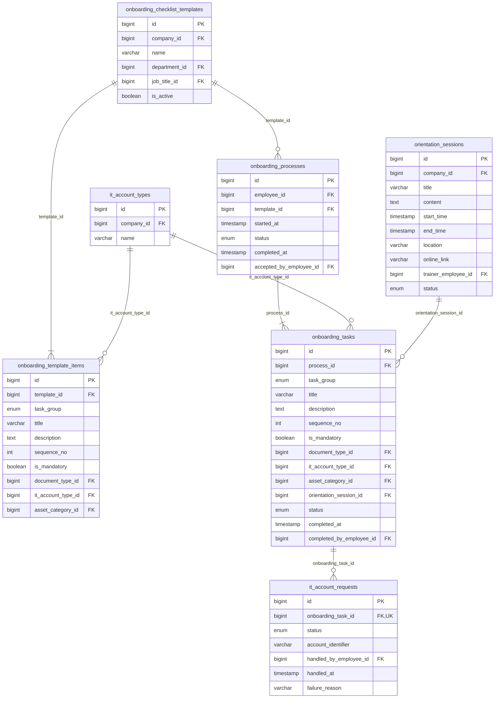

#### `onboarding_checklist_templates` — Mẫu Checklist
| Trường | Kiểu dữ liệu | Khóa | Mô tả |
| --- | --- | --- | --- |
| id | BIGINT | PK | |
| company_id | BIGINT | FK → companies.id, NN | |
| name | VARCHAR(200) | NN | Tên mẫu |
| department_id | BIGINT | FK → departments.id, NULL | Áp dụng cho phòng ban (NULL = mọi phòng ban) |
| job_title_id | BIGINT | FK → job_titles.id, NULL | Áp dụng cho chức danh (NULL = mọi chức danh) |
| is_active | BOOLEAN | NN | Mẫu đang được sử dụng |

#### `it_account_types` — Loại tài khoản CNTT
| Trường | Kiểu dữ liệu | Khóa | Mô tả |
| --- | --- | --- | --- |
| id | BIGINT | PK | |
| company_id | BIGINT | FK → companies.id, NN | |
| name | VARCHAR(100) | NN | Email công ty, GitLab, CRM... |

Ràng buộc bảng: `UNIQUE (company_id, name)`.

#### `onboarding_template_items` — Hạng mục của mẫu
| Trường | Kiểu dữ liệu | Khóa | Mô tả |
| --- | --- | --- | --- |
| id | BIGINT | PK | |
| template_id | BIGINT | FK → onboarding_checklist_templates.id, NN | |
| task_group | ENUM OnboardingTaskGroup | NN | Nhóm công việc |
| title | VARCHAR(200) | NN | Tên hạng mục |
| description | TEXT | NULL | |
| sequence_no | INT | NN | Thứ tự thực hiện |
| is_mandatory | BOOLEAN | NN | Bắt buộc phải hoàn thành trước khi nghiệm thu |
| document_type_id | BIGINT | FK → document_types.id, NULL | Loại giấy tờ yêu cầu (khi `DOCUMENTS`) |
| it_account_type_id | BIGINT | FK → it_account_types.id, NULL | Loại tài khoản cần cấp (khi `ACCOUNTS`) |
| asset_category_id | BIGINT | FK → asset_categories.id, NULL | Loại thiết bị cần bàn giao (khi `EQUIPMENT`) |

Ràng buộc bảng: `UNIQUE (template_id, sequence_no)`; `CHECK`: nhiều nhất một trong ba FK trên khác NULL và khớp với `task_group`.

**Enum `OnboardingTaskGroup`**

| Giá trị | Mô tả |
| --- | --- |
| DOCUMENTS | Hồ sơ, giấy tờ (CCCD, bằng cấp, giấy khám sức khỏe, cam kết bảo mật) |
| ACCOUNTS | Cấp email công ty và tài khoản phần mềm |
| EQUIPMENT | Bàn giao laptop, màn hình, thẻ nhân viên... |
| ORIENTATION | Đào tạo định hướng (văn hóa, nội quy) |
| OTHER | Công việc khác (gặp quản lý, người hướng dẫn, bàn giao việc ban đầu) |

#### `orientation_sessions` — Buổi đào tạo định hướng
| Trường | Kiểu dữ liệu | Khóa | Mô tả |
| --- | --- | --- | --- |
| id | BIGINT | PK | |
| company_id | BIGINT | FK → companies.id, NN | |
| title | VARCHAR(200) | NN | |
| content | TEXT | NULL | Nội dung đào tạo |
| start_time | TIMESTAMP | NN | |
| end_time | TIMESTAMP | NN | |
| location | VARCHAR(255) | NULL | Địa điểm |
| online_link | VARCHAR(500) | NULL | Đường dẫn họp trực tuyến |
| trainer_employee_id | BIGINT | FK → employees.id, NN | Người phụ trách |
| status | ENUM OrientationSessionStatus | NN | |

**Enum `OrientationSessionStatus`**: `SCHEDULED` (đã lên lịch) · `COMPLETED` (hoàn thành) · `CANCELLED` (hủy).

#### `onboarding_processes` — Tiến trình hội nhập của nhân viên
| Trường | Kiểu dữ liệu | Khóa | Mô tả |
| --- | --- | --- | --- |
| id | BIGINT | PK | |
| employee_id | BIGINT | FK → employees.id, NN | |
| template_id | BIGINT | FK → onboarding_checklist_templates.id, NN | Mẫu dùng để khởi tạo |
| started_at | TIMESTAMP | NN | Thời điểm khởi tạo |
| status | ENUM OnboardingStatus | NN | |
| completed_at | TIMESTAMP | NULL | Thời điểm hoàn tất (ghi khi `COMPLETED`) |
| accepted_by_employee_id | BIGINT | FK → employees.id, NULL | HR nghiệm thu |

Ràng buộc bảng: mỗi nhân viên tối đa **một** tiến trình `IN_PROGRESS` (partial unique trên `employee_id`).

**Enum `OnboardingStatus`**: `IN_PROGRESS` (đang thực hiện) · `COMPLETED` (đã nghiệm thu — **không** tự chuyển nhân viên sang ACTIVE) · `CANCELLED` (hủy).

#### `onboarding_tasks` — Công việc của tiến trình (bản sao từ mẫu)
Sao chép nội dung từ mẫu lúc khởi tạo vì sửa mẫu về sau không được đổi tiến trình đang chạy (snapshot — §6).

| Trường | Kiểu dữ liệu | Khóa | Mô tả |
| --- | --- | --- | --- |
| id | BIGINT | PK | |
| process_id | BIGINT | FK → onboarding_processes.id, NN | |
| task_group | ENUM OnboardingTaskGroup | NN | |
| title | VARCHAR(200) | NN | |
| description | TEXT | NULL | |
| sequence_no | INT | NN | |
| is_mandatory | BOOLEAN | NN | |
| document_type_id | BIGINT | FK → document_types.id, NULL | Hoàn thành chỉ khi nhân viên có tài liệu loại này đã được xác thực trong Module 7 |
| it_account_type_id | BIGINT | FK → it_account_types.id, NULL | Hoàn thành chỉ khi `it_account_requests.status = PROVISIONED` |
| asset_category_id | BIGINT | FK → asset_categories.id, NULL | |
| orientation_session_id | BIGINT | FK → orientation_sessions.id, NULL | Buổi đào tạo mà nhân viên tham dự (khi `ORIENTATION`) — chính dòng này là bản ghi tham dự |
| status | ENUM OnboardingTaskStatus | NN | |
| completed_at | TIMESTAMP | NULL | |
| completed_by_employee_id | BIGINT | FK → employees.id, NULL | |

Ràng buộc bảng: `UNIQUE (process_id, sequence_no)`; mục `is_mandatory = true` không được ở trạng thái `SKIPPED`.

**Enum `OnboardingTaskStatus`**: `PENDING` (chờ thực hiện) · `COMPLETED` (hoàn thành) · `SKIPPED` (bỏ qua — chỉ cho hạng mục không bắt buộc).

#### `it_account_requests` — Yêu cầu cấp tài khoản CNTT
| Trường | Kiểu dữ liệu | Khóa | Mô tả |
| --- | --- | --- | --- |
| id | BIGINT | PK | |
| onboarding_task_id | BIGINT | FK → onboarding_tasks.id, UQ, NN | Hạng mục `ACCOUNTS` phát sinh yêu cầu (loại tài khoản lấy từ task) |
| status | ENUM ItAccountRequestStatus | NN | |
| account_identifier | VARCHAR(255) | NULL | Tài khoản đã cấp (email/username) khi `PROVISIONED` |
| handled_by_employee_id | BIGINT | FK → employees.id, NULL | Người IT cập nhật kết quả |
| handled_at | TIMESTAMP | NULL | |
| failure_reason | VARCHAR(500) | NULL | Lý do khi `FAILED` |

**Enum `ItAccountRequestStatus`**: `PENDING` (chờ cấp phát) · `PROVISIONED` (đã cấp phát) · `FAILED` (thất bại).

---
### 8.8. MODULE 7 — SỐ HÓA VÀ LƯU KHO HỒ SƠ (Digital Records Repository)

Module này sở hữu **tài liệu gốc, metadata, phiên bản và vòng đời lưu trữ**. Hành vi xem/tải/sửa metadata/nộp lưu/tiêu hủy được ghi ở `audit_logs` (không tạo bảng log riêng). Watermark động là xử lý khi hiển thị.

**Lược đồ quan hệ:**

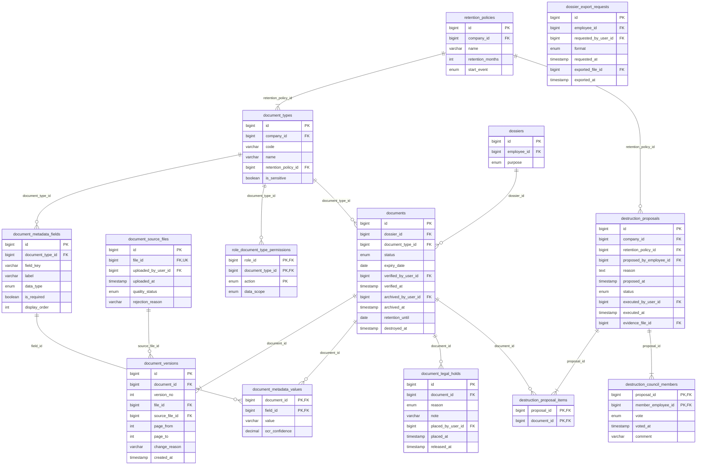

#### `retention_policies` — Chính sách lưu trữ
| Trường | Kiểu dữ liệu | Khóa | Mô tả |
| --- | --- | --- | --- |
| id | BIGINT | PK | |
| company_id | BIGINT | FK → companies.id, NN | |
| name | VARCHAR(150) | NN | Tên chính sách |
| retention_months | INT | NN | Thời hạn lưu giữ (tháng) |
| start_event | ENUM RetentionStartEvent | NN | Sự kiện bắt đầu tính hạn |

**Enum `RetentionStartEvent`**

| Giá trị | Mô tả |
| --- | --- |
| ARCHIVED_DATE | Từ ngày nộp lưu kho chính thức |
| EMPLOYMENT_END_DATE | Từ ngày nhân viên chấm dứt quan hệ lao động |
| CONTRACT_END_DATE | Từ ngày hợp đồng kết thúc |
| DOCUMENT_EXPIRY_DATE | Từ ngày giấy tờ hết hiệu lực |

#### `document_types` — Loại tài liệu
| Trường | Kiểu dữ liệu | Khóa | Mô tả |
| --- | --- | --- | --- |
| id | BIGINT | PK | |
| company_id | BIGINT | FK → companies.id, NN | |
| code | VARCHAR(30) | NN | CCCD, DEGREE, LABOR_CONTRACT, CERTIFICATE, HEALTH_CHECK... |
| name | VARCHAR(150) | NN | Tên hiển thị |
| retention_policy_id | BIGINT | FK → retention_policies.id, NN | Chính sách lưu trữ áp dụng [A18] |
| is_sensitive | BOOLEAN | NN | Tài liệu nhạy cảm (watermark, hạn chế xuất, cần phê duyệt khi xuất) |

Ràng buộc bảng: `UNIQUE (company_id, code)`.

#### `document_metadata_fields` — Cấu hình trường metadata theo loại tài liệu
| Trường | Kiểu dữ liệu | Khóa | Mô tả |
| --- | --- | --- | --- |
| id | BIGINT | PK | |
| document_type_id | BIGINT | FK → document_types.id, NN | |
| field_key | VARCHAR(50) | NN | Khóa kỹ thuật (id_number, issue_date...) |
| label | VARCHAR(100) | NN | Nhãn hiển thị |
| data_type | ENUM MetadataDataType | NN | Kiểu giá trị |
| is_required | BOOLEAN | NN | |
| display_order | INT | NN | |

Ràng buộc bảng: `UNIQUE (document_type_id, field_key)`.

**Enum `MetadataDataType`**: `TEXT` · `DATE` · `NUMBER`.

#### `dossiers` — Bộ hồ sơ (Dossier)
| Trường | Kiểu dữ liệu | Khóa | Mô tả |
| --- | --- | --- | --- |
| id | BIGINT | PK | |
| employee_id | BIGINT | FK → employees.id, NN | |
| purpose | ENUM DossierPurpose | NN | Mục đích quản lý |

Ràng buộc bảng: `UNIQUE (employee_id, purpose)` [A40].

**Enum `DossierPurpose`**: `RECRUITMENT` (hồ sơ tuyển dụng) · `CONTRACT` (hồ sơ hợp đồng) · `INSURANCE` (hồ sơ bảo hiểm) · `MEDICAL` (hồ sơ y tế) · `OTHER` (khác).

#### `document_source_files` — Tệp nguồn tải lên (bản gốc được bảo toàn)
Một tệp scan nhiều trang có thể tách thành nhiều tài liệu.

| Trường | Kiểu dữ liệu | Khóa | Mô tả |
| --- | --- | --- | --- |
| id | BIGINT | PK | |
| file_id | BIGINT | FK → files.id, UQ, NN | Tệp gốc nguyên bản |
| uploaded_by_user_id | BIGINT | FK → users.id, NN | HR hoặc nhân viên tải lên |
| uploaded_at | TIMESTAMP | NN | |
| quality_status | ENUM SourceQualityStatus | NN | Kết quả kiểm tra chất lượng trước OCR |
| rejection_reason | VARCHAR(500) | NULL | Lý do yêu cầu tải/scan lại (mờ, thiếu trang...) |

**Enum `SourceQualityStatus`**: `PENDING_CHECK` (chờ kiểm tra) · `ACCEPTED` (đạt) · `REJECTED` (không đạt, yêu cầu scan lại).

#### `documents` — Tài liệu logic
| Trường | Kiểu dữ liệu | Khóa | Mô tả |
| --- | --- | --- | --- |
| id | BIGINT | PK | |
| dossier_id | BIGINT | FK → dossiers.id, NN | Bộ hồ sơ (cho biết nhân viên) |
| document_type_id | BIGINT | FK → document_types.id, NN | Loại tài liệu |
| status | ENUM DocumentStatus | NN | Vòng đời |
| expiry_date | DATE | NULL | Ngày giấy tờ hết hiệu lực sử dụng (nhắc gia hạn). "Hết hiệu lực" là derived |
| verified_by_user_id | BIGINT | FK → users.id, NULL | HR xác thực metadata |
| verified_at | TIMESTAMP | NULL | |
| archived_by_user_id | BIGINT | FK → users.id, NULL | Người nộp lưu (người phê duyệt: xem workflow) |
| archived_at | TIMESTAMP | NULL | Thời điểm nộp lưu chính thức |
| retention_until | DATE | NULL | Ngày kết thúc lưu trữ, chốt tại thời điểm nộp lưu (§6). NULL khi sự kiện bắt đầu tính hạn chưa xảy ra |
| destroyed_at | TIMESTAMP | NULL | Thời điểm tiêu hủy |

**Enum `DocumentStatus`**

| Giá trị | Mô tả |
| --- | --- |
| DRAFT | Đã tải lên/OCR, chưa xác thực metadata |
| VERIFIED | HR đã xác thực metadata |
| PENDING_ARCHIVE | Đã gửi yêu cầu nộp lưu, chờ phê duyệt |
| ARCHIVED | Đã nộp lưu chính thức — không ghi đè, chỉ tạo phiên bản mới |
| DESTROYED | Đã tiêu hủy theo quyết định hội đồng |

#### `document_versions` — Phiên bản tài liệu
| Trường | Kiểu dữ liệu | Khóa | Mô tả |
| --- | --- | --- | --- |
| id | BIGINT | PK | |
| document_id | BIGINT | FK → documents.id, NN | |
| version_no | INT | NN | Số phiên bản (lớn nhất = hiện hành) |
| file_id | BIGINT | FK → files.id, NN | Tệp đã chuẩn hóa định dạng phục vụ OCR/lưu trữ |
| source_file_id | BIGINT | FK → document_source_files.id, NN | Tệp gốc |
| page_from | INT | NULL | Trang bắt đầu trong tệp gốc (khi tách) |
| page_to | INT | NULL | Trang kết thúc |
| change_reason | VARCHAR(500) | NULL | Lý do thay thế (vd bản scan thiếu trang) |
| created_at | TIMESTAMP | NN | |

Ràng buộc bảng: `UNIQUE (document_id, version_no)`.

#### `document_metadata_values` — Giá trị metadata
| Trường | Kiểu dữ liệu | Khóa | Mô tả |
| --- | --- | --- | --- |
| document_id | BIGINT | PK, FK → documents.id | |
| field_id | BIGINT | PK, FK → document_metadata_fields.id | |
| value | VARCHAR(1000) | NULL | Giá trị đã xác nhận/nhập |
| ocr_confidence | DECIMAL(5,2) | NULL | Độ tin cậy OCR của trường (NULL nếu nhập tay). "Cần kiểm tra" = dưới ngưỡng cấu hình — derived |

Ghi chú: `field_id` phải thuộc đúng `document_types` của tài liệu (kiểm tra ở ứng dụng/trigger).

#### `document_legal_holds` — Tạm giữ tài liệu
| Trường | Kiểu dữ liệu | Khóa | Mô tả |
| --- | --- | --- | --- |
| id | BIGINT | PK | |
| document_id | BIGINT | FK → documents.id, NN | |
| reason | ENUM LegalHoldReason | NN | |
| note | VARCHAR(500) | NULL | |
| placed_by_user_id | BIGINT | FK → users.id, NN | |
| placed_at | TIMESTAMP | NN | |
| released_at | TIMESTAMP | NULL | NULL = đang tạm giữ |

**Enum `LegalHoldReason`**: `DISPUTE` (tranh chấp) · `AUDIT` (kiểm toán) · `INSPECTION` (thanh tra) · `LEGAL_REQUEST` (yêu cầu pháp lý khác).

#### `destruction_proposals` — Đề xuất hủy tài liệu
| Trường | Kiểu dữ liệu | Khóa | Mô tả |
| --- | --- | --- | --- |
| id | BIGINT | PK | |
| company_id | BIGINT | FK → companies.id, NN | |
| retention_policy_id | BIGINT | FK → retention_policies.id, NN | Chính sách lưu trữ áp dụng [A18] |
| proposed_by_employee_id | BIGINT | FK → employees.id, NN | |
| reason | TEXT | NN | |
| proposed_at | TIMESTAMP | NN | |
| status | ENUM DestructionStatus | NN | |
| executed_by_user_id | BIGINT | FK → users.id, NULL | Người thực hiện tiêu hủy |
| executed_at | TIMESTAMP | NULL | |
| evidence_file_id | BIGINT | FK → files.id, NULL | Biên bản/bằng chứng tiêu hủy |

**Enum `DestructionStatus`**: `DRAFT` · `COUNCIL_REVIEW` (hội đồng đang biểu quyết) · `APPROVED` (đạt tỷ lệ biểu quyết, chưa tiêu hủy) · `REJECTED` · `EXECUTED` (đã tiêu hủy).  
Ghi chú: điều kiện hủy (hết `retention_until`, không có hold đang hiệu lực) là kiểm tra nghiệp vụ, không lưu.

#### `destruction_proposal_items` — Tài liệu trong đề xuất (N:M)
| Trường | Kiểu dữ liệu | Khóa | Mô tả |
| --- | --- | --- | --- |
| proposal_id | BIGINT | PK, FK → destruction_proposals.id | |
| document_id | BIGINT | PK, FK → documents.id | |

#### `destruction_council_members` — Hội đồng xét hủy & biểu quyết
| Trường | Kiểu dữ liệu | Khóa | Mô tả |
| --- | --- | --- | --- |
| proposal_id | BIGINT | PK, FK → destruction_proposals.id | |
| member_employee_id | BIGINT | PK, FK → employees.id | |
| vote | ENUM CouncilVote | NULL | NULL = chưa biểu quyết |
| voted_at | TIMESTAMP | NULL | |
| comment | VARCHAR(500) | NULL | |

**Enum `CouncilVote`**: `APPROVE` (đồng ý hủy) · `REJECT` (không đồng ý). Tỷ lệ biểu quyết là derived, ngưỡng lấy từ cấu hình.

#### `role_document_type_permissions` — Quyền truy cập tài liệu theo vai trò
| Trường | Kiểu dữ liệu | Khóa | Mô tả |
| --- | --- | --- | --- |
| role_id | BIGINT | PK, FK → roles.id | |
| document_type_id | BIGINT | PK, FK → document_types.id | |
| action | ENUM DocumentAction | PK | Hành động được phép |
| data_scope | ENUM DataScope | NN | Phạm vi nhân sự áp dụng |

**Enum `DocumentAction`**: `VIEW` · `DOWNLOAD` · `UPLOAD` · `EDIT_METADATA` · `VERIFY` · `ARCHIVE` · `EXPORT`.

#### `dossier_export_requests` — Yêu cầu xuất trọn bộ hồ sơ
Có quyền riêng, có thể cần phê duyệt (Workflow `DOCUMENT_EXPORT`), phải lưu lịch sử xuất.

| Trường | Kiểu dữ liệu | Khóa | Mô tả |
| --- | --- | --- | --- |
| id | BIGINT | PK | |
| employee_id | BIGINT | FK → employees.id, NN | Nhân viên có hồ sơ được xuất |
| requested_by_user_id | BIGINT | FK → users.id, NN | |
| format | ENUM ExportFormat | NN | |
| requested_at | TIMESTAMP | NN | |
| exported_file_id | BIGINT | FK → files.id, NULL | Tệp kết quả sau khi được phép xuất |
| exported_at | TIMESTAMP | NULL | |

**Enum `ExportFormat`**: `MERGED_PDF` (PDF gộp) · `ZIP` (file nén).

---

### 8.9. MODULE 8 — HỢP ĐỒNG & HỢP ĐỒNG ĐIỆN TỬ

Chấm dứt hợp đồng/trợ cấp: xem Module 16 ([A14]). Trạng thái `FULLY_SIGNED`, `PARTIALLY_SIGNED`, `ACTIVE`, `EXPIRING`, `EXPIRED`, `TERMINATED` là **derived** (từ `contract_signers`, ngày hiệu lực, `resignation_requests`/`termination_decisions`).

**Lược đồ quan hệ:**

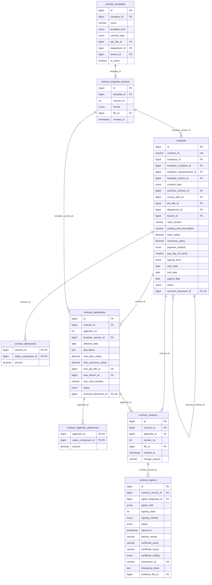

#### `contract_templates` — Mẫu hợp đồng / thư mời
| Trường | Kiểu dữ liệu | Khóa | Mô tả |
| --- | --- | --- | --- |
| id | BIGINT | PK | |
| company_id | BIGINT | FK → companies.id, NN | |
| name | VARCHAR(200) | NN | |
| template_kind | ENUM TemplateKind | NN | |
| contract_type | ENUM ContractType | NULL | Loại hợp đồng áp dụng (NULL = mọi loại) |
| job_title_id | BIGINT | FK → job_titles.id, NULL | Nhóm chức danh áp dụng |
| department_id | BIGINT | FK → departments.id, NULL | Phòng ban áp dụng |
| branch_id | BIGINT | FK → branches.id, NULL | Chi nhánh áp dụng |
| is_active | BOOLEAN | NN | |

**Enum `TemplateKind`**: `LABOR_CONTRACT` · `APPENDIX` · `OFFER_LETTER` [A27].

**Enum `ContractType`**

| Giá trị | Mô tả |
| --- | --- |
| FIXED_TERM | Hợp đồng lao động xác định thời hạn (tối đa 36 tháng) |
| INDEFINITE | Hợp đồng lao động không xác định thời hạn |
| PROBATION | Thỏa thuận thử việc riêng |
| SERVICE | Hợp đồng dịch vụ với cá nhân tự do — **không** phải hợp đồng lao động, phân loại riêng |

#### `contract_template_versions` — Phiên bản mẫu
| Trường | Kiểu dữ liệu | Khóa | Mô tả |
| --- | --- | --- | --- |
| id | BIGINT | PK | |
| template_id | BIGINT | FK → contract_templates.id, NN | |
| version_no | INT | NN | |
| format | ENUM TemplateFormat | NN | |
| file_id | BIGINT | FK → files.id, NN | Tệp mẫu chứa biến `{{employee_name}}`... |
| created_at | TIMESTAMP | NN | |

Ràng buộc bảng: `UNIQUE (template_id, version_no)`. Hợp đồng đã tạo/ký luôn tham chiếu đúng phiên bản đã dùng.  
**Enum `TemplateFormat`**: `DOCX` · `HTML`.

#### `contracts` — Hợp đồng
Snapshot điều khoản thỏa thuận (§6): công việc, lương... **không** suy ra từ hồ sơ hiện tại. Họ tên/CCCD/địa chỉ người lao động **không** lặp — lấy từ `employees`.

| Trường | Kiểu dữ liệu | Khóa | Mô tả |
| --- | --- | --- | --- |
| id | BIGINT | PK | |
| contract_no | VARCHAR(50) | UQ, NN | Mã hợp đồng sinh theo quy tắc cấu hình |
| employee_id | BIGINT | FK → employees.id, NN | Người lao động |
| employer_company_id | BIGINT | FK → companies.id, NN | Pháp nhân ký kết (địa chỉ, mã số thuế lấy từ `companies`) |
| employer_representative_id | BIGINT | FK → employees.id, NN | Người đại diện doanh nghiệp ký [A34] |
| template_version_id | BIGINT | FK → contract_template_versions.id, NN | |
| contract_type | ENUM ContractType | NN | |
| previous_contract_id | BIGINT | FK → contracts.id, NULL | Hợp đồng liền trước khi tái ký (căn cứ đếm số lần ký tiếp) |
| source_offer_id | BIGINT | FK → offers.id, NULL | Offer làm căn cứ |
| job_title_id | BIGINT | FK → job_titles.id, NN | Chức danh thỏa thuận |
| department_id | BIGINT | FK → departments.id, NN | |
| branch_id | BIGINT | FK → branches.id, NN | |
| work_location | VARCHAR(500) | NN | Địa điểm làm việc ghi trong hợp đồng |
| working_time_description | VARCHAR(500) | NN | Thời giờ làm việc ghi trong hợp đồng |
| base_salary | DECIMAL(18,2) | NN | Lương cơ bản |
| insurance_salary | DECIMAL(18,2) | NULL | Mức lương đóng bảo hiểm |
| payment_method | ENUM SalaryPaymentMethod | NN | Hình thức trả lương |
| pay_day_of_month | SMALLINT | NN | Kỳ hạn trả lương (ngày trong tháng) |
| signing_form | ENUM SigningForm | NN | |
| start_date | DATE | NN | Ngày bắt đầu hiệu lực |
| end_date | DATE | NULL | NULL với hợp đồng không xác định thời hạn |
| signed_date | DATE | NULL | Ngày ký ghi trên văn bản |
| status | ENUM ContractStatus | NN | |
| archived_document_id | BIGINT | FK → documents.id, UQ, NULL | Bản lưu kho chính thức (Module 7) |

Ràng buộc bảng: `CHECK (end_date IS NULL OR end_date >= start_date)`; `end_date IS NULL` khi `INDEFINITE`.

**Enum `SalaryPaymentMethod`**: `BANK_TRANSFER` (chuyển khoản) · `CASH` (tiền mặt).  
**Enum `SigningForm`**: `PAPER` (ký giấy trực tiếp) · `ELECTRONIC` (ký điện tử từ xa).

**Enum `ContractStatus`** (dùng chung cho hợp đồng, phụ lục)

| Giá trị | Mô tả |
| --- | --- |
| DRAFT | Dự thảo (cũng là trạng thái trả về khi bị từ chối duyệt/ký) |
| PENDING_APPROVAL | Chờ phê duyệt nội bộ |
| PENDING_SIGNATURE | Đã duyệt, đang trong giai đoạn ký |
| CANCELLED | Hủy trước khi hoàn tất ký |

#### `contract_allowances` — Phụ cấp thỏa thuận trong hợp đồng
| Trường | Kiểu dữ liệu | Khóa | Mô tả |
| --- | --- | --- | --- |
| contract_id | BIGINT | PK, FK → contracts.id | |
| salary_component_id | BIGINT | PK, FK → salary_components.id | |
| amount | DECIMAL(18,2) | NN | |

#### `contract_appendices` — Phụ lục hợp đồng
Chỉ cột `new_*` khác NULL mới là nội dung thay đổi. Không có cột thời hạn — phụ lục không được sửa thời hạn hợp đồng (Điều 22, 33 BLLĐ).

| Trường | Kiểu dữ liệu | Khóa | Mô tả |
| --- | --- | --- | --- |
| id | BIGINT | PK | |
| contract_id | BIGINT | FK → contracts.id, NN | Hợp đồng gốc |
| appendix_no | INT | NN | Số thứ tự phụ lục |
| template_version_id | BIGINT | FK → contract_template_versions.id, NN | |
| effective_date | DATE | NN | Ngày phụ lục có hiệu lực |
| description | TEXT | NN | Nội dung điều chỉnh/bổ sung |
| new_base_salary | DECIMAL(18,2) | NULL | |
| new_insurance_salary | DECIMAL(18,2) | NULL | |
| new_job_title_id | BIGINT | FK → job_titles.id, NULL | |
| new_branch_id | BIGINT | FK → branches.id, NULL | |
| new_work_location | VARCHAR(500) | NULL | |
| status | ENUM ContractStatus | NN | |
| archived_document_id | BIGINT | FK → documents.id, UQ, NULL | |

Ràng buộc bảng: `UNIQUE (contract_id, appendix_no)`.

#### `contract_appendix_allowances` — Phụ cấp thay đổi theo phụ lục
| Trường | Kiểu dữ liệu | Khóa | Mô tả |
| --- | --- | --- | --- |
| appendix_id | BIGINT | PK, FK → contract_appendices.id | |
| salary_component_id | BIGINT | PK, FK → salary_components.id | |
| amount | DECIMAL(18,2) | NN | Mức mới (0 = bãi bỏ) |

#### `contract_versions` — Phiên bản văn bản hợp đồng/phụ lục
| Trường | Kiểu dữ liệu | Khóa | Mô tả |
| --- | --- | --- | --- |
| id | BIGINT | PK | |
| contract_id | BIGINT | FK → contracts.id, NN | |
| appendix_id | BIGINT | FK → contract_appendices.id, NULL | NULL = văn bản của hợp đồng chính |
| version_no | INT | NN | Nội dung đổi sau khi ký một phần → hủy lượt ký và phát hành phiên bản mới |
| file_id | BIGINT | FK → files.id, NN | Văn bản đã điền dữ liệu (`files.sha256_hash` = giá trị băm toàn vẹn) |
| created_at | TIMESTAMP | NN | |
| change_reason | VARCHAR(500) | NULL | |

Ràng buộc bảng: `UNIQUE (contract_id, appendix_id, version_no)` (xử lý NULL bằng chỉ mục riêng).

#### `contract_signers` — Bên ký & bằng chứng giao kết
| Trường | Kiểu dữ liệu | Khóa | Mô tả |
| --- | --- | --- | --- |
| id | BIGINT | PK | |
| contract_version_id | BIGINT | FK → contract_versions.id, NN | Phiên bản được ký |
| signer_employee_id | BIGINT | FK → employees.id, NN | Danh tính người ký |
| signer_side | ENUM SignerSide | NN | |
| signing_order | INT | NN | Thứ tự ký |
| signing_method | ENUM SigningMethod | NN | Phương thức xác thực/ký |
| status | ENUM SignerStatus | NN | |
| signed_at | TIMESTAMP | NULL | |
| decline_reason | VARCHAR(500) | NULL | Bắt buộc khi `DECLINED` |
| certificate_serial | VARCHAR(100) | NULL | Số serial chứng thư số |
| certificate_issuer | VARCHAR(200) | NULL | Tổ chức cấp chứng thư |
| certificate_validity | ENUM CertificateValidity | NULL | Trạng thái chứng thư lúc xác minh |
| transaction_id | VARCHAR(100) | UQ, NULL | Mã định danh giao dịch ký |
| timestamp_token | TEXT | NULL | Dấu thời gian của dịch vụ tin cậy |
| evidence_file_id | BIGINT | FK → files.id, NULL | Dữ liệu chữ ký, bằng chứng giao dịch |

Ràng buộc bảng: `UNIQUE (contract_version_id, signing_order)`, `UNIQUE (contract_version_id, signer_employee_id)`.

**Enum `SignerSide`**: `EMPLOYER` (người sử dụng lao động) · `EMPLOYEE` (người lao động).

**Enum `SigningMethod`**

| Giá trị | Mô tả |
| --- | --- |
| DIGITAL_SIGNATURE | Chữ ký số (USB Token hoặc ký số từ xa) — có giá trị tương đương chữ ký tay theo luật |
| OTP_CONFIRMATION | Chữ ký điện tử khác: OTP + thao tác chấp thuận — chỉ hợp lệ khi đáp ứng điều kiện luật |
| WET_INK | Ký trực tiếp trên giấy (hợp đồng `PAPER`) |

**Enum `SignerStatus`**: `PENDING` (chưa ký) · `SIGNED` (đã ký) · `DECLINED` (từ chối) · `VOIDED` (lượt ký bị hủy do phát hành phiên bản mới).  
**Enum `CertificateValidity`**: `VALID` · `EXPIRED` · `REVOKED` · `UNVERIFIED`.

---
### 8.10. MODULE 9 — CHẤM CÔNG & CA LÀM VIỆC (Attendance)

Nguyên tắc: **log chấm công gốc bất biến (append-only)**; mọi sửa đổi là bản ghi điều chỉnh riêng. Trạng thái từng ngày (`ON_TIME`, `LATE`, `EARLY`, `LATE_AND_EARLY`, `MISSING_CHECK_OUT`, `ABSENT`, `EXPLAINED`, `PENDING_VERIFICATION`), số phút đi muộn/về sớm, công quy đổi, giờ làm tiêu chuẩn, ca qua đêm đều là **derived** (§5, mục 4–7) — tính từ `shifts` + `shift_assignments` + `attendance_logs` + `attendance_adjustments` + `leave_requests`.

**Lược đồ quan hệ:**

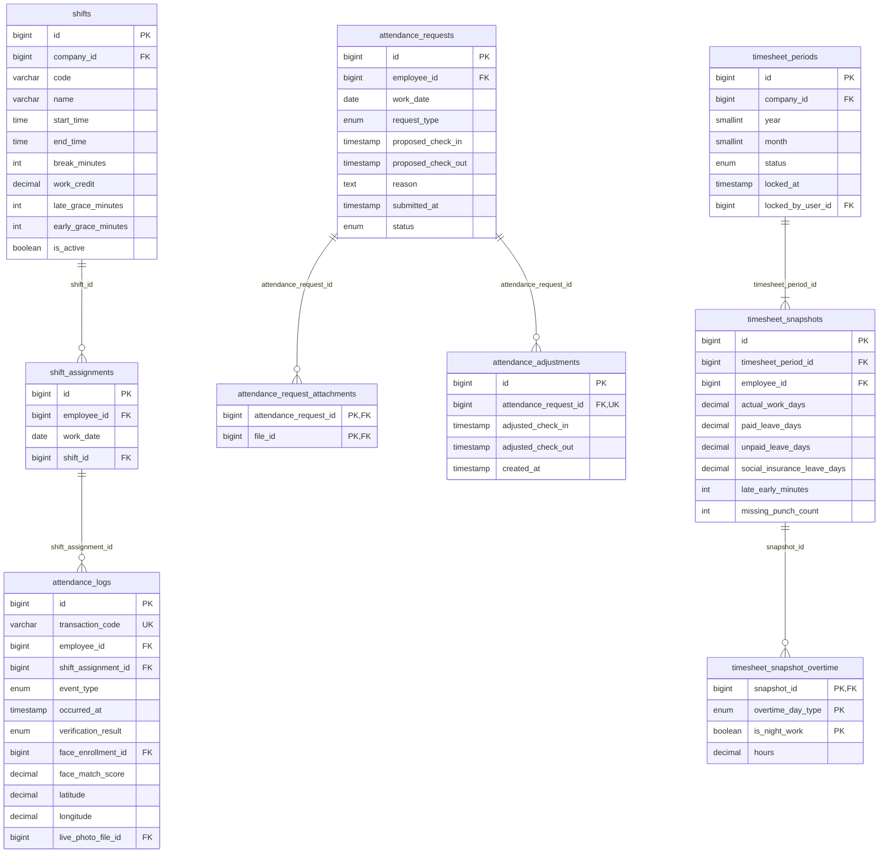

#### `shifts` — Ca làm việc
| Trường | Kiểu dữ liệu | Khóa | Mô tả |
| --- | --- | --- | --- |
| id | BIGINT | PK | |
| company_id | BIGINT | FK → companies.id, NN | |
| code | VARCHAR(30) | NN | Mã ca |
| name | VARCHAR(100) | NN | Hành chính, sáng, chiều, đêm... |
| start_time | TIME | NN | Giờ bắt đầu |
| end_time | TIME | NN | Giờ kết thúc (nhỏ hơn `start_time` = ca qua ngày) |
| break_minutes | INT | NN | Thời gian nghỉ giữa ca |
| work_credit | DECIMAL(3,2) | NN | Định mức công của ca (vd 1.00, 0.50) — do HR quy định, không suy ra được |
| late_grace_minutes | INT | NN | Thời gian ân hạn đi muộn |
| early_grace_minutes | INT | NN | Thời gian ân hạn về sớm |
| is_active | BOOLEAN | NN | Kích hoạt / ngừng sử dụng |

Ràng buộc bảng: `UNIQUE (company_id, code)`. Chỉ xóa được ca chưa có `shift_assignments`.

#### `shift_assignments` — Phân ca theo ngày
Phân ca theo khoảng ngày/hàng loạt được ứng dụng **khai triển** thành từng dòng/ngày ([A19]).

| Trường | Kiểu dữ liệu | Khóa | Mô tả |
| --- | --- | --- | --- |
| id | BIGINT | PK | |
| employee_id | BIGINT | FK → employees.id, NN | |
| work_date | DATE | NN | Ngày làm việc (ngày bắt đầu ca) |
| shift_id | BIGINT | FK → shifts.id, NN | |

Ràng buộc bảng: `UNIQUE (employee_id, work_date)`. Không có ca được phân → dùng ca mặc định theo cấu hình `attendance.default_shift_id`.

#### `attendance_logs` — Nhật ký chấm công gốc (mỗi lượt thử là một dòng)
Lượt **thất bại cũng được lưu** để phân biệt "lỗi xác thực" với "không đi làm" và đếm số lần thử (derived).

| Trường | Kiểu dữ liệu | Khóa | Mô tả |
| --- | --- | --- | --- |
| id | BIGINT | PK | |
| transaction_code | VARCHAR(64) | UQ, NN | Mã giao dịch chấm công |
| employee_id | BIGINT | FK → employees.id, NN | |
| shift_assignment_id | BIGINT | FK → shift_assignments.id, NULL | Ca xác định được; NULL khi dùng ca mặc định hoặc không xác định được ca |
| event_type | ENUM AttendanceEventType | NN | Check-in / Check-out |
| occurred_at | TIMESTAMP | NN | Thời điểm chấm công |
| verification_result | ENUM VerificationResult | NN | Kết quả xác thực tổng hợp |
| face_enrollment_id | BIGINT | FK → face_enrollments.id, NULL | Phiên bản mẫu khuôn mặt đã dùng; NULL khi chưa đăng ký |
| face_match_score | DECIMAL(5,2) | NULL | Điểm so khớp 1:1 (so với ngưỡng cấu hình) |
| latitude | DECIMAL(9,6) | NULL | Vĩ độ GPS |
| longitude | DECIMAL(9,6) | NULL | Kinh độ GPS |
| live_photo_file_id | BIGINT | FK → files.id, NULL | Ảnh chụp trực tiếp — chỉ lưu khi chính sách bảo vệ dữ liệu yêu cầu [A20] |

**Enum `AttendanceEventType`**: `CHECK_IN` · `CHECK_OUT`.

**Enum `VerificationResult`**

| Giá trị | Mô tả |
| --- | --- |
| SUCCESS | Khuôn mặt khớp và GPS hợp lệ — lượt chấm công được ghi nhận |
| NO_ENROLLMENT | Chưa đăng ký khuôn mặt hoặc mẫu đã bị thu hồi |
| LOW_IMAGE_QUALITY | Ảnh không đạt chất lượng |
| LIVENESS_FAILED | Không vượt qua kiểm tra người thật |
| FACE_MISMATCH | Khuôn mặt không đạt ngưỡng so khớp |
| OUT_OF_RANGE | GPS ngoài phạm vi địa điểm hợp lệ |
| NO_SHIFT | Không xác định được ca phù hợp |
| DUPLICATE_OR_SEQUENCE_ERROR | Lượt trùng hoặc sai thứ tự |

#### `attendance_requests` — Đơn giải trình / chấm công ngoại lệ
Duyệt qua Workflow `ATTENDANCE_REQUEST`.

| Trường | Kiểu dữ liệu | Khóa | Mô tả |
| --- | --- | --- | --- |
| id | BIGINT | PK | |
| employee_id | BIGINT | FK → employees.id, NN | |
| work_date | DATE | NN | Ngày làm việc cần giải trình |
| request_type | ENUM AttendanceRequestType | NN | Loại lý do |
| proposed_check_in | TIMESTAMP | NULL | Giờ vào đề xuất |
| proposed_check_out | TIMESTAMP | NULL | Giờ ra đề xuất |
| reason | TEXT | NN | Lý do chi tiết |
| submitted_at | TIMESTAMP | NN | |
| status | ENUM RequestStatus | NN | |

**Enum `AttendanceRequestType`**: `FORGOT_PUNCH` (quên chấm công) · `TIME_DEVIATION` (sai lệch thời gian) · `DEVICE_FAILURE` (thiết bị sự cố) · `FACE_VERIFICATION_FAILED` (xác thực khuôn mặt không thành công) · `BUSINESS_TRIP` (đi công tác) · `OFFSITE_WORK` (làm việc tại địa điểm khác) · `OTHER`.

**Enum `RequestStatus`** (dùng chung cho đơn nghiệp vụ có phê duyệt: đơn giải trình, nghỉ phép, thôi việc...)

| Giá trị | Mô tả |
| --- | --- |
| PENDING | Đã gửi, chờ phê duyệt |
| APPROVED | Đã được phê duyệt |
| REJECTED | Bị từ chối |
| CANCELLED | Người gửi hủy khi còn chờ |

#### `attendance_request_attachments` — Minh chứng
| Trường | Kiểu dữ liệu | Khóa | Mô tả |
| --- | --- | --- | --- |
| attendance_request_id | BIGINT | PK, FK → attendance_requests.id | |
| file_id | BIGINT | PK, FK → files.id | |

#### `attendance_adjustments` — Bản ghi điều chỉnh sau phê duyệt
Không ghi đè `attendance_logs`.

| Trường | Kiểu dữ liệu | Khóa | Mô tả |
| --- | --- | --- | --- |
| id | BIGINT | PK | |
| attendance_request_id | BIGINT | FK → attendance_requests.id, UQ, NN | Đơn đã duyệt phát sinh điều chỉnh (nhân viên, ngày lấy từ đơn) |
| adjusted_check_in | TIMESTAMP | NULL | Giờ vào được thừa nhận (có thể khác đề xuất) |
| adjusted_check_out | TIMESTAMP | NULL | Giờ ra được thừa nhận |
| created_at | TIMESTAMP | NN | |

#### `timesheet_periods` — Kỳ công tháng
| Trường | Kiểu dữ liệu | Khóa | Mô tả |
| --- | --- | --- | --- |
| id | BIGINT | PK | |
| company_id | BIGINT | FK → companies.id, NN | |
| year | SMALLINT | NN | Năm [A16] |
| month | SMALLINT | NN | Tháng (1–12) |
| status | ENUM TimesheetPeriodStatus | NN | |
| locked_at | TIMESTAMP | NULL | Thời điểm khóa gần nhất |
| locked_by_user_id | BIGINT | FK → users.id, NULL | |

Ràng buộc bảng: `UNIQUE (company_id, year, month)`. Mở khóa có kiểm soát → trạng thái trở lại `OPEN`, ghi `audit_logs`; khóa lại sẽ ghi đè snapshot [A35].

**Enum `TimesheetPeriodStatus`**: `OPEN` (đang tổng hợp/đối soát, tính lại được) · `LOCKED` (đã khóa và chuyển Payroll).

#### `timesheet_snapshots` — Bản tổng hợp công tại thời điểm khóa (§6)
Chỉ tồn tại sau khi khóa. Số công chuẩn không lưu ở đây — lấy từ `payroll_periods.standard_work_days`; "tổng công tính lương" = `actual_work_days + paid_leave_days + social_insurance_leave_days` (derived).

| Trường | Kiểu dữ liệu | Khóa | Mô tả |
| --- | --- | --- | --- |
| id | BIGINT | PK | |
| timesheet_period_id | BIGINT | FK → timesheet_periods.id, NN | |
| employee_id | BIGINT | FK → employees.id, NN | |
| actual_work_days | DECIMAL(5,2) | NN | Công thực tế |
| paid_leave_days | DECIMAL(5,2) | NN | Nghỉ hưởng lương |
| unpaid_leave_days | DECIMAL(5,2) | NN | Nghỉ không hưởng lương |
| social_insurance_leave_days | DECIMAL(5,2) | NN | Nghỉ theo chế độ do cơ quan bảo hiểm chi trả (ốm, thai sản) |
| late_early_minutes | INT | NN | Tổng phút đi muộn/về sớm |
| missing_punch_count | INT | NN | Số lượt chấm công còn thiếu |

Ràng buộc bảng: `UNIQUE (timesheet_period_id, employee_id)`.

#### `timesheet_snapshot_overtime` — Giờ làm thêm theo loại
Chỉ có dòng khi phát sinh OT [A15].

| Trường | Kiểu dữ liệu | Khóa | Mô tả |
| --- | --- | --- | --- |
| snapshot_id | BIGINT | PK, FK → timesheet_snapshots.id | |
| overtime_day_type | ENUM OvertimeDayType | PK | Loại ngày |
| is_night_work | BOOLEAN | PK | Phần giờ làm ban đêm |
| hours | DECIMAL(6,2) | NN | Số giờ |

**Enum `OvertimeDayType`**: `WEEKDAY` (ngày làm việc bình thường) · `WEEKLY_REST_DAY` (ngày nghỉ hằng tuần) · `HOLIDAY` (ngày lễ, Tết).

---

### 8.11. MODULE 10 — BẢNG LƯƠNG & TÍNH LƯƠNG TỰ ĐỘNG (Payroll)

Gross, Net, tổng quỹ lương, số nhân viên, tiến độ, cảnh báo biến động > 30% **không lưu** (§5). Các thông số luật (giảm trừ, biểu thuế, tỷ lệ BH, hệ số OT) lấy từ `compliance_rule_versions/parameters` (§8.18).

**Lược đồ quan hệ:**

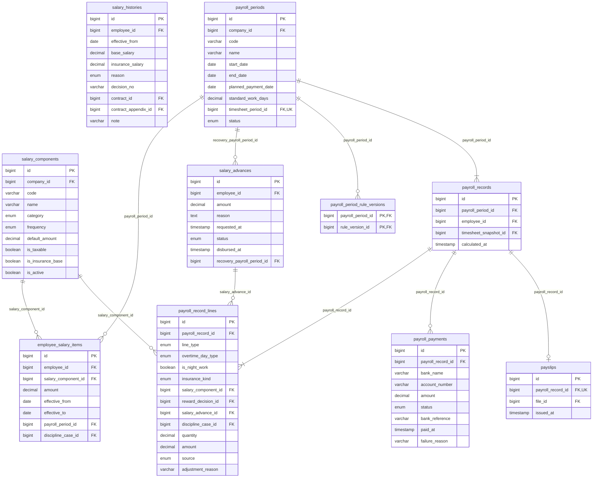

#### `salary_components` — Thành phần lương
| Trường | Kiểu dữ liệu | Khóa | Mô tả |
| --- | --- | --- | --- |
| id | BIGINT | PK | |
| company_id | BIGINT | FK → companies.id, NN | |
| code | VARCHAR(30) | NN | Mã thành phần |
| name | VARCHAR(150) | NN | Tên hiển thị |
| category | ENUM SalaryComponentCategory | NN | Nhóm |
| frequency | ENUM ComponentFrequency | NN | Định kỳ hoặc một lần |
| default_amount | DECIMAL(18,2) | NULL | Số tiền mặc định |
| is_taxable | BOOLEAN | NN | Chịu thuế TNCN (không đặt tùy ý nếu luật đã quy định) |
| is_insurance_base | BOOLEAN | NN | Tính vào lương đóng bảo hiểm |
| is_active | BOOLEAN | NN | |

Ràng buộc bảng: `UNIQUE (company_id, code)`.

**Enum `SalaryComponentCategory`**: `ALLOWANCE` (phụ cấp) · `BONUS` (thưởng) · `DEDUCTION` (khấu trừ) · `REIMBURSEMENT` (hoàn trả chi phí).  
**Enum `ComponentFrequency`**: `RECURRING` (định kỳ) · `ONE_TIME` (một lần).

#### `employee_salary_items` — Khoản lương gán cho nhân viên (ngoài hợp đồng)
Phụ cấp đã thỏa thuận trong hợp đồng nằm ở `contract_allowances` (không lặp lại ở đây). Bảng này dành cho thưởng/khấu trừ/hoàn trả do Payroll quản lý.

| Trường | Kiểu dữ liệu | Khóa | Mô tả |
| --- | --- | --- | --- |
| id | BIGINT | PK | |
| employee_id | BIGINT | FK → employees.id, NN | |
| salary_component_id | BIGINT | FK → salary_components.id, NN | |
| amount | DECIMAL(18,2) | NN | |
| effective_from | DATE | NULL | Khoản định kỳ: ngày bắt đầu áp dụng |
| effective_to | DATE | NULL | Khoản định kỳ: ngày kết thúc (NULL = còn hiệu lực) |
| payroll_period_id | BIGINT | FK → payroll_periods.id, NULL | Khoản một lần: kỳ lương áp dụng |
| discipline_case_id | BIGINT | FK → discipline_cases.id, NULL | Căn cứ bắt buộc với khấu trừ kỷ luật/bồi thường |

Ràng buộc bảng: `CHECK` đúng một trong `effective_from` (định kỳ) hoặc `payroll_period_id` (một lần) có giá trị, khớp `frequency` của thành phần.

#### `salary_histories` — Lịch sử mức lương (hiệu lực theo thời gian)
Mức lương cũ = dòng liền trước; ngày kết thúc = `effective_from` dòng kế tiếp.

| Trường | Kiểu dữ liệu | Khóa | Mô tả |
| --- | --- | --- | --- |
| id | BIGINT | PK | |
| employee_id | BIGINT | FK → employees.id, NN | |
| effective_from | DATE | NN | Ngày bắt đầu áp dụng |
| base_salary | DECIMAL(18,2) | NN | Lương cơ bản |
| insurance_salary | DECIMAL(18,2) | NULL | Mức lương làm căn cứ đóng bảo hiểm |
| reason | ENUM SalaryChangeReason | NN | Lý do điều chỉnh |
| decision_no | VARCHAR(50) | NULL | Số quyết định |
| contract_id | BIGINT | FK → contracts.id, NULL | Hợp đồng làm căn cứ |
| contract_appendix_id | BIGINT | FK → contract_appendices.id, NULL | Phụ lục làm căn cứ |
| note | VARCHAR(500) | NULL | |

Ràng buộc bảng: `UNIQUE (employee_id, effective_from)`.

**Enum `SalaryChangeReason`**: `INITIAL` (lương khi tiếp nhận) · `PROMOTION` (thăng chức) · `PERIODIC_REVIEW` (xét tăng định kỳ) · `ADJUSTMENT` (điều chỉnh khác) · `REDUCTION` (giảm lương).

#### `salary_advances` — Tạm ứng lương
Duyệt qua Workflow `SALARY_ADVANCE`. Trạng thái `DEDUCTED` là **derived** (tồn tại dòng lương `ADVANCE_RECOVERY` tham chiếu khoản này ở kỳ đã chốt).

| Trường | Kiểu dữ liệu | Khóa | Mô tả |
| --- | --- | --- | --- |
| id | BIGINT | PK | |
| employee_id | BIGINT | FK → employees.id, NN | |
| amount | DECIMAL(18,2) | NN | Số tiền đề nghị |
| reason | TEXT | NN | |
| requested_at | TIMESTAMP | NN | |
| status | ENUM SalaryAdvanceStatus | NN | |
| disbursed_at | TIMESTAMP | NULL | Kế toán ghi nhận giải ngân |
| recovery_payroll_period_id | BIGINT | FK → payroll_periods.id, NULL | Kỳ lương dự kiến thu hồi |

**Enum `SalaryAdvanceStatus`**: `DRAFT` · `PENDING_APPROVAL` · `APPROVED` · `REJECTED` · `DISBURSED` (kế toán đã giải ngân).

#### `payroll_periods` — Kỳ lương
| Trường | Kiểu dữ liệu | Khóa | Mô tả |
| --- | --- | --- | --- |
| id | BIGINT | PK | |
| company_id | BIGINT | FK → companies.id, NN | |
| code | VARCHAR(30) | NN | Mã kỳ |
| name | VARCHAR(100) | NN | Tên kỳ |
| start_date | DATE | NN | |
| end_date | DATE | NN | |
| planned_payment_date | DATE | NN | Ngày chi trả dự kiến |
| standard_work_days | DECIMAL(5,2) | NN | Số ngày công chuẩn do kế toán xác lập [A33] |
| timesheet_period_id | BIGINT | FK → timesheet_periods.id, UQ, NN | Kỳ công cung cấp dữ liệu (phải đã `LOCKED` mới tính được) [A35] |
| status | ENUM PayrollPeriodStatus | NN | |

Ràng buộc bảng: `UNIQUE (company_id, code)`; `CHECK (start_date <= end_date)`.

**Enum `PayrollPeriodStatus`**

| Giá trị | Mô tả |
| --- | --- |
| OPEN | Mở kỳ, đang chuẩn bị dữ liệu / tính toán / điều chỉnh |
| CALCULATED | Đã tính xong, kế toán rà soát (bị từ chối duyệt cũng quay về đây) |
| PENDING_APPROVAL | Đã trình phê duyệt, không sửa trực tiếp |
| APPROVED | Đã được duyệt, chờ chi trả |
| PAYMENT_PROCESSING | Đang chi trả (một số giao dịch còn chờ/bị ngân hàng từ chối) |
| LOCKED | Đã khóa sổ — không được tính lại |

#### `payroll_period_rule_versions` — Phiên bản quy tắc pháp lý áp dụng cho kỳ
Bảo đảm kỳ đã chốt truy được đúng quy tắc đã dùng.

| Trường | Kiểu dữ liệu | Khóa | Mô tả |
| --- | --- | --- | --- |
| payroll_period_id | BIGINT | PK, FK → payroll_periods.id | |
| rule_version_id | BIGINT | PK, FK → compliance_rule_versions.id | |

#### `payroll_records` — Bảng lương của nhân viên trong kỳ
| Trường | Kiểu dữ liệu | Khóa | Mô tả |
| --- | --- | --- | --- |
| id | BIGINT | PK | |
| payroll_period_id | BIGINT | FK → payroll_periods.id, NN | |
| employee_id | BIGINT | FK → employees.id, NN | |
| timesheet_snapshot_id | BIGINT | FK → timesheet_snapshots.id, NULL | Nguồn công đã chốt (NULL → vào danh sách "thiếu dữ liệu") |
| calculated_at | TIMESTAMP | NN | Thời điểm tính gần nhất |

Ràng buộc bảng: `UNIQUE (payroll_period_id, employee_id)`.

#### `payroll_record_lines` — Dòng chi tiết bảng lương (bất biến sau khi chốt — §6)
| Trường | Kiểu dữ liệu | Khóa | Mô tả |
| --- | --- | --- | --- |
| id | BIGINT | PK | |
| payroll_record_id | BIGINT | FK → payroll_records.id, NN | |
| line_type | ENUM PayrollLineType | NN | Loại dòng |
| overtime_day_type | ENUM OvertimeDayType | NULL | Chỉ với `OVERTIME` |
| is_night_work | BOOLEAN | NULL | Chỉ với `OVERTIME` |
| insurance_kind | ENUM InsuranceKind | NULL | Chỉ với `INSURANCE_EMPLOYEE`/`INSURANCE_EMPLOYER` |
| salary_component_id | BIGINT | FK → salary_components.id, NULL | Thành phần liên quan |
| reward_decision_id | BIGINT | FK → reward_decisions.id, NULL | Khoản thưởng đã chuyển vào lương |
| salary_advance_id | BIGINT | FK → salary_advances.id, NULL | Khoản tạm ứng được thu hồi |
| discipline_case_id | BIGINT | FK → discipline_cases.id, NULL | Căn cứ khấu trừ kỷ luật/bồi thường |
| quantity | DECIMAL(10,2) | NULL | Số lượng đo được (ngày công, giờ OT) |
| amount | DECIMAL(18,2) | NN | Số tiền của dòng (luôn ≥ 0; chiều thu/chi do `line_type`) |
| source | ENUM PayrollLineSource | NN | Nguồn dòng |
| adjustment_reason | VARCHAR(500) | NULL | Bắt buộc khi `MANUAL_ADJUSTMENT`. Giá trị trước/sau và người thực hiện → `audit_logs` |

**Enum `PayrollLineType`**

| Giá trị | Nhóm | Mô tả |
| --- | --- | --- |
| BASE_SALARY | Thu nhập | Lương theo ngày công và nghỉ hưởng lương |
| OVERTIME | Thu nhập | Tiền làm thêm giờ (theo `overtime_day_type`, `is_night_work`) |
| ALLOWANCE | Thu nhập | Phụ cấp |
| BONUS | Thu nhập | Thưởng |
| REIMBURSEMENT | Thu nhập | Hoàn trả chi phí |
| INSURANCE_EMPLOYEE | Khấu trừ | Bảo hiểm bắt buộc phần người lao động đóng |
| PERSONAL_INCOME_TAX | Khấu trừ | Thuế TNCN |
| ADVANCE_RECOVERY | Khấu trừ | Thu hồi tạm ứng |
| DEDUCTION | Khấu trừ | Khấu trừ khác (kỷ luật/bồi thường — bắt buộc có căn cứ) |
| INSURANCE_EMPLOYER | Chi phí doanh nghiệp | Bảo hiểm phần doanh nghiệp đóng — **không** trừ vào Net |

**Enum `InsuranceKind`**: `SOCIAL` (BHXH) · `HEALTH` (BHYT) · `UNEMPLOYMENT` (BHTN).  
**Enum `PayrollLineSource`**: `SYSTEM_CALCULATED` · `MANUAL_ADJUSTMENT` (kế toán bổ sung khi kỳ còn cho chỉnh).

#### `payroll_payments` — Giao dịch chi trả
| Trường | Kiểu dữ liệu | Khóa | Mô tả |
| --- | --- | --- | --- |
| id | BIGINT | PK | |
| payroll_record_id | BIGINT | FK → payroll_records.id, NN | Một bảng lương có thể có nhiều lần chi (thử lại) |
| bank_name | VARCHAR(150) | NN | Ngân hàng tại thời điểm chi (§6) |
| account_number | VARCHAR(30) | NN | Tài khoản tại thời điểm chi |
| amount | DECIMAL(18,2) | NN | Số tiền chuyển thực tế |
| status | ENUM PaymentStatus | NN | |
| bank_reference | VARCHAR(100) | NULL | Mã giao dịch ngân hàng |
| paid_at | TIMESTAMP | NULL | |
| failure_reason | VARCHAR(500) | NULL | Lý do khi `REJECTED` |

**Enum `PaymentStatus`**: `PENDING` (chờ chi) · `PAID` (đã chi) · `REJECTED` (ngân hàng từ chối).

#### `payslips` — Phiếu lương điện tử
Lịch sử tải xuống → `audit_logs`.

| Trường | Kiểu dữ liệu | Khóa | Mô tả |
| --- | --- | --- | --- |
| id | BIGINT | PK | |
| payroll_record_id | BIGINT | FK → payroll_records.id, UQ, NN | |
| file_id | BIGINT | FK → files.id, NN | Tệp PDF (lưu mã hóa) |
| issued_at | TIMESTAMP | NN | |

---
### 8.12. MODULE 11 — HIỆU SUẤT & KPI (Performance)

Luồng: Kỳ đánh giá → Phiếu đánh giá (mỗi nhân viên/kỳ) → Mục tiêu (kèm điểm tự đánh giá và điểm quản lý). Điểm tổng hợp **tính được** từ điểm quản lý × trọng số (§5) nên chỉ **chốt lưu một lần khi `FINALIZED`** (§6): kết quả bất biến, không đổi dù ngưỡng xếp loại cấu hình thay đổi sau. Ngưỡng xếp loại lấy từ cấu hình (§10).

**Lược đồ quan hệ:**

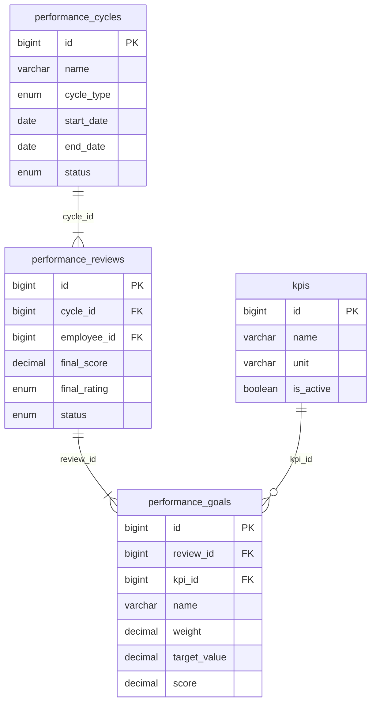

#### `performance_cycles` — Kỳ đánh giá
| Trường | Kiểu dữ liệu | Khóa | Mô tả |
| --- | --- | --- | --- |
| id | BIGINT | PK | |
| company_id | BIGINT | FK → companies.id, NN | |
| name | VARCHAR(150) | NN | Tên kỳ |
| cycle_type | ENUM PerformanceCycleType | NN | Loại chu kỳ |
| start_date | DATE | NN | |
| end_date | DATE | NN | |
| status | ENUM PerformanceCycleStatus | NN | |

Ràng buộc bảng: `UNIQUE (company_id, name)`; `CHECK (start_date <= end_date)`.

**Enum `PerformanceCycleType`**: `QUARTERLY` (quý) · `SEMI_ANNUAL` (nửa năm) · `ANNUAL` (năm).

**Enum `PerformanceCycleStatus`**

| Giá trị | Mô tả |
| --- | --- |
| DRAFT | Đang chuẩn bị, sửa/xóa được |
| ACTIVE | Đang áp dụng: thiết lập mục tiêu và đánh giá |
| CLOSED | Đã kết thúc, không được chỉnh sửa |

#### `kpis` — Danh mục KPI
| Trường | Kiểu dữ liệu | Khóa | Mô tả |
| --- | --- | --- | --- |
| id | BIGINT | PK | |
| company_id | BIGINT | FK → companies.id, NN | |
| name | VARCHAR(150) | NN | Tên KPI |
| unit | VARCHAR(30) | NN | Đơn vị tính (%, VND, số lượng) |
| measurement_method | TEXT | NULL | Cách đo lường |
| department_id | BIGINT | FK → departments.id, NULL | NULL = KPI toàn công ty; có giá trị = chỉ giao cho nhân viên thuộc đơn vị này |
| is_active | BOOLEAN | NN | |

Ràng buộc bảng: `UNIQUE (company_id, name)`.

#### `performance_reviews` — Phiếu đánh giá (nhân viên × kỳ)
| Trường | Kiểu dữ liệu | Khóa | Mô tả |
| --- | --- | --- | --- |
| id | BIGINT | PK | |
| cycle_id | BIGINT | FK → performance_cycles.id, NN | |
| employee_id | BIGINT | FK → employees.id, NN | Chủ phiếu |
| manager_employee_id | BIGINT | FK → employees.id, NULL | Quản lý thực hiện đánh giá |
| status | ENUM ReviewStatus | NN | |
| self_comment | TEXT | NULL | Nhận xét tổng quan của nhân viên |
| manager_comment | TEXT | NULL | Nhận xét tổng quan của quản lý |
| self_submitted_at | TIMESTAMP | NULL | |
| manager_submitted_at | TIMESTAMP | NULL | |
| final_score | DECIMAL(5,2) | NULL | Điểm tổng hợp chốt (làm tròn 2 số); chỉ có khi `FINALIZED` |
| final_rating | ENUM PerformanceRating | NULL | Xếp loại chốt; chỉ có khi `FINALIZED` |
| finalized_by_user_id | BIGINT | FK → users.id, NULL | |
| finalized_at | TIMESTAMP | NULL | |

Ràng buộc bảng: `UNIQUE (cycle_id, employee_id)`; `final_*` và `finalized_*` cùng NULL hoặc cùng có giá trị.

**Enum `ReviewStatus`**: `DRAFT` · `SELF_REVIEWED` (đã tự đánh giá) · `MANAGER_REVIEWED` (quản lý đã đánh giá) · `FINALIZED` (đã chốt, bất biến). Hai bước SELF/MANAGER không bắt buộc theo thứ tự cứng.

**Enum `PerformanceRating`**

| Giá trị | Mô tả |
| --- | --- |
| EXCELLENT | Xuất sắc (≥ 90) |
| GOOD | Tốt (≥ 80 và < 90) |
| SATISFACTORY | Đạt (≥ 65 và < 80) |
| NEEDS_IMPROVEMENT | Cần cải thiện (≥ 50 và < 65) |
| POOR | Kém (< 50) |

#### `performance_goals` — Mục tiêu cá nhân và điểm đánh giá từng mục tiêu
Cặp (nhân viên, kỳ) lấy qua `review_id` — không lặp lại ở bảng này [A36].

| Trường | Kiểu dữ liệu | Khóa | Mô tả |
| --- | --- | --- | --- |
| id | BIGINT | PK | |
| review_id | BIGINT | FK → performance_reviews.id, NN | |
| name | VARCHAR(200) | NN | Tên mục tiêu |
| target_value | DECIMAL(18,2) | NULL | Giá trị cần đạt |
| kpi_id | BIGINT | FK → kpis.id, NULL | KPI liên kết (nếu KPI cấp đơn vị, nhân viên phải thuộc đơn vị đó) |
| weight | DECIMAL(5,2) | NN | Trọng số (%): 0,01–100; tổng trọng số theo `review_id` ≤ 100 |
| status | ENUM GoalStatus | NN | Trạng thái thực hiện |
| self_score | DECIMAL(5,2) | NULL | Điểm tự đánh giá |
| self_comment | TEXT | NULL | |
| manager_score | DECIMAL(5,2) | NULL | Điểm quản lý — căn cứ chính của điểm tổng hợp |
| manager_comment | TEXT | NULL | |

**Enum `GoalStatus`**: `NOT_STARTED` (chưa thực hiện) · `IN_PROGRESS` (đang thực hiện) · `COMPLETED` (đã hoàn thành).

---

### 8.13. MODULE 12 — KHEN THƯỞNG, KỶ LUẬT & KHIẾU NẠI

Quyết định đã hiệu lực là bất biến. `pushedToPayroll` (có dòng lương tham chiếu `reward_decision_id`), thời hiệu xử lý, ngày hết hiệu lực/`EXPIRED` của kỷ luật, tình trạng bị hạn chế xử lý đều là **derived** (§5, mục 12–15) — không cần scheduler 02:30 để đổi trạng thái.

**Lược đồ quan hệ:**

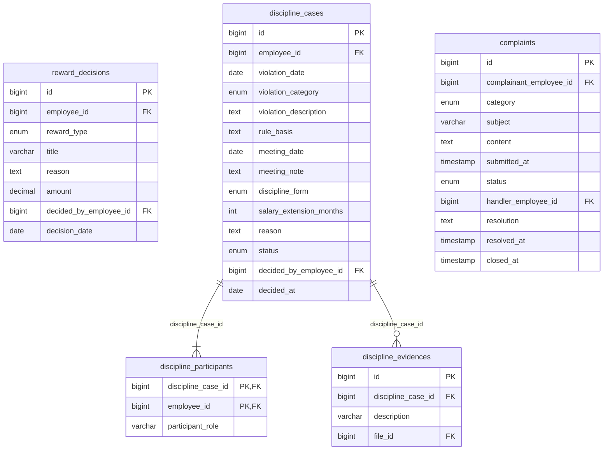

#### `reward_decisions` — Quyết định khen thưởng
| Trường | Kiểu dữ liệu | Khóa | Mô tả |
| --- | --- | --- | --- |
| id | BIGINT | PK | |
| employee_id | BIGINT | FK → employees.id, NN | |
| reward_type | ENUM RewardType | NN | Hình thức |
| title | VARCHAR(200) | NN | |
| reason | TEXT | NN | |
| amount | DECIMAL(18,2) | NULL | Số tiền thưởng — bắt buộc khi `MONETARY_BONUS`, NULL với hình thức khác |
| decided_by_employee_id | BIGINT | FK → employees.id, NN | Người quyết định |
| decision_date | DATE | NN | |

**Enum `RewardType`**: `CERTIFICATE` (giấy khen/vinh danh) · `MONETARY_BONUS` (thưởng tiền) · `PROMOTION_PROPOSAL` (đề xuất thăng tiến) · `OTHER`.

#### `discipline_cases` — Hồ sơ vi phạm và kỷ luật
| Trường | Kiểu dữ liệu | Khóa | Mô tả |
| --- | --- | --- | --- |
| id | BIGINT | PK | |
| employee_id | BIGINT | FK → employees.id, NN | |
| violation_date | DATE | NN | Ngày xảy ra vi phạm (gốc tính thời hiệu) |
| violation_category | ENUM ViolationCategory | NN | Nhóm vi phạm (quyết định thời hiệu 6 hay 12 tháng) |
| violation_description | TEXT | NN | |
| rule_basis | TEXT | NULL | Căn cứ nội quy lao động |
| meeting_date | DATE | NULL | Ngày họp xử lý |
| meeting_note | TEXT | NULL | Thông tin cuộc họp |
| discipline_form | ENUM DisciplineForm | NULL | Hình thức kỷ luật đề xuất/quyết định |
| salary_extension_months | INT | NULL | Số tháng kéo dài nâng lương (≤ 6, chỉ với `KEO_DAI_NANG_LUONG`) |
| reason | TEXT | NULL | Lý do xử lý |
| status | ENUM DisciplineStatus | NN | |
| decided_by_employee_id | BIGINT | FK → employees.id, NULL | Người ban hành quyết định |
| decided_at | DATE | NULL | Ngày ban hành (gốc tính hết hiệu lực) |

Ràng buộc bảng: ban hành (`DECIDED`) chỉ khi đủ: `rule_basis`, ≥ 1 `discipline_evidences`, `meeting_date`, ≥ 1 `discipline_participants`, còn thời hiệu, nhân viên không thuộc diện hạn chế. `SA_THAI` không được chuyển thẳng sang `DECIDED` mà phải qua Workflow `DISMISSAL`.

**Enum `ViolationCategory`**: `GENERAL` (vi phạm thông thường — thời hiệu 6 tháng) · `FINANCIAL_ASSET_SECRET` (tài chính, tài sản, bí mật — 12 tháng).

**Enum `DisciplineForm`**: `KHIEN_TRACH` (khiển trách, hết hiệu lực sau 3 tháng) · `KEO_DAI_NANG_LUONG` (kéo dài thời hạn nâng lương, 6 tháng) · `CACH_CHUC` (cách chức, 6 tháng) · `SA_THAI` (sa thải, không tự xóa).

**Enum `DisciplineStatus`**: `DRAFT` (đang lập hồ sơ) · `PENDING_DISMISSAL_APPROVAL` (sa thải đang chờ phê duyệt) · `DECIDED` (đã ban hành, bất biến) — "hết hiệu lực/xóa án" suy ra từ `decided_at` + `discipline_form`.

#### `discipline_participants` — Thành phần tham dự họp xử lý [A24]
| Trường | Kiểu dữ liệu | Khóa | Mô tả |
| --- | --- | --- | --- |
| discipline_case_id | BIGINT | PK, FK → discipline_cases.id | |
| employee_id | BIGINT | PK, FK → employees.id | |
| participant_role | VARCHAR(100) | NULL | Vai trò trong cuộc họp (chủ trì, thư ký, đại diện công đoàn...) |

#### `discipline_evidences` — Bằng chứng vi phạm
| Trường | Kiểu dữ liệu | Khóa | Mô tả |
| --- | --- | --- | --- |
| id | BIGINT | PK | |
| discipline_case_id | BIGINT | FK → discipline_cases.id, NN | |
| description | VARCHAR(500) | NN | Mô tả bằng chứng |
| file_id | BIGINT | FK → files.id, NULL | Tệp đính kèm |

#### `complaints` — Khiếu nại và phản ánh nội bộ
| Trường | Kiểu dữ liệu | Khóa | Mô tả |
| --- | --- | --- | --- |
| id | BIGINT | PK | |
| complainant_employee_id | BIGINT | FK → employees.id, NN | Người gửi |
| category | ENUM ComplaintCategory | NN | Nhóm khiếu nại |
| subject | VARCHAR(200) | NN | Tiêu đề |
| content | TEXT | NN | Nội dung |
| submitted_at | TIMESTAMP | NN | |
| status | ENUM ComplaintStatus | NN | |
| handler_employee_id | BIGINT | FK → employees.id, NULL | HR tiếp nhận/điều tra |
| resolution | TEXT | NULL | Phương án/kết quả giải quyết |
| resolved_at | TIMESTAMP | NULL | |
| closed_at | TIMESTAMP | NULL | |

**Enum `ComplaintCategory`**: `WORKPLACE_CONFLICT` (mâu thuẫn nơi làm việc) · `COMPENSATION` (lương, thưởng, đãi ngộ) · `POLICY` (chính sách doanh nghiệp) · `HARASSMENT` (quấy rối) · `OTHER`.  
**Enum `ComplaintStatus`**: `OPEN` · `INVESTIGATING` · `RESOLVED` · `CLOSED` — đã `RESOLVED`/`CLOSED` không được giải quyết lại.

---

### 8.14. MODULE 13 — PHÁT TRIỂN NHÂN SỰ & QUY HOẠCH KẾ NHIỆM

**Lược đồ quan hệ:**

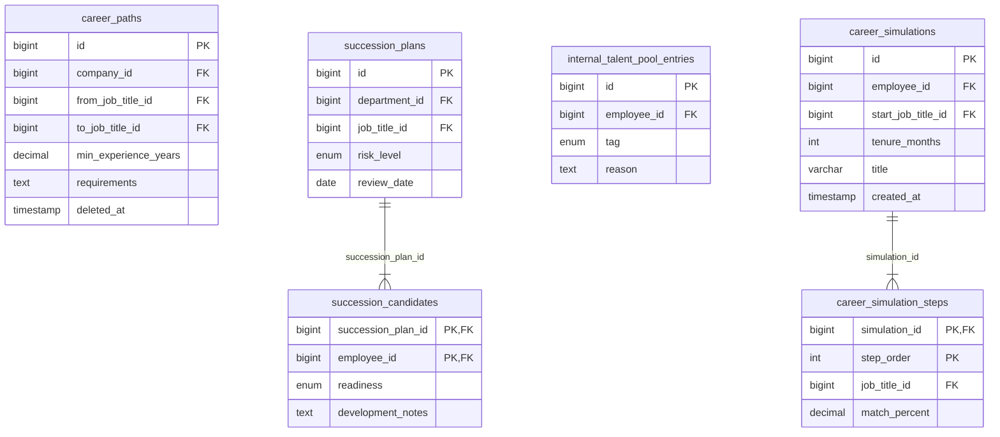

#### `career_paths` — Lộ trình thăng tiến chuẩn
| Trường | Kiểu dữ liệu | Khóa | Mô tả |
| --- | --- | --- | --- |
| id | BIGINT | PK | |
| company_id | BIGINT | FK → companies.id, NN | |
| from_job_title_id | BIGINT | FK → job_titles.id, NN | Vị trí xuất phát |
| to_job_title_id | BIGINT | FK → job_titles.id, NN | Vị trí đích |
| min_experience_years | DECIMAL(4,1) | NN | Số năm kinh nghiệm tối thiểu |
| requirements | TEXT | NULL | Yêu cầu năng lực, kỹ năng, chứng chỉ |
| deleted_at | TIMESTAMP | NULL | Xóa mềm |

Ràng buộc bảng: `CHECK (from_job_title_id <> to_job_title_id)`; duy nhất `(company_id, from_job_title_id, to_job_title_id)` trong các dòng chưa xóa mềm (partial unique).

#### `succession_plans` — Kế hoạch kế nhiệm
Vị trí trọng yếu = cặp (phòng ban, chức danh) [A10]; người đang giữ vị trí là derived.

| Trường | Kiểu dữ liệu | Khóa | Mô tả |
| --- | --- | --- | --- |
| id | BIGINT | PK | |
| department_id | BIGINT | FK → departments.id, NN | |
| job_title_id | BIGINT | FK → job_titles.id, NN | |
| risk_level | ENUM RiskLevel | NN | Mức độ rủi ro của vị trí |
| review_date | DATE | NN | Ngày rà soát kế hoạch |

Ràng buộc bảng: `UNIQUE (department_id, job_title_id)`.

**Enum `RiskLevel`**: `LOW` · `MEDIUM` · `HIGH` · `CRITICAL`.

#### `succession_candidates` — Ứng viên kế nhiệm
| Trường | Kiểu dữ liệu | Khóa | Mô tả |
| --- | --- | --- | --- |
| succession_plan_id | BIGINT | PK, FK → succession_plans.id | |
| employee_id | BIGINT | PK, FK → employees.id | Không được là người đang giữ vị trí mục tiêu (`CANDIDATE_IS_CURRENT_HOLDER`) |
| readiness | ENUM Readiness | NN | Mức độ sẵn sàng |
| development_notes | TEXT | NULL | Nhận xét năng lực/nhu cầu đào tạo |

**Enum `Readiness`**: `READY_NOW` (đảm nhiệm ngay) · `READY_1_2_YEARS` (trong 1–2 năm) · `READY_3_5_YEARS` (trong 3–5 năm).

#### `internal_talent_pool_entries` — Kho nhân tài nội bộ (nhân viên × thẻ)
| Trường | Kiểu dữ liệu | Khóa | Mô tả |
| --- | --- | --- | --- |
| id | BIGINT | PK | |
| employee_id | BIGINT | FK → employees.id, NN | |
| tag | ENUM TalentTag | NN | Thẻ phân loại |
| reason | TEXT | NULL | Lý do/thành tích nổi bật |

Ràng buộc bảng: `UNIQUE (employee_id, tag)`.

**Enum `TalentTag`**: `HIPO` (High Potential) · `KEY_TALENT` · `LEADERSHIP_POTENTIAL` · `TECH_EXPERT`.

#### `career_simulations` — Kịch bản mô phỏng đã lưu (snapshot — §6)
Chỉ chủ sở hữu được xem/xóa (`FORBIDDEN_SIMULATION_ACCESS`). Lộ trình gợi ý và hồ sơ tương đồng là kết quả tính toán, **không lưu** — chỉ lưu bản chụp mà nhân viên chủ động chọn.

| Trường | Kiểu dữ liệu | Khóa | Mô tả |
| --- | --- | --- | --- |
| id | BIGINT | PK | |
| employee_id | BIGINT | FK → employees.id, NN | Chủ sở hữu |
| start_job_title_id | BIGINT | FK → job_titles.id, NN | Vị trí xuất phát tại thời điểm mô phỏng |
| tenure_months | INT | NN | Thâm niên tại thời điểm mô phỏng (snapshot) |
| title | VARCHAR(150) | NULL | Tên kịch bản |
| created_at | TIMESTAMP | NN | |

#### `career_simulation_steps` — Các bước trong kịch bản
| Trường | Kiểu dữ liệu | Khóa | Mô tả |
| --- | --- | --- | --- |
| simulation_id | BIGINT | PK, FK → career_simulations.id | |
| step_order | INT | PK | Thứ tự bước |
| job_title_id | BIGINT | FK → job_titles.id, NN | Vị trí ở bước này |
| match_percent | DECIMAL(5,2) | NN | Tỷ lệ tương thích tại thời điểm lưu (snapshot) |

---
### 8.15. MODULE 14 — QUẢN LÝ NGHỈ PHÉP (Leave)

**Quỹ phép:** chỉ lưu **số ngày được cấp** và **phép chuyển năm trước** (quyết định cấp phát). `used_days`, `pending_days`, `remaining_days` là **derived** từ `leave_requests` (§5 mục 16): `used = SUM(days_count)` đơn `APPROVED`; `pending = SUM` đơn `PENDING`; `remaining = entitled + carried_over − used − pending`. Việc "giữ chỗ/hoàn trả" khi gửi, duyệt, từ chối, hủy do đó **tự nhiên đúng** mà không cần cập nhật số dư.

**Lược đồ quan hệ:**

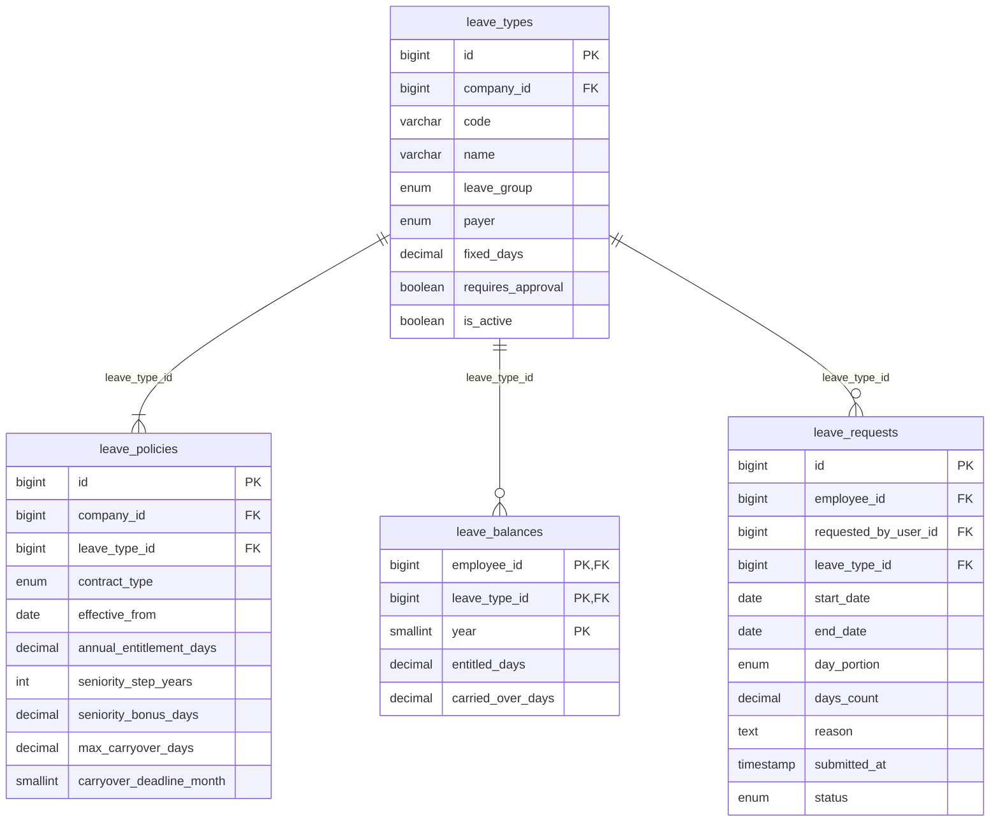

#### `leave_types` — Loại nghỉ
| Trường | Kiểu dữ liệu | Khóa | Mô tả |
| --- | --- | --- | --- |
| id | BIGINT | PK | |
| company_id | BIGINT | FK → companies.id, NN | |
| code | VARCHAR(30) | NN | Mã loại nghỉ |
| name | VARCHAR(150) | NN | Tên loại nghỉ |
| leave_group | ENUM LeaveGroup | NN | Nhóm nghỉ |
| payer | ENUM LeavePayer | NN | Nguồn chi trả |
| fixed_days | DECIMAL(4,1) | NULL | Số ngày cố định theo sự kiện (kết hôn, tang lễ...); NULL = không cố định |
| requires_approval | BOOLEAN | NN | `false` = tự động duyệt theo cấu hình |
| is_active | BOOLEAN | NN | |

Ràng buộc bảng: `UNIQUE (company_id, code)`; không xóa loại nghỉ đang được chính sách/đơn tham chiếu. Loại nghỉ **có hạn mức** = `leave_group = ANNUAL` (derived, không cần cờ riêng).

**Enum `LeaveGroup`**

| Giá trị | Mô tả |
| --- | --- |
| ANNUAL | Nghỉ phép năm — dùng quỹ phép cá nhân |
| PUBLIC_HOLIDAY | Nghỉ lễ, Tết theo lịch hợp lệ |
| PERSONAL_PAID | Nghỉ việc riêng hưởng lương (kết hôn, tang lễ) |
| PERSONAL_UNPAID | Nghỉ việc riêng không lương |
| SICK | Nghỉ ốm đau (liên quan chế độ BHXH) |
| MATERNITY | Nghỉ thai sản (liên quan chế độ BHXH) |

**Enum `LeavePayer`**: `EMPLOYER` (doanh nghiệp chi trả lương) · `SOCIAL_INSURANCE` (quỹ BHXH chi trả) · `NONE` (không hưởng lương) [A30].

#### `leave_policies` — Chính sách nghỉ phép năm
Hiệu lực theo ngày; ứng dụng bảo đảm một nhân viên chỉ khớp một chính sách tại mỗi thời điểm (không có hai chính sách mâu thuẫn).

| Trường | Kiểu dữ liệu | Khóa | Mô tả |
| --- | --- | --- | --- |
| id | BIGINT | PK | |
| company_id | BIGINT | FK → companies.id, NN | |
| leave_type_id | BIGINT | FK → leave_types.id, NN | Loại nghỉ có hạn mức mà chính sách áp dụng |
| contract_type | ENUM ContractType | NULL | Loại hợp đồng áp dụng; NULL = mọi loại [A37] |
| effective_from | DATE | NN | Ngày bắt đầu hiệu lực |
| annual_entitlement_days | DECIMAL(4,1) | NN | Định mức nghỉ hằng năm |
| seniority_step_years | INT | NULL | Cứ mỗi N năm thâm niên được tăng thêm |
| seniority_bonus_days | DECIMAL(3,1) | NULL | Số ngày tăng thêm cho mỗi bước thâm niên |
| max_carryover_days | DECIMAL(4,1) | NN | Số ngày tối đa được chuyển sang năm sau (0 = không chuyển) |
| carryover_deadline_month | SMALLINT | NULL | Tháng của năm kế tiếp là hạn sử dụng phép chuyển |

Ràng buộc bảng: `UNIQUE (company_id, leave_type_id, contract_type, effective_from)`.

#### `leave_balances` — Quỹ phép cá nhân theo năm
| Trường | Kiểu dữ liệu | Khóa | Mô tả |
| --- | --- | --- | --- |
| employee_id | BIGINT | PK, FK → employees.id | |
| leave_type_id | BIGINT | PK, FK → leave_types.id | Loại nghỉ có hạn mức |
| year | SMALLINT | PK | Năm quỹ phép |
| entitled_days | DECIMAL(4,1) | NN | Số ngày được cấp (chính sách, thâm niên, tỷ lệ thời gian — HR có thể yêu cầu tính lại) |
| carried_over_days | DECIMAL(4,1) | NN | Phép chuyển từ năm trước (đã chốt khi cấp) |

Tính lại quỹ chỉ thay `entitled_days`; đơn nghỉ không bị ảnh hưởng.

#### `leave_requests` — Đơn xin nghỉ
Duyệt qua Workflow `LEAVE_REQUEST` (loại không cần duyệt → tự `APPROVED`). `days_count` là snapshot lúc gửi (§6): tính theo lịch ca/ngày nghỉ lễ **có thể sửa về sau**, nhưng số ngày đã duyệt không được thay đổi theo. Đơn nghỉ thuộc về năm quỹ phép của `start_date` [A38].

| Trường | Kiểu dữ liệu | Khóa | Mô tả |
| --- | --- | --- | --- |
| id | BIGINT | PK | |
| employee_id | BIGINT | FK → employees.id, NN | Người nghỉ |
| requested_by_user_id | BIGINT | FK → users.id, NN | Người lập đơn (HR có thể tạo thay nhân viên) |
| leave_type_id | BIGINT | FK → leave_types.id, NN | |
| start_date | DATE | NN | |
| end_date | DATE | NN | |
| day_portion | ENUM DayPortion | NN | Buổi nghỉ (chỉ khác `FULL_DAY` khi nghỉ nửa ngày trong một ngày) |
| days_count | DECIMAL(4,1) | NN | Số ngày nghỉ đã tính khi nộp đơn |
| reason | TEXT | NULL | |
| submitted_at | TIMESTAMP | NN | |
| status | ENUM RequestStatus | NN | Dùng chung (xem §8.10) |

Ràng buộc bảng: `CHECK (start_date <= end_date)`; `CHECK (day_portion = 'FULL_DAY' OR start_date = end_date)`; không trùng khoảng ngày với đơn `PENDING`/`APPROVED` khác của cùng nhân viên (exclusion/ứng dụng).

**Enum `DayPortion`**: `FULL_DAY` (nguyên ngày) · `MORNING` (buổi sáng) · `AFTERNOON` (buổi chiều).

---

### 8.16. MODULE 15 — ĐIỀU CHUYỂN NHÂN SỰ (Transfer)

Điều chuyển hoàn thành → sinh dòng mới ở `employee_work_assignments` (`transfer_request_id` trỏ ngược về phiếu). Giá trị cũ/mới từng trường lấy từ hai dòng liền kề, nên **không** lưu bảng "chi tiết thay đổi". Phiếu giữ `from_*` làm **dữ liệu gốc đối chiếu** (§6).

**Lược đồ quan hệ:**

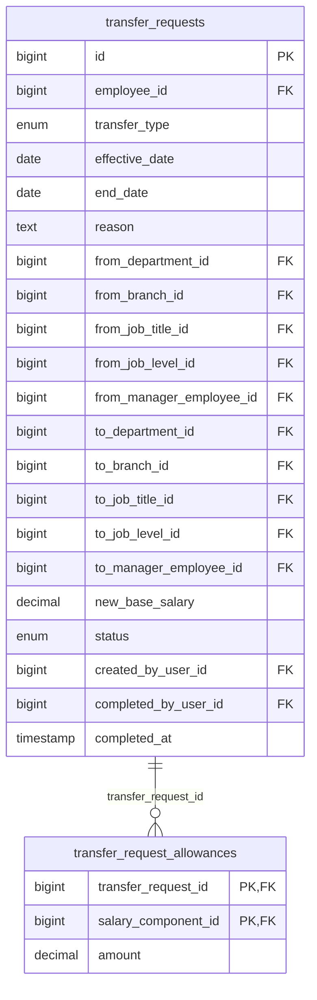

#### `transfer_requests` — Phiếu điều chuyển
| Trường | Kiểu dữ liệu | Khóa | Mô tả |
| --- | --- | --- | --- |
| id | BIGINT | PK | |
| employee_id | BIGINT | FK → employees.id, NN | |
| transfer_type | ENUM TransferType | NN | Loại hình điều chuyển |
| effective_date | DATE | NN | Ngày hiệu lực |
| end_date | DATE | NULL | Ngày kết thúc — chỉ với `TEMPORARY`, không trước `effective_date` |
| reason | TEXT | NN | Lý do điều chuyển |
| from_department_id | BIGINT | FK → departments.id, NN | Dữ liệu gốc: phòng ban lúc lập phiếu |
| from_branch_id | BIGINT | FK → branches.id, NN | Dữ liệu gốc: chi nhánh |
| from_job_title_id | BIGINT | FK → job_titles.id, NN | Dữ liệu gốc: chức danh |
| from_job_level_id | BIGINT | FK → job_levels.id, NN | Dữ liệu gốc: cấp bậc |
| from_manager_employee_id | BIGINT | FK → employees.id, NULL | Dữ liệu gốc: quản lý trực tiếp |
| to_department_id | BIGINT | FK → departments.id, NN | Đơn vị tiếp nhận |
| to_branch_id | BIGINT | FK → branches.id, NULL | Chi nhánh mới (NULL = không đổi) |
| to_job_title_id | BIGINT | FK → job_titles.id, NULL | Chức danh mới (NULL = không đổi) |
| to_job_level_id | BIGINT | FK → job_levels.id, NULL | Cấp bậc mới (NULL = không đổi) |
| to_manager_employee_id | BIGINT | FK → employees.id, NULL | Quản lý mới (NULL = không đổi) |
| new_base_salary | DECIMAL(18,2) | NULL | Đề xuất lương cơ bản mới — Transfer không tự cập nhật Payroll |
| status | ENUM TransferStatus | NN | |
| created_by_user_id | BIGINT | FK → users.id, NN | HR lập phiếu |
| completed_by_user_id | BIGINT | FK → users.id, NULL | |
| completed_at | TIMESTAMP | NULL | |

Ràng buộc bảng: mỗi nhân viên tối đa **một** phiếu `DRAFT/PENDING_APPROVAL/APPROVED` đang mở (partial unique trên `employee_id`); `effective_date` không ở quá khứ khi lập; "có yêu cầu điều chỉnh lương" = `new_base_salary IS NOT NULL` hoặc tồn tại phụ cấp (derived).

**Enum `TransferType`**

| Giá trị | Mô tả |
| --- | --- |
| INTERNAL_DEPARTMENT | Chuyển phòng ban nội bộ |
| BRANCH | Chuyển chi nhánh |
| COMPANY | Chuyển công ty thành viên |
| POSITION | Thay đổi chức vụ |
| TEMPORARY | Điều chuyển tạm thời có thời hạn |

**Enum `TransferStatus`**

| Giá trị | Mô tả |
| --- | --- |
| DRAFT | Đang soạn (sửa được) |
| PENDING_APPROVAL | Đã trình duyệt, khóa nội dung |
| APPROVED | Đã duyệt, chờ HR hoàn thành |
| REJECTED | Bị từ chối |
| COMPLETED | Đã áp dụng vào hồ sơ nhân viên |
| CANCELLED | Đã hủy |

#### `transfer_request_allowances` — Phụ cấp mới đề xuất
| Trường | Kiểu dữ liệu | Khóa | Mô tả |
| --- | --- | --- | --- |
| transfer_request_id | BIGINT | PK, FK → transfer_requests.id | |
| salary_component_id | BIGINT | PK, FK → salary_components.id | |
| amount | DECIMAL(18,2) | NN | |

---
### 8.17. MODULE 16 — OFFBOARDING (Thôi việc & Chấm dứt hợp đồng)

Hai nguồn khởi tạo (**đơn xin thôi việc** của nhân viên / **quyết định chấm dứt** của công ty) → một **hồ sơ Offboarding** → 5 hạng mục bàn giao → hoàn tất. Khi hoàn tất: ghi `employee_status_history` (`RESIGNED`/`TERMINATED` tùy nguồn), đặt `users.status = LOCKED`. Người duyệt/thời điểm duyệt đơn → `workflow_request_steps`. Loại hồ sơ, số phép còn lại, số tài sản chưa trả, tiến độ bàn giao, hợp đồng đã chấm dứt, trợ cấp thôi việc/mất việc đều là **derived** ([A14]).

**Lược đồ quan hệ:**

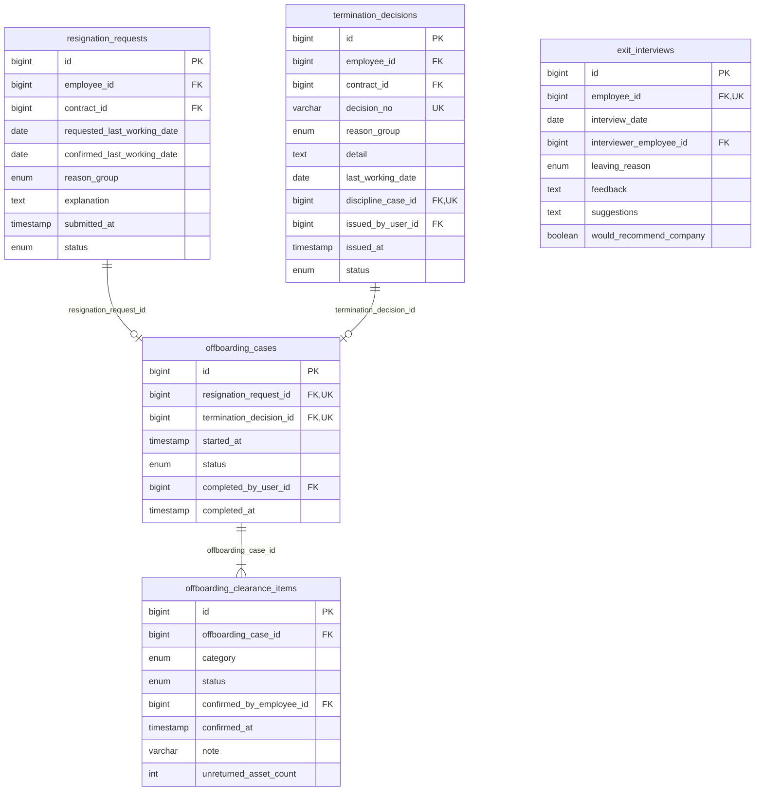

#### `resignation_requests` — Đơn xin thôi việc tự nguyện
| Trường | Kiểu dữ liệu | Khóa | Mô tả |
| --- | --- | --- | --- |
| id | BIGINT | PK | |
| employee_id | BIGINT | FK → employees.id, NN | |
| contract_id | BIGINT | FK → contracts.id, NN | Hợp đồng đang hiệu lực (căn cứ thời hạn báo trước theo loại hợp đồng) |
| requested_last_working_date | DATE | NN | Ngày làm việc cuối mong muốn |
| confirmed_last_working_date | DATE | NULL | Ngày làm việc cuối được xác nhận khi chấp thuận |
| reason_group | ENUM ResignationReason | NN | Nhóm lý do |
| explanation | TEXT | NULL | Giải thích thêm |
| submitted_at | TIMESTAMP | NN | |
| status | ENUM RequestStatus | NN | Dùng chung (§8.10). Lý do từ chối nằm ở `workflow_request_steps.comment` |

**Enum `ResignationReason`**

| Giá trị | Mô tả |
| --- | --- |
| BETTER_OPPORTUNITY | Có cơ hội nghề nghiệp khác |
| PERSONAL_FAMILY | Lý do cá nhân hoặc gia đình |
| HEALTH | Lý do sức khỏe |
| RELOCATION | Thay đổi nơi cư trú |
| CAREER_CHANGE | Chuyển hướng nghề nghiệp |
| WORK_ENVIRONMENT | Môi trường làm việc |
| COMPENSATION | Thu nhập và đãi ngộ |
| OTHER | Lý do khác |

#### `termination_decisions` — Quyết định chấm dứt hợp đồng
| Trường | Kiểu dữ liệu | Khóa | Mô tả |
| --- | --- | --- | --- |
| id | BIGINT | PK | |
| employee_id | BIGINT | FK → employees.id, NN | |
| contract_id | BIGINT | FK → contracts.id, NN | Hợp đồng bị chấm dứt |
| decision_no | VARCHAR(50) | UQ, NN | Số quyết định |
| reason_group | ENUM TerminationReason | NN | Nhóm lý do |
| detail | TEXT | NN | Nội dung chi tiết |
| last_working_date | DATE | NN | Ngày làm việc cuối |
| discipline_case_id | BIGINT | FK → discipline_cases.id, UQ, NULL | Bắt buộc khi `DISCIPLINARY_DISMISSAL` |
| issued_by_user_id | BIGINT | FK → users.id, NN | HR ban hành |
| issued_at | TIMESTAMP | NN | |
| status | ENUM RequestStatus | NN | Có phê duyệt pháp lý trước khi hiệu lực (Workflow `TERMINATION`) |

**Enum `TerminationReason`**

| Giá trị | Mô tả |
| --- | --- |
| PERFORMANCE | Lý do liên quan đến kết quả công việc |
| DISCIPLINARY_DISMISSAL | Sa thải theo quyết định kỷ luật |
| RESTRUCTURING_DOWNSIZING | Tái cơ cấu hoặc cắt giảm nhân sự |
| CONTRACT_EXPIRED_NOT_RENEWED | Hợp đồng hết hạn và không gia hạn |
| MUTUAL_AGREEMENT | Hai bên thỏa thuận chấm dứt |
| PROBATION_FAILED | Không đạt yêu cầu thử việc |
| OTHER | Trường hợp khác |

#### `offboarding_cases` — Hồ sơ Offboarding
Đúng **một** nguồn khởi tạo. Nhân viên đang có hồ sơ `IN_PROGRESS` thì không được mở hồ sơ thứ hai (ứng dụng kiểm tra qua nguồn).

| Trường | Kiểu dữ liệu | Khóa | Mô tả |
| --- | --- | --- | --- |
| id | BIGINT | PK | |
| resignation_request_id | BIGINT | FK → resignation_requests.id, UQ, NULL | Nguồn: đơn thôi việc đã `APPROVED` |
| termination_decision_id | BIGINT | FK → termination_decisions.id, UQ, NULL | Nguồn: quyết định chấm dứt đã `APPROVED` |
| started_at | TIMESTAMP | NN | Thời điểm tạo hồ sơ (cùng lúc 5 hạng mục) |
| status | ENUM OffboardingStatus | NN | |
| completed_by_user_id | BIGINT | FK → users.id, NULL | HR hoàn tất |
| completed_at | TIMESTAMP | NULL | |

Ràng buộc bảng: `CHECK` đúng một trong `resignation_request_id`, `termination_decision_id` khác NULL. Hoàn tất chỉ khi: nguồn `APPROVED`; không còn tài sản chưa hoàn trả; đủ 5 hạng mục `CLEARED`.  
**Enum `OffboardingStatus`**: `IN_PROGRESS` (đang xử lý) · `COMPLETED` (đã hoàn tất, nhân viên chuyển trạng thái) · `CANCELLED` (hủy do nguồn bị hủy/rút).

#### `offboarding_clearance_items` — Hạng mục bàn giao
| Trường | Kiểu dữ liệu | Khóa | Mô tả |
| --- | --- | --- | --- |
| id | BIGINT | PK | |
| offboarding_case_id | BIGINT | FK → offboarding_cases.id, NN | |
| category | ENUM ClearanceCategory | NN | Hạng mục [A13] |
| status | ENUM ClearanceStatus | NN | |
| confirmed_by_employee_id | BIGINT | FK → employees.id, NULL | Người xác nhận |
| confirmed_at | TIMESTAMP | NULL | Thời điểm xác nhận/hoàn thành |
| note | VARCHAR(500) | NULL | Ghi chú |
| unreturned_asset_count | INT | NULL | Chỉ với `ASSET`: số tài sản chưa trả **tại thời điểm xác nhận** (snapshot — §6); phải bằng 0 mới được `CLEARED` |

Ràng buộc bảng: `UNIQUE (offboarding_case_id, category)`.

**Enum `ClearanceCategory`** [A13]

| Giá trị | Mô tả |
| --- | --- |
| WORK_HANDOVER | Bàn giao công việc |
| ASSET | Hoàn trả tài sản |
| IT_ACCESS | Thu hồi tài khoản, quyền truy cập |
| DOCUMENT | Bàn giao tài liệu, hồ sơ |
| FINANCE | Đối soát tài chính (tạm ứng, công nợ) |

**Enum `ClearanceStatus`**: `PENDING` (chờ xử lý) · `CLEARED` (đã hoàn tất) · `REJECTED` (không đạt).

#### `exit_interviews` — Phỏng vấn nghỉ việc [A32]
Không bắt buộc để hoàn tất Offboarding.

| Trường | Kiểu dữ liệu | Khóa | Mô tả |
| --- | --- | --- | --- |
| id | BIGINT | PK | |
| employee_id | BIGINT | FK → employees.id, UQ, NN | |
| interview_date | DATE | NN | |
| interviewer_employee_id | BIGINT | FK → employees.id, NN | Người thực hiện |
| leaving_reason | ENUM ResignationReason | NULL | Lý do nghỉ việc theo lời nhân viên (dùng chung bộ nhóm lý do) |
| feedback | TEXT | NULL | Phản hồi về môi trường làm việc |
| suggestions | TEXT | NULL | Đề xuất cải thiện |
| would_recommend_company | BOOLEAN | NULL | Có sẵn sàng giới thiệu công ty |

---

### 8.18. MODULE 17 — PHÁP LUẬT & TUÂN THỦ (Legal & Compliance)

Nguồn **duy nhất** cho thông số pháp lý của toàn hệ thống (lương, thuế, bảo hiểm, OT, thời hiệu kỷ luật, thời hạn lưu trữ...). Dữ liệu dùng chung, không thuộc công ty cụ thể [A25]. Quy tắc đã công bố **bất biến** — sửa đổi = phiên bản mới. Dashboard, báo cáo tuân thủ là derived; nhật ký thay đổi → `audit_logs` + `workflow_request_steps`.

**Lược đồ quan hệ:**

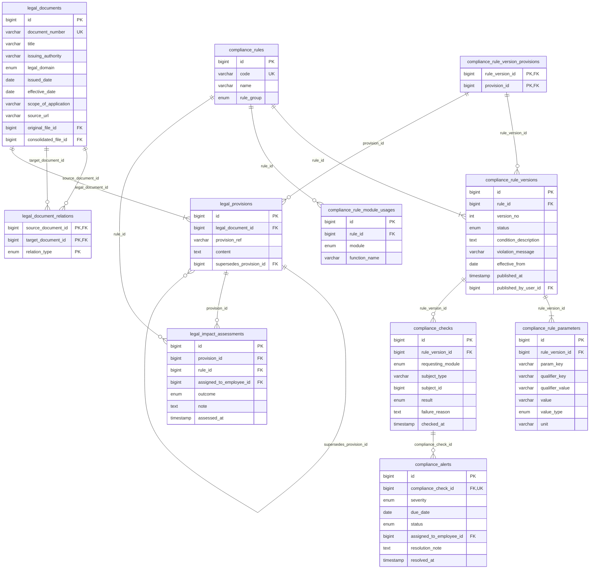

#### `legal_documents` — Văn bản pháp luật
| Trường | Kiểu dữ liệu | Khóa | Mô tả |
| --- | --- | --- | --- |
| id | BIGINT | PK | |
| document_number | VARCHAR(100) | UQ, NN | Số hiệu văn bản |
| title | VARCHAR(500) | NN | Tên văn bản |
| issuing_authority | VARCHAR(200) | NN | Cơ quan ban hành |
| legal_domain | ENUM LegalDomain | NN | Lĩnh vực |
| issued_date | DATE | NN | Ngày ban hành |
| effective_date | DATE | NN | Ngày có hiệu lực (khác ngày ban hành) |
| scope_of_application | VARCHAR(500) | NULL | Phạm vi áp dụng |
| source_url | VARCHAR(500) | NULL | Nguồn chính thức |
| original_file_id | BIGINT | FK → files.id, NULL | Bản gốc |
| consolidated_file_id | BIGINT | FK → files.id, NULL | Bản hợp nhất |

**Enum `LegalDomain`**: `LABOR` (lao động) · `INSURANCE` (bảo hiểm) · `PERSONAL_INCOME_TAX` (thuế TNCN) · `ELECTRONIC_TRANSACTION` (giao dịch điện tử) · `PERSONAL_DATA_PROTECTION` (bảo vệ dữ liệu cá nhân) · `OTHER`.

#### `legal_document_relations` — Quan hệ giữa các văn bản
| Trường | Kiểu dữ liệu | Khóa | Mô tả |
| --- | --- | --- | --- |
| source_document_id | BIGINT | PK, FK → legal_documents.id | Văn bản mới |
| target_document_id | BIGINT | PK, FK → legal_documents.id | Văn bản bị tác động |
| relation_type | ENUM LegalRelationType | PK | Loại quan hệ |

Ràng buộc bảng: `CHECK (source_document_id <> target_document_id)`.  
**Enum `LegalRelationType`**: `AMENDS` (sửa đổi) · `SUPPLEMENTS` (bổ sung) · `REPLACES` (thay thế) · `REPEALS` (bãi bỏ).

#### `legal_provisions` — Điều khoản
| Trường | Kiểu dữ liệu | Khóa | Mô tả |
| --- | --- | --- | --- |
| id | BIGINT | PK | |
| legal_document_id | BIGINT | FK → legal_documents.id, NN | |
| provision_ref | VARCHAR(50) | NN | Ký hiệu điều/khoản/điểm (vd "Điều 98.1") |
| content | TEXT | NN | Nội dung điều khoản |
| supersedes_provision_id | BIGINT | FK → legal_provisions.id, NULL | Điều khoản cũ mà điều khoản này sửa/thay thế — cơ sở "đánh dấu điều khoản thay đổi" |

Ràng buộc bảng: `UNIQUE (legal_document_id, provision_ref)`.

#### `compliance_rules` — Quy tắc tuân thủ (định danh ổn định)
| Trường | Kiểu dữ liệu | Khóa | Mô tả |
| --- | --- | --- | --- |
| id | BIGINT | PK | |
| code | VARCHAR(50) | UQ, NN | Mã quy tắc |
| name | VARCHAR(200) | NN | |
| rule_group | ENUM ComplianceRuleGroup | NN | Nhóm quy định |

**Enum `ComplianceRuleGroup`**: `WORKING_HOURS` (thời giờ làm việc) · `OVERTIME` (làm thêm giờ) · `PROBATION` (thử việc) · `CONTRACT_TERMINATION` (chấm dứt hợp đồng) · `RECORD_RETENTION` (lưu trữ hồ sơ) · `PAYROLL_TAX` (thuế TNCN) · `INSURANCE` (bảo hiểm) · `LEAVE` (nghỉ phép) · `DISCIPLINE` (kỷ luật) · `ELECTRONIC_CONTRACT` (hợp đồng điện tử) · `DATA_PROTECTION` (bảo vệ dữ liệu) · `OTHER`.

#### `compliance_rule_versions` — Phiên bản quy tắc
| Trường | Kiểu dữ liệu | Khóa | Mô tả |
| --- | --- | --- | --- |
| id | BIGINT | PK | |
| rule_id | BIGINT | FK → compliance_rules.id, NN | |
| version_no | INT | NN | |
| status | ENUM RuleVersionStatus | NN | |
| condition_description | TEXT | NULL | Điều kiện áp dụng (loại hợp đồng, thời điểm giao kết, đối tượng, ngoại lệ...) |
| violation_message | VARCHAR(500) | NN | Thông báo khi vi phạm |
| effective_from | DATE | NN | Ngày có hiệu lực áp dụng |
| published_at | TIMESTAMP | NULL | Ngày doanh nghiệp thực tế công bố (khác `effective_from`) |
| published_by_user_id | BIGINT | FK → users.id, NULL | |

Ràng buộc bảng: `UNIQUE (rule_id, version_no)`. Quy tắc/phiên bản `PUBLISHED` không được sửa. Rà soát lần lượt Pháp chế → BA → Kỹ thuật → Người có thẩm quyền là các bước của Workflow `COMPLIANCE_RULE`; bị từ chối → trở về `DRAFT` kèm ý kiến ở `workflow_request_steps.comment`. Phiên bản "đang áp dụng tại ngày T" = `PUBLISHED` có `effective_from ≤ T` lớn nhất.

**Enum `RuleVersionStatus`**: `DRAFT` (bản nháp) · `PENDING_APPROVAL` (đang rà soát/phê duyệt) · `PUBLISHED` (đã công bố — bất biến).

#### `compliance_rule_parameters` — Tham số của phiên bản quy tắc
Không phải quy tắc nào cũng một giá trị số: dùng cặp `qualifier` để biểu diễn điều kiện (vd hệ số OT theo loại ngày, bậc thuế thứ n).

| Trường | Kiểu dữ liệu | Khóa | Mô tả |
| --- | --- | --- | --- |
| id | BIGINT | PK | |
| rule_version_id | BIGINT | FK → compliance_rule_versions.id, NN | |
| param_key | VARCHAR(100) | NN | Khóa tham số (`ot.multiplier`, `pit.bracket.upper`, `pit.bracket.rate`, `insurance.employee.rate`...) |
| qualifier_key | VARCHAR(50) | NULL | Điều kiện phân nhánh (`day_type`, `bracket_no`, `insurance_kind`...) |
| qualifier_value | VARCHAR(50) | NULL | Giá trị điều kiện (`WEEKDAY`, `1`, `SOCIAL`...) |
| value | VARCHAR(100) | NN | Giá trị tham số |
| value_type | ENUM ParameterValueType | NN | Kiểu giá trị |
| unit | VARCHAR(30) | NULL | Đơn vị (%, VND, giờ, tháng) |

Ràng buộc bảng: `UNIQUE (rule_version_id, param_key, qualifier_key, qualifier_value)` (xử lý NULL bằng chỉ mục biểu thức).  
**Enum `ParameterValueType`**: `NUMBER` · `PERCENT` · `TEXT` · `BOOLEAN` · `DATE`.

#### `compliance_rule_version_provisions` — Căn cứ pháp lý (N:M)
Một điều khoản sinh nhiều quy tắc; một quy tắc tham chiếu nhiều điều khoản.

| Trường | Kiểu dữ liệu | Khóa | Mô tả |
| --- | --- | --- | --- |
| rule_version_id | BIGINT | PK, FK → compliance_rule_versions.id | |
| provision_id | BIGINT | PK, FK → legal_provisions.id | |

#### `compliance_rule_module_usages` — Ánh xạ quy tắc ↔ chức năng nghiệp vụ
| Trường | Kiểu dữ liệu | Khóa | Mô tả |
| --- | --- | --- | --- |
| id | BIGINT | PK | |
| rule_id | BIGINT | FK → compliance_rules.id, NN | |
| module | ENUM SystemModule | NN | Module sử dụng quy tắc |
| function_name | VARCHAR(150) | NN | Chức năng bị ảnh hưởng |

Ràng buộc bảng: `UNIQUE (rule_id, module, function_name)`.

**Enum `SystemModule`** (dùng cho §8.18)

| Giá trị | Mô tả |
| --- | --- |
| AUTH | Xác thực |
| ORGANIZATION | Quản lý tổ chức (gồm mô phỏng tái cơ cấu) |
| PERMISSION | Phân quyền |
| RECRUITMENT | Tuyển dụng |
| EMPLOYEE | Hồ sơ nhân sự |
| ONBOARDING | Hội nhập |
| DIGITAL_RECORDS | Số hóa & lưu kho hồ sơ |
| CONTRACT | Hợp đồng |
| ATTENDANCE | Chấm công |
| PAYROLL | Lương |
| PERFORMANCE | Hiệu suất |
| REWARD_DISCIPLINE | Khen thưởng, kỷ luật, khiếu nại |
| CAREER | Phát triển & kế nhiệm |
| LEAVE | Nghỉ phép |
| TRANSFER | Điều chuyển |
| OFFBOARDING | Thôi việc |
| LEGAL_COMPLIANCE | Pháp luật & tuân thủ |
| AI_ASSISTANT | Trợ lý AI |
| WORKPLACE | Sơ đồ ghế ngồi & không gian làm việc |
| NOTIFICATION | Thông báo |
| WORKFLOW | Quy trình phê duyệt |
| ASSET | Tài sản |

#### `legal_impact_assessments` — Đánh giá tác động khi điều khoản thay đổi
Danh sách quy tắc/chức năng bị ảnh hưởng **tra được** từ `compliance_rule_version_provisions` và `compliance_rule_module_usages` (derived); bảng này chỉ lưu **kết quả đánh giá và phân công** của Pháp chế/BA.

| Trường | Kiểu dữ liệu | Khóa | Mô tả |
| --- | --- | --- | --- |
| id | BIGINT | PK | |
| provision_id | BIGINT | FK → legal_provisions.id, NN | Điều khoản mới/được sửa đổi |
| rule_id | BIGINT | FK → compliance_rules.id, NN | Quy tắc cần rà soát |
| assigned_to_employee_id | BIGINT | FK → employees.id, NULL | Người/bộ phận phụ trách |
| outcome | ENUM ImpactOutcome | NULL | Kết luận; NULL = chưa đánh giá |
| note | TEXT | NULL | |
| assessed_at | TIMESTAMP | NULL | |

Ràng buộc bảng: `UNIQUE (provision_id, rule_id)`.  
**Enum `ImpactOutcome`**: `NO_IMPACT` (không ảnh hưởng) · `CONFIG_UPDATE` (cập nhật bằng cấu hình/tham số) · `CODE_CHANGE` (cần sửa mã nguồn) · `PROCESS_CHANGE` (cần đổi quy trình nội bộ).

#### `compliance_checks` — Kết quả kiểm tra tuân thủ
Lưu **phiên bản quy tắc đã dùng** cho từng lần kiểm tra (yêu cầu truy vết, §17.3.9). Mã quy tắc và căn cứ pháp lý lấy qua `rule_version_id`.

| Trường | Kiểu dữ liệu | Khóa | Mô tả |
| --- | --- | --- | --- |
| id | BIGINT | PK | |
| rule_version_id | BIGINT | FK → compliance_rule_versions.id, NN | |
| requesting_module | ENUM SystemModule | NN | Module gửi yêu cầu |
| subject_type | VARCHAR(50) | NN | Loại đối tượng được kiểm tra (tham chiếu đa hình — §3.5) |
| subject_id | BIGINT | NN | Id đối tượng |
| result | ENUM ComplianceResult | NN | Kết quả |
| failure_reason | TEXT | NULL | Lý do không đạt (bắt buộc khi khác `COMPLIANT`) |
| checked_at | TIMESTAMP | NN | |

**Enum `ComplianceResult`**: `COMPLIANT` (hợp lệ) · `WARNING` (cảnh báo) · `VIOLATION` (vi phạm).

#### `compliance_alerts` — Cảnh báo tuân thủ cần xử lý
| Trường | Kiểu dữ liệu | Khóa | Mô tả |
| --- | --- | --- | --- |
| id | BIGINT | PK | |
| compliance_check_id | BIGINT | FK → compliance_checks.id, UQ, NN | Lần kiểm tra phát sinh cảnh báo |
| severity | ENUM AlertSeverity | NN | Mức độ |
| due_date | DATE | NULL | Hạn xử lý |
| status | ENUM AlertStatus | NN | |
| assigned_to_employee_id | BIGINT | FK → employees.id, NULL | Bộ phận phụ trách |
| resolution_note | TEXT | NULL | |
| resolved_at | TIMESTAMP | NULL | |

**Enum `AlertSeverity`**: `LOW` · `MEDIUM` · `HIGH`.  
**Enum `AlertStatus`**: `OPEN` (mới) · `IN_PROGRESS` (đang xử lý) · `ESCALATED_TO_LEGAL` (chuyển Pháp chế đánh giá) · `RESOLVED` (đã khắc phục/đóng).

---
### 8.19. MODULE 18 — TRỢ LÝ AI (AI 1-1 Assistant)

Chatbot dùng Function Calling (dữ liệu nghiệp vụ, **không lưu kết quả truy vấn** — tránh sao chép dữ liệu nhạy cảm ngoài phạm vi quyền) và RAG (tài liệu nội bộ). Số câu hỏi của cụm, ngưỡng thông báo, "câu hỏi chưa có lời giải" đều là derived hoặc cấu hình.

**Lược đồ quan hệ:**

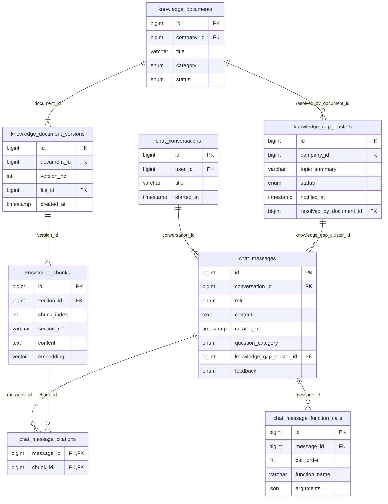

#### `knowledge_documents` — Tài liệu trong kho tri thức
| Trường | Kiểu dữ liệu | Khóa | Mô tả |
| --- | --- | --- | --- |
| id | BIGINT | PK | |
| company_id | BIGINT | FK → companies.id, NN | |
| title | VARCHAR(300) | NN | Tên tài liệu |
| category | ENUM KnowledgeCategory | NN | Nhóm tài liệu |
| status | ENUM KnowledgeDocumentStatus | NN | Trạng thái sử dụng |

**Enum `KnowledgeCategory`**: `HR_POLICY` (chính sách nhân sự, nội quy, phúc lợi) · `EMPLOYEE_HANDBOOK` (sổ tay nhân viên) · `SYSTEM_GUIDE` (hướng dẫn sử dụng HRM) · `LEGAL_DOCUMENT` (tài liệu pháp lý).  
**Enum `KnowledgeDocumentStatus`**: `ACTIVE` (đang được chatbot sử dụng) · `ARCHIVED` (lỗi thời — không được viện dẫn).

#### `knowledge_document_versions` — Phiên bản tài liệu
Phiên bản đang dùng = `version_no` lớn nhất của tài liệu `ACTIVE` (derived).

| Trường | Kiểu dữ liệu | Khóa | Mô tả |
| --- | --- | --- | --- |
| id | BIGINT | PK | |
| document_id | BIGINT | FK → knowledge_documents.id, NN | |
| version_no | INT | NN | |
| file_id | BIGINT | FK → files.id, NN | Tệp nguồn |
| created_at | TIMESTAMP | NN | |

Ràng buộc bảng: `UNIQUE (document_id, version_no)`.

#### `knowledge_chunks` — Đoạn nội dung đã chia nhỏ & chỉ mục ngữ nghĩa
| Trường | Kiểu dữ liệu | Khóa | Mô tả |
| --- | --- | --- | --- |
| id | BIGINT | PK | |
| version_id | BIGINT | FK → knowledge_document_versions.id, NN | |
| chunk_index | INT | NN | Thứ tự đoạn |
| section_ref | VARCHAR(200) | NULL | Mục/điều tham chiếu để trích dẫn |
| content | TEXT | NN | Nội dung đoạn |
| embedding | VECTOR(n) | NN | Vector embedding phục vụ tìm kiếm ngữ nghĩa [A39] |

Ràng buộc bảng: `UNIQUE (version_id, chunk_index)`.  
Lý do được lưu `embedding`: dù sinh ra từ `content`, tài liệu **yêu cầu rõ** lập chỉ mục tìm kiếm ngữ nghĩa và việc tính lại ở mỗi truy vấn là không khả thi → đây là chỉ mục kỹ thuật bắt buộc, không phải dữ liệu nghiệp vụ.

#### `knowledge_gap_clusters` — Cụm câu hỏi chưa có lời giải
| Trường | Kiểu dữ liệu | Khóa | Mô tả |
| --- | --- | --- | --- |
| id | BIGINT | PK | |
| company_id | BIGINT | FK → companies.id, NN | |
| topic_summary | VARCHAR(300) | NN | Chủ đề đại diện của cụm |
| status | ENUM KnowledgeGapStatus | NN | |
| notified_at | TIMESTAMP | NULL | Lần gửi thông báo cho HR Admin khi đạt ngưỡng (tránh gửi lặp) |
| resolved_by_document_id | BIGINT | FK → knowledge_documents.id, NULL | Tài liệu được bổ sung/cập nhật để giải quyết |

**Enum `KnowledgeGapStatus`**: `OPEN` (cần bổ sung tri thức) · `RESOLVED` (đã bổ sung/cập nhật tài liệu) · `DISMISSED` (HR xác nhận không cần xử lý).

#### `chat_conversations` — Cuộc hội thoại
| Trường | Kiểu dữ liệu | Khóa | Mô tả |
| --- | --- | --- | --- |
| id | BIGINT | PK | |
| user_id | BIGINT | FK → users.id, NN | Chủ cuộc hội thoại |
| title | VARCHAR(200) | NULL | |
| started_at | TIMESTAMP | NN | |

#### `chat_messages` — Tin nhắn
Mỗi dòng là một câu hỏi (`USER`) hoặc một câu trả lời (`ASSISTANT`). Người hỏi lấy qua `conversation_id` — không lặp `user_id`.

| Trường | Kiểu dữ liệu | Khóa | Mô tả |
| --- | --- | --- | --- |
| id | BIGINT | PK | |
| conversation_id | BIGINT | FK → chat_conversations.id, NN | |
| role | ENUM ChatRole | NN | Người gửi |
| content | TEXT | NN | Nội dung câu hỏi/câu trả lời |
| created_at | TIMESTAMP | NN | |
| question_category | ENUM QuestionCategory | NULL | Kết quả phân loại — chỉ với `USER` |
| knowledge_gap_cluster_id | BIGINT | FK → knowledge_gap_clusters.id, NULL | Cụm mà câu hỏi chưa có lời giải được gom vào — chỉ với `USER` |
| feedback | ENUM AnswerFeedback | NULL | Đánh giá của người dùng — chỉ với `ASSISTANT` |

Ghi chú: câu hỏi "chưa có lời giải" = `USER` loại `IN_SCOPE_POLICY` mà câu trả lời kế tiếp không có trích dẫn (derived); cột cụm do tác vụ nền gán.

**Enum `ChatRole`**: `USER` · `ASSISTANT`.

**Enum `QuestionCategory`**

| Giá trị | Mô tả |
| --- | --- |
| IN_SCOPE_DATA | Hỏi dữ liệu nhân sự/báo cáo — xử lý bằng Function Calling theo quyền người hỏi |
| IN_SCOPE_POLICY | Hỏi chính sách/tài liệu nội bộ — xử lý bằng RAG |
| OUT_OF_SCOPE | Ngoài phạm vi HRM — từ chối ngay, không truy vấn |

**Enum `AnswerFeedback`**: `HELPFUL` (hữu ích) · `NOT_HELPFUL` (không hữu ích).

#### `chat_message_function_calls` — Các function đã gọi để trả lời
| Trường | Kiểu dữ liệu | Khóa | Mô tả |
| --- | --- | --- | --- |
| id | BIGINT | PK | |
| message_id | BIGINT | FK → chat_messages.id, NN | Tin nhắn `ASSISTANT` |
| call_order | INT | NN | Thứ tự gọi |
| function_name | VARCHAR(100) | NN | Tên function (kể cả `render_chart`) |
| arguments | JSON | NULL | Tham số đã truyền (không lưu kết quả) |

Ràng buộc bảng: `UNIQUE (message_id, call_order)`.

#### `chat_message_citations` — Đoạn tài liệu được trích dẫn
Tên tài liệu và mục tham chiếu lấy qua `chunk → version → document`.

| Trường | Kiểu dữ liệu | Khóa | Mô tả |
| --- | --- | --- | --- |
| message_id | BIGINT | PK, FK → chat_messages.id | |
| chunk_id | BIGINT | PK, FK → knowledge_chunks.id | |

---

### 8.20. MODULE 19 — SƠ ĐỒ GHẾ NGỒI & KHÔNG GIAN LÀM VIỆC (Smart Workplace)

Phân cấp: **Site → Floor → Zone → SeatRow → Seat**. Mỗi bảng con chỉ giữ khóa của cha trực tiếp (không lặp zone/floor/site ở `seats`). Tỷ lệ lấp đầy, trạng thái `AVAILABLE/OCCUPIED` của bàn, `COMPLETED` của đặt phòng, vị trí đồng nghiệp, đường đi A\* đều là **derived** (§5 mục 21–23, [A23]). Công ty của Site lấy qua `branch_id → regions.company_id`; tính duy nhất `(công ty, code)` do ứng dụng kiểm tra.

**Lược đồ quan hệ 1 — Hạ tầng Mặt bằng, Tầng & Phân khu chỗ ngồi:**

```mermaid
erDiagram
    sites {
        bigint id PK
        bigint branch_id FK
        varchar code
        varchar name
        varchar address
        text description
        timestamp deleted_at
    }
    floors {
        bigint id PK
        bigint site_id FK
        int floor_number
        varchar name
        text description
    }
    floor_plans {
        bigint id PK
        bigint floor_id FK
        int version_no
        bigint background_file_id FK
        int canvas_width
        int canvas_height
        decimal scale_meters_per_px
        enum status
    }
    zones {
        bigint id PK
        bigint floor_id FK
        varchar name
        bigint department_id FK
        char color_hex
    }
    zone_boundary_points {
        bigint zone_id PK,FK
        int point_order PK
        decimal x
        decimal y
    }
    seat_rows {
        bigint id PK
        bigint zone_id FK
        varchar code
        enum layout_type
        decimal x
        decimal y
        decimal rotation_degrees
    }
    seats {
        bigint id PK
        bigint seat_row_id FK
        varchar seat_code UK
        enum seat_type
        enum status
        decimal x
        decimal y
        enum shape
        decimal width
        decimal height
        decimal rotation_degrees
        varchar qr_token UK
    }
    floor_objects {
        bigint id PK
        bigint floor_id FK
        enum object_type
        varchar name
        decimal x
        decimal y
        decimal width
        decimal height
        decimal rotation_degrees
        varchar qr_token UK
    }
    sites ||--|{ floors : "site_id"
    floors ||--o{ floor_plans : "floor_id"
    floors ||--o{ zones : "floor_id"
    zones ||--|{ zone_boundary_points : "zone_id"
    zones ||--o{ seat_rows : "zone_id"
    seat_rows ||--|{ seats : "seat_row_id"
    floors ||--o{ floor_objects : "floor_id"
```

**Lược đồ quan hệ 2 — Phân bổ Bàn, Tiện ích, Đặt chỗ & Quản lý Sự cố:**

```mermaid
erDiagram
    seats {
        bigint id PK
        varchar seat_code UK
        enum seat_type
        enum status
        varchar qr_token UK
    }
    amenities {
        bigint id PK
        bigint company_id FK
        varchar name
    }
    seat_amenities {
        bigint seat_id PK,FK
        bigint amenity_id PK,FK
    }
    seat_assignments {
        bigint id PK
        bigint seat_id FK
        bigint employee_id FK
        timestamp assigned_at
        timestamp released_at
    }
    seat_assets {
        bigint id PK
        bigint seat_id FK
        bigint asset_id FK
        timestamp linked_at
        timestamp unlinked_at
    }
    floor_objects {
        bigint id PK
        bigint floor_id FK
        enum object_type
        varchar name
        varchar qr_token UK
    }
    meeting_rooms {
        bigint floor_object_id PK,FK
        int capacity
    }
    desk_bookings {
        bigint id PK
        bigint seat_id FK
        bigint employee_id FK
        date booking_date
        enum status
        timestamp checked_in_at
    }
    room_bookings {
        bigint id PK
        bigint meeting_room_id FK
        bigint organizer_employee_id FK
        bigint created_by_user_id FK
        varchar title
        int attendee_count
        timestamp start_time
        timestamp end_time
        enum status
        timestamp checked_in_at
    }
    workplace_issues {
        bigint id PK
        bigint reporter_employee_id FK
        enum issue_type
        enum severity
        varchar title
        text description
        bigint seat_id FK
        bigint floor_object_id FK
        bigint floor_id FK
        decimal location_x
        decimal location_y
        enum status
        bigint assigned_to_employee_id FK
        text resolution_note
        timestamp reported_at
        timestamp resolved_at
    }
    seats ||--o{ seat_amenities : "seat_id"
    amenities ||--o{ seat_amenities : "amenity_id"
    seats ||--o{ seat_assignments : "seat_id"
    seats ||--o{ seat_assets : "seat_id"
    seats ||--o{ desk_bookings : "seat_id"
    floor_objects ||--o| meeting_rooms : "floor_object_id"
    meeting_rooms ||--o{ room_bookings : "meeting_room_id"
    seats ||--o{ workplace_issues : "seat_id"
    floor_objects ||--o{ workplace_issues : "floor_object_id"
```

#### `sites` — Cơ sở / tòa nhà
| Trường | Kiểu dữ liệu | Khóa | Mô tả |
| --- | --- | --- | --- |
| id | BIGINT | PK | |
| branch_id | BIGINT | FK → branches.id, NN | Chi nhánh liên kết |
| code | VARCHAR(30) | NN | Mã cơ sở — chuẩn hóa chữ in hoa, duy nhất trong công ty |
| name | VARCHAR(150) | NN | |
| address | VARCHAR(500) | NN | |
| description | TEXT | NULL | |
| deleted_at | TIMESTAMP | NULL | Xóa mềm |

#### `floors` — Tầng
| Trường | Kiểu dữ liệu | Khóa | Mô tả |
| --- | --- | --- | --- |
| id | BIGINT | PK | |
| site_id | BIGINT | FK → sites.id, NN | |
| floor_number | INT | NN | Số tầng |
| name | VARCHAR(100) | NN | |
| description | TEXT | NULL | |

Ràng buộc bảng: `UNIQUE (site_id, floor_number)`.

#### `floor_plans` — Bản vẽ sơ đồ tầng (phiên bản)
| Trường | Kiểu dữ liệu | Khóa | Mô tả |
| --- | --- | --- | --- |
| id | BIGINT | PK | |
| floor_id | BIGINT | FK → floors.id, NN | |
| version_no | INT | NN | Phiên bản bản vẽ |
| background_file_id | BIGINT | FK → files.id, NULL | Ảnh nền sơ đồ |
| canvas_width | INT | NN | Chiều rộng Canvas (px) |
| canvas_height | INT | NN | Chiều cao Canvas (px) |
| scale_meters_per_px | DECIMAL(10,6) | NN | Tỷ lệ thực tế [A29] |
| status | ENUM FloorPlanStatus | NN | Trạng thái phát hành |

Ràng buộc bảng: `UNIQUE (floor_id, version_no)`; mỗi tầng tối đa một bản `PUBLISHED`.  
**Enum `FloorPlanStatus`**: `DRAFT` · `PUBLISHED` (đang hiển thị cho nhân viên) · `ARCHIVED`.

#### `zones` — Phân khu
| Trường | Kiểu dữ liệu | Khóa | Mô tả |
| --- | --- | --- | --- |
| id | BIGINT | PK | |
| floor_id | BIGINT | FK → floors.id, NN | |
| name | VARCHAR(100) | NN | |
| department_id | BIGINT | FK → departments.id, NULL | Phòng ban liên kết (nếu có) |
| color_hex | CHAR(7) | NULL | Màu nhận diện (#RRGGBB) |

#### `zone_boundary_points` — Đỉnh ranh giới phân khu
Hình chữ nhật = đa giác 4 điểm nên **không** cần cột `boundary_type` (§5 mục 33).

| Trường | Kiểu dữ liệu | Khóa | Mô tả |
| --- | --- | --- | --- |
| zone_id | BIGINT | PK, FK → zones.id | |
| point_order | INT | PK | Thứ tự đỉnh |
| x | DECIMAL(10,2) | NN | Tọa độ X trên Canvas |
| y | DECIMAL(10,2) | NN | Tọa độ Y trên Canvas |

#### `seat_rows` — Cụm / dãy bàn
| Trường | Kiểu dữ liệu | Khóa | Mô tả |
| --- | --- | --- | --- |
| id | BIGINT | PK | |
| zone_id | BIGINT | FK → zones.id, NN | |
| code | VARCHAR(30) | NN | Mã cụm (một thành phần của mã bàn) |
| layout_type | ENUM RowLayoutType | NN | Kiểu bố trí |
| x | DECIMAL(10,2) | NN | Vị trí trên bản đồ |
| y | DECIMAL(10,2) | NN | |
| rotation_degrees | DECIMAL(5,2) | NN | Góc xoay |

Ràng buộc bảng: `UNIQUE (zone_id, code)`.

**Enum `RowLayoutType`**: `SINGLE_ROW` (một dãy bàn) · `POD_4_FACING` (cụm 4 bàn đối diện) · `POD_6_FACING` (cụm 6 bàn đối diện).

#### `amenities` — Danh mục tiện ích của bàn
| Trường | Kiểu dữ liệu | Khóa | Mô tả |
| --- | --- | --- | --- |
| id | BIGINT | PK | |
| company_id | BIGINT | FK → companies.id, NN | |
| name | VARCHAR(100) | NN | Ổ điện, màn hình phụ, đèn bàn... |

Ràng buộc bảng: `UNIQUE (company_id, name)`.

#### `seats` — Bàn làm việc
`seat_code` là **định danh nghiệp vụ được cấp một lần** (sinh từ năm cấp không gian tại thời điểm tạo, gắn với QR) và không đổi khi tên cụm/phân khu đổi → được lưu, không phải dữ liệu derived.

| Trường | Kiểu dữ liệu | Khóa | Mô tả |
| --- | --- | --- | --- |
| id | BIGINT | PK | |
| seat_row_id | BIGINT | FK → seat_rows.id, NN | |
| seat_code | VARCHAR(100) | UQ, NN | Mã bàn (mã đã tồn tại được bỏ qua khi tạo hàng loạt) |
| seat_type | ENUM SeatType | NN | Loại bàn |
| status | ENUM SeatStatus | NN | Trạng thái khả dụng do quản trị đặt [A23] |
| x | DECIMAL(10,2) | NN | Vị trí trên bản đồ |
| y | DECIMAL(10,2) | NN | |
| shape | ENUM SeatShape | NN | Hình dạng |
| width | DECIMAL(8,2) | NN | Kích thước |
| height | DECIMAL(8,2) | NN | |
| rotation_degrees | DECIMAL(5,2) | NN | Góc xoay |
| qr_token | VARCHAR(100) | UQ, NN | Dữ liệu định danh QR (ảnh QR sinh từ token) |

**Enum `SeatType`**: `DEDICATED` (bàn cố định gán một nhân viên) · `HOT_DESK` (bàn linh hoạt đặt theo ngày) · `VISITOR` (bàn khách/thực tập sinh).

**Enum `SeatStatus`** [A23]

| Giá trị | Mô tả |
| --- | --- |
| IN_SERVICE | Đang hoạt động (còn trống/đã có người suy ra từ phân bổ và đặt chỗ) |
| MAINTENANCE | Đang bảo trì |
| BLOCKED | Bị khóa (kể cả khóa tự động khi có sự cố) |

**Enum `SeatShape`**: `RECTANGLE` · `ROUND`.

#### `seat_amenities` — Tiện ích đi kèm bàn (N:M)
| Trường | Kiểu dữ liệu | Khóa | Mô tả |
| --- | --- | --- | --- |
| seat_id | BIGINT | PK, FK → seats.id | |
| amenity_id | BIGINT | PK, FK → amenities.id | |

#### `seat_assignments` — Phân bổ bàn cố định
| Trường | Kiểu dữ liệu | Khóa | Mô tả |
| --- | --- | --- | --- |
| id | BIGINT | PK | |
| seat_id | BIGINT | FK → seats.id, NN | Phải là bàn `DEDICATED`, `IN_SERVICE` |
| employee_id | BIGINT | FK → employees.id, NN | |
| assigned_at | TIMESTAMP | NN | |
| released_at | TIMESTAMP | NULL | Thu hồi (nhân viên chuyển vị trí/nghỉ việc); NULL = đang giữ |

Ràng buộc bảng: tối đa một dòng `released_at IS NULL` cho mỗi `seat_id` và cho mỗi `employee_id` (partial unique).

#### `seat_assets` — Tài sản gắn tại bàn
| Trường | Kiểu dữ liệu | Khóa | Mô tả |
| --- | --- | --- | --- |
| id | BIGINT | PK | |
| seat_id | BIGINT | FK → seats.id, NN | |
| asset_id | BIGINT | FK → assets.id, NN | Đã xác minh qua Asset Service |
| linked_at | TIMESTAMP | NN | |
| unlinked_at | TIMESTAMP | NULL | Tháo liên kết; NULL = đang gắn |

Ràng buộc bảng: một tài sản chỉ có tối đa một liên kết đang gắn (partial unique trên `asset_id`).

#### `floor_objects` — Vật thể không phải bàn trên bản đồ (NonDeskObject)
| Trường | Kiểu dữ liệu | Khóa | Mô tả |
| --- | --- | --- | --- |
| id | BIGINT | PK | |
| floor_id | BIGINT | FK → floors.id, NN | |
| object_type | ENUM FloorObjectType | NN | |
| name | VARCHAR(150) | NN | |
| x | DECIMAL(10,2) | NN | |
| y | DECIMAL(10,2) | NN | |
| width | DECIMAL(8,2) | NN | |
| height | DECIMAL(8,2) | NN | |
| rotation_degrees | DECIMAL(5,2) | NN | |
| qr_token | VARCHAR(100) | UQ, NULL | QR của phòng họp hoặc điểm xuất phát điều hướng |

**Enum `FloorObjectType`**: `MEETING_ROOM` (phòng họp — duy nhất loại được đặt lịch) · `ELEVATOR` · `STAIRS` · `EXIT` · `RESTROOM` · `PANTRY` · `PRINTER` · `LOCKER` · `WALL_OBSTACLE` (vật cản cho thuật toán tìm đường) · `OTHER`.

#### `meeting_rooms` — Thông tin riêng của phòng họp (1:1)
| Trường | Kiểu dữ liệu | Khóa | Mô tả |
| --- | --- | --- | --- |
| floor_object_id | BIGINT | PK, FK → floor_objects.id | Chỉ vật thể loại `MEETING_ROOM` |
| capacity | INT | NN | Sức chứa |

#### `desk_bookings` — Đặt bàn linh hoạt
| Trường | Kiểu dữ liệu | Khóa | Mô tả |
| --- | --- | --- | --- |
| id | BIGINT | PK | |
| seat_id | BIGINT | FK → seats.id, NN | Chỉ bàn `HOT_DESK`, `IN_SERVICE` |
| employee_id | BIGINT | FK → employees.id, NN | |
| booking_date | DATE | NN | |
| status | ENUM BookingStatus | NN | |
| checked_in_at | TIMESTAMP | NULL | Chỉ khi `CHECKED_IN` |

Ràng buộc bảng: duy nhất `(employee_id, booking_date)` và duy nhất `(seat_id, booking_date)` trong các dòng khác `CANCELLED` (partial unique).

**Enum `BookingStatus`** (dùng chung bàn/phòng họp)

| Giá trị | Mô tả |
| --- | --- |
| CONFIRMED | Đã xác nhận (trạng thái khi tạo) |
| CHECKED_IN | Đã check-in (chỉ chuyển từ `CONFIRMED`) |
| CANCELLED | Đã hủy |

"Hoàn thành" của lượt đặt phòng là derived (`end_time < now()` và không `CANCELLED`).

#### `room_bookings` — Đặt phòng họp
| Trường | Kiểu dữ liệu | Khóa | Mô tả |
| --- | --- | --- | --- |
| id | BIGINT | PK | |
| meeting_room_id | BIGINT | FK → meeting_rooms.floor_object_id, NN | |
| organizer_employee_id | BIGINT | FK → employees.id, NN | Người tổ chức |
| created_by_user_id | BIGINT | FK → users.id, NN | Người tạo (Office Admin có thể tạo thay) |
| title | VARCHAR(200) | NN | Tên cuộc họp |
| attendee_count | INT | NN | Số người tham gia (≤ `capacity`) |
| start_time | TIMESTAMP | NN | |
| end_time | TIMESTAMP | NN | |
| status | ENUM BookingStatus | NN | |
| checked_in_at | TIMESTAMP | NULL | |

Ràng buộc bảng: `CHECK (start_time < end_time)`; không chồng khoảng thời gian với lượt đặt khác `CANCELLED` của cùng phòng (exclusion constraint).

#### `workplace_issues` — Sự cố cơ sở vật chất
Vị trí: đúng **một** trong `seat_id`, `floor_object_id` (tọa độ lấy từ đối tượng — derived) hoặc `floor_id` + `location_x/y`.

| Trường | Kiểu dữ liệu | Khóa | Mô tả |
| --- | --- | --- | --- |
| id | BIGINT | PK | |
| reporter_employee_id | BIGINT | FK → employees.id, NN | |
| issue_type | ENUM WorkplaceIssueType | NN | |
| severity | ENUM IssueSeverity | NN | Mức độ nghiêm trọng |
| title | VARCHAR(200) | NN | |
| description | TEXT | NN | |
| seat_id | BIGINT | FK → seats.id, NULL | Sự cố gắn với bàn |
| floor_object_id | BIGINT | FK → floor_objects.id, NULL | Sự cố gắn với vật thể |
| floor_id | BIGINT | FK → floors.id, NULL | Sự cố tại điểm tự do trên tầng |
| location_x | DECIMAL(10,2) | NULL | Chỉ khi dùng `floor_id` |
| location_y | DECIMAL(10,2) | NULL | |
| status | ENUM IssueStatus | NN | |
| assigned_to_employee_id | BIGINT | FK → employees.id, NULL | Người phụ trách |
| resolution_note | TEXT | NULL | Kết quả xử lý |
| reported_at | TIMESTAMP | NN | |
| resolved_at | TIMESTAMP | NULL | |

**Enum `WorkplaceIssueType`**: `ELECTRICAL` (điện) · `FURNITURE` (nội thất) · `AIR_CONDITIONING` (điều hòa) · `HARDWARE` (thiết bị phần cứng) · `CLEANING` (vệ sinh) · `OTHER`.  
**Enum `IssueSeverity`**: `LOW` · `MEDIUM` · `HIGH`.  
**Enum `IssueStatus`**: `OPEN` (mới báo) · `IN_PROGRESS` (đang xử lý) · `RESOLVED` (đã xử lý — bàn bị khóa vì sự cố được khôi phục `IN_SERVICE`).

---

### 8.21. MODULE 20 — THÔNG BÁO NỘI BỘ (Notification)

Pull-based (không WebSocket). Thông báo lưu **theo từng người dùng**; phát toàn công ty = **fan-out** mỗi người một dòng [A21] — mỗi dòng có trạng thái đọc riêng nên không thể gộp. `is_read` và số chưa đọc là derived (§5 mục 18). Xóa thông báo cá nhân là **xóa vật lý** (hộp thư riêng của người dùng; sự kiện nghiệp vụ gốc vẫn ở bảng nguồn và `audit_logs`).

#### `notifications` — Thông báo
| Trường | Kiểu dữ liệu | Khóa | Mô tả |
| --- | --- | --- | --- |
| id | BIGINT | PK | |
| user_id | BIGINT | FK → users.id, NN | Người nhận — mọi thao tác xem/đọc/xóa giới hạn theo cột này |
| notification_type | ENUM NotificationType | NN | Loại thông báo |
| title | VARCHAR(200) | NN | |
| content | TEXT | NN | |
| action_url | VARCHAR(500) | NULL | Đường dẫn tới màn hình nghiệp vụ liên quan |
| created_at | TIMESTAMP | NN | |
| read_at | TIMESTAMP | NULL | Thời điểm đọc; NULL = chưa đọc |

**Enum `NotificationType`**: `WORKFLOW` (bước phê duyệt được giao) · `CONTRACT` (hợp đồng sắp hết hạn, cần ký...) · `PAYROLL` (bảng lương, phiếu lương) · `ANNOUNCEMENT` (thông báo chung do quản trị viên phát — cần quyền `notification.broadcast`) · `SYSTEM` (thông báo hệ thống).

---

### 8.22. MODULE 21 — NHẬT KÝ KIỂM TOÁN (Audit Log & Audit Trail)

Chỉ **INSERT/SELECT**, không UPDATE/DELETE (append-only); ghi bất đồng bộ/`REQUIRES_NEW` nên không làm rollback nghiệp vụ. Đây là nơi lưu **ai thực hiện, khi nào, giá trị trước/sau** cho toàn hệ thống (nên các bảng nghiệp vụ không có cột `created_by/updated_by`).

#### `audit_logs` — Nhật ký kiểm toán
| Trường | Kiểu dữ liệu | Khóa | Mô tả |
| --- | --- | --- | --- |
| id | BIGINT | PK | |
| actor_user_id | BIGINT | FK → users.id, NULL | Người thực hiện; NULL = tiến trình hệ thống |
| action | ENUM AuditAction | NN | Hành động đã chuẩn hóa |
| entity_type | VARCHAR(100) | NN | Loại đối tượng nghiệp vụ (tên thực thể) |
| entity_id | BIGINT | NN | Id đối tượng bị tác động (tham chiếu đa hình — §3.5; cặp (`entity_type`,`entity_id`) là khóa truy vết Audit Trail) |
| occurred_at | TIMESTAMP | NN | Thời điểm thao tác |
| ip_address | VARCHAR(45) | NULL | IP thiết bị (IPv4/IPv6) |
| user_agent | VARCHAR(500) | NULL | Chuỗi User-Agent (trình duyệt/HĐH/thiết bị là derived) |
| old_value | JSON | NULL | Snapshot trước thay đổi |
| new_value | JSON | NULL | Snapshot sau thay đổi |
| description | VARCHAR(500) | NULL | Mô tả ngắn / từ khóa tìm kiếm |

Chỉ mục gợi ý: `(entity_type, entity_id, occurred_at)`, `(actor_user_id, occurred_at)`, `(action, occurred_at)`.

**Enum `AuditAction`**

| Giá trị | Mô tả |
| --- | --- |
| CREATE | Tạo mới |
| UPDATE | Cập nhật |
| DELETE | Xóa (kể cả xóa mềm) |
| APPROVE | Phê duyệt |
| REJECT | Từ chối |
| OVERRIDE | Ghi đè/điều chỉnh có kiểm soát (vd mở khóa kỳ công, điều chỉnh bảng lương) |
| EXPORT | Xuất dữ liệu (kể cả `audit.export`, xuất hồ sơ) |
| VIEW | Xem dữ liệu nhạy cảm (vd tài liệu nhạy cảm) |
| DOWNLOAD | Tải tệp (vd phiếu lương, tài liệu) |
| LOGIN | Đăng nhập |
| LOCK | Khóa (kỳ công, kỳ lương, tài khoản) |
| UNLOCK | Mở khóa |
| PUBLISH | Công bố (quy tắc, bản vẽ, tin tuyển dụng) |

---
## 9. Kiểm tra chuẩn hóa

### 9.1. Kiểm tra 1NF

| Tiêu chí | Kết quả |
| --- | --- |
| Không có repeating group / danh sách ID trong một ô | Đạt. Mọi quan hệ nhiều-nhiều đều là bảng nối riêng (`candidate_skills`, `interview_panelists`, `seat_amenities`, `destruction_proposal_items`, `compliance_rule_version_provisions`...). Danh sách phụ cấp là bảng con (`offer_allowances`, `contract_allowances`, `transfer_request_allowances`), không phải cột lặp. |
| Mỗi ô một giá trị nguyên tử | Đạt. Địa chỉ lưu một cột văn bản vì tài liệu không dùng riêng từng thành phần [A7]. Họ tên nhân viên tách `last_name`/`first_name`. |
| Cột JSON | Chỉ có **3 cột**, đều là bản chụp không xuyên suốt truy vấn thuộc tính: `audit_logs.old_value/new_value` (snapshot trước/sau theo yêu cầu tài liệu), `chat_message_function_calls.arguments` (tham số gọi hàm do mô hình sinh). Không có thuộc tính nghiệp vụ nào bị giấu trong JSON. |
| Cột "văn bản dài" chứa nhiều ý | `TEXT` chỉ dùng cho nội dung diễn giải tự do (lý do, nhận xét, mô tả công việc) — không phải danh sách dữ liệu có cấu trúc. |

### 9.2. Kiểm tra 2NF (bảng có khóa chính ghép)

| Bảng | Khóa | Kết luận |
| --- | --- | --- |
| `role_permissions` | (role_id, permission_id) | `data_scope` phụ thuộc cả cặp quyền–vai trò — đạt |
| `role_document_type_permissions` | (role_id, document_type_id, action) | `data_scope` phụ thuộc đủ 3 thành phần — đạt |
| `candidate_skills`, `seat_amenities`, `interview_panelists`, `destruction_proposal_items`, `compliance_rule_version_provisions`, `internal_opportunity…` | khóa ghép thuần | Không có thuộc tính không khóa — đạt |
| `scorecard_scores` | (scorecard_id, criterion_id) | `score`, `comment` phụ thuộc cả phiếu và tiêu chí — đạt |
| `offer_allowances`, `contract_allowances`, `contract_appendix_allowances`, `transfer_request_allowances` | (parent_id, salary_component_id) | `amount` phụ thuộc cả hai — đạt |
| `document_metadata_values` | (document_id, field_id) | `value`, `ocr_confidence` phụ thuộc cả hai — đạt |
| `leave_balances` | (employee_id, leave_type_id, year) | `entitled_days`, `carried_over_days` phụ thuộc đủ 3 thành phần — đạt |
| `org_scenario_employee_moves` | (scenario_id, employee_id) | Đích/quản lý mới phụ thuộc cả hai — đạt |
| `succession_candidates` | (succession_plan_id, employee_id) | `readiness`, `development_notes` thuộc về cặp — đạt |
| `zone_boundary_points`, `career_simulation_steps`, `timesheet_snapshot_overtime`, `destruction_council_members`, `discipline_participants` | khóa ghép | Thuộc tính phụ thuộc đầy đủ vào khóa — đạt |

Các bảng còn lại dùng khóa thay thế `id` đơn nên không phát sinh phụ thuộc riêng phần.

### 9.3. Kiểm tra 3NF — các phụ thuộc bắc cầu đã được loại bỏ

| # | Vi phạm tiềm ẩn | Cách xử lý |
| --- | --- | --- |
| 1 | `branches.company_id` (branch → region → company) | Bỏ `company_id`, lấy qua `region_id` |
| 2 | Tên/cha/trung tâm chi phí/quản lý đặt ở `departments` nhưng đổi theo thời gian | Tách `department_versions` (xem §3.1) |
| 3 | `employees` chứa phòng ban, chi nhánh, chức danh, quản lý, loại hình, trạng thái | Tách `employee_work_assignments`, `employee_status_history`; không lưu tên phòng ban/chi nhánh |
| 4 | `seats` chứa zone/floor/site | Chỉ giữ `seat_row_id`; các cấp trên truy ngược qua chuỗi khóa ngoại |
| 5 | `contracts` chứa họ tên, CCCD, địa chỉ nhân viên, tên công ty | Bỏ; lấy từ `employees`, `employee_identity_documents`, `companies` |
| 6 | `payroll_records` chứa tên nhân viên, phòng ban, tổng Gross/Net | Bỏ; tổng = `SUM(payroll_record_lines)` |
| 7 | `performance_goals` chứa `cycle_id`, `employee_id` | Chỉ giữ `review_id` (review → cycle, employee) |
| 8 | `chat_messages.user_id` | Bỏ; lấy qua `conversation_id` |
| 9 | `leave_requests` chứa phòng ban, số dư còn lại | Bỏ; số dư là derived từ đơn |
| 10 | `job_openings` chứa phòng ban, chức danh, cấp bậc | Bỏ; lấy qua `recruitment_request_id` |
| 11 | `interviews` chứa vòng + vị trí tuyển dụng | Chỉ giữ `interview_round_id` (round → job_opening) và `application_id` (kiểm tra cùng `job_opening_id`) |
| 12 | `compliance_checks` chứa mã quy tắc, căn cứ pháp lý | Chỉ giữ `rule_version_id` |
| 13 | `audit_logs.module` (entity_type → module) | Không lưu cột module |
| 14 | `workflow_requests` chứa trạng thái tổng/người duyệt | Bỏ; trạng thái là derived từ `workflow_request_steps` |
| 15 | `documents` chứa nhân viên (`employee_id`) | Chỉ giữ `dossier_id` (dossier → employee) |
| 16 | `onboarding_processes` chứa tiến độ, số việc xong | Bỏ; derived (§5 mục 1) |
| 17 | `payslips`/`payroll_payments` chứa tên nhân viên, kỳ lương | Chỉ giữ `payroll_record_id` (+ snapshot tài khoản ngân hàng khi chi trả là fact — §6) |
| 18 | `departments.dissolved_date` | Giữ ở `departments` (thuộc danh tính đơn vị, không đổi theo version) |

### 9.4. Đăng ký ngoại lệ có chủ đích (dư thừa được phép)

Các cột/bảng dưới đây **trùng thông tin có thể suy ra** nhưng được giữ vì là fact lịch sử/snapshot — chi tiết lý do ở §6:

`contracts.*` (điều khoản đã ký), `salary_histories`, `payroll_record_lines`, `payroll_payments`, `timesheet_snapshots(+overtime)`, `leave_requests.days_count`, `leave_balances.*`, `transfer_requests.from_*`, `offboarding_clearance_items.unreturned_asset_count`, `performance_reviews.final_score/final_rating`, `career_simulation_steps.match_percent`, `onboarding_tasks.*`, `documents.retention_until`, `contract_signers.*` (bằng chứng ký), `knowledge_chunks.embedding` (chỉ mục kỹ thuật bắt buộc).

---

## 10. Phụ lục: khóa cấu hình

### 10.1. `system_configurations` (tham số vận hành — không phải thông số pháp lý)

| Khóa | Kiểu giá trị | Mô tả |
| --- | --- | --- |
| `auth.activation_token_ttl_hours` | số | Hiệu lực liên kết kích hoạt (48 giờ) — thực thi ở Redis |
| `attendance.default_shift_id` | id ca | Ca mặc định khi nhân viên chưa được phân ca |
| `attendance.face_match_threshold` | số (0–100) | Ngưỡng chấp nhận so khớp khuôn mặt 1:1 |
| `attendance.max_retry_attempts` | số | Số lần thử lại tối đa trước khi chuyển quy trình ngoại lệ |
| `attendance.punch_window_minutes` | số | Khoảng thời gian cho phép chấm công quanh ca (căn cứ chốt kiểm tra ca đêm) |
| `attendance.store_live_photo` | boolean | Có lưu ảnh chụp trực tiếp của mỗi lượt hay không [A20] |
| `documents.ocr_confidence_threshold` | số (%) | Ngưỡng độ tin cậy OCR (mặc định 60) — dưới ngưỡng thì "cần kiểm tra" |
| `documents.destruction_approval_ratio` | số (%) | Tỷ lệ biểu quyết đồng ý tối thiểu của hội đồng xét hủy |
| `contract.number_format` | chuỗi | Quy tắc sinh `contracts.contract_no` |
| `contract.expiry_reminder_days` | danh sách số | Mốc nhắc hợp đồng sắp hết hạn (vd 45, 30) |
| `recruitment.interview_reminder_minutes` | số | Nhắc lịch phỏng vấn (30 phút) |
| `recruitment.score_disagreement_threshold` | số | Ngưỡng cảnh báo bất đồng điểm giữa các giám khảo |
| `payroll.anomaly_threshold_percent` | số (%) | Ngưỡng cảnh báo lương biến động (mặc định 30 — quy tắc đề xuất, không phải luật) |
| `payroll.advance_limit_percent` | số (%) | Hạn mức tạm ứng theo chính sách doanh nghiệp |
| `performance.rating_threshold.excellent` / `.good` / `.satisfactory` / `.needs_improvement` | số | Ngưỡng điểm xếp loại (90 / 80 / 65 / 50) |
| `ai.knowledge_gap_notify_threshold` | số | Số câu hỏi trong cụm để gửi thông báo cho HR Admin |

### 10.2. Ví dụ khóa `compliance_rule_parameters` (thông số pháp lý — lấy từ Module 17)

| Nhóm quy tắc | `param_key` ví dụ | Qualifier |
| --- | --- | --- |
| OVERTIME | `ot.multiplier` | `day_type` = WEEKDAY / WEEKLY_REST_DAY / HOLIDAY; thêm hệ số ban đêm |
| PAYROLL_TAX | `pit.personal_deduction`, `pit.dependent_deduction`, `pit.bracket.upper`, `pit.bracket.rate` | `bracket_no` = 1…n |
| INSURANCE | `insurance.employee.rate`, `insurance.employer.rate`, `insurance.base.cap` | `insurance_kind` = SOCIAL / HEALTH / UNEMPLOYMENT |
| PAYROLL_TAX | `minimum_wage.monthly` | `region_group` |
| DISCIPLINE | `discipline.limitation_months`, `discipline.expiry_months`, `discipline.max_salary_extension_months` | `violation_category` / `discipline_form` |
| LEAVE | `leave.annual_base_days`, `leave.payout_standard_days` | `contract_type` |
| CONTRACT_TERMINATION | `resignation.notice_days` | `contract_type` |
| PROBATION | `probation.max_days` | — |

---

## 11. Giả định bổ sung

(Tiếp theo danh sách ở §7; các giả định phát sinh trong lúc thiết kế chi tiết.)

| Mã | Giả định |
| --- | --- |
| **A34** | Người đại diện doanh nghiệp ký hợp đồng (`contracts.employer_representative_id`) và bên ký phía doanh nghiệp (`contract_signers.signer_employee_id`) đều là nhân viên của hệ thống. |
| **A35** | Mỗi kỳ lương gắn đúng một kỳ công (`payroll_periods.timesheet_period_id` UNIQUE) — nhất quán với A16 (kỳ công = tháng). Khi mở khóa có kiểm soát rồi khóa lại kỳ công, snapshot cũ bị thay thế; lịch sử thay đổi truy được ở `audit_logs` (action `UNLOCK`/`OVERRIDE`/`LOCK`). |
| **A36** | Phiếu đánh giá (`performance_reviews`) được tạo khi nhân viên được giao mục tiêu đầu tiên trong kỳ `ACTIVE`; mục tiêu thuộc về phiếu. |
| **A37** | "Điều kiện làm việc" của chính sách nghỉ phép (tài liệu không nêu cụ thể) chỉ được mô hình hóa qua `contract_type`; thâm niên mô hình hóa bằng cặp (`seniority_step_years`, `seniority_bonus_days`). |
| **A38** | Đơn nghỉ trải qua nhiều năm được tính vào quỹ phép của năm chứa `start_date`. |
| **A39** | Kích thước vector `n` của `embedding` phụ thuộc mô hình embedding được chọn khi triển khai; dùng kiểu vector gốc của RDBMS (vd `pgvector`) hoặc vector DB ngoài với `knowledge_chunks.id` làm khóa. |
| **A40** | Mỗi nhân viên có tối đa một bộ hồ sơ (`dossiers`) cho mỗi mục đích. |
| **A41** | Trạng thái mục tiêu `NOT_STARTED` được thêm vào `GoalStatus` (tài liệu chỉ nêu ví dụ "đang thực hiện/đã hoàn thành"). |
| **A42** | Quy tắc "duy nhất theo công ty" cho các bảng không có `company_id` (vd `sites.code`) do ứng dụng kiểm tra qua chuỗi khóa ngoại, thay vì lặp `company_id` (tránh phụ thuộc bắc cầu — §3.6). |
| **A43** | Thông số do **tài liệu nghiệp vụ** (không phải luật) đặt ra cho kỷ luật — thời hiệu 6/12 tháng, thời gian xóa án 3/6 tháng, tối đa 6 tháng kéo dài nâng lương — được lưu trong `compliance_rule_parameters` nhóm `DISCIPLINE` để thay đổi được mà không sửa mã. |

---

*Hết tài liệu.*