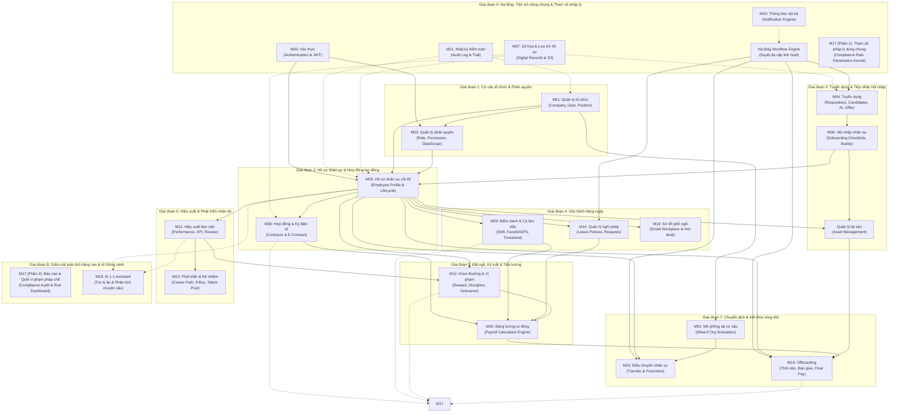

# LỘ TRÌNH VÀ THỨ TỰ TRIỂN KHAI CODE CÁC MODULE HỆ THỐNG CYCLOSA HRM

> **Tài liệu tham chiếu:**
> - Nghiệp vụ chi tiết: [`Nghiep-vu.docx`](file:///f:/Project/CYCLOSA/ba/Nghiep-vu.docx)
> - Thiết kế CSDL: [`database.md`](file:///f:/Project/CYCLOSA/ba/database.md) & [`ERD.md`](file:///f:/Project/CYCLOSA/ERD.md)
> - Quy tắc kiểm tra tính hợp lệ & Lỗi: [`HRM-API-Validation-Rules.md`](file:///f:/Project/CYCLOSA/ba/HRM-API-Validation-Rules.md)
> - Tổng hợp quy trình nghiệp vụ: [`HRM-Quy-Trinh.md`](file:///f:/Project/CYCLOSA/ba/HRM-Quy-Trinh.md)
> - Phân quyền & Vai trò: [`HRM-Roles-Phan-Quyen.md`](file:///f:/Project/CYCLOSA/ba/HRM-Roles-Phan-Quyen.md)

---

## 1. NGUYÊN LÝ THIẾT KẾ THỨ TỰ TRIỂN KHAI (CODING SEQUENCE)

Thứ tự lập trình các module trong hệ thống CYCLOSA HRM được xây dựng dựa trên 3 nguyên lý kỹ thuật cốt lõi:

1. **Ràng buộc phụ thuộc CSDL & Khóa ngoại (Data & Foreign Key Dependency):**
   Một module không thể code hoàn chỉnh tầng Data Layer / Business Logic nếu thực thể cha của nó chưa tồn tại.
   *Ví dụ:* `employees` cần `departments`, `job_positions`, `users`; `payrolls` cần `employees`, `attendance_summaries`, `leave_requests`, `contracts`.
2. **Quy trình vận hành vòng đời nhân sự (Employee Lifecycle Flow):**
   Hệ thống HRM vận hành như một dòng chảy tự nhiên: **Tổ chức -> Tuyển dụng -> Onboarding -> Ký hợp đồng -> Vận hành hàng ngày (Công/Phép/Chỗ ngồi) -> Đãi ngộ (Lương/Thưởng/Kỷ luật) -> Phát triển (KPI/Kế nhiệm) -> Chuyển đổi (Điều chuyển/Tái cơ cấu) -> Thôi việc (Offboarding)**.
3. **Kiến trúc dịch vụ dùng chung trước, dịch vụ nghiệp vụ sau (Cross-cutting First):**
   Hạ tầng bảo mật (Auth/RBAC), Truy vết (Audit Log), Động cơ phê duyệt (Workflow Engine), Lưu trữ tài liệu (Digital Records) và Thông báo (Notification) phải sẵn sàng từ sớm để các module nghiệp vụ chỉ việc cắm vào dùng lại mà không bị tái cấu trúc mã (code refactor) nhiều lần.

---

## 2. SƠ ĐỒ ĐỒ THỊ PHỤ THUỘC TỔNG THỂ (SYSTEM DEPENDENCY DAG)



---

## 3. BẢNG TỔNG HỢP CÁC GIAI ĐOẠN TRIỂN KHAI (ROADMAP SUMMARY MATRIX)

| Giai đoạn (Phase) | Mã Module | Tên Module (theo nghiệp vụ) | Mục tiêu chính | Phụ thuộc đầu vào (Prerequisites) | Mức độ phức tạp |
|---|---|---|---|---|---|
| **Phase 0: Nền tảng** | **M00** | Xác thực (Authentication) | JWT, Redis, Session, Account, OAuth2 | Không có | Trung bình |
| | **M21** | Nhật ký kiểm toán (Audit Log) | AOP logging, truy vết thay đổi dữ liệu | M00 | Thấp |
| | **M20** | Thông báo nội bộ (Notification) | In-app notification, SSE/WebSocket, Mail | M00 | Thấp |
| | **M07** | Số hóa & Lưu kho hồ sơ (Digital Records) | Quản lý tệp tin, MinIO/S3, Metadata, OCR | M00 | Trung bình |
| | **WF** | Động cơ quy trình (Workflow Engine) | Thiết lập luồng duyệt động, State machine | M00 | Cao |
| | **M17.1** | Tham số pháp lý dùng chung (Compliance Kernel) | Quản lý tham số luật: trần OT, trần BHXH, hạn HĐ, thời hạn báo trước | Không có | Trung bình |
| **Phase 1: Tổ chức & Quyền** | **M01** | Quản lý tổ chức (Organization) | Doanh nghiệp, Cây phòng ban, Chức danh, Vùng | M00, M21 | Trung bình |
| | **M03** | Quản lý phân quyền (Role & Permission) | RBAC, Data Scope (Toàn quyền, Chi nhánh, Phòng, Bản thân) | M00, M01 | Cao |
| **Phase 2: Hồ sơ & Hợp đồng** | **M05** | Hồ sơ nhân sự (Employee Profile) | Master data nhân viên, Quan hệ phụ thuộc, Quá trình | M00, M01, M03, M07 | Rất cao |
| | **M08** | Hợp đồng & Hợp đồng điện tử (Contract) | Hợp đồng LĐ, Phụ lục, Ký số, Cảnh báo hạn | M05, M07 | Cao |
| **Phase 3: Tuyển dụng & Vào làm** | **M04** | Tuyển dụng (Recruitment) | Kế hoạch tuyển dụng, Ứng viên, Phỏng vấn, Scorecard, Offer | M01, M03, M07, WF | Rất cao |
| | **M06** | Hội nhập nhân sự (Onboarding) | Checklist hội nhập, Cấp tài khoản tự động, Buddy | M04, M05 | Trung bình |
| | **AST** | Quản lý tài sản (Asset Management) | Kho tài sản, Cấp phát thiết bị cho người mới | M05 | Trung bình |
| **Phase 4: Vận hành thường nhật** | **M14** | Quản lý nghỉ phép (Leave Management) | Loại phép, Quỹ phép, Đơn nghỉ phép, Tự động trừ công | M05, WF | Trung bình |
| | **M09** | Điểm danh & Ca làm việc (Attendance) | Ca kíp, Chấm công FaceID/GPS, Giải trình, Chốt bảng công | M01, M05, M14 | Rất cao |
| | **M19** | Sơ đồ ghế ngồi (Smart Workplace) | Sơ đồ tầng, Tọa độ chỗ ngồi, Gán chỗ, Đặt chỗ (Hot-desk) | M01, M05 | Trung bình |
| **Phase 5: Đãi ngộ & Tiền lương** | **M12** | Khen thưởng & Vi phạm (Reward/Discipline) | Quyết định thưởng, Xử lý vi phạm, Khiếu nại | M05, WF | Trung bình |
| | **M10** | Bảng lương & Tính lương (Payroll) | Động cơ tính lương tự động, Thuế, BHXH, Phiếu lương số | M05, M08, M09, M14, M12 | Cực kỳ cao |
| **Phase 6: Hiệu suất & Nhân tài** | **M11** | Hiệu suất làm việc (Performance) | Kỳ đánh giá, Danh mục KPI, Đánh giá 360, Xếp loại | M01, M05 | Cao |
| | **M13** | Phát triển & Kế nhiệm (Talent/Succession) | Khung năng lực, Bản đồ 9 ô, Lộ trình nghề nghiệp | M05, M11 | Cao |
| **Phase 7: Chuyển đổi & Nghỉ việc** | **M15** | Điều chuyển nhân sự (Transfer) | Luồng chuyển phòng/chức danh, Cập nhật tự động HĐ & Lương | M01, M05, M08, WF | Cao |
| | **M02** | Mô phỏng tái cơ cấu (What-if Simulation) | Tạo cây tổ chức ảo, Đánh giá ngân sách, Áp dụng | M01, M05, M10, M15 | Cao |
| | **M16** | Offboarding (Thôi việc) | Đơn xin thôi việc, Thu hồi tài sản, Khóa nick, Quyết toán lương | M05, M08, M10, AST, WF | Cao |
| **Phase 8: Giám sát & AI** | **M17.2** | Giám sát tuân thủ & Dashboard (Compliance Audit) | Quét vi phạm tự động toàn hệ thống, Dashboard sức khỏe tuân thủ | M08, M09, M10, M12, M16 | Trung bình |
| | **M18** | AI 1-1 Assistant & Trợ lý thông minh | Chatbot chính sách, Tóm tắt 1-1, Phát hiện bất thường | M05, M09, M10, M11 | Cao |

---

## 4. CHI TIẾT TỪNG GIAI ĐOẠN & THỨ TỰ CODE TỪNG MODULE

---

### GIAI ĐOẠN 0: HẠ TẦNG CỐT LÕI & DỊCH VỤ DÙNG CHUNG (CORE INFRASTRUCTURE)

#### 1. Module 0: Xác thực (Authentication) - `M00`
* **Vị trí & Lý do:** Bước khởi đầu tiên quyết của toàn bộ hệ thống. Mọi API nghiệp vụ sau này đều cần biết ai đang gọi (`userId`, `roles`, `tenantId`).
* **Bảng CSDL liên quan:** `users`, `user_tokens`, `password_resets`, `oauth_accounts`.
* **Thứ tự code kỹ thuật:**
  1. `UserEntity`, `UserStatus` enum (`PENDING_ACTIVATION`, `ACTIVE`, `SUSPENDED`).
  2. `UserRepository` (tìm kiếm theo email, provider id).
  3. Spring Security Configuration (`SecurityFilterChain`, `PasswordEncoder` BCrypt).
  4. `JwtTokenProvider` & Redis Token Store (Sinh Access Token ngắn hạn, Refresh Token lưu Redis, Logout Blacklist).
  5. `JwtAuthFilter`: Chặn request, kiểm tra blacklist, giải mã token vào `SecurityContextHolder`.
  6. `AuthService`:
     - Kích hoạt tài khoản lần đầu qua email (Token TTL 48 giờ).
     - Đăng nhập mật khẩu / Làm mới Access Token.
     - Google OAuth2 callback & auto provisioning.
  7. `AuthController` & Endpoints công khai (`/api/v1/auth/**`).
  8. Frontend: `cyclosa_fe/src/app/(auth)/login`, zustand store lưu token, axios/fetch interceptors tự refresh token.

#### 2. Module 21: Nhật ký kiểm toán & Truy vết hệ thống (Audit Log & Audit Trail) - `M21`
* **Vị trí & Lý do:** Mọi thay đổi dữ liệu của các module sau (từ chức danh, lương, hồ sơ đến phân quyền) đều cần lưu vết tự động. Nếu làm sau sẽ phải sửa lại code của tất cả các service trước.
* **Bảng CSDL liên quan:** `audit_logs`, `audit_trail_details`.
* **Thứ tự code kỹ thuật:**
  1. `AuditLogEntity` (`actor_id`, `action`, `resource_type`, `resource_id`, `ip_address`, `old_values`, `new_values`, `created_at`).
  2. Spring AOP Annotation `@Auditable(action = "...", resource = "...")`.
  3. `AuditAspect` & Spring Event (`ApplicationEventPublisher`) để ghi log bất đồng bộ (`@Async`), không làm chậm luồng chính.
  4. `AuditLogService` & Controller tra cứu cho Quản trị viên.

#### 3. Module 20: Thông báo nội bộ (Internal Notification) - `M20`
* **Vị trí & Lý do:** Hạ tầng liên lạc nội bộ phục vụ việc thông báo khi có yêu cầu phê duyệt, sinh tài khoản, nhắc lịch phỏng vấn, báo phiếu lương.
* **Bảng CSDL liên quan:** `notifications`, `notification_templates`, `user_notification_settings`.
* **Thứ tự code kỹ thuật:**
  1. `NotificationEntity` (`recipient_id`, `title`, `content`, `type`, `is_read`, `action_url`).
  2. SSE (Server-Sent Events) hoặc WebSocket Handler cho thông báo thời gian thực trên giao diện web.
  3. Email Sender Service (tích hợp SMTP/JavaMailSender gửi template HTML).
  4. `NotificationService.send(NotificationEvent)` cắm vào Event Bus của hệ thống.

#### 4. Module 7: Số hóa và lưu kho hồ sơ nhân sự (Digital Records Repository) - `M07`
* **Vị trí & Lý do:** Cung cấp dịch vụ tải lên, lưu trữ tập tin và quản lý tài liệu tập trung cho CV ứng viên, scan hợp đồng, tài liệu tùy thân CCCD, bằng cấp, ảnh điểm danh.
* **Bảng CSDL liên quan:** `digital_documents`, `document_categories`, `document_shares`.
* **Thứ tự code kỹ thuật:**
  1. Cấu hình Storage Client (Local Disk / S3 / MinIO).
  2. `FileStorageService`: Upload, Validate MIME type, sinh mã SHA256 chống trùng lặp, tạo đường dẫn an toàn kèm chữ ký số (Presigned URL).
  3. `DigitalDocumentEntity`: Quản lý metadata, phân quyền truy cập tập tin theo `data_scope`.
  4. OCR Extractor Service (Tích hợp Tesseract/Google Vision API phục vụ bóc tách CCCD và CV).

#### 5. Hạ tầng Động cơ Phê duyệt quy trình (Workflow Engine) - `WF`
* **Vị trí & Lý do:** Rất nhiều nghiệp vụ (Tuyển dụng, Nghỉ phép, Làm thêm giờ, Tăng lương, Kỷ luật, Thôi việc) cần quy trình duyệt đa cấp linh hoạt. Việc xây dựng riêng lẻ từng bảng phê duyệt sẽ phân mảnh và khó mở rộng.
* **Bảng CSDL liên quan:** `workflow_definitions`, `workflow_steps`, `workflow_instances`, `workflow_approvals`.
* **Thứ tự code kỹ thuật:**
  1. Thiết kế State Machine: `DRAFT` -> `SUBMITTED` -> `PENDING_APPROVAL` -> `APPROVED` / `REJECTED` -> `CANCELLED`.
  2. Entity cho phép cấu hình người duyệt theo: Chức vụ cụ thể, Cấp quản lý trực tiếp (Direct Manager), hoặc Trưởng bộ phận (Department Head).
  3. `WorkflowExecutionEngine`: Xử lý chuyển bước, kiểm tra điều kiện rẽ nhánh (ví dụ: nghỉ > 3 ngày cần Giám đốc duyệt), tự động gửi thông báo qua Module 20.

---

### GIAI ĐOẠN 1: CƠ CẤU TỔ CHỨC & PHÂN QUYỀN (ORGANIZATION & ACCESS CONTROL)

#### 6. Module 1: Quản lý tổ chức (Organization Management) - `M01`
* **Vị trí & Lý do:** Định hình khung xương doanh nghiệp. Không thể có nhân viên nếu không có Công ty, Phòng ban, Chi nhánh, Chức danh.
* **Bảng CSDL liên quan:** `companies`, `departments`, `branches`, `job_titles`, `job_levels`, `job_positions`, `cost_centers`.
* **Thứ tự code kỹ thuật:**
  1. `CompanyEntity`: Thiết lập thông tin pháp nhân doanh nghiệp.
  2. `BranchEntity` & `CostCenterEntity`: Quản lý văn phòng/chi nhánh địa lý và mã ngân sách.
  3. `DepartmentEntity`: Cấu trúc cây phòng ban cha-con (`parent_id`, `path_index` phục vụ truy vấn lồng).
  4. `JobTitleEntity`, `JobLevelEntity`, `JobPositionEntity` (Vị trí = Chức danh + Phòng ban, có định biên nhân sự `headcount`).
  5. Tổ chức API CRUD, Tree Traversal Service (lấy toàn bộ cây phòng ban trực thuộc).
  6. Frontend: Trang vẽ sơ đồ cây cơ cấu tổ chức (Org Chart Tree) và danh mục vị trí.

#### 7. Module 3: Quản lý phân quyền (Role & Permission Management) - `M03`
* **Vị trí & Lý do:** Quyết định ai được thấy gì và sửa gì. CYCLOSA đòi hỏi phân quyền 2 chiều: Quyền chức năng (Functional Permission) và Phạm vi dữ liệu (Data Scope).
* **Bảng CSDL liên quan:** `roles`, `permissions`, `role_permissions`, `user_roles`, `data_scopes`.
* **Thứ tự code kỹ thuật:**
  1. Seed dữ liệu Permission chuẩn (theo danh mục 726 endpoint từ `api-list.md`).
  2. `DataScope` Enum: `ALL` (Toàn hệ thống), `REGION` (Vùng miền), `BRANCH` (Chi nhánh), `DEPARTMENT` (Phòng ban và phòng con), `SELF` (Chỉ bản thân).
  3. Xây dựng `@PreAuthorize("hasAuthority('...')")` kết hợp `DataScopeAspect`: Tự động inject filter `department_id IN (...)` hoặc `employee_id = current_user` vào câu truy vấn database.
  4. Xử lý kiêm nhiệm (Một nhân viên giữ nhiều vị trí/vai trò ở các phòng ban khác nhau).

---

### GIAI ĐOẠN 2: HỒ SƠ NHÂN SỰ & HỢP ĐỒNG LAO ĐỘNG (CORE EMPLOYEE & CONTRACT)

#### 8. Module 5: Hồ sơ nhân sự (Employee Profile & Lifecycle) - `M05`
* **Vị trí & Lý do:** Đây là **thực thể trung tâm cốt lõi (Core Entity)** của toàn bộ hệ thống HRM. Tất cả các phân hệ về sau (chấm công, lương, nghỉ phép, hợp đồng, tài sản, ghế ngồi) đều liên kết trực tiếp với `employee_id`.
* **Bảng CSDL liên quan:** `employees`, `employee_job_histories`, `dependents`, `emergency_contacts`, `bank_accounts`.
* **Thứ tự code kỹ thuật:**
  1. `EmployeeEntity`: Mã định danh nhân viên tự sinh (`EMP-YYYY-xxxx`), Họ tên, Ngày sinh, Giới tính, CCCD/Hộ chiếu, Email công vụ, Trạng thái (`PROBATION`, `OFFICIAL`, `MATERNITY_LEAVE`, `SUSPENDED`, `RESIGNED`).
  2. Quan hệ liên kết: Gắn với `department_id`, `position_id`, `direct_manager_id`, `user_id`.
  3. Bảng phụ trợ: `dependents` (Người phụ thuộc để giảm trừ gia cảnh), `emergency_contacts`, `bank_accounts`.
  4. `EmployeeLifecycleService`: Quản lý chuyển đổi trạng thái nhân sự kèm ghi nhận lịch sử vào `employee_job_histories`.
  5. Validate CCCD 12 số, tính duy nhất của Mã số thuế, Email doanh nghiệp.
  6. Frontend: Hồ sơ 360 độ nhân viên, danh sách tìm kiếm, phân trang và bộ lọc theo phòng ban/vị trí.

#### 9. Module 8: Quản lý hợp đồng & Hợp đồng điện tử (Contract Management & E-Contract) - `M08`
* **Vị trí & Lý do:** Thiết lập mối quan hệ lao động pháp lý chính thức. Chứa dữ liệu về loại hình làm việc, thời hạn, mức lương đóng bảo hiểm và phụ cấp cơ bản - là căn cứ cho chấm công và tính lương.
* **Bảng CSDL liên quan:** `contracts`, `contract_types`, `contract_appendices`, `contract_salaries`.
* **Thứ tự code kỹ thuật:**
  1. `ContractTypeEntity` (Hợp đồng học việc, Thử việc, Có thời hạn 12-36 tháng, Không xác định thời hạn).
  2. `ContractEntity`: Số hợp đồng, Ngày bắt đầu, Ngày kết thúc, Mức lương cơ bản thỏa thuận, Tỷ lệ đóng BHXH.
  3. `ContractAppendixEntity`: Quản lý phụ lục điều chỉnh lương hoặc vị trí công việc.
  4. Tích hợp E-Contract: Sinh file PDF từ template HTML, ký số nội bộ (OTP / Chữ ký điện tử).
  5. Cron Job / Scheduler: Quét tự động mỗi ngày phát hiện hợp đồng sắp hết hạn (trước 30 ngày, 15 ngày) -> bắn thông báo qua Module 20 cho HR.

---

### GIAI ĐOẠN 3: TUYỂN DỤNG & TIẾP NHẬN HỘI NHẬP (RECRUITMENT & ONBOARDING)

#### 10. Module 4: Tuyển dụng (Recruitment) - `M04`
* **Vị trí & Lý do:** Kênh đầu vào của nhân lực. Khởi tạo từ yêu cầu nhân sự của các phòng ban (được tạo ở M01), thu hút ứng viên và sau khi trúng tuyển sẽ trực tiếp chuyển đổi thành hồ sơ nhân viên (M05).
* **Bảng CSDL liên quan:** `manpower_requests`, `job_postings`, `candidates`, `candidate_applications`, `interview_schedules`, `interview_evaluations`, `job_offers`, `talent_pool`.
* **Thứ tự code kỹ thuật:**
  1. Đề xuất tuyển dụng (`ManpowerRequest`): Kiểm tra định biên nhân sự còn trống của vị trí tại M01 -> Định tuyến qua Workflow để duyệt.
  2. Tin tuyển dụng (`JobPosting`): Tạo tin tuyển dụng và cung cấp Public API cho trang tuyển dụng bên ngoài (`cyclosa_fe/src/app/careers`).
  3. Hồ sơ ứng viên & Đơn ứng tuyển (`Candidate`, `Application`): Nhận CV đính kèm (qua M07).
  4. AI Screening Engine: Bóc tách text CV, so khớp từ khóa với mô tả công việc (JD), sinh điểm phù hợp (Match Score).
  5. Lịch phỏng vấn & Đánh giá hội đồng (`InterviewSchedule`, `Scorecard`): Chấm điểm vòng phỏng vấn, tổng hợp kết quả.
  6. Thư mời nhận việc (`JobOffer`): Soạn thảo và gửi Offer letter cho ứng viên.
  7. Trạng thái `OFFER_ACCEPTED` -> Nút chuyển đổi tự động sang quy trình Hội nhập (M06) & Hồ sơ nhân sự (M05).
  8. Talent Pool & Internal Talent Marketplace: Lưu trữ hồ sơ tiềm năng để tái sử dụng hoặc mở cơ hội ứng tuyển nội bộ cho nhân viên hiện tại.

#### 11. Module 6: Hội nhập nhân sự (Onboarding) - `M06`
* **Vị trí & Lý do:** Tiếp nối trực tiếp từ tuyển dụng trúng tuyển, chuẩn bị môi trường làm việc trước ngày nhân viên chính thức vào công ty (First Day).
* **Bảng CSDL liên quan:** `onboarding_processes`, `onboarding_task_templates`, `onboarding_tasks`, `onboarding_buddies`.
* **Thứ tự code kỹ thuật:**
  1. Mẫu nhiệm vụ hội nhập (`OnboardingTemplate`): Giao việc chuẩn theo từng phòng ban/chức danh.
  2. Khởi tạo quy trình: Sinh tự động danh sách công việc (Nộp bằng cấp, CCCD, Ký cam kết bảo mật, Cài đặt phần mềm).
  3. Gán người hướng dẫn (Buddy/Mentor) hỗ trợ nhân viên mới.
  4. Tự động kích hoạt tài khoản hệ thống (gọi Module 00 tạo user và gửi link đặt mật khẩu).
  5. Đánh giá hoàn thành thử việc -> Khuyến nghị ký Hợp đồng chính thức (chuyển sang Module 08).

#### 12. Quản lý tài sản (Asset Management) - `AST`
* **Vị trí & Lý do:** Cung cấp trang thiết bị (Laptop, Màn hình, Thẻ nhân viên, Bàn giao dụng cụ) trong giai đoạn Onboarding và thu hồi khi Offboarding.
* **Bảng CSDL liên quan:** `assets`, `asset_categories`, `asset_allocations`, `asset_maintenances`.
* **Thứ tự code kỹ thuật:**
  1. Quản lý danh mục tài sản, số serial, tình trạng thiết bị.
  2. Luồng cấp phát tài sản cho nhân viên (`employee_id`), lập biên bản bàn giao điện tử.
  3. Kiểm kê định kỳ và báo hỏng/bảo trì.

---

### GIAI ĐOẠN 4: VẬN HÀNH THƯỜNG NHẬT (DAILY OPERATIONS: ATTENDANCE, LEAVE, WORKPLACE)

#### 13. Module 14: Quản lý nghỉ phép (Leave Management) - `M14`
* **Vị trí & Lý do:** Cần làm trước chấm công vì bảng chấm công và tính lương phải biết ngày nào nhân viên nghỉ có phép, ngày nào nghỉ không lương.
* **Bảng CSDL liên quan:** `leave_types`, `leave_policies`, `leave_balances`, `leave_requests`.
* **Thứ tự code kỹ thuật:**
  1. `LeaveTypeEntity` (Phép năm, Nghỉ ốm, Thai sản, Việc riêng có lương, Nghỉ không lương theo luật lao động).
  2. `LeaveBalanceEntity`: Quản lý số ngày phép tồn, số ngày đã dùng, ngày phép thâm niên tích lũy. Batch job cộng dồn quỹ phép ngày đầu năm.
  3. `LeaveRequestService`:
     - Kiểm tra điều kiện số dư phép hợp lệ.
     - Kiểm tra trùng lặp ngày nghỉ.
     - Định tuyến đơn qua Workflow Engine (Quản lý trực tiếp duyệt).
     - Khi đơn duyệt thành công: Tự động trừ số dư phép. Nếu hủy đơn trước ngày nghỉ: Tự động hoàn lại số dư.

#### 14. Module 9: Điểm danh & Ca làm việc (Attendance) - `M09`
* **Vị trí & Lý do:** Dữ liệu đầu vào sống của hệ thống, ghi nhận sự có mặt, đi muộn, về sớm, làm thêm giờ (OT). Dữ liệu này sau đó tổng hợp thành Bảng công tháng (Monthly Timesheet) cấp cho module Bảng lương.
* **Bảng CSDL liên quan:** `work_shifts`, `shift_assignments`, `face_biometrics`, `attendance_logs`, `attendance_exceptions`, `overtime_requests`, `monthly_timesheets`.
* **Thứ tự code kỹ thuật:**
  1. `WorkShiftEntity`: Cấu hình ca làm việc (Giờ bắt đầu, Giờ kết thúc, Thời gian nghỉ giữa ca, Khoảng thời gian cho phép check-in).
  2. `ShiftAssignmentEntity`: Phân ca cho nhân viên hoặc phòng ban theo tuần/tháng.
  3. `FaceBiometrics`: Đăng ký vector khuôn mặt của nhân viên (Face Enrollment).
  4. Check-in/Check-out API:
     - Nhận ảnh webcam/điện thoại + Tọa độ GPS của nhân viên.
     - Kiểm tra khoảng cách GPS Geofencing (bán kính hợp lệ quanh văn phòng công ty).
     - Nhận diện khuôn mặt (so khớp vector sinh trắc học, chống gian lận chụp ảnh lại).
     - Ghi nhận `attendance_logs`.
  5. Đăng ký làm thêm giờ (`OvertimeRequest`) & Giải trình công sai sót (`AttendanceCorrection`): Duyệt qua Workflow.
  6. Timesheet Calculation Engine: Tự động ghép nối log check-in/out với đơn nghỉ phép (M14) và ca làm việc để tính: Giờ làm việc thực tế, Số phút đi muộn, Số phút về sớm, Giờ OT.
  7. Khóa sổ bảng công tháng (`lock_timesheet`) chuyển giao sang Module 10 (Payroll).

#### 15. Module 19: Sơ đồ ghế ngồi & Không gian làm việc (Smart Workplace) - `M19`
* **Vị trí & Lý do:** Hỗ trợ nhân viên sau khi vào làm biết vị trí ngồi của mình và đặt chỗ làm việc linh hoạt. Độc lập logic tính toán với bảng lương.
* **Bảng CSDL liên quan:** `workplace_buildings`, `workplace_floors`, `workplace_zones`, `workplace_desks`, `desk_bookings`.
* **Thứ tự code kỹ thuật:**
  1. Quản lý tòa nhà, mặt bằng tầng và sơ đồ tọa độ Visual Grid/Canvas.
  2. Gán vị trí chỗ ngồi cố định cho nhân viên theo phòng ban.
  3. Hot-desking: Nhân viên đặt chỗ ngồi linh hoạt theo ngày/giờ và check-in chỗ ngồi qua ứng dụng.
  4. Bản đồ trực quan tìm vị trí đồng nghiệp trên giao diện Web.

---

### GIAI ĐOẠN 5: ĐÃI NGỘ, KỶ LUẬT & TÍNH LƯƠNG TỰ ĐỘNG (COMPENSATION & PAYROLL)

#### 16. Module 12: Khen thưởng & Vi phạm (Reward & Discipline) - `M12`
* **Vị trí & Lý do:** Các khoản thưởng tiền mặt hoặc các quyết định phạt/kỷ luật trừ lương là dữ liệu phát sinh bắt buộc phải có trước khi chốt bảng lương kỳ đó.
* **Bảng CSDL liên quan:** `reward_records`, `discipline_records`, `grievance_records`.
* **Thứ tự code kỹ thuật:**
  1. `RewardRecordEntity`: Quyết định khen thưởng, loại thưởng (Vinh danh, Thưởng tiền, Thăng chức), số tiền thưởng.
  2. Cơ chế khóa: Cờ `pushed_to_payroll = true` để khóa không cho sửa đổi khi kỳ lương đã nhận dữ liệu.
  3. `DisciplineRecordEntity`: Quản lý quy trình xử lý vi phạm lao động theo đúng thủ tục BLLĐ (Lập biên bản vi phạm, Họp hội đồng kỷ luật, Quyết định kỷ luật, Thời hiệu xóa kỷ luật).
  4. `GrievanceRecordEntity`: Kênh tiếp nhận và giải quyết khiếu nại của người lao động.

#### 17. Module 10: Bảng lương và Tính lương tự động (Payroll) - `M10`
* **Vị trí & Lý do:** **Đỉnh cao nghiệp vụ tài chính của hệ thống HRM**. Đây là module có độ phức tạp tính toán cao nhất và phụ thuộc vào gần như toàn bộ các module vận hành trước đó.
* **Bảng CSDL liên quan:** `salary_components`, `salary_histories`, `salary_advances`, `payroll_periods`, `payroll_items`, `payslips`.
* **Thứ tự code kỹ thuật:**
  1. `SalaryComponentEntity`: Cấu hình danh mục thành phần lương (Lương hợp đồng, Phụ cấp ăn trưa, Phụ cấp điện thoại, Thưởng doanh số, Khấu trừ bảo hiểm, Khấu trừ thuế).
  2. `SalaryHistoryEntity`: Ghi nhận biến động lương nhân viên theo thời gian (effective-dated).
  3. Tạm ứng lương (`SalaryAdvance`): Nhân viên đề xuất ứng lương trong kỳ -> Duyệt và khấu trừ khi tính lương.
  4. Mở kỳ lương (`PayrollPeriod`): Xác định chu kỳ từ ngày X đến ngày Y.
  5. **Payroll Calculation Engine (Động cơ tính toán lương):**
     - Đọc lương cơ bản từ Hợp đồng lao động (`M08`).
     - Đọc tổng số ngày công chuẩn và giờ OT từ Bảng công tháng (`M09`).
     - Đọc số ngày nghỉ hưởng lương / không lương từ Quản lý nghỉ phép (`M14`).
     - Đọc các khoản thưởng từ Khen thưởng (`M12`).
     - Tính các khoản trích nộp theo lương: BHXH (8%), BHYT (1.5%), BHTN (1%) theo mức trần quy định.
     - Tính Giảm trừ gia cảnh bản thân & người phụ thuộc từ Hồ sơ nhân viên (`M05`).
     - Tính Thuế TNCN lũy tiến từng phần (từ 5% đến 35%).
     - Tính Lương thực nhận (Net Salary).
  6. Kiểm tra bất thường (Payroll Anomaly Detection): So sánh cảnh báo nếu lương tăng/giảm đột biến > 30% so với kỳ trước.
  7. Phê duyệt bảng lương qua Workflow -> Khóa sổ kỳ lương (`CLOSED`).
  8. Xuất file thanh toán ngân hàng (Bank Transfer Format) & Phát hành Phiếu lương điện tử (Payslip) gửi qua Email/In-app cho từng nhân viên.

---

### GIAI ĐOẠN 6: HIỆU SUẤT & PHÁT TRIỂN NHÂN TÀI (PERFORMANCE & TALENT DEVELOPMENT)

#### 18. Module 11: Hiệu suất làm việc (Performance Management) - `M11`
* **Vị trí & Lý do:** Đánh giá định kỳ đóng góp của nhân sự sau khi nhân viên đã làm việc ổn định. Kết quả đánh giá là đầu vào trực tiếp cho Khen thưởng (M12), Xét tăng lương (M08/M10) và Quy hoạch kế nhiệm (M13).
* **Bảng CSDL liên quan:** `performance_cycles`, `kpi_catalogs`, `employee_goals`, `performance_evaluations`, `evaluation_feedbacks_360`.
* **Thứ tự code kỹ thuật:**
  1. `PerformanceCycle`: Thiết lập kỳ đánh giá theo Quý, Nửa năm, Năm (`DRAFT` -> `ACTIVE` -> `CLOSED`).
  2. `KpiCatalog`: Danh mục KPI cấp công ty và cấp phòng ban.
  3. Thiết lập mục tiêu cá nhân (`EmployeeGoal`): Gán trọng số mục tiêu (tổng trọng số = 100%).
  4. Quy trình đánh giá hiệu suất 3 bước:
     - Bước 1: Nhân viên tự đánh giá (`SELF_REVIEW`).
     - Bước 2: Đánh giá đồng nghiệp 360 độ (`360_FEEDBACK`).
     - Bước 3: Quản lý trực tiếp chấm điểm & nhận xét (`MANAGER_REVIEW`).
  5. Xếp loại hiệu suất tự động (Calibration & Bell Curve: Xuất sắc, Tốt, Hoàn thành, Cần cải thiện).

#### 19. Module 13: Phát triển nhân sự và Quy hoạch kế nhiệm (Career & Succession) - `M13`
* **Vị trí & Lý do:** Phát triển chiều sâu nguồn nhân lực chiến lược dựa trên dữ liệu đánh giá hiệu suất của Module 11 và hồ sơ kinh nghiệm từ Module 05.
* **Bảng CSDL liên quan:** `competency_frameworks`, `employee_competencies`, `career_paths`, `succession_plans`, `talent_pool_successions`.
* **Thứ tự code kỹ thuật:**
  1. Khung năng lực (`CompetencyFramework`): Định nghĩa các kỹ năng cốt lõi và tiêu chuẩn theo từng cấp bậc chức danh.
  2. Đánh giá khoảng cách năng lực (Skill Gap Analysis): So sánh năng lực hiện tại của nhân viên với chức vụ mục tiêu.
  3. Bản đồ ma trận 9 ô (9-Box Grid): Đối sánh giữa Hiệu suất (Performance) và Tiềm năng (Potential) để lọc ra nhóm nhân tài chủ chốt (Top Talent).
  4. Kế hoạch kế nhiệm (`SuccessionPlan`): Xây dựng danh sách ứng viên nội bộ sẵn sàng thay thế các vị trí lãnh đạo then chốt.
  5. Mô phỏng lộ trình sự nghiệp (Career Simulator): Gợi ý các bước phát triển để nhân viên thăng tiến trong tổ chức.

---

### GIAI ĐOẠN 7: CHUYỂN DỊCH TỔ CHỨC & KẾT THÚC VÒNG ĐỜI (TRANSITIONS & OFFBOARDING)

#### 20. Module 15: Điều chuyển nhân sự (Transfer & Promotion) - `M15`
* **Vị trí & Lý do:** Nhân sự có sự biến động chuyển đổi giữa các phòng ban, thay đổi chức vụ hoặc chi nhánh làm việc.
* **Bảng CSDL liên quan:** `transfer_requests`, `transfer_approvals`.
* **Thứ tự code kỹ thuật:**
  1. Khởi tạo đề xuất điều chuyển (`TransferRequest`): Chọn nhân viên, phòng ban đích, chức danh mới, người quản lý mới, ngày hiệu lực.
  2. Luồng phê duyệt đa bên qua Workflow: Trưởng bộ phận cũ duyệt -> Trưởng bộ phận mới duyệt -> HR xác nhận -> Ban Giám đốc phê duyệt.
  3. Động cơ tự động cập nhật khi ngày hiệu lực đến:
     - Tự động đổi `department_id`, `position_id` trong `EmployeeEntity` (M05).
     - Tạo bản ghi điều chỉnh phụ lục hợp đồng (`ContractAppendix` M08).
     - Cập nhật phân ca làm việc mới (`ShiftAssignment` M09).
     - Thu hồi chỗ ngồi cũ và phân vị trí mới (`SmartWorkplace` M19).

#### 21. Module 2: Mô phỏng Tái cơ cấu Tổ chức (What-if Org Simulation) - `M02`
* **Vị trí & Lý do:** Chức năng hoạch định cấp chiến lược. Cần cơ cấu tổ chức hiện tại (M01) và chi phí lương bình quân (M10) để phân tích kịch bản trước khi ra quyết định tái cơ cấu thực tế.
* **Bảng CSDL liên quan:** `org_simulation_scenarios`, `simulated_departments`, `simulated_positions`, `simulation_impact_analyses`.
* **Thứ tự code kỹ thuật:**
  1. Tạo kịch bản mô phỏng (`Scenario`): Sao chép nhánh cây phòng ban từ M01 sang môi trường thử nghiệm (Sandbox).
  2. Thao tác tái cơ cấu: Thử nghiệm sáp nhập, giải thể phòng ban, thêm bớt vị trí, chuyển nhân sự ảo.
  3. Động cơ phân tích tác động (Impact Engine): Tính toán độ tăng/giảm ngân sách quỹ lương, tính toán tỷ lệ quản lý trên nhân viên (Span of Control).
  4. So sánh phương án A vs Phương án B.
  5. Phê duyệt và Áp dụng chính thức: Chuyển toàn bộ cấu trúc đã thử nghiệm vào CSDL thật (M01) và tự động phát sinh hàng loạt yêu cầu điều chuyển (M15).

#### 22. Module 16: Offboarding (Quy trình Nghỉ việc & Chấm dứt HĐLĐ) - `M16`
* **Vị trí & Lý do:** Điểm kết thúc của vòng đời nhân sự. Liên quan đến thủ tục bàn giao của tất cả các bộ phận (Hành chính, IT, Nhân sự, Tài chính).
* **Bảng CSDL liên quan:** `resignation_requests`, `offboarding_checklists`, `exit_interviews`, `final_payrolls`.
* **Thứ tự code kỹ thuật:**
  1. Đơn xin thôi việc hoặc Quyết định chấm dứt hợp đồng lao động: Kiểm tra thời hạn báo trước theo luật định (30 ngày đối với HĐ xác định thời hạn, 45 ngày đối với HĐ không xác định thời hạn).
  2. Định tuyến đơn qua Workflow phê duyệt.
  3. Quy trình bàn giao (Offboarding Checklist):
     - Khảo sát thôi việc (Exit Interview): Phỏng vấn nguyên nhân nghỉ việc.
     - Bàn giao công việc cho người thay thế.
     - Thu hồi tài sản thiết bị (gọi Module Asset Management M13).
     - Khóa tài khoản đăng nhập hệ thống và email (gọi Module 00 Auth).
  4. Quyết toán lương cuối cùng (Final Payroll):
     - Tính lương số ngày công thực tế trong tháng cuối.
     - Tính tiền thanh toán cho những ngày phép năm chưa sử dụng hết (từ M14).
     - Tính trợ cấp thôi việc / trợ cấp mất việc làm (theo Điều 46, Điều 47 BLLĐ).
  5. Cập nhật trạng thái nhân viên thành `RESIGNED` và đóng hồ sơ, chuyển lưu kho số hóa (M07).

---

### GIAI ĐOẠN 8: PHÁP CHẾ TUÂN THỦ & TRÍ TUỆ NHÂN TẠO NÂNG CAO (COMPLIANCE & AI)

#### 23. Module 17: Pháp luật và Tuân thủ (Legal & Compliance Management) - `M17`
> **Lưu ý kiến trúc quan trọng (Kiến trúc 2 chặng):**
> Module 17 liên quan mật thiết và cung cấp ràng buộc cho hầu hết các module khác (Hợp đồng, Điểm danh/OT, Tiền lương, Kỷ luật, Thôi việc). Vì vậy, Module 17 được **chia làm 2 chặng triển khai kỹ thuật**:
> 1. **Chặng 1 (Code ngay tại Phase 0 - Shared Kernel):** Triển khai tầng **Tham số pháp lý dùng chung (`compliance_rules`, `compliance_rule_parameters`)** và dịch vụ `LegalParameterProvider`. Nhờ đó, các module như Hợp đồng (`M08`), Điểm danh (`M09`), Lương (`M10`), Kỷ luật (`M12`), Thôi việc (`M16`) không bị hard-code số cứng mà lấy trực tiếp trần OT, trần BHXH, hạn tái ký HĐ, thời hạn báo trước từ tầng này.
> 2. **Chặng 2 (Code tại Phase 8 - Giám sát & Báo cáo cấp cao):** Triển khai tầng **Quản lý thư viện văn bản pháp luật số (`legal_documents`), Công cụ quét vi phạm định kỳ (Compliance Audit Scanner)** và **Bảng đo lường rủi ro pháp lý toàn diện (Compliance Health Dashboard)** sau khi toàn bộ hệ thống đã có dữ liệu thực tế vận hành.

* **Vị trí & Lý do triển khai Chặng 2 ở Phase 8:** Sau khi các module nghiệp vụ phát sinh hàng vạn hợp đồng, bảng công và kỳ lương, công cụ quét vi phạm định kỳ mới có dữ liệu thực tế để đối soát, phát hiện rủi ro và trực quan hóa lên Dashboard cho chuyên viên pháp chế và Ban Giám đốc.
* **Bảng CSDL liên quan:** `legal_documents`, `legal_document_relations`, `legal_provisions`, `compliance_rules`, `compliance_rule_versions`, `compliance_rule_parameters`, `compliance_audit_records`, `compliance_warnings`.
* **Thứ tự code kỹ thuật:**
  1. *[Chặng 1 - Phase 0]* Tạo bảng tham số và API tra cứu tham số luật theo ngày hiệu lực (effective-dated).
  2. *[Chặng 2 - Phase 8]* Quản lý văn bản pháp luật, quan hệ văn bản sửa đổi/thay thế.
  3. Scheduled Compliance Scanner: Cron job quét tự động toàn bộ database vào cuối mỗi tuần:
     - Quét nhân viên có giờ OT > 40h/tháng hoặc > 200h/năm.
     - Quét hợp đồng xác định thời hạn đã tái ký > 1 lần.
     - Quét quyết định kỷ luật áp dụng với nhân viên mang thai hoặc nuôi con nhỏ < 12 tháng.
  4. Cảnh báo tự động (`compliance_warnings`): Bắn thông báo khẩn qua Module 20 tới HR và Trưởng bộ phận.
  5. Compliance Health Dashboard: Báo cáo tỷ lệ tuân thủ pháp lý theo từng chi nhánh/phòng ban.

#### 24. Module 18: AI 1-1 Assistant & Trợ lý thông minh - `M18`
* **Vị trí & Lý do:** Tầng thông minh nâng cao (AI Layer). Tận dụng toàn bộ nguồn dữ liệu sạch tích lũy từ các giai đoạn trước để đem lại trải nghiệm vượt trội cho nhân viên và ban lãnh đạo.
* **Bảng CSDL liên quan:** `ai_conversations`, `ai_messages`, `ai_meeting_notes`, `ai_sentiment_logs`.
* **Thứ tự code kỹ thuật:**
  1. Trợ lý hỏi đáp chính sách nhân sự (HR Policy RAG Chatbot): Đọc dữ liệu từ kho tài liệu nội bộ (Module 07) để trả lời nhân viên về chế độ bảo hiểm, nội quy, ngày nghỉ.
  2. AI Tra cứu cá nhân: Cho phép nhân viên hỏi "Tháng này tôi còn bao nhiêu ngày phép?", "Giải thích phiếu lương kỳ này của tôi".
  3. AI Meeting Assistant: Ghi âm cuộc họp 1-1 giữa Quản lý và Nhân viên (kèm cam kết đồng thuận), bóc tách nội dung, trích xuất danh sách hành động (Action Items).
  4. Phân tích cảm xúc & Nguy cơ kiệt sức (Burnout / Attrition Risk Detection): Phân tích tần suất làm việc quá giờ, lịch sử nghỉ phép để cảnh báo sớm cho nhà quản lý.

---

## 5. BẢNG KIỂM TRA PHỤ THUỘC TRƯỚC KHI CODE (PRE-CODING CHECKLIST)

Trước khi bắt tay vào code bất kỳ module nào, Lập trình viên (Developer) **BẮT BUỘC** phải rà soát bảng kiểm tra phụ thuộc dưới đây:

| Module cần code | Bảng/Dịch vụ bắt buộc PHẢI CÓ TRƯỚC | Kiểm tra trạng thái sẵn sàng |
|---|---|:---:|
| **M01: Quản lý tổ chức** | CSDL khởi tạo, `users` (để gán Admin/Trưởng phòng) | ⬜ |
| **M03: Quản lý phân quyền** | `users`, `departments`, `job_positions` | ⬜ |
| **M05: Hồ sơ nhân sự** | `users`, `departments`, `job_positions`, `roles`, `digital_documents` (M07) | ⬜ |
| **M08: Quản lý hợp đồng** | `employees`, `job_positions`, `digital_documents` | ⬜ |
| **M04: Tuyển dụng** | `departments`, `job_positions`, `workflow_engine`, `digital_documents` | ⬜ |
| **M06: Onboarding** | `candidates`, `employees`, `users`, `workflow_engine` | ⬜ |
| **M14: Quản lý nghỉ phép** | `employees`, `departments`, `workflow_engine` | ⬜ |
| **M09: Điểm danh & Ca** | `employees`, `departments`, `leave_requests` (M14) | ⬜ |
| **M12: Khen thưởng & Kỷ luật** | `employees`, `departments`, `workflow_engine` | ⬜ |
| **M10: Bảng lương tự động** | `employees`, `contracts`, `monthly_timesheets`, `leave_requests`, `reward_records` | ⬜ |
| **M11: Hiệu suất làm việc** | `employees`, `departments`, `job_positions` | ⬜ |
| **M13: Quy hoạch kế nhiệm** | `employees`, `job_positions`, `performance_evaluations` (M11) | ⬜ |
| **M15: Điều chuyển nhân sự** | `employees`, `departments`, `job_positions`, `contracts`, `workflow_engine` | ⬜ |
| **M02: Tái cơ cấu (What-if)** | `companies`, `departments`, `job_positions`, `salary_histories` | ⬜ |
| **M16: Offboarding** | `employees`, `contracts`, `assets`, `payroll_engine`, `workflow_engine` | ⬜ |
| **M17: Pháp luật & Tuân thủ** | Dữ liệu `contracts`, `attendance_logs`, `discipline_records` | ⬜ |
| **M18: Trợ lý AI** | Kho tri thức `digital_documents`, APIs của `leave`, `payroll`, `attendance` | ⬜ |

---

## 6. CHIẾN LƯỢC PHÂN CHIA NHÓM VÀ CODE SONG SONG (PARALLEL EXECUTION STRATEGY)

Để đẩy nhanh tiến độ dự án, sau khi hoàn thành **Giai đoạn 0 (Hạ tầng)**, **Giai đoạn 1 (Tổ chức & Phân quyền)** và **Giai đoạn 2 (Hồ sơ nhân sự cốt lõi)**, dự án có thể phân chia thành **4 luồng lập trình song song (Streams)** độc lập:

```
[MỐC CỘNG TÁC CHUNG: Hoàn thành Phase 0, 1, 2 (M00, M21, M20, M07, WF, M01, M03, M05, M08)]
          │
          ├──> LUỒNG A (Nhân sự & Tuyển dụng): M04 (Tuyển dụng) ──> M06 (Onboarding) ──> AST (Tài sản)
          │
          ├──> LUỒNG B (Chấm công & Vận hành): M14 (Nghỉ phép) ──> M09 (Điểm danh/Ca) ──> M19 (Sơ đồ ghế ngồi)
          │
          ├──> LUỒNG C (Đánh giá & Nhân tài): M12 (Khen thưởng) ──> M11 (Hiệu suất) ──> M13 (Kế nhiệm)
          │
          └──> LUỒNG D (Chuyển đổi & Tái cấu trúc): M15 (Điều chuyển) ──> M02 (What-if Org)
                                       │
                                       ▼
        [ĐIỂM HỘI TỤ 1: Hoàn thành Luồng B + C -> Tiến hành Module 10: TÍNH LƯƠNG TỰ ĐỘNG (Payroll)]
                                       │
                                       ▼
        [ĐIỂM HỘI TỤ 2: Tích hợp Luồng A + B + C + D -> Hoàn thành Module 16: OFFBOARDING]
                                       │
                                       ▼
        [GIAI ĐOẠN HOÀN THIỆN: Module 17 (Pháp chế Tuân thủ) & Module 18 (Trí tuệ nhân tạo AI)]
```

### Hướng dẫn phối hợp Frontend & Backend (Contract-First Development):
1. **Thống nhất DTO / Schema trước:** Mỗi module trước khi code Java Backend cần chốt bản mẫu Request/Response JSON dựa trên [`api-list.md`](file:///f:/Project/CYCLOSA/ba/api-list.md).
2. **Frontend dựng Mock Data:** Đội ngũ Frontend (`cyclosa_fe`) sử dụng Swagger/OpenAPI Spec hoặc Mock Service Worker (MSW) để phát triển màn hình UI, Form validation và Table phân trang song song với lúc Backend viết Service logic.
3. **Tích hợp API và E2E Testing:** Khi Backend hoàn thiện tầng Controller, chỉ cần đổi baseURL trên Frontend sang Endpoint thật để kiểm thử tích hợp.

---

## 7. KỊCH BẢN KIỂM THỬ THÔNG LUỒNG TOÀN DIỆN (E2E ACCEPTANCE LIFECYCLE)

Để nghiệm thu toàn bộ hệ thống sau khi code theo đúng thứ tự, thực hiện kịch bản chạy thử nghiệm một vòng đời nhân viên trọn vẹn:

1. **Khởi tạo cơ cấu:** Admin tạo Phòng Công nghệ, chức vụ Kỹ sư phần mềm (`M01`), cấu hình quyền HR (`M03`).
2. **Tuyển dụng:** HR tạo Manpower Request -> Duyệt -> Đăng tuyển -> Ứng viên nộp hồ sơ -> AI chấm điểm đạt 85% -> Phỏng vấn cho điểm Đạt -> Gửi Offer letter (`M04`).
3. **Tiếp nhận & Ký hợp đồng:** Ứng viên chấp nhận Offer -> Hệ thống sinh quy trình Onboarding (`M06`), sinh tài khoản User (`M00`), sinh Hồ sơ nhân viên (`M05`), cấp phát Laptop (`AST`), tạo Hợp đồng thử việc 2 tháng và ký số (`M08`).
4. **Vận hành hằng ngày:** Nhân viên được phân ca hành chính (`M09`), phân chỗ ngồi tầng 3 bàn A-12 (`M19`). Nhân viên check-in bằng khuôn mặt và GPS. Nhân viên xin nghỉ phép 1 ngày, quản lý phê duyệt (`M14`).
5. **Khen thưởng & Tính lương:** Trưởng phòng đề xuất thưởng nóng 2 triệu đồng do hoàn thành dự án (`M12`). Hết tháng, HR chốt bảng công (`M09`), chạy kỳ lương tự động (`M10`): Hệ thống tự đối soát giờ làm, trừ 1 ngày phép, cộng 2 triệu thưởng, tính giảm trừ gia cảnh, trích bảo hiểm và sinh phiếu lương. Nhân viên xem và xác nhận phiếu lương.
6. **Đánh giá hiệu suất:** Đến kỳ đánh giá cuối năm, nhân viên tự đánh giá KPI, đồng nghiệp chấm 360, quản lý cho điểm Xếp loại A (`M11`), đưa vào diện quy hoạch cán bộ nguồn (`M13`).
7. **Điều chuyển:** Nhân viên được thăng chức lên Trưởng nhóm, duyệt qua quy trình chuyển bộ phận (`M15`), tự động tăng bậc lương và cập nhật phụ lục hợp đồng (`M08`).
8. **Thôi việc:** Sau 3 năm, nhân viên nộp đơn xin thôi việc (`M16`), hệ thống kiểm tra báo trước đủ 30 ngày (`M17`). Nhân viên làm Exit Interview, trả lại Laptop (`AST`), bị khóa tài khoản IT (`M00`), nhận quyết toán lương cuối cùng và thôi việc. Mọi lịch sử công tác được lưu vào kho số hóa (`M07`) và nhật ký kiểm toán ghi vết đầy đủ (`M21`).

