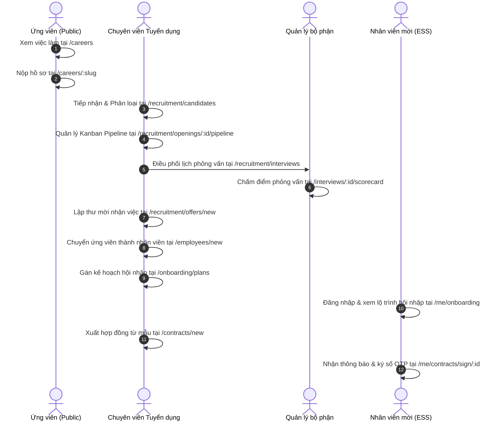
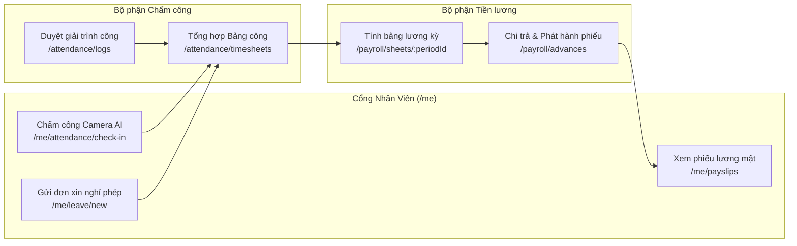

# SƠ ĐỒ ĐIỀU HƯỚNG TOÀN DIỆN — CYCLOSA ENTERPRISE HRM
> **Phiên bản:** 1.0 (Tháng 10/2026)  
> **Phạm vi:** Toàn bộ 224/224 màn hình nghiệp vụ chuẩn hóa 100% theo tài liệu `ba/page-list.md`.

---

## 1. Kiến Trúc Điều Hướng Tổng Thể (Architecture Overview)

Hệ thống CYCLOSA được thiết kế theo mô hình **Unified Workspace with Role-Based Routing**, trong đó tất cả người dùng truy cập chung một ứng dụng, nhưng cây menu và sơ đồ điều hướng được thích ứng theo vai trò (`GET /auth/me/permissions`).

```mermaid
graph TD
    Root["CYCLOSA Platform (Port 3000)"] --> PublicPortal["1. Cổng Công Khai (Public Portal)"]
    Root --> ESSPortal["2. Cổng Nhân Viên Tự Phục Vụ (ESS Portal - /me/*)"]
    Root --> CoreHR["3. Cổng Nghiệp Vụ Nhân Sự (Core HR Portal)"]
    Root --> AdminPortal["4. Cổng Quản Trị Hệ Thống (System Admin Portal)"]

    PublicPortal --> Login["Đăng nhập /auth/login"]
    PublicPortal --> Careers["Cổng việc làm /careers"]
    PublicPortal --> JobDetail["Ứng tuyển /careers/:slug"]
    PublicPortal --> Activate["Kích hoạt tài khoản /auth/activate"]
    PublicPortal --> ErrorPages["Trang trạng thái /403, /404, /session-expired"]

    ESSPortal --> MeProfile["Hồ sơ & Khuôn mặt /me/profile, /me/face-enrollment"]
    ESSPortal --> MeAttendance["Chấm công GPS & Giải trình /me/attendance/*"]
    ESSPortal --> MeLeave["Quỹ phép & Đơn nghỉ /me/leave/*"]
    ESSPortal --> MePayroll["Phiếu lương & Tạm ứng /me/payslips, /me/salary-advances"]
    ESSPortal --> MeContract["Ký hợp đồng số /me/contracts, /me/contracts/sign/:id"]
    ESSPortal --> MeWorkplace["Bàn làm việc & Phòng họp /me/workplace"]

    CoreHR --> Org["Cơ cấu & Mô phỏng /organization/*, /org-simulations/*"]
    CoreHR --> Rec["Tuyển dụng ATS & Phỏng vấn /recruitment/*"]
    CoreHR --> Emp["Quản lý Nhân sự & Hồ sơ /employees/*"]
    CoreHR --> Onb["Kế hoạch Hội nhập /onboarding/*"]
    CoreHR --> Con["Quản trị Hợp đồng /contracts/*"]
    CoreHR --> Att["Chấm công & Ca kíp /attendance/*"]
    CoreHR --> Pay["Tính lương & Chi trả /payroll/*"]
    CoreHR --> Perf["Đánh giá KPI & Hiệu suất /performance/*"]
    CoreHR --> Wp["Không gian làm việc & Bản đồ /workplace/*"]

    AdminPortal --> Rbac["Tài khoản & Phân quyền /admin/users, /admin/roles"]
    AdminPortal --> WfDef["Thiết kế Quy trình duyệt /admin/workflow-definitions"]
    AdminPortal --> SysCfg["Cấu hình tham số /admin/system-configs"]
    AdminPortal --> Audit["Nhật ký kiểm toán /audit-logs"]
```



---

## 2. Sơ Đồ Luồng Nghiệp Vụ Xuyên Suốt (End-to-End Workflows)

### 2.1. Luồng Tuyển Dụng — Hội Nhập — Ký Hợp Đồng (Recruitment to Onboarding Flow)



---

### 2.2. Luồng Chấm Công — Nghỉ Phép — Tính Lương (Time & Payroll Lifecycle)



---

## 3. Danh Mục Chi Tiết Toàn Bộ 224 Màn Hình Chuẩn Hóa Theo 22 Phân Hệ

### 3.1. 5.0. XÁC THỰC (AUTH) (4 màn hình)

| ID | Route | Tên màn hình (Loại) | Chức năng chính | Quyền hạn |
| :--- | :--- | :--- | :--- | :--- |
| **AUTH-01** | `/login` | Đăng nhập (PUBLIC) | Form email + mật khẩu; nút "Đăng nhập với Google"; thông báo khi tài khoản bị khóa/chưa kích hoạt. Không có đăng ký (tài khoản do quản trị viên tạo) | `Public` |
| **AUTH-02** | `/auth/callback *(giả định)*` | Điểm nhận kết quả Google OAuth2 (PUBLIC) | Trang trung gian nhận token sau khi backend xử lý callback, lưu phiên rồi chuyển vào trang chủ | `Public` |
| **AUTH-03** | `/auth/activate?token=` | Kích hoạt tài khoản (PUBLIC) | Đặt mật khẩu lần đầu từ liên kết email (hiệu lực 48 giờ); thành công thì tự đăng nhập; báo lỗi nếu token hết hạn/đã dùng | `Public` |
| **AUTH-04** | `/403, /404, /session-expired` | Trang lỗi (STATIC) | Không đủ quyền / không tìm thấy / hết phiên | `Public` |

### 3.2. 5.1. DÙNG CHUNG (CMN) (14 màn hình)

| ID | Route | Tên màn hình (Loại) | Chức năng chính | Quyền hạn |
| :--- | :--- | :--- | :--- | :--- |
| **CMN-01** | `/dashboard` | Trang chủ (DASH) | Widget theo vai trò, mỗi widget gọi API sẵn có: số việc chờ duyệt, thông báo chưa đọc, trạng thái chấm công hôm nay, quỹ phép, văn bản chờ ký, hợp đồng và giấy tờ sắp hết hạn | `Auth (widget con theo quyền)` |
| **CMN-02** | `/workflows/pending` | Hộp thư cần tôi duyệt (LIST) | Danh sách bước đang chờ, lọc theo loại yêu cầu (requestType); mở nhanh chi tiết để duyệt. Là đích điều hướng của thông báo | `Auth` |
| **CMN-03** | `/workflows/submitted` | Yêu cầu tôi đã gửi (LIST) | Theo dõi trạng thái các yêu cầu do mình gửi; hủy yêu cầu đang chờ | `Auth` |
| **CMN-04** | `/workflows/:requestId` | Chi tiết yêu cầu phê duyệt (DETAIL) | Thông tin đối tượng được duyệt (liên kết sang trang nghiệp vụ gốc), timeline các bước, nhận xét. Người được giao thấy nút Phê duyệt / Từ chối (bắt buộc nhận xét) | `Auth` |
| **CMN-05** | `/workflows` | Tra cứu yêu cầu phê duyệt (LIST) | HR/Admin tra cứu theo requestType, referenceId, status | `workflow.view` |
| **CMN-06** | `/admin/workflow-definitions` | Quy trình phê duyệt (LIST) | Danh sách quy trình theo requestType; kích hoạt (tự vô hiệu quy trình đang chạy cùng loại) / ngừng áp dụng | `workflow.manage` |
| **CMN-07** | `/admin/workflow-definitions/new, /admin/workflow-definitions/:id` | Thiết kế quy trình (FORM) | Chọn loại yêu cầu, thêm/sắp xếp các bước và người duyệt. Cảnh báo "chỉ ảnh hưởng yêu cầu tạo sau đó" | `workflow.manage` |
| **CMN-08** | `/admin/system-configs` | Cấu hình hệ thống (LIST) | Danh sách khóa cấu hình theo công ty/tiền tố; sửa giá trị; hiển thị giá trị đang được kế thừa từ toàn hệ thống | `system.view / system.update` |
| **CMN-09** | `/admin/holidays` | Ngày nghỉ lễ (CALENDAR) | Lịch ngày lễ theo năm và công ty; thêm/sửa/xóa. Ai cũng xem được | `Auth (xem) · holiday.manage` |
| **CMN-10** | `/admin/skills` | Danh mục kỹ năng (LIST) | CRUD kỹ năng; không xóa được kỹ năng đã được tham chiếu (409) | `Auth (xem) · skill.manage` |
| **CMN-11** | `/assets/categories` | Loại tài sản (LIST) | CRUD loại tài sản | `asset.view / asset.manage` |
| **CMN-12** | `/assets` | Danh sách tài sản (LIST) | Lọc theo loại, từ khóa, đang cấp/chưa cấp; tạo tài sản; hành động Cấp phát nhanh | `asset.view / asset.manage / asset.assign` |
| **CMN-13** | `/assets/:id` | Chi tiết tài sản (DETAIL) | Thông tin, người đang giữ, lịch sử cấp/trả; sửa; cấp phát; ghi nhận hoàn trả | `asset.view / asset.manage / asset.assign` |
| **CMN-14** | `/me/assets` | Tài sản tôi đang giữ (LIST) | ESS xem thiết bị đang được cấp | `Auth` |

### 3.3. 5.2. QUẢN LÝ TỔ CHỨC (ORG) (9 màn hình)

| ID | Route | Tên màn hình (Loại) | Chức năng chính | Quyền hạn |
| :--- | :--- | :--- | :--- | :--- |
| **ORG-01** | `/organization/companies` | Danh sách công ty (LIST) | Danh sách pháp nhân, tạo công ty mới (mã, tên, MST, địa chỉ, liên hệ) | `organization.view / organization.manage` |
| **ORG-02** | `/organization/companies/:id` | Thông tin doanh nghiệp (DETAIL) | Xem/cập nhật thông tin công ty; lối tắt sang vùng, chi nhánh, trung tâm chi phí | `organization.view / organization.manage` |
| **ORG-03** | `/organization/regions-branches` | Vùng miền & chi nhánh (LIST) | Bố cục hai cột: cột trái danh sách vùng (thêm/sửa/xóa), cột phải chi nhánh của vùng được chọn; lọc theo từ khóa | `organization.view / organization.manage` |
| **ORG-04** | `/organization/branches/:id` | Chi tiết chi nhánh (FORM) | Địa chỉ, **tọa độ GPS và bán kính chấm công** chọn trên bản đồ (MapPicker); xóa chi nhánh (chặn nếu còn nhân viên/cơ sở tham chiếu) | `organization.view / organization.manage` |
| **ORG-05** | `/organization/cost-centers` | Trung tâm chi phí (LIST) | CRUD, hiển thị phòng ban đang dùng | `organization.view / organization.manage` |
| **ORG-06** | `/organization/job-titles` | Chức danh (LIST) | Danh sách + form tạo/sửa; xem chi tiết; xóa khi chưa được tham chiếu | `organization.view / organization.manage` |
| **ORG-07** | `/organization/job-levels` | Cấp bậc (LIST) | Danh sách theo thứ tự thẩm quyền (rank_order), kéo thả sắp xếp *(giả định)* | `organization.view / organization.manage` |
| **ORG-08** | `/organization/departments` | Sơ đồ tổ chức (LIST) | Chuyển đổi giữa **dạng cây** và bảng; chọn thời điểm asOf để xem cơ cấu quá khứ; tạo đơn vị; chỉ định quản lý; **Chuyển đơn vị** với bước xem trước tác động (số nhân viên và đơn vị con bị ảnh hưởng, chặn vòng lặp); giải thể đơn vị | `organization.view / organization.manage` |
| **ORG-09** | `/organization/departments/:id` | Chi tiết đơn vị (DETAIL) | Tab **Thông tin** (sửa tên/trung tâm chi phí, tạo phiên bản mới có ngày hiệu lực) · **Nhân viên** (kèm/không kèm đơn vị con, theo asOf) · **Lịch sử cơ cấu** | `organization.view / organization.manage` |

### 3.4. 5.3. MÔ PHỎNG TÁI CƠ CẤU TỔ CHỨC (SIM) (4 màn hình)

| ID | Route | Tên màn hình (Loại) | Chức năng chính | Quyền hạn |
| :--- | :--- | :--- | :--- | :--- |
| **SIM-01** | `/org-simulations` | Danh sách kịch bản (LIST) | Lọc theo trạng thái; tạo kịch bản (sao chép cây hiện tại vào sandbox); xóa kịch bản DRAFT; hủy kịch bản; chọn nhiều kịch bản để so sánh | `org_scenario.view / org_scenario.manage` |
| **SIM-02** | `/org-simulations/:id` | Trình chỉnh sơ đồ sandbox (EDITOR) | Cây đơn vị kéo thả: **chuyển**, **sáp nhập** nhiều đơn vị vào một, **tách**, **giải thể**, thêm mới, đổi tên/quản lý/trung tâm chi phí. Panel "Điều chuyển nhân sự giả lập" gán nhân viên sang đơn vị/quản lý mới. Sửa tên, mô tả, ngày hiệu lực dự kiến khi DRAFT. Banner nhắc đây là sandbox, chưa ảnh hưởng dữ liệu thật | `org_scenario.view / org_scenario.manage` |
| **SIM-03** | `/org-simulations/:id/impact` | Phân tích tác động & phê duyệt (DASH) | Thống kê nhân viên, chi phí theo trung tâm chi phí, quy trình phê duyệt, quyền hạn bị ảnh hưởng; nút **Trình phê duyệt**; khi APPROVED hiện nút **Áp dụng vào cơ cấu thật** (có xác nhận) | `org_scenario.view / org_scenario.manage / org_scenario.apply` |
| **SIM-04** | `/org-simulations/compare?ids=` | So sánh kịch bản (DASH) | Bảng đối chiếu song song các phương án (số đơn vị, nhân sự, chi phí, tác động) | `org_scenario.view` |

### 3.5. 5.4. PHÂN QUYỀN & TÀI KHOẢN (RBAC) (4 màn hình)

| ID | Route | Tên màn hình (Loại) | Chức năng chính | Quyền hạn |
| :--- | :--- | :--- | :--- | :--- |
| **RBAC-01** | `/admin/users` | Danh sách tài khoản (LIST) | Lọc theo từ khóa, trạng thái (PENDING_ACTIVATION, ACTIVE, LOCKED...), vai trò; tạo tài khoản (email, nhân viên liên kết, vai trò) và gửi email kích hoạt | `user.view / user.create` |
| **RBAC-02** | `/admin/users/:id` | Chi tiết tài khoản (DETAIL) | Trạng thái, lần đăng nhập gần nhất; **Khóa / Mở khóa**; **Gửi lại kích hoạt** (chỉ khi chờ kích hoạt); tab vai trò theo công ty: gán và gỡ vai trò | `user.view / user.update / user.lock / role.view / role.assign` |
| **RBAC-03** | `/admin/roles` | Danh sách vai trò (LIST) | Vai trò mặc định hệ thống (không sửa) và vai trò tùy chỉnh theo công ty; tạo; xóa vai trò chưa được gán | `role.view / role.manage` |
| **RBAC-04** | `/admin/roles/:id` | Chi tiết vai trò (DETAIL) | Tab **Thông tin** (sửa tên/mô tả) · **Ma trận quyền** (hàng = chức năng, cột = hành động, mỗi quyền chọn phạm vi dữ liệu OWN/TEAM/DEPARTMENT/COMPANY/ALL) · **Quyền tài liệu** (theo loại tài liệu, hành động, phạm vi) · **Người dùng** đang giữ vai trò | `role.view / role.manage` |

### 3.6. 5.5. TUYỂN DỤNG (REC) (31 màn hình)

| ID | Route | Tên màn hình (Loại) | Chức năng chính | Quyền hạn |
| :--- | :--- | :--- | :--- | :--- |
| **REC-01** | `/careers` | Danh sách việc làm (PUBLIC) | Tìm theo từ khóa, phòng ban; thẻ vị trí đang tuyển | `Public` |
| **REC-02** | `/careers/:slug` | Trang ứng tuyển riêng của vị trí (PUBLIC) | Landing page theo landing_slug: mô tả công việc, khung lương, hạn nộp; form họ tên, email, SĐT, đính kèm CV; báo lỗi trùng email/SĐT; trang cảm ơn sau khi nộp | `Public` |
| **REC-03** | `/recruitment/requests` | Đề xuất tuyển dụng (LIST) | Lọc theo phòng ban, trạng thái (PENDING_APPROVAL, APPROVED...) | `recruitment_request.view` |
| **REC-04** | `/recruitment/requests/new, /recruitment/requests/:id/edit` | Lập/sửa đề xuất (FORM) | Trưởng bộ phận nhập phòng ban, chức danh, số lượng, lý do. Tạo xong tự gửi duyệt; chỉ sửa được khi chưa có bước duyệt xử lý | `recruitment_request.create` |
| **REC-05** | `/recruitment/requests/:id` | Chi tiết đề xuất (DETAIL) | Thông tin + ApprovalTimeline; hủy khi còn chờ duyệt; nút **Tạo vị trí tuyển dụng** khi APPROVED | `recruitment_request.view / recruitment_request.create` |
| **REC-06** | `/recruitment/openings` | Vị trí tuyển dụng (LIST) | Lọc theo trạng thái (OPEN, ON_HOLD, CLOSED), phòng ban; hiển thị số cần tuyển/đã tuyển | `recruitment.view` |
| **REC-07** | `/recruitment/openings/new?requestId=, /recruitment/openings/:id/edit` | Tạo/sửa vị trí (FORM) | Tạo từ đề xuất đã duyệt: JD, khung lương, hạn tuyển | `recruitment.manage` |
| **REC-08** | `/recruitment/openings/:id` | Chi tiết vị trí (DETAIL) | Tổng quan, số hồ sơ theo giai đoạn; **Tạm dừng / Mở lại / Đóng**; tab điều hướng sang Pipeline, Tin đăng, Vòng phỏng vấn | `recruitment.view / recruitment.manage` |
| **REC-09** | `/recruitment/openings/:id/pipeline` | ATS Pipeline (BOARD) | Kanban các giai đoạn tuyển dụng; kéo thẻ hồ sơ để chuyển giai đoạn (nhập ghi chú); mở nhanh chi tiết hồ sơ | `recruitment.view / candidate.manage` |
| **REC-10** | `/recruitment/openings/:id/postings` | Tin đăng đa kênh (LIST) | Chọn nhiều kênh + hạn đăng, tạo một lần; **Xuất bản** / **Gỡ tin**; hiển thị trạng thái FAILED khi tích hợp lỗi | `recruitment.view / recruitment.manage` |
| **REC-11** | `/recruitment/channels` | Kênh tuyển dụng (LIST) | CRUD kênh/nguồn ứng viên | `recruitment.view / recruitment.manage` |
| **REC-12** | `/recruitment/candidates` | Danh sách ứng viên (LIST) | Tìm theo từ khóa, kỹ năng, nguồn | `candidate.view` |
| **REC-13** | `/recruitment/candidates/new` | Thêm ứng viên (WIZARD) | Bước 1 tải CV · Bước 2 **CV Parser** trích xuất để HR kiểm tra · Bước 3 bổ sung kinh nghiệm, học vấn, kỹ năng · Bước 4 lưu. Tiến trình AI chạy bất đồng bộ | `candidate.manage` |
| **REC-14** | `/recruitment/candidates/:id` | Hồ sơ ứng viên (DETAIL) | Thông tin liên hệ (sửa), kinh nghiệm, học vấn, kỹ năng, các lần ứng tuyển; nút Thêm vào Talent Pool, Thêm hồ sơ ứng tuyển | `candidate.view / candidate.manage` |
| **REC-15** | `/recruitment/applications` | Hồ sơ ứng tuyển (LIST) | Lọc theo vị trí, giai đoạn, từ khóa; HR thêm hồ sơ cho ứng viên có sẵn | `candidate.view / candidate.manage` |
| **REC-16** | `/recruitment/applications/:id` | Chi tiết hồ sơ ứng tuyển (DETAIL) | Tab **Tổng quan** (chuyển giai đoạn + lịch sử) · **AI CV Review** (chạy và xem các kết quả đã lưu, ghi rõ là tham khảo) · **Phỏng vấn** (Interview Kit, các buổi) · **Offer**. Nút "Sinh bộ câu hỏi bằng AI" theo từng vòng | `candidate.view / candidate.manage / interview.manage` |
| **REC-17** | `/recruitment/talent-pool` | Ngân hàng hồ sơ (Talent Pool) (LIST) | Tìm lại ứng viên tiềm năng theo kỹ năng, nguồn, từ khóa; sửa ghi chú; gỡ khỏi kho; thêm ứng viên | `candidate.view / candidate.manage` |
| **REC-18** | `/recruitment/openings/:id/interview-setup` | Thiết lập vòng phỏng vấn (EDITOR) | Danh sách vòng; mỗi vòng có **tiêu chí đánh giá** (thang điểm, trọng số) và **bộ câu hỏi chuẩn**; thêm/sửa/xóa (không xóa vòng đã có buổi phỏng vấn) | `interview.view / interview.manage` |
| **REC-19** | `/recruitment/interviews` | Lịch phỏng vấn (CALENDAR) | Lịch theo ngày/tuần, lọc theo hồ sơ, trạng thái | `interview.view` |
| **REC-20** | `/recruitment/interviews/new?applicationId=` | Lên lịch phỏng vấn (FORM) | Chọn vòng, thời gian, hình thức, hội đồng; **kiểm tra lịch rảnh/trùng lịch** của người phỏng vấn trước khi lưu | `interview.manage` |
| **REC-21** | `/recruitment/interviews/:id` | Chi tiết buổi phỏng vấn (DETAIL) | Đổi lịch/hình thức (gửi thông báo lại), đổi hội đồng, **Hoàn thành**, **Hủy**; nút **Quét nội dung không phù hợp**; xem phiếu của các giám khảo (chỉ khi người xem đã nộp phiếu của mình) | `interview.view / interview.manage` |
| **REC-22** | `/me/interviews` | Lịch phỏng vấn tôi tham gia (LIST) | Giám khảo xem các buổi được phân công và mở phiếu chấm | `Auth` |
| **REC-23** | `/interviews/:id/scorecard` | Phiếu chấm điểm độc lập (FORM) | **Blind Grading**: chấm theo từng tiêu chí, lưu nháp, **Nộp phiếu**. Sau khi nộp mới được xem phiếu giám khảo khác | `Auth` |
| **REC-24** | `/recruitment/applications/:id/score-summary` | Tổng hợp điểm phỏng vấn (DASH) | Điểm tổng hợp theo giám khảo và tiêu chí; **cảnh báo bất đồng điểm** giữa giám khảo | `interview.view` |
| **REC-25** | `/recruitment/content-flags` | Cảnh báo nội dung phỏng vấn (LIST) | Danh sách cảnh báo câu hỏi/ghi chú có nguy cơ phân biệt đối xử; HR xem xét → CONFIRMED hoặc DISMISSED | `interview.manage` |
| **REC-26** | `/recruitment/offers` | Danh sách offer (LIST) | Lọc theo trạng thái, hồ sơ | `offer.view` |
| **REC-27** | `/recruitment/offers/new?applicationId=, /recruitment/offers/:id` | Tạo & chi tiết offer (FORM/DETAIL) | Nhập lương cơ bản, ngày nhận việc, hạn phản hồi (sửa khi DRAFT). Chuỗi hành động theo trạng thái: **Sinh thư mời** → **Trình duyệt** (vượt khung lương thêm bước duyệt) → **Gửi thư** (khi APPROVED) → **Ghi nhận đồng ý / từ chối** (chọn lý do) / **Hủy**. Khi ứng viên đồng ý hiện nút **Tiếp nhận thành nhân viên** → chuyển sang EMP-02 | `offer.view / offer.manage` |
| **REC-28** | `/marketplace` | Cơ hội nội bộ (LIST) | Mọi nhân viên xem vị trí mở/dự án ngắn hạn; lọc theo loại, trạng thái, phòng ban | `Auth` |
| **REC-29** | `/marketplace/:id` | Chi tiết cơ hội (DETAIL) | Nhân viên: **Bày tỏ quan tâm** (nhập động lực) / **Rút quan tâm**. Người quản lý cơ hội: danh sách nhân viên quan tâm, **Chọn** (giao nhiệm vụ) / **Không chọn** / **Ghi nhận kết quả đóng góp**, **Đóng cơ hội** | `Auth · internal_opportunity.manage` |
| **REC-30** | `/marketplace/new, /marketplace/:id/edit` | Đăng/sửa cơ hội (FORM) | Quản lý đăng vị trí mở hoặc dự án ngắn hạn | `internal_opportunity.manage` |
| **REC-31** | `/me/marketplace` | Cơ hội tôi quan tâm (LIST) | Lịch sử quan tâm/tham gia của tôi | `Auth` |

### 3.7. 5.6. HỒ SƠ NHÂN SỰ (EMP) (10 màn hình)

| ID | Route | Tên màn hình (Loại) | Chức năng chính | Quyền hạn |
| :--- | :--- | :--- | :--- | :--- |
| **EMP-01** | `/employees` | Danh sách nhân viên (LIST) | Lọc theo từ khóa, phòng ban, chi nhánh, chức danh, trạng thái; **Xuất danh sách** (bất đồng bộ) | `employee.view / employee.export` |
| **EMP-02** | `/employees/new?applicationId=` | Tạo hồ sơ nhân viên (WIZARD) | Nhập tay hoặc tiếp nhận từ ứng viên trúng tuyển (điền sẵn từ hồ sơ ứng tuyển); kiểm tra trùng mã nhân viên và số CCCD/hộ chiếu; tùy chọn tạo kèm tài khoản | `employee.create` |
| **EMP-03** | `/employees/:id` | Tổng quan nhân viên (DETAIL) | Thẻ thông tin tóm tắt (phòng ban, chức danh, quản lý, trạng thái hiện hành), cấp dưới trực tiếp, cảnh báo thiếu giấy tờ; thanh tab sang các mục dưới | `employee.view / employee.update` |
| **EMP-04** | `/employees/:id/personal` | Cá nhân & pháp lý (DETAIL) | Giấy tờ định danh (CCCD/hộ chiếu, kiểm tra trùng số); tài khoản ngân hàng nhận lương. Dữ liệu che mặc định (SensitiveMask) | `employee.view_sensitive / employee.update` |
| **EMP-05** | `/employees/:id/assignments` | Công tác (DETAIL) | Lịch sử công tác theo ngày hiệu lực (phòng ban, chi nhánh, chức danh, cấp bậc, quản lý, loại hình); xem **tại một ngày**; thêm dòng bổ nhiệm/điều chỉnh không qua điều chuyển | `employee.view / employee.assign` |
| **EMP-06** | `/employees/:id/family` | Người phụ thuộc & liên hệ khẩn cấp (DETAIL) | Hai bảng CRUD; người phụ thuộc có thời gian giảm trừ gia cảnh | `employee.view / employee.update` |
| **EMP-07** | `/employees/:id/status` | Trạng thái & thử việc (DETAIL) | Lịch sử trạng thái, ghi nhận đổi trạng thái (vd SUSPENDED); kết quả thử việc (đạt/không đạt/gia hạn); **kiểm tra điều kiện chuyển chính thức** và nút **Xác nhận chính thức** (PROBATION → ACTIVE) | `employee.view / employee.status` |
| **EMP-08** | `/employees/:id/face` | Đăng ký khuôn mặt – HR (DETAIL) | Lịch sử đăng ký, đăng ký thay nhân viên (ảnh + liveness + ghi nhận đồng ý xử lý dữ liệu sinh trắc), **thu hồi mẫu** kèm lý do | `employee.face_manage` |
| **EMP-09** | `/me/profile` | Hồ sơ của tôi (DETAIL) | Xem hồ sơ; tự sửa các trường được phép (liên hệ, địa chỉ, người liên hệ khẩn cấp) | `Auth` |
| **EMP-10** | `/me/face-enrollment` | Khuôn mặt của tôi (MOBILE) | Xem trạng thái; tự đăng ký (chụp ảnh, liveness, đồng ý điều khoản dữ liệu sinh trắc); **yêu cầu xóa dữ liệu khuôn mặt** | `Auth` |

### 3.8. 5.7. HỘI NHẬP NHÂN SỰ (ONB) (9 màn hình)

| ID | Route | Tên màn hình (Loại) | Chức năng chính | Quyền hạn |
| :--- | :--- | :--- | :--- | :--- |
| **ONB-01** | `/onboarding/templates` | Mẫu checklist (LIST) | Lọc theo phòng ban, chức danh, đang dùng; ngừng sử dụng mẫu | `onboarding.view / onboarding.manage` |
| **ONB-02** | `/onboarding/templates/new, /onboarding/templates/:id` | Thiết kế mẫu (EDITOR) | Thông tin mẫu + danh sách hạng mục kéo thả sắp xếp, đánh dấu bắt buộc, loại việc (giấy tờ, tài khoản IT, thiết bị, đào tạo). Ghi chú: sửa mẫu không ảnh hưởng tiến trình đang chạy | `onboarding.view / onboarding.manage` |
| **ONB-03** | `/onboarding/processes` | Tiến trình hội nhập (LIST) | Lọc theo trạng thái, phòng ban; thanh tiến độ | `onboarding.view` |
| **ONB-04** | `/onboarding/processes/new` | Khởi tạo tiến trình (FORM) | Chọn nhân viên mới + mẫu checklist (gợi ý theo phòng ban/chức danh) | `onboarding.manage` |
| **ONB-05** | `/onboarding/processes/:id` | Chi tiết tiến trình (DETAIL) | Checklist theo nhóm, tiến độ (số việc/hoàn thành); **Hoàn thành** / **Bỏ qua** (chỉ việc không bắt buộc) / **Thêm việc ngoài mẫu**; **Nghiệm thu** (chặn nếu còn việc bắt buộc); **Hủy** | `onboarding.view / onboarding.manage` |
| **ONB-06** | `/onboarding/orientation-sessions` | Buổi đào tạo định hướng (CALENDAR) | Tạo/sửa buổi; **Hoàn thành**, **Hủy**; **điểm danh** nhiều nhân viên (tự hoàn thành task ORIENTATION tương ứng) | `onboarding.view / onboarding.manage` |
| **ONB-07** | `/onboarding/it-account-types` | Loại tài khoản CNTT (LIST) | CRUD danh mục (email, phần mềm, hệ thống nội bộ) | `onboarding.view / onboarding.manage` |
| **ONB-08** | `/onboarding/it-requests` | Hàng đợi cấp tài khoản (IT) (LIST) | Yêu cầu theo trạng thái; **Đã cấp** (nhập định danh tài khoản) / **Thất bại** (nhập lý do) | `onboarding.it_handle` |
| **ONB-09** | `/me/onboarding` | Hội nhập của tôi (DETAIL) | Nhân viên mới xem checklist, tiến độ, lịch đào tạo, thiết bị và tài khoản được cấp | `Auth` |

### 3.9. 5.8. SỐ HÓA & LƯU KHO HỒ SƠ (DOC) (13 màn hình)

| ID | Route | Tên màn hình (Loại) | Chức năng chính | Quyền hạn |
| :--- | :--- | :--- | :--- | :--- |
| **DOC-01** | `/records/config/retention-policies` | Chính sách lưu trữ (LIST) | CRUD thời hạn và sự kiện bắt đầu tính hạn. Ghi chú: sửa không đổi hạn đã chốt của tài liệu cũ | `document.config` |
| **DOC-02** | `/records/config/document-types` | Loại tài liệu (LIST) | CRUD loại tài liệu; lối tắt sang cấu hình metadata | `document.view / document.config` |
| **DOC-03** | `/records/config/document-types/:id/metadata` | Cấu hình trường metadata (EDITOR) | Danh sách trường (tên, kiểu, bắt buộc, ngưỡng OCR) kéo thả; lưu thay thế toàn bộ | `document.view / document.config` |
| **DOC-04** | `/records/documents` | Kho tài liệu (LIST) | Tìm theo nhân viên, loại, trạng thái, sắp hết hạn, từ khóa | `document.view` |
| **DOC-05** | `/records/upload` | Tải lên & OCR (WIZARD) | Bước 1 chọn bộ hồ sơ + tải ảnh/scan/PDF (hỗ trợ chụp từ di động) · Bước 2 xem kết quả kiểm tra chất lượng và OCR (xử lý bất đồng bộ) · Bước 3 **tách tệp nhiều trang** thành các tài liệu theo khoảng trang và loại · Bước 4 sang nhập metadata | `document.upload` |
| **DOC-06** | `/records/documents/:id` | Chi tiết tài liệu (DETAIL) | Thông tin + metadata; **xem trước có watermark động**; **tải xuống** (watermark, ghi audit); tab **Phiên bản** (tải bản mới kèm lý do, không ghi đè bản đã lưu kho); tab **Tạm giữ pháp lý** (đặt/gỡ); **Nộp lưu kho** (đi workflow) | `document.view / document.download / document.upload / document.archive / document.hold` |
| **DOC-07** | `/records/documents/:id/review` | Nhập & xác thực metadata (EDITOR) | Màn hình chia đôi: ảnh tài liệu bên trái, form metadata bên phải (tự điền từ OCR, **đánh dấu trường dưới ngưỡng tin cậy**); HR bấm **Xác thực** (VERIFIED) | `document.edit_metadata / document.verify` |
| **DOC-08** | `/records/expiring` | Giấy tờ sắp/đã hết hạn (LIST) | Lọc theo số ngày withinDays; nhắc bổ sung | `document.view` |
| **DOC-09** | `/employees/:id/documents` | Bộ hồ sơ của nhân viên (DETAIL) | Các dossier theo mục đích, tài liệu bên trong, giấy tờ còn thiếu; tạo dossier; **Xuất trọn bộ hồ sơ** (PDF gộp/ZIP, hồ sơ nhạy cảm cần phê duyệt) | `document.view / document.upload / document.export` |
| **DOC-10** | `/records/exports` | Lịch sử xuất hồ sơ (LIST) | Theo dõi trạng thái yêu cầu xuất; tải tệp kết quả khi được phép | `document.export` |
| **DOC-11** | `/records/destruction` | Tiêu hủy tài liệu (LIST) | Tab **Đủ điều kiện hủy** (hết hạn lưu, không bị tạm giữ; lọc theo chính sách) và tab **Đề xuất hủy**; lập đề xuất (chọn tài liệu, lý do, thành viên hội đồng) | `document.destroy` |
| **DOC-12** | `/records/destruction/:id` | Chi tiết đề xuất hủy (DETAIL) | Danh sách tài liệu, hội đồng và kết quả biểu quyết; **Chuyển hội đồng xét**; thành viên hội đồng **biểu quyết** kèm ý kiến; khi APPROVED → **Thực hiện tiêu hủy** (đính kèm biên bản) | `document.destroy · biểu quyết: Auth` |
| **DOC-13** | `/me/documents` | Tài liệu của tôi (ESS) (LIST) | Giấy tờ đã nộp, còn thiếu, cần cập nhật; **tự nộp giấy tờ** (chụp/tải lên); xem các bộ hồ sơ của mình | `Auth` |

### 3.10. 5.9. HỢP ĐỒNG & HỢP ĐỒNG ĐIỆN TỬ (CON) (13 màn hình)

| ID | Route | Tên màn hình (Loại) | Chức năng chính | Quyền hạn |
| :--- | :--- | :--- | :--- | :--- |
| **CON-01** | `/contract-templates` | Mẫu hợp đồng (LIST) | Lọc theo loại mẫu, loại hợp đồng, chức danh, phòng ban, chi nhánh, đang dùng; ngừng sử dụng | `contract.view / contract.template_manage` |
| **CON-02** | `/contract-templates/new, /contract-templates/:id` | Thiết kế mẫu & phiên bản (DETAIL) | Thuộc tính áp dụng của mẫu; tab **Phiên bản** (tải DOCX/HTML chứa biến {{...}}, tải về). Phiên bản mới không đổi hợp đồng đã phát hành | `contract.view / contract.template_manage` |
| **CON-03** | `/contracts` | Danh sách hợp đồng (LIST) | Lọc theo nhân viên, loại, trạng thái (kể cả trạng thái suy ra), sắp hết hạn | `contract.view` |
| **CON-04** | `/contracts/expiring` | Hợp đồng sắp hết hạn (LIST) | Theo mốc nhắc cấu hình; lối tắt **Tái ký** | `contract.view` |
| **CON-05** | `/contracts/new` | Tạo hợp đồng (WIZARD) | Chọn nhân viên + mẫu → hệ thống tự điền dữ liệu và sinh số hợp đồng → chỉnh điều khoản, phụ cấp thỏa thuận → **Kiểm tra tuân thủ** (thời hạn, số lần ký, thử việc...) | `contract.create` |
| **CON-06** | `/contracts/:id` | Chi tiết hợp đồng (DETAIL) | Thông tin và trạng thái tổng hợp (ký/hiệu lực/hết hạn), xem trước văn bản. Hành động theo trạng thái: **Trình duyệt**, **Phát hành ký**, **Hủy**, **Tái ký** (tạo hợp đồng kế tiếp), **Lưu kho** bản đã ký đủ | `contract.view / contract.create / contract.sign_manage / contract.archive` |
| **CON-07** | `/contracts/:id/versions` | Phiên bản văn bản (LIST) | Các phiên bản hợp đồng và phụ lục; phát hành phiên bản mới (cảnh báo hủy lượt ký cũ nếu đã ký một phần); tải xuống; **kiểm tra toàn vẹn** SHA-256 và chứng thư | `contract.view / contract.create` |
| **CON-08** | `/contracts/:id/signers` | Bên ký & bằng chứng (DETAIL) | Danh sách bên ký, thứ tự, trạng thái; HR **xác nhận ký giấy trực tiếp**; xem **chứng cứ ký** (chứng thư, mã giao dịch, dấu thời gian) | `contract.view / contract.sign_manage` |
| **CON-09** | `/contracts/:id/appendices` | Phụ lục hợp đồng (LIST) | Danh sách phụ lục; tạo phụ lục (chỉ các trường thay đổi new_*, không sửa thời hạn) | `contract.view / contract.create` |
| **CON-10** | `/contract-appendices/:id` | Chi tiết phụ lục (DETAIL) | Sửa khi DRAFT, phụ cấp thay đổi; **Trình duyệt → Phát hành ký → Lưu kho**, **Hủy** | `contract.view / contract.create / contract.sign_manage / contract.archive` |
| **CON-11** | `/me/contracts` | Hợp đồng của tôi (LIST) | Xem và tải hợp đồng đã ký | `Auth` |
| **CON-12** | `/me/signing` | Văn bản chờ tôi ký (LIST) | Danh sách văn bản cần ký, hạn ký | `Auth` |
| **CON-13** | `/me/signing/:signerId` | Ký hợp đồng (MOBILE) | Đọc văn bản → chọn phương thức (chữ ký số/OTP) → **gửi OTP** → ký; hoặc **từ chối ký** (bắt buộc lý do) | `Auth` |

### 3.11. 5.10. CHẤM CÔNG & CA LÀM VIỆC (ATT) (16 màn hình)

| ID | Route | Tên màn hình (Loại) | Chức năng chính | Quyền hạn |
| :--- | :--- | :--- | :--- | :--- |
| **ATT-01** | `/attendance/shifts` | Danh mục ca làm việc (LIST) | Tạo/sửa ca (giờ vào/ra, nghỉ giữa ca, định mức công, ân hạn, ca qua đêm); kích hoạt/ngừng; xóa ca chưa được phân | `attendance.view / attendance.shift_manage` |
| **ATT-02** | `/attendance/shift-assignments` | Phân ca (CALENDAR) | Lưới lịch theo nhân viên × ngày, lọc theo phòng ban; **phân ca hàng loạt** theo khoảng ngày; đổi ca một ngày; xóa phân ca | `attendance.view / attendance.shift_manage` |
| **ATT-03** | `/me/attendance/check-in` | Chấm công (MOBILE) | Hiển thị ca và trạng thái hôm nay; nút **Check-in / Check-out** mở camera (liveness), lấy GPS, gửi kèm mã giao dịch. Hiển thị kết quả so khớp; khi thất bại cho phép thử lại hoặc chuyển sang tạo đơn giải trình (ATT-10) | `Auth` |
| **ATT-04** | `/me/attendance` | Chấm công của tôi (DETAIL) | Tab **Nhật ký chấm công** (theo khoảng ngày) · **Kết quả theo ngày** (đi muộn, về sớm, thiếu chấm công; chọn tháng/năm) | `Auth` |
| **ATT-05** | `/me/shifts` | Lịch ca của tôi (CALENDAR) | Lịch ca theo khoảng ngày kèm ngày lễ | `Auth` |
| **ATT-06** | `/attendance/logs` | Tra cứu log chấm công (LIST) | Lọc theo nhân viên, khoảng ngày, kết quả xác thực; chi tiết log (điểm so khớp, GPS trên bản đồ, ảnh nếu có) | `attendance.view` |
| **ATT-07** | `/attendance/daily-records` | Công theo ngày (LIST) | Kết quả công đã tính của nhân viên/đơn vị | `attendance.view` |
| **ATT-08** | `/attendance/monthly-summary` | Bảng công tháng hiện thời (LIST) | Ma trận nhân viên × ngày theo tháng, phòng ban (tính trực tiếp, chưa khóa) | `attendance.view` |
| **ATT-09** | `/attendance/exceptions` | Ngoại lệ cần xử lý (LIST) | Thiếu chấm công, xác thực lỗi, vắng không phép; lối tắt tạo/xử lý giải trình | `attendance.view` |
| **ATT-10** | `/me/attendance-requests` | Đơn giải trình của tôi (LIST) | Danh sách đơn; **Tạo đơn** (ngày công, loại, giờ vào/ra đề nghị, đính kèm minh chứng); hủy đơn đang chờ | `Auth` |
| **ATT-11** | `/attendance/requests` | Đơn giải trình (HR/quản lý) (LIST) | Lọc theo nhân viên, trạng thái, khoảng ngày | `attendance.view` |
| **ATT-12** | `/attendance/requests/:id` | Chi tiết đơn giải trình (DETAIL) | Thông tin đơn, minh chứng, tiến trình duyệt; người duyệt **hiệu chỉnh giờ được thừa nhận** trước khi duyệt (việc duyệt thực hiện ở CMN-04); đính kèm thêm minh chứng; hủy | `Auth · attendance.approve` |
| **ATT-13** | `/attendance/adjustments` | Bản ghi điều chỉnh công (LIST) | Truy vết các điều chỉnh phát sinh từ đơn giải trình đã duyệt | `attendance.view` |
| **ATT-14** | `/attendance/periods` | Kỳ công (LIST) | Danh sách theo năm; **Mở kỳ công** (công ty, năm, tháng) | `attendance.view / attendance.period_manage` |
| **ATT-15** | `/attendance/periods/:id` | Chi tiết kỳ công (DETAIL) | **Kiểm tra trước khi khóa** (đơn giải trình còn chờ, thiếu chấm công...) → **Khóa kỳ** (tạo snapshot, chuyển Payroll, bất đồng bộ) · **Mở khóa** có kiểm soát (bắt buộc lý do) · bảng công đã chốt kèm giờ OT, lọc theo phòng ban · **Xuất bảng công** | `attendance.view / attendance.period_manage / attendance.period_unlock / attendance.export` |
| **ATT-16** | `/me/timesheets` | Bảng công đã chốt của tôi (LIST) | Theo năm | `Auth` |

### 3.12. 5.11. BẢNG LƯƠNG & TÍNH LƯƠNG TỰ ĐỘNG (PAY) (12 màn hình)

| ID | Route | Tên màn hình (Loại) | Chức năng chính | Quyền hạn |
| :--- | :--- | :--- | :--- | :--- |
| **PAY-01** | `/payroll/components` | Thành phần lương (LIST) | CRUD phụ cấp, thưởng, khấu trừ, hoàn trả; lọc theo nhóm, đang dùng; liên kết khoản mục với quy tắc thuế/bảo hiểm | `payroll.view / payroll.config` |
| **PAY-02** | `/payroll/periods` | Kỳ lương (LIST) | Danh sách theo công ty, trạng thái, năm; **Mở kỳ lương** (gắn kỳ công đã LOCKED) | `payroll.view / payroll.manage` |
| **PAY-03** | `/payroll/periods/:id` | Tổng quan & điều phối kỳ lương (DETAIL) | Số liệu tổng hợp (Gross, Net, quỹ lương, số nhân viên); thanh tiến trình các bước. Hành động theo trạng thái: sửa tham số (chỉ khi OPEN) → **Kiểm tra dữ liệu thiếu** (thiếu công/lương/ngân hàng/hợp đồng) → **Tính lương** (bất đồng bộ) → **Trình duyệt** → **Bắt đầu chi trả** → **Khóa sổ** | `payroll.view / payroll.manage / payroll.calculate / payroll.pay` |
| **PAY-04** | `/payroll/periods/:id/records` | Bảng lương nhân viên (LIST) | Danh sách theo phòng ban, từ khóa; **tính lại một nhân viên** | `payroll.view / payroll.calculate` |
| **PAY-05** | `/payroll/periods/:id/review` | Rà soát bất thường & quy tắc (DASH) | Cảnh báo lương biến động vượt ngưỡng so với kỳ trước; phiên bản quy tắc pháp lý đã dùng để tính | `payroll.view` |
| **PAY-06** | `/payroll/records/:id` | Chi tiết bảng lương & truy vết (DETAIL) | Các dòng thu nhập/bảo hiểm/thuế/tạm ứng/khấu trừ/thực nhận; **truy vết nguồn gốc từng dòng** (công, hợp đồng, quy tắc, thưởng); thêm/sửa/xóa **dòng điều chỉnh thủ công** (bắt buộc lý do, ghi audit OVERRIDE); bị khóa khi kỳ đã chốt | `payroll.view / payroll.adjust` |
| **PAY-07** | `/payroll/periods/:id/payments` | Chi trả lương (LIST) | Danh sách giao dịch theo trạng thái; **Xuất tệp chuyển khoản ngân hàng**; **Nhập kết quả đối soát**; cập nhật PAID/REJECTED kèm mã tham chiếu; **tạo lại giao dịch** bị từ chối | `payroll.view / payroll.pay` |
| **PAY-08** | `/payroll/periods/:id/payslips` | Phát hành phiếu lương (DETAIL) | **Sinh phiếu lương PDF mã hóa** hàng loạt (bất đồng bộ), theo dõi tiến độ; **gửi lại** phiếu cho từng nhân viên | `payroll.pay` |
| **PAY-09** | `/employees/:id/payroll` | Lương của nhân viên – HR/Kế toán (DETAIL) | Tab **Lịch sử mức lương** (xem tại một ngày, ghi nhận điều chỉnh kèm số quyết định) · tab **Khoản lương ngoài hợp đồng** (định kỳ/một lần; khấu trừ kỷ luật phải gắn hồ sơ kỷ luật; không xóa khoản đã vào kỳ chốt). Che dữ liệu nếu thiếu quyền xem lương | `payroll.view / payroll.view_salary / payroll.manage` |
| **PAY-10** | `/payroll/advances` | Quản lý tạm ứng (LIST) | Danh sách theo nhân viên, trạng thái; chi tiết (kèm trạng thái đã khấu trừ); kế toán **giải ngân** và chọn kỳ thu hồi (duyệt thực hiện ở CMN-04) | `payroll.view / payroll.manage` |
| **PAY-11** | `/me/salary-advances` | Tạm ứng của tôi (LIST) | Danh sách đơn; **Tạo đề nghị** (số tiền, lý do, thời điểm); hủy khi chưa duyệt | `Auth` |
| **PAY-12** | `/me/payslips` | Phiếu lương của tôi (LIST) | Danh sách phiếu theo năm; **tải phiếu** (ghi audit); xem chi tiết bảng lương trong kỳ đã chốt | `Auth` |

### 3.13. 5.12. HIỆU SUẤT & KPI (PERF) (7 màn hình)

| ID | Route | Tên màn hình (Loại) | Chức năng chính | Quyền hạn |
| :--- | :--- | :--- | :--- | :--- |
| **PERF-01** | `/performance/cycles` | Kỳ đánh giá (LIST) | Lọc theo trạng thái, năm; xóa kỳ DRAFT | `performance.view / performance.config` |
| **PERF-02** | `/performance/cycles/new, /performance/cycles/:id/edit` | Tạo/sửa kỳ (FORM) | Tên, loại kỳ (quý/nửa năm/năm), thời gian; chỉ sửa khi DRAFT | `performance.config` |
| **PERF-03** | `/performance/cycles/:id` | Chi tiết kỳ đánh giá (DASH) | **Kích hoạt / Đóng** kỳ; thống kê phân bố xếp loại (biểu đồ); danh sách phiếu trong kỳ; **Khởi tạo phiếu** cho nhiều nhân viên | `performance.view / performance.config / performance.manage` |
| **PERF-04** | `/performance/kpis` | Danh mục KPI (LIST) | CRUD KPI, phạm vi toàn công ty hoặc một đơn vị; không xóa KPI đã được gán | `performance.view / performance.config` |
| **PERF-05** | `/performance/reviews` | Danh sách phiếu đánh giá (LIST) | HR/quản lý lọc theo kỳ, nhân viên, trạng thái | `performance.view` |
| **PERF-06** | `/performance/reviews/:id (ESS: /me/performance/:id)` | Phiếu đánh giá (DETAIL) | Một trang, giao diện đổi theo vai trò và trạng thái: **Mục tiêu** (thêm/sửa/xóa, trọng số, tổng ≤ 100, cập nhật tiến độ) → **Tự đánh giá** (nhân viên chấm từng mục tiêu, nộp) → **Đánh giá của quản lý** (chấm, nộp) → **Điểm tạm tính & xếp loại** → **Chốt kết quả** (bất biến, khóa mọi chỉnh sửa) | `performance.view / performance.manage / performance.review / performance.finalize · tự đánh giá & cập nhật tiến độ: Auth` |
| **PERF-07** | `/me/performance` | Đánh giá của tôi (LIST) | Các phiếu của tôi theo kỳ và kết quả đã chốt | `Auth` |

### 3.14. 5.13. KHEN THƯỞNG, KỶ LUẬT & KHIẾU NẠI (RWD) (10 màn hình)

| ID | Route | Tên màn hình (Loại) | Chức năng chính | Quyền hạn |
| :--- | :--- | :--- | :--- | :--- |
| **RWD-01** | `/rewards` | Quyết định khen thưởng (LIST) | Lọc theo nhân viên, hình thức, khoảng ngày; cột "đã chuyển Payroll" | `reward.view` |
| **RWD-02** | `/rewards/new, /rewards/:id` | Lập & chi tiết khen thưởng (FORM/DETAIL) | Hình thức (giấy khen, thưởng tiền, đề xuất thăng tiến...); thưởng tiền bắt buộc số tiền. **Khóa sửa/xóa** khi đã có dòng lương tham chiếu | `reward.view / reward.manage` |
| **RWD-03** | `/me/rewards` | Khen thưởng của tôi (LIST) | Lịch sử khen thưởng | `Auth` |
| **RWD-04** | `/discipline` | Hồ sơ kỷ luật (LIST) | Lọc theo nhân viên, trạng thái, hình thức kỷ luật | `discipline.view` |
| **RWD-05** | `/discipline/new` | Mở hồ sơ vi phạm (FORM) | Nhân viên, ngày vi phạm, loại vi phạm, lý do, mô tả | `discipline.manage` |
| **RWD-06** | `/discipline/:id` | Chi tiết hồ sơ kỷ luật (DETAIL) | Cập nhật khi DRAFT. Tab **Điều kiện & thời hiệu** (thời hiệu còn lại, diện hạn chế xử lý: nghỉ ốm, thai sản, nuôi con < 12 tháng) · **Thành phần họp** · **Bằng chứng** (thêm/xóa) · **Ban hành quyết định** (không áp dụng sa thải) · **Trình duyệt sa thải** (workflow riêng) | `discipline.view / discipline.manage / discipline.decide` |
| **RWD-07** | `/me/discipline` | Quyết định kỷ luật liên quan tôi (LIST) | Danh sách quyết định của tôi và hiệu lực | `Auth` |
| **RWD-08** | `/complaints` | Khiếu nại – HR (LIST) | Lọc theo trạng thái, nhóm khiếu nại | `complaint.manage` |
| **RWD-09** | `/complaints/:id` | Xử lý khiếu nại (DETAIL) | Chi tiết; **Phân công** người xử lý → **Bắt đầu điều tra** (INVESTIGATING) → **Ghi phương án giải quyết** (RESOLVED) → **Đóng** | `complaint.manage` |
| **RWD-10** | `/me/complaints` | Khiếu nại của tôi (LIST) | Danh sách + **Gửi khiếu nại/phản ánh** mới | `Auth` |

### 3.15. 5.14. PHÁT TRIỂN NHÂN SỰ & QUY HOẠCH KẾ NHIỆM (CAR) (8 màn hình)

| ID | Route | Tên màn hình (Loại) | Chức năng chính | Quyền hạn |
| :--- | :--- | :--- | :--- | :--- |
| **CAR-01** | `/career/paths` | Lộ trình thăng tiến (LIST) | Danh sách lọc theo chức danh xuất phát/đích; chuyển sang **dạng đồ thị** từ một chức danh | `career.view / career.manage` |
| **CAR-02** | `/career/paths/:id` | Chi tiết lộ trình (FORM) | Mô tả năng lực, yêu cầu kinh nghiệm; sửa; xóa mềm | `career.view / career.manage` |
| **CAR-03** | `/career/succession` | Vị trí trọng yếu (LIST) | Lọc theo phòng ban, mức rủi ro; tạo kế hoạch cho cặp (phòng ban, chức danh) | `succession.view / succession.manage` |
| **CAR-04** | `/career/succession/:id` | Kế hoạch kế nhiệm (DETAIL) | Người đang giữ vị trí, mức rủi ro, ngày rà soát; danh sách ứng viên kế nhiệm (thêm, sửa mức sẵn sàng/nhận xét, gỡ; không được trùng người đang giữ vị trí); **gợi ý ứng viên phù hợp** | `succession.view / succession.manage` |
| **CAR-05** | `/career/talent-pool` | Kho nhân tài nội bộ (LIST) | Lọc theo thẻ (HiPo, Key Talent, Leadership Potential, Tech Expert), phòng ban; gắn/gỡ thẻ kèm lý do; thẻ nhân tài của từng nhân viên | `succession.view / succession.manage` |
| **CAR-06** | `/me/career` | MyCareer – Mô phỏng lộ trình (DASH) | Các lộ trình khả dụng từ vị trí hiện tại; chạy **mô phỏng** (độ tương thích, thời gian dự kiến); xem **hồ sơ tương đồng ẩn danh** đã thăng tiến; **lưu kịch bản** | `Auth` |
| **CAR-07** | `/me/career/simulations` | Kịch bản đã lưu (LIST) | Danh sách kịch bản của tôi | `Auth` |
| **CAR-08** | `/me/career/simulations/:id` | Chi tiết kịch bản (DETAIL) | Xem và xóa (chỉ chủ sở hữu) | `Auth` |

### 3.16. 5.15. QUẢN LÝ NGHỈ PHÉP (LEA) (8 màn hình)

| ID | Route | Tên màn hình (Loại) | Chức năng chính | Quyền hạn |
| :--- | :--- | :--- | :--- | :--- |
| **LEA-01** | `/leave/types` | Loại nghỉ (LIST) | CRUD loại nghỉ (nguồn chi trả, số ngày cố định, có cần phê duyệt) gồm nghỉ ốm đau, thai sản; lọc theo nhóm, đang dùng | `leave.config` |
| **LEA-02** | `/leave/policies` | Chính sách nghỉ phép năm (LIST) | CRUD chính sách (định mức theo loại hợp đồng, thâm niên, chuyển phép, hạn sử dụng; hiệu lực theo ngày) | `leave.view / leave.config` |
| **LEA-03** | `/leave/balances` | Quỹ phép nhân viên – HR (LIST) | Tra cứu quỹ phép theo nhân viên/năm (cấp, chuyển, đã dùng, chờ duyệt, còn lại); **Cấp quỹ phép năm** (toàn bộ hoặc chọn nhân viên); **Tính lại** cho một nhân viên/loại nghỉ; **Chuyển phép tồn** sang năm sau | `leave.view / leave.manage` |
| **LEA-04** | `/me/leave` | Nghỉ phép của tôi (DASH) | Thẻ quỹ phép theo loại + danh sách đơn của tôi (lọc theo trạng thái, năm) | `Auth` |
| **LEA-05** | `/me/leave/new, /leave/requests/new (HR tạo thay)` | Tạo đơn xin nghỉ (FORM) | Chọn loại nghỉ, ngày bắt đầu/kết thúc, buổi nghỉ (nguyên ngày/nửa ngày), lý do. **Xem trước** số ngày nghỉ (theo lịch ca và ngày lễ) và số dư còn lại trước khi gửi; chặn trùng ngày. Loại không cần duyệt tự được duyệt | `Auth` |
| **LEA-06** | `/leave/requests` | Đơn nghỉ theo phạm vi (LIST) | Quản lý/HR lọc theo nhân viên, phòng ban, trạng thái, khoảng ngày | `leave.view` |
| **LEA-07** | `/leave/requests/:id` | Chi tiết đơn nghỉ (DETAIL) | Thông tin, số ngày, ApprovalTimeline; **Hủy đơn** (số dư tự hoàn lại) | `Auth` |
| **LEA-08** | `/leave/calendar` | Lịch nghỉ của đội/phòng (CALENDAR) | Ai nghỉ ngày nào, lọc theo phòng ban, khoảng ngày; hỗ trợ quản lý cân đối nhân sự | `leave.view` |

### 3.17. 5.16. ĐIỀU CHUYỂN NHÂN SỰ (TRF) (4 màn hình)

| ID | Route | Tên màn hình (Loại) | Chức năng chính | Quyền hạn |
| :--- | :--- | :--- | :--- | :--- |
| **TRF-01** | `/transfers` | Phiếu điều chuyển (LIST) | Lọc theo nhân viên, trạng thái, khoảng ngày | `transfer.view` |
| **TRF-02** | `/transfers/new, /transfers/:id/edit` | Lập/sửa phiếu (FORM) | Chọn nhân viên (hệ thống chụp dữ liệu gốc from_* từ công tác hiện tại), đơn vị/chi nhánh/quản lý/chức vụ mới, ngày hiệu lực, loại hình (kể cả tạm thời kèm ngày kết thúc), lý do; phụ cấp mới đề xuất. Báo lỗi khi nhân viên đã có phiếu đang xử lý hoặc không có thay đổi. Chỉ sửa khi DRAFT | `transfer.create` |
| **TRF-03** | `/transfers/:id` | Chi tiết phiếu điều chuyển (DETAIL) | Tab **So sánh trước/sau** (kèm cảnh báo hồ sơ nhân viên đã đổi so với dữ liệu gốc) · tiến trình duyệt. Hành động: **Trình duyệt** (khóa nội dung), **Hủy**, **Hoàn thành** (HR áp dụng vào hồ sơ khi APPROVED) | `transfer.view / transfer.create / transfer.complete` |
| **TRF-04** | `/employees/:id/transfers` | Lịch sử điều chuyển của nhân viên (LIST) | Dòng thời gian các lần điều chuyển | `transfer.view` |

### 3.18. 5.17. THÔI VIỆC & CHẤM DỨT HỢP ĐỒNG (OFF) (9 màn hình)

| ID | Route | Tên màn hình (Loại) | Chức năng chính | Quyền hạn |
| :--- | :--- | :--- | :--- | :--- |
| **OFF-01** | `/me/resignation` | Đơn xin thôi việc của tôi (FORM) | Nộp đơn (ngày làm việc cuối mong muốn, nhóm lý do, giải thích); hệ thống kiểm tra thời hạn báo trước theo loại hợp đồng; xem trạng thái và **rút đơn** khi còn chờ | `Auth` |
| **OFF-02** | `/offboarding/resignations` | Đơn thôi việc (LIST) | Lọc theo trạng thái, phòng ban | `offboarding.view` |
| **OFF-03** | `/offboarding/resignations/:id` | Chi tiết đơn thôi việc (DETAIL) | Thông tin đơn + tiến trình duyệt (duyệt ở CMN-04); khi chấp thuận, người duyệt/HR **xác nhận ngày làm việc cuối**; khi APPROVED có nút **Mở hồ sơ Offboarding** | `offboarding.view / offboarding.manage` |
| **OFF-04** | `/offboarding/terminations` | Quyết định chấm dứt hợp đồng (LIST) | Lọc theo trạng thái, nhóm lý do | `offboarding.view` |
| **OFF-05** | `/offboarding/terminations/new, /offboarding/terminations/:id` | Lập & chi tiết quyết định (FORM/DETAIL) | HR lập quyết định (sa thải bắt buộc chọn hồ sơ kỷ luật); sửa khi chưa trình duyệt; **xem ước tính trợ cấp** thôi việc/mất việc và phép chưa nghỉ theo quy tắc pháp lý; **Trình duyệt pháp lý**; **Hủy** | `offboarding.view / offboarding.terminate` |
| **OFF-06** | `/offboarding/cases` | Hồ sơ Offboarding (LIST) | Lọc theo trạng thái; **tạo hồ sơ** từ đơn/quyết định đã APPROVED (tự sinh 5 hạng mục bàn giao) | `offboarding.view / offboarding.manage` |
| **OFF-07** | `/offboarding/cases/:id` | Chi tiết hồ sơ Offboarding (DETAIL) | Tiến độ bàn giao, tài sản chưa trả, phép tồn. Danh sách hạng mục: người phụ trách **Xác nhận** CLEARED (hạng mục tài sản yêu cầu đã trả hết) hoặc **Đánh dấu không đạt** kèm ghi chú. **Hoàn tất** (ghi RESIGNED/TERMINATED, khóa tài khoản đăng nhập; chặn nếu chưa đủ điều kiện, 422) / **Hủy** | `offboarding.view / offboarding.clearance / offboarding.manage` |
| **OFF-08** | `/offboarding/exit-interviews` | Phỏng vấn nghỉ việc (LIST) | Danh sách theo khoảng ngày | `offboarding.view` |
| **OFF-09** | `/offboarding/exit-interviews/new, /offboarding/exit-interviews/:id` | Ghi nhận & chi tiết phỏng vấn (FORM/DETAIL) | Nhập và sửa nội dung phỏng vấn (không bắt buộc để hoàn tất offboarding) | `offboarding.view / offboarding.manage` |

### 3.19. 5.18. PHÁP LUẬT & TUÂN THỦ (LEG) (10 màn hình)

| ID | Route | Tên màn hình (Loại) | Chức năng chính | Quyền hạn |
| :--- | :--- | :--- | :--- | :--- |
| **LEG-01** | `/compliance/dashboard` | Dashboard tuân thủ (DASH) | Tổng hợp quy tắc, thay đổi pháp luật chờ đánh giá, cảnh báo theo mức độ | `compliance.view` |
| **LEG-02** | `/compliance/legal-documents` | Kho văn bản pháp luật (LIST) | Tra cứu theo từ khóa, lĩnh vực, khoảng hiệu lực; thêm văn bản (kèm tệp gốc/bản hợp nhất) | `legal.view / legal.manage` |
| **LEG-03** | `/compliance/legal-documents/:id` | Chi tiết văn bản (DETAIL) | Thông tin (sửa); tab **Quan hệ** (sửa đổi/bổ sung/thay thế/bãi bỏ; thêm/gỡ); tab **Điều khoản** (thêm, sửa, đánh dấu điều khoản thay đổi và điều khoản bị thay thế) | `legal.view / legal.manage` |
| **LEG-04** | `/compliance/rules` | Quy tắc tuân thủ (LIST) | Lọc theo nhóm, từ khóa; tạo quy tắc (mã định danh ổn định) | `compliance.view / compliance.manage` |
| **LEG-05** | `/compliance/rules/:id` | Chi tiết quy tắc (DETAIL) | Sửa tên/nhóm; danh sách **phiên bản** và tạo phiên bản mới (DRAFT); tab **Ánh xạ chức năng** (module nào đang dùng quy tắc, thêm/gỡ) | `compliance.view / compliance.manage` |
| **LEG-06** | `/compliance/rules/:id/versions/:versionId` | Soạn phiên bản quy tắc (EDITOR) | Thông tin, **bộ tham số pháp lý**, **căn cứ pháp lý** (liên kết N:M tới điều khoản). Chỉ sửa khi DRAFT, bản PUBLISHED bất biến. **Trình rà soát** (Pháp chế → BA → Kỹ thuật → thẩm quyền) rồi **Công bố** khi đủ phê duyệt | `compliance.view / compliance.manage / compliance.publish` |
| **LEG-07** | `/compliance/impact-assessments` | Đánh giá tác động pháp lý (LIST) | Danh sách điều khoản mới/sửa đổi cần đánh giá; **sinh danh sách quy tắc/chức năng bị ảnh hưởng**; ghi kết luận, phân công người xử lý | `compliance.assess` |
| **LEG-08** | `/compliance/checks` | Lịch sử kiểm tra tuân thủ (LIST) | Lọc theo quy tắc, module, kết quả, đối tượng; chi tiết kèm phiên bản quy tắc đã dùng | `compliance.view` |
| **LEG-09** | `/compliance/alerts` | Cảnh báo tuân thủ (LIST) | Lọc theo trạng thái, mức độ nghiêm trọng | `compliance.view` |
| **LEG-10** | `/compliance/alerts/:id` | Xử lý cảnh báo (DETAIL) | Chi tiết; **Phân công** bộ phận + hạn; **Chuyển Pháp chế** (ESCALATED_TO_LEGAL); **Ghi nhận khắc phục** | `compliance.view / compliance.manage` |

### 3.20. 5.19. TRỢ LÝ AI 1-1 (AI) (5 màn hình)

| ID | Route | Tên màn hình (Loại) | Chức năng chính | Quyền hạn |
| :--- | :--- | :--- | :--- | :--- |
| **AI-01** | `/ai-assistant (và cửa sổ chat nổi trên mọi trang)` | Trợ lý AI (DETAIL) | Danh sách hội thoại cũ và hội thoại mới; khung chat hỏi đáp số liệu nhân sự (theo quyền người hỏi) và chính sách nội bộ (RAG); hiển thị **trích dẫn tài liệu**, biểu đồ (render_chart) từ dữ liệu đã truy xuất; thông báo "chưa có thông tin, vui lòng liên hệ HR" khi không tìm thấy; **đánh giá hữu ích / không hữu ích**; xóa hội thoại | `Auth` |
| **AI-02** | `/ai/knowledge` | Kho tri thức (LIST) | Lọc theo nhóm, trạng thái; thêm tài liệu (xử lý chia đoạn + embedding bất đồng bộ) | `ai.knowledge_manage` |
| **AI-03** | `/ai/knowledge/:id` | Chi tiết tài liệu tri thức (DETAIL) | Sửa tiêu đề/nhóm; **tải phiên bản mới**; **Lưu trữ** (không còn được viện dẫn); **Lập lại chỉ mục** | `ai.knowledge_manage` |
| **AI-04** | `/ai/knowledge-gaps` | Câu hỏi chưa có lời giải (LIST) | Các cụm câu hỏi tương tự chưa tìm được tài liệu; lọc theo trạng thái | `ai.knowledge_manage` |
| **AI-05** | `/ai/knowledge-gaps/:id` | Chi tiết cụm câu hỏi (DETAIL) | Danh sách câu hỏi trong cụm; đánh dấu **đã xử lý** (chọn tài liệu đã bổ sung) hoặc **bỏ qua** | `ai.knowledge_manage` |

### 3.21. 5.20. SƠ ĐỒ GHẾ NGỒI & KHÔNG GIAN LÀM VIỆC (WP) (19 màn hình)

| ID | Route | Tên màn hình (Loại) | Chức năng chính | Quyền hạn |
| :--- | :--- | :--- | :--- | :--- |
| **WP-01** | `/workplace/admin/sites` | Cơ sở (LIST) | Danh sách theo chi nhánh; tạo cơ sở (mã tự chuẩn hóa in hoa) | `workplace.view / workplace.manage` |
| **WP-02** | `/workplace/admin/sites/:id` | Chi tiết cơ sở & tầng (DETAIL) | Sửa/xóa mềm cơ sở; danh sách tầng, thêm/sửa/xóa tầng (chặn nếu còn phân khu/bản vẽ) | `workplace.view / workplace.manage` |
| **WP-03** | `/workplace/admin/floors/:id/plans` | Bản vẽ tầng (LIST) | Các phiên bản bản vẽ; tạo bản vẽ (ảnh nền, kích thước Canvas, tỷ lệ thực tế); sửa bản DRAFT; **Phát hành** (bản đang phát hành trước đó tự chuyển ARCHIVED); lưu trữ | `workplace.view / workplace.manage` |
| **WP-04** | `/workplace/admin/floors/:id/editor` | Trình soạn bản đồ tầng (EDITOR) | Canvas 2D trên bản vẽ: thanh công cụ vẽ **phân khu** (hình chữ nhật/đa giác, gắn phòng ban, màu), **cụm/dãy bàn** (vị trí, góc xoay, kiểu bố trí), **sinh bàn hàng loạt**, thêm/sửa **bàn đơn lẻ**, **vật thể** (phòng họp, thang máy, cầu thang, WC, pantry, máy in, tủ đồ, vật cản), thiết lập sức chứa phòng họp. Chọn đối tượng mở panel thuộc tính bên phải | `workplace.manage` |
| **WP-05** | `/workplace/admin/seats/:id` | Chi tiết bàn (DETAIL) | Người được phân bổ; đổi trạng thái (IN_SERVICE/MAINTENANCE/BLOCKED); thiết lập **tiện ích**; **gắn/tháo tài sản** (xác minh qua module Tài sản); **mã QR** để in | `workplace.view / workplace.manage` |
| **WP-06** | `/workplace/admin/seats` | Danh sách bàn (LIST) | Tìm theo tầng, phân khu, loại bàn (DEDICATED/HOT_DESK), trạng thái, tiện ích | `workplace.view` |
| **WP-07** | `/workplace/admin/amenities` | Danh mục tiện ích (LIST) | CRUD tiện ích (màn hình rời, ổ cắm...); không xóa tiện ích đã gắn bàn | `workplace.view / workplace.manage` |
| **WP-08** | `/workplace/admin/seat-assignments` | Phân bổ bàn cố định (LIST) | Danh sách phân bổ (lọc tầng, nhân viên, đang hiệu lực); phân bổ bàn DEDICATED (một người một bàn); **thu hồi** | `workplace.view / workplace.manage` |
| **WP-09** | `/workplace/admin/desk-bookings` | Quản lý đặt bàn (LIST) | Danh sách đặt bàn linh hoạt theo ngày, tầng, nhân viên | `workplace.view` |
| **WP-10** | `/workplace/admin/room-bookings` | Lịch phòng họp (CALENDAR) | Lịch theo phòng và ngày; Office Admin **đặt thay** cho nhân viên | `workplace.view` |
| **WP-11** | `/workplace/admin/issues` | Sự cố cơ sở vật chất (LIST) | Lọc theo trạng thái, mức độ, tầng | `workplace.view` |
| **WP-12** | `/workplace/admin/issues/:id` | Xử lý sự cố (DETAIL) | Chi tiết + vị trí trên bản đồ; **Phân công** → **Bắt đầu xử lý** → **Hoàn tất** (ghi chú; bàn tự khôi phục IN_SERVICE) | `workplace.view / workplace.manage` |
| **WP-13** | `/workplace/admin/reports` | Báo cáo sử dụng không gian (DASH) | Tỷ lệ lấp đầy, mức sử dụng bàn và phòng họp theo tầng, khoảng ngày | `workplace.report` |
| **WP-14** | `/workplace` | My Workplace (DASH) | Một nơi tập hợp: bàn cố định của tôi, lượt đặt bàn, lượt đặt phòng họp, sự cố tôi đã báo; lối tắt tới bản đồ, đặt bàn, đặt phòng, báo sự cố | `Auth` |
| **WP-15** | `/workplace/map` | Bản đồ văn phòng & tìm đường (MOBILE) | Bản đồ tầng đã phát hành kèm trạng thái bàn trống/có người; **tìm vị trí đồng nghiệp** (theo quyền); **chỉ đường** A* giữa hai điểm/bàn/phòng, vẽ đường đi trên canvas | `Auth` |
| **WP-16** | `/workplace/desk-booking` | Đặt bàn linh hoạt (WIZARD) | Chọn ngày, tầng, tiện ích mong muốn → xem bàn HOT_DESK trống trên bản đồ → đặt (mỗi người một bàn/ngày); **Check-in bằng QR**; hủy | `Auth` |
| **WP-17** | `/workplace/room-booking` | Đặt phòng họp (WIZARD) | Chọn khoảng thời gian, sức chứa tối thiểu, tầng → phòng trống → đặt (chặn chồng giờ, kiểm tra sức chứa); check-in; hủy | `Auth` |
| **WP-18** | `/workplace/issues/new` | Báo sự cố (FORM) | Loại, mức độ, tiêu đề, mô tả; chọn vị trí: bàn, vật thể hoặc điểm tự do trên bản đồ. Sự cố gắn bàn sẽ tự khóa bàn | `Auth` |
| **WP-19** | `/workplace/qr?token=` | Đích quét mã QR (MOBILE) | Giải mã QR của bàn/phòng họp/điểm xuất phát rồi chuyển sang check-in, chi tiết phòng hoặc chỉ đường | `Auth` |

### 3.22. 5.21. THÔNG BÁO NỘI BỘ (NTF) (2 màn hình)

| ID | Route | Tên màn hình (Loại) | Chức năng chính | Quyền hạn |
| :--- | :--- | :--- | :--- | :--- |
| **NTF-01** | `/notifications (và dropdown từ biểu tượng chuông)` | Trung tâm thông báo (LIST) | Lọc chưa đọc/đã đọc, theo loại (WORKFLOW, CONTRACT, PAYROLL, ANNOUNCEMENT, SYSTEM); đánh dấu đã đọc từng cái hoặc **tất cả**; xóa; bấm vào thông báo mở **action_url** (deep link, ví dụ /workflows/pending, /contracts/123) | `Auth` |
| **NTF-02** | `/admin/broadcast` | Phát thông báo toàn công ty (FORM) | Tiêu đề, nội dung, đường dẫn hành động (tùy chọn) | `notification.broadcast` |

### 3.23. 5.22. NHẬT KÝ KIỂM TOÁN (AUD) (3 màn hình)

| ID | Route | Tên màn hình (Loại) | Chức năng chính | Quyền hạn |
| :--- | :--- | :--- | :--- | :--- |
| **AUD-01** | `/audit-logs` | Tra cứu nhật ký (LIST) | Lọc theo người thực hiện, hành động (danh mục chuẩn hóa), loại đối tượng, mã đối tượng, khoảng thời gian, từ khóa, IP; **Xuất dữ liệu** (bất đồng bộ, bản thân việc xuất cũng được ghi log) | `audit.view / audit.export` |
| **AUD-02** | `/audit-logs/:id` | Chi tiết bản ghi (DETAIL) | Hành động, đối tượng, người thực hiện, thời gian, IP, User Agent; **so sánh giá trị trước/sau** dạng side-by-side | `audit.view` |
| **AUD-03** | `/audit-logs/entity/:entityType/:entityId` | Audit Trail của một đối tượng (DETAIL) | Dòng thời gian toàn bộ thay đổi của một đối tượng nghiệp vụ (hợp đồng, bảng lương, hồ sơ...). Mở từ nút "Lịch sử thay đổi" ở các trang chi tiết | `audit.view` |

---

## 4. Cấu Trúc Menu Sidebar Phân Cấp (Hierarchical Sidebar Tree)

```text
Trang chủ (/dashboard)
├── Hộp thư phê duyệt (/workflows/pending)
├── Yêu cầu đã gửi (/workflows/submitted)
└── Thông báo hệ thống (/notifications)

CÁ NHÂN (ESS)
├── Hồ sơ của tôi (/me/profile)
├── Đăng ký khuôn mặt AI (/me/face-enrollment)
├── Chấm công trực tuyến (/me/attendance/check-in)
├── Lịch sử chấm công (/me/attendance)
├── Nghỉ phép cá nhân (/me/leave)
├── Phiếu lương điện tử (/me/payslips)
├── Hợp đồng lao động (/me/contracts)
├── Lộ trình hội nhập (/me/onboarding)
├── Không gian làm việc (/me/workplace)
└── Tài sản được cấp (/me/assets)

QUẢN LÝ NHÂN SỰ
├── Cơ cấu tổ chức (/organization/departments)
│   ├── Công ty thành viên (/organization/companies)
│   ├── Vùng & Chi nhánh (/organization/regions-branches)
│   ├── Chức danh & Cấp bậc (/organization/job-titles)
│   └── Trung tâm chi phí (/organization/cost-centers)
├── Mô phỏng tái cơ cấu (/org-simulations)
├── Hồ sơ nhân viên (/employees)
├── Tuyển dụng & ATS (/recruitment/openings)
│   ├── Đề xuất tuyển dụng (/recruitment/requests)
│   ├── Quản lý ứng viên (/recruitment/candidates)
│   ├── Lịch phỏng vấn (/recruitment/interviews)
│   └── Ngân hàng tài năng (/recruitment/talent-pool)
├── Kế hoạch hội nhập (/onboarding/plans)
└── Hợp đồng lao động (/contracts)

CÔNG & LƯƠNG
├── Bảng tổng hợp công (/attendance/timesheets)
│   ├── Tổng quan điểm danh (/attendance/overview)
│   ├── Quản lý ca làm việc (/attendance/shifts)
│   └── Lịch làm việc (/attendance/logs)
├── Quản lý nghỉ phép (/leave/requests)
└── Quản lý tiền lương (/payroll/dashboard)
    ├── Bảng lương định kỳ (/payroll/periods)
    ├── Cấu phần lương (/payroll/components)
    └── Quản lý tạm ứng (/payroll/advances)

HIỆU SUẤT & PHÁT TRIỂN
├── Đánh giá hiệu suất (/performance/cycles)
│   └── Hiệu chuẩn Bell-curve (/performance/calibration)
├── Khung năng lực & Kỹ năng (/career/skills-matrix)
├── Quy hoạch kế cận (/career/succession)
├── Khen thưởng & Kỷ luật (/rewards)
└── Thủ tục thôi việc (/offboarding)

TIỆN ÍCH & VĂN PHÒNG
├── Quản lý không gian (/workplace/dashboard)
├── Bản đồ chỗ ngồi (/workplace/map)
└── Quản trị tài sản (/assets)

HỆ THỐNG & PHÁP CHẾ
├── Tuân thủ pháp lý (/compliance/dashboard)
├── Trợ lý trí tuệ nhân tạo (/ai/chat)
├── Quản lý người dùng (/admin/users)
├── Ma trận phân quyền (/admin/roles)
├── Thiết kế quy trình duyệt (/admin/workflow-definitions)
└── Nhật ký kiểm toán (/audit-logs)
```
